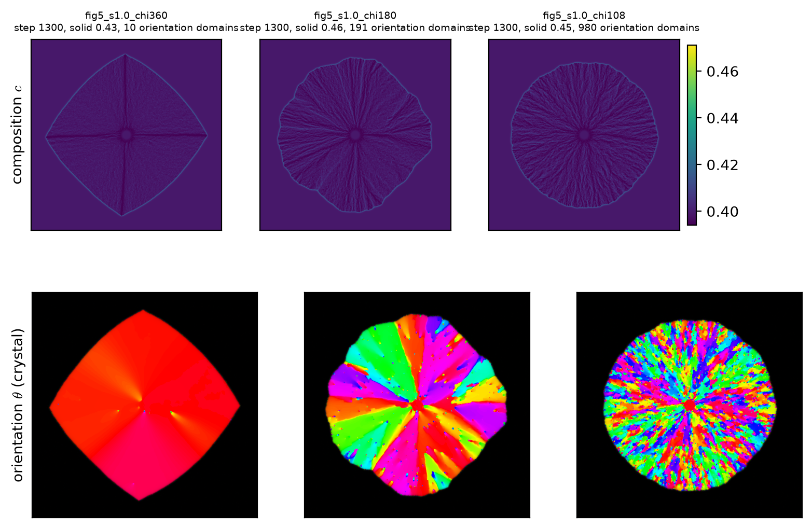
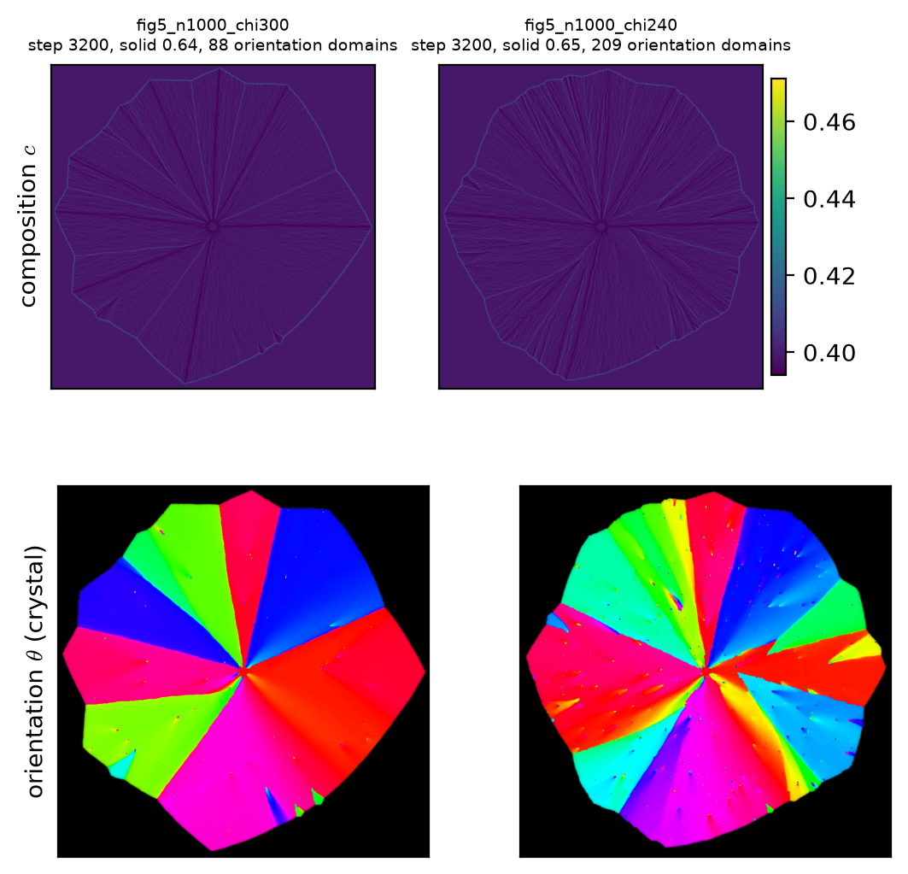

# 14. Part IV plan: phase-field crystallization benchmark

Started 2026-11-17. Guide papers: (granasy 2019 nucleation) (the review) and
(granasy 2005 spherulites). Aim: for every case of the two papers that PINNACLE can be made to
run, one standalone input deck, its expected outcome, the comparison with the published result,
and the report section with the mechanism. Route order per case: FE, then PINN+FEM, then PINN.
Every run keeps its field series; animations ship beside the figures (author, 2026-11-17).

This document is the plan and the capability record. Results go to
`docs/reports/phase_field_crystallization_pinnacle_benchmark_report.md`; reproduction steps to
`docs/reproduce_crystallization.md`.

## 1. Models of the two papers

| id | model | fields | source |
|---|---|---|---|
| M1 | single-field: F = int eps^2/2 \|grad phi\|^2 + w g(phi) + p(phi) Delta_f, Allen-Cahn dynamics, optional noise | phi | review Eq. 12-16 |
| M2 | M1 + wall: contact-angle boundary condition (Model I: n.grad phi = sqrt(2 Delta_f(phi))/eps cos(Psi); Model II: phi = const) | phi | review Eq. 17-19 |
| M3 | binary ideal solution (Warren-Boettinger): f = w(c) T g + p f_L + (1-p) f_S, conserved c | phi, c | review Eq. 20; spherulite paper Eq. 2.1-2.4 |
| M4 | M3 + orientation field: f_ori = H T [1-p(phi)] {x F0 + (1-x) F1}(xi0 \|grad theta\|), anisotropy s(vartheta, theta), noise | phi, c, theta | spherulite paper Eq. 2.1-2.6; review Eq. 27 |
| M5 | phase-field crystal (Swift-Hohenberg free energy, conserved dynamics) | psi | review Eq. 30, 36 |

## 2. Case matrix

Tier = accuracy tier of PROJECT_GUIDELINES §5 that the case can reach. "PINN" is the pure
network route; a case marked "no" has a structural reason given below the table.

| case | content | model | target | tier | FE | PINN+FEM | PINN |
|---|---|---|---|---|---|---|---|
| A1 | planar equilibrium interface: profile, gamma, 10-90 % width | M1 | closed form | 2 | yes | yes | yes |
| A2 | steady front velocity v = -6 M Delta_f delta (p = phi^2(3-2phi)); numerical v for the standard p | M1 | closed form | 2 | yes | yes | yes |
| A3 | critical nucleus in Ni: radial profiles, W*/kT, R* against undercooling | M1, spherical | review Fig. 3 (digitized), own shooting solution, CNT | 2, 3 | yes | yes | yes |
| A4 | effect of g and p on W* (standard, GL bcc, GL fcc) | M1, spherical | review Fig. 5, own shooting solution | 2, 3 | yes | - | - |
| A5 | sub- and supercritical seeds: a seed below R* melts, above it grows (the nucleus is the saddle) | M1, spherical, transient | A3 | 2 | yes | yes | yes |
| B1 | heterogeneous nucleus on a wall, Psi = 61.2 deg, Model I and II, W_het / W_cap against undercooling | M2, 2-D | review Fig. 6 | 2, 3 | yes | later | later |
| B2 | noise-induced nucleation and growth, transformed fraction, Avrami exponent p = 1 + d = 3 | M1 + noise, 2-D | JMAK theory; review Fig. 10 | 2 (statistical) | yes | no | no |
| C1 | orientational free energy f_ori against misorientation (k = 2, m = 3, n = 1/2, x = 0.2) | M4 material | spherulite Fig. 3 | 2, 3 | material check | - | - |
| C2 | single-crystal growth forms, isotropic and four-fold, S = 0.8 and 1.0 | M3 (+ M4 one grain) | spherulite Fig. 4 a, b, d, e | 3 (morphology), R(t) law | yes | no | no |
| C3 | polycrystalline dendrite and category 1 spherulite (reduced orientational mobility) | M4 | spherulite Fig. 4 c, f; Fig. 5 | 3 (morphology) | yes | no | no |
| C4 | needle to spherulite with supersaturation, 30 deg branching | M4, k = 2 | spherulite Fig. 6, 7 | 3 (morphology) | yes | no | no |
| C5 | transformation kinetics of impinging spherulites, p = 3.04 +/- 0.02 | M4 | spherulite Fig. 8 | 3 (statistical) | reduced size | no | no |
| C6 | heat-treatment sequences and the morphology gallery (Table II) | M4 | spherulite Fig. 9, 10 | 3 (morphology) | selected | no | no |
| D1 | PFC: phase diagram points, hexagonal nucleus | M5 | review Fig. 35, 37 | 3 | later | no | no |

Structural limits of the network routes:

- Noise-driven cases (B2, C2-C6). The published patterns are realizations of a stochastic
  equation: white noise is drawn per cell and per step. A network that maps (x, t) to the field
  has no random input and cannot represent one realization, and PINNACLE refuses
  `langevin_noise` on the PINN path by design. These cases are reported as FE-only, in the same
  way the coupled CP-PFD field solve is hybrid-only (PINNACLE ADR 0017).
- A4 repeats A3 with other functions; the network routes are shown on A3 only.

Sizes. The spherulite paper used an explicit finite-difference code on 500^2 to 5000^2 grids
(40 CPU-years in total). C2-C4 at 500^2 are within reach of an explicit scheme on one machine;
C5 (5000^2) and the 4000^2 run of Fig. 5 are reproduced at a reduced size with the statistics
stated.

## 3. PINNACLE capability against the cases (survey of 9548123, 2026-11-17)

Exists: `time_derivative + ac_bulk + ac_interface` on `pf_fem_transient` (bdf1, bdf2, convex
splitting; Newton with the exact block Jacobian), free-energy authoring (`parsed_free_energy`,
arithmetic of one variable), `langevin_noise`, `pf_contact_angle` (for phi in [-1, 1]),
`nucleation_inserter`, `feature_volume_fraction`, `pf_pinn` (strong / weak / energy forms, time
slabs, causal weights, hard transforms), split Cahn-Hilliard.

Gaps, in the order the cases need them:

| # | gap | needed by | kind |
|---|---|---|---|
| G1 | no field time series from `pf_fem_transient` (final `fields.vtk` only) | every case (animations) | output |
| G2 | no spherical or axisymmetric volume weight in the FE assembly or in `pf_pinn` | A3-A5 | new capability |
| G3 | `ac_bulk` on the PINN path accepts only three free-energy materials; a parsed (tilted) energy is refused | A1-A5 PINN | fix |
| G4 | `pinn_fem_hybrid` on an Allen-Cahn deck solves a steady Laplace problem (returned field is zero): no physical PINN+FEM route for phase-field | A1-A5 PINN+FEM | new capability |
| G5 | operator kernels (`time_derivative`, `ac_interface`, ...) assemble dense n x n matrices in a Python loop: about 2e4 nodes is the ceiling | B, C | performance |
| G6 | no steady nonlinear solve started from the IC (workaround: one backward-Euler step with dt = 1e10) | A1, A3, B1 | option |
| G7 | contact-angle BC only for phi in [-1, 1] and with a fixed (1 - phi^2) form; Models I and II for phi in [0, 1] | B1 | new BC form |
| G8 | noise amplitude has no dt or cell-volume scaling and cannot depend on phi | B2, C | extension |
| G9 | no free energy of two fields, no log terms, no field-dependent mobility: the binary model M3 | C | new kernels |
| G10 | no orientation field (theta, \|grad theta\|, anisotropy s(vartheta - theta)) | C | new kernels |
| G11 | no explicit scheme and no periodic boundaries in `pf_fem_transient` | C at 500^2 | new scheme |
| G12 | no sixth-order (PFC) operator | D | new kernels |

## 4. Stages

- Stage A (single-field model, cases A1-A5): gaps G1-G4, G6. FE, PINN+FEM and PINN on each.
- Stage B (walls and noise, B1-B2): gaps G5, G7, G8.
- Stage C (binary and orientation-field models, C1-C6): gaps G9-G11.
- Stage D (phase-field crystal): gap G12.

Each stage ends with its decks, figures, animations and report section, and with the PINNACLE
changes committed and pushed on `feat/pinn_benchmark` after their tests pass. A stage with a
parameter family (A3: nine undercoolings; C4: six supersaturations) runs one case first.

## 5. Reference solutions made independently of PINNACLE

`scripts/cryst_reference.py` (deck `decks/crystallization/reference/ni_nucleus_3d.i`): closed
forms of A1 and A2, and the shooting solution of the critical nucleus (A3, A4) in scaled
variables. Result (2026-11-17): with eps^2 and w proportional to T (gamma = gamma_eq T/T_f,
constant interface width) the standard model gives W*/kT = 99.2 / 67.7 / 47.9 / 34.8 / 25.8 /
19.5 at Delta T/T_f = 0.15 / 0.175 / 0.20 / 0.225 / 0.25 / 0.275. The 'standard PF' line of the
review's Fig. 3(c), digitized by `scripts/cryst_digitize_fig3c.py` (224 columns, half stroke
1.4 kT), reads 100.4 / 67.6 / 48.0 / 34.8 / 25.8 / 19.6: agreement within 1.1 % (tier 3 for the
reference). With eps^2 and w held at their melting-point values the barrier is 62 to 176 %
higher, so the published line uses the proportional scaling; the review does not say so for
the PF line (it does for the CNT line), and this is recorded as `derived`.

Model parameters of Ni (review Table 2, `reported_table`): gamma = 0.302 J/m^2 and
d_10-90 = 1 nm give eps^2 = 4.1234e-10 J/m, w = 1.59255e10 J/m^3, delta = 0.22756 nm;
H_f / v_m = 2.46182e9 J/m^3.

## 6. Status (2026-11-17)

Stage A: FE done for A1-A5; PINN and PINN+FEM done for A1 and A3 (0.20). Gaps closed in
PINNACLE `ddaeb91` (ADR 0037): G1, G2 (FE and stationary PINN; not `pf_pinn`), G3, G4 (stationary
states), G6 (kept as one bdf1 step with a large dt), and the conversion half of G5 (operators
stored sparse; their build is still dense). Open in stage A, awaiting the author: the network
routes over the undercooling family, the guess scan of the three routes, and the network
routes of the transient cases A2 and A5 (spherical term in `pf_pinn`, per-step predictor).

Update (afternoon): stage B done on the FE route (B1 Models I and II against the digitized
Fig. 6; B2 kinetics). Gaps closed in PINNACLE `cd2d3d3` (ADR 0038): G5 for `time_derivative`
and `ac_interface` (sparse build), G7 (`flux_form = young`, `wall_free_energy`), G8 (`scaling =
white`, `state_factor`); a new one found and closed: plain Newton cannot find wall saddles
(`pf_fem_saddle`). Stage A network family and guess scan done. Next: stage C (G9-G11).

## 7. Stage C design: the binary and orientation-field model (2026-11-17)

Convention of (granasy 2005 spherulites): **phi = 1 liquid, phi = 0 crystal**; A = Ni, B = Cu,
c = Cu fraction. Sources read in full text for the items below: PRL 88, 206105
(arXiv cond-mat/0204143), the spherulite paper (cond-mat/0412630), the handbook review
cond-mat/0703676 (Appendix A), EPL 71, 131 (cond-mat/0502594), Phil. Mag. 86, 3757. The 2004
J. Phys.: Condens. Matter review, the Nature Materials paper and Warren-Boettinger 1995 were
not available as free full text.

### 7.1 Dimensionless equations (lengths in xi = 2.1e-4 cm, time in xi^2/D_l)

    phi_t   = m_phi { div(s^2 grad phi) - d_x(s s' d_y phi) + d_y(s s' d_x phi)
                      - [ a_w(c) g'(phi) + p'(phi) ( b(c) - f_ori-term ) ] } + zeta_phi
    c_t     = div{ lambda(phi) [ grad c - c (1 - c) ( q_f p'(phi) + q_w g'(phi) ) grad phi ] } + div(zeta_c)
    theta_t = m_theta(phi) div{ [1 - p(phi)] ... (x F0' m + (1-x) F1' n) grad theta / |grad theta| } + zeta_theta

    g = phi^2 (1-phi)^2 / 4,  p = phi^3 (10 - 15 phi + 6 phi^2),  lambda = p(phi)  (D_s = 0)
    s = 1 + s0 cos[k (vartheta - 2 pi theta / k)],  vartheta = atan2(phi_y, phi_x)

The concentration equation follows from the ideal solution: the bracket of the paper's Eq. 2.4
is (v_m/R)(w_B - w_A) g + (v_m/RT) p (Delta f_B - Delta f_A) + ln[c/(1-c)], and
c (1-c) grad ln[c/(1-c)] = grad c.

### 7.2 Parameters

| quantity | value | provenance |
|---|---|---|
| T | 1574 K | reported_text |
| T_f, L, gamma (Ni; Cu) | 1728 K, 2350 J/cm^3, 315 mJ/m^2; 1358 K, 1728 J/cm^3, 247 mJ/m^2 | reported_table (Table I) |
| rescaling | interface thickness x 20.8, gamma / 6 | reported_text |
| delta (tanh parameter; d_10-90 = 6.21 delta) | 20.8 nm for both | derived (PRL02 footnotes 8, 9; "about 40 times" elsewhere in the paper is inconsistent with it) |
| eps^2 = 6 sqrt(2) gamma delta / T_f, w = 12 gamma / (sqrt(2) delta T_f) | 5.36e-12 J/(m K), 1.239e4 J/(m^3 K) (Ni), Cu within 0.2 % | derived |
| a_w = xi^2 w / eps^2 = (xi/delta)^2 | 1.0193e4 | derived |
| b(c) = xi^2 (f_L - f_S)/(eps^2 T) | (1-c) 1.0943e5 - c 1.4393e5 | derived, Delta f_i = L_i (T_i - T)/T_i (the ideal-solution form is not printed in any source read: `assumed` standard Warren-Boettinger) |
| v_m | 7.4 cm^3/mol | derived: the only value that returns c_L = 0.466219, c_S = 0.399112 to six digits |
| q_f = v_m (Delta f_Ni - Delta f_Cu)/(R T), q_w = v_m (w_Ni - w_Cu)/R | 0.27383, 2.5e-5 | derived |
| c_L, c_S; S = (c_L - c_inf)/(c_L - c_S) | 0.466219, 0.399112; 0.75 to 1.2 | reported_text |
| m_phi,0, m_theta,l, m_theta,s, D_s | 1.0, 360, 0, 0 | reported_text |
| xi_0 / xi | = dx | reported_text |
| dx, dt | 6.25e-3, 4.75e-6 (dt/dx^2 = 0.1216); theta needs about 1/50 of the step | reported_text |
| noise amplitudes (phi, c, theta) | 0.0025, 0.00125, 0.0375; zeta = zeta_s + (zeta_l - zeta_s) p(phi); Gaussian; flux noise for c | reported_text; zeta_s and whether the amplitude is per step or a rate: `unavailable` |
| H (orientational energy scale; enters as xi^2 H/(2 xi_0 eps^2) in the phi equation) | `unavailable` | to be `assumed` and tested by sensitivity |
| discretization of grad theta/|grad theta|, wrapping of theta | `unavailable` (pointer to Kobayashi-Giga 1999) | `assumed`: differences wrapped to [-1/2, 1/2], regularized modulus |
| seed of the single-crystal runs | "slightly supercritical fluctuation at the centre" | `assumed`: a disc of the solidus composition |

### 7.3 Order of work

1. Independent reference implementation (explicit finite differences, periodic, NumPy/Torch,
   outside PINNACLE): C2 first (single crystals, theta uniform), then C3-C4 with theta.
2. PINNACLE: an explicit lumped-mass executioner with periodic node maps (G11), the binary
   kernels (G9), the orientation kernels (G10); compared with the reference field by field on a
   small grid without noise (tier 2), then the published morphologies (tier 3, qualitative).
3. Cases C2 (Fig. 4 a, b, d, e), C3 (Fig. 4 c, f), C4 (Fig. 6, 7), reduced C5 (Fig. 8).

### 7.4 Status (2026-11-17, evening)

Done: the independent reference and PINNACLE for the binary model (C1 function, C2 four growth
forms); gaps G9 (binary kernels) and G11 (explicit scheme, periodic boundaries) closed in ADR
0039. Open: G10, the orientation field, with the assumptions of section 7.2 for H and for the
singular term; cases C3 to C6.

## 8. Additional sources, GPU estimate and the extended case list (2026-11-17, author's fourth message)

### 8.1 What the three supplied papers settle

Read as text (`pdftotext`, kept under `results/crystallization/lit/`, not shipped):
(granasy 2004 modelling) appendix A.2-A.3, the 2006 J. Mater. Res. review, and the 2021 JACS Au
paper on biomineralization.

| item of section 7.2 | finding |
|---|---|
| H (orientational energy scale) | NOT given numerically in any of the three. It enters the theta equation only through chi = M_theta xi H T / D_l (given: 360) and the phi equation through xi^2 H / (2 xi_0 eps^2). Stays `unavailable`: assumed, with a sensitivity run. |
| theta sub-step | "about 1/20 of the time step" (2004 review, A.2 remark ii); the spherulite paper says 1/50. Both are timed below. |
| singular term | not described beyond the equations of A.3 (F0~, F1~ with sign and cosine). `assumed` discretization as planned. |
| noise | "Gaussian noises of amplitude zeta = zeta_s + (zeta_l - zeta_s) p(phi) ... random concentration fluxes"; "Gaussian white noise" (2021). What the amplitude multiplies is not stated. |
| second term of the theta equation | omitted with a broad interface (A.2 remark i), as in the spherulite paper. |
| interface thickness | the 2021 paper's Table 5 gives delta = 4.15e-8 m with the same xi, dx, dt; PRL02 used 41.6 nm; the spherulite paper says "factor of 20.8" and also "about 40 times". UNRESOLVED: our C2 runs use 20.8 nm (10-90 % width 9.9 cells); 41.5 nm would give 19.7 cells. To be checked by a C2 run at 41.5 nm. |
| the 2021 model PF1 | the same binary + orientation model with f_ori = p H T |grad theta|; its Table 2 (Delta g_A = -0.1184, Delta g_B = 0.1554, T_r = 0.911, T_r,B = 0.786) is the Cu-Ni data of section 7.2 under other names; m_phi = 3.75, m_theta,M = 120. |

### 8.2 Measured step times on rocm-server (Radeon 8060S), `scripts/cryst_gpu_benchmark.py`

A Torch finite-difference step of the model (phi and c) and one theta sub-step, float64 on the
GPU: 0.0066 + 0.0027 s at 1000^2, 0.194 + 0.101 s at 4000^2 (float32: 0.0022 + 0.0011 and
0.093 + 0.050; CPU float64 at 4000^2: 1.39 + 0.89). Full table:
`results/crystallization/gpu_benchmark_rocm.txt`. This times the arithmetic of the model, not
PINNACLE: `pf_fem_explicit` has no Torch path yet (NumPy: about 1.5 s per step for two fields at
1000^2), and the bilinear-element residual needs more operations than the stencil.

Estimates from those times (GPU, float64, 20 / 50 theta sub-steps per step):

| case | grid, steps | estimate |
|---|---|---|
| Fig. 5 of the spherulite paper | 4000^2, 13,500 (stated) | 8 h / 20 h |
| the same at 1000^2 | 1000^2, 13,500 | 14 min / 32 min |
| Fig. 8 (kinetics) | 5000^2, about 16,300 (10,000 pre-heat + t = 0.03) | 16 h / 37 h |
| the same at 1000^2 | 1000^2, 16,300 | 17 min / 39 min |
| Fig. 10 gallery (Table II: N = 500 to 3000; steps not stated, assumed 4 N) | ten runs | 500: 1 min; 1000: 4-10 min; 2000: 1.2-3 h; 3000: 4-10 h; all ten about 10-25 h |
| 2021 paper, Fig. 9, 16, 17 | 1000 x 2000, 2.4e5 to 5e5 (stated) | 8-17 h / 19-40 h each |

If the PINNACLE Torch residual is five times slower than the stencil (to be measured once
written), every entry is five times longer: the 4000^2 and 5000^2 cases are then 2 to 8 days,
the 1000^2 versions one to three hours.

Measured afterwards (2026-11-17, PINNACLE ef9a7cd, `pf_fem_explicit` on the GPU, float64, three
fields, 20 theta sub-steps): 0.24 to 0.31 s per step at 500^2 (405 to 553 s per Fig. 4 case
with output), against 0.04 to 0.05 s per step for the reference at the same size and 0.12 s
at 1000^2. PINNACLE is about six times slower than the stencil. Scaled with the number of
elements (not yet measured above 500^2; the memory of the element-wise arrays at 4000^2 is
not measured either):

| case | PINNACLE estimate | reference estimate |
|---|---|---|
| 1000^2, 3,200 steps (Fig. 5 conditions up to the box size) | about 1 h | 7 min (measured) |
| Fig. 8 at 1000^2, 16,300 steps | about 5 h | 35 min |
| Fig. 5 at 4000^2, 13,500 steps | about 2.5 to 3 days | 7 to 8 h |
| Fig. 8 at 5000^2, 16,300 steps | about 5 days | 13 to 14 h |

The large cases are within days on the reference and at the edge of it on PINNACLE; they are
run only after the 1000^2 versions are reviewed.

### 8.3 Cases added from the two additional papers

| id | case | source | model | needs |
|---|---|---|---|---|
| E1 | band formation: from diffusionless growth to partitioning with decreasing driving force | 2021 Fig. 8(a) | binary model (existing kernels) | a planar-front deck with a supersaturation ramp |
| E2 | mollusk shell: granular, columnar prismatic and sheet-nacre domains along a composition gradient c(x) = c_min + (c_max - c_min)(1 - exp(-9x/L)), nucleation on the periostracum | 2021 Fig. 9 | binary + orientation (f_ori = p H T |grad theta|) | orientation field, GPU path; 1000 x 2000 |
| E3 | coral skeleton (plumose spherulite with "sprinkles") and its temperature series | 2021 Fig. 16, 17 | as E2 | as E2 |
| E4 | dendrite-to-seaweed transition by reduced orientational mobility or by orientation-pinning particles; "dizzy" dendrites | 2006 Fig. 5, 6 (also spherulite Fig. 11) | binary + orientation + pinning centers | orientation field |
| E5 | heterogeneous nucleation on rough walls, in porous matter, orientation selector (2-D) | 2006 Fig. 3 | single-field or binary with walls | wall geometry inside the domain |

Not taken (other models than the ones this part builds): the regular-solution eutectic model
PF2 (2021 Fig. 10), the 3-D ternary model PF3 (Fig. 12-15), the hard-sphere density-coupled
barrier (2006 Fig. 2), 3-D cases with quaternion orientation (2006 Fig. 4, 8).

### 8.4 Order of work from here

1. Orientation-field kernels in PINNACLE (model C of the 2004 appendix; model B as its x = 0,
   single-minimum limit), with the assumed H and discretization, checked against an extended
   independent reference.
2. Torch (GPU) residual path of `pf_fem_explicit`; measure it on rocm-server.
3. Runs on rocm-server: 500^2 cases (Fig. 4 c/f, 6, 7), then Fig. 5 and Fig. 8 at 1000^2, the
   Fig. 10 gallery, E1-E4; 4000^2 / 5000^2 only if step 2 puts them within days.

### 8.5 Conditions for Fig. 5 (2026-11-17)

The paper gives the grid (4000^2), the snapshot steps (1000, 2500, 5000, 13,500) and the
picture, but neither S nor chi_l. S = 1.0 is `derived`: a crystal that fills 4000 cells in
13,500 steps grows 0.15 cells per step, the speed measured at S = 1.0 (0.14 to 0.16); at
S = 0.8 it is 0.05. chi_l is `assumed` from reference runs (h = 1900, s0 = 0.1):

| chi_l | grid, steps | result |
|---|---|---|
| 360 | 500^2, 1300 | square single crystal (10 orientation domains, all near the seed) |
| 300 | 1000^2, 3200 | faceted crystal of about ten sectors that start at the seed |
| 240 | 1000^2, 3200 | sectors from the seed plus wedge-shaped grains that start at the growth front; envelope rounding |
| 180 | 500^2, 1300 | radially elongated grains, rounded envelope |
| 108 | 500^2, 1300 | fine-grained spherulite |

chi_l = 240 is taken for the Fig. 5 decks (`c3_fig5_s1.0_chi240_n1000`). Difference from the
paper to keep in view: there the crystal is a single square until a critical size and the
grains appear later; here sectors already start at the seed for chi_l <= 300, which depends
on the seed (12 cells, random orientation around it) and on the assumed h and noise.

