# Crystal-plasticity finite-element calibration of Al2219 on a phase-field-grown polycrystal plate with PINNACLE

Technical report, draft of 2026-10-12. Status: methodology, numerical method,
calibration and mesh sensitivity; abstract, introduction and the later
stages are held until the author decides what enters the report. Every number here traces to a run in
`docs/run_ledger.md` and to a deck under `decks/`. Figures are produced by
`scripts/report_figures.py` from `decks/report/cp_calibration_figures.i`.

## Abstract

*(to be written after all studies are complete)*

## 1. Introduction

*(to be written after all studies are complete)*

## 2. Crystal-plasticity finite-element methodology

### 2.1 Kinematics

The deformation gradient at each material point is split multiplicatively into
an elastic and a plastic part,

$$
\mathbf{F} = \mathbf{F}^e \mathbf{F}^p , \qquad
\mathbf{L}^p = \dot{\mathbf{F}}^p \mathbf{F}^{p-1} = \sum_{\alpha=1}^{12} \dot{\gamma}^\alpha \, \mathbf{s}^\alpha \otimes \mathbf{n}^\alpha ,
\tag{1}
$$

where $\mathbf{s}^\alpha$ and $\mathbf{n}^\alpha$ are the slip direction and
slip-plane normal of system $\alpha$ in the sample frame and
$\dot{\gamma}^\alpha$ its slip rate. The twelve $\{111\}\langle 110\rangle$
systems of the FCC lattice are used. The crystal frame of each grain is set by
a Bunge triple $(\varphi_1, \Phi, \varphi_2)$, which rotates both the slip
systems and the elastic stiffness.

### 2.2 Elasticity

The elastic response is cubic and hyperelastic in the Green-Lagrange strain of
the elastic part,

$$
\mathbf{E}^e = \tfrac{1}{2}\left(\mathbf{F}^{eT}\mathbf{F}^e - \mathbf{I}\right), \qquad
\mathbf{S} = \mathbb{C} : \mathbf{E}^e , \qquad
\boldsymbol{\sigma} = \frac{1}{\det \mathbf{F}^e}\, \mathbf{F}^e \mathbf{S} \mathbf{F}^{eT} ,
\tag{2}
$$

with $\mathbb{C}$ the cubic stiffness ($C_{11}$, $C_{12}$, $C_{44}$) rotated
into the sample frame, $\mathbf{S}$ the second Piola-Kirchhoff stress and
$\boldsymbol{\sigma}$ the Cauchy stress. The resolved shear stress on system
$\alpha$ is

$$
\tau^\alpha = \mathbf{S} : \mathbf{M}^\alpha , \qquad
\mathbf{M}^\alpha = \tfrac{1}{2}\left(\mathbf{s}^\alpha \otimes \mathbf{n}^\alpha + \mathbf{n}^\alpha \otimes \mathbf{s}^\alpha\right).
\tag{3}
$$

### 2.3 Flow rule

Slip follows a rate-dependent power law (Hutchinson form),

$$
\dot{\gamma}^\alpha = \dot{\gamma}_0 \left| \frac{\tau^\alpha}{\tau_c^\alpha} \right|^{n} \operatorname{sign}(\tau^\alpha), \qquad n = 1/m ,
\tag{4}
$$

with reference slip rate $\dot{\gamma}_0$, rate exponent $n$ and the rate
sensitivity $m$ of the source papers (Rezwan 2025 intragranular). No kinematic
backstress is used.

### 2.4 Slip resistance and dislocation-density evolution

The slip resistance is a Taylor relation on the forest density, with the
latent-hardened interaction sum,

$$
\tau_c^\alpha = \tau_{c0} + \alpha_0\, \mu\, b \sqrt{\sum_{\beta=1}^{12} a^{\alpha\beta} \rho^\beta}, \qquad
a^{\alpha\beta} = \begin{cases} 1 & \alpha = \beta \\ q & \alpha \ne \beta \end{cases}
\tag{5}
$$

where $\rho^\beta$ is the statistically stored dislocation density of system
$\beta$, $\mu$ the shear modulus, $b$ the Burgers vector, $\alpha_0$ the
Taylor prefactor, $q$ the latent-to-self hardening ratio and $\tau_{c0}$ a
rate- and density-independent lattice friction. With all twelve densities
equal, the interaction sum multiplies the density by $1 + 11q = 16.4$ and
$\tau_c - \tau_{c0}$ by $\sqrt{16.4} = 4.05$ relative to the self term alone;
the calibrated parameters of §4 are therefore specific to this convention.

Each density evolves by a Kocks-Mecking storage-recovery law written per
system,

$$
\dot{\rho}^\alpha = \frac{1}{b}\left( k_1 \sqrt{\rho^\alpha} - 2 y_c\, \rho^\alpha \right) \left| \dot{\gamma}^\alpha \right| ,
\qquad \rho^\alpha(0) = \rho_0 ,
\tag{6}
$$

with the storage coefficient $k_1$ (the papers' $k_m$) and the annihilation
distance $y_c$. The law saturates at

$$
\rho_{sat} = \left( \frac{k_1}{2 y_c} \right)^2 , \qquad
\tau_{c,sat} = \tau_{c0} + \alpha_0 \mu b \sqrt{(1 + 11 q)\, \rho_{sat}} ,
\tag{7}
$$

so $k_1$ sets the hardening rate after yield and, together with $y_c$, the
height of the plateau; $\rho_0$ sets the initial resistance through Eq. (5);
$\tau_{c0}$ is a uniform offset. §4.4 quantifies each of these on the plate.

No geometrically necessary densities, grain-boundary slip transmission rules
or damage are active in the runs of this report: the plate is the undamaged
crystal-plasticity baseline that the later phase-field damage study builds
on.

### 2.5 Material parameters

Table 1 lists every parameter of Eqs. (1)-(7), its value in the runs of §4,
its provenance tag (PROJECT_GUIDELINES §4) and its role in the study. Units
are micrometer, megapascal and second throughout.

**Table 1.** Crystal-plasticity parameters for Al2219.

| symbol | meaning | value | unit | provenance | role |
|---|---|---|---|---|---|
| $C_{11}$ | cubic stiffness | 108.0 | GPa | reported_table (Rezwan 2025 intragranular, Table 1) | fixed |
| $C_{12}$ | cubic stiffness | 61.3 | GPa | reported_table | fixed |
| $C_{44}$ | cubic stiffness | 28.5 | GPa | reported_table | fixed |
| $\mu$ | shear modulus in Eq. (5) | 25.7 | GPa | reported_table | fixed |
| $b$ | Burgers vector | 0.286 | nm | reported_table | fixed |
| $q$ | latent-hardening ratio | 1.4 | - | reported_table | fixed |
| $\alpha_0$ | Taylor prefactor | 0.4 | - | reported_table | fixed |
| $\dot{\gamma}_0$ | reference slip rate | $10^{-5}$ | s$^{-1}$ | reported_table | fixed |
| $m$ ($n = 1/m$) | rate sensitivity | 0.12 (8.333) | - | reported_table | fixed |
| $\rho_0$ | initial SSD density per system | 47.99 | $\mu$m$^{-2}$ | calibrated (§4) | free |
| $k_1$ | storage coefficient | 0.1988 | - | calibrated (§4) | free |
| $y_c$ | annihilation distance | 0.00344 | $\mu$m | calibrated (§4) | free |
| $\tau_{c0}$ | lattice friction | 5.29 | MPa | calibrated (§4) | free |
| $\dot{\varepsilon}$ | applied strain rate | $10^{-3}$ | s$^{-1}$ | assumed (not reported with the test) | fixed |

The fixed set is the author's decision: elastic constants, $b$, $\mu$, $q$
and $\alpha_0$ are material constants; $\dot{\gamma}_0$ and $m$ are held and
reserved by the author for convergence questions only. The
four free parameters are fit in the order $\rho_0$, $k_1$, $y_c$, $\tau_{c0}$.

Derived quantities of the calibrated set (Eqs. 5 and 7): initial slip
resistance $\tau_c(\rho_0) = 87.8$ MPa, saturation density
$\rho_{sat} = 836\ \mu$m$^{-2}$, saturation resistance $\tau_{c,sat} = 350$
MPa. With a Taylor factor near 3 the initial resistance corresponds to about
260 MPa of rate-independent yield; the rate term of Eq. (4) at the applied
rate raises it to the 364 MPa 0.2%-offset yield of §4.3. The hardening rate
of the calibrated plate is still 0.33 GPa at 20% strain (§4.3), so the
densities are well below $\rho_{sat}$ at the end of the test, as the
experiment's unsaturated curve requires.

### 2.6 Polycrystal plate model

**Geometry and mesh.** A pseudo-three-dimensional plate of 100 x 50 x 1
$\mu$m is meshed with one HEX8 element through the thickness; the mesh level
hN has N elements along the 100 $\mu$m length and N/2 along the width. The
results of §4 are at h40 (40 x 20 x 1 elements, 2.5 $\mu$m elements, 800
elements, 1,722 nodes, 5,166 displacement degrees of freedom, 6,400
quadrature points). The pseudo-3D plate has one element through its thickness
and free top and back faces, so it deforms in generalized plane stress.

**Grain structure.** Thirty grains are generated by phase-field grain growth
of a 32-seed Voronoi tessellation of the plate's in-plane extent: the Moelans
multi-order-parameter Allen-Cahn model (eight order parameters, grain-boundary
width 1.485 $\mu$m, grid 203 x 102) is integrated for 2.5 interface relaxation
times, which equilibrates the triple junctions and consumes the two smallest
grains. The grain map is shown in Fig. 1. Grain areas range from 21 to 448
$\mu$m$^2$ (mean 169 $\mu$m$^2$); the equivalent diameter is 13.7 $\mu$m on
average and in the median (range 5.2 to 23.9 $\mu$m), so a 2.5 $\mu$m element
puts about 5.5 elements across a grain.

**Orientations.** One Bunge triple per grain, drawn uniformly on SO(3) from a
recorded seed (20261009), so the plate is untextured. The orientation reaches
every quadrature point of a grain through a point file read by the deck
(PINNACLE `[OrientationField]`, §3.5). The same structure and the same thirty
orientations are used by every run of this report; only the four free
parameters change.

**Boundary conditions and loading.** $u_x = 0$ on the $x = 0$ face, $u_y = 0$
on the $y = 0$ face, $u_z = 0$ on the $z = 0$ face; the $x = 100$ $\mu$m face
is displaced along $+x$ by a linear ramp to 20 $\mu$m (20% nominal strain) in
200 s, i.e. $\dot{\varepsilon} = 10^{-3}$ s$^{-1}$. All other faces are
traction-free, so the plate contracts laterally and through the thickness.

**Figure 1.** The 30-grain plate used by every run, colored by grain, with the
loading axis.

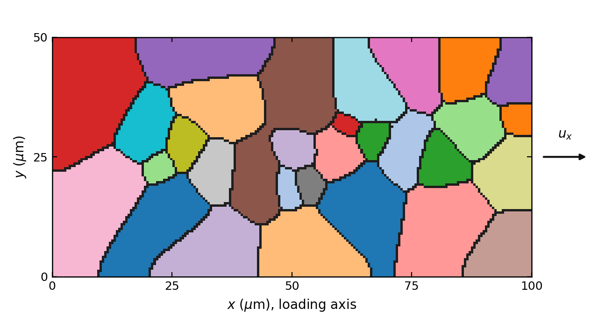

**Stress and strain measures.** The reported strain is the nominal strain
$\varepsilon = u_x(100\ \mu\text{m}) / 100\ \mu$m. The reported stress is the
engineering axial stress, i.e. the quadrature-point mean of the Cauchy stress
$\bar{\sigma}_{xx}$ converted to force over the original cross-section with the
mean transverse stretches,

$$
\sigma = \bar{\sigma}_{xx} \left(1 + \bar{H}_{yy}\right)\left(1 + \bar{H}_{zz}\right),
\tag{8}
$$

where $\bar{H}$ is the mean displacement gradient. Engineering stress is used
on both sides of every comparison because the experimental curve is a tensile
test record. At 20% strain the two transverse stretches are each about 0.91,
so the engineering stress is 16% below the mean Cauchy stress there.

**Reference data.** The ground truth is the Al2219 tensile curve of Vaughan
(2024 mechanistic) as plotted in Fig. 3 of Rezwan (2025 intragranular), from
which the nine experimental markers were digitized at the figure's native 300
DPI (extraction uncertainty $\pm 0.03$% strain, $\pm 1.5$ MPa; method in
`docs/digitization_uncertainty.md`). The marker at the origin is the initial
condition; the other eight, from 0.14% to 17.0% strain, are the calibration
targets.

## 3. Numerical method (PINNACLE)

All runs use PINNACLE (branch `feat/pinn_benchmark`, revision 47a41e0),
numpy backend, double precision, one CPU core per run. A run is fully
described by one input deck (`cpfe.i`) plus the orientation point file; the
deck is generated from a pipeline deck by `scripts/polycrystal_plate.py`, and
the study decks that set the parameters are under `decks/cp_study/`.

### 3.1 Finite-element discretization

Trilinear HEX8 elements with 2 x 2 x 2 Gauss quadrature carry the displacement
field. The finite-strain problem is posed on the displacement gradient
$\mathbf{H} = \nabla \mathbf{u}$ at each quadrature point, from which
$\mathbf{F} = \mathbf{I} + \mathbf{H}$; the material returns the Cauchy stress
of Eq. (2) and the assembler forms the residual of the balance of linear
momentum (`stress_divergence_cp` kernel, finite-strain mode) with Dirichlet
conditions imposed on node sets. Orientations are supplied per element and
broadcast to its quadrature points.

### 3.2 Load stepping

The quasi-static load program (`cp_quasi_static` executioner) divides the 200
s ramp into 256 equal steps of $\Delta t = 0.78$ s, i.e. $7.8 \times 10^{-4}$
nominal strain per step, below the framework's $8 \times 10^{-4}$ per-step
strain-increment limit for the explicit constitutive update. A step that
fails to converge is halved and retried up to ten times (none was needed in
the runs of §4 and §5: 256 of 256 steps converged with zero cutbacks on
every case). Every run records the field series every four load steps
(every 0.3125% strain): displacement, Cauchy stress, strain, equivalent
plastic strain, slip activity and mean dislocation density per element.

### 3.3 Newton solve and tangent

Each load step is solved by Newton's method on the displacement vector to an
absolute residual norm of $10^{-3}$ MPa $\mu$m$^2$ over the free degrees of
freedom, about $3 \times 10^{-7}$ of the nodal force scale at h40, with no
relative criterion, so that every step of every route of this study
(FE, hybrid, PINN) is held to the same test whatever its starting point
(at most 50 iterations; the calibrated run used 5.9 on average, 8 at most). The algorithmic tangent
$\partial \boldsymbol{\sigma} / \partial \mathbf{H}$ is formed at every
quadrature point by one-sided finite differences of the constitutive response
at the frozen state (perturbation $10^{-7}$, ten batched evaluations per
tangent) and assembled sparse. The linear systems are solved with a sparse LU
factorization (`linear_method = direct`): the finite-strain crystal-plasticity
tangent is non-symmetric and loses positive definiteness as slip localizes,
so an iterative solver has to be a non-symmetric one (GMRES with ILU
preconditioning is available for larger meshes); at the sizes used here the
direct solve is cheap.

### 3.4 Constitutive integration

Within a converged step the state $\{\mathbf{F}^p, \rho^\alpha\}$ at each
quadrature point is advanced by explicit forward Euler with adaptive
sub-stepping: the sub-increment is chosen so that the largest slip increment
on the point obeys $\max_\alpha |\dot{\gamma}^\alpha| \, \delta t \le 10^{-3}$,
with a budget of $10^5$ sub-steps per load step. The plastic deformation
gradient is updated as $\mathbf{F}^p_{n+1} = (\mathbf{I} + \delta t\,
\mathbf{L}^p)\, \mathbf{F}^p_n$ and the densities by Eq. (6), clipped at zero.
The slip rates of Eq. (4) are evaluated at the step's converged stress with
the state frozen (the trial stress inside Newton does not advance the state),
which is what makes the per-step strain limit of §3.2 necessary. Every
quadrature point that is still active is advanced in one batched call, so the
cost is independent of the number of grains.

### 3.5 Orientation field

The deck block `[OrientationField] source = point_file` reads a CSV of
$(x, y, z, \varphi_1, \Phi, \varphi_2, \text{grain})$ rows, one per node of
the grain-growth grid, and assigns each element the orientation of the
nearest point (ADR 0026 in PINNACLE). The crystal block's own Euler angles are
a fallback that is never reached when the field covers the mesh; the log line
"[OrientationField] ... resolved on 800 elements, coverage 1.0" is the check
that it did.

### 3.6 Grain growth numerics

The grain structure of §2.6 is produced by PINNACLE's phase-field module
(`gb_evolution` material with `ac_bulk` and `ac_interface` kernels,
`pf_fem_transient` executioner) on a 203 x 102 bilinear grid with
$M_{GB} = 1$, $\sigma_{GB} = 1$, $w_{GB} = 1.485\ \mu$m and $\gamma = 1.5$ in
the Moelans free energy. Time integration is fully implicit backward Euler
(`bdf1`) at $\Delta t = 0.5 / (L \mu)$ with $1/(L\mu) = w_{GB}^2 / (8
M_{GB} \sigma_{GB})$ the bulk relaxation time, 40 steps, Newton to $10^{-8}$,
natural boundary conditions. Grains are labeled on the final field by the
argmax order parameter and connected components, specks under four cells are
dropped, and diffuse-boundary nodes are assigned to the nearest labeled node.

### 3.7 Homogenized output

The executioner records, for every accepted load step, the time and the
quadrature-point means of the Cauchy stress and of the displacement gradient.
Eq. (8) is applied to these means. Field output (displacement, stress, strain,
equivalent plastic strain, slip activity and mean density per element) is
written at the end of the run.

### 3.8 Reproducibility

Each run is reproducible from its generated deck and point file; the pipeline
deck records the growth run, labeling thresholds, orientation seed, mesh,
loading and every material value. The commands are in
`docs/reproduce_polycrystal_plate.md`; the run ledger `docs/run_ledger.md`
gives the deck, scripts, framework revision, host, cores and wall time of
every run cited here. A calibrated-set run at h40 takes about 14 min of one
core (3.3 s per load step, of which the Newton solves are 838 s).

## 4. Results: parameter calibration

### 4.1 Objective

The free parameters are those that minimize the root-mean-square deviation
between the engineering stress of the plate, interpolated at the eight
experimental marker strains, and the marker stresses, in this framework and
at this mesh. Neither the published parameter table nor any re-expression of
it is a target: with the interaction sum of Eq. (5) and the rate law of Eq.
(4), the published numbers do not reproduce the curve in this framework, and
the calibrated values are reported as such (provenance `calibrated`).

The parameters were bounded a priori from the features of the experimental
curve: $\rho_0 \in [20, 80]\ \mu$m$^{-2}$, $k_1 \in [0.02, 0.30]$,
$y_c \in [0.001, 0.006]\ \mu$m, $\tau_{c0} \in [0, 50]$ MPa.

### 4.2 Procedure

1. A Taylor (isostrain) material-point aggregate of thirty random grains was
   used as a surrogate to locate a starting point inside the bounds
   (`scripts/taylor_surrogate.py`, deck `decks/cp_study/taylor_screen.i`).
2. At the FE level, each iteration ran the center and one multiplicative
   perturbation per parameter ($\rho_0$, $k_1$, $y_c$ x 1.2; $\tau_{c0}$ x
   1.5) as five concurrent plate runs to 20% strain (`decks/cp_study/cal_gn*.i`,
   driver `scripts/cp_parameter_study.py`). The finite-difference Jacobian
   $\partial \sigma_i / \partial \ln p_j$ at the marker strains gave a
   bounded Levenberg-Marquardt step in log parameters
   (`scripts/cp_gauss_newton.py`).
3. The iteration stopped when the predicted step moved no parameter by more
   than a few percent and predicted no gain in the objective. Two FE
   iterations were needed: the first center (RMSE 48.2 MPa) stepped to the
   final set with a predicted 14.2 MPa; the second center measured 14.4 MPa
   and its own step (1.1% on $\rho_0$, 1.4% on $k_1$, 0.6% on $y_c$, 5% on
   $\tau_{c0}$) predicted 14.2 MPa.

### 4.3 Calibrated parameter set

**Table 2.** Calibrated set at mesh h40 (deck `decks/cp_study/cal_center2.i`,
run `results/cp_study/cal/gn2/base`), with the linearized one-standard-
deviation uncertainty from the residual beyond 0.5% strain and the FE
Jacobian.

| parameter | value | unit | relative 1$\sigma$ |
|---|---|---|---|
| $\rho_0$ | 47.99 | $\mu$m$^{-2}$ | $\pm 57$% |
| $k_1$ | 0.1988 | - | $\pm 11$% |
| $y_c$ | 0.00344 | $\mu$m | $\pm 20$% |
| $\tau_{c0}$ | 5.29 | MPa | $\pm 358$% |

The uncertainties say how tightly eight markers pin each value, not how far
the curve would move: $k_1$ is the best-determined parameter because it
controls the whole hardening branch; $\tau_{c0}$ is nearly free because its
effect (a uniform 25 MPa offset per e-fold) is interchangeable with a small
change of $\rho_0$ at the yield point.

**Figure 2.** Calibrated plate against the experimental markers.

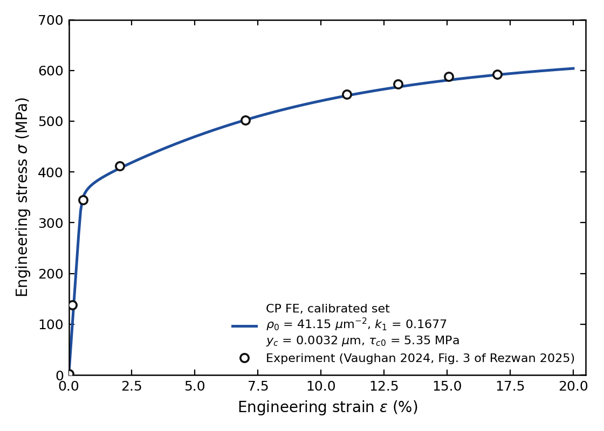

Characteristics of the calibrated curve: elastic modulus 71.2 GPa (the
untextured aluminum polycrystal value), 0.2%-offset yield stress 364 MPa,
engineering stress 404 / 503 / 592 / 603 MPa at 2 / 7 / 17 / 20% strain, and
a hardening rate $d\sigma/d\varepsilon$ falling from 2.4 GPa at 2% to 0.46
GPa at 17% and 0.33 GPa at 20%.

### 4.4 Error analysis

**Table 3.** Calibrated plate at the experimental markers (engineering
stress).

| strain (%) | experiment (MPa) | FE (MPa) | difference (MPa) | relative error |
|---|---|---|---|---|
| 0.14 | 137.7 | 99.1 | -38.6 | -28.0% |
| 0.57 | 344.9 | 351.3 | +6.4 | +1.9% |
| 2.02 | 411.9 | 404.3 | -7.5 | -1.8% |
| 7.01 | 502.5 | 502.9 | +0.5 | +0.1% |
| 11.02 | 552.5 | 551.2 | -1.3 | -0.2% |
| 13.05 | 573.6 | 568.1 | -5.5 | -1.0% |
| 15.06 | 588.3 | 581.3 | -7.0 | -1.2% |
| 16.98 | 592.6 | 591.4 | -1.2 | -0.2% |

Root-mean-square deviation over the eight markers: 14.4 MPa; over the seven
markers from 0.5% strain: 5.1 MPa, with a largest deviation of 7.5 MPa (1.8%).
From 0.5% strain the plate reproduces the experimental curve within the
digitization uncertainty budget plus a few MPa; the error is of uniform sign
and small on the plastic branch, so the shape of the curve (yield, hardening
rate, approach to the plateau) is captured, not only its level. This is a
tier-4 agreement (PROJECT_GUIDELINES §5: agreement with experiment).

The one miss is the 0.14% marker, 28% below the experiment. That marker lies
on the digitized record's initial slope of about 99 GPa, whereas the
untextured plate's modulus is 71 GPa and aluminum's polycrystal modulus is
about 70 GPa. The elastic constants are fixed and no parameter of Eqs. (4)-(6)
acts below yield, so the point reflects the test record or its digitization
rather than the calibration, and it is retained in the objective rather than
removed.

**Figure 3.** Deviation of the calibrated plate from the experimental markers.

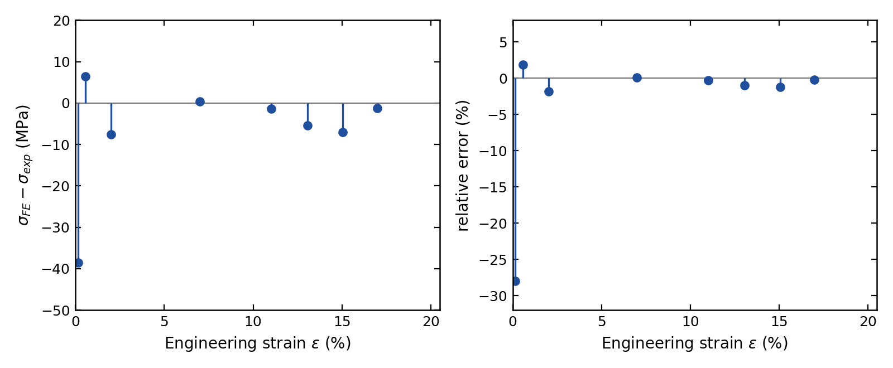

### 4.5 Effect of each parameter

Each parameter was perturbed one at a time from the calibrated set while the
others were held (Table 4, Fig. 4). The Jacobian of the final iteration is the same
information as a sensitivity $\partial \sigma / \partial \ln p$, i.e. the
stress change per e-fold change of the parameter, along the curve (Fig. 6).

**Table 4.** One-at-a-time perturbations of the calibrated set at h40
(`decks/cp_study/cal_gn2.i`): engineering stress at the marker strains and
the sensitivity $\partial\sigma/\partial\ln p$.

| case | 0.57% | 2% | 7% | 11% | 17% | RMSE (MPa) | $\partial\sigma/\partial\ln p$ at 2 / 7 / 17% (MPa) |
|---|---|---|---|---|---|---|---|
| calibrated | 352 | 404 | 503 | 551 | 591 | 14.4 | |
| $\rho_0$ x 1.2 = 57.58 $\mu$m$^{-2}$ | 372 | 433 | 526 | 571 | 608 | 22.6 | 160 / 127 / 92 |
| $k_1$ x 1.2 = 0.2386 | 352 | 413 | 546 | 612 | 668 | 50.9 | 52 / 238 / 418 |
| $y_c$ x 1.2 = 0.00413 $\mu$m | 352 | 401 | 484 | 520 | 547 | 33.6 | -15 / -103 / -241 |
| $\tau_{c0}$ x 1.5 = 7.94 MPa | 359 | 414 | 513 | 561 | 601 | 15.7 | 25 / 25 / 24 |

What each parameter does to the curve, in this framework and with this law:

- **$\rho_0$ sets the yield level.** Raising the initial density raises
  $\tau_c$ through Eq. (5) from the first slip onward, so the whole curve
  moves up, most at yield (160 MPa per e-fold at 2%) and less with strain (92
  MPa at 17%) as the stored density overtakes the initial one. It is the
  parameter that places the knee of the curve.
- **$k_1$ sets the hardening rate.** Its effect is near zero at yield (52 MPa
  per e-fold at 2%) and grows monotonically with strain (418 MPa at 17%): a
  larger storage coefficient makes the curve climb faster after yield and
  raises the plateau through Eq. (7). It is the parameter that sets the slope
  of the plastic branch.
- **$y_c$ sets the saturation.** Recovery is negligible at low density and
  grows with it, so a larger $y_c$ lowers the late curve (-241 MPa per e-fold
  at 17%) and leaves yield unchanged. It bends the curve toward its plateau
  and, with $k_1$, fixes the plateau height.
- **$\tau_{c0}$ is a uniform offset.** It shifts the curve by about 25 MPa per
  e-fold at every strain, because it adds to $\tau_c$ independently of the
  density. On this curve it is nearly interchangeable with a small change of
  $\rho_0$, which is why it is the least-determined parameter in Table 2.

The order of the calibration ($\rho_0$, then $k_1$, then $y_c$, then
$\tau_{c0}$) follows from these shapes: level first, slope second, curvature
third, offset last.

**Figure 4.** One parameter perturbed at a time from the calibrated set (left
to right, top to bottom: $\rho_0$, $k_1$, $y_c$, $\tau_{c0}$).

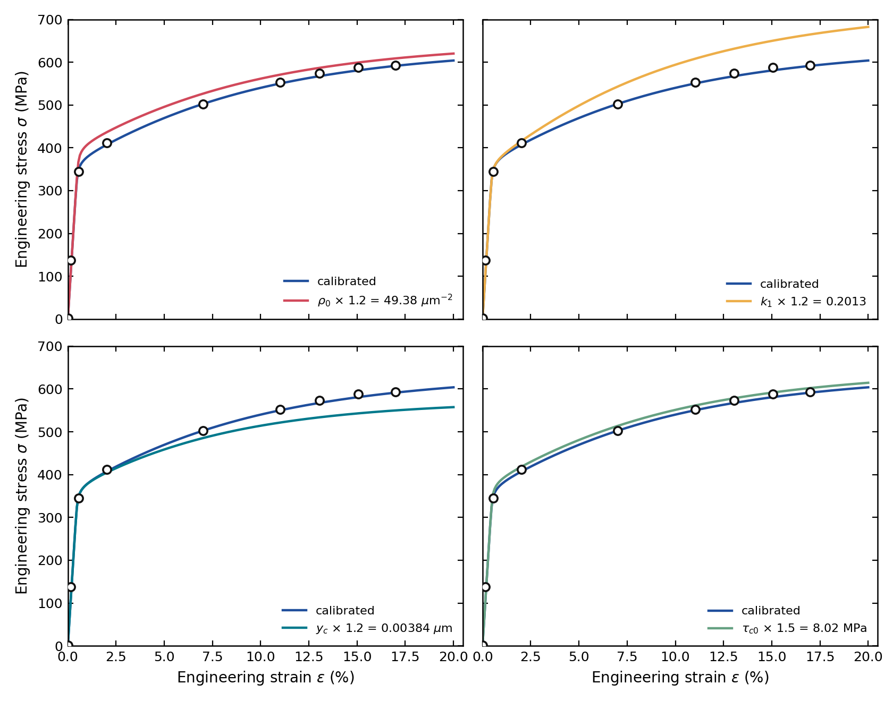

**Figure 5.** All four perturbations on one axis.

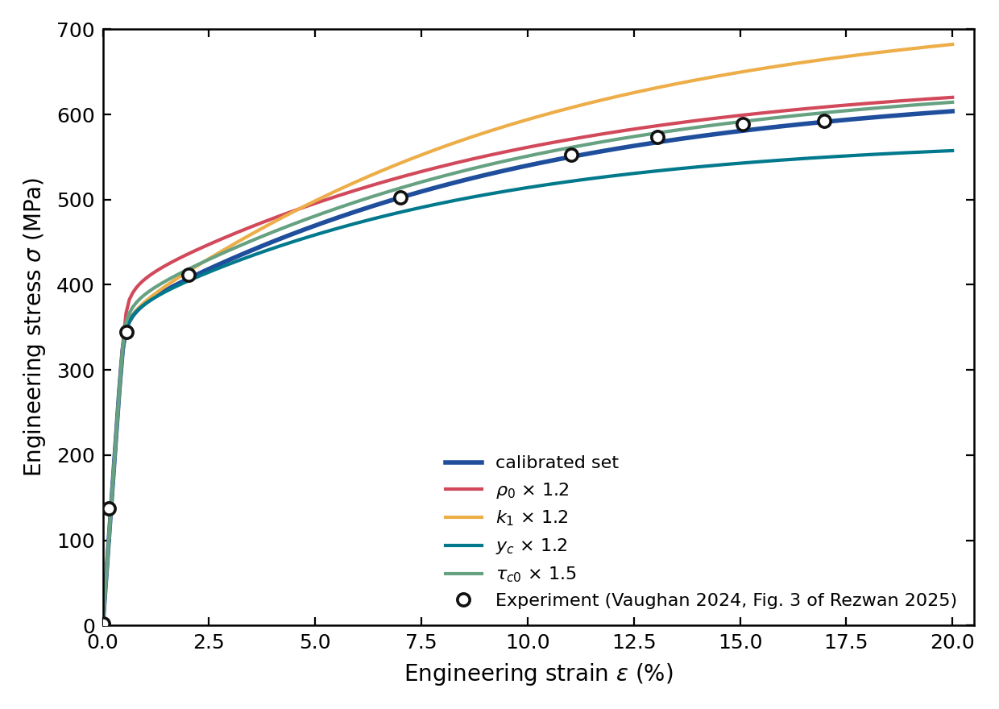

**Figure 6.** Sensitivity $\partial\sigma/\partial\ln p$ of the engineering
stress to each parameter along the curve, from the finite-difference Jacobian
of the final iteration.

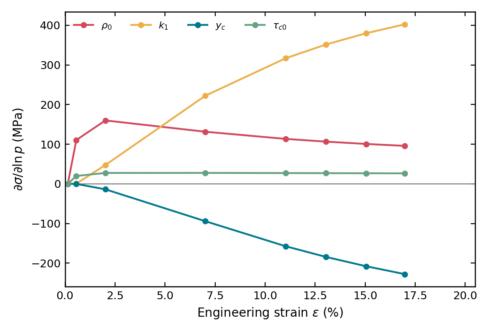

### 4.6 Scope of the calibrated set

The set of Table 2 holds for: this framework's constitutive conventions (the
latent-hardened sum of Eq. (5), the per-system law of Eq. (6), the rate law of
Eq. (4) with the fixed $\dot{\gamma}_0$ and $m$); the assumed strain rate of
$10^{-3}$ s$^{-1}$ (with $n = 8.33$ a factor 3 in rate moves the flow stress
by about 14%); the h40 mesh (2.5 $\mu$m elements); and this thirty-grain
realization and orientation draw. The mesh dependence is quantified in §5;
the dependence on the realization will be quantified on the mesh chosen
there.

## 5. Mesh sensitivity

### 5.1 Design

The calibrated set of Table 2 was run on four meshes of the same plate, grain
structure, orientations, loading and solver criterion, changing only the
element count: h20, h40, h80 and h160 (Table 5; decks
`decks/cp_study/mesh_h{20,80,160}.i`, h40 being the calibrated run). All
four completed the 256 load steps to 20% strain without a cutback and wrote
the field series every four steps.

**Table 5.** Meshes of the sensitivity study and the engineering stress at
four strains; the sixth column is the change from the next coarser mesh at
2 / 7 / 17 / 20% strain, the seventh the distance to h160 at the same
strains.

| mesh | elements | $h$ ($\mu$m) | elements across a grain | 2% | 7% | 17% | 20% | change from coarser mesh | distance to h160 | wall time (one core) |
|---|---|---|---|---|---|---|---|---|---|---|
| h20 | 200 | 5.0 | 2.7 | 413.1 | 518.7 | 616.0 | 629.8 | | +3.8 / +5.7 / +8.2 / +8.8% | 5 min |
| h40 | 800 | 2.5 | 5.5 | 403.9 | 502.8 | 591.5 | 603.3 | -2.2 / -3.1 / -4.0 / -4.2% | +1.5 / +2.5 / +3.9 / +4.2% | 14 min |
| h80 | 3,200 | 1.25 | 11 | 400.2 | 495.4 | 578.6 | 589.3 | -0.9 / -1.5 / -2.2 / -2.3% | +0.6 / +1.0 / +1.7 / +1.8% | 1.8 h |
| h160 | 12,800 | 0.625 | 22 | 397.9 | 490.6 | 569.2 | 578.9 | -0.6 / -1.0 / -1.6 / -1.8% | | 4 h |

### 5.2 Results

**Figure 7.** Stress-strain curves of the four meshes with the calibrated
set.

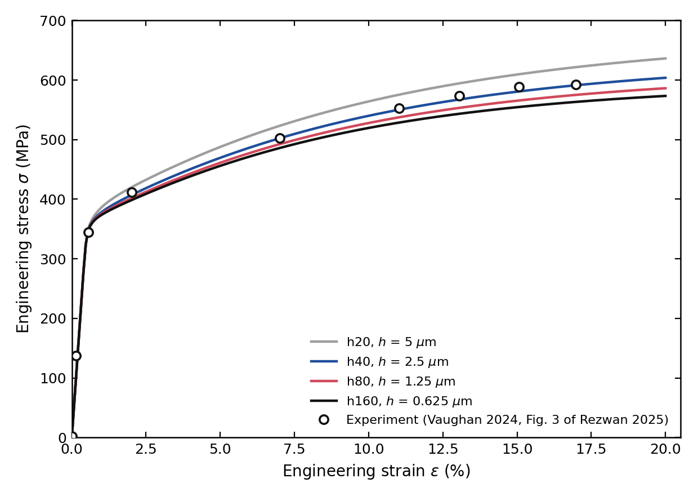

**Figure 8.** Engineering stress at fixed strains against element size.

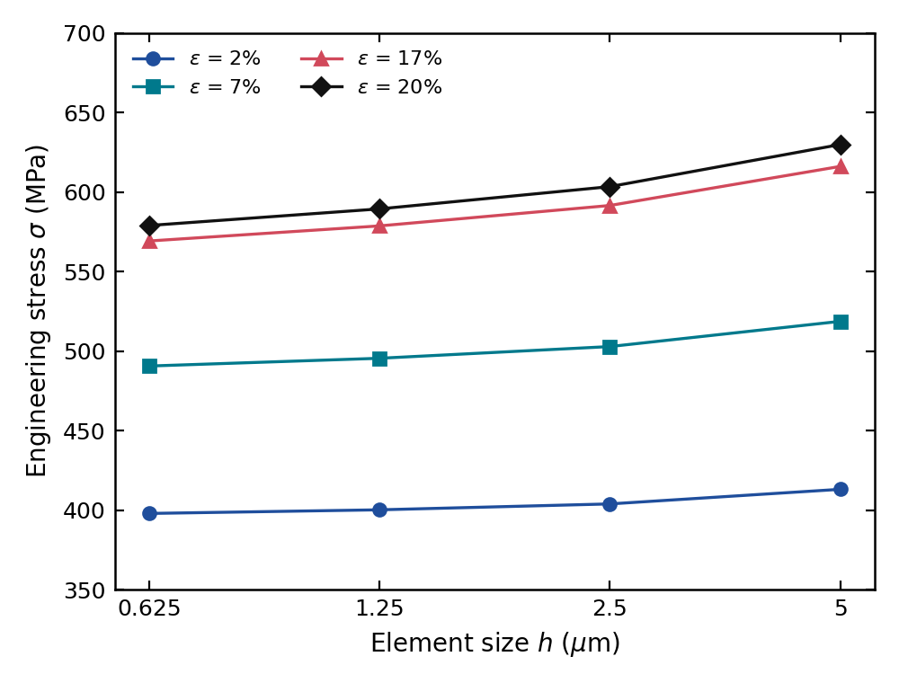

The response softens monotonically with refinement at every strain (Figs. 7
and 8). The coarse mesh is the stiff one, as a displacement-based
discretization with fewer than three elements across a grain must be, and
the change per halving of $h$ decreases: 4.2%, 2.3% and 1.8% at 20% strain.
The convergence is close to first order at yield, where the ratio of
successive changes is 0.62 (apparent order 0.7), and slower on the plastic
branch, where the ratio rises to 0.75 at 20% strain (apparent order 0.4):
the finer meshes keep resolving sharper slip bands at grain boundaries and
triple junctions, and the constitutive law of §2 has no internal length, so
localized slip remains mesh-dependent within the range studied. The
root-mean-square deviation from the markers rises away from h40 (20.1 /
14.4 / 18.2 / 22.6 MPa for h20 / h40 / h80 / h160) only because the set was
calibrated at h40; a transfer to another mesh is a small correction of the
size of the mesh shift, mostly on $\rho_0$ and $k_1$ (Table 4).

**Figure 9.** Element-averaged equivalent plastic strain on the deformed
plate for the four meshes at 2, 8, 15 and 20% nominal strain (one color
scale); the full loading is animated in
`figures/report/plastic_strain_mesh.gif`.

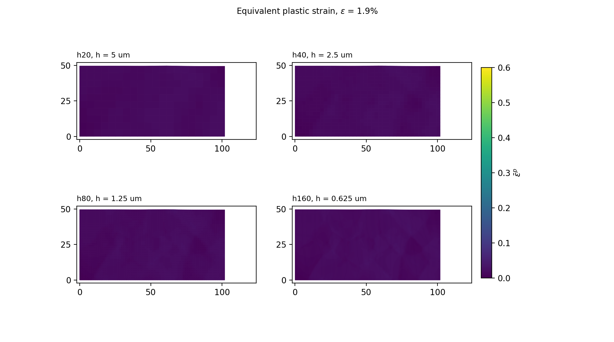

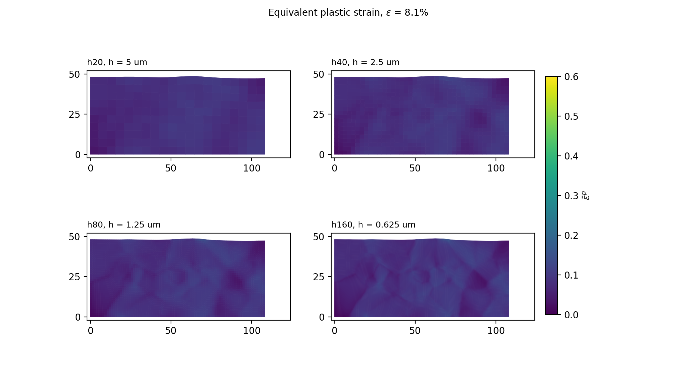

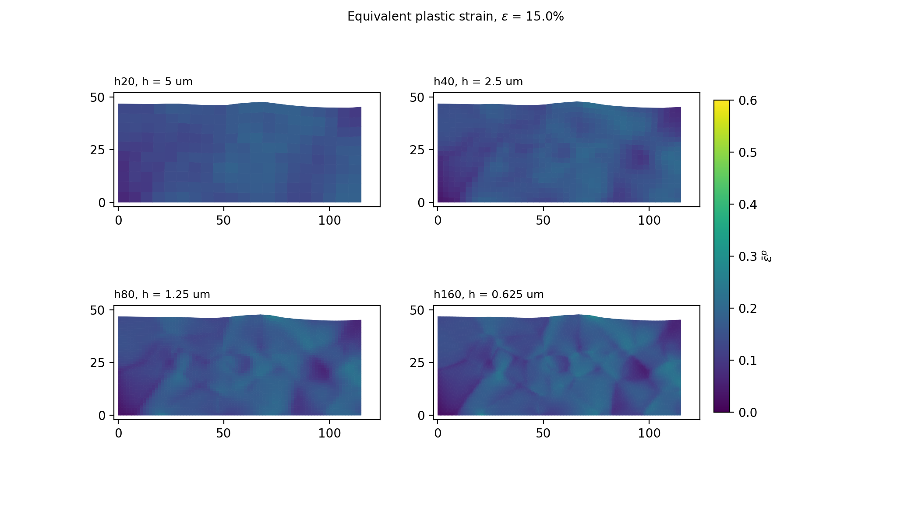

The plastic strain localizes in the same bands on every mesh, along the
grain boundaries that cross the loading direction at an angle and through
the softest grains; refinement sharpens the bands and raises their peak
value without moving them, which is the field-level picture of the slow
convergence of the plastic branch.

### 5.3 Mesh selection

The choice of the working mesh for the parameter sensitivity, the
grain-instance check and the neural routes is the author's, against the
cost column of Table 5: h40 is within 4.2% of h160 at every strain for 14
min per run, h80 within 1.8% for 1.8 h.

## 6. Parameter sensitivity

*(on the mesh chosen after §5)*

## 7. Grain-instance check

*(on the mesh chosen after §5)*

## References

- (rezwan 2025 intragranular) A. Rezwan, N. Aragon, D. de Oca Zapiain, H. Lim,
  "Coupled phase field damage and crystal plasticity analysis of intragranular
  fracture: The role of crystallographic orientation and voids", International
  Journal of Plasticity 191 (2025) 104372. doi:10.1016/j.ijplas.2025.104372
- (vaughan 2024 mechanistic) M. Vaughan, H. Lim, B. Pham, R. Seede, A.
  Polonsky, K. Johnson et al., "The mechanistic origins of heterogeneous void
  growth during ductile failure", Acta Materialia 274 (2024) 119977.
  doi:10.1016/j.actamat.2024.119977

Both entries are in `bib/references.bib`.

## Appendix A. Artifacts behind this report

| item | path |
|---|---|
| calibrated run deck (generated) | `results/cp_study/cal/gn2/base/cpfe.i` |
| pipeline deck of the calibrated run | `decks/cp_study/cal_center2.i` |
| study deck of the perturbations | `decks/cp_study/cal_gn2.i` |
| grain-growth deck | `decks/graingrowth/pilot/n32_bdf1_h40.i` |
| orientations (per grain) | `results/cp_study/cal/gn2/base/grains.csv` |
| curves | `results/cp_study/cal/gn2/{base,rho0_p,k1_p,y_c_p,tau_c0_p}/results.csv` |
| Jacobian, per-marker errors, step | `results/cp_study/cal/gn2/gauss_newton.json` |
| experimental markers | `data/digitized/al2219_fig3_experiment_markers.csv` |
| figure deck and script | `decks/report/cp_calibration_figures.i`, `scripts/report_figures.py` |
| run ledger rows | `cal-gn1`, `cal-gn2` in `docs/run_ledger.md` |
