# Crystal plasticity and phase-field ductile fracture of Al2219 polycrystal plates with PINNACLE: finite-element calibration and the PINN+FEM, PINN and surrogate routes

Technical report, draft of 2026-10-15. Status: Part I (crystal plasticity,
§2-§11) complete; Part II (phase-field ductile fracture on J2 plasticity and
coupled with crystal plasticity, §12-§20) complete after the author's revision
round of 2026-10-14; abstract and introduction are held until the study is
closed. Every number here traces to a run in `docs/run_ledger.md` and to a
deck under `decks/`. Part I figures are produced by `scripts/report_figures.py`
from `decks/report/cp_calibration_figures.i`; Part II figures by the
deck-driven scripts named in each section, under `figures/pfd/`.

## Abstract

*(to be written after all studies are complete)*

## 1. Introduction

*(to be written after all studies are complete)*

## 2. Crystal-plasticity finite-element methodology

### 2.1 Kinematics

The deformation gradient at each material point is split multiplicatively into
an elastic and a plastic part,

$$
\mathbf{F} = \mathbf{F}^e \mathbf{F}^p , \qquad
\mathbf{L}^p = \dot{\mathbf{F}}^p \mathbf{F}^{p-1} = \sum_{\alpha=1}^{12} \dot{\gamma}^\alpha \, \mathbf{s}^\alpha \otimes \mathbf{n}^\alpha ,
\tag{1}
$$

where $\mathbf{s}^\alpha$ and $\mathbf{n}^\alpha$ are the slip direction and
slip-plane normal of system $\alpha$ in the sample frame and
$\dot{\gamma}^\alpha$ its slip rate. The twelve $\{111\}\langle 110\rangle$
systems of the FCC lattice are used. The crystal frame of each grain is set by
a Bunge triple $(\varphi_1, \Phi, \varphi_2)$, which rotates both the slip
systems and the elastic stiffness.

### 2.2 Elasticity

The elastic response is cubic and hyperelastic in the Green-Lagrange strain of
the elastic part,

$$
\mathbf{E}^e = \tfrac{1}{2}\left(\mathbf{F}^{eT}\mathbf{F}^e - \mathbf{I}\right), \qquad
\mathbf{S} = \mathbb{C} : \mathbf{E}^e , \qquad
\boldsymbol{\sigma} = \frac{1}{\det \mathbf{F}^e}\, \mathbf{F}^e \mathbf{S} \mathbf{F}^{eT} ,
\tag{2}
$$

with $\mathbb{C}$ the cubic stiffness ($C_{11}$, $C_{12}$, $C_{44}$) rotated
into the sample frame, $\mathbf{S}$ the second Piola-Kirchhoff stress and
$\boldsymbol{\sigma}$ the Cauchy stress. The resolved shear stress on system
$\alpha$ is

$$
\tau^\alpha = \mathbf{S} : \mathbf{M}^\alpha , \qquad
\mathbf{M}^\alpha = \tfrac{1}{2}\left(\mathbf{s}^\alpha \otimes \mathbf{n}^\alpha + \mathbf{n}^\alpha \otimes \mathbf{s}^\alpha\right).
\tag{3}
$$

### 2.3 Flow rule

Slip follows a rate-dependent power law (Hutchinson form),

$$
\dot{\gamma}^\alpha = \dot{\gamma}_0 \left| \frac{\tau^\alpha}{\tau_c^\alpha} \right|^{n} \operatorname{sign}(\tau^\alpha), \qquad n = 1/m ,
\tag{4}
$$

with reference slip rate $\dot{\gamma}_0$, rate exponent $n$ and the rate
sensitivity $m$ of the source papers (Rezwan 2025 intragranular). No kinematic
backstress is used.

### 2.4 Slip resistance and dislocation-density evolution

The slip resistance is a Taylor relation on the forest density, with the
latent-hardened interaction sum,

$$
\tau_c^\alpha = \tau_{c0} + \alpha_0\, \mu\, b \sqrt{\sum_{\beta=1}^{12} a^{\alpha\beta} \rho^\beta}, \qquad
a^{\alpha\beta} = \begin{cases} 1 & \alpha = \beta \\ q & \alpha \ne \beta \end{cases}
\tag{5}
$$

where $\rho^\beta$ is the statistically stored dislocation density of system
$\beta$, $\mu$ the shear modulus, $b$ the Burgers vector, $\alpha_0$ the
Taylor prefactor, $q$ the latent-to-self hardening ratio and $\tau_{c0}$ a
rate- and density-independent lattice friction. With all twelve densities
equal, the interaction sum multiplies the density by $1 + 11q = 16.4$ and
$\tau_c - \tau_{c0}$ by $\sqrt{16.4} = 4.05$ relative to the self term alone;
the calibrated parameters of §4 are therefore specific to this convention.

Each density evolves by a Kocks-Mecking storage-recovery law written per
system,

$$
\dot{\rho}^\alpha = \frac{1}{b}\left( k_1 \sqrt{\rho^\alpha} - 2 y_c\, \rho^\alpha \right) \left| \dot{\gamma}^\alpha \right| ,
\qquad \rho^\alpha(0) = \rho_0 ,
\tag{6}
$$

with the storage coefficient $k_1$ (the papers' $k_m$) and the annihilation
distance $y_c$. The law saturates at

$$
\rho_{sat} = \left( \frac{k_1}{2 y_c} \right)^2 , \qquad
\tau_{c,sat} = \tau_{c0} + \alpha_0 \mu b \sqrt{(1 + 11 q)\, \rho_{sat}} ,
\tag{7}
$$

so $k_1$ sets the hardening rate after yield and, together with $y_c$, the
height of the plateau; $\rho_0$ sets the initial resistance through Eq. (5);
$\tau_{c0}$ is a uniform offset. §4.4 quantifies each of these on the plate.

No geometrically necessary densities, grain-boundary slip transmission rules
or damage are active in the runs of this report: the plate is the undamaged
crystal-plasticity baseline that the later phase-field damage study builds
on.

### 2.5 Material parameters

Table 1 lists every parameter of Eqs. (1)-(7), its value in the runs of §4,
its provenance tag (PROJECT_GUIDELINES §4) and its role in the study. Units
are micrometer, megapascal and second throughout.

**Table 1.** Crystal-plasticity parameters for Al2219.

| symbol | meaning | value | unit | provenance | role |
|---|---|---|---|---|---|
| $C_{11}$ | cubic stiffness | 108.0 | GPa | reported_table (Rezwan 2025 intragranular, Table 1) | fixed |
| $C_{12}$ | cubic stiffness | 61.3 | GPa | reported_table | fixed |
| $C_{44}$ | cubic stiffness | 28.5 | GPa | reported_table | fixed |
| $\mu$ | shear modulus in Eq. (5) | 25.7 | GPa | reported_table | fixed |
| $b$ | Burgers vector | 0.286 | nm | reported_table | fixed |
| $q$ | latent-hardening ratio | 1.4 | - | reported_table | fixed |
| $\alpha_0$ | Taylor prefactor | 0.4 | - | reported_table | fixed |
| $\dot{\gamma}_0$ | reference slip rate | $10^{-5}$ | s$^{-1}$ | reported_table | fixed |
| $m$ ($n = 1/m$) | rate sensitivity | 0.12 (8.333) | - | reported_table | fixed |
| $\rho_0$ | initial SSD density per system | 47.99 | $\mu$m$^{-2}$ | calibrated (§4) | free |
| $k_1$ | storage coefficient | 0.1988 | - | calibrated (§4) | free |
| $y_c$ | annihilation distance | 0.00344 | $\mu$m | calibrated (§4) | free |
| $\tau_{c0}$ | lattice friction | 5.29 | MPa | calibrated (§4) | free |
| $\dot{\varepsilon}$ | applied strain rate | $10^{-3}$ | s$^{-1}$ | assumed (not reported with the test) | fixed |

The fixed set is the author's decision: elastic constants, $b$, $\mu$, $q$
and $\alpha_0$ are material constants; $\dot{\gamma}_0$ and $m$ are held and
reserved by the author for convergence questions only. The
four free parameters are fit in the order $\rho_0$, $k_1$, $y_c$, $\tau_{c0}$.

Derived quantities of the calibrated set (Eqs. 5 and 7): initial slip
resistance $\tau_c(\rho_0) = 87.8$ MPa, saturation density
$\rho_{sat} = 836\ \mu$m$^{-2}$, saturation resistance $\tau_{c,sat} = 350$
MPa. With a Taylor factor near 3 the initial resistance corresponds to about
260 MPa of rate-independent yield; the rate term of Eq. (4) at the applied
rate raises it to the 364 MPa 0.2%-offset yield of §4.3. The hardening rate
of the calibrated plate is still 0.33 GPa at 20% strain (§4.3), so the
densities are well below $\rho_{sat}$ at the end of the test, as the
experiment's unsaturated curve requires.

### 2.6 Polycrystal plate model

**Geometry and mesh.** A pseudo-three-dimensional plate of 100 x 50 x 1
$\mu$m is meshed with one HEX8 element through the thickness; the mesh level
hN has N elements along the 100 $\mu$m length and N/2 along the width. The
results of §4 are at h40 (40 x 20 x 1 elements, 2.5 $\mu$m elements, 800
elements, 1,722 nodes, 5,166 displacement degrees of freedom, 6,400
quadrature points). The pseudo-3D plate has one element through its thickness
and free top and back faces, so it deforms in generalized plane stress.

**Grain structure.** Thirty grains are generated by phase-field grain growth
of a 32-seed Voronoi tessellation of the plate's in-plane extent: the Moelans
multi-order-parameter Allen-Cahn model (eight order parameters, grain-boundary
width 1.485 $\mu$m, grid 203 x 102) is integrated for 2.5 interface relaxation
times, which equilibrates the triple junctions and consumes the two smallest
grains. The grain map is shown in Fig. 1. Grain areas range from 21 to 448
$\mu$m$^2$ (mean 169 $\mu$m$^2$); the equivalent diameter is 13.7 $\mu$m on
average and in the median (range 5.2 to 23.9 $\mu$m), so a 2.5 $\mu$m element
puts about 5.5 elements across a grain.

**Orientations.** One Bunge triple per grain, drawn uniformly on SO(3) from a
recorded seed (20261009), so the plate is untextured. The orientation reaches
every quadrature point of a grain through a point file read by the deck
(PINNACLE `[OrientationField]`, §3.5). The same structure and the same thirty
orientations are used by every run of this report; only the four free
parameters change.

**Boundary conditions and loading.** $u_x = 0$ on the $x = 0$ face, $u_y = 0$
on the $y = 0$ face, $u_z = 0$ on the $z = 0$ face; the $x = 100$ $\mu$m face
is displaced along $+x$ by a linear ramp to 20 $\mu$m (20% nominal strain) in
200 s, i.e. $\dot{\varepsilon} = 10^{-3}$ s$^{-1}$. All other faces are
traction-free, so the plate contracts laterally and through the thickness.

**Figure 1.** The 30-grain plate used by every run, colored by grain, with the
loading axis.

**Stress and strain measures.** The reported strain is the nominal strain
$\varepsilon = u_x(100\ \mu\text{m}) / 100\ \mu$m. The reported stress is the
engineering axial stress, i.e. the quadrature-point mean of the Cauchy stress
$\bar{\sigma}_{xx}$ converted to force over the original cross-section with the
mean transverse stretches,

$$
\sigma = \bar{\sigma}_{xx} \left(1 + \bar{H}_{yy}\right)\left(1 + \bar{H}_{zz}\right),
\tag{8}
$$

where $\bar{H}$ is the mean displacement gradient. Engineering stress is used
on both sides of every comparison because the experimental curve is a tensile
test record. At 20% strain the two transverse stretches are each about 0.91,
so the engineering stress is 16% below the mean Cauchy stress there.

**Reference data.** The ground truth is the Al2219 tensile curve of Vaughan
(2024 mechanistic) as plotted in Fig. 3 of Rezwan (2025 intragranular), from
which the nine experimental markers were digitized at the figure's native 300
DPI (extraction uncertainty $\pm 0.03$% strain, $\pm 1.5$ MPa; method in
`docs/digitization_uncertainty.md`). The marker at the origin is the initial
condition; the other eight, from 0.14% to 17.0% strain, are the calibration
targets.

## 3. Numerical method (PINNACLE)

All runs use PINNACLE (branch `feat/pinn_benchmark`, revision 47a41e0),
numpy backend, double precision, one CPU core per run. A run is fully
described by one input deck (`cpfe.i`) plus the orientation point file; the
deck is generated from a pipeline deck by `scripts/polycrystal_plate.py`, and
the study decks that set the parameters are under `decks/cp_study/`.

### 3.1 Finite-element discretization

Trilinear HEX8 elements with 2 x 2 x 2 Gauss quadrature carry the displacement
field. The finite-strain problem is posed on the displacement gradient
$\mathbf{H} = \nabla \mathbf{u}$ at each quadrature point, from which
$\mathbf{F} = \mathbf{I} + \mathbf{H}$; the material returns the Cauchy stress
of Eq. (2) and the assembler forms the residual of the balance of linear
momentum (`stress_divergence_cp` kernel, finite-strain mode) with Dirichlet
conditions imposed on node sets. Orientations are supplied per element and
broadcast to its quadrature points.

### 3.2 Load stepping

The quasi-static load program (`cp_quasi_static` executioner) divides the 200
s ramp into 256 equal steps of $\Delta t = 0.78$ s, i.e. $7.8 \times 10^{-4}$
nominal strain per step, below the framework's $8 \times 10^{-4}$ per-step
strain-increment limit for the explicit constitutive update. A step that
fails to converge is halved and retried up to ten times (none was needed in
the runs of §4 and §5: 256 of 256 steps converged with zero cutbacks on
every case). Every run records the field series every four load steps
(every 0.3125% strain): displacement, Cauchy stress, strain, equivalent
plastic strain, slip activity and mean dislocation density per element.

### 3.3 Newton solve and tangent

Each load step is solved by Newton's method on the displacement vector to an
absolute residual norm of $10^{-3}$ MPa $\mu$m$^2$ over the free degrees of
freedom, about $3 \times 10^{-7}$ of the nodal force scale at h40, with no
relative criterion, so that every step of every route of this study
(FE, hybrid, PINN) is held to the same test whatever its starting point
(at most 50 iterations; the calibrated run used 5.9 on average, 8 at most). The algorithmic tangent
$\partial \boldsymbol{\sigma} / \partial \mathbf{H}$ is formed at every
quadrature point by one-sided finite differences of the constitutive response
at the frozen state (perturbation $10^{-7}$, ten batched evaluations per
tangent) and assembled sparse. The linear systems are solved with a sparse LU
factorization (`linear_method = direct`): the finite-strain crystal-plasticity
tangent is non-symmetric and loses positive definiteness as slip localizes,
so an iterative solver has to be a non-symmetric one (GMRES with ILU
preconditioning is available for larger meshes); at the sizes used here the
direct solve is cheap.

### 3.4 Constitutive integration

Within a converged step the state $\{\mathbf{F}^p, \rho^\alpha\}$ at each
quadrature point is advanced by explicit forward Euler with adaptive
sub-stepping: the sub-increment is chosen so that the largest slip increment
on the point obeys $\max_\alpha |\dot{\gamma}^\alpha| \, \delta t \le 10^{-3}$,
with a budget of $10^5$ sub-steps per load step. The plastic deformation
gradient is updated as $\mathbf{F}^p_{n+1} = (\mathbf{I} + \delta t\,
\mathbf{L}^p)\, \mathbf{F}^p_n$ and the densities by Eq. (6), clipped at zero.
The slip rates of Eq. (4) are evaluated at the step's converged stress with
the state frozen (the trial stress inside Newton does not advance the state),
which is what makes the per-step strain limit of §3.2 necessary. Every
quadrature point that is still active is advanced in one batched call, so the
cost is independent of the number of grains.

### 3.5 Orientation field

The deck block `[OrientationField] source = point_file` reads a CSV of
$(x, y, z, \varphi_1, \Phi, \varphi_2, \text{grain})$ rows, one per node of
the grain-growth grid, and assigns each element the orientation of the
nearest point (ADR 0026 in PINNACLE). The crystal block's own Euler angles are
a fallback that is never reached when the field covers the mesh; the log line
"[OrientationField] ... resolved on 800 elements, coverage 1.0" is the check
that it did.

### 3.6 Grain growth numerics

The grain structure of §2.6 is produced by PINNACLE's phase-field module
(`gb_evolution` material with `ac_bulk` and `ac_interface` kernels,
`pf_fem_transient` executioner) on a 203 x 102 bilinear grid with
$M_{GB} = 1$, $\sigma_{GB} = 1$, $w_{GB} = 1.485\ \mu$m and $\gamma = 1.5$ in
the Moelans free energy. Time integration is fully implicit backward Euler
(`bdf1`) at $\Delta t = 0.5 / (L \mu)$ with $1/(L\mu) = w_{GB}^2 / (8
M_{GB} \sigma_{GB})$ the bulk relaxation time, 40 steps, Newton to $10^{-8}$,
natural boundary conditions. Grains are labeled on the final field by the
argmax order parameter and connected components, specks under four cells are
dropped, and diffuse-boundary nodes are assigned to the nearest labeled node.

### 3.7 Homogenized output

The executioner records, for every accepted load step, the time and the
quadrature-point means of the Cauchy stress and of the displacement gradient.
Eq. (8) is applied to these means. Field output (displacement, stress, strain,
equivalent plastic strain, slip activity and mean density per element) is
written at the end of the run.

### 3.8 Reproducibility

Each run is reproducible from its generated deck and point file; the pipeline
deck records the growth run, labeling thresholds, orientation seed, mesh,
loading and every material value. The commands are in
`docs/reproduce_polycrystal_plate.md`; the run ledger `docs/run_ledger.md`
gives the deck, scripts, framework revision, host, cores and wall time of
every run cited here. A calibrated-set run at h40 takes about 14 min of one
core (3.3 s per load step, of which the Newton solves are 838 s).

## 4. Results: parameter calibration

### 4.1 Objective

The free parameters are those that minimize the root-mean-square deviation
between the engineering stress of the plate, interpolated at the eight
experimental marker strains, and the marker stresses, in this framework and
at this mesh. Neither the published parameter table nor any re-expression of
it is a target: with the interaction sum of Eq. (5) and the rate law of Eq.
(4), the published numbers do not reproduce the curve in this framework, and
the calibrated values are reported as such (provenance `calibrated`).

The parameters were bounded a priori from the features of the experimental
curve: $\rho_0 \in [20, 80]\ \mu$m$^{-2}$, $k_1 \in [0.02, 0.30]$,
$y_c \in [0.001, 0.006]\ \mu$m, $\tau_{c0} \in [0, 50]$ MPa.

### 4.2 Procedure

1. A Taylor (isostrain) material-point aggregate of thirty random grains was
   used as a surrogate to locate a starting point inside the bounds
   (`scripts/taylor_surrogate.py`, deck `decks/cp_study/taylor_screen.i`).
2. At the FE level, each iteration ran the center and one multiplicative
   perturbation per parameter ($\rho_0$, $k_1$, $y_c$ x 1.2; $\tau_{c0}$ x
   1.5) as five concurrent plate runs to 20% strain (`decks/cp_study/cal_gn*.i`,
   driver `scripts/cp_parameter_study.py`). The finite-difference Jacobian
   $\partial \sigma_i / \partial \ln p_j$ at the marker strains gave a
   bounded Levenberg-Marquardt step in log parameters
   (`scripts/cp_gauss_newton.py`).
3. The iteration stopped when the predicted step moved no parameter by more
   than a few percent and predicted no gain in the objective. Two FE
   iterations were needed: the first center (RMSE 48.2 MPa) stepped to the
   final set with a predicted 14.2 MPa; the second center measured 14.4 MPa
   and its own step (1.1% on $\rho_0$, 1.4% on $k_1$, 0.6% on $y_c$, 5% on
   $\tau_{c0}$) predicted 14.2 MPa.

### 4.3 Calibrated parameter set

**Table 2.** Calibrated set at mesh h40 (deck `decks/cp_study/cal_center2.i`,
run `results/cp_study/cal/gn2/base`), with the linearized one-standard-
deviation uncertainty from the residual beyond 0.5% strain and the FE
Jacobian.

| parameter | value | unit | relative 1$\sigma$ |
|---|---|---|---|
| $\rho_0$ | 47.99 | $\mu$m$^{-2}$ | $\pm 57$% |
| $k_1$ | 0.1988 | - | $\pm 11$% |
| $y_c$ | 0.00344 | $\mu$m | $\pm 20$% |
| $\tau_{c0}$ | 5.29 | MPa | $\pm 358$% |

The uncertainties say how tightly eight markers pin each value, not how far
the curve would move: $k_1$ is the best-determined parameter because it
controls the whole hardening branch; $\tau_{c0}$ is nearly free because its
effect (a uniform 25 MPa offset per e-fold) is interchangeable with a small
change of $\rho_0$ at the yield point.

**Figure 2.** Calibrated plate against the experimental markers.

Characteristics of the calibrated curve: elastic modulus 71.2 GPa (the
untextured aluminum polycrystal value), 0.2%-offset yield stress 364 MPa,
engineering stress 404 / 503 / 592 / 603 MPa at 2 / 7 / 17 / 20% strain, and
a hardening rate $d\sigma/d\varepsilon$ falling from 2.4 GPa at 2% to 0.46
GPa at 17% and 0.33 GPa at 20%.

### 4.4 Error analysis

**Table 3.** Calibrated plate at the experimental markers (engineering
stress).

| strain (%) | experiment (MPa) | FE (MPa) | difference (MPa) | relative error |
|---|---|---|---|---|
| 0.14 | 137.7 | 99.1 | -38.6 | -28.0% |
| 0.57 | 344.9 | 351.3 | +6.4 | +1.9% |
| 2.02 | 411.9 | 404.3 | -7.5 | -1.8% |
| 7.01 | 502.5 | 502.9 | +0.5 | +0.1% |
| 11.02 | 552.5 | 551.2 | -1.3 | -0.2% |
| 13.05 | 573.6 | 568.1 | -5.5 | -1.0% |
| 15.06 | 588.3 | 581.3 | -7.0 | -1.2% |
| 16.98 | 592.6 | 591.4 | -1.2 | -0.2% |

Root-mean-square deviation over the eight markers: 14.4 MPa; over the seven
markers from 0.5% strain: 5.1 MPa, with a largest deviation of 7.5 MPa (1.8%).
From 0.5% strain the plate reproduces the experimental curve within the
digitization uncertainty budget plus a few MPa; the error is of uniform sign
and small on the plastic branch, so the shape of the curve (yield, hardening
rate, approach to the plateau) is captured, not only its level. This is a
tier-4 agreement (PROJECT_GUIDELINES §5: agreement with experiment).

The one miss is the 0.14% marker, 28% below the experiment. That marker lies
on the digitized record's initial slope of about 99 GPa, whereas the
untextured plate's modulus is 71 GPa and aluminum's polycrystal modulus is
about 70 GPa. The elastic constants are fixed and no parameter of Eqs. (4)-(6)
acts below yield, so the point reflects the test record or its digitization
rather than the calibration, and it is retained in the objective rather than
removed.

**Figure 3.** Deviation of the calibrated plate from the experimental markers.

### 4.5 Effect of each parameter

Each parameter was perturbed one at a time from the calibrated set while the
others were held (Table 4, Fig. 4). The Jacobian of the final iteration is the same
information as a sensitivity $\partial \sigma / \partial \ln p$, i.e. the
stress change per e-fold change of the parameter, along the curve (Fig. 6).

**Table 4.** One-at-a-time perturbations of the calibrated set at h40
(`decks/cp_study/cal_gn2.i`): engineering stress at the marker strains and
the sensitivity $\partial\sigma/\partial\ln p$.

| case | 0.57% | 2% | 7% | 11% | 17% | RMSE (MPa) | $\partial\sigma/\partial\ln p$ at 2 / 7 / 17% (MPa) |
|---|---|---|---|---|---|---|---|
| calibrated | 352 | 404 | 503 | 551 | 591 | 14.4 | |
| $\rho_0$ x 1.2 = 57.58 $\mu$m$^{-2}$ | 372 | 433 | 526 | 571 | 608 | 22.6 | 160 / 127 / 92 |
| $k_1$ x 1.2 = 0.2386 | 352 | 413 | 546 | 612 | 668 | 50.9 | 52 / 238 / 418 |
| $y_c$ x 1.2 = 0.00413 $\mu$m | 352 | 401 | 484 | 520 | 547 | 33.6 | -15 / -103 / -241 |
| $\tau_{c0}$ x 1.5 = 7.94 MPa | 359 | 414 | 513 | 561 | 601 | 15.7 | 25 / 25 / 24 |

What each parameter does to the curve, in this framework and with this law:

- **$\rho_0$ sets the yield level.** Raising the initial density raises
  $\tau_c$ through Eq. (5) from the first slip onward, so the whole curve
  moves up, most at yield (160 MPa per e-fold at 2%) and less with strain (92
  MPa at 17%) as the stored density overtakes the initial one. It is the
  parameter that places the knee of the curve.
- **$k_1$ sets the hardening rate.** Its effect is near zero at yield (52 MPa
  per e-fold at 2%) and grows monotonically with strain (418 MPa at 17%): a
  larger storage coefficient makes the curve climb faster after yield and
  raises the plateau through Eq. (7). It is the parameter that sets the slope
  of the plastic branch.
- **$y_c$ sets the saturation.** Recovery is negligible at low density and
  grows with it, so a larger $y_c$ lowers the late curve (-241 MPa per e-fold
  at 17%) and leaves yield unchanged. It bends the curve toward its plateau
  and, with $k_1$, fixes the plateau height.
- **$\tau_{c0}$ is a uniform offset.** It shifts the curve by about 25 MPa per
  e-fold at every strain, because it adds to $\tau_c$ independently of the
  density. On this curve it is nearly interchangeable with a small change of
  $\rho_0$, which is why it is the least-determined parameter in Table 2.

The order of the calibration ($\rho_0$, then $k_1$, then $y_c$, then
$\tau_{c0}$) follows from these shapes: level first, slope second, curvature
third, offset last.

**Figure 4.** One parameter perturbed at a time from the calibrated set (left
to right, top to bottom: $\rho_0$, $k_1$, $y_c$, $\tau_{c0}$).

**Figure 5.** All four perturbations on one axis.

**Figure 6.** Sensitivity $\partial\sigma/\partial\ln p$ of the engineering
stress to each parameter along the curve, from the finite-difference Jacobian
of the final iteration.

### 4.6 Scope of the calibrated set

The set of Table 2 holds for: this framework's constitutive conventions (the
latent-hardened sum of Eq. (5), the per-system law of Eq. (6), the rate law of
Eq. (4) with the fixed $\dot{\gamma}_0$ and $m$); the assumed strain rate of
$10^{-3}$ s$^{-1}$ (with $n = 8.33$ a factor 3 in rate moves the flow stress
by about 14%); the h40 mesh (2.5 $\mu$m elements); and this thirty-grain
realization and orientation draw. The mesh dependence is quantified in §5;
the dependence on the realization will be quantified on the mesh chosen
there.

## 5. Mesh sensitivity

### 5.1 Design

The calibrated set of Table 2 was run on four meshes of the same plate, grain
structure, orientations, loading and solver criterion, changing only the
element count: h20, h40, h80 and h160 (Table 5; decks
`decks/cp_study/mesh_h{20,80,160}.i`, h40 being the calibrated run). All
four completed the 256 load steps to 20% strain without a cutback and wrote
the field series every four steps.

**Table 5.** Meshes of the sensitivity study and the engineering stress at
four strains; the sixth column is the change from the next coarser mesh at
2 / 7 / 17 / 20% strain, the seventh the distance to h160 at the same
strains.

| mesh | elements | $h$ ($\mu$m) | elements across a grain | 2% | 7% | 17% | 20% | change from coarser mesh | distance to h160 | wall time (one core) |
|---|---|---|---|---|---|---|---|---|---|---|
| h20 | 200 | 5.0 | 2.7 | 413.1 | 518.7 | 616.0 | 629.8 | | +3.8 / +5.7 / +8.2 / +8.8% | 5 min |
| h40 | 800 | 2.5 | 5.5 | 403.9 | 502.8 | 591.5 | 603.3 | -2.2 / -3.1 / -4.0 / -4.2% | +1.5 / +2.5 / +3.9 / +4.2% | 14 min |
| h80 | 3,200 | 1.25 | 11 | 400.2 | 495.4 | 578.6 | 589.3 | -0.9 / -1.5 / -2.2 / -2.3% | +0.6 / +1.0 / +1.7 / +1.8% | 1.8 h |
| h160 | 12,800 | 0.625 | 22 | 397.9 | 490.6 | 569.2 | 578.9 | -0.6 / -1.0 / -1.6 / -1.8% | | 4 h |

### 5.2 Results

**Figure 7.** Stress-strain curves of the four meshes with the calibrated
set.

**Figure 8.** Engineering stress at fixed strains against element size.

The response softens monotonically with refinement at every strain (Figs. 7
and 8). The coarse mesh is the stiff one, as a displacement-based
discretization with fewer than three elements across a grain must be, and
the change per halving of $h$ decreases: 4.2%, 2.3% and 1.8% at 20% strain.
The convergence is close to first order at yield, where the ratio of
successive changes is 0.62 (apparent order 0.7), and slower on the plastic
branch, where the ratio rises to 0.75 at 20% strain (apparent order 0.4):
the finer meshes keep resolving sharper slip bands at grain boundaries and
triple junctions, and the constitutive law of §2 has no internal length, so
localized slip remains mesh-dependent within the range studied. The
root-mean-square deviation from the markers rises away from h40 (20.1 /
14.4 / 18.2 / 22.6 MPa for h20 / h40 / h80 / h160) only because the set was
calibrated at h40; a transfer to another mesh is a small correction of the
size of the mesh shift, mostly on $\rho_0$ and $k_1$ (Table 4).

**Figure 9.** Element-averaged equivalent plastic strain on the deformed
plate for the four meshes at 2, 8, 15 and 20% nominal strain (one color
scale); the full loading is animated in
`figures/report/plastic_strain_mesh.gif`.

The plastic strain localizes in the same bands on every mesh, along the
grain boundaries that cross the loading direction at an angle and through
the softest grains; refinement sharpens the bands and raises their peak
value without moving them, which is the field-level picture of the slow
convergence of the plastic branch.

### 5.3 Mesh selection

The choice of the working mesh for the parameter sensitivity, the
grain-instance check and the neural routes is the author's, against the
cost column of Table 5: h40 is within 4.2% of h160 at every strain for 14
min per run, h80 within 1.8% for 1.8 h.

## 6. Parameter sensitivity at the chosen mesh

### 6.1 Design

Each free parameter of Table 2 was varied one at a time over a factor of
four, at 0.5, 0.8, 1.25 and 2 times its calibrated value, with the other
three held at their calibrated values (study deck `decks/cp_study/sens_h40.i`,
sixteen cases plus the calibrated base, all at h40 on the plate of §2.6,
field series included). Every case completed the 256 load steps to 20%
strain without a cutback. Table 6 reports the 0.2%-offset yield stress, the
engineering stress at four strains, the hardening rate at 17% strain and
the root-mean-square deviation from the experimental markers; Figs. 10 and
11 show the curves.

**Table 6.** One-at-a-time sensitivity at h40. $\sigma_y$ is the 0.2%-offset
yield stress; $\theta_{17}$ the hardening rate $d\sigma/d\varepsilon$ at
17% strain; RMSE against the eight markers from 0.1% strain.

| case | $\sigma_y$ (MPa) | 2% | 7% | 17% | 20% | $\theta_{17}$ (GPa) | RMSE (MPa) |
|---|---|---|---|---|---|---|---|
| calibrated | 364 | 404 | 503 | 591 | 603 | 0.46 | 14.4 |
| $\rho_0$ x 0.5 | 271 | 316 | 436 | 544 | 560 | 0.59 | 63.9 |
| $\rho_0$ x 0.8 | 330 | 372 | 478 | 574 | 587 | 0.51 | 28.0 |
| $\rho_0$ x 1.25 | 402 | 440 | 532 | 612 | 623 | 0.41 | 26.3 |
| $\rho_0$ x 2 | 496 | 531 | 607 | 668 | 675 | 0.28 | 82.9 |
| $k_1$ x 0.5 | 362 | 381 | 402 | 411 | 411 | -0.01 | 124.6 |
| $k_1$ x 0.8 | 363 | 395 | 461 | 517 | 524 | 0.28 | 54.8 |
| $k_1$ x 1.25 | 365 | 416 | 557 | 687 | 705 | 0.70 | 63.5 |
| $k_1$ x 2 | 368 | 452 | 724 | 978 | 1,015 | 1.41 | 259.1 |
| $y_c$ x 0.5 | 364 | 411 | 563 | 763 | 801 | 1.39 | 101.9 |
| $y_c$ x 0.8 | 364 | 407 | 524 | 647 | 666 | 0.72 | 34.8 |
| $y_c$ x 1.25 | 364 | 401 | 480 | 538 | 544 | 0.25 | 39.2 |
| $y_c$ x 2 | 363 | 391 | 429 | 439 | 437 | -0.04 | 102.8 |
| $\tau_{c0}$ x 0.5 | 354 | 394 | 493 | 582 | 594 | 0.47 | 18.2 |
| $\tau_{c0}$ x 0.8 | 360 | 400 | 499 | 588 | 600 | 0.47 | 15.4 |
| $\tau_{c0}$ x 1.25 | 369 | 409 | 508 | 596 | 608 | 0.46 | 14.4 |
| $\tau_{c0}$ x 2 | 384 | 424 | 523 | 611 | 622 | 0.45 | 21.1 |

**Figure 10.** One parameter varied at a time over a factor of four (top
left to bottom right: $\rho_0$, $k_1$, $y_c$, $\tau_{c0}$); the calibrated
curve and the experimental markers in every panel.

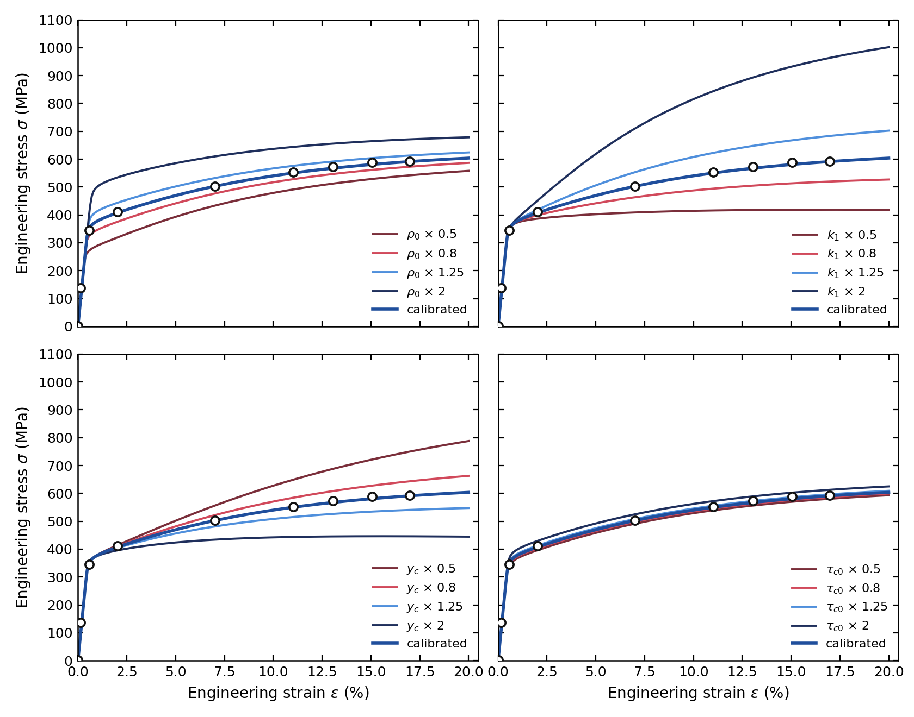

**Figure 11.** Engineering stress at fixed strains against the multiple of
each parameter.

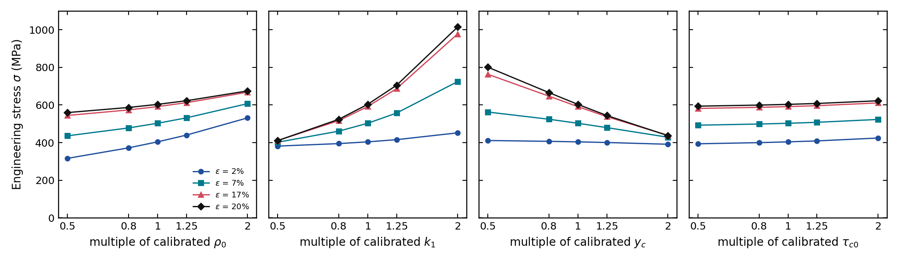

### 6.2 Results

**$\rho_0$ sets the yield level.** The yield stress follows the initial
density closely, from 271 MPa at half the calibrated value to 496 MPa at
twice it, i.e. $\sigma_y$ scales as about $\rho_0^{0.44}$, close to the
square root of Eq. (5) softened by the rate term. The offset it produces
fades with strain as the stored density overtakes the initial one (from
127 to 183 MPa per e-fold at 2% down to 62 to 104 MPa per e-fold at 20%),
and a higher $\rho_0$ also lowers the late hardening rate because the
density starts closer to saturation. Over the factor of four the curves
keep their shape; the parameter positions the knee.

**$k_1$ sets the hardening rate and the plateau.** Yield is unchanged (362
to 368 MPa across the factor of four), while the stress at 20% strain spans
411 to 1,015 MPa and the hardening rate at 17% strain spans zero to 1.41
GPa. The sensitivity grows monotonically with strain (33 to 70 MPa per
e-fold at 2%, 277 to 594 at 20%) and is itself larger at larger $k_1$: the
response is strongly nonlinear in $k_1$ because the saturation density of
Eq. (7) scales as $k_1^2$. At half the calibrated value the plate stops
hardening by 10% strain; at twice it the plate is still hardening at 1.4 GPa
at 20%. The experiment's slope is matched only within about $\pm 20$% of the
calibrated value.

**$y_c$ sets the saturation.** Yield is unchanged (363 to 364 MPa) and the
early curve nearly so (391 to 411 MPa at 2%), while the stress at 20%
strain spans 437 to 801 MPa in the opposite sense to $k_1$: a larger
annihilation distance saturates the density earlier and lower. At twice the
calibrated value the hardening rate is zero by 17% strain; at half it the
plate hardens at 1.39 GPa at 20%. The sensitivity is about $-240$ to $-285$
MPa per e-fold at 20% and nearly independent of the multiple, i.e. the
response is close to logarithmic in $y_c$ over this range. $k_1$ and $y_c$
act on the same branch of the curve with opposite sign; their ratio fixes
the plateau through Eq. (7) and their product the rate at which the plateau
is approached, which is why the calibration determines $k_1$ and $y_c$
jointly ($\pm 11$% and $\pm 20$% in Table 2) rather than each alone.

**$\tau_{c0}$ is a uniform offset.** It shifts the whole curve by 13 to 30
MPa per e-fold with no change of shape (the hardening rate stays at 0.45 to
0.47 GPa) and moves the yield stress by only 30 MPa over the factor of four.
At the calibrated 5.29 MPa it is a minor term against the 82 MPa density
contribution to the initial slip resistance, which is why it is the least
determined parameter and the last in the calibration order.

**Order of influence.** On the whole curve the ranking is $k_1$, $y_c$,
$\rho_0$, $\tau_{c0}$ (RMSE at the x2 case 259, 103, 83 and 21 MPa); at
yield it is $\rho_0$ first and $\tau_{c0}$ second, with $k_1$ and $y_c$
inert. The calibration order $\rho_0$, $k_1$, $y_c$, $\tau_{c0}$ follows
this separation: yield is fixed first by the parameter that alone controls
it, the plastic branch second by the pair that controls it, and the offset
last.

## 7. Grain-instance check

### 7.1 Design

The calibrated set and the plate of §2.6 were run on two further grain
structures, each a new uniform Voronoi seeding of the plate grown with the
phase-field settings of §3.6 and given its own orientation draw (Table 7;
growth decks `decks/graingrowth/instances/n32_bdf1_h40_s{C,B}.i`, pipeline
decks `decks/cp_study/grain_s{C,B}.i`). Mesh (h40), loading, solver
criterion, field series and parameters are those of the calibrated run. The
purpose is to show that the set of Table 2 describes the material rather
than one realization of thirty grains.

**Table 7.** Grain instances with the calibrated set at h40: grain count,
median equivalent diameter, elastic modulus, 0.2%-offset yield stress,
engineering stress at four strains, RMSE against the markers, and the mean
and largest relative deviation from the calibrated structure's curve beyond
0.5% strain.

| instance | seeds (Voronoi / orientations) | grains | $d_{med}$ ($\mu$m) | $E$ (GPa) | $\sigma_y$ (MPa) | 2% | 7% | 17% | 20% | RMSE (MPa) | deviation, mean / max |
|---|---|---|---|---|---|---|---|---|---|---|---|
| 1 (calibrated) | 20260914 / 20261009 | 30 | 13.7 | 71.2 | 364 | 404 | 503 | 591 | 603 | 14.4 | |
| 2 | 20261013 / 20261013 | 31 | 13.7 | 71.5 | 369 | 412 | 519 | 616 | 630 | 20.4 | +3.5% / 4.4% |
| 3 | 20261012 / 20261012 | 30 | 13.4 | 70.8 | 361 | 399 | 495 | 584 | 597 | 17.1 | -1.4% / 1.6% |

**Figure 12.** The three grain structures.

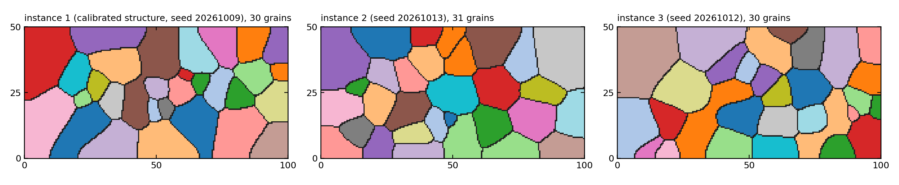

**Figure 13.** Stress-strain curves of the three instances with the
calibrated set.

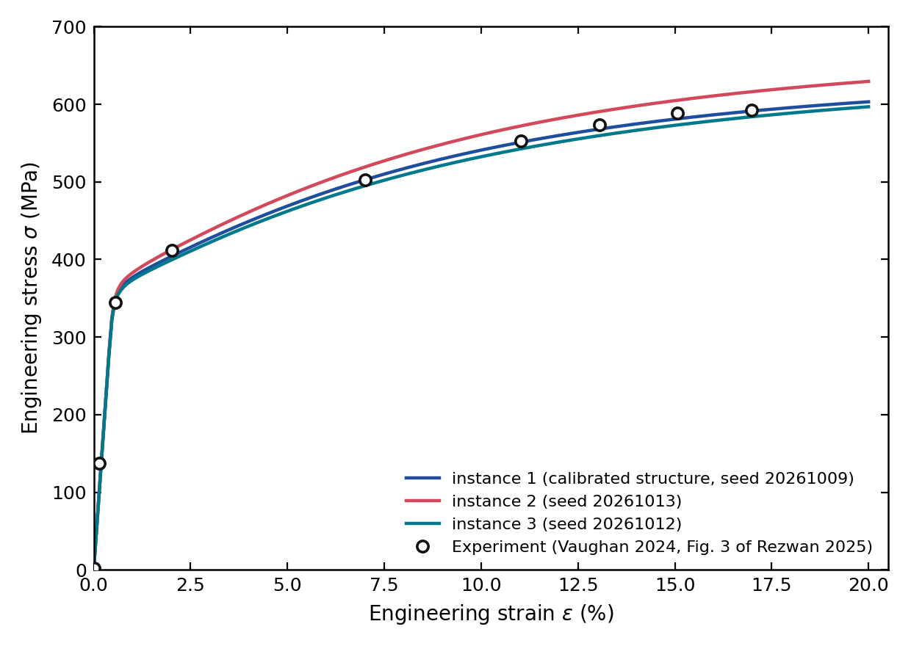

### 7.2 Results

The three realizations give the same elastic modulus within 1%, the same
yield stress within $\pm 1.5$% and the same hardening branch within $-1.4$%
to $+3.5$% (Fig. 13); all three completed the 256 load steps without a
cutback. The spread is of the size of the mesh effect between h40 and h80
(§5) and smaller than the effect of a 20% change of any free parameter but
$\tau_{c0}$ (§6), so the calibrated set is not an artifact of the structure
it was fitted on. The instance-to-instance spread, about $\pm 2.5$% on the
flow stress, is the statistical resolution of a thirty-grain,
one-element-thick plate and should be read as the uncertainty attached to
any single-realization result of this report.

## 8. Neural routes on the calibrated problem: PINN+FEM and PINN as solver

### 8.1 Design

Both neural routes run inside the load-stepping executioner of §3 and
differ from the FE reference only in where the nodal field of a load step
comes from. A **load-step predictor** proposes the displacement field
$\mathbf{u}^{\star}_{k+1}$ the step starts from; the executioner pins the
prescribed degrees of freedom, measures the proposal's equilibrium error,
and either corrects it with Newton to the criterion of §3 (the **PINN+FEM**
route) or accepts it as the step's solution when that error is already
below the tolerance (the **PINN as solver** route). The constitutive state
lives at the quadrature points of the h40 mesh in both routes and is
advanced from the accepted field, so the history of the material is that
of the finite-element discretisation whatever produced the field.

The equilibrium error of a nodal field $\mathbf{u}$ is the assembled
residual of the discrete weak form at the frozen state of the step,
$\mathbf{R}(\mathbf{u}) = \mathbf{f}_{\mathrm{int}}(\mathbf{u};\,\mathbf{s}_k) - \mathbf{f}_{\mathrm{ext}}$,
measured over the free degrees of freedom and scaled by the reaction it
carries on the constrained ones,

$$
r(\mathbf{u}) = \frac{\lVert \mathbf{R}_{\mathrm{free}}(\mathbf{u}) \rVert_2}{\lVert \mathbf{R}_{\mathrm{Dirichlet}}(\mathbf{u}) \rVert_2}.
\tag{9}
$$

A field with $r \le r_{\mathrm{tol}}$ is a finite-element solution of the
step to that tolerance; the solver route uses $r_{\mathrm{tol}} = 0.05$ and
records on every step whether the proposal was accepted or corrected.

The predictor is a network $\mathbf{u}_\theta(\mathbf{x}, \lambda)$ (three
hidden layers of 64 tanh units; normalised coordinates and the load factor
$\lambda$ as inputs; the three displacement components as outputs) that
**corrects the linear extrapolation** of the last two accepted fields,

$$
\mathbf{u}^{\star}_{k+1} = \mathbf{u}_k + \frac{\lambda_{k+1} - \lambda_k}{\lambda_k - \lambda_{k-1}}\,(\mathbf{u}_k - \mathbf{u}_{k-1}) + \Delta u\;\mathbf{u}_\theta(\mathbf{x}, \lambda_{k+1}),
\tag{10}
$$

with $\Delta u$ the size of the last accepted increment and the output
layer initialised to zero, so that the untrained network returns the
extrapolation itself and training can only improve on it. The network is
trained **on the assembled residual of its own nodal values**, with the
loss $r^2$ of Eq. (9): the residual is assembled by the finite-element arm
at the frozen state, and its gradient with respect to the nodal values is
the transpose of the consistent tangent $\mathbf{K} = \partial\mathbf{R}/\partial\mathbf{u}$
the Newton solver already forms. Every loss evaluation therefore costs
one residual-and-tangent assembly on the FE arm (numpy, CPU) while the
network itself is evaluated and differentiated on the GPU (torch); the
weights are carried from step to step. Training uses L-BFGS with a
strong-Wolfe line search (two L-BFGS steps per load step, at most 40 inner
iterations, for the PINN+FEM route; four, at most 80, for the solver route,
which stops early as soon as $r \le r_{\mathrm{tol}}$), and the best
iterate seen is returned. The reference for both routes is the same
executioner with the linear extrapolation alone as predictor, and the cold
run of §4 with the previous field as initial guess.

A second variant of each route gives the network **grain-aware inputs**:
appended to the coordinates and the load factor at every node are the
nine entries of the crystal-to-sample rotation matrix averaged over the
elements that share the node and a grain-boundary indicator (one minus
the largest fraction of the node's elements that belong to one grain:
zero inside a grain, positive on a boundary), both derived once from the
orientation field of §2. A network of the coordinates alone has no input
that changes at a grain boundary and so cannot kink there; with these
ten extra inputs it can. Architecture, loss, optimizer and budgets are
otherwise identical to the coordinate-only runs.

This weak-form training replaces the strong-form collocation of the
balance of momentum, which was found unreachable on this problem: a
network regressed to within 0.55% (L2) of the finite-element displacement
of a step still carries $r = 0.73$ and a strong-form residual of order one
on the $\mu / L$ scale, because the equilibrium of a thirty-grain plate
lives in the strain kinks at the grain boundaries that a smooth global
network cannot represent. The weak-form loss is the quantity the corrector
drives to zero, so an accepted network field is verifiable by
construction. Decks: `decks/cp_study/hybrid/h40_linear.i`,
`h40_fem_residual.i`, `h40_fem_solver.i`, `h40_fem_residual_grain.i`,
`h40_fem_solver_grain.i`; the framework pieces are PINNACLE ADR 0028 and
ADR 0029.

### 8.2 Results

Table 8 summarises the six runs of the same deck family at h40, all to
20% strain in 256 steps under the criterion of §3 with no cutback.

**Table 8.** Cost and outcome of the neural routes against the FE
reference at h40. Newton iterations are the cost measure that does not
depend on host load; the Newton time per iteration varied between runs
with the machine's occupancy (0.41 to 0.70 s) and is given for
completeness. The predictor time of the two network runs includes the
assemblies of the training loss (0.28 s each) and the GPU evaluation of
the network. $r$ is the equilibrium error of Eq. (9), median over the
predicted steps.

| run | Newton iterations | steps solved without Newton | Newton time (s) | predictor time (s) | assemblies for training | $r$ before training (median) | $r$ after training (median) | max $\lvert\Delta\sigma\rvert$ vs FE (MPa) |
|---|---|---|---|---|---|---|---|---|
| FE, cold start (§4) | 1,506 | 0 | 838 | 0 | 0 | -- | -- | 0 |
| PINN+FEM, linear extrapolation | 948 | 0 | 667 | 0.005 | 0 | -- | -- | 0.000 |
| PINN+FEM, FE-residual-trained network | 945 | 0 | 409 | 349 | 1,574 | 0.0008 | 0.0008 | 0.000 |
| PINN as solver, verified ($r_{\mathrm{tol}} = 0.05$) | 650 | 132 of 256 | 264 | 4,964 | 16,264 | 0.098 | 0.049 | 5.14 |
| PINN+FEM, grain-aware network | 923 | 0 | 403 | 716 | 2,696 | 0.0005 | 0.0005 | 0.000 |
| PINN as solver, verified, grain-aware network | 635 | 131 of 256 | 264 | 4,279 | 13,865 | 0.076 | 0.050 | 0.33 |

**PINN+FEM.** The linear extrapolation alone is already a good predictor
on this load path: beyond 1% strain its proposal is within 0.03% of the
step's increment (median) and carries an equilibrium error $r$ of about
$10^{-3}$, and it removes 37% of the Newton iterations of the cold start.
The network trained on the assembled residual does not improve on it: the
L-BFGS line search finds no descent worth taking from a proposal that is
already that close (a median of four assemblies per step), the iteration
count is the same as with the extrapolation alone (945 against 948; 251
steps identical, four steps one iteration fewer, one step one more), the
curve and the fields are identical to the FE reference (Fig. 14, Fig. 15),
and the training adds 349 s to the run. Where the extrapolation is poor,
in the first 1% of strain when grains yield one after another and $r$ of
the extrapolation is 0.03 to 0.4, the network lowers $r$ by about 20%,
which does not remove a Newton iteration.

**PINN as solver.** With the tolerance $r_{\mathrm{tol}} = 0.05$ the
network solves 132 of the 256 steps on its own (about every other step,
evenly from 1% to 20% strain) and the Newton corrector solves the rest,
so the run needs 650 Newton iterations instead of 1,506. Every accepted
field is a finite-element solution to $r \le 0.05$ by construction, and
the price of that tolerance is visible but small: the engineering stress
is within 5.1 MPa (0.85%) of the reference along the whole curve
(Fig. 14), and at 2, 8, 15 and 20% strain the displacement, the
equivalent plastic strain and $\sigma_{xx}$ are within 0.1%, 0.3% and 0.6%
of the reference fields in relative L2 norm, element by element (Fig. 15,
Table 9). The cost is the training: a median of 20 s and up to 35 s per
step, 16,264 assemblies in all, against a Newton solve of 1 to 3 s per
step, so the run takes 5,228 s where the cold FE run takes 838 s and the
extrapolation-started run 667 s. The alternation of accepted and corrected
steps is the mechanism: a step accepted at $r = 0.05$ leaves a slightly
worse starting point for the next extrapolation, which the network cannot
bring below the tolerance within its budget, and the following Newton
solve resets it.

**Grain-aware inputs.** The ten extra inputs lift the representational
limit of the coordinate-only network. In the capacity check (8 steps
through the yield onset, up to 450 assemblies per step) the grain-aware
network reaches $r$ = 0.009, 0.043, 0.099 and 0.076 at the four plastic
steps where the coordinate-only network stalls at 0.034, 0.108, 0.287 and
0.198: three to four times lower, and below the tolerance at one of them.
Over the full load path, at the same budgets as before, the effect is
visible in quality more than in cost. As a predictor the grain-aware
network removes a further 2.5% of the Newton iterations (923 against 945
and 948) and keeps the fields identical, for twice the training time of
the coordinate-only network (716 s). As a verified solver it accepts the
same number of steps (131 of 256) with 14% less training (4,279 s, 13,865
assemblies) and 15 fewer Newton iterations, and the accepted fields are
much closer to the reference at the same $r \le 0.05$: the curve is within
0.33 MPa (0.05%) instead of 5.1 MPa, and the plastic-strain and stress
fields within 0.3% and 0.5% at the worst strain and within 0.01% and 0.04%
at 20% (Table 9, Fig. 15). The network corrects the extrapolation in the
right places, the grain boundaries, so a field accepted at the tolerance
carries a smaller error in the quantities of interest. Its baseline before
training is also better (median $r$ 0.076 against 0.098), the mark of
weights that transfer from step to step. The remaining cost gap is the
training itself: 16 s per step, against 1 to 3 s of Newton.

**Table 9.** Relative L2 difference of the fields of the two verified
PINN-as-solver runs from the FE reference on the same mesh, element by
element; the three PINN+FEM runs differ from the reference by zero at the
printed precision at every strain.

| strain | network inputs | displacement | $\bar\varepsilon^p$ | $\sigma_{xx}$ | max $\lvert\Delta\bar\varepsilon^p\rvert$ |
|---|---|---|---|---|---|
| 1.9% | coordinates | 0.04% | 0.26% | 0.05% | 0.0001 |
| 8.1% | coordinates | 0.07% | 0.07% | 0.39% | 0.0001 |
| 15.0% | coordinates | 0.09% | 0.12% | 0.57% | 0.0004 |
| 20.0% | coordinates | 0.06% | 0.12% | 0.54% | 0.0006 |
| 1.9% | grain-aware | 0.05% | 0.32% | 0.37% | 0.0002 |
| 8.1% | grain-aware | 0.00% | 0.01% | 0.04% | 0.0000 |
| 15.0% | grain-aware | 0.01% | 0.01% | 0.46% | 0.0001 |
| 20.0% | grain-aware | 0.00% | 0.01% | 0.02% | 0.0001 |

**Figure 14.** Engineering stress-strain response of the FE reference,
the three PINN+FEM runs and the two verified PINN-as-solver runs at h40,
with the experimental markers.

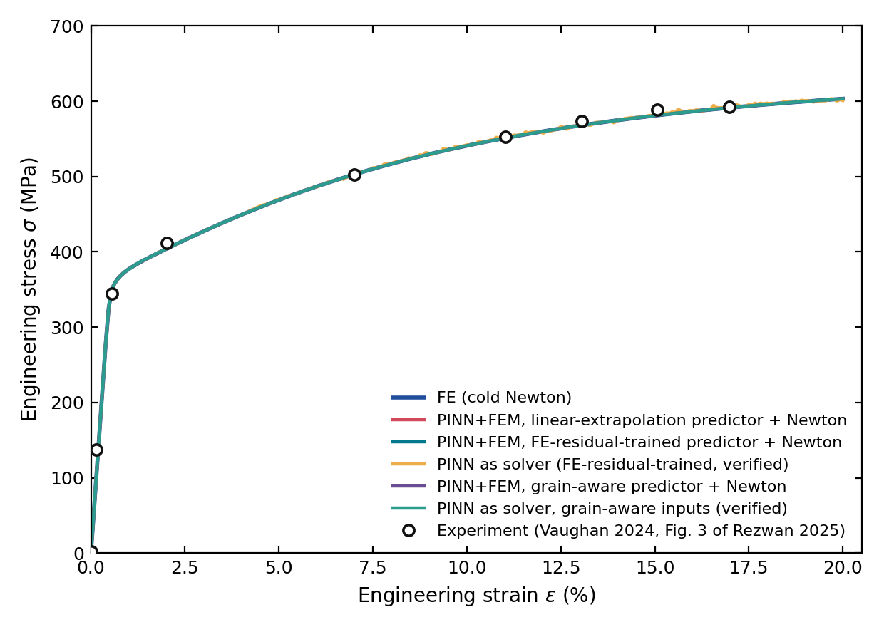

**Figure 15.** Equivalent plastic strain on the deformed plate at 20%
strain: FE reference, the PINN+FEM runs, the PINN-as-solver runs, and
the difference of the grain-aware solver run from the reference (the same panels at 2, 8
and 15% are `figures/report/neural_h40_fields_{2,8,15}pct.png`).

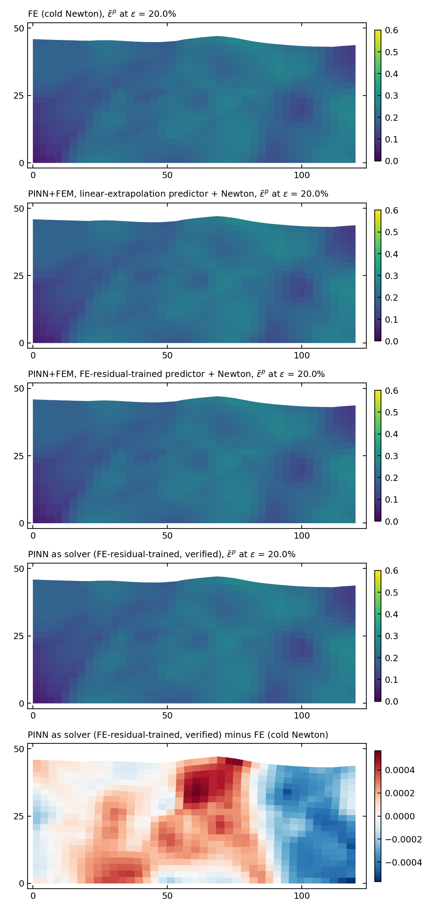

**Figure 16.** Top: Newton iterations and solve-plus-predictor time per
step of the six runs along the load path. Bottom: equilibrium error $r$
of the network's proposal before (dashed) and after training for the
four network runs, with the tolerance of the solver route.

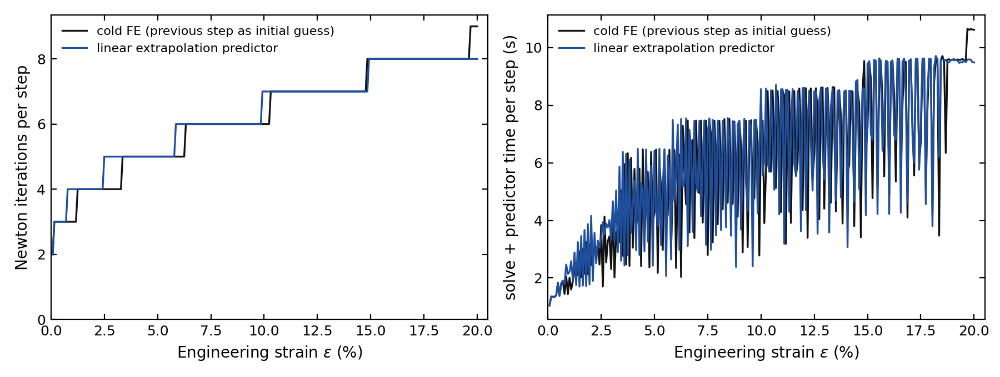

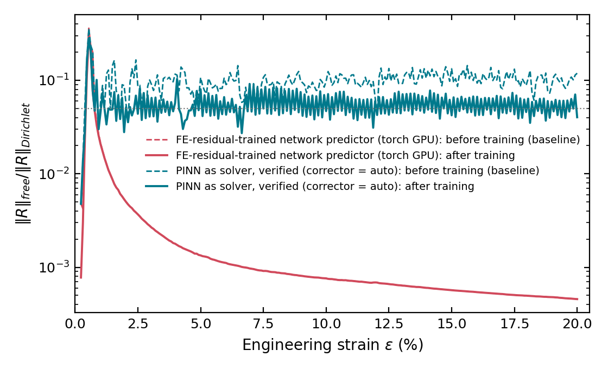

### 8.3 What the two routes measure

The network's value on this problem is bounded first by what it can
represent and then by what its training costs. A network of the
coordinates and the load factor carries the smooth part of the
step-to-step increment, which the linear extrapolation already delivers
for free; the remainder, the redistribution of plastic strain between
grains as they yield, is as sharply structured at the grain boundaries as
the field itself, and neither the strong-form nor the weak-form loss
changes that. Grain-aware inputs remove this representational limit: the
same network then reaches three to four times lower equilibrium errors
per step, and as a verified solver it returns fields fifteen times closer
to the reference at the same tolerance. What they do not remove is the
cost of training on the assembled residual, 10 to 20 s per step against 1
to 3 s for the Newton solve it replaces, so on this problem the verified
PINN-as-solver route is a correct and accurate solver at five to six
times the cost of the finite-element one, and the PINN+FEM route is a
predictor that improves on the linear extrapolation by a few percent of
the Newton iterations at a net loss of wall time. Trained on the strong
form the same network solved no step at all.

## 9. Parameter sensitivity of the neural routes

### 9.1 Design

The two routes carried forward from §8, the PINN+FEM hybrid with the
linear-extrapolation predictor and the verified PINN-as-solver with
grain-aware inputs, are run through the sixteen one-at-a-time cases of
§6 (each calibrated parameter at $\times 0.5$, $\times 0.8$, $\times 1.25$
and $\times 2$, the other three at their calibrated values) with the decks
of §8 otherwise unchanged. The question is whether a route's accuracy and
cost depend on the material constants, that is, whether the figures of
Table 8 hold away from the calibrated set. The finite-element case of §6
is the reference for every case. Decks:
`decks/cp_study/sens_h40_linear.i`, `decks/cp_study/sens_h40_grain_solver.i`;
analysis: `decks/report/neural_sensitivity.i` with
`scripts/neural_sensitivity.py`.

### 9.2 Results

**PINN+FEM, linear extrapolation.** Every one of the sixteen cases
reproduces its finite-element curve to the solver tolerance (the largest
stress difference over all cases and strains is $3 \times 10^{-6}$ MPa),
while the finite-element effect being tracked ranges from $-32$% to
$+68$% of the flow stress at 20% strain. The Newton iteration count is
941 to 974 per case against 1,468 to 1,536 for the corresponding
finite-element cases: a saving of 37% (median) that does not vary with the
parameter or its level (Fig. 17). The predictor's benefit is a property of
the load path, not of the material constants.

**PINN as solver, grain-aware, verified.** On all sixteen cases the
route behaves exactly as on the calibrated set: the engineering stress
stays within 0.3 to 1.3 MPa (at most 0.2%) of the finite-element case at
every strain, 129 to 138 of the 256 steps are solved by the network
without Newton, and the Newton count is 611 to 647, with no trend against
the parameter or its level while the finite-element flow stress moves by
$-32$% to $+68$%. The acceptance rate of about one step in two and the
accuracy of the accepted steps are properties of the tolerance and of the
network's inputs, not of the material constants; the cost per run (4,370
to 4,780 s, two runs sharing the host) is likewise unchanged.

**Table 11.** Parameter sensitivity of the two neural routes: deviation of
the route from the finite-element case and its cost, per case (full table
in `results/cp_study/sens_neural/sens_neural_h40.csv`).

| case | FE effect at 20% | PINN+FEM linear: max $\lvert\Delta\sigma\rvert$ (MPa), Newton iterations | grain-aware solver: max $\lvert\Delta\sigma\rvert$ (MPa), steps without Newton, Newton iterations |
|---|---|---|---|
| base | 0 | 0.000, 948 | 0.33, 131, 635 |
| $\rho_0 \times 0.5$ | $-7.2$% | 0.000, 952 | 0.60, 129, 634 |
| $\rho_0 \times 0.8$ | $-2.7$% | 0.000, 949 | 0.83, 134, 634 |
| $\rho_0 \times 1.25$ | $+3.2$% | 0.000, 948 | 0.77, 132, 637 |
| $\rho_0 \times 2$ | $+11.8$% | 0.000, 957 | 1.32, 132, 628 |
| $k_1 \times 0.5$ | $-31.9$% | 0.000, 974 | 0.36, 137, 611 |
| $k_1 \times 0.8$ | $-13.2$% | 0.000, 953 | 0.38, 131, 626 |
| $k_1 \times 1.25$ | $+16.9$% | 0.000, 947 | 0.77, 138, 615 |
| $k_1 \times 2$ | $+68.2$% | 0.000, 944 | 0.79, 131, 647 |
| $y_c \times 0.5$ | $+32.8$% | 0.000, 941 | 0.43, 131, 640 |
| $y_c \times 0.8$ | $+10.4$% | 0.000, 947 | 0.49, 131, 637 |
| $y_c \times 1.25$ | $-9.8$% | 0.000, 952 | 0.38, 131, 628 |
| $y_c \times 2$ | $-27.5$% | 0.000, 965 | 0.32, 131, 624 |
| $\tau_{c0} \times 0.5$ | $-1.6$% | 0.000, 948 | 0.32, 131, 633 |
| $\tau_{c0} \times 0.8$ | $-0.6$% | 0.000, 948 | 0.39, 131, 634 |
| $\tau_{c0} \times 1.25$ | $+0.8$% | 0.000, 949 | 0.80, 135, 615 |
| $\tau_{c0} \times 2$ | $+3.2$% | 0.000, 948 | 1.23, 132, 634 |

**Figure 17.** Deviation from the finite-element case and solve time per
case for the two routes.

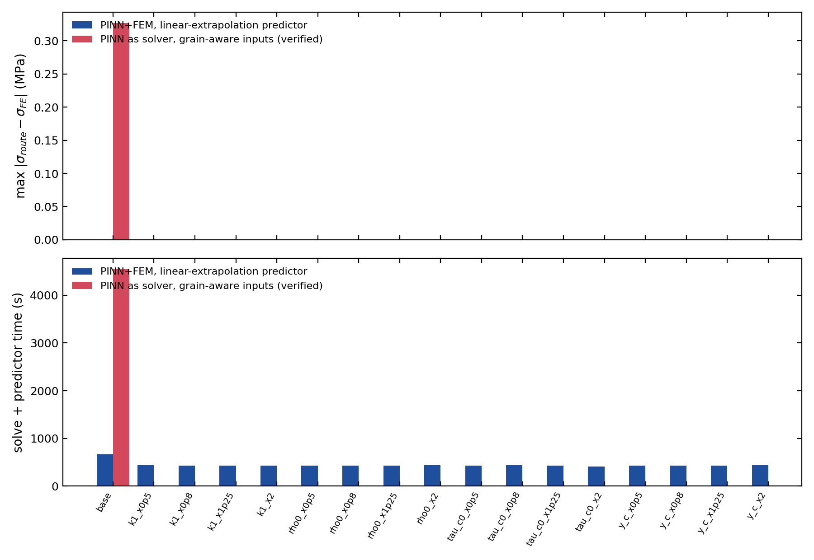

## 10. Hardware and time benchmark

### 10.1 Design

All timings in §8 and §9 were taken while other runs shared the host, so
they measure iterations and assemblies reliably and wall time only
roughly. This section measures wall time under controlled conditions:
each case is the first 16 load steps of the calibrated h40 deck (the
strain per step of §3 unchanged, so the steps are those of the cold
start, the elastic rise and the first yield), run alone on the host (8
CPU cores, one GPU), with the thread count pinned. Nine cases: the cold
finite-element arm on numpy at 1, 2, 4 and 8 threads, on torch CPU at 8
threads, on torch CPU at 1, 2, 4 and 8 threads and on the torch GPU; the PINN+FEM route with the linear
extrapolation; and the verified grain-aware PINN-as-solver route with its
network on the GPU and on the CPU. For each case: wall time per load
step, Newton time per iteration, predictor time per step, the number of
assemblies, the peak resident memory of the process and the peak GPU
memory. Deck `decks/benchmark/hardware_h40.i`; script
`scripts/hardware_benchmark.py`.

### 10.2 Results

All twelve cases converged in the same 16 steps; the three cold
finite-element cases on numpy, torch CPU and torch GPU took the same 46
Newton iterations, so they are timed on identical work. Table 12 gives
the measurements; Fig. 20 the time per step.

**Table 12.** Hardware and time benchmark, first 16 load steps of the
calibrated h40 deck, one case at a time on the host (8 cores, one GPU);
the three torch CPU rows at 1, 2 and 4 threads were added on 2026-10-13 to
size the concurrency of the following campaigns.
The peak resident memory is that of the process; the GPU memory poll did
not capture a value on this host (its tool prints no per-process figure)
and is omitted.

| case | FE arm | threads | network device | Newton iterations | Newton time per iteration | predictor time per step | steps without Newton | time per step | peak memory |
|---|---|---|---|---|---|---|---|---|---|
| cold FE | numpy | 1 | -- | 46 | 0.45 s | -- | 0 | 1.35 s | 173 MB |
| cold FE | numpy | 2 | -- | 46 | 0.47 s | -- | 0 | 1.41 s | 174 MB |
| cold FE | numpy | 4 | -- | 46 | 0.45 s | -- | 0 | 1.34 s | 175 MB |
| cold FE | numpy | 8 | -- | 46 | 0.45 s | -- | 0 | 1.35 s | 175 MB |
| cold FE | torch CPU | 1 | -- | 46 | 0.142 s | -- | 0 | 0.63 s | 1,179 MB |
| cold FE | torch CPU | 2 | -- | 46 | 0.092 s | -- | 0 | 0.42 s | 1,186 MB |
| cold FE | torch CPU | 4 | -- | 46 | 0.076 s | -- | 0 | 0.38 s | 1,201 MB |
| cold FE | torch CPU | 8 | -- | 46 | 0.067 s | -- | 0 | 0.36 s | 1,203 MB |
| cold FE | torch GPU | 8 | -- | 46 | 0.079 s | -- | 0 | 0.50 s | 1,610 MB |
| PINN+FEM, linear extrapolation | numpy | 8 | -- | 37 | 0.48 s | 0.00 s | 0 | 1.19 s | 1,610 MB (shared poll) |
| PINN as solver, grain-aware, verified | numpy | 8 | GPU | 22 | 0.48 s | 12.9 s | 8 of 16 | 13.8 s | 1,959 MB |
| PINN as solver, grain-aware, verified | numpy | 8 | CPU | 22 | 0.47 s | 12.6 s | 8 of 16 | 13.4 s | 1,959 MB |

**The finite-element arm.** On numpy the thread count does not matter:
the crystal-plasticity assembly is a sequence of small vectorised
operations that do not use the threaded BLAS, so one core does the work
of eight (0.45 s per Newton iteration in every case). On torch the same
batched path is 3.2 times faster on a single thread (0.142 s per
iteration), 4.9 times at two threads (0.092 s), 5.9 times at four
(0.076 s) and 6.7 times at eight (0.067 s): the gain is mostly the
batched kernel itself, the threads add a further factor of two with
diminishing returns, so the host's 16 cores are best used as several
two-thread runs side by side. The GPU is 5.7 times faster than numpy
(0.079 s): at 800 elements the GPU is slightly slower than the CPU,
as the first measurement of the batched kernel also found, and both
torch arms cost 7 to 9 times the memory of numpy. The absolute times of
§8 and §9, which were measured with the numpy arm, therefore overstate
every route's cost by the same factor of about 6 relative to what the
torch CPU arm delivers; the ratios between routes are unchanged, because
every route is made of the same assemblies.

**The neural routes.** The linear-extrapolation predictor costs nothing
measurable and removes a fifth of the Newton iterations over these 16
steps (37 against 46; 37% over the full path, §8). The verified
grain-aware solver solves 8 of the 16 steps without Newton, but its
training costs 12.6 to 12.9 s per step, 42 assemblies per step on the
numpy arm, against 1.35 s for the cold solve. Placing the network on the
GPU or on the CPU makes no difference (12.9 against 12.6 s): the network
is small, and the cost of the route is the finite-element assemblies of
its training loss, not the network. The same conclusion as §8, now under
controlled timing.

**Figure 20.** Time per load step of the twelve cases, split into the
Newton solve and the predictor (log scale).

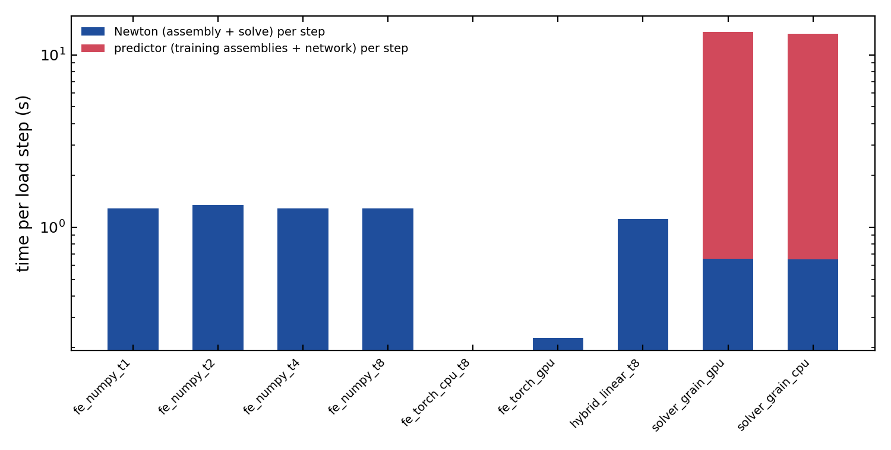

## 11. The parametric surrogate

### 11.1 Design

The three routes above solve one problem per run. The surrogate route of
the framework (ADR 0030) trains a network of the deck's **parameters**
once and answers queries in milliseconds; on crystal plasticity, whose
response depends on the loading path, the admissible training source is
sampled finite-element runs (the strong-form residual is not a function
of parameters and coordinates alone, and §8 measured that it is
unreachable on a polycrystal in any case), so the surrogate learns the
**reduced response**, the engineering stress-strain curve, and the
**final displacement field** at 20% strain, as functions of
$(\rho_0, k_1, y_c, \tau_{c0})$ over the range of §6 ($\times 0.5$ to
$\times 2$ of the calibrated values, log-uniform). Twenty-four
Latin-hypercube samples are run through the pipeline of §2 on the
calibrated structure (deck `decks/cp_study/surrogate/design_h40.i`); six
are held out. The curve surrogate is a network
$\sigma(\mathbf{p}, \varepsilon)$ with five inputs and one output, the
field surrogate $\mathbf{u}(\mathbf{p}, \mathbf{x})$ with seven inputs and
three outputs (three hidden layers of 64 tanh units in both), trained on
the GPU with Adam and L-BFGS. The measures are the held-out error
(relative L2 of the curve and of the field at parameters the network has
not seen), the cost of the data (finite-element time of the 18 training
samples), the training time, the time per query on the GPU and on the
CPU (1,000 random parameter rows), and the break-even number of queries
against the finite-element run, the PINN+FEM run and the verified
PINN-as-solver run of §8. Decks
`decks/cp_study/surrogate/plate_h40_surrogate_curve.i` and
`plate_h40_surrogate_field.i`.

### 11.2 Results

The twenty-four samples cost 14,961 s of finite-element time (623 s each
on average at two threads, four at a time); the eighteen training samples
account for 11,270 s. Table 10 summarises the three surrogate runs.

**Table 10.** Plate surrogates over $(\rho_0, k_1, y_c, \tau_{c0})$ at h40,
eighteen training samples, six held out. The held-out error is the mean
relative L2 difference from the finite-element result at parameters the
network has not seen; the query time is for 1,000 random parameter rows
after training. Break-even is the number of queries after which data
plus training is cheaper than one solver run per query (cold FE 838 s;
PINN+FEM 667 s; verified grain-aware solver 4,543 s).

| surrogate | network | training device | held-out error, mean (max) | training time | time per query | break-even vs cold FE |
|---|---|---|---|---|---|---|
| stress-strain curve $\sigma(\mathbf{p}, \varepsilon)$ | 5 in, 1 out, 8,769 weights | GPU | 3.3% (6.6%) | 28 s | 0.38 ms | 14 runs |
| stress-strain curve, same deck | same | CPU | 2.0% (5.2%) | 52 s | 0.18 ms | 14 runs |
| displacement field $\mathbf{u}(\mathbf{p}, \mathbf{x})$ at 20% | 7 in, 3 out, 9,027 weights | GPU | 0.97% (1.04%) | 121 s | 0.60 ms (1,722 nodes per query) | 14 runs |

**Accuracy.** The field surrogate reproduces the 20% displacement field
of every held-out sample to about 1%: the displacement of a plate in
tension varies smoothly with the parameters and the network has little
to learn beyond the amplitude. The curve surrogate is coarser, 2 to 3% on
average and 5 to 7% at worst (Fig. 18): the elastic knee is smoothed, and
the held-out sample with the lowest hardening (sample 21, saturating at
420 MPa) is overshot at small strain and under-resolved afterwards, the
signature of a four-dimensional log space sampled by eighteen points. The
accuracy is limited by the data, not by the network; doubling the design
costs another 15,000 s of finite-element time and is the lever if the
curve surrogate is to be used quantitatively.

**Cost.** The training is negligible next to the data: 28 to 121 s
against 11,270 s of finite-element runs. The network is small, so a curve query
costs 0.2 to 0.4 ms on either device and a field query (1,722 nodes) 0.6
ms, and the GPU gives no advantage at this size (it is slower per query than the CPU because of the launch
overhead); training on the GPU is faster for the field surrogate only.
Against the finite-element run of §4 the surrogate pays for itself after
14 queries, against the verified PINN-as-solver run after 3 (Fig. 19);
beyond that every query is four to five orders of magnitude cheaper than
a solve. The two neural solver routes of §8 never reach this regime
because they are trained per trajectory; the surrogate does because it is
trained once over the parameter space and verified on held-out
finite-element runs, which is the only verification available for a
history-dependent material (the certification by one assembly of §11.1's
framework applies to steady physics only).

**Figure 18.** Held-out stress-strain curves (solid, finite element)
against the curve surrogate (dashed), GPU run.

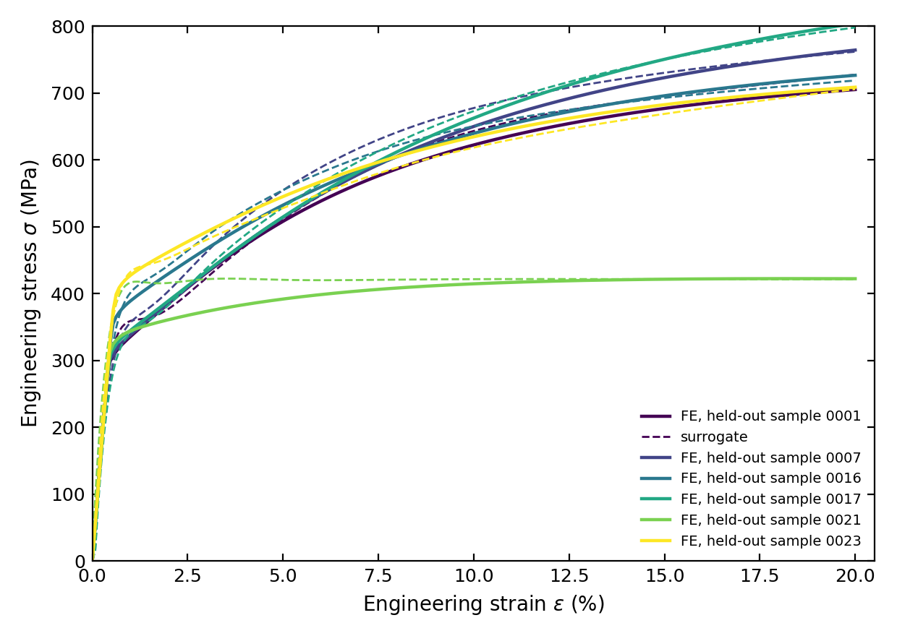

**Figure 19.** Cost per query against the number of queries answered: the
surrogates (data plus training amortised, plus the query) and the solver
routes (one run per query).

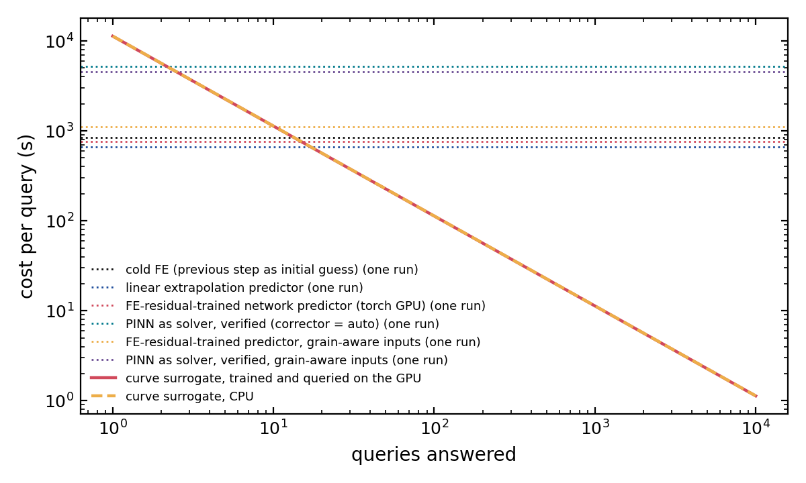

## 12. Part II: phase-field ductile fracture on the perforated plate

### 12.1 Problem

The Part I plate (100 x 50 x 1 um, 30 grains, x-loaded to 20% nominal
strain at 1e-3 /s) receives a central through-hole of diameter 5 um. The
hole is the stress concentrator whose Irwin plastic zone
$r_p = (a/2)(\sigma/\sigma_y)^2$ stays clear of the plate edges
($r_p \le 3.3$ um against a 22.5 um ligament) and is smaller than a grain
(13.7 um median), so that initiation is governed by the grains at the
hole. Two couplings are benchmarked on the same geometry, mesh and
loading: J2 plasticity with phase-field ductile fracture (J2+PFD) and the
Part I crystal plasticity with the same fracture model (CP+PFD).

### 12.2 Fracture model

The AT2 phase field $d$ with degradation $g(d) = (1-d)^2$ and the
plastic-work driving force,

$$
\frac{G_c}{\ell_0}\, d - G_c \ell_0 \nabla^2 d = 2 (1-d)\, \mathcal{H}, \qquad
\mathcal{H}(t) = \max_{\tau \le t} \left\langle \zeta\, W_p(\tau) - W_c \right\rangle ,
\tag{20}
$$

where $W_p$ is the accumulated plastic work density, $\zeta = 1$, $W_c$ a
plastic-work threshold below which no damage accrues, and $\eta = 0$
(quasi-static). The mechanics and the damage are solved in a staggered
loop with up to three alternations per load step (tolerance 1e-3 on the
damage increment), 256 load steps to 20%, and the mechanics stiffness
degraded by $g(d)$. Fracture initiation is the first load step at which
$d \ge 0.8$ at any node (the element-average criterion gives the same
step on every case reported); the fracture strain is the nominal strain of
that step. The calibration target is the last point of the (vaughan 2024
mechanistic) curve, 17.2% nominal strain.

### 12.3 Mesh

hexaform `plate` meshes (hexahedral, one element through the thickness,
a conforming O-grid ring of 24 segments around the hole, grain ids from the
Part I point file at the element centroids): h20 (5 um background, 308
hex8, 700 nodes), h40 (2.5 um, 860, 1,864; the production level) and h80
(1.25 um, 3,232, 6,736). The h160 level (12,800 elements) was built and
dropped: no load step of the coupled J2 solve completed in 5.5 h.

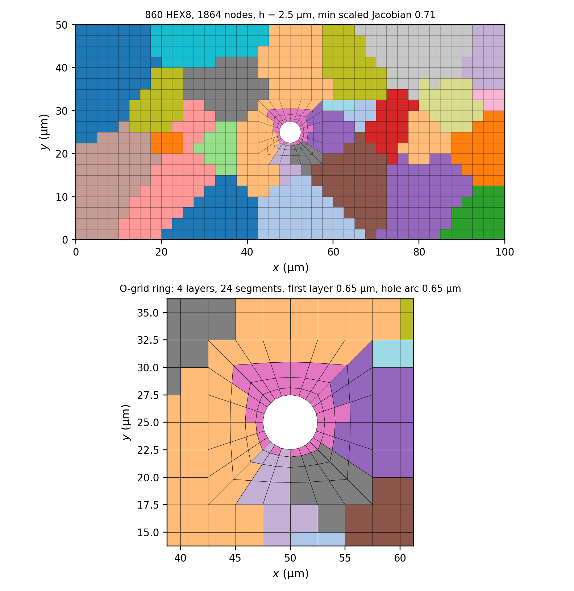

*Figure 20. The h40 perforated mesh coloured by grain id (top) and the
O-grid ring around the hole (bottom): 4 layers, hole-arc element 0.65 um.*

### 12.4 Hardware

Every run of Part II uses the torch CPU arm (the Part I hardware
benchmark's best arm), two threads per run and up to seven runs side by
side on the 16-core host, except the hardware comparison of §18.

## 13. J2 plasticity with phase-field ductile fracture

### 13.1 J2 law

The isotropic hardening law is fitted to the digitized experimental curve
converted to true stress and logarithmic strain (elastic constants from the
Voigt average of the cubic set, E = 71.2 GPa, nu = 0.346, so that the J2
and CP plates share one elastic response). A power law
$\sigma_y = 299 + 829\,\alpha^{0.44}$ MPa misses the nearly linear late
hardening by 5 to 6% at 13 to 17% strain; a 26-point piecewise table of
median true stress in log-spaced bins of plastic strain reproduces every
experiment marker from 0.6% to 17% within 0.3% and is the J2 law of
Part II (`decks/pfd_study/j2_fit.i`, `scripts/j2_fit.py`).

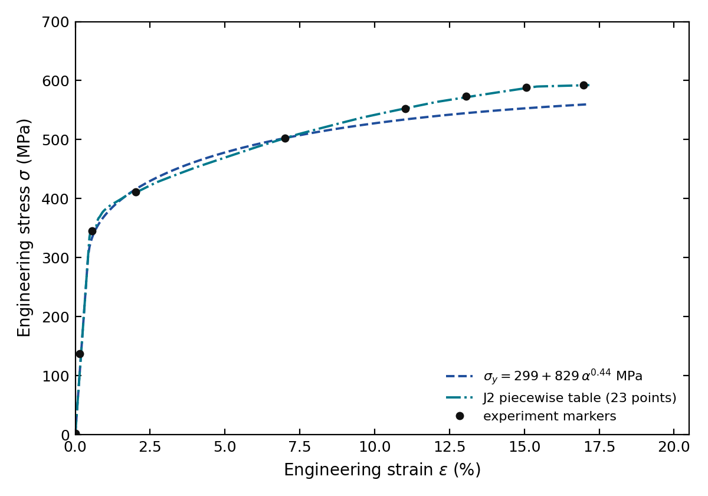

*Figure 21. The two J2 hardening laws against the experiment markers; the
piecewise table is carried.*

### 13.2 Threshold and toughness: the W_c scan

With $W_c = 0$ or 20 MPa and $G_c$ calibrated to the 17.2% target, the
perforated J2 plate softens from 6% strain (peak 415 and 485 MPa) while the
experiment hardens to 17%, and the calibrated $G_c$ of 2,000 MPa um
(2 kJ/m$^2$) is high for an aluminium alloy. The threshold was therefore
scanned at $\ell_0 = 5$ um, with $G_c$ re-calibrated by log-bisection at
every value (`decks/pfd_study/j2/cal_h40_wc{200,400,600,800}.i`,
`scripts/pfd_calibrate.py`; the scan values bracket the plastic-work
density at the hole, 91 MPa at 5% and 1,160 MPa at 17%):

| $W_c$ (MPa) | calibrated $G_c$ (MPa um) | fracture strain | onset of softening | peak (MPa) |
|---|---|---|---|---|
| 0 | 2,063 | 17.3% | 6.1% | 415 |
| 20 | 2,003 | 17.1% | 6.1% | 485 |
| 200 | 385.5 | 17.2% | 13.9% | 571 |
| 400 | 155.9 | 17.2% | 14.1% | 485 |
| 600 | 144.7 | 17.2% | 13.4% | 472 |
| 800 | 144.7 | 17.2% | 13.4% | 472 |

*Table 13. The W_c scan at l0 = 5 um, h40.*

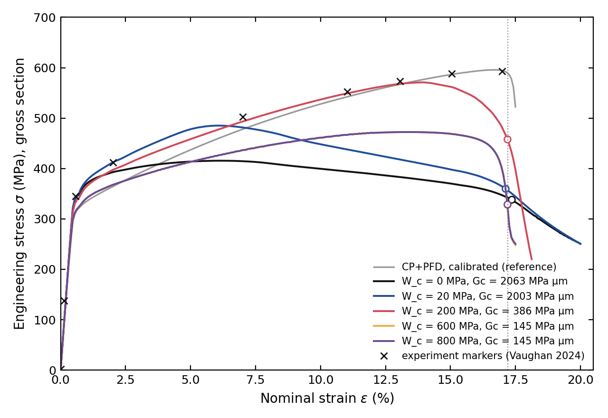

*Figure 22. Gross-section stress-strain curves of the calibrated J2 plate
at each threshold, the CP+PFD plate in grey, the experiment markers and the
17.2% target (dotted). Circles mark initiation.*

The threshold and the toughness trade against each other: raising $W_c$
from 20 to 200 MPa moves the onset of softening from 6.1 to 13.9% and lets
$G_c$ fall five-fold, with the peak rising to 571 MPa (97% of the
experiment's 590). Beyond 400 MPa the trade turns: the plastic work exceeds
the threshold only in the root elements late in the path, the bisection
needs $G_c \approx 150$ MPa um to initiate by 17.2%, and that low toughness
degrades the root so fast that the peak falls back below 490 MPa; 600 and
800 MPa reproduce each other to the digit because the threshold is already
above the plastic work everywhere but the root. The carried J2
configuration is $W_c = 200$ MPa, $G_c = 385.5$ MPa um (0.39 kJ/m$^2$),
$\ell_0 = 5$ um.

### 13.3 Calibrated $G_c(\ell_0)$ and the length-scale sweep

| $\ell_0$ (um) | $\ell_0/h$ | calibrated $G_c$ (MPa um) | $G_c \ell_0$ | fracture strain | peak (MPa) at strain |
|---|---|---|---|---|---|
| 5 | 2 | 385.5 | 1,928 | 17.19% | 571 at 13.9% |
| 10 | 4 | 488.9 | 4,889 | 17.27% | 537 at 13.0% |
| 20 | 8 | 558.8 | 11,175 | 17.19% | 499 at 11.6% |

*Table 14. J2+PFD calibration at W_c = 200 MPa, h40.*

| $\ell_0$ at $G_c = 385.5$ (um) | 2.5 (= h) | 5 | 10 | 20 | 40 |
|---|---|---|---|---|---|
| fracture strain | 18.13% | 17.19% | 15.86% | 14.45% | 15.08% |
| peak (MPa) | 611 | 571 | 509 | 448 | 436 |
| fracture energy (MPa) | 101.9 | 87.0 | 71.7 | 58.2 | 58.6 |

*Table 15. J2+PFD length-scale sweep at fixed G_c (the (chakraborty 2016
multiscale) Fig. 8 analogue).*

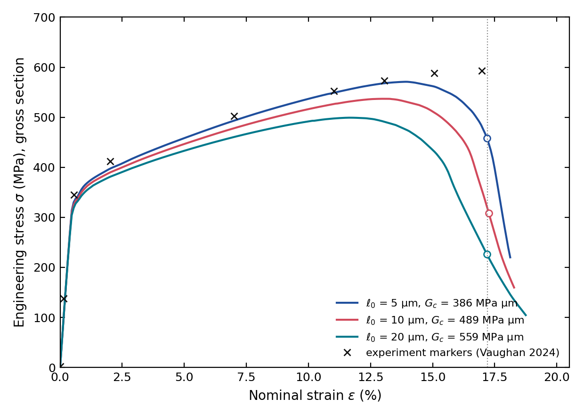

*Figure 23. The calibrated J2 plates at l0 = 5, 10 and 20 um.*

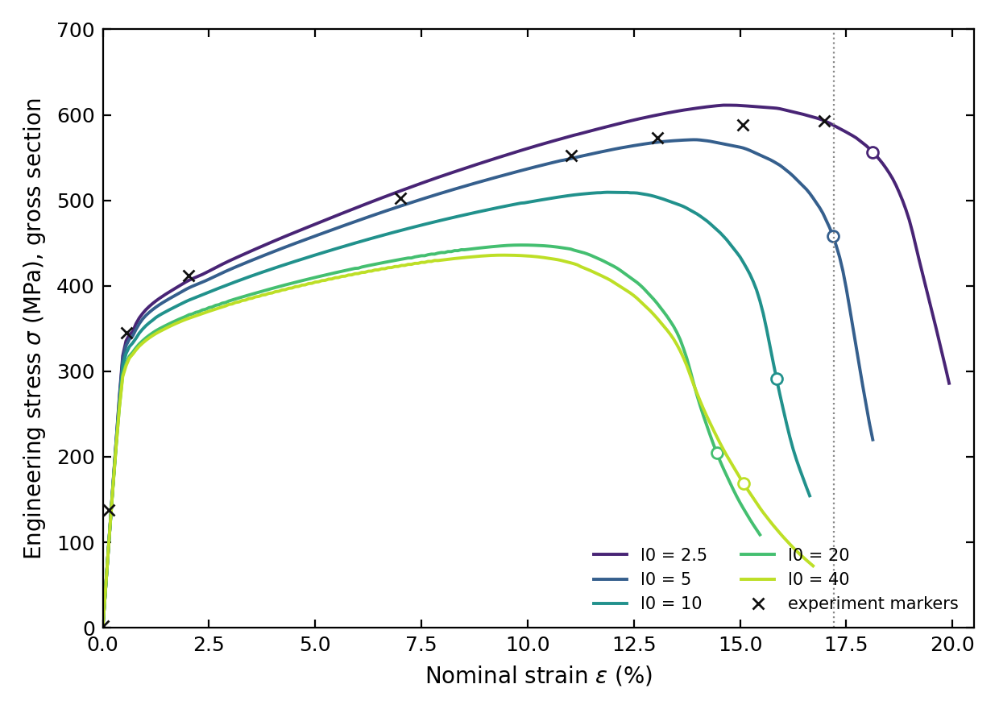

*Figure 24. J2+PFD at fixed G_c, l0 from h to 16h.*

The calibrated toughness rises with the length scale (x1.45 from 5 to
20 um) and the peak falls because a wider damage band degrades more of the
ligament before the root reaches $d = 0.8$. At fixed $G_c$ the fracture
strain, the peak and the fracture energy fall with $\ell_0$ to 20 um and
the fracture strain turns up at 40 um, where the band spans the ligament
and the damage grows everywhere at once.

### 13.4 Parameter sensitivity

One parameter at a time from the carried configuration, four values each
(`decks/pfd_study/j2/sens_h40.i`):

| parameter | values | fracture strain | peak (MPa) |
|---|---|---|---|
| base | $G_c$ 385.5, $\ell_0$ 5, $\eta$ 0, $W_c$ 200 | 17.19% | 571 |
| $G_c$ x 0.25, 0.5, 2, 4 | 96, 193, 771, 1,542 | 9.06, 13.36%, none, none | 398, 497, 617, 645 |
| $\ell_0$ (um) | 2.5, 3.75, 7.5, 10 | 18.13, 17.58, 16.48, 15.86% | 611, 590, 537, 509 |
| $\eta$ (MPa s) | 1, 3, 10, 30 | 17.34, 17.58, 18.28, 19.69% | 572, 573, 579, 595 |
| $W_c$ (MPa) | 50, 100, 400, 800 | 7.97, 11.72%, none, none | 471, 523, 594, 596 |
| alternations | 5 | 17.19% | 571 |

*Table 16. J2+PFD sensitivity at h40 ("none": no initiation by 20%).*

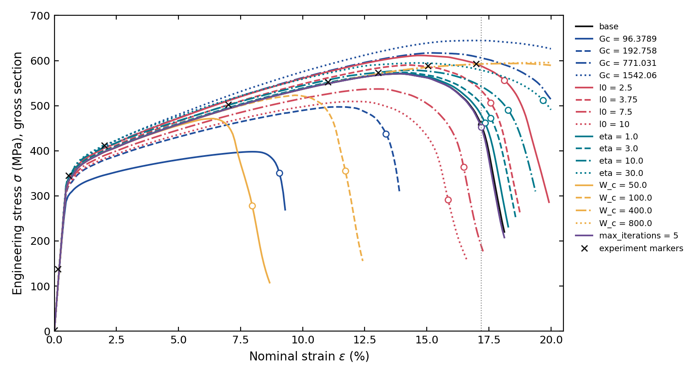

*Figure 25. J2+PFD sensitivity curves: one colour per parameter, one line
style per value.*

Every fracture parameter is active: $G_c$ and the threshold move the
initiation by several percent of strain (the threshold is the steepest
lever, 8.0% at 50 MPa, none at 400 MPa), $\ell_0$ moves it monotonically
with the peak, and the viscosity, immaterial at $W_c = 0$, now delays
initiation by 1.1 to 2.5% at 10 to 30 MPa s because the damage grows in
3% of strain once the threshold is crossed. Five alternations against three
leave the result unchanged.

### 13.5 Mesh sensitivity

| mesh | h (um) | $\ell_0/h$ | fracture strain | peak (MPa) | fracture energy (MPa) |
|---|---|---|---|---|---|
| h20 | 5 | 1 | 17.34% | 570 | 92.0 |
| h40 | 2.5 | 2 | 17.19% | 571 | 87.0 |
| h80 | 1.25 | 4 | 16.02% | 564 | 79.4 |

*Table 17. J2+PFD at W_c = 200, l0 = 5 um, three mesh levels.*

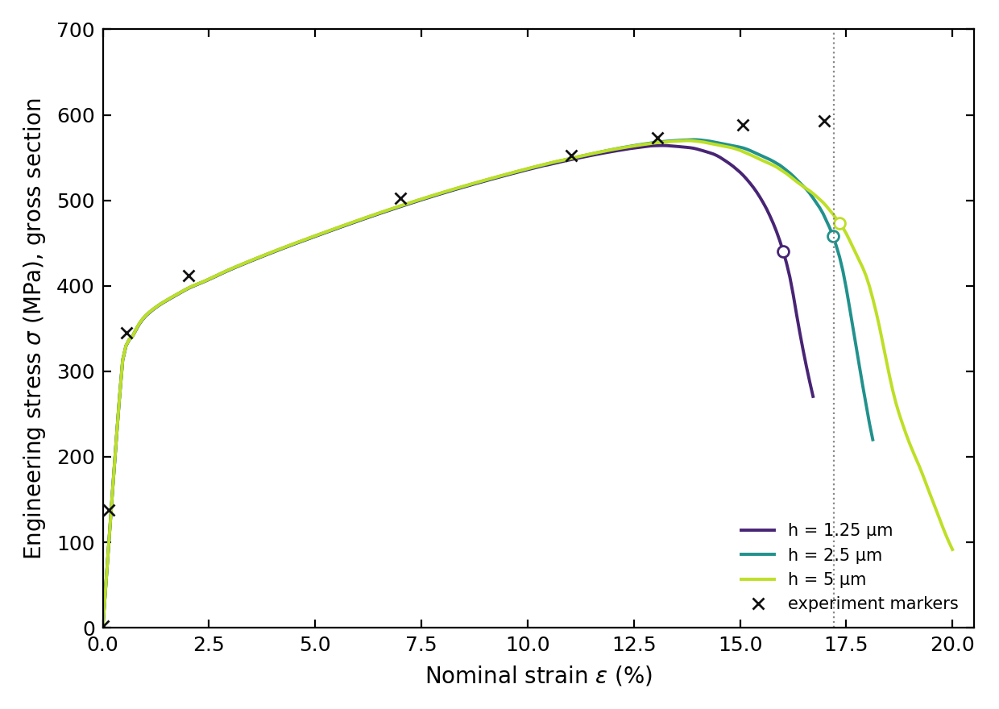

*Figure 26. J2+PFD mesh sensitivity.*

The peak is mesh-independent within 1.2%, but the initiation strain of the
thresholded J2 source is not converged at h40: h80 initiates 1.2% strain
earlier. The threshold confines the damage source to the root elements
where $W_p > W_c$, and the finer mesh resolves a smaller, hotter root volume
that crosses the threshold earlier. This is a limitation of the carried J2
configuration (a calibration at h80 would lower $G_c$ by about 10%); the
$\ell_0 \ge 2h$ rule, sufficient for the diffuse $W_c = 0$ source
(h40 and h80 within two load steps), is not sufficient for a thresholded
one.

## 14. Crystal plasticity with phase-field ductile fracture

### 14.1 Calibrated $G_c(\ell_0)$ and the length-scale sweep

The Part I calibrated crystal-plasticity set and grain structure, the AT2
model with $W_c = 0$ and $\eta = 0$, $G_c$ calibrated by log-bisection
at each $\ell_0$ (`decks/pfd_study/cp/cal_h40.i`):

| $\ell_0$ (um) | $\ell_0/h$ | calibrated $G_c$ (MPa um) | fracture strain | peak (MPa) at strain |
|---|---|---|---|---|
| 5 | 2 | 1,106 | 17.19% | 596 at 16.6% |
| 10 | 4 | 1,832 | 17.11% | 577 at 15.5% |
| 20 | 8 | 2,818 | 17.27% | 569 at 15.1% |

*Table 18. CP+PFD calibration at h40.*

| $\ell_0$ at $G_c = 1,106$ (um) | 2.5 (= h) | 5 | 10 | 20 | 40 |
|---|---|---|---|---|---|
| fracture strain | none | 17.2% | 10.5% | 7.1% | 6.9% |
| peak (MPa) | 658 | 596 | 486 | 418 | 407 |
| fracture energy (MPa) | 103 | 85.0 | 43.7 | 26.7 | 25.4 |

*Table 19. CP+PFD length-scale sweep at fixed G_c.*

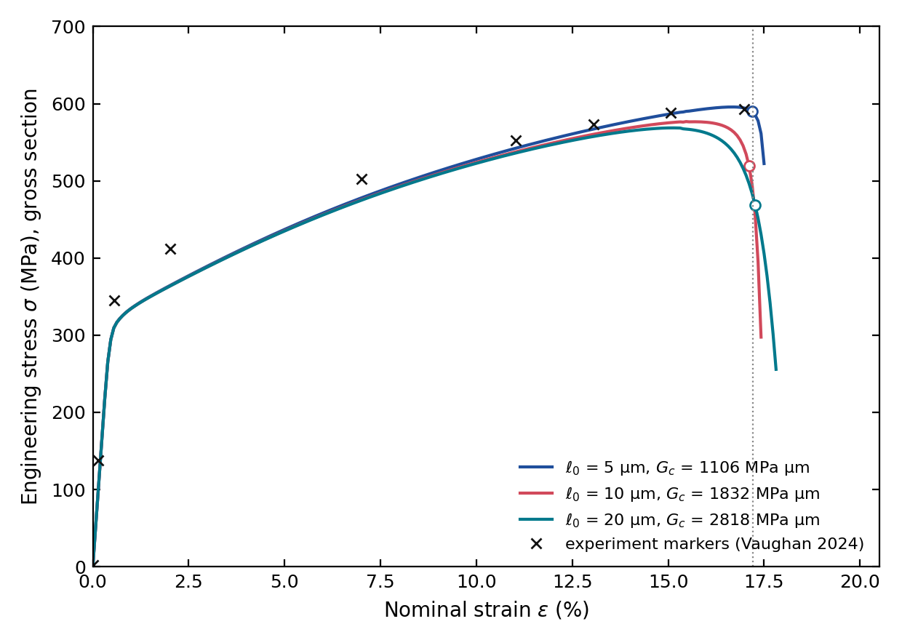

*Figure 27. The calibrated CP+PFD plates at l0 = 5, 10 and 20 um against
the experiment markers.*

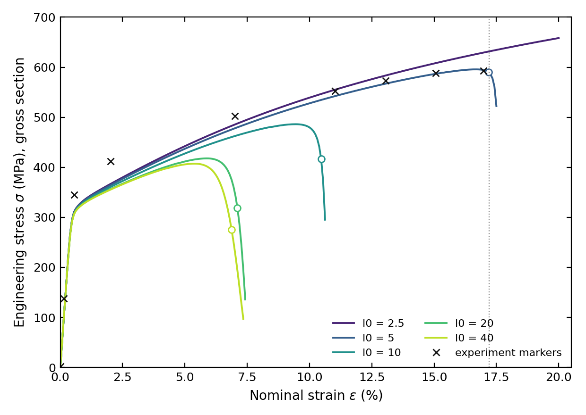

*Figure 28. CP+PFD at fixed G_c, l0 from h to 16h.*

The crystal-plasticity plate needs no threshold: its gross-section stress
follows the plain-specimen markers within 1 to 2% from 0.6% to 17% (peak
596 MPa at 16.6% against 593 at 17%) and loses its load in 0.6% of strain
after initiation. This agreement is recorded as a coincidence of a
different specimen, not a validation: the perforated gross section is 10%
smaller and the Part I plain plate matched the same markers, so the net-
section loss and the different hardening of the polycrystal under the
hole's stress state cancel on this geometry. The calibrated $G_c$ is
1,106 MPa um at $\ell_0 = 5$ um, 2.9x the J2 value at the same length
scale, and it rises with $\ell_0$ to the J2 $W_c = 0$ value at 20 um,
where the band averages over the four grains at the hole. At fixed
$G_c$ the sweep gives the clean (chakraborty 2016 multiscale) Fig. 8 form:
peak, fracture strain and energy all fall monotonically with $\ell_0$
and saturate between 8h and 16h; at $\ell_0 = h$ nothing initiates.

### 14.2 Parameter sensitivity

| parameter | values | fracture strain | peak (MPa) |
|---|---|---|---|
| base | $G_c$ 1,106, $\ell_0$ 5, $\eta$ 0, $W_c$ 0 | 17.19% | 596 |
| $G_c$ x 0.25, 0.5, 2, 4 | 277, 553, 2,212, 4,424 | 4.22, 8.59%, none, none | 381, 472, 657, 666 |
| $\ell_0$ (um) | 2.5, 3.75, 7.5, 10 | none, none, 12.89, 10.47% | 658, 641, 529, 486 |
| $\eta$ (MPa s) | 1, 3, 10, 30 | 17.19% (all) | 596 (all) |
| $W_c$ (MPa) | 5, 10, 20, 40 | 17.66, 18.13, 19.06%, none | 602, 608, 619, 641 |
| alternations | 5 | 17.11% | 595 |

*Table 20. CP+PFD sensitivity at h40.*

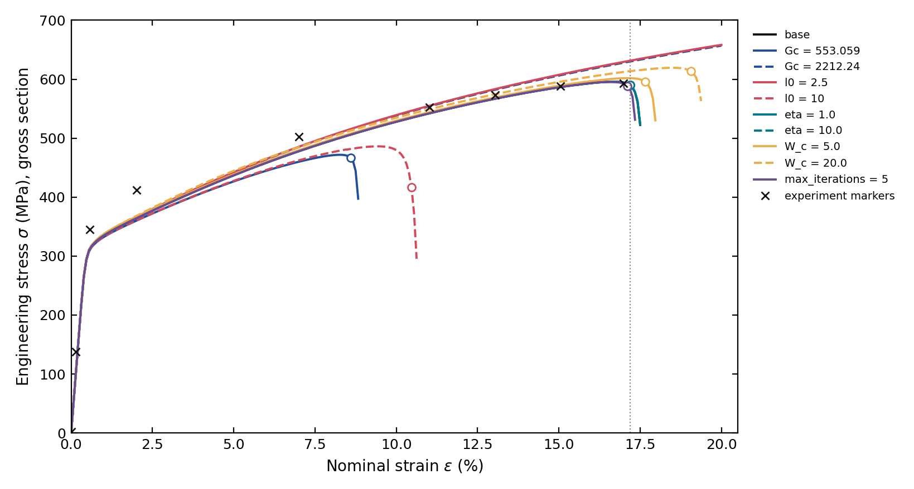

*Figure 29. CP+PFD sensitivity curves.*

$G_c$ and $\ell_0$ govern initiation monotonically; the viscosity is
immaterial at the quasi-static rate (peak within 0.06 MPa over 1 to 30
MPa s); the threshold moves initiation by about +0.1% strain per MPa and
removes it at 40 MPa, because the intragranular plastic work at the
initiation site is spent in a narrower range than in J2. Five alternations
against three change the fracture strain by one load step.

### 14.3 Mesh sensitivity

| mesh | h (um) | $\ell_0/h$ | fracture strain | peak (MPa) | fracture energy (MPa) |
|---|---|---|---|---|---|
| h20 | 5 | 1 | 16.09% | 609 | 81.0 |
| h40 | 2.5 | 2 | 17.19% | 596 | 85.0 |
| h80 | 1.25 | 4 | 17.58% | 587 | 86.3 |

*Table 21. CP+PFD at l0 = 5 um, three mesh levels.*

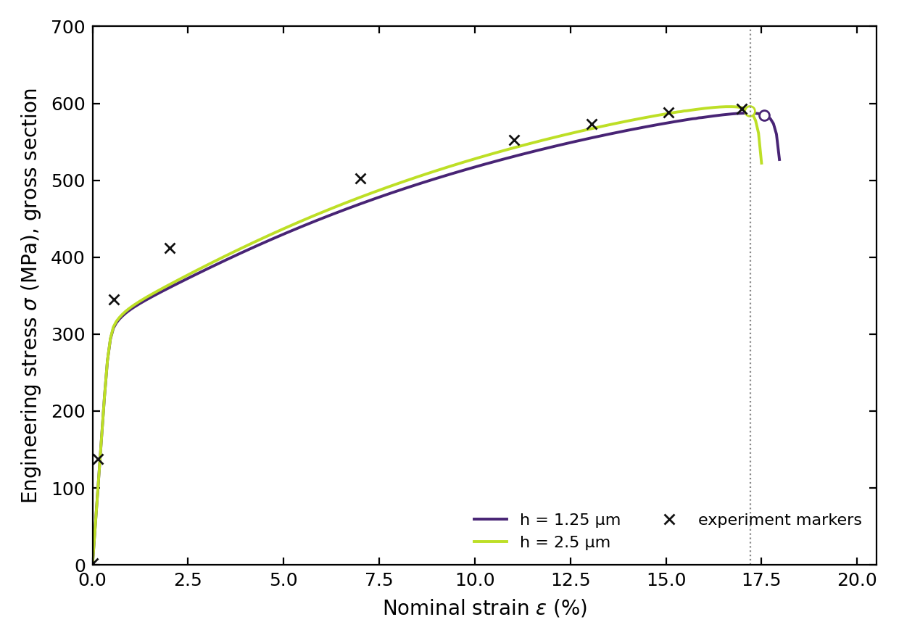

*Figure 30. CP+PFD mesh sensitivity.*

The sequence converges from below in the initiation strain and from above
in the peak: h20 ($\ell_0 = h$) initiates 1.1% early and 2% too stiff,
h40 and h80 differ by five load steps (0.4%) and 1.4% in the peak, within
the 2% the Part I grain-instance check accepted. h40 with
$\ell_0 = 5$ um ($\ell_0 = 2h$) is the production configuration.

### 14.4 Grain-instance check

| instance | fracture strain | peak (MPa) | fracture energy (MPa) | max d at 20% |
|---|---|---|---|---|
| A (calibration) | 17.19% | 596 | 85.0 | -- |
| B | none by 20% | 613 | 99.8 | 0.73 |
| C | 16.09% | 612 | 83.4 | -- |

*Table 22. The calibrated CP+PFD case on the three Part I grain structures.*

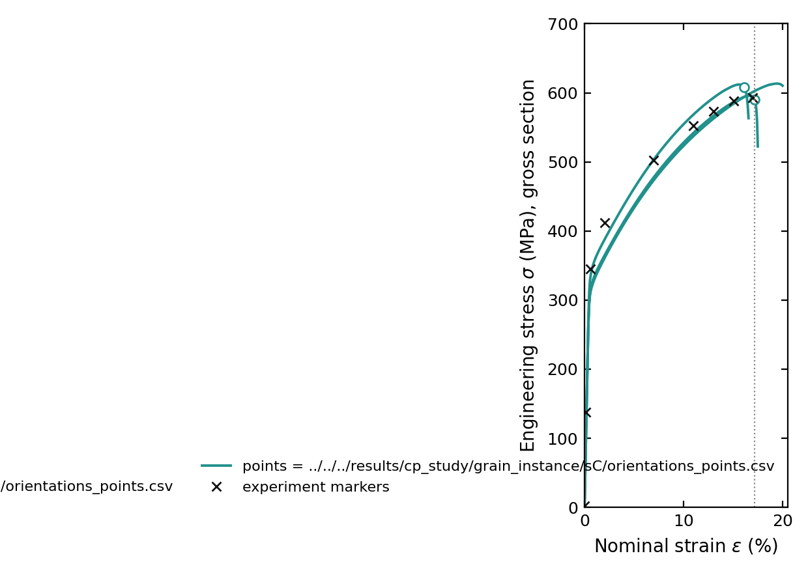

*Figure 31. CP+PFD on the three grain instances.*

With the same $G_c$ and $\ell_0$, instance C initiates 1.1% earlier and
instance B not at all within the path, while the gross-section curves
agree within 3% to 15%: the grain configuration at the hole governs the
initiation strain, as the plastic zone smaller than a grain implies. A
$G_c$ calibrated on one instance is an instance-specific number.

## 15. Fields: how the two couplings fail

`decks/pfd_study/report/fields_cal_h40.i`, `scripts/pfd_fields.py`
(damage and equivalent plastic strain at fixed nominal strains, the
cracked elements $d \ge 0.8$ solid over the plastic strain, and the
animation `figures/pfd/cal_h40_evolution.gif`).

| run | strain | max d | mean d | elements with d >= 0.8 | max equivalent plastic strain |
|---|---|---|---|---|---|
| CP | 5 / 10 / 15 / 17.2% | 0.22 / 0.42 / 0.61 / 0.81 | 0.14 / 0.27 / 0.39 / 0.44 | 0 / 0 / 0 / 2 | 0.16 / 0.30 / 0.42 / 0.46 |
| CP | 17.5% (end) | 0.97 | 0.47 | 40 | 0.46 |
| J2 | 5 / 10 / 15 / 17.2% | 0.05 / 0.07 / 0.37 / 0.78 | 0.03 / 0.05 / 0.08 / 0.14 | 0 / 0 / 0 / 0 | 0.17 / 0.31 / 0.62 / 1.02 |
| J2 | 18.1% (end) | 0.91 | 0.19 | 28 | 1.31 |

*Table 23. Field statistics of the two calibrated plates.*

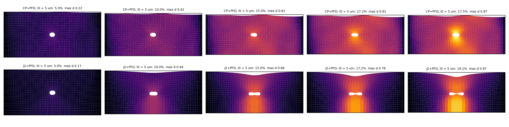

*Figure 32. Damage (element mean) on the deformed plates at 5, 10, 15 and
17.2% and at the end of the path; CP+PFD (top), J2+PFD at W_c = 200
(bottom).*

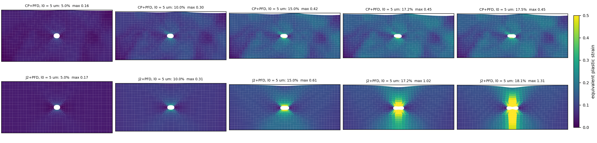

*Figure 33. Equivalent plastic strain at the same strains.*

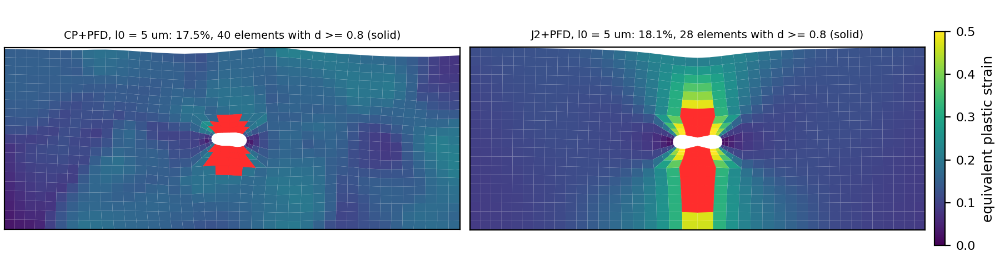

*Figure 34. The cracked elements (d >= 0.8, solid) over the equivalent
plastic strain at the end of each path.*

The two plates reach $d = 0.8$ at the root at the same nominal strain by
construction, by different routes. The CP plate damages diffusely from the
first steps (mean $d$ 0.14 at 5%, 0.44 at initiation) because every grain
accumulates plastic work and the source has no threshold; the hot spot sits
at the root in the grain below the hole, and the cracked elements extend
above and below the hole with a tilt toward the lower-right grain
boundary, while the plastic strain stays below 0.46 in a grain-wise
pattern. The J2 plate holds its section until the plastic work at the root
passes the threshold (max $d$ 0.07 at 10%), then a transverse band of
damage grows across the ligament in a few percent of strain, with the
plastic strain localised in the same band (1.0 at initiation, three times
the CP maximum) and the plate necking at the top edge; the 28 cracked
elements form a straight transverse crack. This is the J2 limitation: with
a homogeneous flow stress the model matches the curve's hardening and its
fracture strain only through a threshold and a five-fold lower toughness,
and the mechanism it then produces (a localised plastic-work band) is not
the CP mechanism (a grain-set hot spot in a diffusely damaged section).
Matching the CP fields needs the heterogeneous flow stress of the grain
structure, not a J2 parameter.

## 16. Stress-concentrator shape study (CP+PFD)

The calibrated CP+PFD set on six elliptical holes (hexaform ellipse holes,
h40 background, the same ring rule; `decks/pfd_study/cp/shape_h40.i`,
`decks/pfd_study/mesh/h40_ell_*.i`), in three series: A holds the
transverse half-extent $a = 2.5$ um and sharpens the root (Inglis
$K_t = 1 + 2a/b$ = 5 and 9); B holds the hole area and lengthens the
transverse extent (7.07 and 10 um); C rotates the 5 x 2.5 um ellipse by 45
and 90 degrees.

| series | case | $K_t$ | fracture strain | peak (MPa) | fracture energy (MPa) | cracked elements at the end |
|---|---|---|---|---|---|---|
| -- | circle 5 um | 3 | 17.19% | 596 | 85.0 | 40 |
| A | 5 x 2.5 | 5 | 17.81% | 602 | 89.1 | 61 |
| A | 5 x 1.25 | 9 | 18.36% | 606 | 92.2 | 7 |
| B | 7.07 x 3.54 | 5 | 16.33% | 590 | 79.0 | 45 |
| B | 10 x 2.5 | 9 | 15.47% | 572 | 74.1 | 11 |
| C | 5 x 2.5 at 45 deg | -- | 18.52% | 606 | 93.0 | 82 |
| C | 5 x 2.5 at 90 deg | 2 | 18.91% | 610 | 95.2 | 56 |

*Table 24. The shape study (the 7.07 x 3.54 peak is the value before its
last-step spike).*

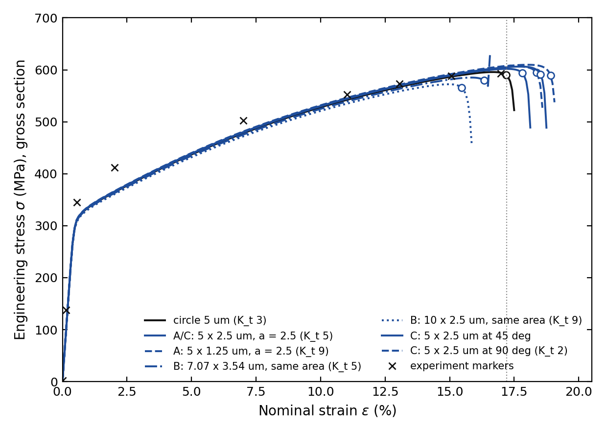

*Figure 35. Stress-strain curves of the seven stress concentrators.*

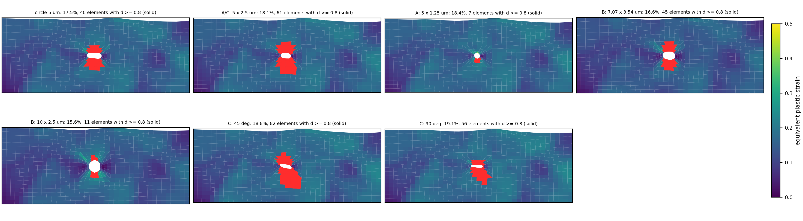

*Figure 36. Cracked elements over the plastic strain at the end of each
path (`figures/pfd/cp_shape_h40_evolution.gif` animates the seven cases).*

Series A contradicts the elastic expectation: at fixed transverse extent a
sharper root initiates later, not earlier, because the plastic-work source
of the CP plate is concentrated into a smaller root volume (7 cracked
elements for the sharpest root against 40 for the circle) and because the
0.45 um hole-arc element under-resolves a 0.16 um root radius (the case is
reported with that caveat; the h80 ring would be needed to make it
quantitative). Series B follows the Irwin scaling: the larger transverse
extent ($r_p$ proportional to $a$) initiates earlier with a lower energy
and the crack leaves the root transversely. Series C delays initiation as
$K_t$ falls with the rotation and the 45-degree case tilts the crack along
the grain boundary below the hole into the lower-right grain, the path the
circle's crack also turns into. Every case initiates at the root or the
grain boundary adjacent to it, and the peak varies by only 2% because the
gross section is 95% intact until initiation.

## 17. Neural routes inside the staggered loop

The two Part I routes serve the mechanics sub-solve of every staggered
step of the calibrated CP+PFD plate (`decks/pfd_study/cp/neural_h40.i`):
the linear extrapolation predictor (PINN+FEM) and the grain-aware
FE-residual-trained network as the verified solver (network on the GPU,
Newton correction when the proposal's residual exceeds 5% of the step's).

| route | fracture strain | peak (MPa) | Newton iterations (last alternation of each step) | Newton time (s) | predictor time (s) | wall (s) |
|---|---|---|---|---|---|---|
| FE (cold Newton start) | 17.19% | 595.8 | 1,008 | 147 | -- | 642 |
| PINN+FEM, linear extrapolation | 17.19% | 595.8 | 1,008 | 145 | 0.0 | 609 |
| PINN as solver, grain-aware, verified | 17.11% | 595.6 | 955 | 122 | 43.5 | 481 |

*Table 25. The neural routes on the coupled problem (torch CPU, 2 threads).*

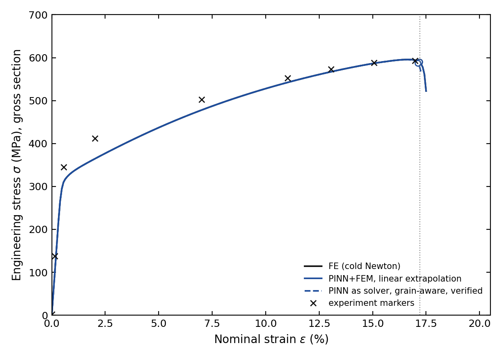

*Figure 37. The three routes coincide on the curve.*

The linear extrapolation reproduces the FE run to the printed digits with
a median proposal error of 0.6% of the step increment. The verified solver
accepts its proposal at 216 of 222 first alternations (two cold-start
steps without history and four early steps corrected by Newton; median
residual of the accepted proposals 0.4% of the step) and reproduces the
curve within one load step of initiation. The staggered scheme then
re-solves the mechanics once or twice per step against the updated damage
with ordinary warm-started Newton, so the predictor replaces only the first
alternation: the route's saving is 25% of the wall time (481 against
642 s, the predictor's 43.5 s included), not the 37% of the uncoupled
plate. A predictor of the re-solves (a network of the damage increment)
is the next step and outside this study.

## 18. Hardware and time benchmark of the coupled routes

Seven cases, each the first 16 staggered steps of the calibrated CP+PFD
plate, one at a time on the host (`decks/benchmark/hardware_pfd_h40.i`,
`scripts/hardware_benchmark.py`):

| case | backend / threads | wall per step (s) | Newton s per iteration | Newton iterations, first alternations / all | predictor s per step | peak memory (MB) |
|---|---|---|---|---|---|---|
| FE, numpy | numpy / 8 | 2.68 | 0.450 | 49 / 80 | -- | 264 |
| FE, torch CPU | torch / 2 | 1.64 | 0.150 | 49 / 80 | -- | 1,328 |
| FE, torch CPU | torch / 8 | 1.47 | 0.117 | 49 / 80 | -- | 1,328 |
| FE, torch GPU | torch GPU / 8 | 2.50 | 0.141 | 49 / 80 | -- | 1,718 |
| PINN+FEM, linear extrapolation | torch / 8 | 1.46 | 0.117 | 43 / 74 | 0.000 | 1,718 |
| PINN as solver, verified, network on GPU | torch / 8 | 2.75 | 0.116 | 16 / 51 | 1.22 | 2,124 |
| PINN as solver, verified, network on CPU | torch / 8 | 2.60 | 0.116 | 16 / 51 | 1.17 | 2,124 |

*Table 26. Time per coupled load step by route and hardware.*

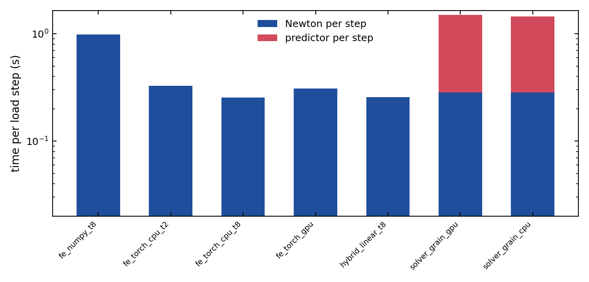

*Figure 38. Time per load step: Newton and predictor shares.*

The Part I backend ranking holds for the coupled problem: torch CPU is 3.0
to 3.9x faster per Newton iteration than numpy, and the GPU no faster than
the CPU at this size. The mechanics Newton is only 17% of a coupled step on
torch (37% on numpy): the damage assembly and solve, the CP state handling
and the reaction and field evaluations of the staggered loop take the rest
and are not sped up by the backend. The linear extrapolation saves 12% of
the first-alternation iterations at no cost; the verified solver removes
the first-alternation Newton on 10 of the 16 steps at 1.2 s of training per
step, the same on the GPU and the CPU (the cost is the numpy assemblies of
the FE residual). Over the full path (§17) the retraining is cheaper per
step and the route ends 25% faster than FE.

## 19. The parametric surrogate of the coupled plate

24 LHS samples of ($G_c$ 553 to 2,212 MPa um, $\ell_0$ 4 to 10 um,
$\rho_0$ 24 to 96, $\tau_{c0}$ 2.6 to 10.6 MPa; log scale) on the
calibrated CP+PFD deck, 17 of which initiate (5.9 to 17.9%); two
surrogates trained on 18 and held out on 6 (3 x 64 tanh, Adam 4,000 +
L-BFGS 50): the engineering stress and the maximum damage along the path,
and the nodal damage field at the end of the path
(`decks/pfd_study/cp/surrogate/`, `scripts/surrogate_compare.py`).

| surrogate | held-out rel. L2 mean / max | training (s) | query (ms) | data cost (s) | break-even vs FE / linear / verified solver (runs) |
|---|---|---|---|---|---|
| curve (stress, max damage vs strain) | 14.7% / 69.8% (one sample; 1.6-4.9% on the other five) | 10.3 | 0.1 | 12,987 | 20 / 21 / 27 |
| damage field at the end of the path | 5.8% / 7.1% | 198 | 0.4 | 12,987 | 21 / 22 / 27 |

*Table 27. Surrogate accuracy and cost.*

| held-out sample | $G_c$ | $\ell_0$ | fracture strain FE -> surrogate |
|---|---|---|---|
| 1 | 702 | 9.0 | 5.86% -> 5.31% |
| 7 | 828 | 8.6 | 8.52% -> 8.44% |
| 16 | 1,205 | 8.1 | 12.66% -> 12.89% |
| 17 | 872 | 8.0 | 10.31% -> 10.31% |
| 21 | 947 | 6.0 | 10.78% -> none predicted (the stress drop is predicted at 10.9%) |
| 23 | 1,341 | 7.3 | 14.92% -> 14.84% |

*Table 28. Fracture strain of the held-out samples from the curve
surrogate (first crossing of d = 0.8).*

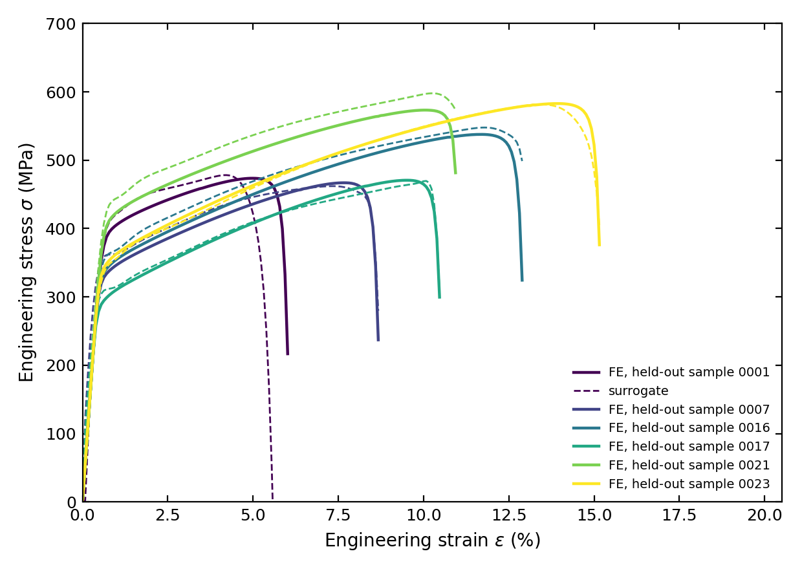

*Figure 39. Held-out curves, FE (solid) against the surrogate (dashed).*

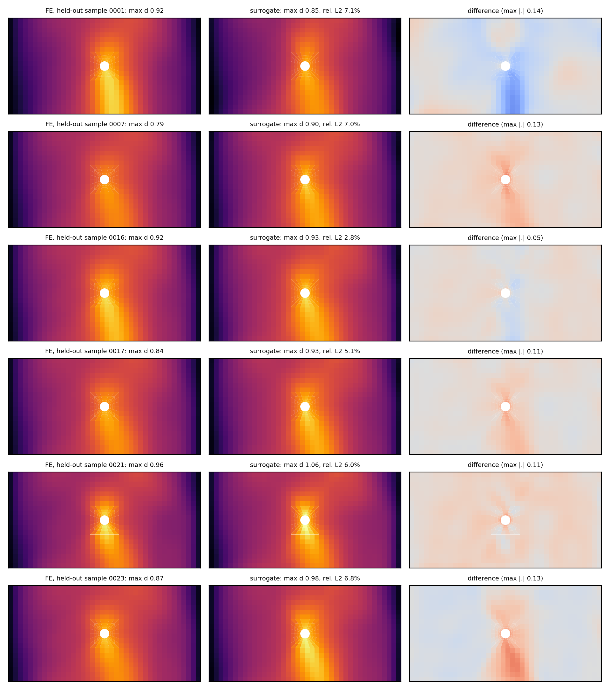

*Figure 40. Held-out damage fields: FE, surrogate and their difference.*

The curve surrogate predicts the fracture strain within 0.25% strain on
four of the six held-out samples and the stress drop on five; its mean
error is set by the sample at the low-$G_c$, high-$\ell_0$ corner of the
box, where the drop comes 0.55% early and the whole error of a curve that
ends at 6% is paid by the shifted collapse. The field surrogate is
uniformly accurate, with the error in the band below the hole where the
crack grows. Data cost 3.6 h of host time against 10 and 198 s of training,
0.1 to 0.4 ms per query, break-even after about 20 FE runs.

## 20. PINNACLE: what Part II required of the framework

Sixteen changes under ADR 0031 (`feat/pinn_benchmark`), each with a unit
test, before and during the runs; the ones that changed the physics or the
feasibility of the plate:

| item | before | after |
|---|---|---|
| damage solve | dense operator, n^2 memory: 4.3 s and 1.8 GB per solve at h80, infeasible at h160 | sparse assembly and direct/CG solve above 500 nodes: 0.05 s and 24 MB at h80, same field to 1e-15 |
| damage boundary | the grip node sets forced d = 0 silently | `boundary_node_set = none` leaves the boundary free; the plates pin d = 0 at the grips explicitly |
| driving force | no threshold | `plastic_work_threshold` (the $W_c$ of §13) and a viscosity term |
| reaction force | none for the mechanics sub-solve | `reaction_node_set` with the reaction on every step row |
| Exodus meshes | meshio misaligned the node-set names | netCDF reader with blocks, side sets and grain ids |
| J2 finite strain | finite-difference split tangent with doubled columns; missing Hencky chain term | analytic spectral projector and the chain term |
| Newton | no line search; absolute tolerance below the force noise | backtracking line search; working cut-backs |
| staggered loop | every alternation started Newton cold (20 to 40 iterations) | warm start from the previous alternation (2 to 3) |
| CP state between alternations | nested-list snapshot, 80 s per restore | arrays, milliseconds |
| CP time increment in a coupled window | the full t_end, which halved the CP flow stress | the window's share; the first CP calibration was void and redone |
| predictor history | lost at every re-solved window | kept across windows |
| backend | the predictor re-pointed the shared backend to the GPU | an unshared backend per component |
| output | the J2 route exported no plastic state | the committed equivalent plastic strain on the result and the snapshots |

*Table 29. ADR 0031 in brief.*

The dense-against-sparse measurement is the one that decided the mesh
range: at h40 the dense path costs 0.9 s per damage solve and 141 MB, at
h80 4.3 s and 1.8 GB (55 min of damage solves on a 256-step staggered run
against 40 s sparsely), and h160 does not fit in memory.

## References

- (rezwan 2025 intragranular) A. Rezwan, N. Aragon, D. de Oca Zapiain, H. Lim,
  "Coupled phase field damage and crystal plasticity analysis of intragranular
  fracture: The role of crystallographic orientation and voids", International
  Journal of Plasticity 191 (2025) 104372. doi:10.1016/j.ijplas.2025.104372
- (vaughan 2024 mechanistic) M. Vaughan, H. Lim, B. Pham, R. Seede, A.
  Polonsky, K. Johnson et al., "The mechanistic origins of heterogeneous void
  growth during ductile failure", Acta Materialia 274 (2024) 119977.
  doi:10.1016/j.actamat.2024.119977

Both entries are in `bib/references.bib`.

## Appendix A. Artifacts behind this report

| item | path |
|---|---|
| calibrated run deck (generated) | `results/cp_study/cal/gn2/base/cpfe.i` |
| pipeline deck of the calibrated run | `decks/cp_study/cal_center2.i` |
| study deck of the perturbations | `decks/cp_study/cal_gn2.i` |
| grain-growth deck | `decks/graingrowth/pilot/n32_bdf1_h40.i` |
| orientations (per grain) | `results/cp_study/cal/gn2/base/grains.csv` |
| curves | `results/cp_study/cal/gn2/{base,rho0_p,k1_p,y_c_p,tau_c0_p}/results.csv` |
| Jacobian, per-marker errors, step | `results/cp_study/cal/gn2/gauss_newton.json` |
| experimental markers | `data/digitized/al2219_fig3_experiment_markers.csv` |
| figure deck and script | `decks/report/cp_calibration_figures.i`, `scripts/report_figures.py` |
| run ledger rows | `cal-gn1`, `cal-gn2` in `docs/run_ledger.md` |
| neural routes (§8): pipeline decks | `decks/cp_study/hybrid/h40_linear.i`, `h40_fem_residual.i`, `h40_fem_solver.i`; checks `check_fem_h40*.i` |
| neural routes: histories, curves, field series | `results/cp_study/hybrid/{h40_linear,h40_fem_residual,h40_fem_solver}/` |
| hardware benchmark (§10) | `decks/benchmark/hardware_h40.i` + `scripts/hardware_benchmark.py`; `results/cp_study/hardware/hardware_h40.csv` |
| surrogate (§11): design, samples, decks, runs | `decks/cp_study/surrogate/{design_h40,plate_h40_surrogate_curve,plate_h40_surrogate_curve_cpu,plate_h40_surrogate_field}.i`; `results/cp_study/surrogate/h40_data/{design,samples}.csv`, `h40_{curve,curve_cpu,field}/`; `decks/report/surrogate_compare.i` + `scripts/surrogate_compare.py` |
| neural routes: comparison decks and scripts | `decks/report/hybrid_compare.i` + `scripts/hybrid_compare.py`; `decks/report/neural_compare.i` + `scripts/field_compare.py`; `results/cp_study/hybrid/hybrid_h40_{summary,steps}.csv`, `neural_h40_field_errors.csv` |

## Appendix B. Artifacts behind Part II

| item | path |
|---|---|
| meshes | `decks/pfd_study/mesh/{h20,h40,h80}_hole5.i`, `h40_ell_*.i`; `results/pfd_study/mesh/*/mesh.e`; `scripts/plate_hole_mesh.py` |
| J2 law | `decks/pfd_study/j2_fit.i`, `scripts/j2_fit.py`, `results/pfd_study/j2_fit/` |
| J2 W_c scan and calibration | `decks/pfd_study/j2/cal_h40_wc{200,400,600,800}.i`, `scripts/pfd_calibrate.py`, `results/pfd_study/j2/cal_h40_wc*/`; figure `decks/pfd_study/j2/wc_scan_h40_figures.i` |
| J2 sweeps and sensitivity (W_c 200) | `decks/pfd_study/j2/{sweep_l_h40,sens_h40,sweep_h_l5}.i`, `results/pfd_study/j2/*_wc200/` |
| CP calibration, sweeps, sensitivity, instances | `decks/pfd_study/cp/{cal_h40,sweep_l_h40,sens_h40,sweep_h_l5,grains_h40}.i`, `results/pfd_study/cp/` |
| fields and animation | `decks/pfd_study/report/fields_cal_h40.i`, `scripts/pfd_fields.py`, `results/pfd_study/cal_h40_fields.csv` |
| shape study | `decks/pfd_study/cp/shape_h40.i`, `decks/pfd_study/report/fields_shape_h40.i`, `results/pfd_study/cp/shape_h40/` |
| neural routes | `decks/pfd_study/cp/neural_h40.i`, `results/pfd_study/cp/neural_h40/` |
| hardware | `decks/benchmark/hardware_pfd_h40.i`, `results/pfd_study/cp/hardware/hardware_pfd_h40.csv` |
| surrogate | `decks/pfd_study/cp/surrogate/{design_h40,plate_h40_surrogate_curve,plate_h40_surrogate_field,compare_h40}.i`, `results/pfd_study/cp/surrogate/` |
| PINNACLE | `docs/adr/0031-pfd-plate-readiness.md` on `feat/pinn_benchmark`; the damage-solve benchmark `scripts/tools/damage_solve_benchmark.py`, `results/pfd_study/damage_solve/dense_vs_sparse.csv` |
| study notebook and ledger | `docs/10_pfd_study.md`, `docs/run_ledger.md` (rows `pfd-*`) |
