# Crystal plasticity and phase-field ductile fracture of Al2219 polycrystal plates with PINNACLE: finite-element calibration and the PINN+FEM, PINN and surrogate routes

Technical report, revision of 2026-11-17. Status: Part I (crystal plasticity,
§2-§11) and Part II (phase-field ductile fracture on J2 plasticity and
coupled with crystal plasticity, §12-§20) complete. Every number here traces to a run in
`docs/run_ledger.md` (rows `al-bunge-*` for the crystal-plasticity runs) and
to a deck under `decks/`. Part I figures are produced by
`scripts/report_figures.py` from `decks/report/bunge/cp_calibration_figures.i`;
Part II figures by the deck-driven scripts named in each section, under
`figures/pfd/`.

Revision of 2026-11-16/17. Every crystal-plasticity run of this report was
repeated with the framework of the Ni single-crystal study
(`docs/reports/ni_single_crystal_pinnacle_benchmark_report.md`): the Euler
angles follow Bunge's convention (PINNACLE ADR 0036; the earlier reader took
$\varphi_1$ and $\varphi_2$ in exchanged order), the balance of linear
momentum is total Lagrangian (ADR 0035), and the constitutive update is
implicit (ADR 0033). The four free parameters were recalibrated and every
study that depends on them was rerun in the order of the report: §4 to §11
and §14 to §19. The J2 sections (§12, §13) have no orientations and no
crystal kernel and are unchanged. The thirty orientations are uniform random
draws, so the exchanged reading was a valid run of another random grain set;
that version of the report is kept as
`archive/docs/al2219_report_exchanged_angles_2026-11-16.md` with its figures
under `archive/figures/al2219_exchanged_angles/`. The mesh level h40 is kept
for every downstream study by the author's decision, as an exception to the
5% criterion of the first study: with the recalibrated set h40 is 5.3% above
h160 at 17% strain and 6.0% at 20% (§5.3).

## Abstract

A thirty-grain Al2219 plate, 100 x 50 x 1 um, is simulated with PINNACLE to
20% tensile strain on four routes: finite elements (FE), a network or
extrapolation that proposes the start of each Newton solve (PINN+FEM), a
network whose proposal is accepted when its residual is small (PINN as
solver), and a parametric surrogate. Part I is dislocation-density crystal
plasticity on the plain plate. Four parameters are fitted to the tensile
curve of (vaughan 2024 mechanistic); the fit is within 1% of the experiment
from 0.6% to 17% strain, and mesh, parameter and grain-instance studies
bound it. Part II adds a 5 um hole and an AT2 phase field driven by the
plastic work, on J2 plasticity and on the crystal plasticity of Part I,
with the fracture energy fitted to the experimental failure strain of
17.2%, followed by length-scale, mesh, grain-instance and hole-shape
studies.

The key results are these. The FE route with a consistent tangent is the
reference and is hard to beat: the full path takes 765 Newton iterations
and 344 s. A linear extrapolation of the preceding steps removes 57% of the
iterations at no cost. A network trained on the FE residual adds 1 to 2%
to that saving and loses time. As a verified solver the grain-aware
network skips Newton on 137 of 256 steps and stays within 4.3 MPa of the
FE curve, at eleven times the FE cost. In the coupled fracture problem no
predictor saves time, because the cost of a mechanics solve does not fall
with its iteration count. The surrogates are the one route that changes
the cost of an answer: 0.1 to 0.7 ms per query, 1 to 4% held-out error on
the plain plate and 6 to 11% on the fracture plate, paid back after 14 to
23 FE runs. With the crystal-plasticity set carried unchanged into Part
II, one fracture energy meets the failure strain, and the perforated plate
lies 2 to 7% below the plain-specimen curve. The report documents each
route with its deck, cost and limit, so that a user can judge where each
one is worth using.

## 1. Introduction

Ductile failure of structural aluminum alloys starts in the microstructure.
Voids grow at different rates in neighboring grains, and the local crystal
orientation decides where strain concentrates and where a crack starts
(vaughan 2024 mechanistic). A model that is to predict this must resolve
the grains, carry the slip history of each material point, and let a crack
form and grow. Crystal plasticity coupled with a phase-field description
of fracture does all three, and (rezwan 2025 intragranular) used that
coupling to relate intragranular fracture to orientation and voids. The
price is computing time. A calibration, a sensitivity study or an
uncertainty estimate needs tens to hundreds of solves of a history-dependent
problem, which is why neural networks are proposed as predictors, solvers
or surrogates for it. Whether they pay on such a problem, and by how much,
is the question of this report.

**Crystal plasticity.** The finite-strain single-crystal framework with
rate-dependent slip goes back to (asaro 1979 geometrical) and (peirce 1982
localized), and the dislocation-density hardening laws used here follow
the physics collected in (kocks 2003 hardening). For polycrystals the
practical questions are numerical and statistical: how fine the mesh and
how many grains a volume element needs (lim 2019 sensitivity), and how
unique a fitted parameter set is. Recent work treats the fit itself as an
object of study, with derivative-free optimizers and the non-uniqueness
they expose (ni 2026 derivative) and with Bayesian calibration on Gaussian
process surrogates (engel 2026 gaussian).

**Phase-field fracture.** The regularized variational model of brittle
fracture and its staggered finite-element solution are given in (miehe
2010 thermodynamically). Ductile fracture needs a coupling with
plasticity: a degradation that depends on the plastic strain (ambati 2015
ductile), a plastic-work contribution to the driving force with a
threshold (borden 2016 triaxiality), or a gradient-extended
plasticity-damage theory (miehe 2016 gradient); (alessi 2018 comparison)
and (marengo 2023 review) compare these choices. The coupling with crystal
plasticity was formulated for single crystals in (delorenzis 2016 crystal)
and (hernandezpadilla 2017 crystal) and for elasto-viscoplastic
polycrystals in (shanthraj 2016 viscoplastic). It has since been applied
to damage around a void as a function of pore shape and orientation
(diehl 2017 void), to crack evolution in the microstructure of 7000-series
aluminum alloys (tu 2020 series) and to ductile cracks crossing grain
boundaries (louisaauth 2025 boundaries).

**Neural networks in solid mechanics.** Physics-informed neural networks
train a network on the residual of the governing equations (raissi 2019
involving); the deep energy method minimizes the potential instead
(samaniego 2020 concepts). Both have been applied to phase-field fracture
(goswami 2020 transfer), including a staggered scheme with one network per
field (wang 2024 staggered), to heterogeneous microstructures (henkes 2022
micromechanics), to finite-strain plasticity with an assessment of the
network's performance (niu 2023 performance) and to history-dependent
constitutive models (rezaei 2024 thermodynamics). For crystal plasticity
there are physics-constrained networks of the constitutive response (zhou
2024 constrained), a combination of a network with an object-oriented
crystal-plasticity finite-element code (keshavarz 2025 advancing) and a
dual-channel network (wang 2026 channel). A second line trains on the
discrete finite-element residual instead of the strong form (liu 2026
aligned; wurth 2024 meshgraphnets), and a third learns the map from
inputs to solution from simulation data, as for localized deformation in
crystal plasticity (ibragimova 2022 convolutional) and for phase-field
fracture (hamdi 2026 expediting). The reviews (sanjalawe 2026 critical)
and (thawon 2026 current) list stability, generalization and cost against
classical solvers as the open issues of the field.

**Research gap.** The works above report each method on its own problem
and mostly on its accuracy. Three things are missing for a user who has to
choose. First, a comparison of the network routes against a converged
finite-element solution of the same model, in the same code, with the
same tolerances, in wall time and on stated hardware. Second, such a
comparison on a problem with the full difficulty: a polycrystal with
history-dependent crystal plasticity, finite strain and a fracture field
coupled to it. Third, the cost side of the surrogate route, namely the
number of solver runs after which the training data are paid back. The
study also keeps one calibration chain from the tensile curve to the
fracture strain, so that every downstream number depends on a documented
upstream fit.

**Hypotheses.** Three hypotheses are tested on the Al2219 plate.

1. A crystal-plasticity set fitted to the plain-plate tensile curve can be
   carried unchanged into the fracture problem, where one fracture energy
   then reproduces the measured failure strain.
2. A network that serves the mechanics solve of a finite-element code, as
   a predictor of the Newton start or as a verified replacement of the
   Newton solve, lowers the cost of a run at the accuracy of the
   finite-element result.
3. A surrogate trained on a few tens of finite-element runs predicts
   curves and fields at unseen parameters within a few percent and pays
   back its data after a number of queries that is small against a
   calibration or sensitivity study.

The results support the first with a stated limit (§14.1), reject the
second on this problem with the measured reasons (§8.3, §17, §18), and
support the third for curves and less so for damage fields (§11, §19).
The purpose is a demonstration: the report shows what PINNACLE does on
each route, how each study is set up from a deck, and what each route
costs, and it is not an optimization of the networks.

**Outline.** Part I treats crystal plasticity on the plain plate. §2
states the model and §3 the numerical method. §4 calibrates the four
parameters, §5 studies the mesh, §6 the parameter sensitivity and §7 the
grain instances. §8 measures the PINN+FEM and PINN-as-solver routes on the
calibrated problem and §9 their sensitivity to the parameters; §10 is the
hardware and time benchmark and §11 the parametric surrogate. Part II
treats phase-field ductile fracture on the perforated plate. §12 states
the problem and the fracture model. §13 gives the J2 coupling and §14 the
crystal-plasticity coupling, each with calibration, parameter and mesh
sensitivity; §15 compares how the two fail and §16 varies the shape of the
stress concentrator. §17 to §19 repeat the neural routes, the hardware
benchmark and the surrogate on the coupled problem, and §20 lists what the
fracture part required of the framework.

## 2. Crystal-plasticity finite-element methodology

### 2.1 Kinematics

The deformation gradient at each material point is split multiplicatively into
an elastic and a plastic part,

$$
\mathbf{F} = \mathbf{F}^e \mathbf{F}^p , \qquad
\mathbf{L}^p = \dot{\mathbf{F}}^p \mathbf{F}^{p-1} = \sum_{\alpha=1}^{12} \dot{\gamma}^\alpha \, \mathbf{s}^\alpha \otimes \mathbf{n}^\alpha ,
\tag{1}
$$

where $\mathbf{s}^\alpha$ and $\mathbf{n}^\alpha$ are the slip direction and
slip-plane normal of system $\alpha$ in the sample frame and
$\dot{\gamma}^\alpha$ its slip rate. The twelve $\{111\}\langle 110\rangle$
systems of the FCC lattice are used. The crystal frame of each grain is set by
a Bunge triple $(\varphi_1, \Phi, \varphi_2)$ (rotation
$\mathbf{R}_z(\varphi_1)\, \mathbf{R}_x(\Phi)\, \mathbf{R}_z(\varphi_2)$ from
the crystal to the sample frame), which rotates both the slip systems and the
elastic stiffness.

### 2.2 Elasticity

The elastic response is cubic and hyperelastic in the Green-Lagrange strain of
the elastic part,

$$
\mathbf{E}^e = \tfrac{1}{2}\left(\mathbf{F}^{eT}\mathbf{F}^e - \mathbf{I}\right), \qquad
\mathbf{S} = \mathbb{C} : \mathbf{E}^e , \qquad
\boldsymbol{\sigma} = \frac{1}{\det \mathbf{F}^e}\, \mathbf{F}^e \mathbf{S} \mathbf{F}^{eT} ,
\tag{2}
$$

with $\mathbb{C}$ the cubic stiffness ($C_{11}$, $C_{12}$, $C_{44}$) rotated
into the sample frame, $\mathbf{S}$ the second Piola-Kirchhoff stress and
$\boldsymbol{\sigma}$ the Cauchy stress. The resolved shear stress on system
$\alpha$ is

$$
\tau^\alpha = \mathbf{S} : \mathbf{M}^\alpha , \qquad
\mathbf{M}^\alpha = \tfrac{1}{2}\left(\mathbf{s}^\alpha \otimes \mathbf{n}^\alpha + \mathbf{n}^\alpha \otimes \mathbf{s}^\alpha\right).
\tag{3}
$$

### 2.3 Flow rule

Slip follows a rate-dependent power law (Hutchinson form),

$$
\dot{\gamma}^\alpha = \dot{\gamma}_0 \left| \frac{\tau^\alpha}{\tau_c^\alpha} \right|^{n} \operatorname{sign}(\tau^\alpha), \qquad n = 1/m ,
\tag{4}
$$

with reference slip rate $\dot{\gamma}_0$, rate exponent $n$ and the rate
sensitivity $m$ of the source papers (Rezwan 2025 intragranular). No kinematic
backstress is used.

### 2.4 Slip resistance and dislocation-density evolution

The slip resistance is a Taylor relation on the forest density, with the
latent-hardened interaction sum,

$$
\tau_c^\alpha = \tau_{c0} + \alpha_0\, \mu\, b \sqrt{\sum_{\beta=1}^{12} a^{\alpha\beta} \rho^\beta}, \qquad
a^{\alpha\beta} = \begin{cases} 1 & \alpha = \beta \\ q & \alpha \ne \beta \end{cases}
\tag{5}
$$

where $\rho^\beta$ is the statistically stored dislocation density of system
$\beta$, $\mu$ the shear modulus, $b$ the Burgers vector, $\alpha_0$ the
Taylor prefactor, $q$ the latent-to-self hardening ratio and $\tau_{c0}$ a
rate- and density-independent lattice friction. With all twelve densities
equal, the interaction sum multiplies the density by $1 + 11q = 16.4$ and
$\tau_c - \tau_{c0}$ by $\sqrt{16.4} = 4.05$ relative to the self term alone;
the calibrated parameters of §4 are therefore specific to this convention.

Each density evolves by a Kocks-Mecking storage-recovery law written per
system,

$$
\dot{\rho}^\alpha = \frac{1}{b}\left( k_1 \sqrt{\rho^\alpha} - 2 y_c\, \rho^\alpha \right) \left| \dot{\gamma}^\alpha \right| ,
\qquad \rho^\alpha(0) = \rho_0 ,
\tag{6}
$$

with the storage coefficient $k_1$ (the papers' $k_m$) and the annihilation
distance $y_c$. The law saturates at

$$
\rho_{sat} = \left( \frac{k_1}{2 y_c} \right)^2 , \qquad
\tau_{c,sat} = \tau_{c0} + \alpha_0 \mu b \sqrt{(1 + 11 q)\, \rho_{sat}} ,
\tag{7}
$$

so $k_1$ sets the hardening rate after yield and, together with $y_c$, the
height of the plateau; $\rho_0$ sets the initial resistance through Eq. (5);
$\tau_{c0}$ is a uniform offset. §4.4 quantifies each of these on the plate.

No geometrically necessary densities, grain-boundary slip transmission rules
or damage are active in the runs of this report: the plate is the undamaged
crystal-plasticity baseline that the later phase-field damage study builds
on.

### 2.5 Material parameters

Table 1 lists every parameter of Eqs. (1)-(7), its value in the runs of §4,
its provenance tag (PROJECT_GUIDELINES §4) and its role in the study. Units
are micrometer, megapascal and second throughout.

**Table 1.** Crystal-plasticity parameters for Al2219.

| symbol | meaning | value | unit | provenance | role |
|---|---|---|---|---|---|
| $C_{11}$ | cubic stiffness | 108.0 | GPa | reported_table (Rezwan 2025 intragranular, Table 1) | fixed |
| $C_{12}$ | cubic stiffness | 61.3 | GPa | reported_table | fixed |
| $C_{44}$ | cubic stiffness | 28.5 | GPa | reported_table | fixed |
| $\mu$ | shear modulus in Eq. (5) | 25.7 | GPa | reported_table | fixed |
| $b$ | Burgers vector | 0.286 | nm | reported_table | fixed |
| $q$ | latent-hardening ratio | 1.4 | - | reported_table | fixed |
| $\alpha_0$ | Taylor prefactor | 0.4 | - | reported_table | fixed |
| $\dot{\gamma}_0$ | reference slip rate | $10^{-5}$ | s$^{-1}$ | reported_table | fixed |
| $m$ ($n = 1/m$) | rate sensitivity | 0.12 (8.333) | - | reported_table | fixed |
| $\rho_0$ | initial SSD density per system | 53.93 | $\mu$m$^{-2}$ | calibrated (§4) | free |
| $k_1$ | storage coefficient | 0.1768 | - | calibrated (§4) | free |
| $y_c$ | annihilation distance | 0.00271 | $\mu$m | calibrated (§4) | free |
| $\tau_{c0}$ | lattice friction | 5.39 | MPa | calibrated (§4) | free |
| $\dot{\varepsilon}$ | applied strain rate | $10^{-3}$ | s$^{-1}$ | assumed (not reported with the test) | fixed |

The fixed set is the author's decision: elastic constants, $b$, $\mu$, $q$
and $\alpha_0$ are material constants; $\dot{\gamma}_0$ and $m$ are held and
reserved by the author for convergence questions only. The
four free parameters are fit in the order $\rho_0$, $k_1$, $y_c$, $\tau_{c0}$.

Derived quantities of the calibrated set (Eqs. 5 and 7): initial slip
resistance $\tau_c(\rho_0) = 92.8$ MPa, saturation density
$\rho_{sat} = 1{,}060\ \mu$m$^{-2}$, saturation resistance $\tau_{c,sat} = 393$
MPa. With a Taylor factor near 3 the initial resistance corresponds to about
280 MPa of rate-independent yield; the rate term of Eq. (4) at the applied
rate raises it to the 368 MPa 0.2%-offset yield of §4.3. The hardening rate
of the calibrated plate is still 0.36 GPa at 20% strain (§4.3), so the
densities are well below $\rho_{sat}$ at the end of the test, as the
experiment's unsaturated curve requires.

### 2.6 Polycrystal plate model

**Geometry and mesh.** A pseudo-three-dimensional plate of 100 x 50 x 1
$\mu$m is meshed with one HEX8 element through the thickness; the mesh level
hN has N elements along the 100 $\mu$m length and N/2 along the width. The
results of §4 are at h40 (40 x 20 x 1 elements, 2.5 $\mu$m elements, 800
elements, 1,722 nodes, 5,166 displacement degrees of freedom, 6,400
quadrature points). The pseudo-3D plate has one element through its thickness
and free top and back faces, so it deforms in generalized plane stress.

**Grain structure.** Thirty grains are generated by phase-field grain growth
of a 32-seed Voronoi tessellation of the plate's in-plane extent: the Moelans
multi-order-parameter Allen-Cahn model (eight order parameters, grain-boundary
width 1.485 $\mu$m, grid 203 x 102) is integrated for 2.5 interface relaxation
times, which equilibrates the triple junctions and consumes the two smallest
grains. The grain map is shown in Fig. 1. Grain areas range from 21 to 448
$\mu$m$^2$ (mean 169 $\mu$m$^2$); the equivalent diameter is 13.7 $\mu$m on
average and in the median (range 5.2 to 23.9 $\mu$m), so a 2.5 $\mu$m element
puts about 5.5 elements across a grain.

**Orientations.** One Bunge triple per grain, drawn uniformly on SO(3) from a
recorded seed (20261009), so the plate is untextured. The triples are read in
Bunge's order (PINNACLE ADR 0036); the first version of this report read
$\varphi_1$ and $\varphi_2$ exchanged, which is another untextured draw of
thirty crystals on the same grain structure. The orientation reaches
every quadrature point of a grain through a point file read by the deck
(PINNACLE `[OrientationField]`, §3.5). The same structure and the same thirty
orientations are used by every run of this report; only the four free
parameters change.

**Boundary conditions and loading.** $u_x = 0$ on the $x = 0$ face, $u_y = 0$
on the $y = 0$ face, $u_z = 0$ on the $z = 0$ face; the $x = 100$ $\mu$m face
is displaced along $+x$ by a linear ramp to 20 $\mu$m (20% nominal strain) in
200 s, i.e. $\dot{\varepsilon} = 10^{-3}$ s$^{-1}$. All other faces are
traction-free, so the plate contracts laterally and through the thickness.

**Figure 1.** The 30-grain plate used by every run, colored by grain, with the
loading axis.

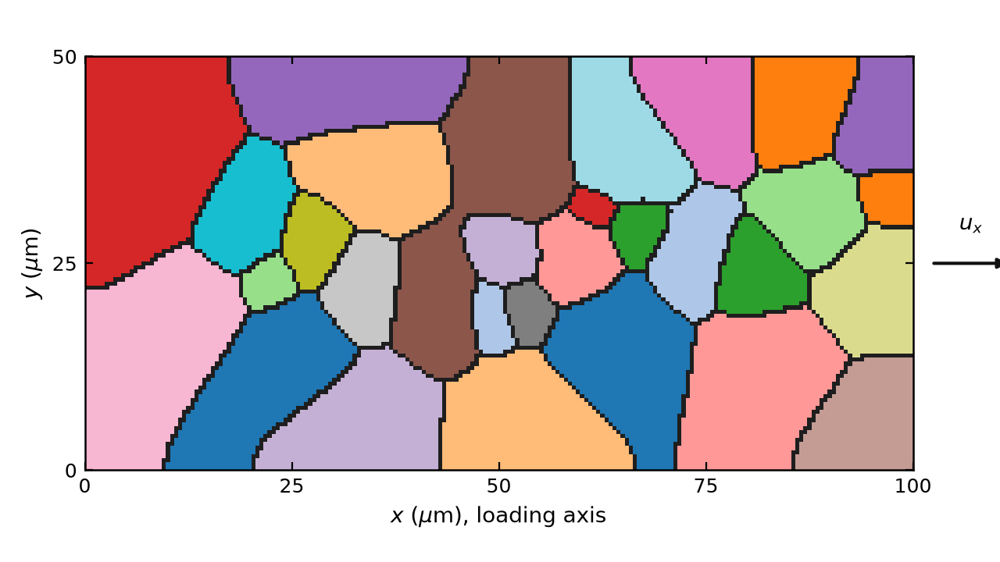

**Stress and strain measures.** The reported strain is the nominal strain
$\varepsilon = u_x(100\ \mu\text{m}) / 100\ \mu$m. The reported stress is the
engineering axial stress, i.e. the reaction force on the pulled face over
the original cross-section,

$$
\sigma = \frac{R_x}{A_0}, \qquad A_0 = 50\ \mu\text{m}^2 ,
\tag{8}
$$

where $R_x$ is the sum of the nodal reactions on the $x = 100\ \mu$m face.
With the total-Lagrangian balance of §3.1 the reaction is the true force on
the face, so Eq. (8) carries the thinning of the section; it agrees within
0.3% with the mean Cauchy stress multiplied by the mean transverse stretches,
the measure of the first version of this report. Engineering stress is used
on both sides of every comparison because the experimental curve is a tensile
test record. At 20% strain the two transverse stretches are each about 0.91,
so the engineering stress is 16% below the mean Cauchy stress there.

**Reference data.** The ground truth is the Al2219 tensile curve of Vaughan
(2024 mechanistic) as plotted in Fig. 3 of Rezwan (2025 intragranular), from
which the nine experimental markers were digitized at the figure's native 300
DPI (extraction uncertainty $\pm 0.03$% strain, $\pm 1.5$ MPa; method in
`docs/digitization_uncertainty.md`). The marker at the origin is the initial
condition; the other eight, from 0.14% to 17.0% strain, are the calibration
targets.

## 3. Numerical method (PINNACLE)

All crystal-plasticity runs use PINNACLE (branch `feat/pinn_benchmark`,
revision 9548123 with the total-Lagrangian balance of ADR 0035, the implicit
update of ADR 0033 and the Euler convention of ADR 0036), torch backend on
the CPU, double precision, two threads per finite-element run and four per
neural-route run on the compute host. A run is fully described by one input
deck (`cpfe.i`) plus the orientation point file; the deck is generated from a
pipeline deck by `scripts/polycrystal_plate.py`
(`kinematics = total_lagrangian`, `state_update = implicit`,
`backend = torch`), and the study decks that set the parameters are under
`decks/cp_study/bunge/`.

### 3.1 Finite-element discretization

Trilinear HEX8 elements with 2 x 2 x 2 Gauss quadrature carry the displacement
field. The balance of linear momentum is written on the reference
configuration (total Lagrangian). At each quadrature point the displacement
gradient $H_{iJ} = \partial u_i / \partial X_J$ gives
$\mathbf{F} = \mathbf{I} + \mathbf{H}$, the material returns the Cauchy stress
of Eq. (2), and the internal force is the reference-volume integral of the
first Piola-Kirchhoff stress
$\mathbf{P} = J\, \boldsymbol{\sigma}\, \mathbf{F}^{-T}$ against the reference
shape-function gradients (`stress_divergence_cp` kernel,
`kinematics = total_lagrangian`), with Dirichlet conditions imposed on node
sets. The reaction of Eq. (8) is therefore the true force on the pulled
face. Orientations are supplied per element and broadcast to its quadrature
points. The first version of this report used the earlier balance of
PINNACLE, which integrated the Cauchy stress with the reference gradients and
weights (`kinematics = legacy`), with the explicit update; on this plate the
present framework gives an engineering stress 1 to 6% lower for the same
parameters, the largest difference at 20% strain, which is why the
parameters were recalibrated (§4).

### 3.2 Load stepping

The quasi-static load program (`cp_quasi_static` executioner) divides the 200
s ramp into 256 equal steps of $\Delta t = 0.78$ s, i.e. $7.8 \times 10^{-4}$
nominal strain per step. The step count is that of the first version of this
report, where it was set by the strain-increment limit of the explicit
constitutive update; the implicit update of §3.4 has no such limit, and the
count is kept so that the load path and the field series are the same. A
step that fails to converge is halved and retried up to ten times (none was
needed in the runs of §4 to §7: 256 of 256 steps converged with zero cutbacks
on every case). Every run records the field series every four load steps
(every 0.3125% strain): displacement, Cauchy stress, strain, equivalent
plastic strain, slip activity and mean dislocation density per element.

### 3.3 Newton solve and tangent

Each load step is solved by Newton's method on the displacement vector to an
absolute residual norm of $10^{-3}$ MPa $\mu$m$^2$ over the free degrees of
freedom, about $3 \times 10^{-7}$ of the nodal force scale at h40, with no
relative criterion, so that every step of every route of this study
(FE, hybrid, PINN) is held to the same test whatever its starting point
(at most 50 iterations; the calibrated run used 3 on every step but three,
765 in all). The tangent is the exact derivative of the total-Lagrangian
residual: the consistent material tangent
$\partial \boldsymbol{\sigma} / \partial \mathbf{F}$ of the implicit update
(§3.4) plus the two geometric terms from $J$ and $\mathbf{F}^{-T}$, assembled
sparse. The linear systems are solved with a sparse LU factorization
(`linear_method = direct`): the finite-strain crystal-plasticity tangent is
non-symmetric and loses positive definiteness as slip localizes, so an
iterative solver has to be a non-symmetric one (GMRES with ILU
preconditioning is available for larger meshes); at the sizes used here the
direct solve is cheap. The consistent tangent is available on the torch
backend; the numpy backend falls back to a finite-difference tangent that
costs about six times more per load step (§10).

### 3.4 Constitutive integration

The state $\{\mathbf{F}^p, \rho^\alpha\}$ at each quadrature point is
integrated over the load step inside every residual evaluation by a
backward-Euler update of the slip increments (`state_update = implicit`):
for the trial deformation $\mathbf{F}_{n+1}$ the increments
$\Delta\gamma^\alpha$ solve

$$
\Delta\gamma^\alpha = \Delta t\, \dot{\gamma}^\alpha\!\left(\tau^\alpha(\mathbf{F}_{n+1}, \Delta\boldsymbol{\gamma}),\ \tau_c^\alpha(\rho_{n+1}(\Delta\boldsymbol{\gamma}))\right), \qquad
\mathbf{F}^p_{n+1} = \Big(\mathbf{I} + \sum_\alpha \Delta\gamma^\alpha\, \mathbf{s}^\alpha \otimes \mathbf{n}^\alpha\Big)\mathbf{F}^p_n ,
$$

with $\rho_{n+1}$ advanced by Eq. (6). A local Newton iteration per point
solves this system to $10^{-10}$; the stress of the step is the stress of the
integrated end state, and its consistent tangent follows from the
implicit-function theorem. The state is committed when the load step
converges. Every quadrature point is advanced in one batched call, so the
cost is independent of the number of grains. The first version of this
report used explicit forward Euler with adaptive sub-stepping at the
converged stress of the step.

### 3.5 Orientation field

The deck block `[OrientationField] source = point_file` reads a CSV of
$(x, y, z, \varphi_1, \Phi, \varphi_2, \text{grain})$ rows, one per node of
the grain-growth grid, and assigns each element the orientation of the
nearest point (ADR 0026 in PINNACLE). The crystal block's own Euler angles are
a fallback that is never reached when the field covers the mesh; the log line
"[OrientationField] ... resolved on 800 elements, coverage 1.0" is the check
that it did.

### 3.6 Grain growth numerics

The grain structure of §2.6 is produced by PINNACLE's phase-field module
(`gb_evolution` material with `ac_bulk` and `ac_interface` kernels,
`pf_fem_transient` executioner) on a 203 x 102 bilinear grid with
$M_{GB} = 1$, $\sigma_{GB} = 1$, $w_{GB} = 1.485\ \mu$m and $\gamma = 1.5$ in
the Moelans free energy. Time integration is fully implicit backward Euler
(`bdf1`) at $\Delta t = 0.5 / (L \mu)$ with $1/(L\mu) = w_{GB}^2 / (8
M_{GB} \sigma_{GB})$ the bulk relaxation time, 40 steps, Newton to $10^{-8}$,
natural boundary conditions. Grains are labeled on the final field by the
argmax order parameter and connected components, specks under four cells are
dropped, and diffuse-boundary nodes are assigned to the nearest labeled node.

### 3.7 Homogenized output

The executioner records, for every accepted load step, the time and the
quadrature-point means of the Cauchy stress and of the displacement gradient,
and the reaction on the pulled face that enters Eq. (8). Field output (displacement, stress, strain,
equivalent plastic strain, slip activity and mean density per element) is
written at the end of the run.

### 3.8 Reproducibility

Each run is reproducible from its generated deck and point file; the pipeline
deck records the growth run, labeling thresholds, orientation seed, mesh,
loading and every material value. The commands are in
`docs/reproduce_polycrystal_plate.md`; the run ledger `docs/run_ledger.md`
gives the deck, scripts, framework revision, host, cores and wall time of
every run cited here. A calibrated-set run at h40 takes about 6 min on two
threads (1.3 s per load step, of which the Newton solves are 344 s).

## 4. Results: parameter calibration

### 4.1 Objective

The free parameters are those that minimize the root-mean-square deviation
between the engineering stress of the plate, interpolated at the eight
experimental marker strains, and the marker stresses, in this framework and
at this mesh. Neither the published parameter table nor any re-expression of
it is a target: with the interaction sum of Eq. (5) and the rate law of Eq.
(4), the published numbers do not reproduce the curve in this framework, and
the calibrated values are reported as such (provenance `calibrated`).

The parameters were bounded a priori from the features of the experimental
curve: $\rho_0 \in [20, 80]\ \mu$m$^{-2}$, $k_1 \in [0.02, 0.30]$,
$y_c \in [0.001, 0.006]\ \mu$m, $\tau_{c0} \in [0, 50]$ MPa.

### 4.2 Procedure

1. In the first version of this report a Taylor (isostrain) material-point
   aggregate of thirty random grains located a starting point inside the
   bounds (`scripts/taylor_surrogate.py`, deck
   `decks/cp_study/taylor_screen.i`), and two FE iterations gave the set
   $\rho_0 = 47.99$, $k_1 = 0.1988$, $y_c = 0.00344$, $\tau_{c0} = 5.29$. The
   recalibration starts from that set.
2. At the FE level, each iteration ran the center and one multiplicative
   perturbation per parameter ($\rho_0$, $k_1$, $y_c$ x 1.2; $\tau_{c0}$ x
   1.5) as five concurrent plate runs to 20% strain
   (`decks/cp_study/bunge/cal_gn*.i`, driver `scripts/cp_parameter_study.py`).
   The finite-difference Jacobian $\partial \sigma_i / \partial \ln p_j$ at
   the marker strains gave a bounded Levenberg-Marquardt step in log
   parameters (`scripts/cp_gauss_newton.py`).
3. The iteration stopped when the predicted step moved no parameter by more
   than a few percent and predicted no gain in the objective. Two FE
   iterations were needed. The first center, the earlier set in the present
   framework, measured an RMSE of 20.1 MPa with the plastic branch 2 to 4%
   low, and stepped to the final set ($+12$% on $\rho_0$, $-11$% on $k_1$,
   $-21$% on $y_c$, $+2$% on $\tau_{c0}$) with a predicted 14.1 MPa. The
   second center measured 14.2 MPa and its own step (0.7% on $\rho_0$, 3.1%
   on $k_1$, 4.5% on $y_c$, 0.2% on $\tau_{c0}$) predicted 14.1 MPa.

### 4.3 Calibrated parameter set

**Table 2.** Calibrated set at mesh h40 (deck
`decks/cp_study/bunge/cal_center2.i`, run `results/cp_study/bunge/cal/gn2/base`),
with the linearized one-standard-deviation uncertainty from the residual
beyond 0.5% strain and the FE Jacobian.

| parameter | value | unit | relative 1$\sigma$ |
|---|---|---|---|
| $\rho_0$ | 53.93 | $\mu$m$^{-2}$ | $\pm 67$% |
| $k_1$ | 0.1768 | - | $\pm 12$% |
| $y_c$ | 0.00271 | $\mu$m | $\pm 19$% |
| $\tau_{c0}$ | 5.39 | MPa | $\pm 448$% |

The uncertainties say how tightly eight markers pin each value, not how far
the curve would move: $k_1$ is the best-determined parameter because it
controls the whole hardening branch; $\tau_{c0}$ is nearly free because its
effect (a uniform 25 MPa offset per e-fold) is interchangeable with a small
change of $\rho_0$ at the yield point.

**Figure 2.** Calibrated plate against the experimental markers.

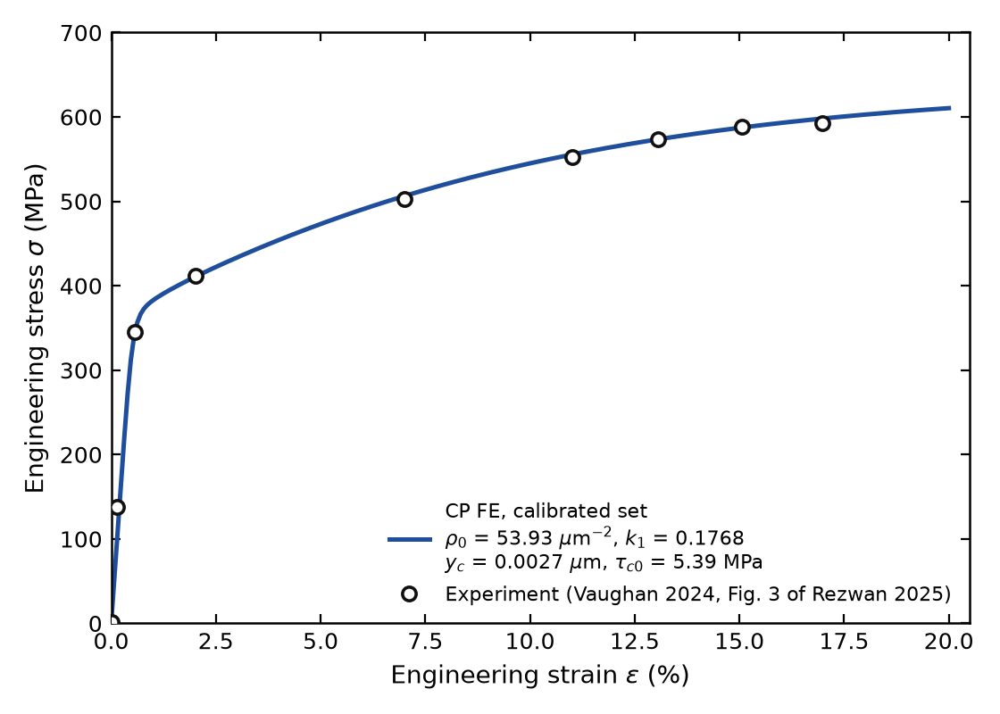

Characteristics of the calibrated curve: elastic modulus 70.3 GPa (the
untextured aluminum polycrystal value), 0.2%-offset yield stress 368 MPa,
engineering stress 411 / 506 / 598 / 610 MPa at 2 / 7 / 17 / 20% strain, and
a hardening rate $d\sigma/d\varepsilon$ falling from 2.4 GPa at 2% to 0.49
GPa at 17% and 0.36 GPa at 20%.

### 4.4 Error analysis

**Table 3.** Calibrated plate at the experimental markers (engineering
stress).

| strain (%) | experiment (MPa) | FE (MPa) | difference (MPa) | relative error |
|---|---|---|---|---|
| 0.14 | 137.7 | 98.2 | -39.5 | -28.7% |
| 0.57 | 344.9 | 344.0 | -0.9 | -0.3% |
| 2.02 | 411.9 | 411.0 | -0.9 | -0.2% |
| 7.01 | 502.5 | 506.4 | +4.0 | +0.8% |
| 11.02 | 552.5 | 555.7 | +3.1 | +0.6% |
| 13.05 | 573.6 | 573.5 | -0.1 | -0.0% |
| 15.06 | 588.3 | 587.5 | -0.9 | -0.1% |
| 16.98 | 592.6 | 598.1 | +5.5 | +0.9% |

Root-mean-square deviation over the eight markers: 14.2 MPa; over the seven
markers from 0.5% strain: 2.9 MPa, with a largest deviation of 5.5 MPa (0.9%).
From 0.5% strain the plate reproduces the experimental curve within the
digitization uncertainty budget plus a few MPa; the error changes sign along
the plastic branch and stays below 1%, so the shape of the curve (yield,
hardening rate, approach to the plateau) is captured, not only its level.
The last marker is the largest miss: the experimental curve flattens between
15 and 17% strain (4 MPa in 2% strain) faster than the storage-recovery law
of Eq. (6) does. This is a
tier-4 agreement (PROJECT_GUIDELINES §5: agreement with experiment).

The one miss is the 0.14% marker, 29% below the experiment. That marker lies
on the digitized record's initial slope of about 99 GPa, whereas the
untextured plate's modulus is 70 GPa and aluminum's polycrystal modulus is
about 70 GPa. The elastic constants are fixed and no parameter of Eqs. (4)-(6)
acts below yield, so the point reflects the test record or its digitization
rather than the calibration, and it is retained in the objective rather than
removed.

**Figure 3.** Deviation of the calibrated plate from the experimental markers.

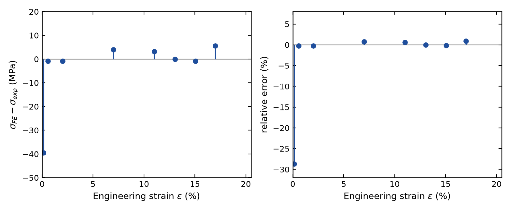

### 4.5 Effect of each parameter

Each parameter was perturbed one at a time from the calibrated set while the
others were held (Table 4, Fig. 4). The Jacobian of the final iteration is the same
information as a sensitivity $\partial \sigma / \partial \ln p$, i.e. the
stress change per e-fold change of the parameter, along the curve (Fig. 6).

**Table 4.** One-at-a-time perturbations of the calibrated set at h40
(`decks/cp_study/bunge/cal_gn2.i`): engineering stress at the marker strains
and the sensitivity $\partial\sigma/\partial\ln p$.

| case | 0.57% | 2% | 7% | 11% | 17% | RMSE (MPa) | $\partial\sigma/\partial\ln p$ at 2 / 7 / 17% (MPa) |
|---|---|---|---|---|---|---|---|
| calibrated | 345 | 411 | 506 | 555 | 598 | 14.2 | |
| $\rho_0$ x 1.2 = 64.72 $\mu$m$^{-2}$ | 362 | 442 | 532 | 578 | 617 | 26.4 | 171 / 141 / 101 |
| $k_1$ x 1.2 = 0.2121 | 345 | 419 | 546 | 613 | 673 | 53.3 | 48 / 220 / 409 |
| $y_c$ x 1.2 = 0.00326 $\mu$m | 345 | 408 | 491 | 529 | 559 | 26.9 | -13 / -86 / -217 |
| $\tau_{c0}$ x 1.5 = 8.08 MPa | 351 | 421 | 517 | 566 | 608 | 17.5 | 26 / 25 / 24 |

What each parameter does to the curve, in this framework and with this law:

- **$\rho_0$ sets the yield level.** Raising the initial density raises
  $\tau_c$ through Eq. (5) from the first slip onward, so the whole curve
  moves up, most at yield (171 MPa per e-fold at 2%) and less with strain (101
  MPa at 17%) as the stored density overtakes the initial one. It is the
  parameter that places the knee of the curve.
- **$k_1$ sets the hardening rate.** Its effect is near zero at yield (48 MPa
  per e-fold at 2%) and grows monotonically with strain (409 MPa at 17%): a
  larger storage coefficient makes the curve climb faster after yield and
  raises the plateau through Eq. (7). It is the parameter that sets the slope
  of the plastic branch.
- **$y_c$ sets the saturation.** Recovery is negligible at low density and
  grows with it, so a larger $y_c$ lowers the late curve (-217 MPa per e-fold
  at 17%) and leaves yield unchanged. It bends the curve toward its plateau
  and, with $k_1$, fixes the plateau height.
- **$\tau_{c0}$ is a uniform offset.** It shifts the curve by about 25 MPa per
  e-fold at every strain, because it adds to $\tau_c$ independently of the
  density. On this curve it is nearly interchangeable with a small change of
  $\rho_0$, which is why it is the least-determined parameter in Table 2.

The order of the calibration ($\rho_0$, then $k_1$, then $y_c$, then
$\tau_{c0}$) follows from these shapes: level first, slope second, curvature
third, offset last.

**Figure 4.** One parameter perturbed at a time from the calibrated set (left
to right, top to bottom: $\rho_0$, $k_1$, $y_c$, $\tau_{c0}$).

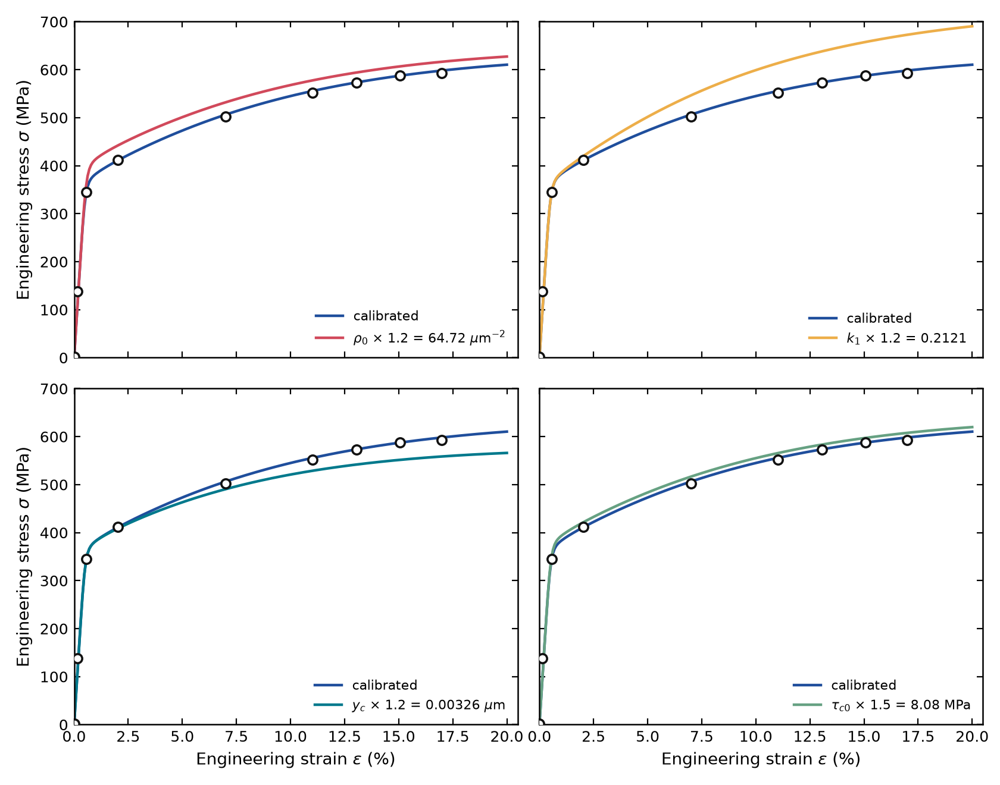

**Figure 5.** All four perturbations on one axis.

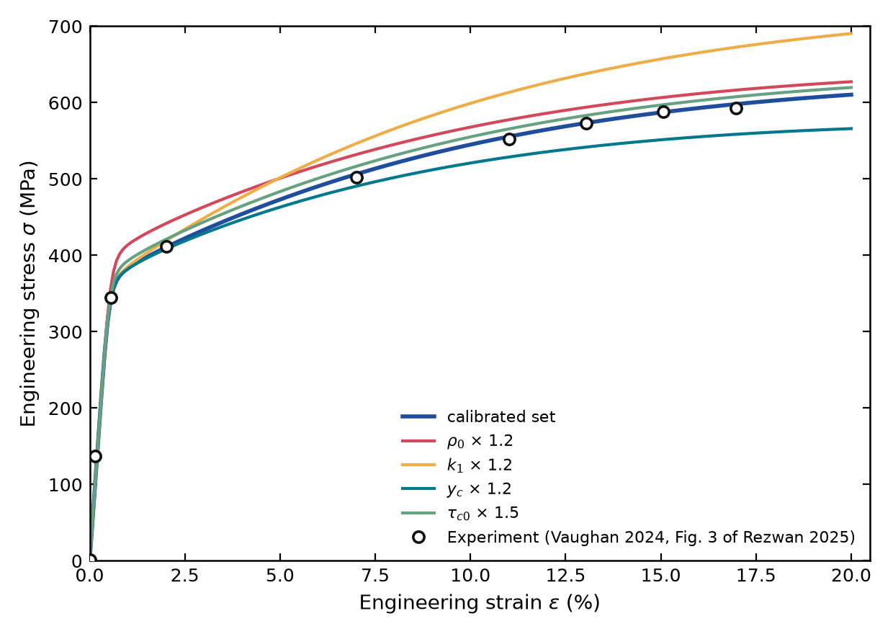

**Figure 6.** Sensitivity $\partial\sigma/\partial\ln p$ of the engineering
stress to each parameter along the curve, from the finite-difference Jacobian
of the final iteration.

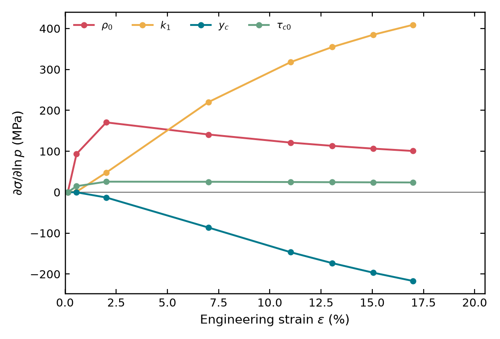

### 4.6 Scope of the calibrated set

The set of Table 2 holds for: this framework's constitutive conventions (the
latent-hardened sum of Eq. (5), the per-system law of Eq. (6), the rate law of
Eq. (4) with the fixed $\dot{\gamma}_0$ and $m$); the assumed strain rate of
$10^{-3}$ s$^{-1}$ (with $n = 8.33$ a factor 3 in rate moves the flow stress
by about 14%); the h40 mesh (2.5 $\mu$m elements); and this thirty-grain
realization and orientation draw. The mesh dependence is quantified in §5;
the dependence on the realization will be quantified on the mesh chosen
there.

## 5. Mesh sensitivity

### 5.1 Design

The calibrated set of Table 2 was run on four meshes of the same plate, grain
structure, orientations, loading and solver criterion, changing only the
element count: h20, h40, h80 and h160 (Table 5; decks
`decks/cp_study/bunge/mesh_h{20,80,160}.i`, h40 being the calibrated run). All
four completed the 256 load steps to 20% strain without a cutback and wrote
the field series every four steps.

**Table 5.** Meshes of the sensitivity study and the engineering stress at
four strains; the sixth column is the change from the next coarser mesh at
2 / 7 / 17 / 20% strain, the seventh the distance to h160 at the same
strains.

| mesh | elements | $h$ ($\mu$m) | elements across a grain | 2% | 7% | 17% | 20% | change from coarser mesh | distance to h160 | wall time (threads) |
|---|---|---|---|---|---|---|---|---|---|---|
| h20 | 200 | 5.0 | 2.7 | 422.5 | 525.3 | 628.1 | 642.9 | | +5.0 / +7.1 / +10.6 / +11.6% | under 2 min (2) |
| h40 | 800 | 2.5 | 5.5 | 410.5 | 506.3 | 598.2 | 610.5 | -2.8 / -3.6 / -4.8 / -5.0% | +2.1 / +3.2 / +5.3 / +6.0% | 6 min (2) |
| h80 | 3,200 | 1.25 | 11 | 405.1 | 496.2 | 579.2 | 589.1 | -1.3 / -2.0 / -3.2 / -3.5% | +0.7 / +1.1 / +2.0 / +2.3% | 26 min (4) |
| h160 | 12,800 | 0.625 | 22 | 402.2 | 490.6 | 568.0 | 576.1 | -0.7 / -1.1 / -1.9 / -2.2% | | 1.9 h (8) |

### 5.2 Results

**Figure 7.** Stress-strain curves of the four meshes with the calibrated
set.

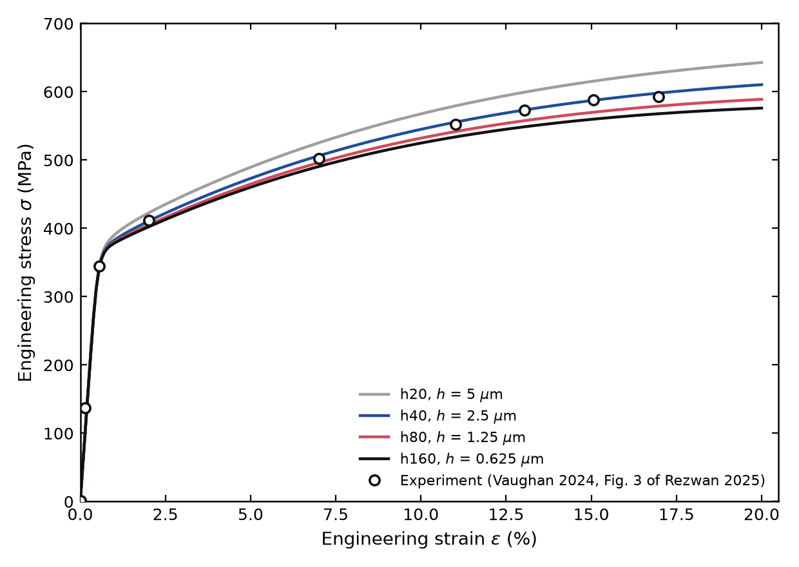

**Figure 8.** Engineering stress at fixed strains against element size.

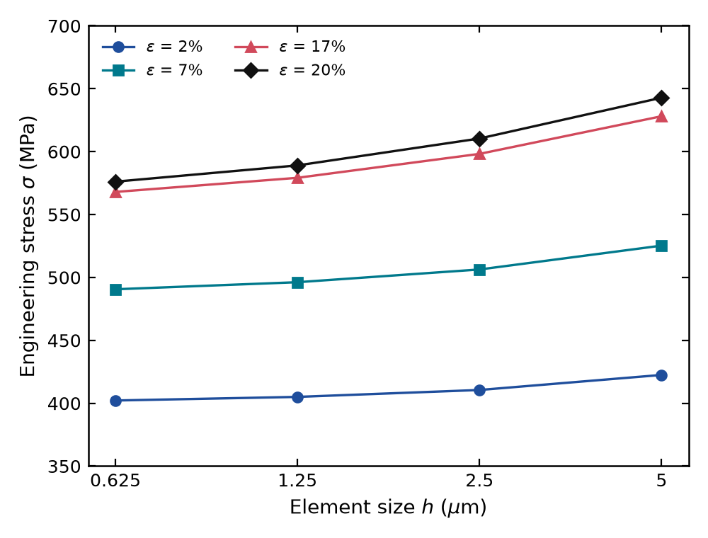

The response softens monotonically with refinement at every strain (Figs. 7
and 8). The coarse mesh is the stiff one, as a displacement-based
discretization with fewer than three elements across a grain must be, and
the change per halving of $h$ decreases: 5.0%, 3.5% and 2.2% at 20% strain.
The convergence is close to first order at 2% strain, where the ratio of
successive changes is 0.45 to 0.54 (apparent order 0.9 to 1.2), and slower
on the plastic branch, where the ratio rises to 0.61 to 0.66 at 20% strain
(apparent order 0.6 to 0.7):
the finer meshes keep resolving sharper slip bands at grain boundaries and
triple junctions, and the constitutive law of §2 has no internal length, so
localized slip remains mesh-dependent within the range studied. The
root-mean-square deviation from the markers rises away from h40 (26.4 /
14.2 / 17.7 / 22.8 MPa for h20 / h40 / h80 / h160) only because the set was
calibrated at h40; a transfer to another mesh is a small correction of the
size of the mesh shift, mostly on $\rho_0$ and $k_1$ (Table 4).

**Figure 9.** Element-averaged equivalent plastic strain on the deformed
plate for the four meshes at 2, 8, 15 and 20% nominal strain (one color
scale); the full loading is animated in
`figures/report/plastic_strain_mesh.gif`.

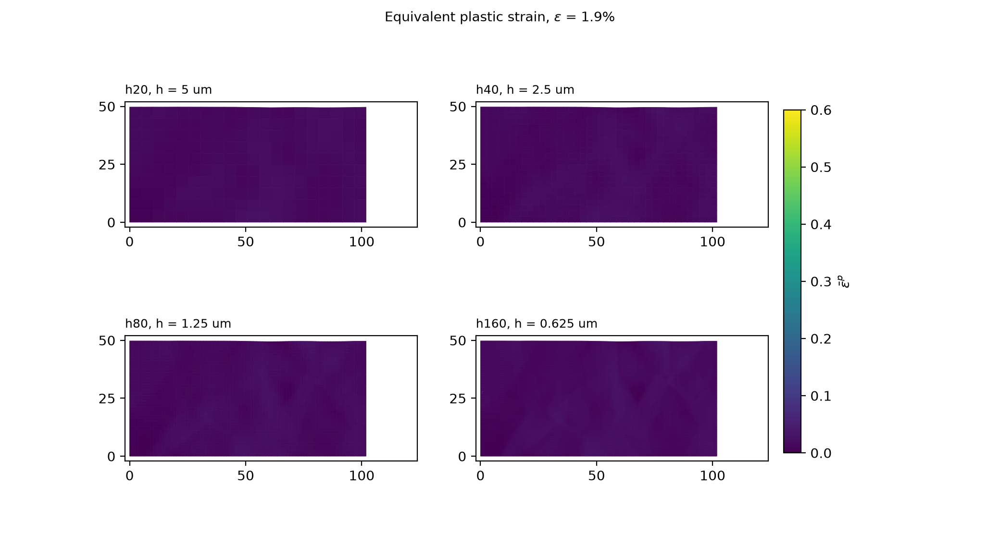

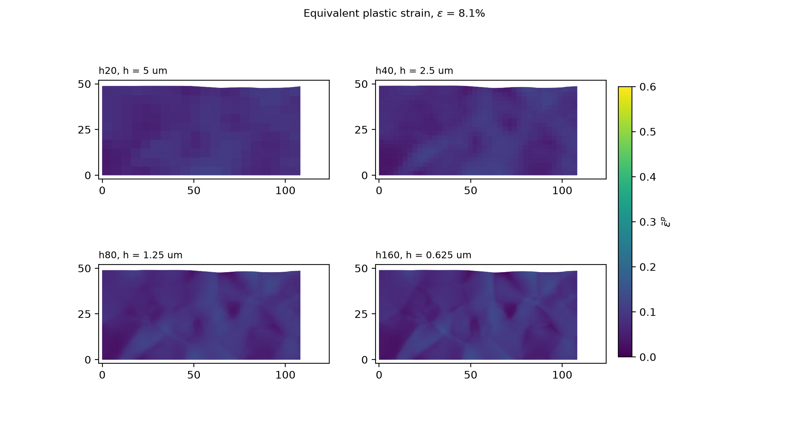

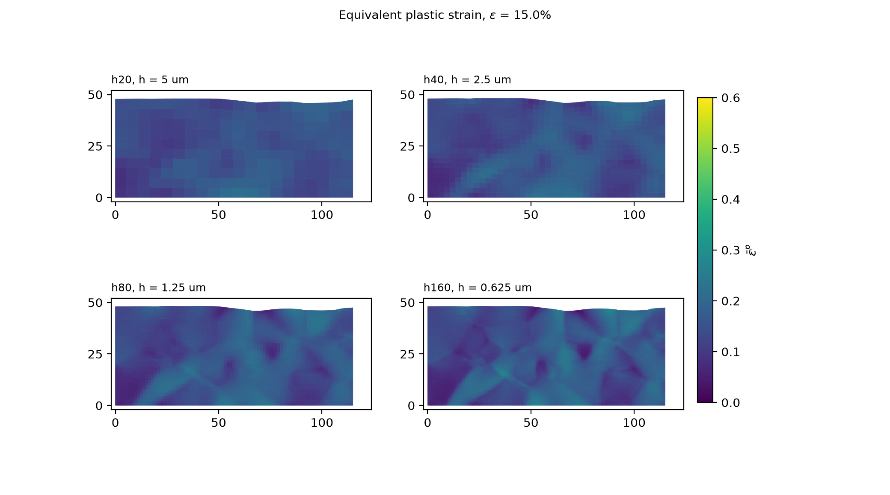

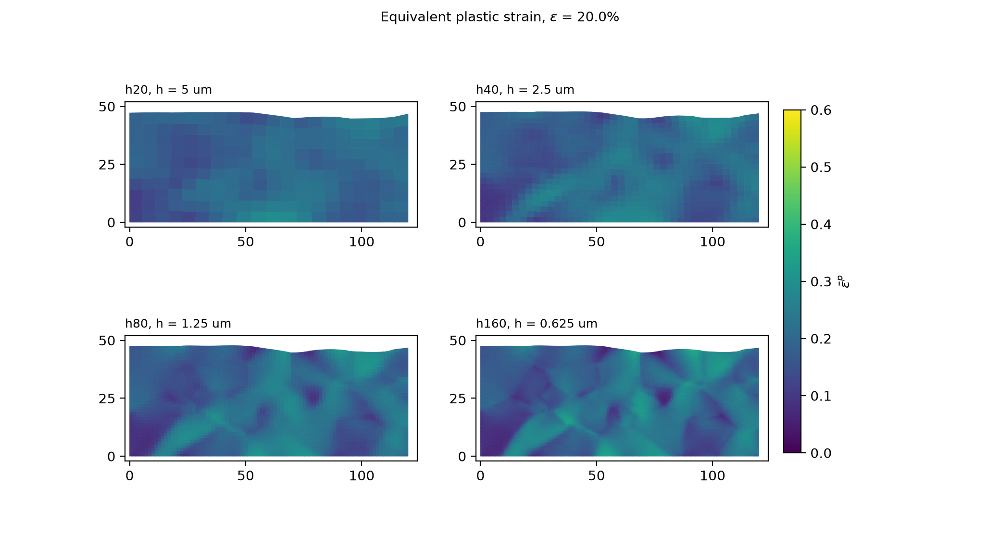

The plastic strain localizes in the same bands on every mesh, along the
grain boundaries that cross the loading direction at an angle and through
the softest grains; refinement sharpens the bands and raises their peak
value without moving them, which is the field-level picture of the slow
convergence of the plastic branch.

### 5.3 Mesh selection

The choice of the working mesh for the parameter sensitivity, the
grain-instance check, the neural routes and Part II is the author's. In the
first version of this report h40 was chosen because it stayed within 5% of
h160 at every strain (4.2% at 20%). With the recalibrated set and the
total-Lagrangian balance the mesh effect is larger: h40 is within 5% of h160
up to about 15% strain, 5.3% above it at 17% and 6.0% at 20%; h80 is within
2.3% at 26 min per run. The author kept h40 for every downstream study as an
exception to the 5% criterion (decision of 2026-11-16), so that Parts I and
II stay on the mesh the set is calibrated on. Every stress of §6 to §11 and
§14 to §19 beyond 15% strain carries this mesh effect; the calibrated set
absorbs it at h40 and a transfer to a finer mesh needs the correction of
§5.2.

## 6. Parameter sensitivity at the chosen mesh

### 6.1 Design

Each free parameter of Table 2 was varied one at a time over a factor of
four, at 0.5, 0.8, 1.25 and 2 times its calibrated value, with the other
three held at their calibrated values (study deck `decks/cp_study/bunge/sens_h40.i`,
sixteen cases plus the calibrated base, all at h40 on the plate of §2.6,
field series included). Every case completed the 256 load steps to 20%
strain without a cutback. Table 6 reports the 0.2%-offset yield stress, the
engineering stress at four strains, the hardening rate at 17% strain and
the root-mean-square deviation from the experimental markers; Figs. 10 and
11 show the curves.

**Table 6.** One-at-a-time sensitivity at h40. $\sigma_y$ is the 0.2%-offset
yield stress; $\theta_{17}$ the hardening rate $d\sigma/d\varepsilon$ at
17% strain; RMSE against the eight markers from 0.1% strain.

| case | $\sigma_y$ (MPa) | 2% | 7% | 17% | 20% | $\theta_{17}$ (GPa) | RMSE (MPa) |
|---|---|---|---|---|---|---|---|
| calibrated | 368 | 411 | 506 | 598 | 610 | 0.49 | 14.2 |
| $\rho_0$ x 0.5 | 270 | 316 | 431 | 546 | 563 | 0.64 | 65.0 |
| $\rho_0$ x 0.8 | 333 | 376 | 479 | 579 | 592 | 0.55 | 26.3 |
| $\rho_0$ x 1.25 | 408 | 449 | 538 | 621 | 631 | 0.43 | 30.8 |
| $\rho_0$ x 2 | 505 | 546 | 621 | 682 | 688 | 0.27 | 94.1 |
| $k_1$ x 0.5 | 366 | 390 | 413 | 422 | 420 | -0.03 | 115.8 |
| $k_1$ x 0.8 | 367 | 402 | 468 | 525 | 532 | 0.28 | 48.7 |
| $k_1$ x 1.25 | 369 | 421 | 557 | 692 | 711 | 0.75 | 65.4 |
| $k_1$ x 2 | 373 | 454 | 712 | 977 | 1,016 | 1.53 | 254.7 |
| $y_c$ x 0.5 | 369 | 417 | 554 | 744 | 780 | 1.34 | 89.5 |
| $y_c$ x 0.8 | 368 | 413 | 524 | 647 | 666 | 0.74 | 34.3 |
| $y_c$ x 1.25 | 368 | 408 | 487 | 550 | 556 | 0.28 | 31.7 |
| $y_c$ x 2 | 367 | 400 | 442 | 456 | 454 | -0.05 | 90.0 |
| $\tau_{c0}$ x 0.5 | 358 | 400 | 496 | 589 | 601 | 0.50 | 16.0 |
| $\tau_{c0}$ x 0.8 | 364 | 406 | 502 | 594 | 607 | 0.49 | 14.3 |
| $\tau_{c0}$ x 1.25 | 373 | 416 | 511 | 603 | 615 | 0.49 | 15.3 |
| $\tau_{c0}$ x 2 | 389 | 431 | 527 | 617 | 629 | 0.48 | 23.9 |

**Figure 10.** One parameter varied at a time over a factor of four (top
left to bottom right: $\rho_0$, $k_1$, $y_c$, $\tau_{c0}$); the calibrated
curve and the experimental markers in every panel.

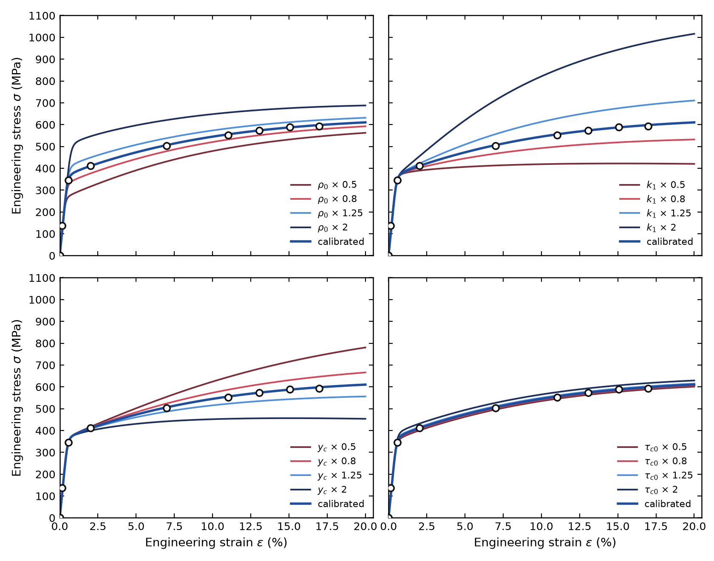

**Figure 11.** Engineering stress at fixed strains against the multiple of
each parameter.

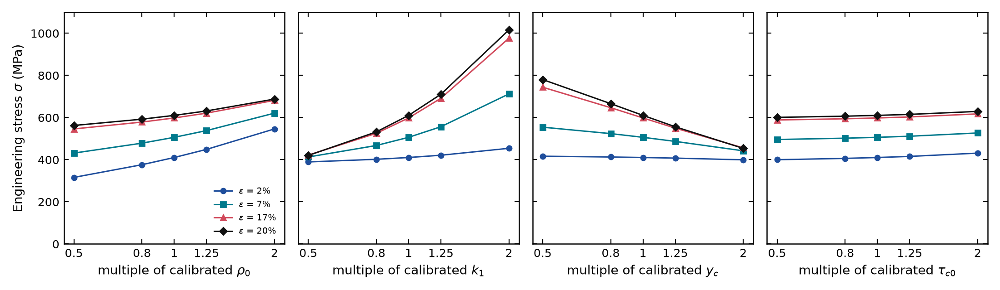

### 6.2 Results

**$\rho_0$ sets the yield level.** The yield stress follows the initial
density closely, from 270 MPa at half the calibrated value to 505 MPa at
twice it, i.e. $\sigma_y$ scales as about $\rho_0^{0.45}$, close to the
square root of Eq. (5) softened by the rate term. The offset it produces
fades with strain as the stored density overtakes the initial one (from
136 to 196 MPa per e-fold at 2% down to 69 to 112 MPa per e-fold at 20%),
and a higher $\rho_0$ also lowers the late hardening rate because the
density starts closer to saturation. Over the factor of four the curves
keep their shape; the parameter positions the knee.

**$k_1$ sets the hardening rate and the plateau.** Yield is unchanged (366
to 373 MPa across the factor of four), while the stress at 20% strain spans
420 to 1,016 MPa and the hardening rate at 17% strain spans zero to 1.53
GPa. The sensitivity grows monotonically with strain (30 to 63 MPa per
e-fold at 2%, 274 to 585 at 20%) and is itself larger at larger $k_1$: the
response is strongly nonlinear in $k_1$ because the saturation density of
Eq. (7) scales as $k_1^2$. At half the calibrated value the plate stops
hardening before 17% strain; at twice it the plate is still hardening at
1.2 GPa at 20%. The experiment's slope is matched only within about $\pm 20$% of the
calibrated value.

**$y_c$ sets the saturation.** Yield is unchanged (367 to 369 MPa) and the
early curve nearly so (400 to 417 MPa at 2%), while the stress at 20%
strain spans 454 to 780 MPa in the opposite sense to $k_1$: a larger
annihilation distance saturates the density earlier and lower. At twice the
calibrated value the hardening rate is zero by 17% strain; at half it the
plate hardens at 1.1 GPa at 20%. The sensitivity is about $-225$ to $-250$
MPa per e-fold at 20% and nearly independent of the multiple, i.e. the
response is close to logarithmic in $y_c$ over this range. $k_1$ and $y_c$
act on the same branch of the curve with opposite sign; their ratio fixes
the plateau through Eq. (7) and their product the rate at which the plateau
is approached, which is why the calibration determines $k_1$ and $y_c$
jointly ($\pm 12$% and $\pm 19$% in Table 2) rather than each alone.

**$\tau_{c0}$ is a uniform offset.** It shifts the whole curve by 14 to 30
MPa per e-fold with no change of shape (the hardening rate stays at 0.48 to
0.50 GPa) and moves the yield stress by only 31 MPa over the factor of four.
At the calibrated 5.39 MPa it is a minor term against the 87 MPa density
contribution to the initial slip resistance, which is why it is the least
determined parameter and the last in the calibration order.

**Order of influence.** On the whole curve $k_1$ is first, $y_c$ and
$\rho_0$ follow close to each other and $\tau_{c0}$ is last (RMSE at the x2
case 255, 90, 94 and 24 MPa; at the x0.5 case 116, 90, 65 and 16 MPa); at
yield it is $\rho_0$ first and $\tau_{c0}$ second, with $k_1$ and $y_c$
inert. The calibration order $\rho_0$, $k_1$, $y_c$, $\tau_{c0}$ follows
this separation: yield is fixed first by the parameter that alone controls
it, the plastic branch second by the pair that controls it, and the offset
last.

## 7. Grain-instance check

### 7.1 Design

The calibrated set and the plate of §2.6 were run on two further grain
structures, each a new uniform Voronoi seeding of the plate grown with the
phase-field settings of §3.6 and given its own orientation draw (Table 7;
growth decks `decks/graingrowth/instances/n32_bdf1_h40_s{C,B}.i`, pipeline
decks `decks/cp_study/bunge/grain_s{C,B}.i`). Mesh (h40), loading, solver
criterion, field series and parameters are those of the calibrated run. The
purpose is to show that the set of Table 2 describes the material rather
than one realization of thirty grains.

**Table 7.** Grain instances with the calibrated set at h40: grain count,
median equivalent diameter, elastic modulus, 0.2%-offset yield stress,
engineering stress at four strains, RMSE against the markers, and the mean
and largest relative deviation from the calibrated structure's curve beyond
0.5% strain.

| instance | seeds (Voronoi / orientations) | grains | $d_{med}$ ($\mu$m) | $E$ (GPa) | $\sigma_y$ (MPa) | 2% | 7% | 17% | 20% | RMSE (MPa) | deviation, mean / max |
|---|---|---|---|---|---|---|---|---|---|---|---|
| 1 (calibrated) | 20260914 / 20261009 | 30 | 13.7 | 70.3 | 368 | 411 | 506 | 598 | 610 | 14.2 | |
| 2 | 20261013 / 20261013 | 31 | 13.7 | 71.8 | 379 | 424 | 521 | 605 | 615 | 17.8 | +2.3% / 3.4% |
| 3 | 20261012 / 20261012 | 30 | 13.4 | 71.4 | 370 | 414 | 509 | 596 | 607 | 13.8 | +0.2% / 1.0% |

**Figure 12.** The three grain structures.

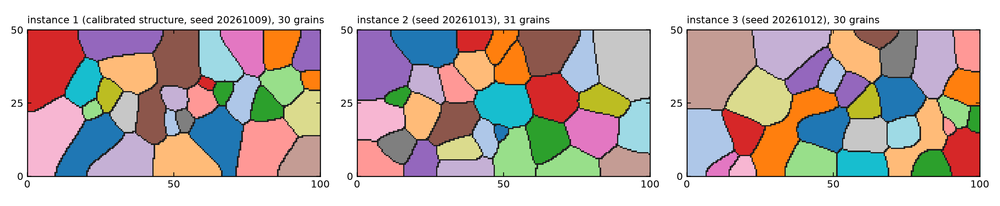

**Figure 13.** Stress-strain curves of the three instances with the
calibrated set.

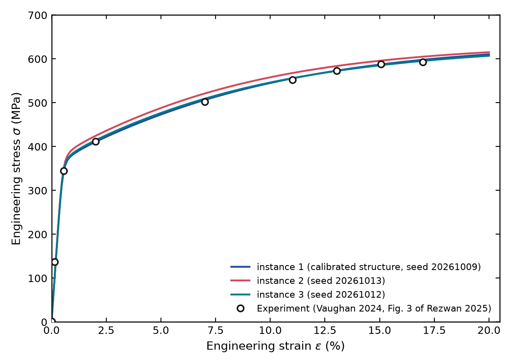

### 7.2 Results

The three realizations give the same elastic modulus within 2%, a yield
stress within 3% (368 to 379 MPa) and the same hardening branch within
$-0.5$% to $+3.4$% (Fig. 13); all three completed the 256 load steps without
a cutback. The largest difference is at yield (instance 2, $+3.4$% at 2%
strain) and closes with strain: at 20% the two new structures are at
$+0.8$% and $-0.5$% of the calibrated one. The spread is of the size of the
mesh effect between h40 and h80 (§5) and smaller than the effect of a 20%
change of any free parameter but $\tau_{c0}$ (§6), so the calibrated set is
not an artifact of the structure it was fitted on. The instance-to-instance
spread, about $\pm 2$% on the flow stress, is the statistical resolution of a thirty-grain,
one-element-thick plate and should be read as the uncertainty attached to
any single-realization result of this report.

## 8. Neural routes on the calibrated problem: PINN+FEM and PINN as solver

### 8.1 Design

Both neural routes run inside the load-stepping executioner of §3 and
differ from the FE reference only in where the nodal field of a load step
comes from. A **load-step predictor** proposes the displacement field
$\mathbf{u}^{\star}_{k+1}$ the step starts from; the executioner pins the
prescribed degrees of freedom, measures the proposal's equilibrium error,
and either corrects it with Newton to the criterion of §3 (the **PINN+FEM**
route) or accepts it as the step's solution when that error is already
below the tolerance (the **PINN as solver** route). The constitutive state
lives at the quadrature points of the h40 mesh in both routes and is
advanced from the accepted field, so the history of the material is that
of the finite-element discretisation whatever produced the field.

The equilibrium error of a nodal field $\mathbf{u}$ is the assembled
residual of the discrete weak form at the frozen state of the step,
$\mathbf{R}(\mathbf{u}) = \mathbf{f}_{\mathrm{int}}(\mathbf{u};\,\mathbf{s}_k) - \mathbf{f}_{\mathrm{ext}}$,
measured over the free degrees of freedom and scaled by the reaction it
carries on the constrained ones,

$$
r(\mathbf{u}) = \frac{\lVert \mathbf{R}_{\mathrm{free}}(\mathbf{u}) \rVert_2}{\lVert \mathbf{R}_{\mathrm{Dirichlet}}(\mathbf{u}) \rVert_2}.
\tag{9}
$$

A field with $r \le r_{\mathrm{tol}}$ is a finite-element solution of the
step to that tolerance; the solver route uses $r_{\mathrm{tol}} = 0.05$ and
records on every step whether the proposal was accepted or corrected.

The predictor is a network $\mathbf{u}_\theta(\mathbf{x}, \lambda)$ (three
hidden layers of 64 tanh units; normalised coordinates and the load factor
$\lambda$ as inputs; the three displacement components as outputs) that
**corrects the linear extrapolation** of the last two accepted fields,

$$
\mathbf{u}^{\star}_{k+1} = \mathbf{u}_k + \frac{\lambda_{k+1} - \lambda_k}{\lambda_k - \lambda_{k-1}}\,(\mathbf{u}_k - \mathbf{u}_{k-1}) + \Delta u\;\mathbf{u}_\theta(\mathbf{x}, \lambda_{k+1}),
\tag{10}
$$

with $\Delta u$ the size of the last accepted increment and the output
layer initialised to zero, so that the untrained network returns the
extrapolation itself and training can only improve on it. The network is
trained **on the assembled residual of its own nodal values**, with the
loss $r^2$ of Eq. (9): the residual is assembled by the finite-element arm
at the frozen state, and its gradient with respect to the nodal values is
the transpose of the consistent tangent $\mathbf{K} = \partial\mathbf{R}/\partial\mathbf{u}$
the Newton solver already forms. Every loss evaluation therefore costs
one residual-and-tangent assembly on the FE arm (torch, CPU); the network
is evaluated and differentiated on the CPU as well, since the GPU gives no
advantage at this size (§10); the weights are carried from step to step. Training uses L-BFGS with a
strong-Wolfe line search (two L-BFGS steps per load step, at most 40 inner
iterations, for the PINN+FEM route; four, at most 80, for the solver route,
which stops early as soon as $r \le r_{\mathrm{tol}}$), and the best
iterate seen is returned. The reference for both routes is the same
executioner with the linear extrapolation alone as predictor, and the cold
run of §4 with the previous field as initial guess.

A second variant of each route gives the network **grain-aware inputs**:
appended to the coordinates and the load factor at every node are the
nine entries of the crystal-to-sample rotation matrix averaged over the
elements that share the node and a grain-boundary indicator (one minus
the largest fraction of the node's elements that belong to one grain:
zero inside a grain, positive on a boundary), both derived once from the
orientation field of §2. A network of the coordinates alone has no input
that changes at a grain boundary and so cannot kink there; with these
ten extra inputs it can. Architecture, loss, optimizer and budgets are
otherwise identical to the coordinate-only runs.

This weak-form training replaces the strong-form collocation of the
balance of momentum, which was found unreachable on this problem in the
first version of this study: a
network regressed to within 0.55% (L2) of the finite-element displacement
of a step still carries $r = 0.73$ and a strong-form residual of order one
on the $\mu / L$ scale, because the equilibrium of a thirty-grain plate
lives in the strain kinks at the grain boundaries that a smooth global
network cannot represent. The weak-form loss is the quantity the corrector
drives to zero, so an accepted network field is verifiable by
construction. Decks: `decks/cp_study/bunge/hybrid/h40_linear.i`,
`h40_fem_residual.i`, `h40_fem_solver.i`, `h40_fem_residual_grain.i`,
`h40_fem_solver_grain.i`; the framework pieces are PINNACLE ADR 0028 and
ADR 0029.

### 8.2 Results

Table 8 summarises the six runs of the same deck family at h40, all to
20% strain in 256 steps under the criterion of §3 with no cutback.

**Table 8.** Cost and outcome of the neural routes against the FE
reference at h40. Newton iterations and assemblies are the cost measures
that do not depend on host load; the runs shared the host (four threads
each, the h160 mesh run alongside), so the Newton time per iteration
varied between runs (0.45 to 0.75 s) and the times are given for
completeness. The predictor time of the network runs includes the
assemblies of the training loss (0.2 to 0.3 s each). $r$ is the equilibrium
error of Eq. (9), median over the predicted steps.

| run | Newton iterations | steps solved without Newton | Newton time (s) | predictor time (s) | assemblies for training | $r$ before training (median) | $r$ after training (median) | max $\lvert\Delta\sigma\rvert$ vs FE (MPa) |
|---|---|---|---|---|---|---|---|---|
| FE, cold start (§4) | 765 | 0 | 344 | 0 | 0 | -- | -- | 0 |
| PINN+FEM, linear extrapolation | 329 | 0 | 247 | 0.007 | 0 | -- | -- | 0.000 |
| PINN+FEM, FE-residual-trained network | 327 | 0 | 233 | 403 | 1,860 | 0.0008 | 0.0008 | 0.000 |
| PINN as solver, verified ($r_{\mathrm{tol}} = 0.05$) | 246 | 140 of 256 | 171 | 8,297 | 13,310 | 0.090 | 0.048 | 8.82 |
| PINN+FEM, grain-aware network | 322 | 0 | 228 | 707 | 3,066 | 0.0005 | 0.0005 | 0.000 |
| PINN as solver, verified, grain-aware network | 240 | 137 of 256 | 158 | 3,686 | 14,347 | 0.078 | 0.049 | 4.30 |

**The reference.** With the consistent tangent of §3.3 the cold
finite-element run needs three Newton iterations on nearly every step, 765
in all, where the finite-difference tangent of the first version of this
study needed 1,506. Every route below is measured against this cheaper
reference.

**PINN+FEM.** The linear extrapolation alone is already a good predictor
on this load path: beyond 1% strain its proposal is within 0.03% of the
step's increment (median) and carries an equilibrium error $r$ of about
$10^{-3}$, and it removes 57% of the Newton iterations of the cold start:
one iteration per step is enough from the extrapolated field where three
are needed from the previous one. The network trained on the assembled
residual does not improve on it: the L-BFGS line search finds no descent
worth taking from a proposal that is already that close (a median of five
assemblies per step), the iteration count is the same as with the
extrapolation alone (327 against 329; 254 steps identical, two steps one
iteration fewer), the curve and the fields are identical to the FE
reference (Fig. 14, Fig. 15), and the training adds 403 s to the run.
Where the extrapolation is poor, in the first 1% of strain when grains
yield one after another and $r$ of the extrapolation is 0.008 to 0.24, the
network lowers $r$ by about 10%, which does not remove a Newton iteration.

**PINN as solver.** With the tolerance $r_{\mathrm{tol}} = 0.05$ the
network solves 140 of the 256 steps on its own (about every other step,
evenly from 0.2% to 20% strain) and the Newton corrector solves the rest,
so the run needs 246 Newton iterations instead of 765. Every accepted
field is a finite-element solution to $r \le 0.05$ by construction, and
the price of that tolerance is visible but small: the engineering stress
is within 8.8 MPa (1.5%) of the reference along the whole curve
(Fig. 14), and at 2, 8, 15 and 20% strain the displacement, the
equivalent plastic strain and $\sigma_{xx}$ are within 0.05%, 0.2% and 0.5%
of the reference fields in relative L2 norm, element by element (Fig. 15,
Table 9). The cost is the training: a median of 11 s per step, 13,310
assemblies in all, against a Newton solve of 1.3 s per step, so the run
takes 8,468 s where the cold FE run takes 344 s and the
extrapolation-started run 247 s (one step of this run spent 1,653 s in a
single training call while the host was shared; without it the run is
about 6,800 s). The alternation of accepted and corrected steps is the
mechanism: a step accepted at $r = 0.05$ leaves a slightly worse starting
point for the next extrapolation, which the network cannot bring below the
tolerance within its budget, and the following Newton solve resets it.

**Grain-aware inputs.** The ten extra inputs lift the representational
limit of the coordinate-only network. In the capacity check of the first
version of this study (8 steps through the yield onset, up to 450
assemblies per step) the grain-aware network reached $r$ = 0.009, 0.043,
0.099 and 0.076 at the four plastic steps where the coordinate-only
network stalled at 0.034, 0.108, 0.287 and 0.198: three to four times
lower, and below the tolerance at one of them. Over the full load path,
at the same budgets as before, the effect is visible in quality more than
in cost. As a predictor the grain-aware network removes a further 2% of
the Newton iterations (322 against 327 and 329) and keeps the fields
identical, for nearly twice the training time of the coordinate-only
network (707 s). As a verified solver it accepts about the same number of
steps (137 of 256) with about the same number of assemblies (14,347) and
six fewer Newton iterations, and the accepted fields are closer to the
reference at the same $r \le 0.05$: the curve is within 4.3 MPa (0.8%)
instead of 8.8 MPa, and the plastic-strain field within 0.12% at the worst
strain and 0.01% from 8% strain on, two to nine times closer than with the
coordinates alone (Table 9, Fig. 15). The stress field is closer at 20%
(0.01% against 0.54%) and not at 8% (0.30% against 0.04%). Its baseline
before training is also better (median $r$ 0.078 against 0.090), the mark
of weights that transfer from step to step. In the first version of this
study the grain-aware solver stayed within 0.33 MPa of the reference; the
gain from the grain-aware inputs is smaller here, a factor of two on the
curve. The remaining cost gap is the training itself: 12 s per step
against 1.3 s of Newton.

**Table 9.** Relative L2 difference of the fields of the two verified
PINN-as-solver runs from the FE reference on the same mesh, element by
element; the three PINN+FEM runs differ from the reference by zero at the
printed precision at every strain.

| strain | network inputs | displacement | $\bar\varepsilon^p$ | $\sigma_{xx}$ | max $\lvert\Delta\bar\varepsilon^p\rvert$ |
|---|---|---|---|---|---|
| 1.9% | coordinates | 0.04% | 0.20% | 0.02% | 0.0001 |
| 8.1% | coordinates | 0.02% | 0.06% | 0.04% | 0.0001 |
| 15.0% | coordinates | 0.03% | 0.05% | 0.35% | 0.0002 |
| 20.0% | coordinates | 0.05% | 0.05% | 0.54% | 0.0002 |
| 1.9% | grain-aware | 0.02% | 0.12% | 0.04% | 0.0001 |
| 8.1% | grain-aware | 0.01% | 0.01% | 0.30% | 0.0000 |
| 15.0% | grain-aware | 0.00% | 0.01% | 0.28% | 0.0000 |
| 20.0% | grain-aware | 0.00% | 0.01% | 0.01% | 0.0000 |

**Figure 14.** Engineering stress-strain response of the FE reference,
the three PINN+FEM runs and the two verified PINN-as-solver runs at h40,
with the experimental markers.

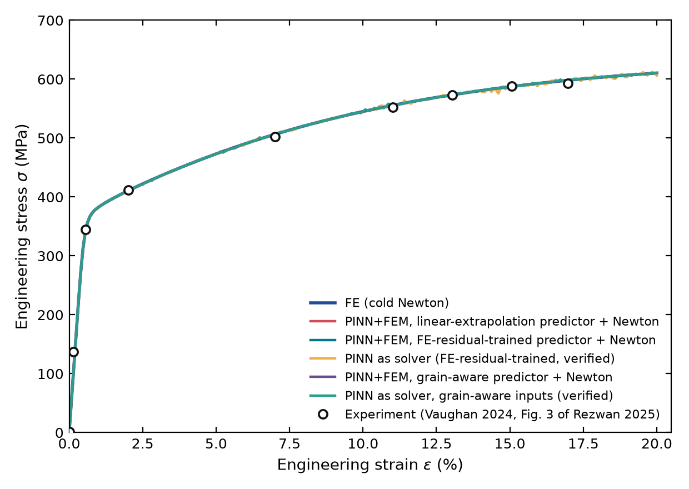

**Figure 15.** Equivalent plastic strain on the deformed plate at 20%
strain: FE reference, the PINN+FEM runs, the PINN-as-solver runs, and
the difference of the grain-aware solver run from the reference (the same panels at 2, 8
and 15% are `figures/report/neural_h40_fields_{2,8,15}pct.png`).

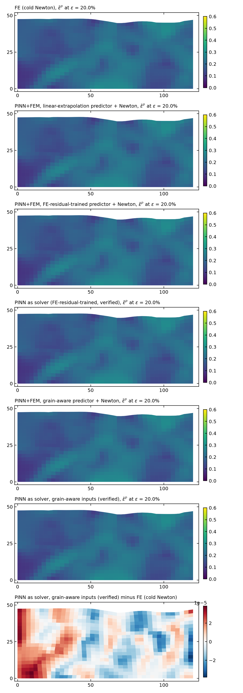

**Figure 16.** Top: Newton iterations and solve-plus-predictor time per
step of the six runs along the load path. Bottom: equilibrium error $r$
of the network's proposal before (dashed) and after training for the
four network runs, with the tolerance of the solver route.

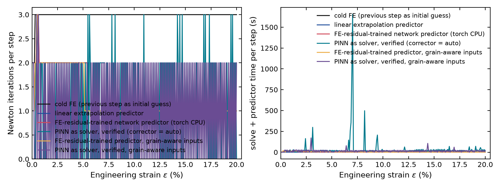

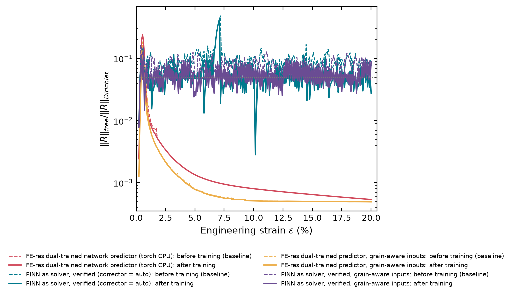

### 8.3 What the two routes measure

The network's value on this problem is bounded first by what it can
represent and then by what its training costs. A network of the
coordinates and the load factor carries the smooth part of the
step-to-step increment, which the linear extrapolation already delivers
for free; the remainder, the redistribution of plastic strain between
grains as they yield, is as sharply structured at the grain boundaries as
the field itself, and neither the strong-form nor the weak-form loss
changes that. Grain-aware inputs remove this representational limit: the
same network then reaches three to four times lower equilibrium errors
per step, and as a verified solver it returns a curve twice as close and
a plastic-strain field two to nine times closer to the reference at the
same tolerance. What they do not remove is the cost of training on the
assembled residual, about 12 s per step against 1.3 s for the Newton
solve it replaces, so on this problem the verified PINN-as-solver route
is a correct and accurate solver at eleven times the cost of the
finite-element one (3,844 against 344 s), and the trained PINN+FEM route
is a predictor that improves on the linear extrapolation by one to two
percent of the Newton iterations at a net loss of wall time. The
consistent tangent halved the cost of the finite-element reference, which
widens the gap to the trained routes; the linear extrapolation is the one
predictor that pays, 57% of the Newton iterations and 28% of the solve
time for nothing. Trained on the strong
form the same network solved no step at all.

## 9. Parameter sensitivity of the neural routes

### 9.1 Design

The two routes carried forward from §8, the PINN+FEM hybrid with the
linear-extrapolation predictor and the verified PINN-as-solver with
grain-aware inputs, are run through the sixteen one-at-a-time cases of
§6 (each calibrated parameter at $\times 0.5$, $\times 0.8$, $\times 1.25$
and $\times 2$, the other three at their calibrated values) with the decks
of §8 otherwise unchanged. The question is whether a route's accuracy and
cost depend on the material constants, that is, whether the figures of
Table 8 hold away from the calibrated set. The finite-element case of §6
is the reference for every case. Decks:
`decks/cp_study/bunge/sens_h40_linear.i`,
`decks/cp_study/bunge/sens_h40_grain_solver.i`;
analysis: `decks/report/bunge/neural_sensitivity.i` with
`scripts/neural_sensitivity.py`.

### 9.2 Results

**PINN+FEM, linear extrapolation.** Every one of the sixteen cases
reproduces its finite-element curve to the solver tolerance (the largest
stress difference over all cases and strains is $4 \times 10^{-6}$ MPa),
while the finite-element effect being tracked ranges from $-31$% to
$+66$% of the flow stress at 20% strain. The Newton iteration count is
304 to 371 per case against 763 to 771 for the corresponding
finite-element cases: a saving of 57% (median), between 52 and 60%
(Fig. 17). The saving is smallest where the plate stops hardening
($k_1 \times 0.5$ and $y_c \times 2$, 371 and 359 iterations) and largest
where it hardens most ($k_1 \times 2$, 304): a flat curve leaves more
steps in which slip redistributes between grains and the extrapolated
field needs a second iteration. The predictor's benefit is mainly a
property of the load path, with this weak dependence on the hardening
rate.

**PINN as solver, grain-aware, verified.** On all sixteen cases the
route behaves as on the calibrated set: the engineering stress stays
within 2.2 to 7.3 MPa (at most 1%) of the finite-element case at every
strain, 131 to 144 of the 256 steps are solved by the network without
Newton, and the Newton count is 226 to 252, with no trend against the
parameter or its level while the finite-element flow stress moves by
$-31$% to $+66$%. The acceptance rate of about one step in two and the
accuracy of the accepted steps are properties of the tolerance and of the
network's inputs, not of the material constants; the cost per run (4,190
to 4,770 s, runs sharing the host) is likewise unchanged.

**Table 11.** Parameter sensitivity of the two neural routes: deviation of
the route from the finite-element case and its cost, per case (full table
in `results/cp_study/bunge/sens_neural/sens_neural_h40.csv`).

| case | FE effect at 20% | PINN+FEM linear: max $\lvert\Delta\sigma\rvert$ (MPa), Newton iterations | grain-aware solver: max $\lvert\Delta\sigma\rvert$ (MPa), steps without Newton, Newton iterations |
|---|---|---|---|
| base | 0 | 0.000, 329 | 4.30, 137, 240 |
| $\rho_0 \times 0.5$ | $-7.8$% | 0.000, 317 | 4.72, 134, 248 |
| $\rho_0 \times 0.8$ | $-3.0$% | 0.000, 324 | 2.22, 132, 250 |
| $\rho_0 \times 1.25$ | $+3.4$% | 0.000, 333 | 3.85, 135, 244 |
| $\rho_0 \times 2$ | $+12.7$% | 0.000, 337 | 4.47, 139, 237 |
| $k_1 \times 0.5$ | $-31.2$% | 0.000, 371 | 2.83, 135, 245 |
| $k_1 \times 0.8$ | $-12.9$% | 0.000, 340 | 3.71, 136, 243 |
| $k_1 \times 1.25$ | $+16.4$% | 0.000, 319 | 6.39, 144, 226 |
| $k_1 \times 2$ | $+66.5$% | 0.000, 304 | 5.89, 137, 240 |
| $y_c \times 0.5$ | $+27.9$% | 0.000, 326 | 7.33, 135, 245 |
| $y_c \times 0.8$ | $+9.1$% | 0.000, 327 | 4.51, 131, 252 |
| $y_c \times 1.25$ | $-8.9$% | 0.000, 333 | 4.18, 132, 251 |
| $y_c \times 2$ | $-25.7$% | 0.000, 359 | 3.82, 134, 247 |
| $\tau_{c0} \times 0.5$ | $-1.5$% | 0.000, 327 | 3.81, 134, 245 |
| $\tau_{c0} \times 0.8$ | $-0.6$% | 0.000, 328 | 2.81, 138, 238 |
| $\tau_{c0} \times 1.25$ | $+0.8$% | 0.000, 330 | 3.36, 132, 251 |
| $\tau_{c0} \times 2$ | $+3.1$% | 0.000, 330 | 4.41, 138, 239 |

**Figure 17.** Deviation from the finite-element case and solve time per
case for the two routes.

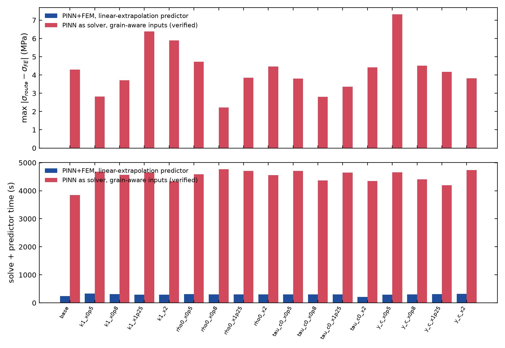

## 10. Hardware and time benchmark

### 10.1 Design

All timings in §8 and §9 were taken while other runs shared the host, so
they measure iterations and assemblies reliably and wall time only
roughly. This section measures wall time under controlled conditions:
each case is the first 16 load steps of the calibrated h40 deck (the
strain per step of §3 unchanged, so the steps are those of the cold
start, the elastic rise and the first yield), run alone on the host with
the thread count pinned. Twelve cases: the cold finite-element arm on
numpy at 1, 2, 4 and 8 threads, on torch CPU at 1, 2, 4 and 8 threads and
on the torch GPU; the PINN+FEM route with the linear extrapolation; and
the verified grain-aware PINN-as-solver route with its network on the GPU
and on the CPU. The three neural-route cases use the torch CPU arm at 8
threads. For each case: wall time per load step, Newton time per
iteration, predictor time per step, the number of assemblies, the peak
resident memory of the process and the peak GPU memory. Deck
`decks/benchmark/bunge/hardware_h40.i`; script
`scripts/hardware_benchmark.py`.

### 10.2 Results

All twelve cases converged in the same 16 steps; the nine cold
finite-element cases on numpy, torch CPU and torch GPU took the same 45
Newton iterations, so they are timed on identical work. Table 12 gives
the measurements; Fig. 20 the time per step.

**Table 12.** Hardware and time benchmark, first 16 load steps of the
calibrated h40 deck, one case at a time on the host. The peak resident
memory is that of the process; the GPU memory poll did not capture a
value on this host (its tool prints no per-process figure) and is
omitted.

| case | FE arm | threads | network device | Newton iterations | Newton time per iteration | predictor time per step | steps without Newton | time per step | peak memory |
|---|---|---|---|---|---|---|---|---|---|
| cold FE | numpy | 1 | -- | 45 | 2.64 s | -- | 0 | 7.53 s | 228 MB |
| cold FE | numpy | 2 | -- | 45 | 2.66 s | -- | 0 | 7.56 s | 233 MB |
| cold FE | numpy | 4 | -- | 45 | 2.66 s | -- | 0 | 7.57 s | 233 MB |
| cold FE | numpy | 8 | -- | 45 | 2.64 s | -- | 0 | 7.51 s | 237 MB |
| cold FE | torch CPU | 1 | -- | 45 | 0.47 s | -- | 0 | 1.55 s | 1,212 MB |
| cold FE | torch CPU | 2 | -- | 45 | 0.39 s | -- | 0 | 1.33 s | 1,216 MB |
| cold FE | torch CPU | 4 | -- | 45 | 0.37 s | -- | 0 | 1.27 s | 1,216 MB |
| cold FE | torch CPU | 8 | -- | 45 | 0.41 s | -- | 0 | 1.38 s | 1,216 MB |
| cold FE | torch GPU | 8 | -- | 45 | 0.56 s | -- | 0 | 2.00 s | 1,623 MB |
| PINN+FEM, linear extrapolation | torch CPU | 8 | -- | 34 | 0.37 s | 0.00 s | 0 | 1.23 s | 1,212 MB |
| PINN as solver, grain-aware, verified | torch CPU | 8 | GPU | 20 | 0.45 s | 8.4 s | 7 of 16 | 9.5 s | 2,074 MB |
| PINN as solver, grain-aware, verified | torch CPU | 8 | CPU | 15 | 0.51 s | 7.6 s | 10 of 16 | 8.5 s | 2,074 MB |

**The finite-element arm.** On numpy the thread count does not matter
(2.64 s per Newton iteration in every case): the implicit update has no
analytic tangent on that arm, so every Newton iteration differentiates
the constitutive update by finite differences, a sequence of small
vectorised operations that do not use the threaded BLAS. On torch the
consistent tangent comes from the same batched pass as the stress, and an
iteration costs 0.47 s on a single thread, 0.39 s at two, 0.37 s at four
and 0.41 s at eight: 5.6 to 7.1 times faster than numpy. The gain is the
tangent and the batched kernel; threads add 25% at most and nothing
beyond four, so the host's cores are best used as several two-thread
runs side by side, which is how every campaign of this report was run.
The GPU is slower than every CPU case (0.56 s): at 800 elements the
launch overhead of the many small operations of the local Newton
iteration outweighs the device, as the first measurement of the batched
kernel also found. Both torch arms cost five to seven times the memory of
numpy. The absolute times of §8 and §9 were measured with the torch CPU
arm at four threads on a shared host (0.45 to 0.75 s per iteration), so
they overstate every route's cost by up to a factor of two relative to
the idle host; the ratios between routes hold in iterations and
assemblies, because every route is made of the same assemblies.

**The neural routes.** The linear-extrapolation predictor costs nothing
measurable and removes a quarter of the Newton iterations over these 16
steps (34 against 45; 57% over the full path, §8: the first steps are the
elastic rise and the first yield, where the extrapolation is poorest).
The verified grain-aware solver solves 7 to 10 of the 16 steps without
Newton, but its training costs 7.6 to 8.4 s per step, 41 to 48 assemblies
per step, against 1.4 s for the cold solve. Placing the network on the
GPU or on the CPU makes no difference beyond the variation between the
two runs (8.4 against 7.6 s; the two devices round differently, so the
runs accept different steps): the network is small, and the cost of the
route is the finite-element assemblies of its training loss, not the
network. The same conclusion as §8, now under controlled timing.

**Figure 20.** Time per load step of the twelve cases, split into the
Newton solve and the predictor (log scale).

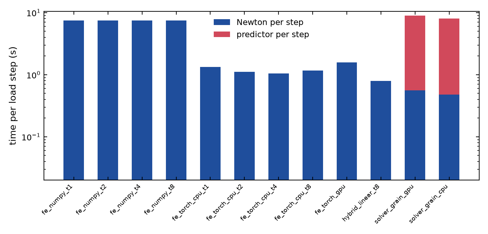

## 11. The parametric surrogate

### 11.1 Design

The three routes above solve one problem per run. The surrogate route of
the framework (ADR 0030) trains a network of the deck's **parameters**
once and answers queries in milliseconds; on crystal plasticity, whose
response depends on the loading path, the admissible training source is
sampled finite-element runs (the strong-form residual is not a function
of parameters and coordinates alone, and §8 measured that it is
unreachable on a polycrystal in any case), so the surrogate learns the
**reduced response**, the engineering stress-strain curve, and the
**final displacement field** at 20% strain, as functions of
$(\rho_0, k_1, y_c, \tau_{c0})$ over the range of §6 ($\times 0.5$ to
$\times 2$ of the calibrated values, log-uniform). Twenty-four
Latin-hypercube samples are run through the pipeline of §2 on the
calibrated structure (deck `decks/cp_study/bunge/surrogate/design_h40.i`); six
are held out. The curve surrogate is a network
$\sigma(\mathbf{p}, \varepsilon)$ with five inputs and one output, the
field surrogate $\mathbf{u}(\mathbf{p}, \mathbf{x})$ with seven inputs and
three outputs (three hidden layers of 64 tanh units in both), trained on
the GPU with Adam and L-BFGS. The measures are the held-out error
(relative L2 of the curve and of the field at parameters the network has
not seen), the cost of the data (finite-element time of the 18 training
samples), the training time, the time per query on the GPU and on the
CPU (1,000 random parameter rows), and the break-even number of queries
against the finite-element run, the PINN+FEM run and the verified
PINN-as-solver run of §8. Decks
`decks/cp_study/bunge/surrogate/plate_h40_surrogate_curve.i` and
`plate_h40_surrogate_field.i`.

### 11.2 Results

The twenty-four samples cost 10,212 s of finite-element time (426 s each
on average at two threads, eight at a time); the eighteen training samples
account for 7,792 s. Table 10 summarises the three surrogate runs.

**Table 10.** Plate surrogates over $(\rho_0, k_1, y_c, \tau_{c0})$ at h40,
eighteen training samples, six held out. The held-out error is the mean
relative L2 difference from the finite-element result at parameters the
network has not seen; the query time is for 1,000 random parameter rows
after training. Break-even is the number of queries after which data
plus training is cheaper than one solver run per query (cold FE 344 s;
PINN+FEM 247 s; verified grain-aware solver 3,844 s).

| surrogate | network | training device | held-out error, mean (max) | training time | time per query | break-even vs cold FE |
|---|---|---|---|---|---|---|
| stress-strain curve $\sigma(\mathbf{p}, \varepsilon)$ | 5 in, 1 out, 8,769 weights | GPU | 3.5% (5.6%) | 19 s | 0.30 ms | 23 runs |
| stress-strain curve, same deck | same | CPU | 2.2% (4.8%) | 17 s | 0.13 ms | 23 runs |
| displacement field $\mathbf{u}(\mathbf{p}, \mathbf{x})$ at 20% | 7 in, 3 out, 9,027 weights | GPU | 0.91% (1.01%) | 118 s | 0.74 ms (1,722 nodes per query) | 23 runs |

**Accuracy.** The field surrogate reproduces the 20% displacement field
of every held-out sample to about 1%: the displacement of a plate in
tension varies smoothly with the parameters and the network has little
to learn beyond the amplitude. The curve surrogate is coarser, 2 to 4% on
average and 5 to 6% at worst (Fig. 18): the elastic knee is smoothed, and
the worst held-out samples are at the edges of the hardening range (on
the GPU run sample 7, with a high $k_1$, at 5.6% and sample 21, with the
largest $y_c$ and the flattest curve, at 4.9%; on the CPU run sample 1 at
4.8%), the signature of a four-dimensional log space sampled by eighteen
points. The two devices train to different minima from the same seed, so
the worst sample differs. The accuracy is limited by the data, not by the
network; doubling the design costs another 10,000 s of finite-element
time and is the lever if the curve surrogate is to be used
quantitatively.

**Cost.** The training is negligible next to the data: 17 to 118 s
against 7,792 s of finite-element runs. The network is small, so a curve query
costs 0.1 to 0.3 ms on either device and a field query (1,722 nodes) 0.7
ms, and the GPU gives no advantage at this size (it is slower per query than the CPU because of the launch
overhead); training on the GPU is faster for the field surrogate only.
Against the finite-element run of §4 the surrogate pays for itself after
23 queries, against the PINN+FEM run after 32 and against the verified
PINN-as-solver run after 3 (Fig. 19); beyond that every query is six
orders of magnitude cheaper than a solve. The break-even against the
finite-element run was 14 queries in the first version of this study: the
data now cost a third less, but one finite-element run costs less than
half, so the surrogate needs more queries to pay. The two neural solver routes of §8 never reach this regime
because they are trained per trajectory; the surrogate does because it is
trained once over the parameter space and verified on held-out
finite-element runs, which is the only verification available for a
history-dependent material (the certification by one assembly of §11.1's
framework applies to steady physics only).

**Figure 18.** Held-out stress-strain curves (solid, finite element)
against the curve surrogate (dashed), GPU run.

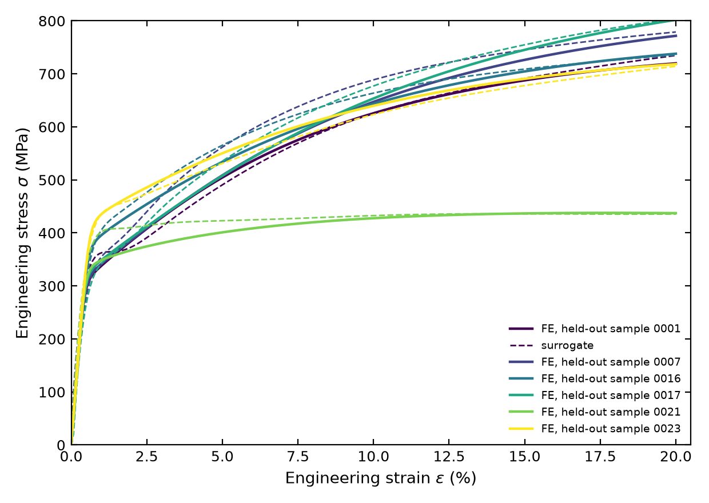

**Figure 19.** Cost per query against the number of queries answered: the
surrogates (data plus training amortised, plus the query) and the solver
routes (one run per query).

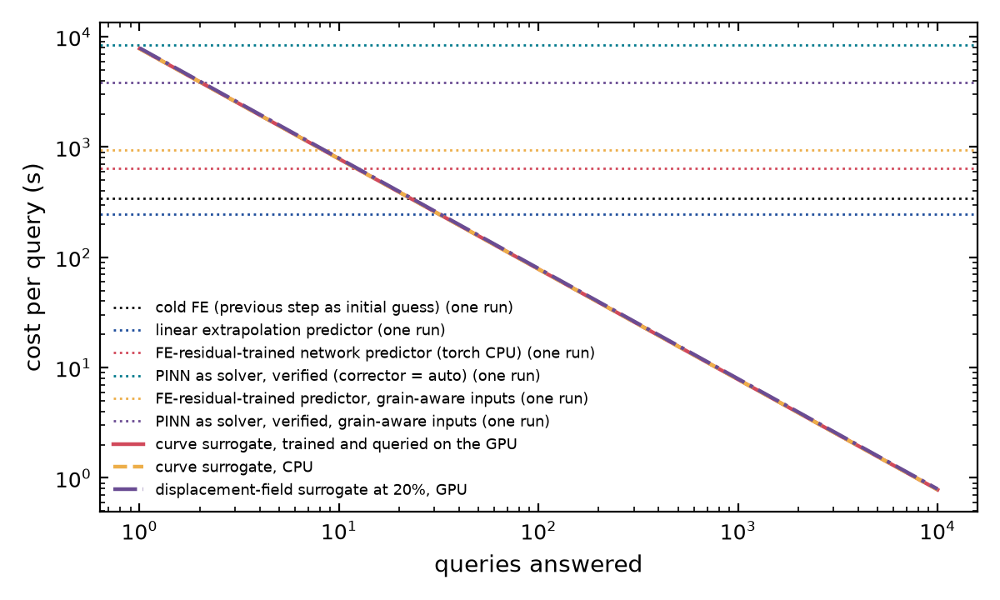

## 12. Part II: phase-field ductile fracture on the perforated plate

### 12.1 Problem

The Part I plate (100 x 50 x 1 um, 30 grains, x-loaded to 20% nominal
strain at 1e-3 /s) receives a central through-hole of diameter 5 um. The
hole is the stress concentrator whose Irwin plastic zone
$r_p = (a/2)(\sigma/\sigma_y)^2$ stays clear of the plate edges
($r_p \le 3.3$ um against a 22.5 um ligament) and is smaller than a grain
(13.7 um median), so that initiation is governed by the grains at the
hole. Two couplings are benchmarked on the same geometry, mesh and
loading: J2 plasticity with phase-field ductile fracture (J2+PFD) and the
Part I crystal plasticity with the same fracture model (CP+PFD).

### 12.2 Fracture model

The AT2 phase field $d$ with degradation $g(d) = (1-d)^2$ and the
plastic-work driving force,

$$
\frac{G_c}{\ell_0}\, d - G_c \ell_0 \nabla^2 d = 2 (1-d)\, \mathcal{H}, \qquad
\mathcal{H}(t) = \max_{\tau \le t} \left\langle \zeta\, W_p(\tau) - W_c \right\rangle ,
\tag{20}
$$

where $W_p$ is the accumulated plastic work density, $\zeta = 1$, $W_c$ a
plastic-work threshold below which no damage accrues, and $\eta = 0$
(quasi-static). The mechanics and the damage are solved in a staggered
loop with up to three alternations per load step (tolerance 1e-3 on the
damage increment), 256 load steps to 20%, and the mechanics stiffness
degraded by $g(d)$. Fracture initiation is the first load step at which
$d \ge 0.8$ at any node (the element-average criterion gives the same
step on every case reported); the fracture strain is the nominal strain of
that step. The calibration target is the last point of the (vaughan 2024
mechanistic) curve, 17.2% nominal strain.

### 12.3 Mesh

hexaform `plate` meshes (hexahedral, one element through the thickness,
a conforming O-grid ring of 24 segments around the hole, grain ids from the
Part I point file at the element centroids): h20 (5 um background, 308
hex8, 700 nodes), h40 (2.5 um, 860, 1,864; the production level) and h80
(1.25 um, 3,232, 6,736). The h160 level (12,800 elements) was built and
dropped: no load step of the coupled J2 solve completed in 5.5 h.

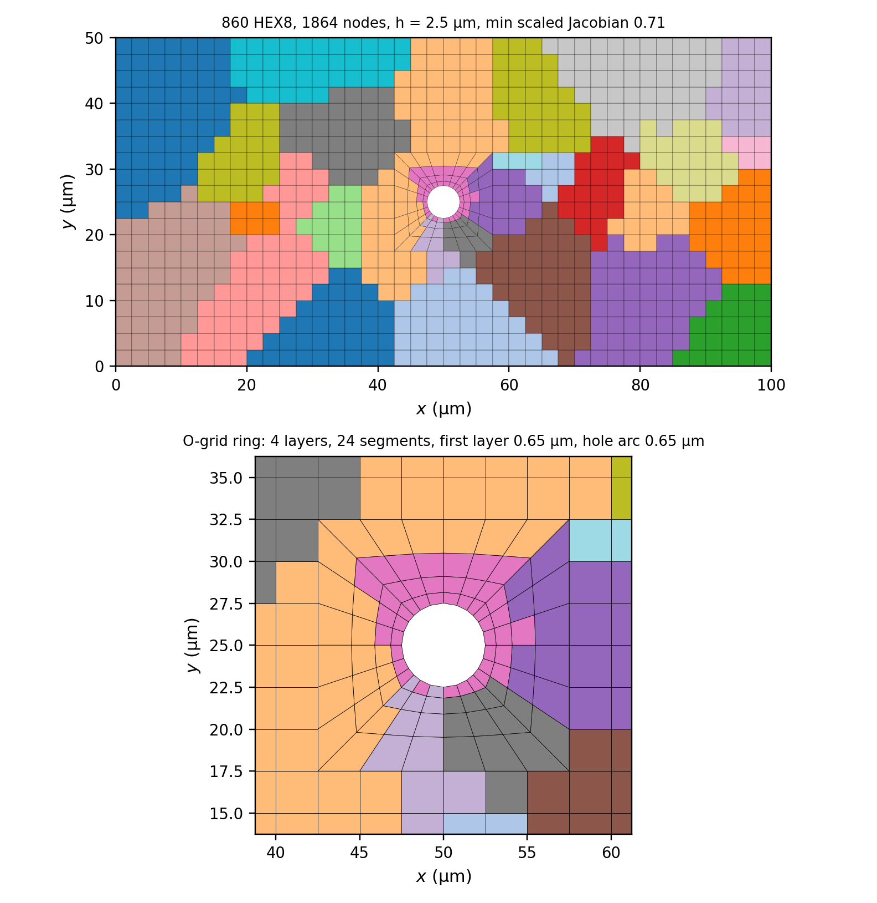

*Figure 20. The h40 perforated mesh coloured by grain id (top) and the
O-grid ring around the hole (bottom): 4 layers, hole-arc element 0.65 um.*

### 12.4 Hardware

Every run of Part II uses the torch CPU arm (the Part I hardware
benchmark's best arm), two threads per run and several runs side by side
on the host, except the hardware comparison of §18. The crystal-plasticity
runs of §14 to §19 use the framework of §3 (Bunge angles, total-Lagrangian
balance, implicit update; decks under `decks/pfd_study/cp/bunge/`), and
their engineering stress is the reaction on the pulled face over the
original gross section. The J2 runs of §13 are those of the first version
of this report.

## 13. J2 plasticity with phase-field ductile fracture

### 13.1 J2 law

The isotropic hardening law is fitted to the digitized experimental curve
converted to true stress and logarithmic strain (elastic constants from the
Voigt average of the cubic set, E = 71.2 GPa, nu = 0.346, so that the J2
and CP plates share one elastic response). A power law
$\sigma_y = 299 + 829\,\alpha^{0.44}$ MPa misses the nearly linear late
hardening by 5 to 6% at 13 to 17% strain; a 26-point piecewise table of
median true stress in log-spaced bins of plastic strain reproduces every
experiment marker from 0.6% to 17% within 0.3% and is the J2 law of
Part II (`decks/pfd_study/j2_fit.i`, `scripts/j2_fit.py`).

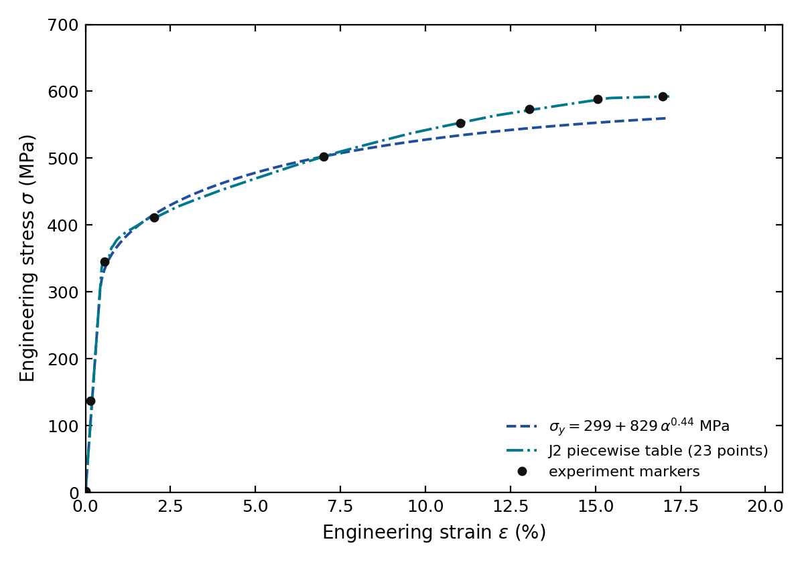

*Figure 21. The two J2 hardening laws against the experiment markers; the
piecewise table is carried.*

### 13.2 Threshold and toughness: the W_c scan

With $W_c = 0$ or 20 MPa and $G_c$ calibrated to the 17.2% target, the
perforated J2 plate softens from 6% strain (peak 415 and 485 MPa) while the
experiment hardens to 17%, and the calibrated $G_c$ of 2,000 MPa um
(2 kJ/m$^2$) is high for an aluminium alloy. The threshold was therefore
scanned at $\ell_0 = 5$ um, with $G_c$ re-calibrated by log-bisection at
every value (`decks/pfd_study/j2/cal_h40_wc{200,400,600,800}.i`,
`scripts/pfd_calibrate.py`; the scan values bracket the plastic-work
density at the hole, 91 MPa at 5% and 1,160 MPa at 17%):

| $W_c$ (MPa) | calibrated $G_c$ (MPa um) | fracture strain | onset of softening | peak (MPa) |
|---|---|---|---|---|
| 0 | 2,063 | 17.3% | 6.1% | 415 |
| 20 | 2,003 | 17.1% | 6.1% | 485 |
| 200 | 385.5 | 17.2% | 13.9% | 571 |
| 400 | 155.9 | 17.2% | 14.1% | 485 |
| 600 | 144.7 | 17.2% | 13.4% | 472 |
| 800 | 144.7 | 17.2% | 13.4% | 472 |

*Table 13. The W_c scan at l0 = 5 um, h40.*

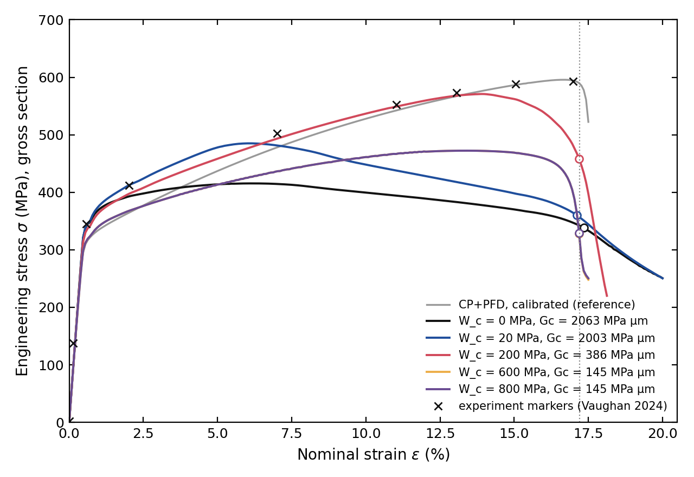

*Figure 22. Gross-section stress-strain curves of the calibrated J2 plate
at each threshold, the CP+PFD plate in grey, the experiment markers and the
17.2% target (dotted). Circles mark initiation.*

The threshold and the toughness trade against each other: raising $W_c$
from 20 to 200 MPa moves the onset of softening from 6.1 to 13.9% and lets
$G_c$ fall five-fold, with the peak rising to 571 MPa (97% of the
experiment's 590). Beyond 400 MPa the trade turns: the plastic work exceeds
the threshold only in the root elements late in the path, the bisection
needs $G_c \approx 150$ MPa um to initiate by 17.2%, and that low toughness
degrades the root so fast that the peak falls back below 490 MPa; 600 and
800 MPa reproduce each other to the digit because the threshold is already
above the plastic work everywhere but the root. The carried J2
configuration is $W_c = 200$ MPa, $G_c = 385.5$ MPa um (0.39 kJ/m$^2$),
$\ell_0 = 5$ um.

### 13.3 Calibrated $G_c(\ell_0)$ and the length-scale sweep

| $\ell_0$ (um) | $\ell_0/h$ | calibrated $G_c$ (MPa um) | $G_c \ell_0$ | fracture strain | peak (MPa) at strain |
|---|---|---|---|---|---|
| 5 | 2 | 385.5 | 1,928 | 17.19% | 571 at 13.9% |
| 10 | 4 | 488.9 | 4,889 | 17.27% | 537 at 13.0% |
| 20 | 8 | 558.8 | 11,175 | 17.19% | 499 at 11.6% |

*Table 14. J2+PFD calibration at W_c = 200 MPa, h40.*

| $\ell_0$ at $G_c = 385.5$ (um) | 2.5 (= h) | 5 | 10 | 20 | 40 |
|---|---|---|---|---|---|
| fracture strain | 18.13% | 17.19% | 15.86% | 14.45% | 15.08% |
| peak (MPa) | 611 | 571 | 509 | 448 | 436 |
| fracture energy (MPa) | 101.9 | 87.0 | 71.7 | 58.2 | 58.6 |

*Table 15. J2+PFD length-scale sweep at fixed G_c (the (chakraborty 2016
multiscale) Fig. 8 analogue).*

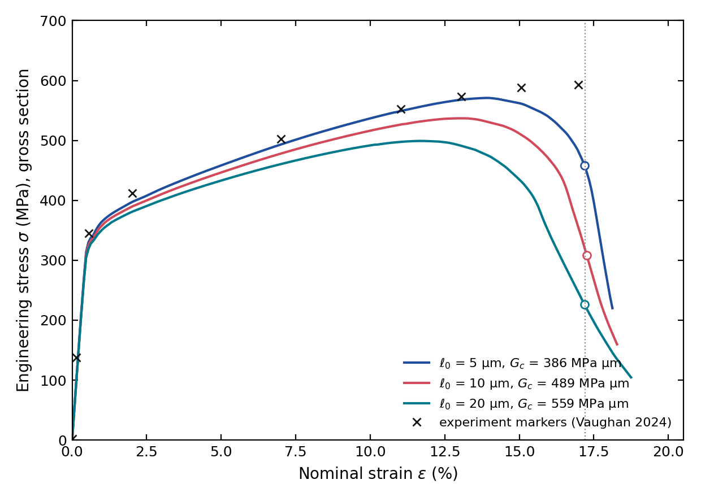

*Figure 23. The calibrated J2 plates at l0 = 5, 10 and 20 um.*

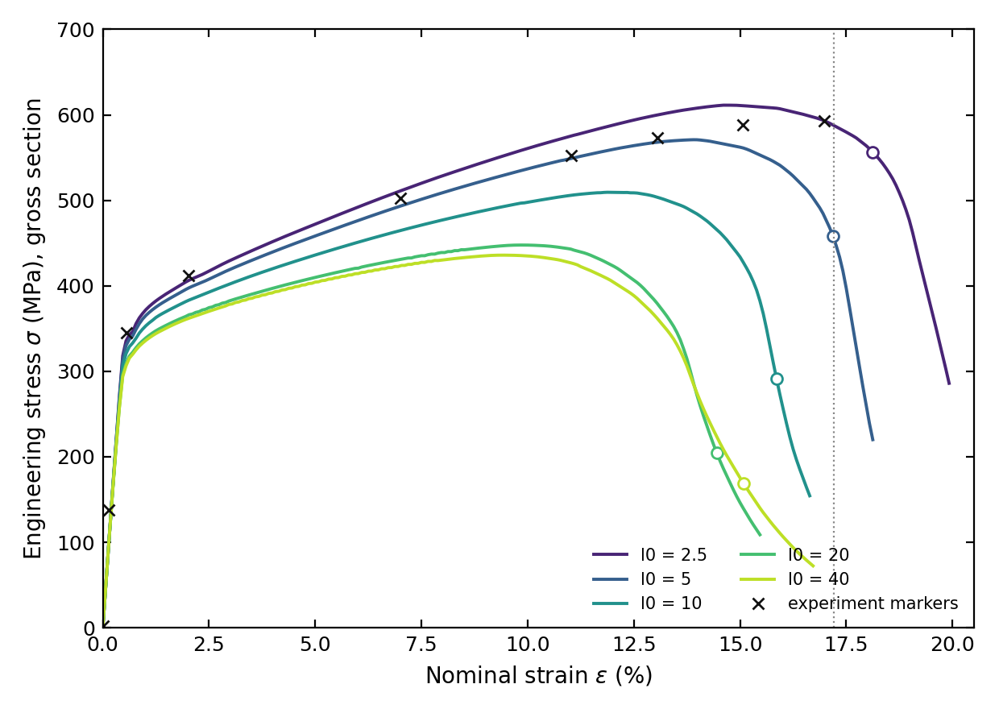

*Figure 24. J2+PFD at fixed G_c, l0 from h to 16h.*

The calibrated toughness rises with the length scale (x1.45 from 5 to
20 um) and the peak falls because a wider damage band degrades more of the
ligament before the root reaches $d = 0.8$. At fixed $G_c$ the fracture
strain, the peak and the fracture energy fall with $\ell_0$ to 20 um and
the fracture strain turns up at 40 um, where the band spans the ligament
and the damage grows everywhere at once.

### 13.4 Parameter sensitivity

One parameter at a time from the carried configuration, four values each
(`decks/pfd_study/j2/sens_h40.i`):

| parameter | values | fracture strain | peak (MPa) |
|---|---|---|---|
| base | $G_c$ 385.5, $\ell_0$ 5, $\eta$ 0, $W_c$ 200 | 17.19% | 571 |
| $G_c$ x 0.25, 0.5, 2, 4 | 96, 193, 771, 1,542 | 9.06, 13.36%, none, none | 398, 497, 617, 645 |
| $\ell_0$ (um) | 2.5, 3.75, 7.5, 10 | 18.13, 17.58, 16.48, 15.86% | 611, 590, 537, 509 |
| $\eta$ (MPa s) | 1, 3, 10, 30 | 17.34, 17.58, 18.28, 19.69% | 572, 573, 579, 595 |
| $W_c$ (MPa) | 50, 100, 400, 800 | 7.97, 11.72%, none, none | 471, 523, 594, 596 |
| alternations | 5 | 17.19% | 571 |

*Table 16. J2+PFD sensitivity at h40 ("none": no initiation by 20%).*

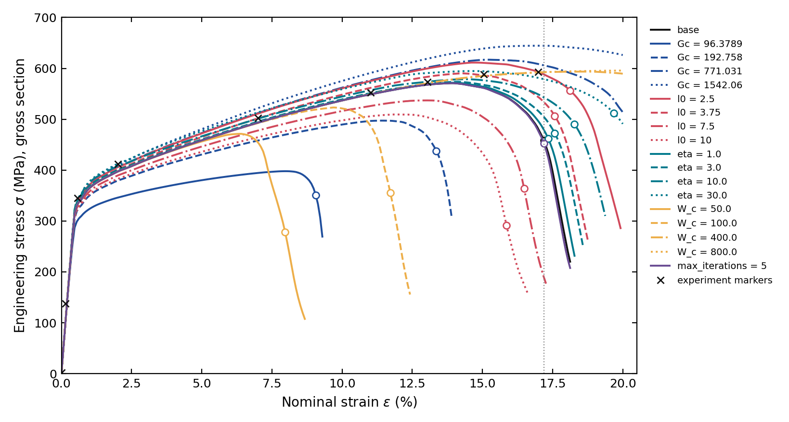

*Figure 25. J2+PFD sensitivity curves: one colour per parameter, one line
style per value.*

Every fracture parameter is active: $G_c$ and the threshold move the
initiation by several percent of strain (the threshold is the steepest
lever, 8.0% at 50 MPa, none at 400 MPa), $\ell_0$ moves it monotonically
with the peak, and the viscosity, immaterial at $W_c = 0$, now delays
initiation by 1.1 to 2.5% at 10 to 30 MPa s because the damage grows in
3% of strain once the threshold is crossed. Five alternations against three
leave the result unchanged.

### 13.5 Mesh sensitivity

| mesh | h (um) | $\ell_0/h$ | fracture strain | peak (MPa) | fracture energy (MPa) |
|---|---|---|---|---|---|
| h20 | 5 | 1 | 17.34% | 570 | 92.0 |
| h40 | 2.5 | 2 | 17.19% | 571 | 87.0 |
| h80 | 1.25 | 4 | 16.02% | 564 | 79.4 |

*Table 17. J2+PFD at W_c = 200, l0 = 5 um, three mesh levels.*

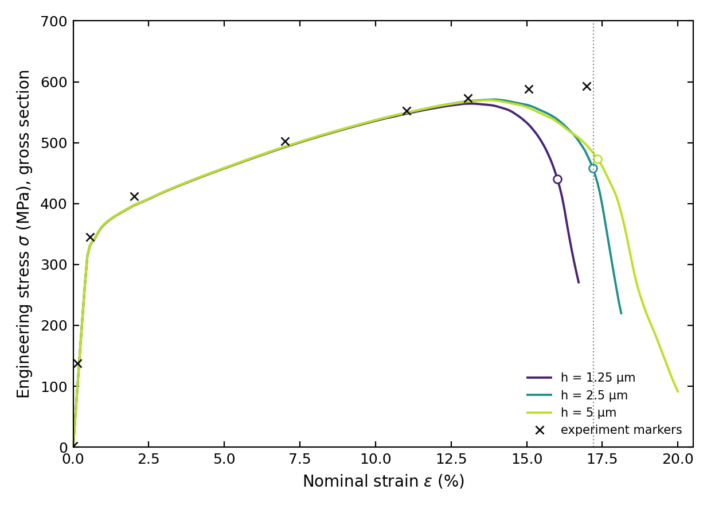

*Figure 26. J2+PFD mesh sensitivity.*

The peak is mesh-independent within 1.2%, but the initiation strain of the
thresholded J2 source is not converged at h40: h80 initiates 1.2% strain
earlier. The threshold confines the damage source to the root elements
where $W_p > W_c$, and the finer mesh resolves a smaller, hotter root volume
that crosses the threshold earlier. This is a limitation of the carried J2
configuration (a calibration at h80 would lower $G_c$ by about 10%); the
$\ell_0 \ge 2h$ rule, sufficient for the diffuse $W_c = 0$ source
(h40 and h80 within two load steps), is not sufficient for a thresholded
one.

## 14. Crystal plasticity with phase-field ductile fracture

### 14.1 Calibrated $G_c(\ell_0)$ and the length-scale sweep

The Part I calibrated crystal-plasticity set and grain structure, the AT2
model with $W_c = 0$ and $\eta = 0$, $G_c$ calibrated by log-bisection
at each $\ell_0$ (`decks/pfd_study/cp/bunge/cal_h40.i`; 9, 7 and 2 trials):

| $\ell_0$ (um) | $\ell_0/h$ | calibrated $G_c$ (MPa um) | fracture strain | peak (MPa) at strain |
|---|---|---|---|---|
| 5 | 2 | 1,123 | 17.11% | 548 at 15.5% |
| 10 | 4 | 1,974 | 17.19% | 543 at 14.8% |
| 20 | 8 | 2,991 | 17.19% | 537 at 14.1% |

*Table 18. CP+PFD calibration at h40.*

| $\ell_0$ at $G_c = 1,123$ (um) | 2.5 (= h) | 5 | 10 | 20 | 40 |
|---|---|---|---|---|---|
| fracture strain | none | 17.1% | 10.0% | 6.8% | 6.6% |
| peak (MPa) | 589 | 548 | 479 | 431 | 424 |
| fracture energy (MPa) | 101 | 83.2 | 43.2 | 27.1 | 25.8 |

*Table 19. CP+PFD length-scale sweep at fixed G_c.*

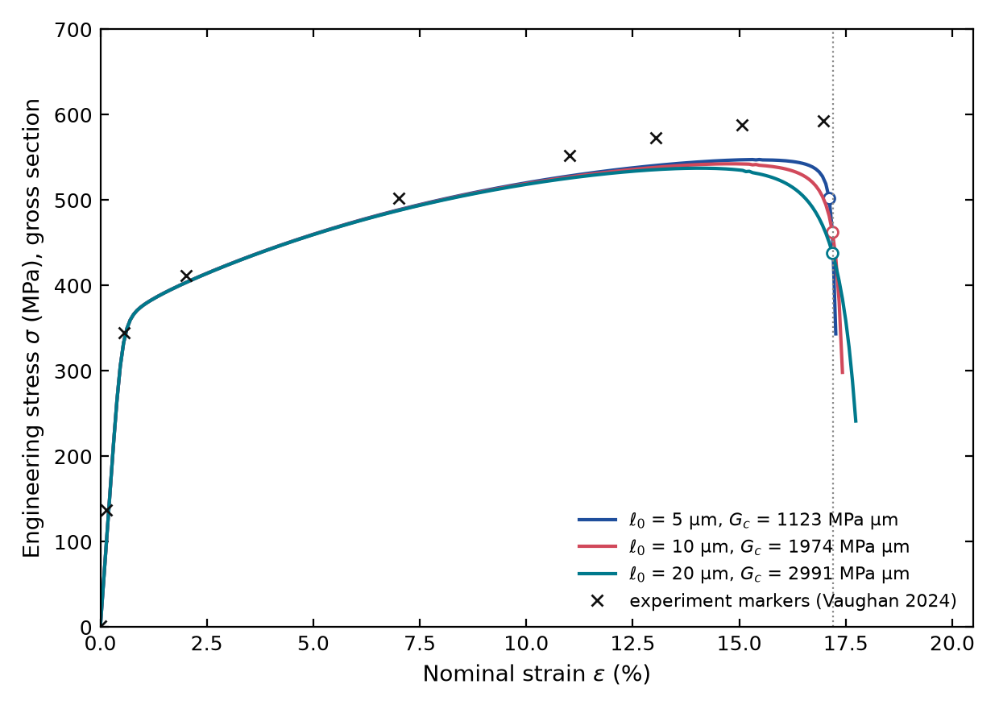

*Figure 27. The calibrated CP+PFD plates at l0 = 5, 10 and 20 um against
the experiment markers.*

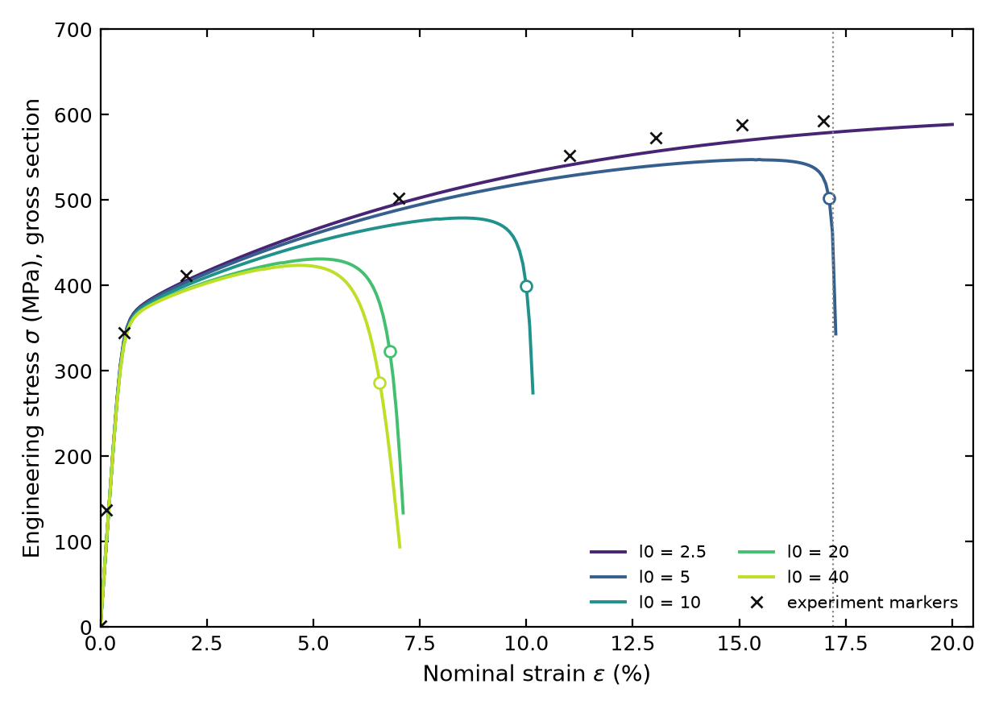

*Figure 28. CP+PFD at fixed G_c, l0 from h to 16h.*

The crystal-plasticity plate needs no threshold to initiate at the target:
the calibrated $G_c$ is 1,123 MPa um at $\ell_0 = 5$ um, 2.9x the J2 value
at the same length scale, and it rises with $\ell_0$ to 2,991 MPa um at 20
um, where the band averages over the four grains at the hole. The three
values are within 2 to 8% of those of the first version of this report
(1,106, 1,832 and 2,818). The load drops by a third within 0.2% of strain
after initiation.

The gross-section stress of the perforated plate lies below the
plain-specimen markers: 2% low at 2% strain, 3% at 7%, 4% at 11% and 7% at
15%, with the peak of 548 MPa at 15.5% against the markers' 593 MPa at
17%. Against the plain plate of Part I with the same parameters the
difference is 1.7% at 2% strain, 3.5% at 7%, 4.9% at 11% and 6.8% at 15%.
Two effects add up: the hole (the sweep case without initiation, at
$\ell_0 = h$, peaks at 589 MPa where the plain plate reaches 610 MPa), and
the AT2 damage, which has no threshold and degrades the whole section
from the first plastic step (mean $d$ 0.27 at 10% strain and 0.39 at 15%,
§15). In the first version of this report the same plate followed the
markers within 1 to 2% up to a peak of 596 MPa; that agreement was
recorded as a coincidence, and it rested on the earlier balance, which
did not carry the thinning of the section into the force. With the true
force the coupled plate is softer than the plain specimen, as a perforated
and diffusely damaged plate must be, and matching the markers on this
geometry would need the crystal-plasticity set refitted on the coupled
model or a threshold $W_c$ (§14.2: $W_c = 40$ MPa raises the peak to 573
MPa). That is outside the pipeline order of this study, in which the
fracture model inherits the Part I set.

At fixed $G_c$ the sweep gives the clean (chakraborty 2016 multiscale)
Fig. 8 form: peak, fracture strain and energy all fall monotonically with
$\ell_0$ and saturate between 8h and 16h; at $\ell_0 = h$ nothing
initiates.

### 14.2 Parameter sensitivity

| parameter | values | fracture strain | peak (MPa) |
|---|---|---|---|
| base | $G_c$ 1,123, $\ell_0$ 5, $\eta$ 0, $W_c$ 0 | 17.11% | 548 |
| $G_c$ x 0.25, 0.5, 2, 4 | 281, 561, 2,245, 4,491 | 4.22, 8.67%, none, none | 403, 470, 590, 599 |
| $\ell_0$ (um) | 2.5, 3.75, 7.5, 10 | none, none, 12.34, 10.00% | 589, 572, 507, 479 |
| $\eta$ (MPa s) | 1, 3, 10, 30 | 17.11% (all) | 548 (all) |
| $W_c$ (MPa) | 5, 10, 20, 40 | 17.58, 18.05, 18.98%, none | 551, 555, 561, 573 |
| alternations | 5 | 17.03% | 548 |

*Table 20. CP+PFD sensitivity at h40 (`decks/pfd_study/cp/bunge/sens_h40.i`).*

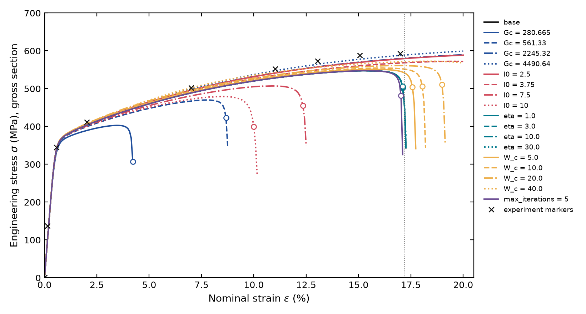

*Figure 29. CP+PFD sensitivity curves.*

$G_c$ and $\ell_0$ govern initiation monotonically; the viscosity is
immaterial at the quasi-static rate (peak within 0.05 MPa over 1 to 30
MPa s); the threshold moves initiation by about +0.1% strain per MPa and
removes it at 40 MPa, because the intragranular plastic work at the
initiation site is spent in a narrower range than in J2. Five alternations
against three change the fracture strain by one load step.

### 14.3 Mesh sensitivity

| mesh | h (um) | $\ell_0/h$ | fracture strain | peak (MPa) | fracture energy (MPa) |
|---|---|---|---|---|---|
| h20 | 5 | 1 | 16.17% | 560 | 80.1 |
| h40 | 2.5 | 2 | 17.11% | 548 | 83.2 |
| h80 | 1.25 | 4 | 17.50% | 537 | 83.5 |

*Table 21. CP+PFD at l0 = 5 um, three mesh levels.*

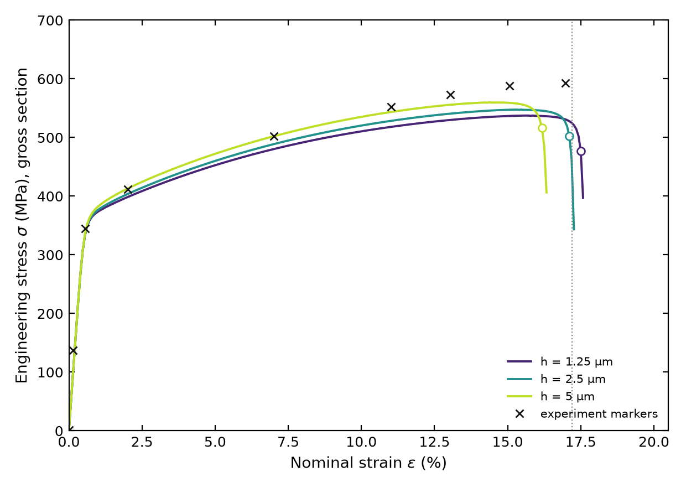

*Figure 30. CP+PFD mesh sensitivity.*

The sequence converges from below in the initiation strain and from above
in the peak: h20 ($\ell_0 = h$) initiates 0.9% early and 2% too stiff,
h40 and h80 differ by five load steps (0.4%) and 1.9% in the peak, within
the 2% the Part I grain-instance check accepted. The peak carries the
mesh effect of the plain plate (§5.3). h40 with $\ell_0 = 5$ um
($\ell_0 = 2h$) is the production configuration.

### 14.4 Grain-instance check

| instance | fracture strain | peak (MPa) | fracture energy (MPa) |
|---|---|---|---|
| A (calibration) | 17.11% | 548 | 83.2 |
| B | 19.14% | 548 | 95.3 |
| C | 17.19% | 556 | 85.6 |

*Table 22. The calibrated CP+PFD case on the three Part I grain structures.*

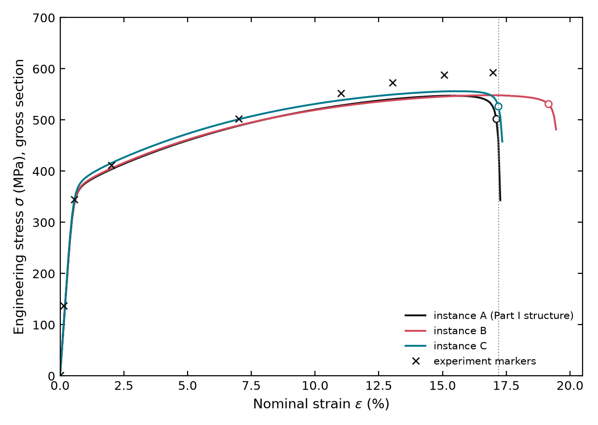

*Figure 31. CP+PFD on the three grain instances.*

With the same $G_c$ and $\ell_0$, instance C initiates one load step
after the calibration structure and instance B 2.0% of strain later,
while the gross-section curves agree within 0.7% (B) and 3.0% (C) up to
15% strain: the grain configuration at the hole governs the initiation
strain, as the plastic zone smaller than a grain implies. A $G_c$
calibrated on one instance is an instance-specific number. The spread is
smaller than in the first version of this report, where B did not
initiate within the path and C initiated 1.1% early.

## 15. Fields: how the two couplings fail

`decks/pfd_study/report/bunge/fields_cal_h40.i`, `scripts/pfd_fields.py`
(damage and equivalent plastic strain at fixed nominal strains, the
cracked elements $d \ge 0.8$ solid over the plastic strain, and the
animation `figures/pfd/cal_h40_evolution.gif`).

| run | strain | max d | mean d | elements with d >= 0.8 | max equivalent plastic strain |
|---|---|---|---|---|---|
| CP | 5 / 10 / 15 / 17.2% (last frame) | 0.21 / 0.39 / 0.56 / 0.91 | 0.14 / 0.27 / 0.39 / 0.46 | 0 / 0 / 0 / 37 | 0.15 / 0.27 / 0.40 / 0.45 |
| J2 | 5 / 10 / 15 / 17.2% | 0.05 / 0.07 / 0.37 / 0.78 | 0.03 / 0.05 / 0.08 / 0.14 | 0 / 0 / 0 / 0 | 0.17 / 0.31 / 0.62 / 1.02 |
| J2 | 18.1% (end) | 0.91 | 0.19 | 28 | 1.31 |

*Table 23. Field statistics of the two calibrated plates.*

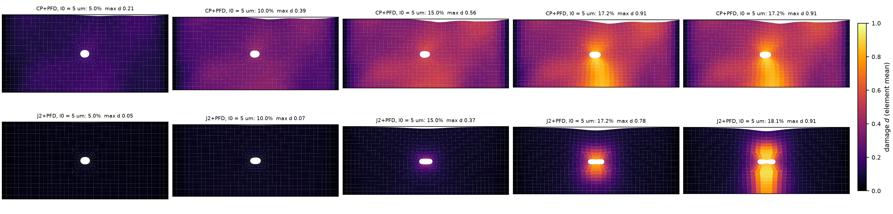

*Figure 32. Damage (element mean) on the deformed plates at 5, 10, 15 and
17.2% and at the end of the path; CP+PFD (top), J2+PFD at W_c = 200
(bottom). The CP path ends at 17.3%, one frame after initiation.*

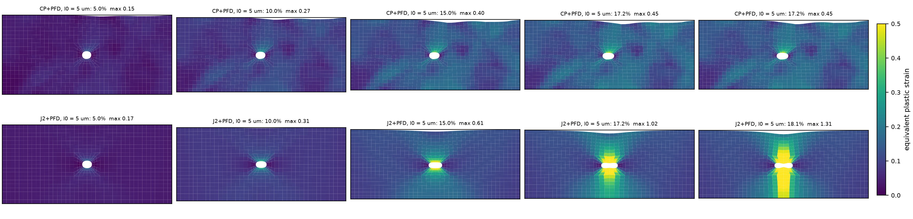

*Figure 33. Equivalent plastic strain at the same strains.*

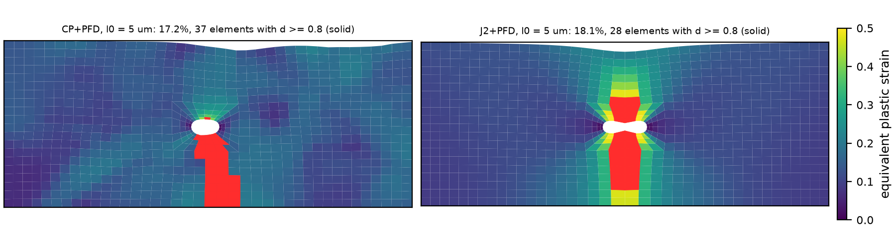

*Figure 34. The cracked elements (d >= 0.8, solid) over the equivalent
plastic strain at the end of each path.*

The two plates reach $d = 0.8$ at the root at the same nominal strain by
construction, by different routes. The CP plate damages diffusely from the
first steps (mean $d$ 0.14 at 5%, 0.46 at initiation) because every grain
accumulates plastic work and the source has no threshold; the hot spot sits
at the root in the grain below the hole, and within one frame of
initiation the 37 cracked elements run from the hole to the lower edge of
the plate, with a step toward the lower-right grain, while the plastic
strain stays below 0.45 in a grain-wise pattern. The J2 plate holds its section until the plastic work at the root
passes the threshold (max $d$ 0.07 at 10%), then a transverse band of
damage grows across the ligament in a few percent of strain, with the
plastic strain localised in the same band (1.0 at initiation, more than
twice the CP maximum) and the plate necking at the top edge; the 28 cracked
elements form a straight transverse crack. This is the J2 limitation: with
a homogeneous flow stress the model matches the curve's hardening and its
fracture strain only through a threshold and a five-fold lower toughness,
and the mechanism it then produces (a localised plastic-work band) is not
the CP mechanism (a grain-set hot spot in a diffusely damaged section).
Matching the CP fields needs the heterogeneous flow stress of the grain
structure, not a J2 parameter.

## 16. Stress-concentrator shape study (CP+PFD)

The calibrated CP+PFD set on six elliptical holes (hexaform ellipse holes,
h40 background, the same ring rule; `decks/pfd_study/cp/bunge/shape_h40.i`,
`decks/pfd_study/mesh/h40_ell_*.i`), in three series: A holds the
transverse half-extent $a = 2.5$ um and sharpens the root (Inglis
$K_t = 1 + 2a/b$ = 5 and 9); B holds the hole area and lengthens the
transverse extent (7.07 and 10 um); C rotates the 5 x 2.5 um ellipse by 45
and 90 degrees.

| series | case | $K_t$ | fracture strain | peak (MPa) | fracture energy (MPa) | cracked elements in the last frame |
|---|---|---|---|---|---|---|
| -- | circle 5 um | 3 | 17.11% | 548 | 83.2 | 37 |
| A | 5 x 2.5 | 5 | 17.66% | 551 | 86.5 | 49 |
| A | 5 x 1.25 | 9 | 17.89% | 552 | 88.0 | 0 (frame before initiation) |
| B | 7.07 x 3.54 | 5 | 15.78% | 542 | 76.1 | 14 |
| B | 10 x 2.5 | 9 | 14.53% | 534 | 68.8 | 10 |
| C | 5 x 2.5 at 45 deg | -- | 17.66% | 551 | 86.5 | 46 |
| C | 5 x 2.5 at 90 deg | 2 | 17.97% | 552 | 88.4 | 38 |

*Table 24. The shape study. Field frames are stored every four load
steps, so the last frame is up to 0.3% of strain before the end of a
path.*

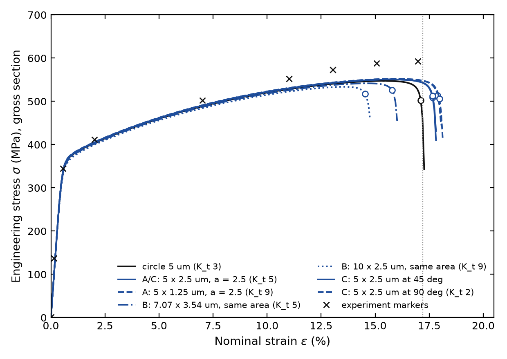

*Figure 35. Stress-strain curves of the seven stress concentrators.*

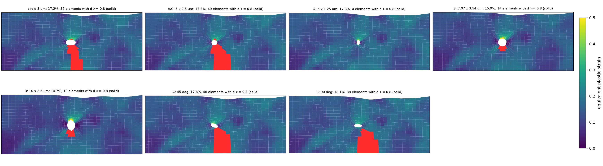

*Figure 36. Cracked elements over the plastic strain in the last frame of
each path (`figures/pfd/cp_shape_h40_evolution.gif` animates the seven
cases).*

Series A contradicts the elastic expectation: at fixed transverse extent a
sharper root initiates later, not earlier (17.11, 17.66 and 17.89% for
$K_t$ = 3, 5 and 9), because a narrower hole removes less of the section
and the plastic-work source of the CP plate is concentrated into a smaller
root volume; the 0.45 um hole-arc element also under-resolves a 0.16 um
root radius (the sharpest case is reported with that caveat; the h80 ring
would be needed to make it quantitative). Series B follows the Irwin
scaling: the larger transverse extent ($r_p$ proportional to $a$)
initiates earlier with a lower energy (15.78 and 14.53%). Series C delays
initiation as $K_t$ falls with the rotation: the 45-degree case initiates
at the same load step as the unrotated ellipse and the 90-degree case
four steps later. In every case the crack starts at the root below the
hole and runs to the lower edge of the plate through the same grains,
with the step toward the lower-right grain that the circle's crack also
takes, and the peak varies by only 3.5% across the seven cases because the damage that sets it is diffuse over the whole
section.

## 17. Neural routes inside the staggered loop

The two Part I routes serve the mechanics sub-solve of every staggered
step of the calibrated CP+PFD plate
(`decks/pfd_study/cp/bunge/neural_h40.i`): the linear extrapolation
predictor (PINN+FEM) and the grain-aware FE-residual-trained network as
the verified solver (network on the CPU, Newton correction when the
proposal's residual exceeds 5% of the step's).

| route | fracture strain | peak (MPa) | Newton iterations, first alternations / all | Newton time, last alternation (s) | predictor time (s) | wall (s) |
|---|---|---|---|---|---|---|
| FE (cold Newton start) | 17.11% | 547.7 | 670 / 1,167 | 399 | -- | 1,366 |
| PINN+FEM, linear extrapolation | 17.11% | 547.7 | 450 / 947 | 400 | 0.0 | 1,399 |
| PINN as solver, grain-aware, verified | 17.03% | 547.5 | 16 / 480 | 361 | 1,087 | 2,034 |

*Table 25. The neural routes on the coupled problem (torch CPU, 2 threads,
two runs side by side).*

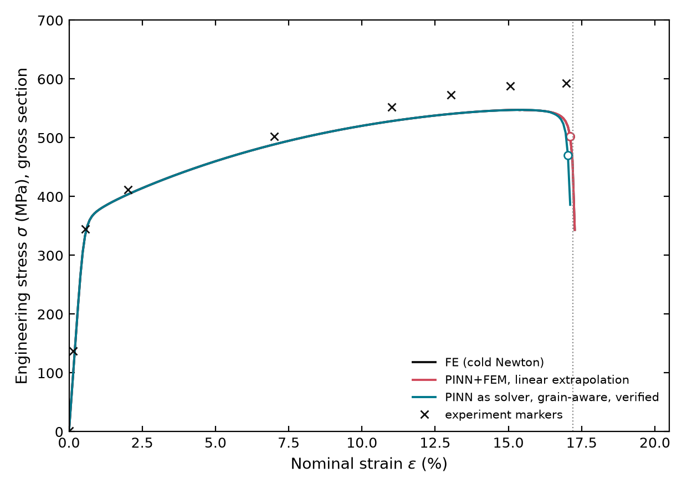

*Figure 37. The three routes coincide on the curve.*

The linear extrapolation reproduces the FE run to the printed digits with
a median proposal error of 0.7% of the step increment, and removes a third
of the first-alternation Newton iterations (450 against 670; 19% of all
mechanics iterations). The verified solver accepts its proposal at 213 of
219 first alternations (the two cold-start steps without history, three
early steps and the last step are corrected by Newton; median residual of
the accepted proposals 4% of the step) and reproduces the curve within
one load step of initiation and 0.2 MPa in the peak. The staggered scheme
then re-solves the mechanics once or twice per step against the updated
damage with ordinary warm-started Newton, so the predictor replaces only
the first alternation: the solver route needs 480 mechanics iterations
where the FE route needs 1,167. That saving does not reach the wall time.
The 740 assemblies of the training loss cost 1,087 s, and the run takes
2,034 s against 1,366 s. In the
first version of this report the same route was 25% faster than FE,
because the FE run then needed two to three times more Newton iterations
per step; with the consistent tangent the Newton solve is cheap enough
that a trained predictor no longer pays on this problem, and the linear
extrapolation, which costs nothing, leaves the wall time unchanged:
the cost of a mechanics solve in the coupled loop does not fall with its
iteration count (§18). A
predictor of the re-solves (a network of the damage increment) is the
next step and outside this study.

## 18. Hardware and time benchmark of the coupled routes

Seven cases, each the first 16 staggered steps of the calibrated CP+PFD
plate, one at a time on the host
(`decks/benchmark/bunge/hardware_pfd_h40.i`,
`scripts/hardware_benchmark.py`):

| case | backend / threads | wall per step (s) | Newton s per iteration | Newton iterations, first alternations / all | predictor s per step | peak memory (MB) |
|---|---|---|---|---|---|---|
| FE, numpy | numpy / 8 | 19.46 | 4.21 | 53 / 79 | -- | 311 |
| FE, torch CPU | torch / 2 | 3.48 | 0.542 | 54 / 80 | -- | 1,338 |
| FE, torch CPU | torch / 8 | 3.21 | 0.489 | 54 / 80 | -- | 1,338 |
| FE, torch GPU | torch GPU / 8 | 4.63 | 0.584 | 54 / 80 | -- | 1,766 |
| PINN+FEM, linear extrapolation | torch / 8 | 3.24 | 0.489 | 37 / 63 | 0.000 | 1,766 |
| PINN as solver, verified, network on GPU | torch / 8 | 8.63 | 0.478 | 12 / 42 | 5.75 | 2,273 |
| PINN as solver, verified, network on CPU | torch / 8 | 8.51 | 0.473 | 12 / 42 | 5.74 | 2,273 |

*Table 26. Time per coupled load step by route and hardware. The Newton
time per iteration is measured on the last alternation of each step, the
only one whose solve time the staggered loop records. The peak memory is a
running maximum over the cases in the order of the table, so the value of
the linear case is an upper bound.*

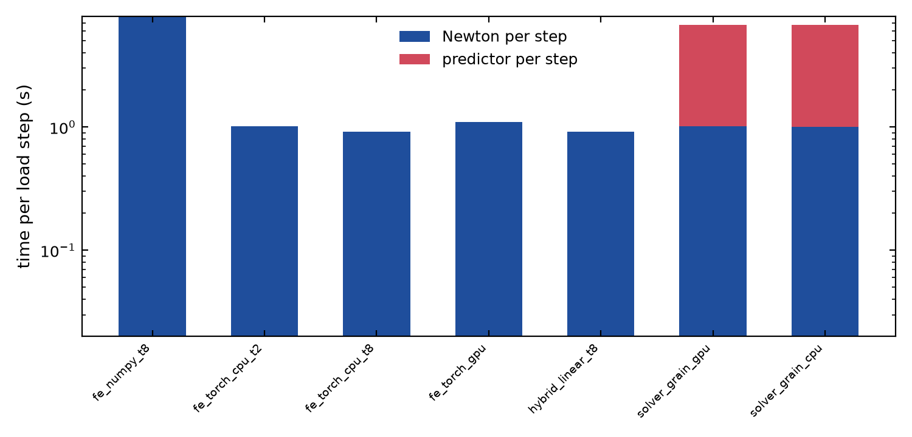

*Figure 38. Time per load step: Newton time of the last alternation and
predictor time.*

The Part I backend ranking holds for the coupled problem: torch CPU is 7.8
to 8.6x faster per Newton iteration than numpy and 6.1x faster per coupled
step, and the GPU is slower than the CPU at this size (4.63 against 3.21 s
per step). The last-alternation Newton solve is 29% of a coupled step on
torch and 41% on numpy; the time of the first-alternation solve is not
recorded separately, so the full mechanics share of a step is not known
from this benchmark. The linear extrapolation removes 31% of the
first-alternation iterations (37 against 54) and leaves the time per step
unchanged within 1% (3.24 against 3.21 s): the log time stamps show that an
alternation takes the same 1.5 to 2 s with two Newton iterations as with
four, so the cost of a mechanics solve in the coupled loop is set per solve
and not per iteration. Which part of the solve carries that fixed cost was
not profiled. The verified solver removes the first-alternation Newton on
11 of the 16 steps (12 iterations against 54) at 5.7 s of training per
step, 97% of it the assemblies of the FE residual and the same with the
network on the GPU and on the CPU, and a step takes 2.7 times the FE step.
Over the full path (§17) the ratio is 1.5, because the retraining becomes
cheaper per step.

## 19. The parametric surrogate of the coupled plate

24 LHS samples of ($G_c$ 561 to 2,245 MPa um, $\ell_0$ 4 to 10 um,
$\rho_0$ 27 to 108, $\tau_{c0}$ 2.7 to 10.8 MPa; log scale) on the
calibrated CP+PFD deck, 17 of which initiate (5.5 to 17.2%); two
surrogates trained on 18 and held out on 6 (3 x 64 tanh, Adam 4,000 +
L-BFGS 50): the engineering stress and the maximum damage along the path,
and the nodal damage field at the end of the path
(`decks/pfd_study/cp/bunge/surrogate/`, `scripts/surrogate_compare.py`).

| surrogate | held-out rel. L2 mean / max | training (s) | query (ms) | data cost (s) | break-even vs FE / linear / verified solver (runs) |
|---|---|---|---|---|---|
| curve (stress, max damage vs strain) | 5.9% / 16.6% (one sample; 2.4-6.0% on the other five) | 11.5 | 0.1 | 19,205 | 14 / 14 / 9 |
| damage field at the end of the path | 11.1% / 15.6% | 200 | 0.4 | 19,205 | 14 / 14 / 10 |

*Table 27. Surrogate accuracy and cost. The data cost is the FE time of
the 18 training samples; the 24 samples took 23,847 s of FE time in all,
62 min on the host at eight side by side.*

| held-out sample | $G_c$ | $\ell_0$ | fracture strain, FE | fracture strain, surrogate | curve rel. L2 | field rel. L2 |
|---|---|---|---|---|---|---|
| 1 | 712 | 9.0 | 5.47% | 5.31% | 16.6% | 15.6% |
| 7 | 840 | 8.6 | 8.05% | 7.81% | 4.7% | 10.7% |
| 16 | 1,223 | 8.1 | 12.03% | 12.03% | 2.7% | 7.6% |
| 17 | 885 | 8.0 | 9.92% | 9.84% | 3.1% | 10.0% |
| 21 | 962 | 6.0 | 10.31% | none predicted (maximum damage 0.74) | 6.0% | 9.8% |
| 23 | 1,361 | 7.3 | 14.22% | 14.22% | 2.4% | 12.8% |

*Table 28. Fracture strain of the held-out samples from the curve
surrogate (first crossing of d = 0.8) and the errors of the two
surrogates.*

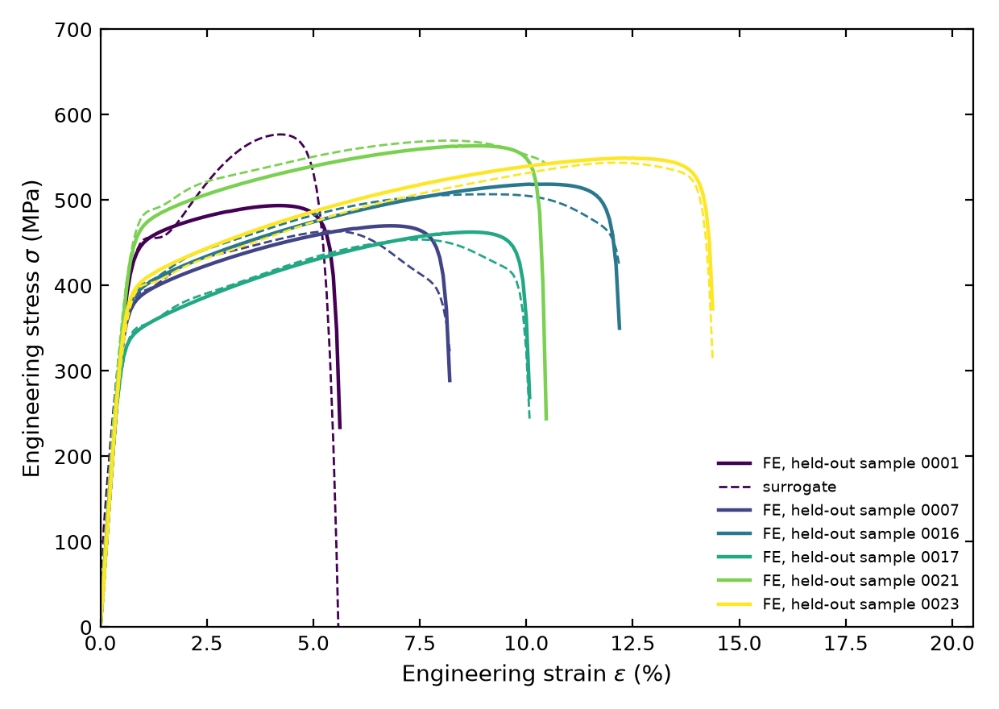

*Figure 39. Held-out curves, FE (solid) against the surrogate (dashed).*

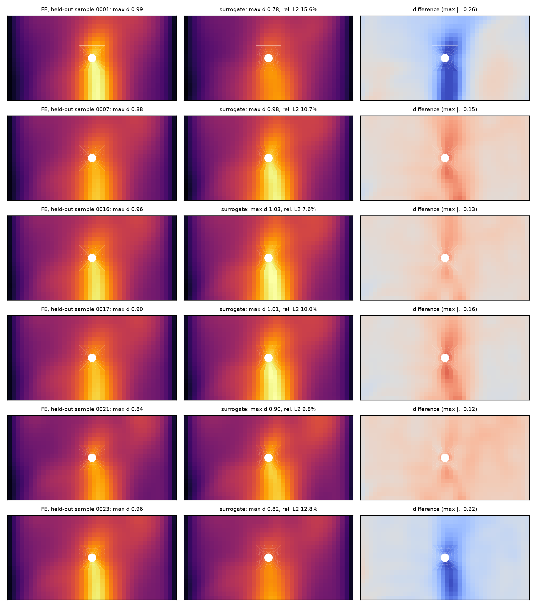

*Figure 40. Held-out damage fields: FE, surrogate and their difference.*

The curve surrogate predicts the fracture strain within 0.25% strain on
five of the six held-out samples and misses the crossing on the sixth,
where its maximum damage stops at 0.74. Its mean error is set by the
sample at the low-$G_c$, high-$\ell_0$ corner of the box, the earliest
fracture of the held-out set: the predicted peak is 577 MPa against 494
MPa, and the error of a curve that ends at 5.5% is paid over a short
path. The field surrogate is less accurate than in the first study (11.1%
against 5.8% mean): it places the damage band below the hole correctly in
all six samples and misses its level by 0.12 to 0.26 in damage, too low
on two samples and too high on four. With 18 training samples, of which
11 initiate, the end-of-path field of a plate that is either cracked or
not is sparsely sampled; more samples are the remedy and were not run.
Data cost 5.3 h of FE time against 12 and 200 s of training, 0.1 to 0.4
ms per query, break-even after about 14 FE runs.

## 20. PINNACLE: what Part II required of the framework

Sixteen changes under ADR 0031 (`feat/pinn_benchmark`), each with a unit
test, before and during the runs; the ones that changed the physics or the
feasibility of the plate:

| item | before | after |
|---|---|---|
| damage solve | dense operator, n^2 memory: 4.3 s and 1.8 GB per solve at h80, infeasible at h160 | sparse assembly and direct/CG solve above 500 nodes: 0.05 s and 24 MB at h80, same field to 1e-15 |
| damage boundary | the grip node sets forced d = 0 silently | `boundary_node_set = none` leaves the boundary free; the plates pin d = 0 at the grips explicitly |
| driving force | no threshold | `plastic_work_threshold` (the $W_c$ of §13) and a viscosity term |
| reaction force | none for the mechanics sub-solve | `reaction_node_set` with the reaction on every step row |
| Exodus meshes | meshio misaligned the node-set names | netCDF reader with blocks, side sets and grain ids |
| J2 finite strain | finite-difference split tangent with doubled columns; missing Hencky chain term | analytic spectral projector and the chain term |
| Newton | no line search; absolute tolerance below the force noise | backtracking line search; working cut-backs |
| staggered loop | every alternation started Newton cold (20 to 40 iterations) | warm start from the previous alternation (2 to 3) |
| CP state between alternations | nested-list snapshot, 80 s per restore | arrays, milliseconds |
| CP time increment in a coupled window | the full t_end, which halved the CP flow stress | the window's share; the first CP calibration was void and redone |
| predictor history | lost at every re-solved window | kept across windows |
| backend | the predictor re-pointed the shared backend to the GPU | an unshared backend per component |
| output | the J2 route exported no plastic state | the committed equivalent plastic strain on the result and the snapshots |

*Table 29. ADR 0031 in brief.*

The dense-against-sparse measurement is the one that decided the mesh
range: at h40 the dense path costs 0.9 s per damage solve and 141 MB, at
h80 4.3 s and 1.8 GB (55 min of damage solves on a 256-step staggered run
against 40 s sparsely), and h160 does not fit in memory.

## References

- (alessi 2018 comparison) R. Alessi, M. Ambati, T. Gerasimov, S. Vidoli, L. De Lorenzis, "Comparison of Phase-Field Models of Fracture Coupled with Plasticity", Computational Methods in Applied Sciences (2018) 1-21. doi:10.1007/978-3-319-60885-3_1
- (ambati 2015 ductile) M. Ambati, T. Gerasimov, L. De Lorenzis, "Phase-field modeling of ductile fracture", Computational Mechanics 55 (2015) 1017-1040. doi:10.1007/s00466-015-1151-4
- (asaro 1979 geometrical) R. Asaro, "Geometrical effects in the inhomogeneous deformation of ductile single crystals", Acta Metallurgica 27 (1979) 445-453. doi:10.1016/0001-6160(79)90036-1
- (borden 2016 triaxiality) M. Borden, T. Hughes, C. Landis, A. Anvari, I. Lee, "A phase-field formulation for fracture in ductile materials: Finite deformation balance law derivation, plastic degradation, and stress triaxiality effects", Computer Methods in Applied Mechanics and Engineering 312 (2016) 130-166. doi:10.1016/j.cma.2016.09.005
- (chakraborty 2016 multiscale) P. Chakraborty, Y. Zhang, M. R. Tonks, "Multi-scale modeling of microstructure dependent intergranular brittle fracture using a quantitative phase-field based method", Computational Materials Science 113 (2016) 38-52. doi:10.1016/j.commatsci.2015.11.010
- (delorenzis 2016 crystal) L. De Lorenzis, A. McBride, B. Reddy, "Phase-field modelling of fracture in single crystal plasticity", GAMM-Mitteilungen 39 (2016) 7-34. doi:10.1002/gamm.201610002
- (diehl 2017 void) M. Diehl, M. Wicke, P. Shanthraj, F. Roters, A. Brueckner-Foit, D. Raabe, "Coupled Crystal Plasticity-Phase Field Fracture Simulation Study on Damage Evolution Around a Void: Pore Shape Versus Crystallographic Orientation", JOM 69 (2017) 872-878. doi:10.1007/s11837-017-2308-8
- (engel 2026 gaussian) S. Engel, P. Shanthraj, J. Quinta da Fonseca, "Bayesian calibration and sensitivity analysis of crystal plasticity models using Gaussian process surrogates", Computational Materials Science 272 (2026) 114770. doi:10.1016/j.commatsci.2026.114770
- (goswami 2020 transfer) S. Goswami, C. Anitescu, S. Chakraborty, T. Rabczuk, "Transfer learning enhanced physics informed neural network for phase-field modeling of fracture", Theoretical and Applied Fracture Mechanics 106 (2020) 102447. doi:10.1016/j.tafmec.2019.102447
- (hamdi 2026 expediting) E. Hamdi, E. Lejeune, "Towards robust surrogate models: Benchmarking machine learning approaches to expediting phase field simulations of brittle fracture", Computer Methods in Applied Mechanics and Engineering 449 (2026) 118526. doi:10.1016/j.cma.2025.118526
- (henkes 2022 micromechanics) A. Henkes, H. Wessels, R. Mahnken, "Physics informed neural networks for continuum micromechanics", Computer Methods in Applied Mechanics and Engineering 393 (2022) 114790. doi:10.1016/j.cma.2022.114790
- (hernandezpadilla 2017 crystal) C. Hernandez Padilla, B. Markert, "A coupled ductile fracture phase-field model for crystal plasticity", Continuum Mechanics and Thermodynamics 29 (2017) 1017-1026. doi:10.1007/s00161-015-0471-0
- (ibragimova 2022 convolutional) O. Ibragimova, A. Brahme, W. Muhammad, D. Connolly, J. Lévesque, K. Inal, "A convolutional neural network based crystal plasticity finite element framework to predict localised deformation in metals", International Journal of Plasticity 157 (2022) 103374. doi:10.1016/j.ijplas.2022.103374
- (keshavarz 2025 advancing) S. Keshavarz, Y. Mao, A. Reid, A. Agrawal, "Advancing material simulations: Physics-Informed Neural Networks and Object-Oriented Crystal Plasticity Finite Element Methods", International Journal of Plasticity 185 (2025) 104221. doi:10.1016/j.ijplas.2024.104221
- (kocks 2003 hardening) U. Kocks, H. Mecking, "Physics and phenomenology of strain hardening: the FCC case", Progress in Materials Science 48 (2003) 171-273. doi:10.1016/s0079-6425(02)00003-8
- (lim 2019 sensitivity) H. Lim, C. Battaile, J. Bishop, J. Foulk, "Investigating mesh sensitivity and polycrystalline RVEs in crystal plasticity finite element simulations", International Journal of Plasticity 121 (2019) 101-115. doi:10.1016/j.ijplas.2019.06.001
- (liu 2026 aligned) C. Liu, A. Abushaikha, "FEM-aligned weak-form physics-informed neural networks with Laplace-Beltrami geometry encoding for linear elastic surrogate modeling", Applied Computing and Geosciences 30 (2026) 100354. doi:10.1016/j.acags.2026.100354
- (louisaauth 2025 boundaries) K. Louisa Auth, J. Brouzoulis, M. Ekh, "Phase-Field Modeling of Ductile Fracture Across Grain Boundaries in Polycrystals", International Journal for Numerical Methods in Engineering 126 (2025). doi:10.1002/nme.70056
- (marengo 2023 review) A. Marengo, U. Perego, "A concise review of small-strain phase-field modeling of ductile fracture", European Journal of Mechanics - A/Solids 101 (2023) 105058. doi:10.1016/j.euromechsol.2023.105058
- (miehe 2010 thermodynamically) C. Miehe, F. Welschinger, M. Hofacker, "Thermodynamically consistent phase-field models of fracture: Variational principles and multi-field FE implementations", International Journal for Numerical Methods in Engineering 83 (2010) 1273-1311. doi:10.1002/nme.2861
- (miehe 2016 gradient) C. Miehe, F. Aldakheel, A. Raina, "Phase field modeling of ductile fracture at finite strains: A variational gradient-extended plasticity-damage theory", International Journal of Plasticity 84 (2016) 1-32. doi:10.1016/j.ijplas.2016.04.011
- (ni 2026 derivative) Z. Ni, M. Guo, Z. Chen, J. Dong, H. Jiang, "Derivative-free optimization for crystal plasticity parameter calibration: benchmarking, non-uniqueness, and transferability", Materials & Design 268 (2026) 116512. doi:10.1016/j.matdes.2026.116512
- (niu 2023 performance) S. Niu, E. Zhang, Y. Bazilevs, V. Srivastava, "Modeling finite-strain plasticity using physics-informed neural network and assessment of the network performance", Journal of the Mechanics and Physics of Solids 172 (2023) 105177. doi:10.1016/j.jmps.2022.105177
- (peirce 1982 localized) D. Peirce, R. Asaro, A. Needleman, "An analysis of nonuniform and localized deformation in ductile single crystals", Acta Metallurgica 30 (1982) 1087-1119. doi:10.1016/0001-6160(82)90005-0
- (raissi 2019 involving) M. Raissi, P. Perdikaris, G. Karniadakis, "Physics-informed neural networks: A deep learning framework for solving forward and inverse problems involving nonlinear partial differential equations", Journal of Computational Physics 378 (2019) 686-707. doi:10.1016/j.jcp.2018.10.045
- (rezaei 2024 thermodynamics) S. Rezaei, A. Moeineddin, A. Harandi, "Learning solutions of thermodynamics-based nonlinear constitutive material models using physics-informed neural networks", Computational Mechanics 74 (2024) 333-366. doi:10.1007/s00466-023-02435-3
- (rezwan 2025 intragranular) A. Rezwan, N. Aragon, D. de Oca Zapiain, H. Lim, "Coupled phase field damage and crystal plasticity analysis of intragranular fracture: The role of crystallographic orientation and voids", International Journal of Plasticity 191 (2025) 104372. doi:10.1016/j.ijplas.2025.104372
- (samaniego 2020 concepts) E. Samaniego, C. Anitescu, S. Goswami, V. Nguyen-Thanh, H. Guo, K. Hamdia et al., "An energy approach to the solution of partial differential equations in computational mechanics via machine learning: Concepts, implementation and applications", Computer Methods in Applied Mechanics and Engineering 362 (2020) 112790. doi:10.1016/j.cma.2019.112790
- (sanjalawe 2026 critical) Y. Sanjalawe, S. Al-E'mari, S. Makhadmeh, "Physics-Informed Neural Networks in Computational Mechanics: A Critical Review of Stability, Generalization, and Multi-Scale Applications", Archives of Computational Methods in Engineering (2026). doi:10.1007/s11831-026-10747-9
- (shanthraj 2016 viscoplastic) P. Shanthraj, L. Sharma, B. Svendsen, F. Roters, D. Raabe, "A phase field model for damage in elasto-viscoplastic materials", Computer Methods in Applied Mechanics and Engineering 312 (2016) 167-185. doi:10.1016/j.cma.2016.05.006
- (thawon 2026 current) I. Thawon, D. Vo, T. Bui, K. Rattanamongkhonkun, C. Chamroon, N. Tippayawong et al., "Physics-Informed Neural Networks: Current Progress and Challenges in Computational Solid and Structural Mechanics", Computer Modeling in Engineering & Sciences 146 (2026) 1-10. doi:10.32604/cmes.2026.077044
- (tu 2020 series) X. Tu, A. Ray, S. Ghosh, "A coupled crystal plasticity FEM and phase-field model for crack evolution in microstructures of 7000 series aluminum alloys", Engineering Fracture Mechanics 230 (2020) 106970. doi:10.1016/j.engfracmech.2020.106970
- (vaughan 2024 mechanistic) M. Vaughan, H. Lim, B. Pham, R. Seede, A. Polonsky, K. Johnson et al., "The mechanistic origins of heterogeneous void growth during ductile failure", Acta Materialia 274 (2024) 119977. doi:10.1016/j.actamat.2024.119977
- (wang 2024 staggered) X. Wang, W. Wu, H. Zhu, "Physics-Informed Multi-Network for Phase-Field Fracture Modeling with a Staggered Solution Scheme", Springer Series in Geomechanics and Geoengineering (2024) 317-322. doi:10.1007/978-3-031-76528-5_31
- (wang 2026 channel) X. Wang, X. Li, Y. Ji, L. Gao, Z. Liang, "DC-PINN: Dual channel physics-informed neural network for crystal plasticity modeling", Engineering Analysis with Boundary Elements 191 (2026) 106960. doi:10.1016/j.enganabound.2026.106960
- (wurth 2024 meshgraphnets) T. Würth, N. Freymuth, C. Zimmerling, G. Neumann, L. Kärger, "Physics-informed MeshGraphNets (PI-MGNs): Neural finite element solvers for non-stationary and nonlinear simulations on arbitrary meshes", Computer Methods in Applied Mechanics and Engineering 429 (2024) 117102. doi:10.1016/j.cma.2024.117102
- (zhou 2024 constrained) G. Zhou, Y. Hu, Z. Cao, M. Lee, D. Li, "A physics-constrained neural network for crystal plasticity modelling of FCC materials", Scripta Materialia 241 (2024) 115861. doi:10.1016/j.scriptamat.2023.115861

Every entry is in `bib/references.bib`.

## Appendix A. Artifacts behind this report

Solver output under `results/` is not shipped; the commands of
`docs/reproduce_al2219_plate.md` regenerate it.

| item | path |
|---|---|
| calibrated run deck (generated) | `results/cp_study/bunge/cal/gn2/base/cpfe.i` |
| pipeline deck of the calibrated run | `decks/cp_study/bunge/cal_center2.i` |
| study decks of the two iterations | `decks/cp_study/bunge/cal_gn1.i`, `cal_gn2.i` |
| grain-growth deck | `decks/graingrowth/pilot/n32_bdf1_h40.i` |
| orientations (per grain) | `results/cp_study/bunge/cal/gn2/base/grains.csv` |
| Jacobian, per-marker errors, step | `results/cp_study/bunge/cal/gn2/gauss_newton.json` |
| experimental markers | `data/digitized/al2219_fig3_experiment_markers.csv` |
| mesh, sensitivity, grain instances | `decks/cp_study/bunge/{mesh_h20,mesh_h80,mesh_h160,sens_h40,grain_sB,grain_sC}.i` |
| figure decks and scripts | `decks/report/bunge/cp_calibration_figures.i` + `scripts/report_figures.py`; `plastic_strain_animation.i` + `scripts/plastic_strain_animation.py` |
| neural routes (§8) | `decks/cp_study/bunge/hybrid/h40_{linear,fem_residual,fem_solver,fem_residual_grain,fem_solver_grain}.i`; `decks/report/bunge/hybrid_compare.i` + `scripts/hybrid_compare.py`; `neural_compare.i` + `scripts/field_compare.py` |
| neural sensitivity (§9) | `decks/cp_study/bunge/sens_h40_{linear,grain_solver}.i`; `decks/report/bunge/neural_sensitivity.i` + `scripts/neural_sensitivity.py` |
| hardware benchmark (§10) | `decks/benchmark/bunge/hardware_h40.i` + `scripts/hardware_benchmark.py` |
| surrogate (§11) | `decks/cp_study/bunge/surrogate/{design_h40,plate_h40_surrogate_curve,plate_h40_surrogate_curve_cpu,plate_h40_surrogate_field}.i`; `decks/report/bunge/surrogate_compare.i` + `scripts/surrogate_compare.py` |
| run ledger rows | `al-bunge-*` in `docs/run_ledger.md` |
| first version of this report | `archive/docs/al2219_report_exchanged_angles_2026-11-16.md`, decks `archive/decks/al2219_exchanged_angles/` |

## Appendix B. Artifacts behind Part II

| item | path |
|---|---|
| meshes | `decks/pfd_study/mesh/{h20,h40,h80}_hole5.i`, `h40_ell_*.i`; `scripts/plate_hole_mesh.py` |
| J2 law | `decks/pfd_study/j2_fit.i`, `scripts/j2_fit.py` |
| J2 W_c scan and calibration | `decks/pfd_study/j2/cal_h40_wc{200,400,600,800}.i`, `scripts/pfd_calibrate.py`; figure `decks/pfd_study/j2/wc_scan_h40_figures.i` |
| J2 sweeps and sensitivity (W_c 200) | `decks/pfd_study/j2/{sweep_l_h40,sens_h40,sweep_h_l5}.i` |
| CP calibration, sweeps, sensitivity, instances | `decks/pfd_study/cp/bunge/{cal_h40,sweep_l_h40,sens_h40,sweep_h_l5,grains_h40}.i` and their `*_figures.i` |
| fields and animation | `decks/pfd_study/report/bunge/fields_cal_h40.i`, `scripts/pfd_fields.py` |
| shape study | `decks/pfd_study/cp/bunge/shape_h40.i`, `decks/pfd_study/report/bunge/fields_shape_h40.i` |
| neural routes | `decks/pfd_study/cp/bunge/neural_h40.i` |
| hardware | `decks/benchmark/bunge/hardware_pfd_h40.i` |
| surrogate | `decks/pfd_study/cp/bunge/surrogate/{design_h40,plate_h40_surrogate_curve,plate_h40_surrogate_field,compare_h40}.i` |
| J2 notebook and ledger | `archive/docs/notebooks/10_pfd_study.md`, `docs/run_ledger.md` (rows `pfd-*` for J2, `al-bunge-pfd-*` for CP) |
| PINNACLE | `docs/adr/0031-pfd-plate-readiness.md` on `feat/pinn_benchmark`; the damage-solve benchmark `scripts/tools/damage_solve_benchmark.py` |
