# Laser powder bed fusion process modeling with PINNACLE: heat transfer, grain structure and process stress, benchmarked on NIST AM Bench alloy 718 and on a published 316L case (Part V)

Status 2026-11-25. This report covers the process chain at the coarse resolution a single
workstation GPU can run (the capability check): heat transfer, melt-pool flow under a flat
surface (reported separately from the conduction results), grain structure, tensile
response with a calibrated crystal-plasticity set, and process stress. The decks of the
full-resolution cases are shipped and not run (decision of the author: they are run on a
multi-GPU node after this part is complete). What is not done is listed in section 9.
Plan:
`docs/15_lpbf_process_modeling_plan.md`; notebook with provenance tables:
`docs/16_lpbf_notebook.md`; reproduction: `docs/reproduce_lpbf.md`; every run:
`docs/run_ledger.md`. PINNACLE revision: branch `feat/multi-gpu-and-am-process`, commits
355b8d6 to f720f35 (local).

## Abstract

Laser powder bed fusion sets the grain structure, the strength and the residual stress of
a part through a chain of heat transfer, melt-pool flow, solidification and thermally
driven plasticity. This report adds that chain to the PINNACLE framework as registered
components that are composed in input decks, and checks it at the resolution of one
workstation GPU against the NIST AM Bench measurements on alloy 718 and against a
published crystal-plasticity simulation of a 316L track. The model is an enthalpy heat
equation with latent heat, a moving volumetric beam and surface losses; a weakly
compressible flow of the liquid under a flat surface with thermocapillary shear, recoil
pressure, buoyancy and mushy-zone drag; a multi-order-parameter grain model with melting,
epitaxial regrowth and nucleation, advanced together with the temperature; and
finite-strain crystal plasticity, loaded by the stored temperature history or by a tensile
test. The components reproduce reference solutions (Stefan front within 0.9 %, a
constrained heated crystal within 0.02 %, natural convection within 0.4 %, a lid-driven
cavity within 3.5 %). For seven bare-plate tracks, with two heat-source parameters fitted
on two of them, conduction alone gives the melt-pool width within 8 % for six tracks and
a depth 15 to 44 % too small for the four deepest (keyhole) tracks; adding the flow
changes the errors over the seven tracks from 23.4 to 21.0 % rms in depth and from 8.6 to
6.3 % rms in width, and a flat surface does not carry the measured dependence of depth
on spot size. A parametric network surrogate trained on 30 finite-element tracks
reproduces the finite-element depth and width within 1 % and inherits its error against
the measurements. Three crystal-plasticity parameters, started from a published-data fit
of the author's toolkit and calibrated by Gauss-Newton on a 216-grain polycrystal,
reproduce the measured tensile curve within 2.7 MPa rms; three grain realizations give a
yield stress of 695 $\pm$ 4 MPa against 691 $\pm$ 3 MPa measured. A four-layer build
column of 129,600 elements runs in 80 min; at its 10 um mesh the median grain diameter
(37.7 $\pm$ 0.9 um over three seeds) is three times the measured one, the texture
fractions change with the seed by as much as they differ from the measurement, and a
cube cut from the first column is 15 % too soft at yield: grain size,
texture and the property predicted from them are not results of the coarse check. For
the 316L track, after the relaxation stage of the published procedure, the stress pattern
agrees with the published simulation, the compression below the track is 10 to 30 %
larger and the tension in the track 2 to 5 times larger under substitute thermal and grain
inputs. The explicit field solves and the training of every network can be split over
several GPUs (NVIDIA CUDA and AMD ROCm), as can the point evaluation of the
crystal-plasticity solves, with results identical to one device; no speed-up could be
measured on the one-GPU host, and the linear solves stay on the host. Decks of the full-resolution cases (up to 23.8 million elements) are
shipped and have not been run.

## 1. Introduction

Laser powder bed fusion (LPBF) builds a metal part by melting thin powder layers with a
scanning laser. The properties of the part are set by a chain of events at very different
scales: the laser melts a pool some hundred micrometers wide that moves at about a meter
per second (khairallah 2016 meltflow); the pool freezes within a millisecond into grains
whose size, shape and orientation depend on the temperature gradient and the front speed;
and the steep thermal cycles leave stresses of the order of the yield stress between and
inside those grains (chen 2019 microscale). Process models follow the same chain: a
thermal or thermal-fluid simulation, a grain-structure simulation driven by its
temperature field, and a mechanics simulation on the resulting grains.

Three families of published chains exist. The first resolves the pool with a
powder-scale thermal-fluid model and grows the grains with a phase field
(yang 2021 grain; chadwick 2021 grain) or from a finite-element temperature field
(liu 2018 sitespecific), then runs crystal plasticity for the stress left by the process
(grilli 2022 elimination; hu 2022 residual) or for the properties of the built material
(liu 2020 integration). The second uses a heat-conduction or thermal-fluid model with a
cellular automaton for the grains (gandin 1994 cellular; rolchigo 2022 exaca) and crystal
plasticity for properties, at exascale in (rolchigo 2025 credibility) and across process
maps in (briffod 2025 mapping). The third replaces a stage by a network: physics-informed
networks for the temperature and flow of a pool (zhu 2021 meltpool; liao 2023 hybrid;
hosseini 2023 singletrack) and a graph network for the phase-field grain model
(xue 2022 graph). A recent model couples phase field and crystal plasticity in both
directions (sun 2026 coupled). Kinetic Monte Carlo (rodgers 2017 montecarlo) and the
comparison of phase-field and cellular-automaton grain competition
(elahi 2023 competition) complete the picture, and GPU finite elements have reached the
thermal problem at part scale (dugast 2021 partscale; xue 2023 jaxfem).

Two difficulties are common to these chains. The stages are separate codes that exchange
files, so a change of mesh or of physics in one stage is a change of interface in the
next. And the validation data are rarely public in full: the chain of (hu 2022 residual)
is anchored by melt-pool sizes, grain statistics and in-situ lattice strains, but its
thermal-fluid field and its measured orientations are not available to a reader. The NIST
AM Bench series closes the second gap for alloy 718: commanded scan paths, single-track
melt pools (weaver 2024 meltpool), in-situ thermography, large-area and
three-dimensional EBSD (levine 2024 microstructure), residual strains
(phan 2025 residual) and tensile tests of the same builds are open
(levine 2024 outcomes).

This part of the study adds the process chain to PINNACLE, a framework in which a
simulation is composed from registered kernels, materials, services and executioners in
one input deck, with finite-element and network solution routes and NumPy or PyTorch
(CPU, NVIDIA CUDA, AMD ROCm) back ends. The questions are: can the chain be composed from
general components with no process-specific solver; what does each stage reproduce of
the open NIST measurements when it is run at the resolution of one workstation GPU; and
what must a user run on larger hardware to reach the measured grain scale. Section 2
gives the governing equations, section 3 the data, section 4 the method and section 5 the
workflow. Section 6 reports the verification against exact solutions and the results on
alloy 718 (conduction, the network surrogate, the build column, the tracks with melt-pool
flow, the tensile case with its calibration), section 7 the 316L case of (grilli 2022 elimination), section 8 the cost and
the multi-device path, and section 9 the limits and the work that remains.

## 2. Physics

### 2.1 Heat transfer with melting

The temperature $T(\mathbf x, t)$ obeys the enthalpy form of the heat equation,

$$\frac{\partial H}{\partial t} = \nabla\cdot\bigl(k\,\nabla T\bigr) + Q_b - Q_l,
\qquad H(T) = \int_{T_0}^{T} \rho c_p(\theta)\,d\theta + \rho L\,f_l(T), \tag{1}$$

with the volumetric enthalpy $H$, the volumetric heat capacity $\rho c_p$, the latent heat
of fusion per volume $\rho L$ and the liquid fraction

$$f_l(T) = s^2(3 - 2s), \qquad s = \min\!\Bigl(\max\!\Bigl(\frac{T - T_s}{T_l - T_s}, 0\Bigr), 1\Bigr), \tag{2}$$

between the solidus $T_s$ and the liquidus $T_l$. The latent heat is part of the enthalpy.
The apparent capacity is $C(T) = dH/dT = \rho c_p + \rho L\,df_l/dT$. The conductivity
depends on the temperature and on the state $\chi$ of the material point:

$$k = \begin{cases} k_g & \chi = 0 \text{ (no material)}\\
(1 - f_l)\,k_p + f_l\,k_L(T) & \chi = 1 \text{ (powder, never molten)}\\
(1 - f_l)\,k_S(T) + f_l\,k_L(T) & \chi = 2 \text{ (consolidated)} \end{cases} \tag{3}$$

A point becomes material when the build surface $z_s(t)$ passes it, and consolidated once
it has been molten; both are irreversible.

The laser is a Gaussian beam of power $P$ and $1/e^2$ radius $r_b$ whose absorbed
fraction $\eta$ is deposited below the surface with a decay length $\delta$:

$$Q_b = \frac{2\,\eta P}{\pi r_b^2\,\delta}\,
\exp\!\Bigl(-\frac{2 d^2}{r_b^2}\Bigr)\exp\!\Bigl(-\frac{z_s - z}{\delta}\Bigr),
\qquad z \le z_s, \tag{4}$$

with $d$ the distance from the beam axis in the layer plane. Its volume integral is
$\eta P$. Convection, radiation and evaporation at the surface are applied over a band of
thickness $b$ below it, because the surface moves through the mesh as layers are added:

$$Q_l = \frac{1}{b}\Bigl[h_c (T - T_\infty) + \epsilon\sigma_{SB}(T^4 - T_\infty^4)
+ (1 - \beta_r)\,L_v\,p_s(T)\sqrt{\frac{M}{2\pi R T}}\Bigr],\qquad
p_s = p_0 \exp\!\Bigl[\frac{L_v M}{R}\Bigl(\frac{1}{T_b} - \frac{1}{T}\Bigr)\Bigr]. \tag{5}$$

The last term is the Hertz-Knudsen evaporative loss with the Clausius-Clapeyron vapor
pressure (khairallah 2016 meltflow). On faces where the modeled block is cut out of a
larger part, heat leaves through a film condition $q = h_f (T - T_\infty)$ with
$h_f \approx k/L$.

No melt-pool flow is solved in this report: the liquid conducts with $k_L$, and the pool
surface stays flat.

### 2.2 Grain structure

The grains are $n$ non-conserved order parameters $\eta_i(\mathbf x, t)$, each standing
for one crystal orientation; $\eta_i = 1$ inside a grain of orientation $i$, and all are
zero in liquid, loose powder and empty space. They are advanced with the temperature:

$$\frac{\partial\eta_i}{\partial t} =
-L(T)\Bigl[m\Bigl(\eta_i^3 - \eta_i + 2\gamma\,\eta_i\sum_{j\ne i}\eta_j^2\Bigr)
- \kappa\nabla^2\eta_i\Bigr] - P\,g(T)\,\eta_i
+ D\,[1 - g(T)]\,c\,s_i\,\Bigl(1 - \sum_j\eta_j^2\Bigr)_{\!+}\eta_i . \tag{6}$$

The bracket is the multi-order-parameter grain-growth model with $m = 6\sigma/w$,
$\kappa = \tfrac34\sigma w$, $\gamma = 3/2$ for a boundary of energy $\sigma$ and width
$w$, and the Arrhenius mobility $L(T) = L_0\exp[-Q/(R\min(T, T_l))]$. The melt switch
$g(T)$ rises smoothly from 0 at $T_l - \Delta$ to 1 at $T_l$: the term $-P g\,\eta_i$
erases the grains in the liquid. The last term is epitaxial regrowth: grains at the pool
boundary grow into material that has cooled below the liquidus and holds no grain;
$c = 1$ in consolidated material and 0 elsewhere, so that empty space and powder stay
grain free. The selection factor of a cubic crystal,

$$s_i = \max\Bigl(s_{min},\ \max_k \bigl|\mathbf a^{(i)}_k\cdot\hat{\mathbf g}\bigr|^{\,p}\Bigr),
\qquad \hat{\mathbf g} = \frac{\nabla T}{|\nabla T|}, \tag{7}$$

with $\mathbf a^{(i)}_k$ the cube axes of orientation $i$, lets a grain with a cube axis
along the temperature gradient advance fastest (competitive growth); $p = 0$ removes the
selection. The regrowth front is a pulled front of speed $2\sqrt{D L\kappa}$: where that
exceeds the speed of the liquidus isotherm, the front follows the isotherm; where it does
not, undercooled grain-free liquid is left behind and can nucleate.

Nucleation follows the continuous law used in cellular-automaton models
(gandin 1994 cellular): sites of density $n_s$ carry critical undercoolings drawn from a
normal distribution $N(\Delta T_n, \Delta T_\sigma)$. A site that has been molten fires
when $T < T_l - \Delta T_c$ and it is still grain free; the new grain takes an
orientation drawn at random. Orientations of substrate grains and nuclei are uniform
random rotations; a grain keeps its orientation after solidification (plan, section 1).

### 2.3 Mechanics under a temperature history

The deformation gradient is split multiplicatively,

$$\mathbf F = \mathbf F^e\,\mathbf F^p\,\mathbf F^\theta\,\mathbf F^a, \qquad
\mathbf F^\theta = \lambda\,\mathbf I, \quad
\lambda = 1 + \bigl(\alpha + \tfrac12\alpha'\Delta T\bigr)\Delta T, \quad \Delta T = T - T_{ref}, \tag{8}$$

into elastic, plastic, thermal and activation parts. The crystal law is evaluated at
$\mathbf F\,\mathbf G$ with $\mathbf G = (\mathbf F^a)^{-1}/\lambda$; the second
Piola-Kirchhoff stress is $\mathbf S = e(T)\,\mathbb C : \mathbf E^e$ with
$\mathbf E^e = \tfrac12(\mathbf F^{eT}\mathbf F^e - \mathbf I)$, the Cauchy stress
$\boldsymbol\sigma = \mathbf F^e\mathbf S\mathbf F^{eT}/\det\mathbf F^e$, and the
equilibrium $\nabla_0\cdot\mathbf P = \mathbf 0$ is solved for the first
Piola-Kirchhoff stress $\mathbf P = J\boldsymbol\sigma\mathbf F^{-T}$ of the total
deformation. Plastic flow is crystallographic slip,

$$\mathbf L^p = \sum_\alpha \dot\gamma^\alpha\,\mathbf s^\alpha\otimes\mathbf m^\alpha, \qquad
\dot\gamma^\alpha = \dot\gamma_0\,\Bigl|\frac{\tau^\alpha}{f(T)\,\tau_c^\alpha}\Bigr|^{1/m}
\operatorname{sign}\tau^\alpha, \tag{9}$$

on the twelve $\{111\}\langle110\rangle$ systems, with the resolved shear stress
$\tau^\alpha$ and the dislocation-density resistance and evolution of PINNACLE,

$$\tau_c^\alpha = \tau_{c0} + \alpha_0\mu b\sqrt{\sum_\beta q_{\alpha\beta}\rho^\beta},\qquad
\dot\rho^\alpha = \frac{1}{b}\bigl(k_1\sqrt{\rho^\alpha} - k_2\rho^\alpha\bigr)|\dot\gamma^\alpha|. \tag{10}$$

Temperature enters through the thermal stretch $\lambda$, the factor on the slip
resistance (grilli 2022 elimination)

$$f(T) = k_A + k_B\exp[-k_C(T - T_{ref})], \tag{11}$$

and the stiffness factor $e(T) = \max(1 + c_E(T - T_{ref}), e_{min})$. For the power-law
flow rule the resistance factor is equivalent to the slip-rate multiplier $f^{-1/m}$.

A point at or above the melting temperature is molten: its stress is multiplied by a
residual factor $q_r$; at the end of every load step its plastic state is reset and its
activation deformation is set to the current one, $\mathbf F^a = \mathbf F/\lambda$, so
that it carries no strain. When it cools below the melting temperature the last
$\mathbf F^a$ stays, and the point solidifies free of stress in the shape it has. This is
the material-point form of the element elimination and reactivation of
(grilli 2022 elimination); no element leaves the mesh.

### 2.4 Flow of the liquid

The liquid of the pool is driven by the gradient of the surface tension along the free
surface (thermocapillary or Marangoni shear), by the vapor recoil and by buoyancy, and it
carries heat. The surface is kept flat (decision D2). The flow is modeled as weakly
compressible with a constant density $\rho$ (artificial compressibility,
chorin 1967 compressibility):

$$\frac{\partial\mathbf u}{\partial t} + (\mathbf u\cdot\nabla)\mathbf u
= -\frac{1}{\rho}\nabla p + \nabla\cdot(\nu_e\nabla\mathbf u)
- \beta\,(T - T_l)\,\mathbf g - D(f_l)\,\mathbf u + \mathbf s, \tag{13}$$

$$\frac{\partial p}{\partial t} + \rho c^2\,\nabla\cdot\mathbf u
= \nabla\cdot(\kappa_p\nabla p), \tag{14}$$

with the Boussinesq buoyancy (expansion coefficient $\beta$, gravity $\mathbf g$), the
drag of the mushy zone (voller 1987 mushy)

$$D(f_l) = A\,\frac{(1 - f_l)^2}{f_l^3 + \epsilon}, \tag{15}$$

which brings the solid to rest, the artificial sound speed $c$ and a pressure diffusivity
$\kappa_p$. For $c$ large against the flow speed the divergence of the velocity is small
and a steady flow is the incompressible one. The surface forces act in a band of
thickness $b$ (one element) below the surface,

$$\mathbf s_\parallel = \frac{f_l}{\rho\,b}\,\frac{d\gamma}{dT}\,\nabla_\parallel T, \qquad
s_n = -\frac{f_l\,c_r\,p_s(T)}{\rho\,b}, \tag{16}$$

the thermocapillary shear and the recoil pressure ($c_r = 0.54$ of the saturation
pressure $p_s$ of equation 5), directed into the body. Advection is stabilized by an
upwind viscosity, $\nu_e = \mu/\rho + \tfrac12 a_u |\mathbf u| h$. The heat equation 1
receives the advected enthalpy in conservative form,

$$\frac{\partial H}{\partial t} + \nabla\cdot\bigl[\mathbf u\,(H - H(T_l))\bigr]
= \nabla\cdot\bigl[(k + \tfrac12 a_u |\mathbf u| h\,C)\nabla T\bigr] + Q_b - Q_l. \tag{17}$$

## 3. Data

### 3.1 NIST AM Bench alloy 718 (primary benchmark)

All measurements are NIST's, read from the public records (local copy
`/mnt/extended/projects/ambench-data`; the records are cited, not redistributed).

**Table 1.** Records used. "Checked" means read from the NIST file for this report.

| link of the chain | record | content | used here |
|---|---|---|---|
| melt pool | (weaver 2022 trackdata), (weaver 2024 meltpool) | cross-section depth and width of bare-plate tracks, seven cases, three tracks and two sections each | targets of case K1; checked |
| process input | (lane 2022 builddata) | commanded scan path, plate thermocouples, powder | build parameters of case K2 (from the challenge description, see below) |
| thermal history | (lane 2023 thermographydata) | time above melting, solid cooling rate per layer | compared in case K2 (summary of the author's toolkit, not re-derived) |
| grain structure | (schwalbach 2024 sectioningdata), (levine 2022 microstructuredata), (levine 2024 microstructure) | 3-D EBSD of a 2.5 mm leg, 1 x 1 x 2.12 um voxels; large-area maps | reference numbers of case K2 (from an earlier analysis of the record, not re-derived) |
| tensile property | (benzing 2025 tensiledata) | eight specimens of the 2.5 mm legs | target of case K3 (not run); checked |
| residual strain | (levine 2022 residualdata), (phan 2025 residual) | part-scale diffraction strains, contour stress, deflection | not a target of a 0.6 mm block |

**Table 2.** Single-track targets of case K1, derived from the NIST workbook by
`scripts/lpbf_k1.py targets` (mean and sample standard deviation of six sections).

| case | power (W) | speed (mm/s) | beam D4$\sigma$ (um) | depth (um) | width (um) |
|---|---|---|---|---|---|
| 0 | 285 | 960 | 67 | 139.7 $\pm$ 1.9 | 136.3 $\pm$ 2.9 |
| 1.1 | 285 | 960 | 49 | 227.2 $\pm$ 3.2 | 106.2 $\pm$ 3.6 |
| 1.2 | 285 | 960 | 82 | 102.4 $\pm$ 1.1 | 141.7 $\pm$ 1.8 |
| 2.1 | 285 | 1200 | 67 | 109.7 $\pm$ 1.7 | 112.9 $\pm$ 1.7 |
| 2.2 | 285 | 800 | 67 | 176.5 $\pm$ 2.6 | 156.1 $\pm$ 4.9 |
| 3.1 | 325 | 960 | 67 | 166.1 $\pm$ 2.0 | 134.3 $\pm$ 2.5 |
| 3.2 | 245 | 960 | 67 | 116.9 $\pm$ 1.2 | 129.4 $\pm$ 1.6 |

Build parameters of the AMB2022-01 parts (285 W, 960 mm/s, hatch 110 um, layer 40 um,
beam D4$\sigma$ 77 um, 90 degrees between layers) are taken from the NIST challenge
description as recorded in the author's toolkit; they have not been read again from the
NIST page for this report. The 3-D EBSD reference values (median equivalent grain diameter
11.5 um; fractions of the build direction within 15 degrees of $\langle100\rangle$,
$\langle110\rangle$, $\langle111\rangle$: 0.10, 0.21, 0.10, against 0.10, 0.20, 0.14 for
random orientations) come from an earlier analysis of the record
(`ambench-data/agent`). The tensile answers are E = 123.6 $\pm$ 5.9 GPa, 0.2 % yield
690.7 $\pm$ 3.1 MPa, ultimate 951.6 $\pm$ 9.2 MPa, strain at ultimate 0.247 $\pm$ 0.020
(eight specimens, $10^{-3}$ /s).

**Table 3.** Thermal properties of alloy 718 used in every deck.

| quantity | value | provenance |
|---|---|---|
| solidus, liquidus | 1528.15 K, 1610.15 K | `reported_text` (hosaeus 2001 liquid) |
| density (reference volume) | 8190 kg/m$^3$ | `reported_table` (hosaeus 2001 liquid) |
| specific heat, solid | 425 to 634 J/(kg K), 298 to 1400 K (ten values); 659 at the solidus | `reported_table` (agazhanov 2019 thermophysical), (hosaeus 2001 liquid) |
| specific heat, liquid | 775 J/(kg K) | `reported_text` (hosaeus 2001 liquid) |
| conductivity, solid | 9.94 to 25.32 W/(m K), 298 to 1400 K, held to the solidus | `reported_table` (agazhanov 2019 thermophysical) |
| conductivity, liquid | 26.80 to 33.13 W/(m K), 1610 to 2073 K | `derived` (Wiedemann-Franz from the resistivity of (hosaeus 2001 liquid)) |
| heat of fusion | 196.85 kJ/kg | `reported_table` (agazhanov 2019 thermophysical) |
| boiling point, heat of vaporization, molar mass, recondensed fraction | 3186 K, 6.4 MJ/kg, 0.0588 kg/mol, 0.18 | `assumed` (values of the author's toolkit) |
| emissivity, film coefficient | 0.4, 10 W/(m$^2$ K) | `assumed` |
| plate temperature | 296.65 K (bare-plate tracks), 353.15 K (builds) | `assumed` |
| powder conductivity | 0.3 W/(m K) | `assumed` |

The volumetric capacity is $\rho_0 c_p(T)$ with the room-temperature density, because the
mesh is fixed. The heat of fusion of the pulse-heating study (290 kJ/kg between solidus
and liquidus, sensible heat included) is the alternative value; it was not run.

### 3.2 316L single track (secondary benchmark)

The single track of (grilli 2022 elimination): a representative volume of
200 x 160 x 108 um of 316L, 150 W, 700 mm/s, crystal plasticity with temperature-dependent
properties in MOOSE, loaded by the temperature field of a powder-scale thermal-fluid
simulation. The values taken from the paper, those derived and those assumed are listed
in the notebook, section 7. Two inputs of the paper are not public and are replaced: the
thermal-fluid temperature field (here: conduction, equations 1 to 5, with an assumed beam)
and the grain structure with EBSD orientations (here: 844 Voronoi grains of the mean size
the paper states, 16 um, with uniform random orientations). The comparison is therefore
with a published simulation under substitute inputs (tier 3, qualitative).

## 4. Method

### 4.1 Components

Every term of section 2 is a registered PINNACLE component, added for this part (ADR 0047
to 0050); a process deck names them like any other physics.

**Table 4.** Components and the equations they carry.

| component | kind | carries |
|---|---|---|
| `phase_change_thermal` | material | $H(T)$, $C(T)$, $f_l$, $k(T, \chi)$ of equations 1 to 3, from constants or tables |
| `enthalpy_time_derivative` | kernel | $\partial H/\partial t$ |
| `phase_change_conduction` | kernel | $\nabla\cdot(k\nabla T)$ |
| `beam_heat_source` | kernel | $Q_b$ of equation 4 along a scan path |
| `surface_heat_loss`, `far_field_heat_loss` | kernels | $Q_l$ of equation 5; film exchange on cut faces |
| `scan_path` | utility | way-points from a file or a raster; beam state; build-surface height $z_s(t)$ |
| `process_state` | utility (service) | state $\chi$ per element, freezing records ($G$, cooling rate, direction, time), melt-pool measures per step, the temperature of the block after the dwell between layers, the stored temperature series |
| `thermal_grain_growth` | kernel | equation 6 with equation 7 |
| `undercooling_nucleation` | utility (service) | nucleation sites and seeds |
| `thermal_load` with `stress_divergence_cp thermal_load` | utility, kernel option | equations 8 and 11, stiffness factor, molten points |
| `release_time` on a `dirichlet` condition | boundary-condition option | a fixed wall removed at a given time of a `cp_quasi_static` run (relaxation stage) |
| `flow_momentum`, `flow_continuity` | kernels | equations 13 to 15 (weakly compressible flow, drag taken implicitly at the nodes) |
| `thermocapillary_shear` | kernel | equation 16 |
| `flow_heat_advection` | kernel | the advection term of equation 17 |
| `field_series` | function | a stored field in time, interpolated in space and time (the hand-off of the temperature to the mechanics deck) |

### 4.2 Discretization and solution

The thermal and grain kernels are point terms of PINNACLE's block system on trilinear
hexahedra with eight Gauss points. Two executioners serve them without change of the deck
beyond the `[Executioner]` block. `pf_fem_transient` takes backward-Euler steps and solves
each by Newton's method with the exact tangent; the storage term is split into a constant
mass matrix and the remainder $[H(T) - H(T^n) - C_{ref}(T - T^n)]/\Delta t$, so that a
step conserves the enthalpy, latent heat included. `pf_fem_explicit` takes forward-Euler
steps with a lumped mass,

$$T^{n+1} = T^n - \Delta t\,\frac{R(T^n)}{M_L\,C(T^n)/C_{ref}}, \tag{12}$$

on NumPy arrays or on device tensors; it is the route of every three-dimensional case
here. Its stability limit on a mesh of size $h$ is $\Delta t \le h^2/(6a)$ with the
diffusivity $a = k/C$; the decks use 0.8 of the limit of the liquid. The latent heat
enters equation 12 through $C(T^n)$, which is accurate while the temperature changes by
much less than the melting range per step.

With flow, velocity and pressure are two more variables of the same deck. They exchange
a wave of speed $c$; advanced together from the old state the pair is unstable for every
step, so the executioner advances the temperature first, then the velocity, then the
pressure from the new velocity (`staged_variables`), several times per thermal step
(`staged_substeps`), with $c\,\Delta t_{flow} \le 0.6\,h/\sqrt3$. The drag of equation
15 is a backward-Euler step at the nodes. The advected enthalpy of equation 17 is tested
with the gradient of the shape functions, the adjoint of the divergence of equation 14:
the enthalpy of the body is then conserved whatever the divergence of the discrete
velocity is.

The temperature and the order parameters are two variables of one deck and are advanced
together; no file is exchanged between the thermal and the grain stage. The numerical
parameters of equation 6 are tied to the mesh and the step: boundary width $w = 4h$,
$L(T_l)\kappa$ at 45 % of $h^2/(6\Delta t)$, $P\Delta t \le 0.5$, $D\Delta t \le 0.4$.

The mechanics deck is a finite-strain crystal-plasticity solve
(`cp_quasi_static`, total-Lagrangian balance, backward-Euler slip update with the
consistent tangent, sparse direct solver). The thermal map of equation 8 is applied
around the constitutive evaluation: the law is called at $\mathbf F\mathbf G$, its Cauchy
stress is passed on, and its tangent is contracted with $\mathbf G$. Before every attempt
of a load step the temperature of the quadrature points is set from the stored series
(element mean of the nodal values).

### 4.3 Calibration and what is fitted

The heat source has two free parameters, $\eta$ and $\delta$ (decision D5). They are
fitted on cases 0 and 1.2 by Gauss-Newton steps on the relative errors of depth and width,
and the other five cases are held out. The grain stage has numerical parameters (section
4.2) and three physical ones that are assumed here and are to be calibrated on the fine
mesh: site density, critical undercooling, and the selection exponent $p$. The 316L case
has no fitted parameter.

### 4.4 Accuracy tiers

Verification against exact solutions is tier 2. Comparisons with the NIST measurements are
tier 4; for the two fitted single-track cases the agreement is a calibration, for the five
held-out cases a prediction. The comparison of the 316L case is tier 3 and qualitative
(substitute inputs).

## 5. Workflow

Each case is a PINNACLE deck; the scripts only generate decks from a study deck, run them
and reduce their output. Steps and commands are in `docs/reproduce_lpbf.md`.

**Table 5.** Cases, decks and scripts.

| case | decks | script | output reduced |
|---|---|---|---|
| verification | PINNACLE `examples/fem/additive_process/*.i` | PINNACLE tests | fronts, fields, stresses against closed forms |
| K1 single tracks | `decks/lpbf/in718/k1/k1_study_h10.i` (and `_start`, `_h5`), generated `cases/<tag>/case*.i` | `scripts/lpbf_k1.py targets, decks, run, collect, figure, fit` | depth and width from the peak temperature of every element (isotherms of solidus and liquidus, interpolated) |
| K2 build column | `decks/lpbf/in718/k2/k2_column_h10.i`, `k2_column_full_h5.i`, `k2_column_full_h2p5.i` | `scripts/lpbf_column.py run, grains, figure` | grains as connected regions of one order parameter; size, extent, texture fractions |
| 316L track | `decks/lpbf/ss316l/track_thermal_h8.i`, `track_mechanics_h8.i` (and `_h4`) | `pinnacle run`; `scripts/lpbf_orientations.py`; `scripts/lpbf_mechanics.py run, summary`; `scripts/lpbf_figures.py stress` | element means of stress and plastic strain; history |

The order within the chain is: thermal deck (alone for K1; with the grains for K2), then
the mechanics deck, which reads the temperature series the thermal deck wrote and an
orientation point file. Runs on the GPU host use a copy of the PINNACLE working tree and
`backend = torch`, `use_gpu = true`, `precision = float64`.

## 6. Results on alloy 718

### 6.1 Verification of the components

**Table 6.** Verification cases (PINNACLE examples; tier 2).

| case | quantity | computed | exact |
|---|---|---|---|
| melting front driven by a hot wall (two-phase Stefan problem), implicit | front position at $t = 0.1$ | 0.2993 | 0.2972 (+0.7 %) |
| the same, explicit | front position | 0.2997 | 0.2972 (+0.9 %) |
| the same | temperature profile | within 0.004 (implicit) of the exact profile on a range of 1.5 | |
| one track of a moving beam on a block, mesh size equal to the beam radius | temperature between 0.3 and 0.8 from the beam, behind and beside it | 5.6 % rms, 17 % at most | Rosenthal moving point source (rosenthal 1946 moving) |
| the same | stored energy at the end of the track | 5.0009 (NumPy), 4.9989 (Torch, 64,000 elements) | 5.0 supplied |
| Torch against NumPy, same mesh | nodal temperatures | equal to $10^{-9}$ | |
| constrained cubic crystal heated by 20 K | stress | $-167.08$ MPa, hydrostatic | $-(C_{11} + 2C_{12})\alpha\Delta T = -167.1$ MPa (small strain) |
| free crystal heated by 20 K | stress; displacement | zero; $\alpha\Delta T\,\mathbf x$ | the same |
| constrained crystal heated through melting and cooled | stress while molten; at the end | below 2 % of the stress before melting; $+10.76$ GPa | tension of the cooling range after freezing |
| assembled tangent behind the thermal map (non-uniform temperature, plastic flow, both property factors, a re-referenced element) | $\lVert K\,\delta u - \delta R\rVert / \lVert\delta R\rVert$ | below $10^{-5}$ | zero |
| grain kernel | tangent; melting, regrowth and rest in the three temperature regimes; selection factor of a crystal turned by 45 degrees | central differences reproduced; signs as expected; 1/4 | $\cos^4 45^\circ = 1/4$ |

The finite melting range (the latent heat is released over 2.7 % of the temperature span
in the Stefan case) and the first-order time integration account for the front error. The
Rosenthal comparison is limited by the mesh (one element per beam radius) and by the
finite beam and block.

### 6.2 Case K1: single tracks (conduction only)

Mesh 10 um (73,500 elements), 480 explicit steps to 1.2 ms, 23 s per case on the GPU host.
Figure 1 shows the baseline track; Figure 2 and Table 7 compare the seven cases.

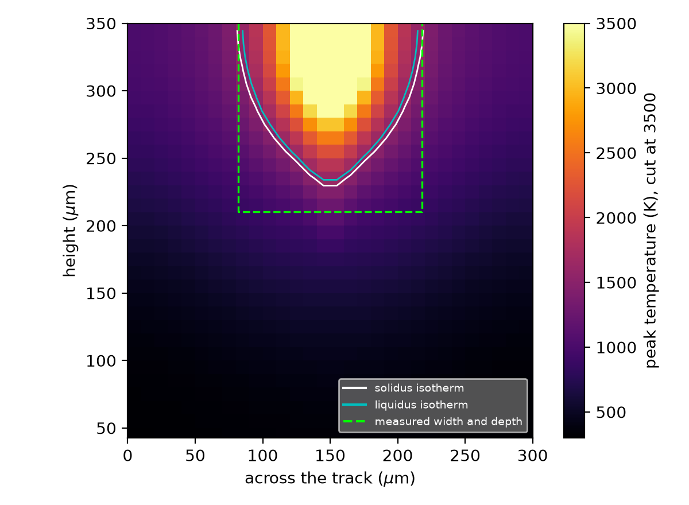

**Figure 1.** Case 0 (285 W, 960 mm/s, beam D4$\sigma$ 67 um), 10 um mesh, calibrated
source: peak temperature reached by every element in the plane across the track at
mid-length, with the solidus and liquidus isotherms and the measured width and depth
(dashed).

**Figure 2.** Computed against measured melt-pool depth and width of the seven cases
(calibrated source). The bar spans the solidus and liquidus isotherms; dashed lines:
$\pm$10 %.

**Table 7.** Depth and width (um): measured, with the starting source
($\eta = 0.70$, $\delta = 52$ um), and with the fitted source ($\eta = 0.7724$,
$\delta = 45.01$ um; one Gauss-Newton step on cases 0 and 1.2). Computed values are the
mean of the two isotherms.

| case | depth measured | start | fitted | error fitted | width measured | start | fitted | error fitted |
|---|---|---|---|---|---|---|---|---|
| 0 (fit) | 139.7 | 122.1 | 118.2 | $-15.4$ % | 136.3 | 125.4 | 133.7 | $-1.9$ % |
| 1.1 | 227.2 | 133.0 | 126.6 | $-44.3$ % | 106.2 | 120.4 | 125.9 | $+18.6$ % |
| 1.2 (fit) | 102.4 | 114.9 | 111.8 | $+9.2$ % | 141.7 | 131.1 | 140.0 | $-1.2$ % |
| 2.1 | 109.7 | 113.0 | 109.9 | $+0.2$ % | 112.9 | 113.8 | 121.5 | $+7.6$ % |
| 2.2 | 176.5 | 129.8 | 124.3 | $-29.6$ % | 156.1 | 137.3 | 143.7 | $-7.9$ % |
| 3.1 | 166.1 | 129.4 | 123.7 | $-25.5$ % | 134.3 | 133.6 | 141.4 | $+5.3$ % |
| 3.2 | 116.9 | 114.4 | 111.2 | $-4.9$ % | 129.4 | 118.6 | 124.7 | $-3.7$ % |
| rms over 7 | | 21.5 % | 23.4 % | | | 8.6 % | 8.6 % | |

- **Width** is reproduced within 8 % for six of the seven cases with either source; the
  fit brings the two fitted cases within 2 %. The exception is the small-spot case 1.1
  ($+19$ %), whose measured pool is the narrowest and the deepest.
- **Depth** is reproduced within 5 % for the two shallowest cases (2.1 and 3.2) and is too
  small by 15 to 44 % for the four deepest. The measured depth changes by 125 um between
  the 49 um and the 82 um spot; the computed depth changes by 15 um. A heat source with
  one absorptivity and one decay length, in a body with a flat surface, does not carry
  that dependence. The measured depth-to-width ratios of cases 1.1, 2.2 and 3.1 are 2.1,
  1.1 and 1.2: keyhole pools.
- The fit was stopped after one step: its predicted gain on the four fitted numbers was
  10.3 % to 9.2 % rms, and over all seven cases the fitted source is not better than the
  starting one (depth 23.4 % against 21.5 %).
- **Peak temperatures** of 5,000 to 7,600 K are far above the boiling point. The
  evaporative sink of equation 5, spread over one 10 um element, does not limit the
  surface temperature; in the experiment the vapor recoil opens the keyhole. Temperatures
  inside the pool are therefore not a result of this model; the fusion boundary is.

For the two fitted cases the comparison is a calibration; for the other five it is a
prediction (tier 4). The same pattern, widths within about 10 to 30 % and keyhole tracks
22 to 41 % too shallow, is reported by the author's toolkit for its own conduction code on
these tracks, which is a consistency check between two independent implementations.

### 6.3 Network route: parametric surrogate of the single-track response

The transient thermal solve with melting is not a problem a network of the coordinates can
be trained on through its pointwise residual alone in PINNACLE: the framework's surrogate
route refuses a physics source for evolution kernels and trains on finite-element data
(PINNACLE ADR 0030). The network route of this part is therefore a parametric surrogate of
the outcome of a track: for laser power $P$, scan speed $v$ and beam diameter $D$ it
returns the peak temperature along the depth below the track axis (24 points to 230 um)
and the melt-pool depth and width.

Training data are 30 finite-element tracks of the K1 template at 10 um with the fitted
source, drawn by Latin hypercube sampling over 230 to 340 W, 750 to 1,250 mm/s and 45 to
86 um, a box that contains the seven NIST cases with a margin
(`decks/lpbf/in718/k1/surrogate/design_h10.i`). Twenty-four are used for training and six
are held out. The network (`parametric_surrogate`, a shared trunk of two layers with one
head for the profile and one per scalar, 32 neurons, 3,427 parameters, an ensemble of
five) is trained for 3,000 Adam and 50 L-BFGS epochs in 47 s on the workstation CPU. The
seven NIST cases are never training data; the trained surrogate is asked for them.

**Table 8.** Surrogate against finite elements, three seeds (seed of the hold-out split
and of the initialization): mean $\pm$ standard deviation, and the worst seed.

| quantity | mean $\pm$ sd | worst seed |
|---|---|---|
| held-out tracks: peak-temperature profile, mean relative $L_2$ error | 0.82 $\pm$ 0.19 % | 0.94 % |
| held-out tracks: worst profile | 1.55 $\pm$ 0.50 % | 1.89 % |
| held-out tracks: depth, mean relative error | 0.26 $\pm$ 0.00 % | 0.26 % |
| held-out tracks: width, mean relative error | 0.38 $\pm$ 0.10 % | 0.49 % |
| seven NIST cases: depth, rms relative error | 0.33 $\pm$ 0.05 % | 0.39 % |
| seven NIST cases: depth, worst case | 0.59 $\pm$ 0.05 % | 0.65 % |
| seven NIST cases: width, rms relative error | 0.52 $\pm$ 0.01 % | 0.52 % |
| seven NIST cases: width, worst case | 0.85 $\pm$ 0.09 % | 0.90 % |

The surrogate reproduces the finite-element model within 1 % everywhere it was asked
(tier 1: agreement of a network with the solver that produced its data). It inherits the
error of that model against the measurements unchanged: its depth for case 1.1 is 126.7 um
against 126.6 um by finite elements and 227.2 um measured. Agreement with the solver does
not validate the surrogate against the experiment.

Cost. The 30 training tracks took 23 s each on the GPU when it was free (69 s each while
it was shared with another run), about 12 min in all; training takes 47 s; a query takes
milliseconds. With one finite-element track at 23 s, the surrogate pays for itself after
about 32 tracks, so for the seven cases of this benchmark it is slower than running them.
Its use is a process map (hundreds of combinations of power, speed and spot) or a fit of
the heat source, where every evaluation would otherwise be a run.

### 6.4 Case K2: build column (temperature and grains together, coarse check)

A block of 600 x 600 um: 200 um of plate and four powder layers of 40 um, scanned with the
build parameters over a patch of 440 x 440 um (five tracks per layer, 90 degrees between
layers). Mesh 10 um (129,600 elements), 30 order parameters, 9,040 explicit steps of
2.5 us to 22.6 ms; 4,821 s on the GPU host (0.53 s per step). One layer was run and looked
at first (1,226 s) before the four layers.

**Figure 3.** Case K2 after four layers, 10 um mesh: grains colored by the crystal
direction along the build direction (inverse pole figure colors), in two vertical sections
and one layer plane. Dashed line: top of the plate. White: powder or empty.

**Table 9.** Grain statistics of the built material (above the plate), seed 1 of the
nucleation sites and plate grains (three seeds: Table 9a).
A grain is a connected region of one order parameter of at least 8 elements.

| quantity | one layer | four layers | measured (3-D EBSD) |
|---|---|---|---|
| grains (fragments below 8 elements, not counted) | 42 (36) | 378 (340) | |
| grains that do not touch the plate | 14 | 258 | |
| nucleation events | 621 | 3,704 | |
| equivalent diameter, median (um) | 71 | 36.8 | 11.5 |
| height along the build direction, median (um) | 85 | 40 | |
| consolidated fraction of the volume above the plate | 0.21 | 0.91 | |
| build direction within 15 degrees of $\langle100\rangle$, $\langle110\rangle$, $\langle111\rangle$ (volume fractions) | 0.08, 0.30, 0.33 | 0.19, 0.16, 0.20 | 0.10, 0.21, 0.10 (random: 0.10, 0.20, 0.14) |

**Table 9a.** Four layers on three seeds (seed of the plate grains and of the nucleation
sites; same deck otherwise). Standard deviation of three values (n - 1). The thermal
history of Table 10 is the same in the three runs, because the grains do not act on the
temperature.

| quantity | seed 1 | seed 2 | seed 3 | mean $\pm$ sd |
|---|---|---|---|---|
| grains (fragments below 8 elements) | 378 (340) | 375 (344) | 361 (383) | 371 $\pm$ 9 |
| grains that do not touch the plate | 258 | 249 | 244 | 250 $\pm$ 7 |
| nucleation events | 3,704 | 3,516 | 3,640 | 3,620 $\pm$ 96 |
| equivalent diameter, median (um) | 36.8 | 37.7 | 38.6 | 37.7 $\pm$ 0.9 |
| equivalent diameter, mean (um) | 47.2 | 47.8 | 47.9 | 47.6 $\pm$ 0.4 |
| consolidated fraction above the plate | 0.912 | 0.913 | 0.912 | 0.912 $\pm$ 0.000 |
| within 15 degrees of $\langle100\rangle$ | 0.19 | 0.13 | 0.29 | 0.20 $\pm$ 0.08 |
| within 15 degrees of $\langle110\rangle$ | 0.16 | 0.11 | 0.27 | 0.18 $\pm$ 0.08 |
| within 15 degrees of $\langle111\rangle$ | 0.20 | 0.08 | 0.11 | 0.13 $\pm$ 0.06 |
| wall time on the GPU host (s) | 4,821 | 4,855 | 4,831 | |

**Table 10.** Thermal history at the build surface against the NIST staring-camera
thermography of leg L9 (lane 2023 thermographydata; medians over 17 layers of three
builds, as reduced by the author's toolkit and not re-derived here).

| quantity | computed, median (quartiles) | measured, median of layer medians (range) |
|---|---|---|
| time above melting (ms) | 2.39 (1.70 to 3.02) | 1.28 (1.04 to 1.82) |
| cooling rate (K/s) | $6.3\times10^4$ at freezing ($5.3$ to $8.0\times10^4$) | $1.9\times10^5$ solid cooling rate ($1.2$ to $3.9\times10^5$) |
| temperature gradient at freezing, all melted elements (K/m) | $3.6\times10^6$ | not measured |

- **What the run shows.** The chain runs as one deck: deposition, melting, epitaxial
  regrowth from the plate grains and from the layer below, nucleation in the undercooled
  liquid, and remelting by the next layer. Grains of the plate continue across the plate
  surface (Figure 3, dashed line), and two thirds of the grains of the build are nucleated
  ones that do not reach the plate.
- **Grain size is not a result at this mesh.** The median diameter is 3.2 times the
  measured one. A boundary of the model is 40 um wide and a grain needs 8 elements to be
  counted, so nothing below about 25 um can exist here; the measured median is 11.5 um.
  The fine decks of section 8.3 (5 and 2.5 um) are the ones to compare.
- **Texture is not a result either.** The fractions change from layer one to layer four
  by more than they differ from the measurement, and the nucleation parameters are
  assumed. Across three seeds (Table 9a) each fraction varies by 0.06 to 0.08, as much as
  its distance from the measured value: with about 370 grains, a few large grains decide
  the volume fraction (in seed 3 one $\langle100\rangle$ grain fills a third of the
  section planes).
- **What three seeds show.** Grain count, size and consolidated fraction repeat within
  2.5 %; they are set by the mesh, the boundary width and the thermal history, not by
  the seed.
- **Thermal history.** The computed time above melting is 1.9 times the measured median,
  and the computed cooling rate at freezing is a third of the measured solid cooling
  rate. The two cooling rates are not the same quantity (NIST evaluates the solid over a
  temperature window below the solidus; the model records the rate when the element
  freezes), and the block is put back to the plate temperature before every layer. Both
  differences have the sign of a block that holds its heat too long (cut sides 1 mm
  from an assumed sink, conduction pool); none of the inputs was adjusted.

Two earlier runs of this case are void and are kept in the ledger as such. In the first,
grains grew into the empty space above the build surface; this was seen in the image, not
in the statistics, and was removed by restricting regrowth to consolidated material. In
the second, the plate grains coarsened during the run because a mobility sized for the
solidification front also moved the boundaries of the cold solid; the mobility now falls
with temperature below the liquidus. Table 9 is from the runs after both corrections.

### 6.5 Case K1 with melt-pool flow (reported separately from the conduction results)

The seven tracks of section 6.2 with the flow of section 2.4 added to the same decks
(`k1_flow_template.i`, `k1_flow_study_h10.i`): the same 10 um mesh, the same heat source
($\eta = 0.7724$, $\delta = 45.01$ um, the values fitted WITHOUT flow and not refitted),
so that the difference to Table 7 is the effect of the flow alone. 2,270 thermal steps of
0.53 us with four flow sub-steps each; 510 s per track on the GPU host (23 s without
flow).

**Flow inputs** (notebook, section 12): liquid density 7,578 kg/m$^3$ and viscosity
5.3 mPa s (table of (amin 2024 heatsource), a thermal-fluid study of the same NIST tracks,
read through a literature tool and not from the PDF); $d\gamma/dT = -1.1\times10^{-4}$
N/(m K), $\beta = 5\times10^{-5}$ /K, $A = 10^8$ /s, $c_r = 0.54$: assumed. Numerical:
$c = 25$ m/s, first-order upwind.

**Verification of the flow components** (PINNACLE examples; tier 2 against a closed form,
tier 3 against published numerical references whose values are quoted from memory and
were not checked against the papers):

| case | quantity | computed | reference |
|---|---|---|---|
| lid-driven cavity, Re = 100, 40 x 40 | extremes of the velocity on the center lines | $-0.2148$, $+0.1802$, $-0.2540$ | $-0.2109$, $+0.1753$, $-0.2453$ (ghia 1982 cavity): within 3.5 % |
| side-heated cavity, Ra = $10^4$, 40 x 40 (buoyancy and equation 17) | Nusselt number; largest velocities | 2.2433; 16.21, 19.68 | 2.243; 16.178, 19.617 (devahldavis 1983 natural): within 0.4 % |
| liquid layer under a surface shear, 16 elements over the depth | velocity profile; surface speed | interior within 0.007 (peak 0.083); $-0.212$ | $u = \tau(3z^2 - 2Hz)/(4\mu H)$; $-0.25$ |
| energy of a track with the surface losses off | stored over supplied energy at 151 us | 1.009 with flow, 1.008 without | 1 |

The band of equation 16 lowers the speed of the surface itself by about $\tau b/(2\mu)$
(third row); the flow below the band is not affected.

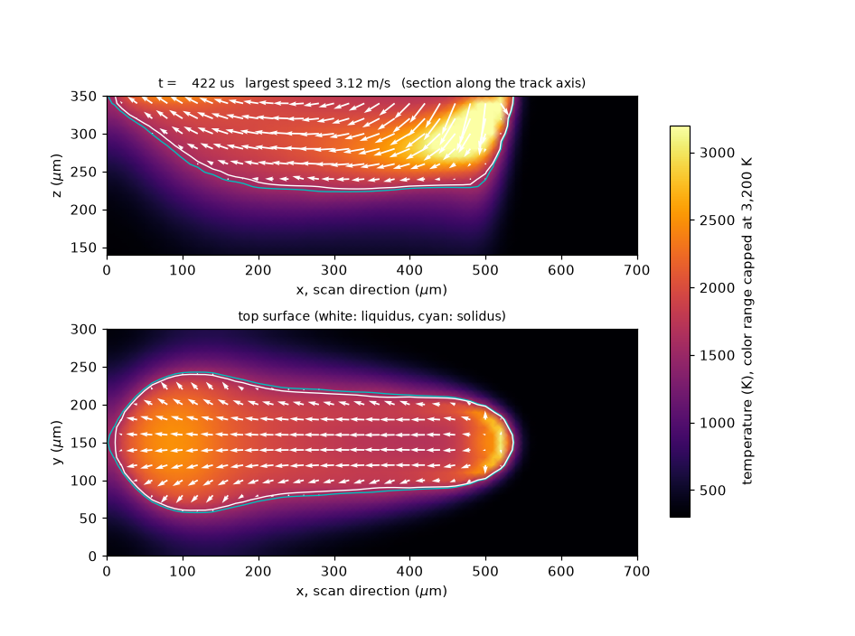

**Figure 4.** Case 0 with flow at 422 us: temperature and velocity in the section along
the track axis and on the surface (white: liquidus, cyan: solidus; color range capped at
3,200 K). Frame 14 of the animation `figures/lpbf/animations/k1_flow_h10_case0.gif`; the
animations of the seven tracks are in the same folder.

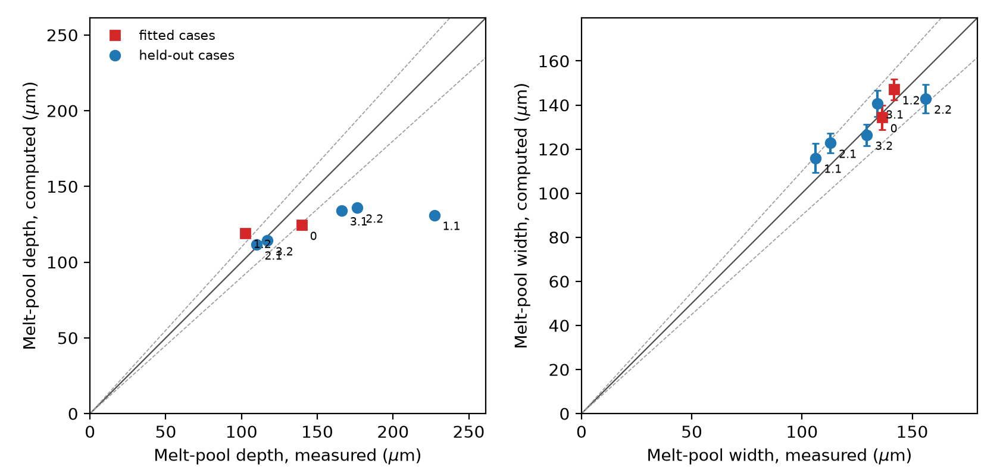

**Figure 5.** Computed against measured melt-pool depth and width of the seven cases with
flow (source parameters of the conduction fit; "fitted" marks the two cases that fit
used). The bar spans the solidus and liquidus isotherms; dashed lines: $\pm$10 %.

**Table 11.** Depth and width (um) with flow against the conduction model of Table 7 (the
same source) and the measurement; largest speed and peak temperature of the run.

| case | depth measured | conduction | flow | error flow | width measured | conduction | flow | error flow | peak T (K), conduction / flow |
|---|---|---|---|---|---|---|---|---|---|
| 0 | 139.7 | 118.2 | 124.4 | $-11.0$ % | 136.3 | 133.7 | 134.3 | $-1.4$ % | about 6,500 / 4,696 |
| 1.1 | 227.2 | 126.6 | 131.1 | $-42.3$ % | 106.2 | 125.9 | 116.0 | $+9.2$ % | / 5,293 |
| 1.2 | 102.4 | 111.8 | 119.2 | $+16.3$ % | 141.7 | 140.0 | 147.1 | $+3.8$ % | / 4,312 |
| 2.1 | 109.7 | 109.9 | 111.5 | $+1.6$ % | 112.9 | 121.5 | 122.7 | $+8.7$ % | / 4,451 |
| 2.2 | 176.5 | 124.3 | 135.9 | $-23.0$ % | 156.1 | 143.7 | 142.9 | $-8.5$ % | / 4,843 |
| 3.1 | 166.1 | 123.7 | 134.0 | $-19.3$ % | 134.3 | 141.4 | 140.6 | $+4.7$ % | / 4,963 |
| 3.2 | 116.9 | 111.2 | 114.2 | $-2.3$ % | 129.4 | 124.7 | 126.4 | $-2.3$ % | / 4,378 |
| rms over 7 | | 23.4 % | 21.0 % | | | 8.6 % | 6.3 % | | |

- **Effect of the flow.** The pool becomes 2 to 12 um deeper and the width changes by
  $-10$ to $+7$ um. The largest liquid speed is about 3.1 m/s (case 0), a jet from the
  hot spot under the beam backward and downward along the pool (Figure 4); the peak
  temperature falls from about 6,500 K to 4,300 to 5,300 K. The depth error over the
  seven cases falls from 23.4 to 21.0 % rms and the width error from 8.6 to 6.3 % rms;
  the small-spot case 1.1 improves most in width ($+18.6$ to $+9.2$ %).
- **What the flow does not repair.** The three keyhole tracks (1.1, 2.2, 3.1) stay 19 to
  42 % too shallow, and case 1.2 becomes too deep by 16 %: a flat surface cannot open a
  keyhole, as decision D2 anticipated. The measured depth changes by 125 um between the
  two spot sizes, the computed one by 12 um.
- **Recoil and shear separately (case 0, one run each).** Without the recoil pressure the
  thermocapillary shear alone spreads the liquid outward: width 162.7 um ($+19$ %),
  depth 116.1 um, largest speed 1.35 m/s, peak temperature unchanged (about 6,100 to
  6,500 K). The recoil pressure turns the flow downward under the beam and brings the
  width back to 134.3 um. The balance of the two depends on $d\gamma/dT$ and $c_r$, which
  are assumed here and were not varied.
- **Peak temperatures** remain above the boiling point (3,186 K); the remarks of section
  6.2 on temperatures inside the pool hold.
- **No refit of the source with flow.** The two fitted cases move in opposite directions
  (case 0 stays 11 % too shallow, case 1.2 becomes 16 % too deep), so a refit of
  $\eta$ and $\delta$ cannot improve both; it was not done.

Two defects of the first flow runs were found from the results and corrected before the
runs of Table 11; both are recorded in the notebook (section 12). The drag as an explicit
point term gave non-finite fields after seven steps. The advection term in the form
$C\,\mathbf u\cdot\nabla T$ created energy: the stored energy reached 1.68 times the
supplied energy and the pool never froze. No number of those runs is used.

### 6.6 Case K3: tensile test and calibration of the crystal-plasticity parameters

**Target.** The mean engineering stress-strain curve of the eight miniature specimens of
(benzing 2025 tensiledata), cut along the build direction and pulled at $10^{-3}$ /s,
derived here from the raw records (`scripts/lpbf_k3_targets.py`: extensometer displacement
over the 3 mm gauge, force over the cross-section in the file header, mean on a common
strain grid up to the smallest uniform elongation, 21.9 %). The properties recomputed
from the records agree with the answers NIST published: ultimate stress 951.6 MPa (NIST
951.6), 0.2 % yield stress 687.3 MPa (690.7), strain at the ultimate stress 0.246 (0.247).
The modulus from a fit between 100 and 400 MPa is 128.1 GPa (NIST 123.6), far below the
polycrystal modulus of the alloy; it is a specimen compliance and is not a target.

**Forward model.** A cube of 120 um with 216 Voronoi grains of 20 um and uniform random
orientations, 6 x 6 x 6 elements, pulled along $z$ to 20 % in 100 load steps; faces
$x = 0$ and $y = 0$ are symmetry planes, the opposite faces are free. Finite-strain
crystal plasticity with the dislocation-density law of equations 9 and 10
(`cp_quasi_static`, backward-Euler slip update, as in Parts I to III). The engineering
stress is the mean Cauchy stress along the load divided by $1 + \varepsilon$ (the
cross-section shrinks at constant volume; the elastic volume change, about 0.2 %, is
neglected). About 5 min per curve on four CPU threads.

**Starting set.** The author's toolkit holds a crystal-plasticity set calibrated on the
same NIST curve with a Taylor model of 400 grains and a Voce-type law (initial resistance
227.2 MPa, saturation 666.3 MPa, $h_0 = 1{,}407$ MPa, exponent 3.10, latent ratio 1.4,
$\dot\gamma_0 = 10^{-3}$ /s, $m = 0.05$, $C_{11}, C_{12}, C_{44} = 250, 160, 120$ GPa).
The law here is a different one, so the starting values are derived to give the same
initial resistance, the same saturation resistance and the same initial hardening rate
$h_0(1 - g_0/g_s)^a = 386$ MPa:

$$\tau_{c0} = g_0 - \alpha_0\mu b\sqrt{S\rho_0}, \qquad
k_1 = \frac{2\sqrt S\,(386\ \text{MPa})}{\alpha_0\,\mu}, \qquad
y_c = \frac{k_1}{2\sqrt{\rho_{sat}}}, \qquad S = 1 + 11\,q, \tag{18}$$

with $k_2 = 2y_c$ in equation 10. Elastic constants, rate constants and $q$ are the
toolkit's and are held; $\alpha_0 = 0.3$, $\mu = 81$ GPa, $b = 0.254$ nm and
$\rho_0 = 10^{10}$ /m$^2$ are assumed.

**Calibration.** Gauss-Newton in the logarithm of $\tau_{c0}$, $k_1$ and $y_c$ on the
88 points of the target between 1 % strain and the end of the run; the Jacobian by
finite differences (each parameter raised by 5 %, four finite-element runs per
iteration), a Levenberg-Marquardt damping of $10^{-3}$ and a step limit of a factor 2
(`scripts/lpbf_k3.py calibrate`; one deck per run, `decks/lpbf/in718/k3/cal_<i>_*.i`).
PINNACLE's built-in inverse mode (`[Calibration] mode = inverse` on the 0-D
`cp_constitutive` route) was tried first and gave stresses of 1.8 GPa at 0.1 % strain for
this setup; it was not used, and the cause was not investigated.

**Table 12.** Iterations of the calibration (grain seed 1).

| iteration | $\tau_{c0}$ (MPa) | $k_1$ | $y_c$ (nm) | rms error (MPa) | largest error (MPa) |
|---|---|---|---|---|---|
| 0 (start) | 224.72 | 0.12866 | 3.641 | 66.58 | 84.8 |
| 1 | 262.02 | 0.07459 | 2.677 | 31.26 | 39.5 |
| 2 | 262.34 | 0.05676 | 1.859 | 3.59 | 16.0 |
| 3 | 263.07 | 0.05334 | 1.554 | 2.75 | 17.2 |
| 4 | 263.31 | 0.05279 | 1.497 | 2.662 | 17.7 |
| 5 (calibrated) | 263.37 | 0.05269 | 1.489 | 2.661 | 17.8 |

The condition number of the Jacobian is 39 at the start and 95 at the end: the three
parameters are identifiable from one tensile curve, $k_1$ and $y_c$ less sharply than
$\tau_{c0}$. The largest remaining error is at the first target point (1 % strain),
where the measured curve is still bending over and the model has already yielded.

**Table 13.** Calibrated set of alloy 718 (as built, build direction, room temperature,
$10^{-3}$ /s) for the law of equations 9 and 10.

| parameter | value | status |
|---|---|---|
| $\tau_{c0}$ | 263.37 MPa | fitted |
| $k_1$ | 0.052690 | fitted |
| $y_c$ ($k_2 = 2y_c$) | 1.4891 nm | fitted |
| $\rho_0$ | $10^{10}$ /m$^2$ | assumed |
| $\alpha_0$, $\mu$, $b$ | 0.3, 81 GPa, 0.254 nm | assumed |
| $q$ (latent ratio) | 1.4 | held (toolkit) |
| $\dot\gamma_0$, $n = 1/m$ | $10^{-3}$ /s, 20 | held (toolkit) |
| $C_{11}$, $C_{12}$, $C_{44}$ | 250, 160, 120 GPa | held (toolkit) |

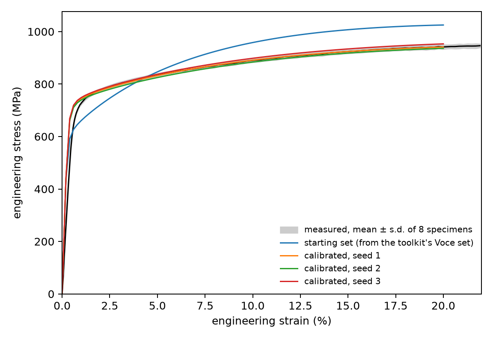

**Figure 6.** Engineering stress-strain curve of the polycrystal cube with the starting
set and with the calibrated set on three grain realizations, against the mean of the
eight NIST specimens (band: standard deviation between the specimens).

**Table 14.** Calibrated set on three grain realizations (216 grains each; seed 1 is the
one the calibration used) against the measurement.

| quantity | seed 1 | seed 2 | seed 3 | mean $\pm$ sd | measured |
|---|---|---|---|---|---|
| rms error of the curve, 1 to 20 % (MPa) | 2.66 | 7.16 | 8.46 | 6.1 $\pm$ 3.0 | |
| 0.2 % yield stress (MPa) | 696.5 | 690.3 | 698.5 | 695.1 $\pm$ 4.3 | 690.7 $\pm$ 3.1 (NIST), 687.3 (here) |
| stress at 5 % (MPa) | 832.4 | 824.9 | 837.4 | 831.6 $\pm$ 6.3 | 833.8 |
| stress at 10 % (MPa) | 891.1 | 883.9 | 898.4 | 891.2 $\pm$ 7.3 | 890.3 |
| stress at 20 % (MPa) | 941.4 | 936.4 | 953.3 | 943.7 $\pm$ 8.7 | 941.6 |
| initial slope (GPa) | 219.6 | 217.9 | 219.7 | 219.1 $\pm$ 1.0 | 123.6 (NIST), not a target |

- The calibration reduces the error of the curve from 66.6 to 2.7 MPa rms (0.3 % of the
  flow stress) in five steps. For seed 1 this is a calibration (tier 4 agreement by
  construction); seeds 2 and 3 show what the grain realization alone changes: 5 to
  6 MPa, less than the scatter between the measured specimens (9 MPa at the ultimate
  stress).
- The starting set, which reproduces the toolkit's Voce parameters in three numbers,
  yields 12 % too early and hardens too much (605 MPa yield, 1,025 MPa at 20 %). The
  toolkit fitted a Taylor model, here a finite-element polycrystal carries the same law
  constants: parameters of crystal plasticity do not transfer between homogenization
  schemes, which is why the set is calibrated again.
- **Limits.** One mesh (one element per grain on average), 216 grains, one strain rate,
  one temperature, one loading direction; random texture (the measured texture is close
  to random, section 3.1). The curve ends at 20 % strain, before the ultimate stress
  (24.6 %); necking and failure are outside this model. The initial slope of the model is
  the polycrystal modulus of the held elastic constants (219 GPa) and is not compared.
  Parameters that were assumed ($\rho_0$, $\alpha_0$, $\mu$) trade off with the fitted
  ones: the set is one consistent set, not a measurement of each parameter.

**From the simulated structure to the tensile curve (the chain, one run).** A cube of
120 um was cut out of the built material of the four-layer column of section 6.4 (above
the plate, in the middle of the block) and pulled with the calibrated set; grains and
orientations are those of the process simulation, the mesh is the column's (12 x 12 x 12
elements). Nothing is fitted in this run.

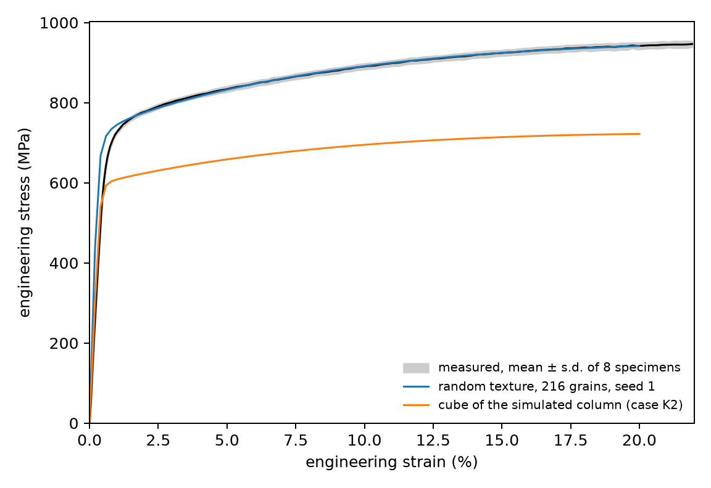

**Figure 7.** Engineering stress-strain curve of the cube cut from the simulated column
against the random-texture polycrystal of Figure 6 and the measurement.

**Table 15.** Tensile response of the cube cut from the simulated column (calibrated
set, nothing fitted) against the random-texture polycrystal and the measurement.

| quantity | cube of the simulated column | random texture, 216 grains (seed 1) | measured |
|---|---|---|---|
| 0.2 % yield stress (MPa) | 589.9 | 696.5 | 690.7 |
| stress at 5 %, 10 %, 20 % (MPa) | 658.4, 694.8, 721.9 | 832.4, 891.1, 941.4 | 833.8, 890.3, 941.6 |
| rms difference to the measured curve (MPa) | 193.8 | 2.7 | |
| initial slope (GPa) | 152.7 | 219.6 | |

- The cube of the simulated structure is 15 % too soft at yield and 23 % at 20 % strain.
  The cause is its grain structure, not the plasticity set: the cube holds 20
  orientations, three of which fill 73 % of it, and the build direction of the five
  largest lies 4, 21, 21, 16 and 4 degrees from a cube axis $\langle100\rangle$ (largest
  Schmid factors 0.43 to 0.49; the low initial slope shows the same, the modulus along
  $\langle100\rangle$ being 125 GPa for these constants).
- This is the coarse column again (section 6.4): at 10 um the model grows few, large
  grains selected along $\langle100\rangle$, where the measured structure has a median
  grain of 11.5 um and a texture close to random. The chain from process to property
  runs end to end; its property prediction is only as good as the grain structure, and
  that needs the fine column. One cube of one column realization.

**The same test on the measured grain structure.** A cube of 120 um of the build
itself: the orientation of every material point is taken from the serial-section 3-D
EBSD of NIST (schwalbach 2024 sectioningdata; volume in build coordinates at 2 um,
every second voxel, 24,300 voxels; 200 to 320 um above the plate; deck
`k3_cube_ebsd_cube1.i`). Mesh 20 x 20 x 20 elements of 6 um, each quadrature point with
the orientation of the nearest voxel; calibrated set, nothing fitted; 12,411 s on 8 CPU
threads (407 Newton iterations, 4 cutbacks near yield).

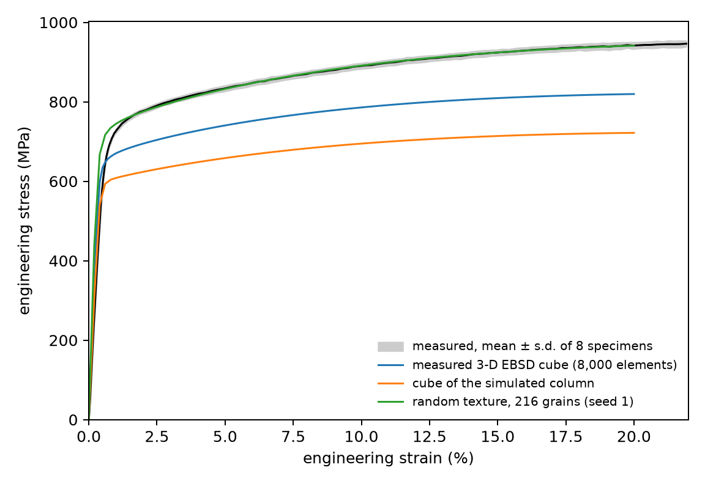

**Figure 7a.** Engineering stress-strain curve of the cube of the measured structure,
with the two cubes of Figure 7 and the measurement.

**Table 15a.** Tensile response of the cube of the measured 3-D EBSD structure.

| quantity | measured structure (3-D EBSD), 8,000 elements | simulated column, 1,728 elements | random texture, 216 grains in 216 elements | measured |
|---|---|---|---|---|
| 0.2 % yield stress (MPa) | 638.9 | 589.9 | 696.5 | 690.7 |
| stress at 5 %, 10 %, 20 % (MPa) | 740.5, 785.8, 819.6 | 658.4, 694.8, 721.9 | 832.4, 891.1, 941.4 | 833.8, 890.3, 941.6 |
| rms difference to the measured curve (MPa) | 104.8 | 193.8 | 2.7 | |
| initial slope (GPa) | 190.0 | 152.7 | 219.6 | |
| build direction within 15 degrees of $\langle100\rangle$, $\langle110\rangle$, $\langle111\rangle$ | 0.14, 0.10, 0.10 | | random: 0.10, 0.20, 0.14 | whole EBSD volume: 0.10, 0.21, 0.10 |

- **With the measured grains the calibrated set is 7.5 % too soft at yield and 13 %
  at 20 % strain.** It is closer to the measurement than the cube of the simulated
  column (15 % and 23 %), as the grain structure is the real one.
- **The remaining difference points at the calibration, not at the structure.** The
  set was calibrated on 216 grains in 216 elements, one element per grain. A grain that
  is one trilinear element cannot deform unevenly, which makes the aggregate stiffer;
  the calibration absorbed that stiffness into the parameters. On a mesh that gives the
  grains several elements the same parameters give a softer response. Two more causes
  are not separated from it: this cube has fewer orientations near $\langle110\rangle$
  and $\langle111\rangle$ than the whole measured volume (Table 15a, last row), and it
  is one cube of 120 um.
- **Consequence.** The parameter set of Table 13 belongs to its mesh. A calibration on
  the measured structure at this resolution (one run of 3.4 h per function evaluation
  here) is the consistent next step and was not done.

### 6.7 Heat-source depth from the keyhole number (reported beside the fitted depth)

The conduction model of section 6.2 has one fitted penetration depth (45 um) for all
tracks, and its computed depth changes by 15 um over tracks whose measured depth changes
by 125 um. The keyhole number (gan 2021 keyhole)

$$Ke = \frac{\eta P}{(T_l - T_0)\,\pi\,\rho c_p\,\sqrt{\alpha V r_0^3}}$$

compares the absorbed power with what conduction carries away from the spot, and the
depth of the vapor depression follows $e/r_0 = 0.4\,(Ke - 1.4)$ in that paper. PINNACLE
takes the decay length of the source from it, $\delta = e/2$ per track, never below one
element (`beam_heat_source penetration_model = keyhole_number`, PINNACLE ADR 0055). No
depth is fitted. Material values are those of the decks at the liquidus
($\rho c_p = 6.35$ MJ/(m$^3$ K), $k = 26.8$ W/(m K)), $T_0 = 296.65$ K.

**Check of the criterion.** Recomputed with PINNACLE's function on the 87 measurements
of that paper (Ti-6Al-4V at two spot sizes, Al6061, 316L; its Supplementary Data 1), the
law reproduces the measured keyhole depths with $R^2 = 0.977$ (rms 0.39 in $e/r_0$; a
free line through the same data gives a slope of 0.397 and an onset of 1.02). The
absorptivity in those rows is the measured one, between 0.12 and 0.67.

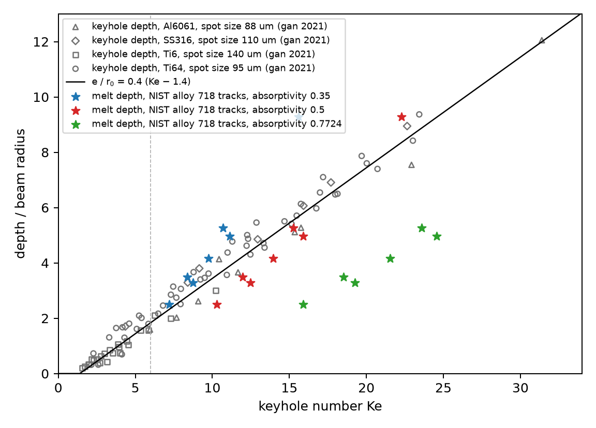

**Figure 9.** Depth over beam radius against the keyhole number. Gray: keyhole depths
of (gan 2021 keyhole) with their measured absorptivity; line: the depth law; stars: the
measured MELT depths of the seven NIST tracks, placed at the keyhole number three
assumed absorptivities give.

**Table 19.** Keyhole number of the seven NIST tracks for three absorptivities (0.7724:
the value of the conduction fit of section 6.2; 0.50 and 0.35: assumed, the range
measured on 316L in that paper is 0.36 to 0.66). Regimes of the paper: conduction below
1.4, keyhole above 6.

| line | spot radius (um) | measured depth, width (um) | width / depth | Ke at 0.35 | Ke at 0.50 | Ke at 0.7724 | depth law at 0.50 (um) |
|---|---|---|---|---|---|---|---|
| 0 | 33.5 | 139.7, 136.3 | 0.98 | 9.8 | 13.9 | 21.5 | 168 |
| 1.1 | 24.5 | 227.2, 106.2 | 0.47 | 15.6 | 22.3 | 34.4 | 205 |
| 1.2 | 41.0 | 102.4, 141.7 | 1.38 | 7.2 | 10.3 | 15.9 | 146 |
| 2.1 | 33.5 | 109.7, 112.9 | 1.03 | 8.7 | 12.5 | 19.3 | 148 |
| 2.2 | 33.5 | 176.5, 156.1 | 0.88 | 10.7 | 15.3 | 23.6 | 186 |
| 3.1 | 33.5 | 166.1, 134.3 | 0.81 | 11.1 | 15.9 | 24.6 | 194 |
| 3.2 | 33.5 | 116.9, 129.4 | 1.11 | 8.4 | 12.0 | 18.5 | 142 |

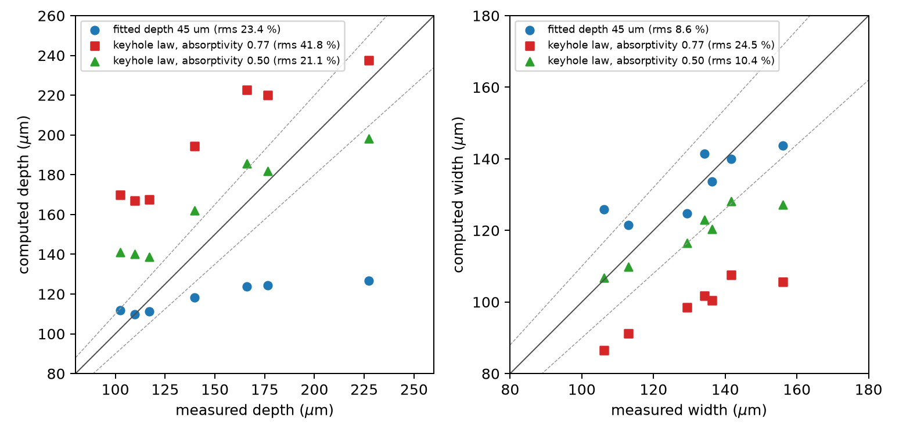

**Figure 10.** Depth and width of the seven tracks, computed against measured, for the
fitted depth of section 6.2 and for the keyhole-number depth with two absorptivities in
$Ke$. Dashed: 10 %.

**Table 20.** Conduction model with three source depths, 10 um mesh (error in %; the
source absorptivity is 0.7724 in all three).

| line | fitted depth 45 um: depth, width | keyhole law, 0.7724 in $Ke$: depth, width | keyhole law, 0.50 in $Ke$: depth, width |
|---|---|---|---|
| 0 | $-15.4$, $-1.9$ | $+39.2$, $-26.3$ | $+16.1$, $-11.7$ |
| 1.1 | $-44.3$, $+18.6$ | $+4.5$, $-18.5$ | $-12.8$, $+0.6$ |
| 1.2 | $+9.2$, $-1.2$ | $+65.8$, $-24.1$ | $+37.7$, $-9.6$ |
| 2.1 | $+0.2$, $+7.6$ | $+52.3$, $-19.3$ | $+27.7$, $-2.8$ |
| 2.2 | $-29.6$, $-7.9$ | $+24.6$, $-32.3$ | $+3.0$, $-18.5$ |
| 3.1 | $-25.5$, $+5.3$ | $+34.0$, $-24.2$ | $+11.8$, $-8.4$ |
| 3.2 | $-4.9$, $-3.7$ | $+43.3$, $-23.9$ | $+18.5$, $-10.0$ |
| rms | 23.4, 8.6 | 41.8, 24.5 | 21.1, 10.4 |
| range of the computed depth (um) | 110 to 127 | 167 to 238 | 139 to 198 |

- **All seven tracks are in keyhole mode**, for any absorptivity from 0.35 up (Table
  19). This is the reason a conduction pool with one source depth cannot follow them.
- **The measured melt depths follow the published law** when the absorptivity in $Ke$
  is between 0.35 and 0.50 (Figure 9): the alloy 718 tracks then lie in the band of the
  keyhole depths of the other alloys. With the absorptivity of the conduction fit
  (0.7724) they lie far below the law: that value is a fitted parameter of a flat-surface
  source and not the absorptivity of the keyhole number.
- **As a source depth, the law carries the dependence on the spot size and on the
  energy input that the fitted constant misses.** With 0.50 in $Ke$ the computed depth
  spans 139 to 198 um (measured 102 to 227; fitted constant: 110 to 127), the deepest
  track is 13 % too shallow (fitted constant: 44 %), and the rms error of the depth is
  21.1 % without a fitted depth against 23.4 % with one. The shallow tracks are now
  too deep (up to 38 %) and the widths are 10 % too small.
- **It is not a parameter-free prediction.** The result depends on the absorptivity
  put into $Ke$ (41.8 % against 21.1 % rms for 0.7724 and 0.50) and on the share of
  the keyhole depth taken as the decay length (0.5, not varied). The paper measures the
  absorptivity; for alloy 718 at these conditions no measurement is used here. The
  fitted-depth result of section 6.2 stays the reference of this report.

### 6.8 Defect indicators

The models resolve no pore: the surface of the pool is flat, powder particles are not
modeled and the element (10 um) is larger than most pores. What the runs hold are the
quantities the published criteria are written in. The service `defect_indicators`
(PINNACLE ADR 0055) reports them at the end of a run. Every entry is an indicator with a
literature threshold, not a porosity prediction.

**Table 21.** Indicators, their inputs and what was found.

| defect | indicator (threshold) | input | finding in this report |
|---|---|---|---|
| lack of fusion | deposited material that never melted, as connected voids | process state of the run | none at the build condition; grows with the hatch (Table 22) |
| lack of fusion | overlap index $(H/W)^2+(L/D)^2$ (above 1) (tang 2017 lackoffusion) | pool width $W$, depth $D$ of the run; hatch $H$, layer $L$ | 0.3 to 0.6 at the build hatch; crosses 1 where unmelted material appears |
| keyhole mode | keyhole number (above 6) (gan 2021 keyhole) | beam, material at the liquidus, absorptivity | all seven tracks and the build condition (Table 19) |
| keyhole mode | normalized enthalpy $\eta P/(\pi\rho c_pT_m\sqrt{\alpha Vr_0^3})$ (above $\pi T_b/T_m = 6.2$) (king 2014 keyhole) | the same | 5.9 to 12.7 at an absorptivity of 0.35: above the threshold for six of seven tracks |
| keyhole mode | pool width over depth (at or below 1.5) | pool of the run | measured: 0.47 to 1.38, all below 1.5 |
| balling | pool length over width (at or above 2.3) (yadroitsev 2010 singletrack) | pool of the run | 2.1 to 5.4 in every run: not informative here (below) |

**Lack of fusion against the hatch spacing.** Two powder layers of 40 um on the plate,
three tracks per layer at the build parameters, the same track positions in both layers
(no rotation, the unfavorable case), conduction model at 10 um. The hatch is the only
change (decks `decks/lpbf/in718/defects/lof_hatch*_h10.i`; about 9 min each on the GPU
host). The build used 110 um.

**Table 22.** Unmelted material between the outer track axes and the overlap index of
the same run (pool width and depth of each track as the run gives them).

| hatch (um) | unmelted share of the deposited material | voids (largest equivalent diameter) | pool width, depth (um) | overlap index, range over the six tracks |
|---|---|---|---|---|
| 110 | 0 | 0 | 160 to 250, 110 to 130 | 0.29 to 0.60 |
| 150 | 0.0001 | 1 (12 um, one element) | 160 to 210, 110 to 120 | 0.62 to 1.01 |
| 190 | 0.106 | 2 (101 um) | 160, 110 to 120 | 1.52 to 1.54 |
| 230 | 0.294 | 2 (147 um) | 150 to 160, 110 | 2.20 to 2.48 |

- **The two lack-of-fusion indicators agree.** Unmelted material appears between a
  hatch of 150 and 190 um, where the overlap index of the same runs crosses 1 (1.01 at
  150 um with one unmelted element, 1.5 at 190 um with 10.6 %). They are not
  independent in their inputs (both come from the same temperature field), but they are
  different statements: one counts elements, the other is a geometric rule on two pool
  dimensions.
- **At the build condition nothing stays unmelted**: none of the 30,976 deposited
  elements of the scanned patch in the three column runs of section 6.4, and none in
  the hatch series at 110 um. This is the expected result for a dense build; it is not
  a test of the indicator, which the hatch series is.
- **The voids are unmelted powder, resolved to the element.** A void of 100 um here
  is a strip of powder between two tracks over both layers. The model has no powder
  packing and no flow into the gap, so the numbers are an upper bound of what a real
  pool would leave, and nothing below 10 um exists.
- **Keyhole mode is indicated for every track** by the keyhole number and by the
  measured aspect ratio; the conduction pool of section 6.2 has a width over depth of
  1.0 to 1.25 and the same flag. Whether a keyhole leaves pores is a question of its
  stability (the cited paper reports almost no porosity below $Ke$ of about 16 and a
  chaotic keyhole above 30); with an absorptivity of 0.35 to 0.50 the tracks lie at 7
  to 22. No pore count exists for these tracks to compare with.
- **The balling ratio is not informative with this model.** The computed pool is 430 to
  510 um long on a 500 um track (it does not reach a steady length) and three widths
  long in the hatch series, so the rule flags every run, the build condition included. A length from a conduction pool that holds
  its heat too long (section 6.4) cannot carry this criterion.
- **Not covered:** gas pores, the pinch-off of pores at a keyhole tip, humping and
  spatter. Solidification-cracking indicators are in section 6.10; pore transport and a
  deforming surface are open.

**Data for a later benchmark of the indicators** (downloaded, not yet used; sources
and licences in `data/lpbf/defects/raw/*/SOURCE.md`): the keyhole depths of
(gan 2021 keyhole) used above; a compilation of melt-pool modes with 169 rows for alloy
718 and 305 for 316L (labels by the compilers, not measured porosity); a literature
compilation of relative density against process parameters (233 rows for alloy 718,
312 for 316L, mixed density methods); per-pore lists from X-ray CT of three build
conditions of alloy 718 (NIST mds2-3083, columns undocumented). No open table of
cracking against process parameters was found, and the AM Bench 2022 CT record holds
gray values only, no pore table.

### 6.9 Case K4: stress left by the process in the build column

The block of case K2 as a crystal-plasticity body, loaded by the temperature history of
the corrected column run (`k2_column_h10_r2.i`: the run of section 6.4 with the surface
correction of PINNACLE ADR 0054; 391 grains, median diameter 37.7 um, time above melting
2.38 ms, against 378, 36.8 um and 2.39 ms before the correction). The grains are those
of that run. Layers that are not built yet and loose powder carry no stress: the
consolidated share of the column run tells the stress stage which points are metal at
which time (`thermal_load consolidated_function`). The crystal-plasticity set is the one
calibrated in case K3. Stages as in the 316L case: the build with the four sides held,
cool-down to the plate temperature, relaxation with two sides released.

Mesh 20 x 20 x 9 elements (30 x 30 x 40 um, one element per layer), 262 load steps of
100 us, 1,344 Newton iterations, 6 cutbacks, 12,538 s on 16 CPU threads.

**Assumed, with no measurement of this report behind it:** thermal expansion
$13\times10^{-6}$ /K with a slope of $5\times10^{-9}$ /K$^2$; a slip-resistance factor of
1.0 to 800 K, 0.85 at 923 K and 0.60 from 1,073 K up; no stress above a cut-off of
1,273 K (the material is treated as molten there); one stiffness factor with a slope
of $-3.5\times10^{-4}$ /K.

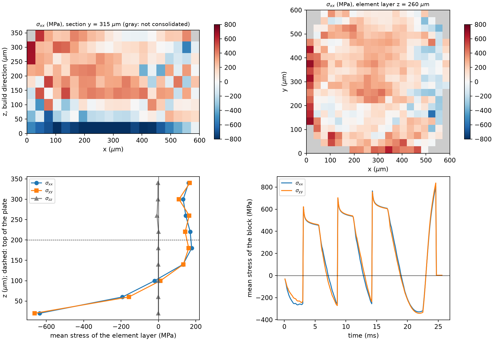

**Figure 11.** Case K4 after the relaxation. Top: $\sigma_{xx}$ of the elements in a
vertical section and in one element layer of the build (gray: not consolidated). Bottom
left: mean stress of each element layer of the consolidated material against the
height. Bottom right: mean stress of the block over the run (four layers; the jump at
the end of a layer is the reset of the block to the plate temperature).

**Table 23.** Residual stress of the column after the relaxation (consolidated
elements, 3,447 of 3,600).

| quantity | value |
|---|---|
| layer mean $\sigma_{xx}$ / $\sigma_{yy}$ at the bottom of the plate, z = 20 um (MPa) | $-636$ / $-662$ |
| height where the layer mean changes sign (um) | about 100 |
| layer means in the upper plate and the four build layers, z = 140 to 340 um (MPa) | $+132$ to $+178$ / $+110$ to $+168$ |
| layer mean $\sigma_{zz}$ (MPa) | $-7$ to $+1$ |
| mean stress of the block before the release, at the plate temperature (MPa) | $+804$ / $+837$ (largest value of the run) |
| mean stress of the block after the release (MPa) | $+2$ / $+2$ |
| von Mises stress, mean, 95th percentile, maximum (MPa) | 436, 786, 1,227 |
| equivalent plastic strain, mean and maximum | 0.014, 0.075 |
| von Mises stress of the elements that are not consolidated, mean (MPa) | 92 |

- **The pattern is that of the 316L case and of the published process-stress results:**
  tension of 110 to 180 MPa in the built layers and the plate just below them,
  compression in the plate further down (up to $-660$ MPa in the lowest element layer),
  no stress along the build direction. The tension is nearly the same in all four
  layers.
- **While the walls are held the block carries about 0.8 GPa.** As in the 316L case
  this is the reaction of the walls on a block that was heated and cooled as a whole,
  not a residual stress; it vanishes when two walls are released.
- **The jumps of the mean stress at the start of each layer are made by the model of
  the dwell**, not by the process: the block is put back to the plate temperature in
  one step when a layer ends (section 6.4), and with the walls held this cooling
  appears as tension at once (620, 700 and 765 MPa after layers one to three), which
  then relaxes by slip during the dwell to about 455, 535 and 605 MPa.
- **What limits the result.** (1) One element per layer and 30 um in the plane: the
  stress inside a layer and across a track is not resolved; the run on 20 um
  (16,200 elements) needed 57 min for its first quarter step on this host and was
  stopped. (2) The temperature dependence of the strength is assumed, and the cut-off
  at 1,273 K was introduced for a numerical reason: with the exponent 20 of the slip law
  a resistance factor $f$ multiplies the slip rate by $f^{-20}$, and a first version of
  the deck with $f = 0.05$ at the solidus did not converge in its first step. (3) The
  parameter set belongs to the mesh it was calibrated on (section 6.6). (4) The block is
  cut out of the part; the measured residual strains of the build (NIST mds2-2711) are
  at the scale of the bridge and are not compared. (5) One grain realization.
- **What the case shows** is that the chain runs to the end on a layered build: the
  temperature and the consolidation history of the column load a crystal-plasticity body
  whose layers come into being as they are built.

### 6.10 Solidification-cracking indicators

A solidification crack starts in the last liquid films between grains: the solid network
already carries strain, and liquid can no longer flow in to fill the opening. The
thermal model resolves no film. It holds the gradient $G$ and the cooling rate
$\dot T$ at which every element froze and the temperature of every element at every
step. The service `cracking_indicators` (PINNACLE ADR 0056) turns these, with a curve of
the solid fraction $f_s(T)$, into three published indicators:

- the **time ratio** $t_V/t_R$ (clyne 1981 cracking): time between $f_s$ 0.90 and 0.99
  over time between 0.40 and 0.90, per element;
- the **steepness index**, the largest $|dT/d\sqrt{f_s}|$ up to the end of the mushy zone
  (kou 2015 cracking), a property of the curve;
- the **pressure drop over the mushy zone** by shrinkage and by deformation
  (rappaz 1999 hottearing, their Eq. 12), per element, with the strain rate taken as the
  thermal contraction rate, expansion times cooling rate.

**Verification.** The pressure-drop integrals reproduce Figure 5 of
(rappaz 1999 hottearing) for Al-Cu with the parameters of its Table I: peaks of 750 Pa
(deformation) and 700 Pa (shrinkage) at 1.5 wt % Cu, against about 810 and 730 Pa at
1.4 wt % read from the figure. The Al-Cu phase-diagram constants are textbook values
chosen by me (partition coefficient 0.17, liquidus slope 3.0 K per wt %); the paper does
not list them, so the agreement is to about 10 %.

**Case.** Three tracks at the build parameters (285 W, 960 mm/s, hatch 110 um) on one
powder layer of 40 um, conduction model at 10 um, followed by a cool-down until all
material is solid (deck `decks/lpbf/in718/defects/cracking_hatch110_h10.i`; 3,200 steps,
18 min on the GPU host). Two curves are evaluated on the same run:

- *linear*: $f_s$ linear between the solidus and liquidus of the thermal model
  (1528 to 1610 K);
- *Scheil*: the Ni-Nb stand-in of alloy 718 (partition coefficient 0.48, liquidus slope
  $-10.5$ K per wt %, 5 wt % Nb; ghosh 2018 cellular), with the remaining liquid frozen
  at the gamma-Laves eutectic near 1185 C (cieslak 1990 comparison). It ends at 1458 K
  with 7 % of eutectic.

Assumed, with no measurement for this alloy at these rates: arm spacing 1 um, shrinkage
factor 0.03, expansion $1.6\times10^{-5}$ /K, cavitation depression 2 kPa (the value of
the paper, from castings). Viscosity 5.3 mPa s as in the flow decks.

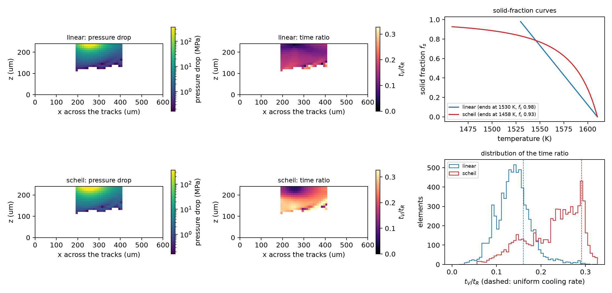

**Figure 12.** Cracking indicators in the section across the three tracks (region
between the outer track axes). Left: pressure drop over the mushy zone (logarithmic).
Middle: time ratio. Right: the two solid-fraction curves, and the distribution of the
time ratio with the value for a uniform cooling rate (dashed).

**Table 24.** Cracking indicators of the 7,381 elements of the region (all of them froze
by themselves). Median, with the 5th to 95th percentile in brackets.

| quantity | linear curve | Scheil curve with eutectic |
|---|---|---|
| end of the mushy zone | 1530 K, $f_s$ 0.98 | 1458 K, $f_s$ 0.93 |
| steepness index (K) | 162 | 2,798 |
| time between $f_s$ 0.40 and 0.90 (us) | 195 | 501 |
| time between $f_s$ 0.90 and 0.99 (us) | 26 | 117 |
| time ratio $t_V/t_R$ | 0.138 (0.077 to 0.204) | 0.245 (0.118 to 0.335) |
| the same for a uniform cooling rate | 0.160 | 0.291 |
| pressure drop by shrinkage (MPa) | 2.5 | 4.4 |
| pressure drop by deformation (MPa) | 0.05 | 0.55 |
| total pressure drop (MPa) | 2.5 (0.31 to 59) | 5.0 (0.61 to 116) |
| total, by depth below the surface: 0 to 40 / 40 to 80 / 80 to 140 um (MPa) | 13.7 / 2.5 / 0.6 | 26.8 / 4.8 / 1.2 |
| share of elements above the cavitation depression of 2 kPa | 1.00 | 1.00 |

Gradient and cooling rate at freezing: $2.6\times10^{6}$ K/m ($0.4$ to $11\times10^{6}$)
and $1.6\times10^{5}$ K/s ($0.9$ to $4.7\times10^{5}$); strain rate 2.5 /s.

- **The curve decides the level, the thermal field the pattern.** The Scheil curve
  gives a steepness index 17 times that of the linear curve, a time ratio 1.8 times and
  a pressure drop twice as large. Both curves give the same map: every indicator comes
  from the same $G$ and $\dot T$.
- **The pressure drop is largest in the material that freezes last.** It rises from
  0.6 MPa at the bottom of the pool to 14 MPa in the top 40 um (linear curve), because
  the gradient falls from $6.7\times10^{6}$ to $0.9\times10^{6}$ K/m and the drop goes
  with $1/G^2$ for the deformation part and $\dot T/G^2$ for the shrinkage part.
  Shrinkage is 50 times (linear) and 8 times (Scheil) the deformation part.
- **The time ratio points the other way**: it is smallest at the top (0.11 against 0.17
  at the bottom, linear curve), where the cooling slows down late in the passage. The
  two indicators do not rank the locations alike; they measure different things (time
  available against feeding resistance).
- **The cavitation threshold of castings carries no information here.** Every element
  exceeds 2 kPa by two to four orders of magnitude, by shrinkage alone, so the largest
  sustainable strain rate of the criterion is negative everywhere. With an arm spacing
  near 1 um the permeability of the mushy zone is $10^{4}$ times smaller than in the
  casting of the paper (100 um). The absolute value depends on the square of an assumed
  spacing; the report is a relative map, not a statement that the material cracks.
- **The thermal field behind it is the conduction pool of section 6.4**, which holds its
  heat too long: the three pools merge and the last material freezes 1.7 ms after the
  laser has left. Gradients and cooling rates of a pool with flow will differ.
- **Material that did not freeze by itself has no indicator.** A first pass with two
  layers on this block is void for this purpose: the change of layer sets the block to
  the plate temperature in one step while the pool of the first layer is still liquid,
  and the run ended with the second pool liquid. Only a thin shell had a record. The
  service now skips such a step and drops the passages it cuts short.
- **No measurement to compare with.** No open table of cracking against process
  parameters for alloy 718 was found (section 6.8). The indicators are verified against
  their definitions and one published curve, not validated on this alloy.
- **Not covered:** the strain rate from the stress stage, crack propagation, liquation
  and solid-state cracking.

### 6.11 Case K2 with melt-pool flow (reported separately from the conduction column)

The column of section 6.4 (600 x 600 um, 200 um of plate, four layers of 40 um, four
tracks per layer, 10 um elements, 30 order parameters) with the flow kernels of section
2.4 added (deck `decks/lpbf/in718/k2/k2_column_flow_h10.i`). The step is five times
smaller than without flow, with four flow sub-steps. The cut sides and the bottom are
walls for the velocity. Nothing was refitted.

**Table 25.** Four layers with and without flow, seed 1.

| quantity | conduction (section 6.4, corrected run) | with flow | measured |
|---|---|---|---|
| grains in the build | 391 | 450 | |
| median equivalent diameter (um) | 37.7 | 34.8 | 11.5 |
| share of the build within 15 deg of <100> / <110> / <111> along the build direction | 0.20 / 0.17 / 0.17 | 0.44 / 0.05 / 0.06 | 0.10 / 0.21 / 0.10 |
| nucleation events | 3,721 | 5,834 | |
| deepest melting below the last surface (um) | 250 | 260 | |
| largest number of liquid elements at one time | 17,006 | 29,865 | |
| largest pool extent in the layer plane (um) | 540 | 600 (the block) | |
| time above melting, last surface, median (ms) | 2.38 | 2.37 | 1.28 |
| cooling rate at freezing, last surface, median (K/s) | 64,000 | 41,000 | 189,000 |
| gradient at freezing, all molten elements, median (K/m) | $3.5\times10^{6}$ | $1.9\times10^{6}$ | |
| largest liquid speed in the stored frames (m/s) | | 2.95 | |
| unmelted deposited elements of the scanned patch | 0 of 30,976 | 0 of 30,976 | |
| wall time on the GPU host (s) | 5,331 | 47,322 | |

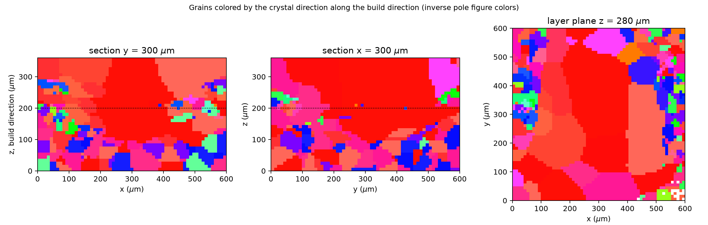

**Figure 13.** Grains of the column with flow, colored by the crystal direction along
the build direction. The dashed line is the top of the plate.

- **The flow column is not a better column; the block is too small for it.** With flow
  the pool spreads until it touches the walls of the block (600 um), holds nearly twice
  as many liquid elements as the conduction pool, and remelts the plate to 100 um
  below its top in the middle of the section (Figure 13). The whole block becomes one pool
  in every layer. Sides that should be surrounded by cold material are closed walls
  with a weak far-field exchange.
- **A few large grains with <100> along the build direction take the block** (share
  0.44 against 0.20 without flow and 0.10 measured). In a pool this large the front
  moves upward everywhere and the favored direction wins over many layers. This is a
  consequence of the block-sized pool and does not support a statement about the
  texture of the build.
- **Thermal history of the surface: no gain.** The time above melting is unchanged
  (2.37 ms against 1.28 ms measured), and the cooling rate at freezing is lower than
  without flow and further from the thermography value.
- **What the run does show:** the flow kernels, the free build surface under unbuilt
  layers (PINNACLE ADR 0054), the grain field and the nucleation work together over
  four layers and 45,200 steps; nothing stays unmelted; the largest liquid speed of a
  stored frame is 1.1 m/s in the median and 2.95 m/s at most.
- **Cost**: 13.1 h, nine times the conduction column. A block wide enough to keep the
  pool away from its sides (about 1.2 mm) has four times the elements: about two days
  on the host, or the decomposed run of section 8.2 on several cards once the grain
  field is supported there.
- **Animations** of both columns, 2-D sections and isometric 3-D view:
  `figures/lpbf/animations/k2_column_h10_r2_2d.gif`, `_3d.gif` and
  `k2_column_flow_h10_2d.gif`, `_3d.gif` (227 frames each, every tenth also as PNG).

## 7. 316L single track: process stress with crystal plasticity

The case of (grilli 2022 elimination) with the substitute inputs of section 3.2, on the
paper's coarse mesh (8 um, 25 x 20 x 14 elements, 56,000 quadrature points). The paper's
fine mesh (4 um) is shipped as a deck and was not run (section 8.3); the full run that
decision D8 prefers is therefore still owed.

**Thermal deck** (conduction, 5,334 explicit steps to 8 ms, 138 s): the melted zone is
112 um wide and 70 um deep over the whole length; the peak temperature is 6,389 K (not a
result, section 6.2); every point of the volume reaches at least 800 K; at 8 ms the volume
is back at 300 to 304 K. 178 temperature frames at 45 us are handed to the mechanics deck.

**Mechanics deck**, two stages as in the paper: (1) scan and cooling to 8.01 ms with no
normal displacement on the four sides and the bottom; (2) relaxation with the walls
$x = 200$ um and $y = 160$ um removed. 200 load steps of 45 us, 460 Newton iterations, no
cutback, no unconverged step, 5,540 s (the host was shared).

**Figure 8.** 316L track, 8 um mesh, after the relaxation stage. Left: $\sigma_{xx}$ and
von Mises stress in the section across the track at mid-length (line: boundary of the
melted zone). Top middle: $\sigma_{xx}$ in the top layer of elements. Bottom middle: mean
of $\sigma_{xx}$ and $\sigma_{yy}$ over every layer of elements against the height (the
quantity of the paper's Figure 15d). Right: mean stress of the volume and temperature
range in time; the walls are removed at 8.01 ms.

**Table 16.** Residual stress after relaxation against the published simulation. The
paper's values are read from its Figure 15 (color scales and curve) by eye.

| quantity | this work | (grilli 2022 elimination) |
|---|---|---|
| layer mean at the bottom, $\sigma_{xx}$ / $\sigma_{yy}$ (MPa) | $-461$ / $-516$ | about $-420$ / $-400$ |
| height where the layer mean changes sign (um) | 45 / 44 | about 30 / 22 |
| largest tensile layer mean (MPa), at height (um) | $+296$ at 73 / $+479$ at 66 | about $+130$ at 65 / $+95$ at 40 to 60 |
| layer mean at the top surface (MPa) | $+221$ / $-23$ | about 0 / 0 |
| mean over the top 50 um (MPa) | $+263$ / $+296$ | not printed (compared with experiments in its Figure 17) |
| range of the local $\sigma_{xx}$ (MPa) | $-1{,}338$ to $+2{,}570$ (element means) | about $-900$ to $+1{,}300$ (color scale) |
| $\sigma_{zz}$ at the top surface | mean of the volume 0.7 MPa | close to zero |
| equivalent plastic strain | mean 0.016, maximum 0.050 | components of $\mathbf F_p - \mathbf I$ up to about 0.02 to 0.03 (its Figures 12, 13) |

- **Pattern.** Tension in and around the melted zone, compression in the substrate
  below it, a stress-free top surface in $z$, grain-to-grain variation of several hundred
  MPa: the same pattern as the published result; the compression at the bottom is 10 to
  30 % larger.
- **Magnitude.** The tensile layer means are 2 to 5 times the published ones, the change
  of sign lies 15 to 22 um higher, and the top layers stay in tension along the scan
  direction where the paper returns to zero. The melted zone here (70 um deep, the whole
  length, from an assumed beam on a conduction model) is not the paper's pool, the whole
  volume was heated to 800 K or more, and the grains and orientations are substitutes;
  the comparison cannot separate these from the hardening substitute. It is a tier 3,
  qualitative comparison, as planned.
- **The relaxation stage is elastic here.** The 22 steps after the release converge in one
  iteration each and change neither the stress nor the plastic strain; its assumed length
  (0.99 ms) therefore has no influence. The top layer of Figure 8 is more tensile towards
  $x = 0$, the wall that stays fixed: only one wall of each pair is removed, as in the
  paper.
- **A first run of this case is superseded.** It ended at 8.01 ms with all walls fixed
  and gave a mean stress of about 1.8 GPa ($xx$) and 2.0 GPa ($yy$) (Figure 8, top right,
  before the release: 1,845 and 2,052 MPa in the run reported here). Those numbers are the reaction of
  the walls on a volume that was heated and cooled as a whole, not a residual stress. The
  relaxation stage of the paper had been left out of the deck; it needed a boundary
  condition that can be released during a run, which was added to PINNACLE
  (`release_time`, section 4.1). The level reached with fixed walls, about 2 GPa against a
  saturation slip resistance of 302 MPa, also shows the rate dependence of the paper's
  flow rule (reference rate $10^{-7}$ /s, exponent 0.1) at the strain rates of the
  process; this contribution was not quantified separately.

- **A second run is superseded as well: the hardening parameters.** The dislocation-density
  parameters of the deck are derived from the paper's law (section 3.2). The first
  derivation matched the saturation resistance but gave a hardening rate lower by the
  factor $S = 1 + 11q = 16.4$ ($k_1 = 4.0\times10^{-3}$ in place of 0.0652); the error
  was found when the same derivation was written out for alloy 718 (equation 18). The
  numbers of Table 16 are from the corrected deck. With the slower hardening the layer
  means were $-429$ / $-472$ MPa at the bottom and $+248$ / $+422$ MPa at most: the
  correction raises the stresses by 7 to 20 % and does not change the reading.

**Table 16a.** The same run on three grain realizations (844 Voronoi grains of 16 um,
uniform random orientations; seed 1 is Table 16). Standard deviation of three values.

| quantity (MPa) | seed 1 | seed 2 | seed 3 | mean $\pm$ sd |
|---|---|---|---|---|
| layer mean at the bottom, $\sigma_{xx}$ | $-461$ | $-481$ | $-468$ | $-470 \pm 10$ |
| layer mean at the bottom, $\sigma_{yy}$ | $-516$ | $-498$ | $-549$ | $-521 \pm 26$ |
| largest tensile layer mean, $\sigma_{xx}$ | $+296$ | $+321$ | $+318$ | $+311 \pm 14$ |
| largest tensile layer mean, $\sigma_{yy}$ | $+479$ | $+488$ | $+481$ | $+483 \pm 5$ |
| layer mean at the top surface, $\sigma_{xx}$ | $+221$ | $+193$ | $+197$ | $+203 \pm 15$ |
| layer mean at the top surface, $\sigma_{yy}$ | $-23$ | $-37$ | $-26$ | $-29 \pm 7$ |
| von Mises stress, mean of the volume | 756 | 764 | 763 | $761 \pm 4$ |
| largest element mean of $\sigma_{xx}$ | 2,570 | 2,450 | 2,628 | |
| wall time on 8 CPU threads (s) | 5,540 (16 threads, shared) | 6,869 | 6,891 | |

- **The layer means do not depend on the grain realization** beyond 5 % (26 MPa at
  most); the differences from the published values in Table 16 are 100 to 400 MPa. The
  grain realization is therefore not what separates this result from the paper's. The
  local extremes move by 100 to 200 MPa with the seed.

## 8. Cost, devices and the standalone decks

### 8.1 Cost of the runs of this report

**Table 17.** Wall times. GPU host: one AMD Radeon 8060S (ROCm 7.2), 16 cores, float64.
Every number is one run.

| run | size | steps | wall time |
|---|---|---|---|
| K1 single track, 10 um | 73,500 elements | 480 | 23 s on the GPU; 141 s on the workstation CPU |
| K1 surrogate: 30 training tracks; training | 3,427 parameters, ensemble of five | 3,000 + 50 epochs | about 12 min; 47 s (CPU) |
| K1 single track with flow, 10 um | 73,500 elements, 5 fields | 2,270 with 4 flow sub-steps | 510 s on the GPU |
| K1 single track, 5 um (case 0 only) | 588,000 elements | 1,920 | 706 s on the GPU: depth and width within 0.5 % of the 10 um run |
| K3 tensile cube, 6 x 6 x 6 | 216 elements, 1,728 quadrature points | 100 load steps | about 310 s on 4 CPU threads; the calibration (6 iterations of 4 runs) about 50 min |
| K3 cube of the simulated column, 12 x 12 x 12 | 1,728 elements | 100 load steps | 2,737 s on 6 CPU threads |
| K2 column, one layer, 10 um | 129,600 elements, 31 fields | 2,240 | 1,226 s on the GPU |
| K2 column, four layers, 10 um | the same | 9,040 | 4,821 s on the GPU (0.53 s per step) |
| 316L thermal, 8 um | 7,000 elements | 5,334 | 138 s on the workstation CPU |
| 316L mechanics, 8 um, two stages | 7,000 elements, 56,000 quadrature points | 200 load steps | 5,540 s on the CPU of the host while it was shared with other runs (27.7 s per step); 2,957 s (14.8 s per step) when alone |

For the 316L mechanics the paper reports 9.5 h on 12 CPUs at the same mesh with steps of
1 us (8,010 steps); the run here takes 45 us steps with an implicit slip update, so the
two times are not a comparison of codes.

### 8.2 Devices

`[Global] devices = 'cuda:0 cuda:1 ...'` (or `num_gpus = N`) splits the element loop of
the explicit executioner over several devices of one node: each device holds a contiguous
range of elements, evaluates the kernels of its range and returns nodal contributions,
which are summed on the first device (PINNACLE ADR 0050). The device names are those of
PyTorch; `cuda:N` addresses NVIDIA cards and, in a ROCm build, AMD cards, for which
`rocm:N` and `hip:N` are accepted as aliases. The pool is written against the tensor
namespace of the backend, so that another device type (Apple Metal) is a matter of the
name table.

Checked on the one GPU of the host: pools that name the GPU twice, and the GPU twice with
the CPU, reproduce the single-device field to $4\times10^{-15}$ (13.1 s single; 14.7 s
and 18.6 s pooled, the cost of the transfers). A speed-up needs a node with several GPUs
(measured below).

**Network training on the pool.** The forward pass of a network splits its batch of
points over the same pool (PINNACLE ADR 0051): every device receives a block of rows and a
copy of the parameters, and the outputs are joined on the first device. The copies and
the moves are part of the differentiation graph, so the derivatives a physics residual
needs and the gradients of the optimizer are those of the single-device pass, and no
executioner had to change. Checked: outputs, first and second input derivatives, parameter
gradients and ten optimizer steps equal to the single-device pass for the three network
classes; on the host GPU a network of four layers of 128 neurons with 200,000 points and
second derivatives gives the same loss to 16 digits with the GPU named twice and with
GPU + GPU + CPU (23.8 s, 24.1 s and 34.8 s for 20 steps: no speed-up on one physical
device). On six example decks trained with and without a two-slot pool, three agree to
$10^{-11}$ or better; the other three differ by as much as the same decks differ between
one and eight threads on one device (round-off amplified by the optimizer).

**Crystal plasticity on the pool.** The crystal-plasticity law is evaluated for all
quadrature points in one batched call; that call splits its points over the pool, with a
copy of the material on every device (PINNACLE ADR 0053). All evaluations of a mechanics
solve pass through it (stress, state update, the local iteration of the implicit slip
update, the tangent), so the executioners did not change. Checked: a polycrystal cube
pulled with the implicit and with the explicit state update gives the single-device
stress, displacement and plastic strain on two and three slots (identical on CPU slots;
a relative $2\times10^{-13}$ on the host with the GPU named twice and with GPU + CPU;
16.3 s single, 17.9 s and 26.1 s pooled). The split is not made inside a differentiation
graph (network training on the law, inverse calibration).

**What the pool covers and what it does not.** It covers every deck that runs on
`pf_fem_explicit` (the thermal, flow and grain stages of this report and the explicit
phase-field decks of the framework), the networks of every network executioner, and the
point evaluation of every crystal-plasticity solve with the batched law. It does not
cover the linear solves (sparse factorization on the host, the larger part of a mechanics
step on a fine mesh), the host-side part of the implicit slip update, the implicit block
executioner `pf_fem_transient`, and the J2 and `kalidindi` materials. **No speed-up has
been measured on the host**, which has one GPU, where a pool costs 5 to 60 % more than the
single device. The measurement on four separate GPUs follows; the network path was not
measured there.

**Measurement on four GPUs (cloud node, 2026-11-26).** One container with four NVIDIA
A10G cards (24 GB each) and 8 CPU cores, PyTorch 2.15 with CUDA, float64; script
`scripts/modal_multigpu.py`. The case is the single track with melt-pool flow of
section 6.5 on finer meshes, run for a fixed number of steps with `devices` naming the
first one, two or four cards.

**Table 17a.** Explicit executioner on one, two and four GPUs.

| case | 1 GPU | 2 GPUs | 4 GPUs |
|---|---|---|---|
| 5 um, 588,000 elements: wall time of 200 steps (s) | 306 | 358 | 279 |
| the same, 100 steps (s), two series | 169, 169 | 192, 191 | 149, 146 |
| per step, from the difference of 200 and 100 steps (s) | 1.37 | 1.66 | 1.30 |
| largest difference of the final temperature to one GPU (K) | | 0.0 | 0.0 |
| 3.5 um, 1,720,000 elements: per step in the solver, split part (s) | 2.1 | | 1.7 |

**Table 17b.** Where a run of 30 steps at 5 um spends its time (profile of the main
thread).

| part | 1 GPU | 4 GPUs |
|---|---|---|
| set-up on the host, once (element geometry, lumped operators) | 35 s | 35 s |
| element loop on the devices, per step | 0.71 s | 0.49 s |
| services and bookkeeping on the host, per step (the remainder of 1.37 s and 1.30 s) | about 0.7 s | about 0.8 s |

- **The pool is correct on separate cards.** The tensors of every slot are on its card,
  and one, two and four cards give the same field.
- **It is not useful for this solver at these sizes.** Four cards change the wall time
  by $-9$ to $-14$ %, two cards by $+13$ to $+17$ %. The part of a step that is split
  gains a factor 1.4 on four cards at 588,000 elements and 1.2 at 1.7 million: the gain
  does not grow with the size of the mesh.
- **Two causes were ruled out and one remains open.** A larger share of CPU for the
  container (8 cores in place of the default share) changed nothing. Assembling the
  nodal residual on each card and sending only nodal arrays, in place of element arrays
  assembled on the first card, changed nothing (PINNACLE working tree; kept, since it
  moves eight times less data). What limits the split part is not identified: the
  kernels are sequences of several hundred tensor operations issued from Python by one
  thread per card, and a plain loop of large operations on four cards from four threads
  reached a factor 2.6 over the same work done one card after another in the same
  container. A design with one process per card, or kernels compiled into fewer
  operations, is the candidate; neither is built.
- **About half of a step is serial work on the host** (copies of the fields for the
  services, a nodal volume recomputed in every step, the lumped update), which no
  number of cards shortens. The profile attributes 0.35 s per step of it to named
  functions; the rest was not resolved. At 100 steps the one-time set-up on the host (35 s) is also a fifth of the
  run; in a production run of several thousand steps it is negligible.
- **Mechanics.** The tensile cube of case K3 at 4,096 elements (32,768 points, three
  load steps) took 141, 143 and 142 s on one, two and four cards: no change. The
  sparse solve and the host-side part of the slip update are not on the pool.
- **Cost.** 4.66 US dollars metered for all runs of this measurement (seven runs,
  four cards at 1.10 dollars per card and hour plus CPU and memory), covered by
  account credits; nothing was billed.
- **What this means for a node with eight GPUs.** The device pool will not shorten the
  fine runs. One case per card (seeds, tracks, parameter sets side by side) works, and
  for the thermal and flow stages the decomposed runs described below divide one case
  over the cards.

**One process per card, each with its own part of the mesh (2026-11-26).** To find out
whether the limit is the hardware or the single Python process, the same case was run
as separate processes on the same four cards: the whole mesh on one card, a quarter of
the elements (the block cut along the scan direction) on one card alone, and four such
quarters at the same time, one process per card (`scripts/modal_multigpu.py::split`).
The four processes do not exchange anything, so the last row is the floor of a
domain-decomposed run, before the cost of exchanging the nodes shared by neighbours.
Two step counts (40 and 120) separate the set-up from the time per step.

**Table 17c.** Separate processes on four A10G cards, 5 um mesh.

| run | elements per process | wall time of 40 / 120 steps (s) | per step (s) |
|---|---|---|---|
| whole mesh, one process, one card | 588,000 | 107.3 / 207.7 | 1.255 |
| a quarter, one process, one card, alone | 147,000 | 27.2 / 51.7 | 0.306 |
| four quarters at the same time, one process per card (slowest) | 147,000 | 27.8 / 52.0 | 0.303 |

- **Four processes on four cards do not disturb each other**: the time per step of a
  quarter is the same alone and with three neighbours. All elements advance one step in
  0.30 s in place of 1.26 s, a factor 4.1, and the set-up shrinks by the same factor.
  The limit of the pool of Table 17a is therefore the single Python process (its
  threads and the serial work on the host), not the cards.
- **Consequence for the design.** A speed-up on several cards and a mesh larger than
  the memory of one card both need the same change: each process owns a part of the
  mesh with its ghost nodes on its own card, and neighbours exchange the shared nodal
  values every step. This is the design of the MPI codes built on Kokkos, where one
  rank drives one GPU (PINNACLE keeps PyTorch as the portability layer). It is not
  built; the present pool keeps the element arrays of the whole mesh on the first card
  and the services of a deck hold the whole mesh on the host.
- **Cost of this test.** 1.13 US dollars (account summary 4.28 before, 5.41 after),
  covered by credits.

**Decomposed runs: the design built and measured (2026-11-26).** PINNACLE now cuts the
mesh of a deck into parts and runs every part as an ordinary problem in its own process
on its own card; the processes exchange the nodal sums at the cuts (PINNACLE ADR 0057;
`[Global] rank_devices = 'cuda:0 cuda:1 ...'`). The exchange layer is a separate
package in the PINNACLE repository, `gpumpi`, that depends on NumPy only and imports
nothing from PINNACLE: ranks with one device each, a communicator close to that of
`mpi4py`, mesh partitioning, and the sum of nodal values across cuts for NumPy,
PyTorch, CuPy and JAX arrays. Kernels, materials and boundary conditions are
unchanged; the explicit executioner and the process state call one hook after each
assembly.

**Table 17d.** The track with flow at 5 um (588,000 elements) on one node with four
NVIDIA A100 cards (40 GB, 8 CPU cores, float64; A10G and L4 nodes with four cards were
not available that afternoon). Slabs along the scan direction. Time per step from runs
of 20 and 60 steps (`scripts/modal_multigpu.py::cut`).

| run | elements per process | per step (s) | factor | device memory per process (GB) | whole process, 60 steps (s) | host memory, all processes (GB) |
|---|---|---|---|---|---|---|
| one process, one card | 588,000 | 0.730 | 1 | not recorded | 97 | 7 |
| 2 ranks, 2 cards | 294,000 | 0.380 | 1.92 | 2.9 | 56 | 11 |
| 4 ranks, 4 cards | 147,000 | 0.205 | 3.56 | 1.45 | 36 | 17 |

- **Both goals are met for the explicit solver.** Four cards advance the mesh 3.56
  times faster than one, and each card holds a quarter of the data (1.45 GB against
  2.9 GB with two ranks): the mesh that fits grows with the number of cards.
- **The result is the single-card result**: temperature identical, velocity within
  $1.5\times10^{-16}$ m/s of 0.65 m/s, pressure within $10^{-19}$ Pa (fields as stored,
  float32). On the workstation, in float64: relative differences of $3\times10^{-16}$
  to $10^{-14}$ for the conduction track, the track with flow and the heat of a layered
  build, on two to four parts.
- **The exchange is small.** A part with two neighbours shares 8,662 of its 155,916
  nodes; it sends 130 kB per exchange, nine exchanges per step. Of the ideal factor 4
  (Table 17c: 4.1 without any exchange), 3.56 remain.
- **The fixed cost shrinks less.** Building the operators takes 46 s for the whole
  mesh on one card and 13 s per rank on four, but starting the processes and loading
  PyTorch costs about 10 s whatever the number of ranks, so the whole process of 60
  steps gains a factor 2.7. A production run of thousands of steps sees the per-step
  factor.
- **Scope of this measurement.** Heat with melting and melt-pool flow. The grain
  field, the reports of the services and the stress stage were added afterwards
  (below); they are verified against the single run on the workstation, not yet
  measured on several cards.
- **Not tested**: the MPI transport of `gpumpi` (several nodes) and its CuPy and JAX
  array paths: none is installed on the machines of this study. More than four cards
  and a mesh beyond the memory of one card were not run.
- **Two failures on the way, both mine, neither in the solver.** A first cloud run
  was killed for memory and restarted by the platform, and the GPU host of this study
  stopped answering for 45 minutes after a check there. The cause was the comparison
  of the fields, not their computation: the single run stores a scalar field as a flat
  array, the decomposed run stored it with one column, and their difference broadcast
  to nodes times nodes. The decomposed run now returns the shapes of the single run,
  its tests compare shapes, and the cloud runs are wrapped in
  `scripts/memory_guard.py` with restarts switched off.
**The whole chain on parts (2026-11-26, later).** Three additions make every stage of
the chain run on a cut mesh (PINNACLE ADR 0057, addendum).

- **Grain field and nucleation.** The random draws of the nucleation service (site,
  critical undercooling, order parameter) are made for the nodes of the whole mesh, and
  a part takes the rows of its nodes; a site fires in the part that owns its node and
  all parts apply the seed. The random plate grains are placed in the box of the whole
  mesh. Two layers with grains and nucleation on three parts: difference to the single
  run $2\times10^{-14}$, the same 35 nucleation events.
- **Reports and files.** The process state, the defect indicators and the cracking
  indicators gather their element records on the first process at the end of a run
  and write the record, the temperature series and the reports of a single run; the
  pool numbers of every step are those of the whole mesh. Checked file by file on three
  parts.
- **Stress stage.** The linear system of a Newton step is no longer factorized as a
  whole. It is solved by GMRES over the parts, with an exact solve inside each part and
  the diagonal on the cuts as preconditioner. The solvers are part of `gpumpi` (also
  conjugate gradients and BiCGStab) and work for any code that can apply its local
  operator; no PETSc and no MPI is needed. A slip update that gives up at one point
  makes all parts cut the step back together.

**Table 17e.** The stress stage on parts against the single run (workstation, CPU).

| case | parts | difference to the single run (displacement / stress, relative) | Newton iterations and cut-backs | wall time, single / parts (s) |
|---|---|---|---|---|
| stress after the track (240 elements, line search, 4 cut-backs, 12 increments) | 2 | $2\times10^{-10}$ / $6\times10^{-9}$ | the same | 214 / 158 |
| polycrystal tensile cube (216 elements, implicit slip update, 19 cut-backs, 55 increments) | 3 | $2\times10^{-13}$ / $10^{-12}$ | the same | 134 / 126 |
| the same cube at 4,096 elements, 2 load steps | 4 processes | $10^{-11}$ / $2\times10^{-11}$ | the same | 72 / 32 |

- The differences are at the tolerance of the linear solve ($10^{-8}$ on the residual).
- At 4,096 elements a linear solve takes 97 GMRES iterations on average. The single
  run used 4 threads and the four processes 4 threads each, so the wall times show that
  the iterative solve is not slower; they are not a scaling measurement.
- **Iteration counts grow with the mesh and with the number of parts** (elastic block,
  conjugate gradients to $10^{-10}$: 58 to 103 iterations at 4,131 unknowns and 85 to
  153 at 28,611, for 2 to 8 parts; 161 and 323 with the plain diagonal). For meshes of
  millions of unknowns a coarse-space correction will be needed; it is not built.
- **Not measured:** the grain field and the stress stage on several GPUs.
- **One change of behaviour:** the order parameter of a nucleus is now drawn with its
  site, not at firing time. A given seed gives another realization of the nuclei than
  the runs of section 6.4 (same statistics); those runs were not repeated.

- **Cost.** 10.2 US dollars for this measurement (account summary 5.41 before, 15.63
  after), of which about 6.8 for the failed run and its restart on the dearer A100
  cards; 55 minutes of waiting for A10G and L4 nodes cost nothing. **Total of the
  cloud measurements: 15.63 of the 30 dollars allowed**, covered by credits.

### 8.3 Standalone decks

The decks below carry their mesh (generated by `box_mesh` from the deck), their material
tables, their scan path and their numerical parameters; they need PINNACLE at the
revision of the ledger and, for the 316L mechanics, the shipped orientation file. Their
headers state size, memory and step count. **None of them has been run for this report**;
each has a checked coarse configuration of the same blocks.

**Table 18.** Standalone decks.

| deck | mesh | elements | steps | memory (estimate) | checked configuration |
|---|---|---|---|---|---|
| `decks/lpbf/in718/k1/k1_study_h5.i` (seven tracks) | 5 um | 588,000 | 1,920 per track | about 1 GB (scaled, not measured) | `k1_study_h10.i` |
| `decks/lpbf/in718/k2/k2_column_full_h5.i` (17 layers, 650 x 650 um) | 5 um | 2.97 million | about 162,000 | 80 GB, float64 | `k2_column_h10.i` |
| `decks/lpbf/in718/k2/k2_column_full_h2p5.i` (the same column) | 2.5 um | 23.8 million | about 648,000 | 321 GB, float32 | `k2_column_h10.i` |
| `decks/lpbf/ss316l/track_thermal_h4.i`, `track_mechanics_h4.i` | 4 um (the paper's fine mesh) | 54,000 | 200 load steps (8,010 at the paper's 1 us) | CPU | the `_h8` decks |

- The memory figures follow from 27 kB per element in float64 at 30 order parameters and
  eight Gauss points, measured on the 10 um run; the step counts follow from the
  stability limit. At the 0.53 s per step of the host, scaled by the element count, the
  5 um column is about 23 days on one such GPU; it is a deck for a multi-GPU node.
- The 2.5 um column does not fit one 64 GB device in either precision and needs `devices`.
  Float32 has not been checked on this case.
- The column decks contain no flow: decision D3 asks for a standalone deck of the
  conduction case and of the flow case; the flow case has no deck because the flow stage
  is not implemented (section 9).
- A deck of the full leg cross-section (2.5 mm) is not shipped: at 5 um it is 44 million
  elements for the same height.

## 9. Limits and what remains

**Limits of the model.**

- *Flat surface.* Without flow the pool is a conduction pool; with the flow of section 2.4
  the surface is still flat. Widths are within about 10 %; the depth of the keyhole
  tracks is 19 to 44 % too small with or without flow, and it does not follow the spot
  size. Temperatures inside the pool are above boiling and are not results. The flow is
  first-order accurate in the advection (upwind), its surface forces are spread over one
  element, and it is weakly compressible (Mach number 0.13 at the largest speed).
- *Explicit latent heat through the apparent capacity* (equation 12); the implicit path
  conserves the enthalpy exactly and is the reference for small cases.
- *Grain model without solute and without tip kinetics.* The front follows the isotherm
  or lags it by the pulled-front speed; the balance between epitaxial and nucleated
  grains is set by the regrowth rate, the site density and the undercooling
  distribution, which are assumed here. Several grains share one order parameter and
  merge when they touch.
- *Nuclei at the surface.* In the column runs of this report a nucleus that fires at the
  build surface also marks grain-free nodes within its radius (15 um) above the surface,
  in powder or empty space; such fragments are remelted when the next layer covers them
  and remain at the last surface. Found after the runs (by the test of a PINNACLE example);
  PINNACLE now restricts a seed to consolidated material when the nucleation block names
  the process state, and the standalone column decks do. The 10 um runs were not repeated.
- *Mesh.* At 10 um a grain boundary is 40 um wide; the measured median grain is 11.5 um.
  The column result is a statement about mechanisms and cost, not about grain size.
- *Dwell between layers* is replaced by a reset of the block to the plate temperature.
- *Mechanics.* One stiffness factor for the three elastic constants; isotropic expansion;
  element-mean temperature; the hardening law of the 316L paper is replaced by the
  dislocation-density law with derived parameters, because PINNACLE's material of the
  paper's form has no batched field evaluation; load steps of 45 us against the paper's
  1 us.
- *Orientations* never change after solidification (plan, section 1); measured grains
  carry orientation gradients (polonsky 2020 gradients).

**Assumed inputs** (Table 3 and notebook, sections 7 and 12): evaporation constants,
emissivity, film coefficients, plate temperatures, powder conductivity; the temperature
coefficient of the surface tension, the expansion coefficient of the liquid, the drag
constant and the recoil coefficient; for 316L the beam and every thermal property. None
of them has been varied: by decision of the author the study of the process inputs is a
separate, later study.

**Not done in this part.**

| item | state |
|---|---|
| deforming free surface (keyhole), powder particles | not planned in this part (decision D2) |
| build column with flow | run (section 6.11): the pool with flow fills the 600 um block, so the result is not representative; a block of about 1.2 mm is needed |
| decomposed runs for the grain field, the services and the stress stage | built and verified against the single run on the workstation (section 8.2, Table 17e); not yet measured on several GPUs; a coarse space for the linear solve of large stress runs is open |
| cracking indicators with the strain rate of the stress stage, and a validation set | not done (section 6.10) |
| refit of the heat source with flow | not done (section 6.5: the two fit cases move in opposite directions) |
| network routes (plan stage F) beyond the single-track surrogate of section 6.3: a network for the thermal field itself (PINN, PINN with FE correction), network routes on the grain and mechanics stages | not implemented |
| case K3 on a cube of the measured 3-D EBSD structure | one cube run (Table 15a): 7.5 % too soft at yield; the calibration itself was not repeated on the measured structure |
| case K4, process stress of the alloy 718 column | run on a mesh of one element per layer (section 6.9); the 20 um deck is shipped and was not finished |
| thermography comparison (time above melting, cooling rate) | compared with a summary reduced by the author's toolkit (Table 10); the NIST maps were not re-reduced, and the solid cooling rate is not evaluated with NIST's definition |
| fine-mesh runs (K1 at 5 um beyond one case, the full column, 316L at 4 um) | decks shipped, not run (section 8.3; decision of the author) |
| multi-device linear solves, `pf_fem_transient`, J2 and `kalidindi` materials | not implemented (section 8.2) |
| scaling on several GPUs | not measured (one GPU on the host) |
| process-parameter study, sensitivity of the assumed inputs | later study (decision of the author) |
| end-to-end example decks of the chain shipped with PINNACLE | shipped: `examples/applications/lpbf_process_chain/` (a track with flow, two layers with grains, cooling and stress; four small decks and a README), not benchmark cases |
| in PINNACLE: graded `box_mesh`, parity-harness cases for the new decks, batched path of the `kalidindi` material, the 0-D inverse calibration route on a polycrystal | open |

## References

Process physics and reviews: khairallah-2016-meltflow; rosenthal-1946-moving;
voller-1987-mushy. Flow: chorin-1967-compressibility; ghia-1982-cavity;
devahldavis-1983-natural; amin-2024-heatsource; nishi-2024-density. Process chains with phase field: yang-2021-grain; chadwick-2021-grain;
liu-2018-sitespecific; liu-2020-integration; grilli-2022-elimination; hu-2022-residual;
hu-2025-process; sun-2026-coupled; chen-2019-microscale. Chains with cellular automata and
Monte Carlo: gandin-1994-cellular; rolchigo-2022-exaca; rolchigo-2022-uncertainty;
rolchigo-2025-credibility; briffod-2025-mapping; rodgers-2017-montecarlo;
elahi-2023-competition. Network and GPU methods: zhu-2021-meltpool; liao-2023-hybrid;
hosseini-2023-singletrack; xue-2022-graph; xue-2023-jaxfem; dugast-2021-partscale. NIST
AM Bench papers: weaver-2024-meltpool; levine-2024-microstructure; levine-2024-outcomes;
phan-2025-residual. NIST data records: weaver-2022-trackdata; lane-2022-builddata;
lane-2023-thermographydata; levine-2022-microstructuredata; levine-2022-residualdata;
schwalbach-2024-sectioningdata; benzing-2025-tensiledata. Alloy 718 properties:
agazhanov-2019-thermophysical; hosaeus-2001-liquid. All keys are in `bib/references.bib`;
`bib/citation_keys.md` states for each whether the full text, the abstract or only the
metadata was read.
