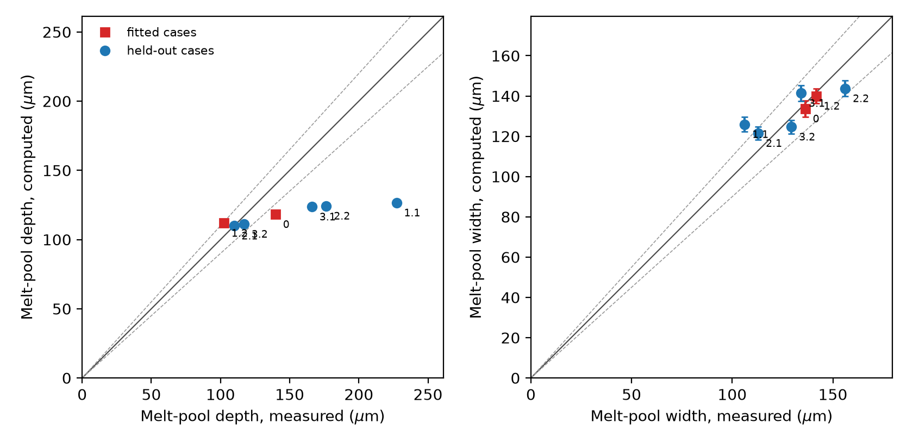
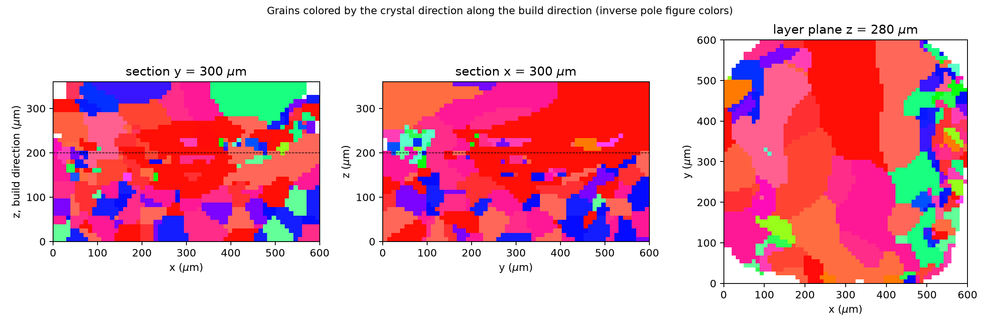
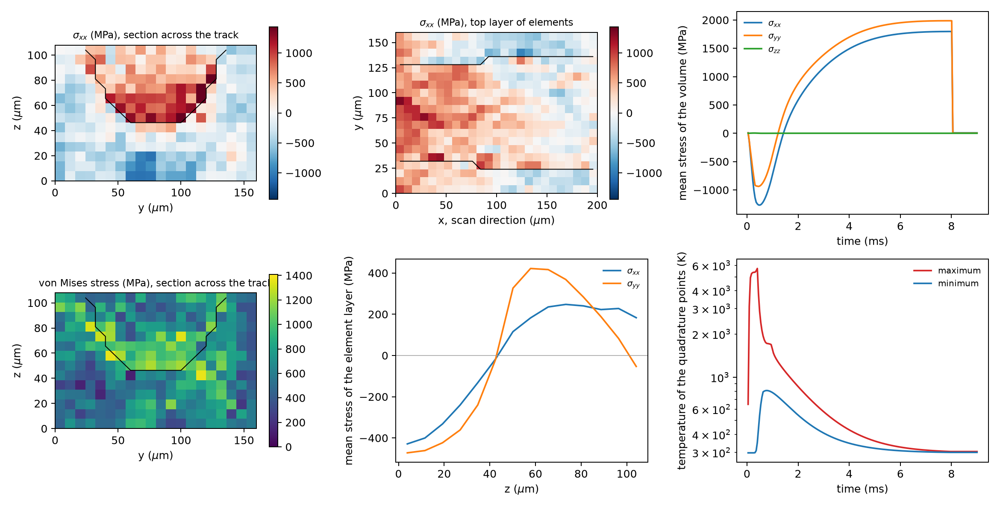

# Laser powder bed fusion process modeling with PINNACLE: heat transfer, grain structure and process stress, benchmarked on NIST AM Bench alloy 718 and on a published 316L case (Part V)

Status 2026-11-25. This report covers the conduction-driven process chain at the coarse
resolution a single workstation GPU can run (the capability check), and ships the decks of
the full-resolution cases. What is not done is listed in section 9: melt-pool flow, the
network routes other than the single-track surrogate, the tensile case and the fine-mesh
runs. Plan:
`docs/15_lpbf_process_modeling_plan.md`; notebook with provenance tables:
`docs/16_lpbf_notebook.md`; reproduction: `docs/reproduce_lpbf.md`; every run:
`docs/run_ledger.md`. PINNACLE revision: branch `feat/multi-gpu-and-am-process`, commits
355b8d6 to 4827247 (local).

## Abstract

Laser powder bed fusion sets the grain structure and the residual stress of a part
through a chain of heat transfer, solidification and thermally driven plasticity. This
report adds that chain to the PINNACLE framework as registered components that are
composed in input decks, and checks it at the resolution of one workstation GPU against
the NIST AM Bench 2022 measurements on alloy 718 and against a published crystal-plasticity
simulation of a 316L track. The model is an enthalpy heat equation with latent heat, a
moving volumetric beam and surface losses; a multi-order-parameter grain model with
melting, epitaxial regrowth and nucleation, advanced together with the temperature; and
finite-strain crystal plasticity loaded by the stored temperature history. Melt-pool flow
is not included. The components reproduce closed-form solutions (Stefan front within
0.9 %, a constrained heated crystal within 0.02 %). For seven bare-plate tracks, with the
two heat-source parameters fitted on two of them, the melt-pool width is within 8 % for
six tracks and the depth is 15 to 44 % too small for the four deepest (keyhole) tracks;
a conduction model does not carry the measured dependence of depth on spot size. A
parametric network surrogate trained on 30 finite-element tracks reproduces the
finite-element depth and width of the seven cases within 1 % and inherits its error
against the measurements. A four-layer build column of 129,600 elements runs in 80 min;
at its 10 um mesh the median grain diameter (37 um) is three times the measured one
(11.5 um) and the time above melting is 1.9 times the measured one, so grain size and
texture are not results of the coarse check. For the 316L track, after the relaxation
stage of the published procedure, the stress pattern and the compression below the track
($-430$ to $-470$ MPa against about $-400$) agree with the published simulation, and the
tension in the track is 2 to 4 times higher under substitute thermal and grain inputs. The
explicit executioner can split its element loop over several GPUs (NVIDIA CUDA and AMD
ROCm); the result is identical to one device, and no speed-up could be measured on the
one-GPU host. Decks of the full-resolution cases (up to 23.8 million elements) are shipped
and have not been run.

## 1. Introduction

Laser powder bed fusion (LPBF) builds a metal part by melting thin powder layers with a
scanning laser. The properties of the part are set by a chain of events at very different
scales: the laser melts a pool some hundred micrometers wide that moves at about a meter
per second (khairallah 2016 meltflow); the pool freezes within a millisecond into grains
whose size, shape and orientation depend on the temperature gradient and the front speed;
and the steep thermal cycles leave stresses of the order of the yield stress between and
inside those grains (chen 2019 microscale). Process models follow the same chain: a
thermal or thermal-fluid simulation, a grain-structure simulation driven by its
temperature field, and a mechanics simulation on the resulting grains.

Three families of published chains exist. The first resolves the pool with a
powder-scale thermal-fluid model and grows the grains with a phase field
(yang 2021 grain; chadwick 2021 grain) or from a finite-element temperature field
(liu 2018 sitespecific), then runs crystal plasticity for the stress left by the process
(grilli 2022 elimination; hu 2022 residual) or for the properties of the built material
(liu 2020 integration). The second uses a heat-conduction or thermal-fluid model with a
cellular automaton for the grains (gandin 1994 cellular; rolchigo 2022 exaca) and crystal
plasticity for properties, at exascale in (rolchigo 2025 credibility) and across process
maps in (briffod 2025 mapping). The third replaces a stage by a network: physics-informed
networks for the temperature and flow of a pool (zhu 2021 meltpool; liao 2023 hybrid;
hosseini 2023 singletrack) and a graph network for the phase-field grain model
(xue 2022 graph). A recent model couples phase field and crystal plasticity in both
directions (sun 2026 coupled). Kinetic Monte Carlo (rodgers 2017 montecarlo) and the
comparison of phase-field and cellular-automaton grain competition
(elahi 2023 competition) complete the picture, and GPU finite elements have reached the
thermal problem at part scale (dugast 2021 partscale; xue 2023 jaxfem).

Two difficulties are common to these chains. The stages are separate codes that exchange
files, so a change of mesh or of physics in one stage is a change of interface in the
next. And the validation data are rarely public in full: the chain of (hu 2022 residual)
is anchored by melt-pool sizes, grain statistics and in-situ lattice strains, but its
thermal-fluid field and its measured orientations are not available to a reader. The NIST
AM Bench series closes the second gap for alloy 718: commanded scan paths, single-track
melt pools (weaver 2024 meltpool), in-situ thermography, large-area and
three-dimensional EBSD (levine 2024 microstructure), residual strains
(phan 2025 residual) and tensile tests of the same builds are open
(levine 2024 outcomes).

This part of the study adds the process chain to PINNACLE, a framework in which a
simulation is composed from registered kernels, materials, services and executioners in
one input deck, with finite-element and network solution routes and NumPy or PyTorch
(CPU, NVIDIA CUDA, AMD ROCm) back ends. The questions are: can the chain be composed from
general components with no process-specific solver; what does each stage reproduce of
the open NIST measurements when it is run at the resolution of one workstation GPU; and
what must a user run on larger hardware to reach the measured grain scale. Section 2
gives the governing equations, section 3 the data, section 4 the method and section 5 the
workflow. Section 6 reports the verification against exact solutions and the results on
alloy 718, section 7 the 316L case of (grilli 2022 elimination), section 8 the cost and
the multi-device path, and section 9 the limits and the work that remains.

## 2. Physics

### 2.1 Heat transfer with melting

The temperature $T(\mathbf x, t)$ obeys the enthalpy form of the heat equation,

$$\frac{\partial H}{\partial t} = \nabla\cdot\bigl(k\,\nabla T\bigr) + Q_b - Q_l,
\qquad H(T) = \int_{T_0}^{T} \rho c_p(\theta)\,d\theta + \rho L\,f_l(T), \tag{1}$$

with the volumetric enthalpy $H$, the volumetric heat capacity $\rho c_p$, the latent heat
of fusion per volume $\rho L$ and the liquid fraction

$$f_l(T) = s^2(3 - 2s), \qquad s = \min\!\Bigl(\max\!\Bigl(\frac{T - T_s}{T_l - T_s}, 0\Bigr), 1\Bigr), \tag{2}$$

between the solidus $T_s$ and the liquidus $T_l$. The latent heat is part of the enthalpy.
The apparent capacity is $C(T) = dH/dT = \rho c_p + \rho L\,df_l/dT$. The conductivity
depends on the temperature and on the state $\chi$ of the material point:

$$k = \begin{cases} k_g & \chi = 0 \text{ (no material)}\\
(1 - f_l)\,k_p + f_l\,k_L(T) & \chi = 1 \text{ (powder, never molten)}\\
(1 - f_l)\,k_S(T) + f_l\,k_L(T) & \chi = 2 \text{ (consolidated)} \end{cases} \tag{3}$$

A point becomes material when the build surface $z_s(t)$ passes it, and consolidated once
it has been molten; both are irreversible.

The laser is a Gaussian beam of power $P$ and $1/e^2$ radius $r_b$ whose absorbed
fraction $\eta$ is deposited below the surface with a decay length $\delta$:

$$Q_b = \frac{2\,\eta P}{\pi r_b^2\,\delta}\,
\exp\!\Bigl(-\frac{2 d^2}{r_b^2}\Bigr)\exp\!\Bigl(-\frac{z_s - z}{\delta}\Bigr),
\qquad z \le z_s, \tag{4}$$

with $d$ the distance from the beam axis in the layer plane. Its volume integral is
$\eta P$. Convection, radiation and evaporation at the surface are applied over a band of
thickness $b$ below it, because the surface moves through the mesh as layers are added:

$$Q_l = \frac{1}{b}\Bigl[h_c (T - T_\infty) + \epsilon\sigma_{SB}(T^4 - T_\infty^4)
+ (1 - \beta_r)\,L_v\,p_s(T)\sqrt{\frac{M}{2\pi R T}}\Bigr],\qquad
p_s = p_0 \exp\!\Bigl[\frac{L_v M}{R}\Bigl(\frac{1}{T_b} - \frac{1}{T}\Bigr)\Bigr]. \tag{5}$$

The last term is the Hertz-Knudsen evaporative loss with the Clausius-Clapeyron vapor
pressure (khairallah 2016 meltflow). On faces where the modeled block is cut out of a
larger part, heat leaves through a film condition $q = h_f (T - T_\infty)$ with
$h_f \approx k/L$.

No melt-pool flow is solved in this report: the liquid conducts with $k_L$, and the pool
surface stays flat.

### 2.2 Grain structure

The grains are $n$ non-conserved order parameters $\eta_i(\mathbf x, t)$, each standing
for one crystal orientation; $\eta_i = 1$ inside a grain of orientation $i$, and all are
zero in liquid, loose powder and empty space. They are advanced with the temperature:

$$\frac{\partial\eta_i}{\partial t} =
-L(T)\Bigl[m\Bigl(\eta_i^3 - \eta_i + 2\gamma\,\eta_i\sum_{j\ne i}\eta_j^2\Bigr)
- \kappa\nabla^2\eta_i\Bigr] - P\,g(T)\,\eta_i
+ D\,[1 - g(T)]\,c\,s_i\,\Bigl(1 - \sum_j\eta_j^2\Bigr)_{\!+}\eta_i . \tag{6}$$

The bracket is the multi-order-parameter grain-growth model with $m = 6\sigma/w$,
$\kappa = \tfrac34\sigma w$, $\gamma = 3/2$ for a boundary of energy $\sigma$ and width
$w$, and the Arrhenius mobility $L(T) = L_0\exp[-Q/(R\min(T, T_l))]$. The melt switch
$g(T)$ rises smoothly from 0 at $T_l - \Delta$ to 1 at $T_l$: the term $-P g\,\eta_i$
erases the grains in the liquid. The last term is epitaxial regrowth: grains at the pool
boundary grow into material that has cooled below the liquidus and holds no grain;
$c = 1$ in consolidated material and 0 elsewhere, so that empty space and powder stay
grain free. The selection factor of a cubic crystal,

$$s_i = \max\Bigl(s_{min},\ \max_k \bigl|\mathbf a^{(i)}_k\cdot\hat{\mathbf g}\bigr|^{\,p}\Bigr),
\qquad \hat{\mathbf g} = \frac{\nabla T}{|\nabla T|}, \tag{7}$$

with $\mathbf a^{(i)}_k$ the cube axes of orientation $i$, lets a grain with a cube axis
along the temperature gradient advance fastest (competitive growth); $p = 0$ removes the
selection. The regrowth front is a pulled front of speed $2\sqrt{D L\kappa}$: where that
exceeds the speed of the liquidus isotherm, the front follows the isotherm; where it does
not, undercooled grain-free liquid is left behind and can nucleate.

Nucleation follows the continuous law used in cellular-automaton models
(gandin 1994 cellular): sites of density $n_s$ carry critical undercoolings drawn from a
normal distribution $N(\Delta T_n, \Delta T_\sigma)$. A site that has been molten fires
when $T < T_l - \Delta T_c$ and it is still grain free; the new grain takes an
orientation drawn at random. Orientations of substrate grains and nuclei are uniform
random rotations; a grain keeps its orientation after solidification (plan, section 1).

### 2.3 Mechanics under a temperature history

The deformation gradient is split multiplicatively,

$$\mathbf F = \mathbf F^e\,\mathbf F^p\,\mathbf F^\theta\,\mathbf F^a, \qquad
\mathbf F^\theta = \lambda\,\mathbf I, \quad
\lambda = 1 + \bigl(\alpha + \tfrac12\alpha'\Delta T\bigr)\Delta T, \quad \Delta T = T - T_{ref}, \tag{8}$$

into elastic, plastic, thermal and activation parts. The crystal law is evaluated at
$\mathbf F\,\mathbf G$ with $\mathbf G = (\mathbf F^a)^{-1}/\lambda$; the second
Piola-Kirchhoff stress is $\mathbf S = e(T)\,\mathbb C : \mathbf E^e$ with
$\mathbf E^e = \tfrac12(\mathbf F^{eT}\mathbf F^e - \mathbf I)$, the Cauchy stress
$\boldsymbol\sigma = \mathbf F^e\mathbf S\mathbf F^{eT}/\det\mathbf F^e$, and the
equilibrium $\nabla_0\cdot\mathbf P = \mathbf 0$ is solved for the first
Piola-Kirchhoff stress $\mathbf P = J\boldsymbol\sigma\mathbf F^{-T}$ of the total
deformation. Plastic flow is crystallographic slip,

$$\mathbf L^p = \sum_\alpha \dot\gamma^\alpha\,\mathbf s^\alpha\otimes\mathbf m^\alpha, \qquad
\dot\gamma^\alpha = \dot\gamma_0\,\Bigl|\frac{\tau^\alpha}{f(T)\,\tau_c^\alpha}\Bigr|^{1/m}
\operatorname{sign}\tau^\alpha, \tag{9}$$

on the twelve $\{111\}\langle110\rangle$ systems, with the resolved shear stress
$\tau^\alpha$ and the dislocation-density resistance and evolution of PINNACLE,

$$\tau_c^\alpha = \tau_{c0} + \alpha_0\mu b\sqrt{\sum_\beta q_{\alpha\beta}\rho^\beta},\qquad
\dot\rho^\alpha = \frac{1}{b}\bigl(k_1\sqrt{\rho^\alpha} - k_2\rho^\alpha\bigr)|\dot\gamma^\alpha|. \tag{10}$$

Temperature enters through the thermal stretch $\lambda$, the factor on the slip
resistance (grilli 2022 elimination)

$$f(T) = k_A + k_B\exp[-k_C(T - T_{ref})], \tag{11}$$

and the stiffness factor $e(T) = \max(1 + c_E(T - T_{ref}), e_{min})$. For the power-law
flow rule the resistance factor is equivalent to the slip-rate multiplier $f^{-1/m}$.

A point at or above the melting temperature is molten: its stress is multiplied by a
residual factor $q_r$; at the end of every load step its plastic state is reset and its
activation deformation is set to the current one, $\mathbf F^a = \mathbf F/\lambda$, so
that it carries no strain. When it cools below the melting temperature the last
$\mathbf F^a$ stays, and the point solidifies free of stress in the shape it has. This is
the material-point form of the element elimination and reactivation of
(grilli 2022 elimination); no element leaves the mesh.

## 3. Data

### 3.1 NIST AM Bench alloy 718 (primary benchmark)

All measurements are NIST's, read from the public records (local copy
`/mnt/extended/projects/ambench-data`; the records are cited, not redistributed).

**Table 1.** Records used. "Checked" means read from the NIST file for this report.

| link of the chain | record | content | used here |
|---|---|---|---|
| melt pool | (weaver 2022 trackdata), (weaver 2024 meltpool) | cross-section depth and width of bare-plate tracks, seven cases, three tracks and two sections each | targets of case K1; checked |
| process input | (lane 2022 builddata) | commanded scan path, plate thermocouples, powder | build parameters of case K2 (from the challenge description, see below) |
| thermal history | (lane 2023 thermographydata) | time above melting, solid cooling rate per layer | compared in case K2 (summary of the author's toolkit, not re-derived) |
| grain structure | (schwalbach 2024 sectioningdata), (levine 2022 microstructuredata), (levine 2024 microstructure) | 3-D EBSD of a 2.5 mm leg, 1 x 1 x 2.12 um voxels; large-area maps | reference numbers of case K2 (from an earlier analysis of the record, not re-derived) |
| tensile property | (benzing 2025 tensiledata) | eight specimens of the 2.5 mm legs | target of case K3 (not run); checked |
| residual strain | (levine 2022 residualdata), (phan 2025 residual) | part-scale diffraction strains, contour stress, deflection | not a target of a 0.6 mm block |

**Table 2.** Single-track targets of case K1, derived from the NIST workbook by
`scripts/lpbf_k1.py targets` (mean and sample standard deviation of six sections).

| case | power (W) | speed (mm/s) | beam D4$\sigma$ (um) | depth (um) | width (um) |
|---|---|---|---|---|---|
| 0 | 285 | 960 | 67 | 139.7 $\pm$ 1.9 | 136.3 $\pm$ 2.9 |
| 1.1 | 285 | 960 | 49 | 227.2 $\pm$ 3.2 | 106.2 $\pm$ 3.6 |
| 1.2 | 285 | 960 | 82 | 102.4 $\pm$ 1.1 | 141.7 $\pm$ 1.8 |
| 2.1 | 285 | 1200 | 67 | 109.7 $\pm$ 1.7 | 112.9 $\pm$ 1.7 |
| 2.2 | 285 | 800 | 67 | 176.5 $\pm$ 2.6 | 156.1 $\pm$ 4.9 |
| 3.1 | 325 | 960 | 67 | 166.1 $\pm$ 2.0 | 134.3 $\pm$ 2.5 |
| 3.2 | 245 | 960 | 67 | 116.9 $\pm$ 1.2 | 129.4 $\pm$ 1.6 |

Build parameters of the AMB2022-01 parts (285 W, 960 mm/s, hatch 110 um, layer 40 um,
beam D4$\sigma$ 77 um, 90 degrees between layers) are taken from the NIST challenge
description as recorded in the author's toolkit; they have not been read again from the
NIST page for this report. The 3-D EBSD reference values (median equivalent grain diameter
11.5 um; fractions of the build direction within 15 degrees of $\langle100\rangle$,
$\langle110\rangle$, $\langle111\rangle$: 0.10, 0.21, 0.10, against 0.10, 0.20, 0.14 for
random orientations) come from an earlier analysis of the record
(`ambench-data/agent`). The tensile answers are E = 123.6 $\pm$ 5.9 GPa, 0.2 % yield
690.7 $\pm$ 3.1 MPa, ultimate 951.6 $\pm$ 9.2 MPa, strain at ultimate 0.247 $\pm$ 0.020
(eight specimens, $10^{-3}$ /s).

**Table 3.** Thermal properties of alloy 718 used in every deck.

| quantity | value | provenance |
|---|---|---|
| solidus, liquidus | 1528.15 K, 1610.15 K | `reported_text` (hosaeus 2001 liquid) |
| density (reference volume) | 8190 kg/m$^3$ | `reported_table` (hosaeus 2001 liquid) |
| specific heat, solid | 425 to 634 J/(kg K), 298 to 1400 K (ten values); 659 at the solidus | `reported_table` (agazhanov 2019 thermophysical), (hosaeus 2001 liquid) |
| specific heat, liquid | 775 J/(kg K) | `reported_text` (hosaeus 2001 liquid) |
| conductivity, solid | 9.94 to 25.32 W/(m K), 298 to 1400 K, held to the solidus | `reported_table` (agazhanov 2019 thermophysical) |
| conductivity, liquid | 26.80 to 33.13 W/(m K), 1610 to 2073 K | `derived` (Wiedemann-Franz from the resistivity of (hosaeus 2001 liquid)) |
| heat of fusion | 196.85 kJ/kg | `reported_table` (agazhanov 2019 thermophysical) |
| boiling point, heat of vaporization, molar mass, recondensed fraction | 3186 K, 6.4 MJ/kg, 0.0588 kg/mol, 0.18 | `assumed` (values of the author's toolkit) |
| emissivity, film coefficient | 0.4, 10 W/(m$^2$ K) | `assumed` |
| plate temperature | 296.65 K (bare-plate tracks), 353.15 K (builds) | `assumed` |
| powder conductivity | 0.3 W/(m K) | `assumed` |

The volumetric capacity is $\rho_0 c_p(T)$ with the room-temperature density, because the
mesh is fixed. The heat of fusion of the pulse-heating study (290 kJ/kg between solidus
and liquidus, sensible heat included) is the alternative value; it was not run.

### 3.2 316L single track (secondary benchmark)

The single track of (grilli 2022 elimination): a representative volume of
200 x 160 x 108 um of 316L, 150 W, 700 mm/s, crystal plasticity with temperature-dependent
properties in MOOSE, loaded by the temperature field of a powder-scale thermal-fluid
simulation. The values taken from the paper, those derived and those assumed are listed
in the notebook, section 7. Two inputs of the paper are not public and are replaced: the
thermal-fluid temperature field (here: conduction, equations 1 to 5, with an assumed beam)
and the grain structure with EBSD orientations (here: 844 Voronoi grains of the mean size
the paper states, 16 um, with uniform random orientations). The comparison is therefore
with a published simulation under substitute inputs (tier 3, qualitative).

## 4. Method

### 4.1 Components

Every term of section 2 is a registered PINNACLE component, added for this part (ADR 0047
to 0050); a process deck names them like any other physics.

**Table 4.** Components and the equations they carry.

| component | kind | carries |
|---|---|---|
| `phase_change_thermal` | material | $H(T)$, $C(T)$, $f_l$, $k(T, \chi)$ of equations 1 to 3, from constants or tables |
| `enthalpy_time_derivative` | kernel | $\partial H/\partial t$ |
| `phase_change_conduction` | kernel | $\nabla\cdot(k\nabla T)$ |
| `beam_heat_source` | kernel | $Q_b$ of equation 4 along a scan path |
| `surface_heat_loss`, `far_field_heat_loss` | kernels | $Q_l$ of equation 5; film exchange on cut faces |
| `scan_path` | utility | way-points from a file or a raster; beam state; build-surface height $z_s(t)$ |
| `process_state` | utility (service) | state $\chi$ per element, freezing records ($G$, cooling rate, direction, time), melt-pool measures per step, the temperature of the block after the dwell between layers, the stored temperature series |
| `thermal_grain_growth` | kernel | equation 6 with equation 7 |
| `undercooling_nucleation` | utility (service) | nucleation sites and seeds |
| `thermal_load` with `stress_divergence_cp thermal_load` | utility, kernel option | equations 8 and 11, stiffness factor, molten points |
| `release_time` on a `dirichlet` condition | boundary-condition option | a fixed wall removed at a given time of a `cp_quasi_static` run (relaxation stage) |
| `field_series` | function | a stored field in time, interpolated in space and time (the hand-off of the temperature to the mechanics deck) |

### 4.2 Discretization and solution

The thermal and grain kernels are point terms of PINNACLE's block system on trilinear
hexahedra with eight Gauss points. Two executioners serve them without change of the deck
beyond the `[Executioner]` block. `pf_fem_transient` takes backward-Euler steps and solves
each by Newton's method with the exact tangent; the storage term is split into a constant
mass matrix and the remainder $[H(T) - H(T^n) - C_{ref}(T - T^n)]/\Delta t$, so that a
step conserves the enthalpy, latent heat included. `pf_fem_explicit` takes forward-Euler
steps with a lumped mass,

$$T^{n+1} = T^n - \Delta t\,\frac{R(T^n)}{M_L\,C(T^n)/C_{ref}}, \tag{12}$$

on NumPy arrays or on device tensors; it is the route of every three-dimensional case
here. Its stability limit on a mesh of size $h$ is $\Delta t \le h^2/(6a)$ with the
diffusivity $a = k/C$; the decks use 0.8 of the limit of the liquid. The latent heat
enters equation 12 through $C(T^n)$, which is accurate while the temperature changes by
much less than the melting range per step.

The temperature and the order parameters are two variables of one deck and are advanced
together; no file is exchanged between the thermal and the grain stage. The numerical
parameters of equation 6 are tied to the mesh and the step: boundary width $w = 4h$,
$L(T_l)\kappa$ at 45 % of $h^2/(6\Delta t)$, $P\Delta t \le 0.5$, $D\Delta t \le 0.4$.

The mechanics deck is a finite-strain crystal-plasticity solve
(`cp_quasi_static`, total-Lagrangian balance, backward-Euler slip update with the
consistent tangent, sparse direct solver). The thermal map of equation 8 is applied
around the constitutive evaluation: the law is called at $\mathbf F\mathbf G$, its Cauchy
stress is passed on, and its tangent is contracted with $\mathbf G$. Before every attempt
of a load step the temperature of the quadrature points is set from the stored series
(element mean of the nodal values).

### 4.3 Calibration and what is fitted

The heat source has two free parameters, $\eta$ and $\delta$ (decision D5). They are
fitted on cases 0 and 1.2 by Gauss-Newton steps on the relative errors of depth and width,
and the other five cases are held out. The grain stage has numerical parameters (section
4.2) and three physical ones that are assumed here and are to be calibrated on the fine
mesh: site density, critical undercooling, and the selection exponent $p$. The 316L case
has no fitted parameter.

### 4.4 Accuracy tiers

Verification against exact solutions is tier 2. Comparisons with the NIST measurements are
tier 4; for the two fitted single-track cases the agreement is a calibration, for the five
held-out cases a prediction. The comparison of the 316L case is tier 3 and qualitative
(substitute inputs).

## 5. Workflow

Each case is a PINNACLE deck; the scripts only generate decks from a study deck, run them
and reduce their output. Steps and commands are in `docs/reproduce_lpbf.md`.

**Table 5.** Cases, decks and scripts.

| case | decks | script | output reduced |
|---|---|---|---|
| verification | PINNACLE `examples/fem/additive_process/*.i` | PINNACLE tests | fronts, fields, stresses against closed forms |
| K1 single tracks | `decks/lpbf/in718/k1/k1_study_h10.i` (and `_start`, `_h5`), generated `cases/<tag>/case*.i` | `scripts/lpbf_k1.py targets, decks, run, collect, figure, fit` | depth and width from the peak temperature of every element (isotherms of solidus and liquidus, interpolated) |
| K2 build column | `decks/lpbf/in718/k2/k2_column_h10.i`, `k2_column_full_h5.i`, `k2_column_full_h2p5.i` | `scripts/lpbf_column.py run, grains, figure` | grains as connected regions of one order parameter; size, extent, texture fractions |
| 316L track | `decks/lpbf/ss316l/track_thermal_h8.i`, `track_mechanics_h8.i` (and `_h4`) | `pinnacle run`; `scripts/lpbf_orientations.py`; `scripts/lpbf_mechanics.py run, summary`; `scripts/lpbf_figures.py stress` | element means of stress and plastic strain; history |

The order within the chain is: thermal deck (alone for K1; with the grains for K2), then
the mechanics deck, which reads the temperature series the thermal deck wrote and an
orientation point file. Runs on the GPU host use a copy of the PINNACLE working tree and
`backend = torch`, `use_gpu = true`, `precision = float64`.

## 6. Results on alloy 718

### 6.1 Verification of the components

**Table 6.** Verification cases (PINNACLE examples; tier 2).

| case | quantity | computed | exact |
|---|---|---|---|
| melting front driven by a hot wall (two-phase Stefan problem), implicit | front position at $t = 0.1$ | 0.2993 | 0.2972 (+0.7 %) |
| the same, explicit | front position | 0.2997 | 0.2972 (+0.9 %) |
| the same | temperature profile | within 0.004 (implicit) of the exact profile on a range of 1.5 | |
| one track of a moving beam on a block, mesh size equal to the beam radius | temperature between 0.3 and 0.8 from the beam, behind and beside it | 5.6 % rms, 17 % at most | Rosenthal moving point source (rosenthal 1946 moving) |
| the same | stored energy at the end of the track | 5.0009 (NumPy), 4.9989 (Torch, 64,000 elements) | 5.0 supplied |
| Torch against NumPy, same mesh | nodal temperatures | equal to $10^{-9}$ | |
| constrained cubic crystal heated by 20 K | stress | $-167.08$ MPa, hydrostatic | $-(C_{11} + 2C_{12})\alpha\Delta T = -167.1$ MPa (small strain) |
| free crystal heated by 20 K | stress; displacement | zero; $\alpha\Delta T\,\mathbf x$ | the same |
| constrained crystal heated through melting and cooled | stress while molten; at the end | below 2 % of the stress before melting; $+10.76$ GPa | tension of the cooling range after freezing |
| assembled tangent behind the thermal map (non-uniform temperature, plastic flow, both property factors, a re-referenced element) | $\lVert K\,\delta u - \delta R\rVert / \lVert\delta R\rVert$ | below $10^{-5}$ | zero |
| grain kernel | tangent; melting, regrowth and rest in the three temperature regimes; selection factor of a crystal turned by 45 degrees | central differences reproduced; signs as expected; 1/4 | $\cos^4 45^\circ = 1/4$ |

The finite melting range (the latent heat is released over 2.7 % of the temperature span
in the Stefan case) and the first-order time integration account for the front error. The
Rosenthal comparison is limited by the mesh (one element per beam radius) and by the
finite beam and block.

### 6.2 Case K1: single tracks (conduction only)

Mesh 10 um (73,500 elements), 480 explicit steps to 1.2 ms, 23 s per case on the GPU host.
Figure 1 shows the baseline track; Figure 2 and Table 7 compare the seven cases.

**Figure 1.** Case 0 (285 W, 960 mm/s, beam D4$\sigma$ 67 um), 10 um mesh, calibrated
source: peak temperature reached by every element in the plane across the track at
mid-length, with the solidus and liquidus isotherms and the measured width and depth
(dashed).

**Figure 2.** Computed against measured melt-pool depth and width of the seven cases
(calibrated source). The bar spans the solidus and liquidus isotherms; dashed lines:
$\pm$10 %.

**Table 7.** Depth and width (um): measured, with the starting source
($\eta = 0.70$, $\delta = 52$ um), and with the fitted source ($\eta = 0.7724$,
$\delta = 45.01$ um; one Gauss-Newton step on cases 0 and 1.2). Computed values are the
mean of the two isotherms.

| case | depth measured | start | fitted | error fitted | width measured | start | fitted | error fitted |
|---|---|---|---|---|---|---|---|---|
| 0 (fit) | 139.7 | 122.1 | 118.2 | $-15.4$ % | 136.3 | 125.4 | 133.7 | $-1.9$ % |
| 1.1 | 227.2 | 133.0 | 126.6 | $-44.3$ % | 106.2 | 120.4 | 125.9 | $+18.6$ % |
| 1.2 (fit) | 102.4 | 114.9 | 111.8 | $+9.2$ % | 141.7 | 131.1 | 140.0 | $-1.2$ % |
| 2.1 | 109.7 | 113.0 | 109.9 | $+0.2$ % | 112.9 | 113.8 | 121.5 | $+7.6$ % |
| 2.2 | 176.5 | 129.8 | 124.3 | $-29.6$ % | 156.1 | 137.3 | 143.7 | $-7.9$ % |
| 3.1 | 166.1 | 129.4 | 123.7 | $-25.5$ % | 134.3 | 133.6 | 141.4 | $+5.3$ % |
| 3.2 | 116.9 | 114.4 | 111.2 | $-4.9$ % | 129.4 | 118.6 | 124.7 | $-3.7$ % |
| rms over 7 | | 21.5 % | 23.4 % | | | 8.6 % | 8.6 % | |

- **Width** is reproduced within 8 % for six of the seven cases with either source; the
  fit brings the two fitted cases within 2 %. The exception is the small-spot case 1.1
  ($+19$ %), whose measured pool is the narrowest and the deepest.
- **Depth** is reproduced within 5 % for the two shallowest cases (2.1 and 3.2) and is too
  small by 15 to 44 % for the four deepest. The measured depth changes by 125 um between
  the 49 um and the 82 um spot; the computed depth changes by 15 um. A heat source with
  one absorptivity and one decay length, in a body with a flat surface, does not carry
  that dependence. The measured depth-to-width ratios of cases 1.1, 2.2 and 3.1 are 2.1,
  1.1 and 1.2: keyhole pools.
- The fit was stopped after one step: its predicted gain on the four fitted numbers was
  10.3 % to 9.2 % rms, and over all seven cases the fitted source is not better than the
  starting one (depth 23.4 % against 21.5 %).
- **Peak temperatures** of 5,000 to 7,600 K are far above the boiling point. The
  evaporative sink of equation 5, spread over one 10 um element, does not limit the
  surface temperature; in the experiment the vapor recoil opens the keyhole. Temperatures
  inside the pool are therefore not a result of this model; the fusion boundary is.

For the two fitted cases the comparison is a calibration; for the other five it is a
prediction (tier 4). The same pattern, widths within about 10 to 30 % and keyhole tracks
22 to 41 % too shallow, is reported by the author's toolkit for its own conduction code on
these tracks, which is a consistency check between two independent implementations.

### 6.3 Network route: parametric surrogate of the single-track response

The transient thermal solve with melting is not a problem a network of the coordinates can
be trained on through its pointwise residual alone in PINNACLE: the framework's surrogate
route refuses a physics source for evolution kernels and trains on finite-element data
(PINNACLE ADR 0030). The network route of this part is therefore a parametric surrogate of
the outcome of a track: for laser power $P$, scan speed $v$ and beam diameter $D$ it
returns the peak temperature along the depth below the track axis (24 points to 230 um)
and the melt-pool depth and width.

Training data are 30 finite-element tracks of the K1 template at 10 um with the fitted
source, drawn by Latin hypercube sampling over 230 to 340 W, 750 to 1,250 mm/s and 45 to
86 um, a box that contains the seven NIST cases with a margin
(`decks/lpbf/in718/k1/surrogate/design_h10.i`). Twenty-four are used for training and six
are held out. The network (`parametric_surrogate`, a shared trunk of two layers with one
head for the profile and one per scalar, 32 neurons, 3,427 parameters, an ensemble of
five) is trained for 3,000 Adam and 50 L-BFGS epochs in 47 s on the workstation CPU. The
seven NIST cases are never training data; the trained surrogate is asked for them.

**Table 8.** Surrogate against finite elements, three seeds (seed of the hold-out split
and of the initialization): mean $\pm$ standard deviation, and the worst seed.

| quantity | mean $\pm$ sd | worst seed |
|---|---|---|
| held-out tracks: peak-temperature profile, mean relative $L_2$ error | 0.82 $\pm$ 0.19 % | 0.94 % |
| held-out tracks: worst profile | 1.55 $\pm$ 0.50 % | 1.89 % |
| held-out tracks: depth, mean relative error | 0.26 $\pm$ 0.00 % | 0.26 % |
| held-out tracks: width, mean relative error | 0.38 $\pm$ 0.10 % | 0.49 % |
| seven NIST cases: depth, rms relative error | 0.33 $\pm$ 0.05 % | 0.39 % |
| seven NIST cases: depth, worst case | 0.59 $\pm$ 0.05 % | 0.65 % |
| seven NIST cases: width, rms relative error | 0.52 $\pm$ 0.01 % | 0.52 % |
| seven NIST cases: width, worst case | 0.85 $\pm$ 0.09 % | 0.90 % |

The surrogate reproduces the finite-element model within 1 % everywhere it was asked
(tier 1: agreement of a network with the solver that produced its data). It inherits the
error of that model against the measurements unchanged: its depth for case 1.1 is 126.7 um
against 126.6 um by finite elements and 227.2 um measured. Agreement with the solver does
not validate the surrogate against the experiment.

Cost. The 30 training tracks took 23 s each on the GPU when it was free (69 s each while
it was shared with another run), about 12 min in all; training takes 47 s; a query takes
milliseconds. With one finite-element track at 23 s, the surrogate pays for itself after
about 32 tracks, so for the seven cases of this benchmark it is slower than running them.
Its use is a process map (hundreds of combinations of power, speed and spot) or a fit of
the heat source, where every evaluation would otherwise be a run.

### 6.4 Case K2: build column (temperature and grains together, coarse check)

A block of 600 x 600 um: 200 um of plate and four powder layers of 40 um, scanned with the
build parameters over a patch of 440 x 440 um (five tracks per layer, 90 degrees between
layers). Mesh 10 um (129,600 elements), 30 order parameters, 9,040 explicit steps of
2.5 us to 22.6 ms; 4,821 s on the GPU host (0.53 s per step). One layer was run and looked
at first (1,226 s) before the four layers.

**Figure 3.** Case K2 after four layers, 10 um mesh: grains colored by the crystal
direction along the build direction (inverse pole figure colors), in two vertical sections
and one layer plane. Dashed line: top of the plate. White: powder or empty.

**Table 9.** Grain statistics of the built material (above the plate), one realization.
A grain is a connected region of one order parameter of at least 8 elements.

| quantity | one layer | four layers | measured (3-D EBSD) |
|---|---|---|---|
| grains (fragments below 8 elements, not counted) | 42 (36) | 378 (340) | |
| grains that do not touch the plate | 14 | 258 | |
| nucleation events | 621 | 3,704 | |
| equivalent diameter, median (um) | 71 | 36.8 | 11.5 |
| height along the build direction, median (um) | 85 | 40 | |
| consolidated fraction of the volume above the plate | 0.21 | 0.91 | |
| build direction within 15 degrees of $\langle100\rangle$, $\langle110\rangle$, $\langle111\rangle$ (volume fractions) | 0.08, 0.30, 0.33 | 0.19, 0.16, 0.20 | 0.10, 0.21, 0.10 (random: 0.10, 0.20, 0.14) |

**Table 10.** Thermal history at the build surface against the NIST staring-camera
thermography of leg L9 (lane 2023 thermographydata; medians over 17 layers of three
builds, as reduced by the author's toolkit and not re-derived here).

| quantity | computed, median (quartiles) | measured, median of layer medians (range) |
|---|---|---|
| time above melting (ms) | 2.39 (1.70 to 3.02) | 1.28 (1.04 to 1.82) |
| cooling rate (K/s) | $6.3\times10^4$ at freezing ($5.3$ to $8.0\times10^4$) | $1.9\times10^5$ solid cooling rate ($1.2$ to $3.9\times10^5$) |
| temperature gradient at freezing, all melted elements (K/m) | $3.6\times10^6$ | not measured |

- **What the run shows.** The chain runs as one deck: deposition, melting, epitaxial
  regrowth from the plate grains and from the layer below, nucleation in the undercooled
  liquid, and remelting by the next layer. Grains of the plate continue across the plate
  surface (Figure 3, dashed line), and two thirds of the grains of the build are nucleated
  ones that do not reach the plate.
- **Grain size is not a result at this mesh.** The median diameter is 3.2 times the
  measured one. A boundary of the model is 40 um wide and a grain needs 8 elements to be
  counted, so nothing below about 25 um can exist here; the measured median is 11.5 um.
  The fine decks of section 8.3 (5 and 2.5 um) are the ones to compare.
- **Texture is not a result either.** The fractions change from layer one to layer four
  by more than they differ from the measurement, they are volume fractions over 42 and
  378 grains of one seed, and the nucleation parameters are assumed.
- **Thermal history.** The computed time above melting is 1.9 times the measured median,
  and the computed cooling rate at freezing is a third of the measured solid cooling
  rate. The two cooling rates are not the same quantity (NIST evaluates the solid over a
  temperature window below the solidus; the model records the rate when the element
  freezes), and the block is put back to the plate temperature before every layer. Both
  differences have the sign of a block that holds its heat too long (cut sides 1 mm
  from an assumed sink, conduction pool); none of the inputs was adjusted.

Two earlier runs of this case are void and are kept in the ledger as such. In the first,
grains grew into the empty space above the build surface; this was seen in the image, not
in the statistics, and was removed by restricting regrowth to consolidated material. In
the second, the plate grains coarsened during the run because a mobility sized for the
solidification front also moved the boundaries of the cold solid; the mobility now falls
with temperature below the liquidus. Table 9 is from the runs after both corrections.

## 7. 316L single track: process stress with crystal plasticity

The case of (grilli 2022 elimination) with the substitute inputs of section 3.2, on the
paper's coarse mesh (8 um, 25 x 20 x 14 elements, 56,000 quadrature points). The paper's
fine mesh (4 um) is shipped as a deck and was not run (section 8.3); the full run that
decision D8 prefers is therefore still owed.

**Thermal deck** (conduction, 5,334 explicit steps to 8 ms, 138 s): the melted zone is
112 um wide and 70 um deep over the whole length; the peak temperature is 6,389 K (not a
result, section 6.2); every point of the volume reaches at least 800 K; at 8 ms the volume
is back at 300 to 304 K. 178 temperature frames at 45 us are handed to the mechanics deck.

**Mechanics deck**, two stages as in the paper: (1) scan and cooling to 8.01 ms with no
normal displacement on the four sides and the bottom; (2) relaxation with the walls
$x = 200$ um and $y = 160$ um removed. 200 load steps of 45 us, 463 Newton iterations, no
cutback, no unconverged step, 2,957 s.

**Figure 4.** 316L track, 8 um mesh, after the relaxation stage. Left: $\sigma_{xx}$ and
von Mises stress in the section across the track at mid-length (line: boundary of the
melted zone). Top middle: $\sigma_{xx}$ in the top layer of elements. Bottom middle: mean
of $\sigma_{xx}$ and $\sigma_{yy}$ over every layer of elements against the height (the
quantity of the paper's Figure 15d). Right: mean stress of the volume and temperature
range in time; the walls are removed at 8.01 ms.

**Table 11.** Residual stress after relaxation against the published simulation. The
paper's values are read from its Figure 15 (color scales and curve) by eye.

| quantity | this work | (grilli 2022 elimination) |
|---|---|---|
| layer mean at the bottom, $\sigma_{xx}$ / $\sigma_{yy}$ (MPa) | $-429$ / $-472$ | about $-420$ / $-400$ |
| height where the layer mean changes sign (um) | 43 / 43 | about 30 / 22 |
| largest tensile layer mean (MPa), at height (um) | $+248$ at 73 / $+422$ at 58 | about $+130$ at 65 / $+95$ at 40 to 60 |
| layer mean at the top surface (MPa) | $+183$ / $-53$ | about 0 / 0 |
| mean over the top 50 um (MPa) | $+220$ / $+244$ | not printed (compared with experiments in its Figure 17) |
| range of the local $\sigma_{xx}$ (MPa) | $-1{,}290$ to $+2{,}392$ (element means) | about $-900$ to $+1{,}300$ (color scale) |
| $\sigma_{zz}$ at the top surface | mean of the volume 0.6 MPa | close to zero |
| equivalent plastic strain | mean 0.016, maximum 0.053 | components of $\mathbf F_p - \mathbf I$ up to about 0.02 to 0.03 (its Figures 12, 13) |

- **Pattern.** Tension in and around the melted zone, compression in the substrate
  below it, a stress-free top surface in $z$, grain-to-grain variation of several hundred
  MPa: the same pattern as the published result, and the compression at the bottom agrees
  within about 15 %.
- **Magnitude.** The tensile layer means are 2 to 4 times the published ones, the change
  of sign lies 13 to 21 um higher, and the top layers stay in tension along the scan
  direction where the paper returns to zero. The melted zone here (70 um deep, the whole
  length, from an assumed beam on a conduction model) is not the paper's pool, the whole
  volume was heated to 800 K or more, and the grains and orientations are substitutes;
  the comparison cannot separate these from the hardening substitute. It is a tier 3,
  qualitative comparison, as planned.
- **The relaxation stage is elastic here.** The 22 steps after the release converge in one
  iteration each and change neither the stress nor the plastic strain; its assumed length
  (0.99 ms) therefore has no influence. The top layer of Figure 4 is more tensile towards
  $x = 0$, the wall that stays fixed: only one wall of each pair is removed, as in the
  paper.
- **A first run of this case is superseded.** It ended at 8.01 ms with all walls fixed
  and gave a mean stress of 1,797 MPa ($xx$) and 1,986 MPa ($yy$) with a von Mises mean of
  2,111 MPa (Figure 4, top right, before the release). Those numbers are the reaction of
  the walls on a volume that was heated and cooled as a whole, not a residual stress. The
  relaxation stage of the paper had been left out of the deck; it needed a boundary
  condition that can be released during a run, which was added to PINNACLE
  (`release_time`, section 4.1). The level reached with fixed walls, about 2 GPa against a
  saturation slip resistance of 302 MPa, also shows the rate dependence of the paper's
  flow rule (reference rate $10^{-7}$ /s, exponent 0.1) at the strain rates of the
  process; this contribution was not quantified separately.

## 8. Cost, devices and the standalone decks

### 8.1 Cost of the runs of this report

**Table 12.** Wall times. GPU host: one AMD Radeon 8060S (ROCm 7.2), 16 cores, float64.
Every number is one run.

| run | size | steps | wall time |
|---|---|---|---|
| K1 single track, 10 um | 73,500 elements | 480 | 23 s on the GPU; 141 s on the workstation CPU |
| K1 surrogate: 30 training tracks; training | 3,427 parameters, ensemble of five | 3,000 + 50 epochs | about 12 min; 47 s (CPU) |
| K2 column, one layer, 10 um | 129,600 elements, 31 fields | 2,240 | 1,226 s on the GPU |
| K2 column, four layers, 10 um | the same | 9,040 | 4,821 s on the GPU (0.53 s per step) |
| 316L thermal, 8 um | 7,000 elements | 5,334 | 138 s on the workstation CPU |
| 316L mechanics, 8 um, two stages | 7,000 elements, 56,000 quadrature points | 200 load steps | 2,957 s on the CPU of the host (14.8 s per step); an earlier 178-step run that shared the host took 5,670 s |

For the 316L mechanics the paper reports 9.5 h on 12 CPUs at the same mesh with steps of
1 us (8,010 steps); the run here takes 45 us steps with an implicit slip update, so the
two times are not a comparison of codes.

### 8.2 Devices

`[Global] devices = 'cuda:0 cuda:1 ...'` (or `num_gpus = N`) splits the element loop of
the explicit executioner over several devices of one node: each device holds a contiguous
range of elements, evaluates the kernels of its range and returns nodal contributions,
which are summed on the first device (PINNACLE ADR 0050). The device names are those of
PyTorch; `cuda:N` addresses NVIDIA cards and, in a ROCm build, AMD cards, for which
`rocm:N` and `hip:N` are accepted as aliases. The pool is written against the tensor
namespace of the backend, so that another device type (Apple Metal) is a matter of the
name table.

Checked on the one GPU of the host: pools that name the GPU twice, and the GPU twice with
the CPU, reproduce the single-device field to $4\times10^{-15}$ (13.1 s single; 14.7 s
and 18.6 s pooled, the cost of the transfers). **No speed-up has been measured**: that
needs a node with several GPUs.

**What the pool covers and what it does not.** It covers every deck that runs on
`pf_fem_explicit`: the thermal and grain stages of this report and the explicit
phase-field decks of the framework. It does not cover the implicit executioners (sparse
Newton solves on the CPU), the crystal-plasticity solve, or network training. The
framework-wide multi-device execution that was asked for is therefore done for one
executioner only; the others are open work.

### 8.3 Standalone decks

The decks below carry their mesh (generated by `box_mesh` from the deck), their material
tables, their scan path and their numerical parameters; they need PINNACLE at the
revision of the ledger and, for the 316L mechanics, the shipped orientation file. Their
headers state size, memory and step count. **None of them has been run for this report**;
each has a checked coarse configuration of the same blocks.

**Table 13.** Standalone decks.

| deck | mesh | elements | steps | memory (estimate) | checked configuration |
|---|---|---|---|---|---|
| `decks/lpbf/in718/k1/k1_study_h5.i` (seven tracks) | 5 um | 588,000 | 1,920 per track | about 1 GB (scaled, not measured) | `k1_study_h10.i` |
| `decks/lpbf/in718/k2/k2_column_full_h5.i` (17 layers, 650 x 650 um) | 5 um | 2.97 million | about 162,000 | 80 GB, float64 | `k2_column_h10.i` |
| `decks/lpbf/in718/k2/k2_column_full_h2p5.i` (the same column) | 2.5 um | 23.8 million | about 648,000 | 321 GB, float32 | `k2_column_h10.i` |
| `decks/lpbf/ss316l/track_thermal_h4.i`, `track_mechanics_h4.i` | 4 um (the paper's fine mesh) | 54,000 | 200 load steps (8,010 at the paper's 1 us) | CPU | the `_h8` decks |

- The memory figures follow from 27 kB per element in float64 at 30 order parameters and
  eight Gauss points, measured on the 10 um run; the step counts follow from the
  stability limit. At the 0.53 s per step of the host, scaled by the element count, the
  5 um column is about 23 days on one such GPU; it is a deck for a multi-GPU node.
- The 2.5 um column does not fit one 64 GB device in either precision and needs `devices`.
  Float32 has not been checked on this case.
- The column decks contain no flow: decision D3 asks for a standalone deck of the
  conduction case and of the flow case; the flow case has no deck because the flow stage
  is not implemented (section 9).
- A deck of the full leg cross-section (2.5 mm) is not shipped: at 5 um it is 44 million
  elements for the same height.

## 9. Limits and what remains

**Limits of the model.**

- *No melt-pool flow, flat surface.* The pool is a conduction pool. Widths are within about
  10 %; the depth of the deeper (keyhole) tracks is 15 to 44 % too small, and it does not
  follow the spot size. Temperatures inside the pool are far above boiling and are not
  results. The flow stage of the plan (flat surface with Marangoni shear, recoil, buoyancy
  and a mushy-zone drag (voller 1987 mushy)) is not implemented; by decision D2 it would
  correct the width, not dig a keyhole.
- *Explicit latent heat through the apparent capacity* (equation 12); the implicit path
  conserves the enthalpy exactly and is the reference for small cases.
- *Grain model without solute and without tip kinetics.* The front follows the isotherm
  or lags it by the pulled-front speed; the balance between epitaxial and nucleated
  grains is set by the regrowth rate, the site density and the undercooling
  distribution, which are assumed here. Several grains share one order parameter and
  merge when they touch.
- *Mesh.* At 10 um a grain boundary is 40 um wide; the measured median grain is 11.5 um.
  The column result is a statement about mechanisms and cost, not about grain size.
- *Dwell between layers* is replaced by a reset of the block to the plate temperature.
- *Mechanics.* One stiffness factor for the three elastic constants; isotropic expansion;
  element-mean temperature; the hardening law of the 316L paper is replaced by the
  dislocation-density law with derived parameters, because PINNACLE's material of the
  paper's form has no batched field evaluation; load steps of 45 us against the paper's
  1 us.
- *Orientations* never change after solidification (plan, section 1); measured grains
  carry orientation gradients (polonsky 2020 gradients).

**Assumed inputs** (Table 3 and notebook, section 7): evaporation constants, emissivity,
film coefficients, plate temperatures, powder conductivity; for 316L the beam and every
thermal property. None of them has been varied; the sensitivity analysis the project
guidelines ask for is owed for each.

**Not done in this part.**

| item | state |
|---|---|
| melt-pool flow (plan stage E) and its separate report section (decision D3) | not implemented |
| network routes (plan stage F) beyond the single-track surrogate of section 6.3: a network for the thermal field itself (PINN, PINN with FE correction), network routes on the grain and mechanics stages | not implemented |
| case K3, tensile test of a cube of the predicted and of the measured grain structure against (benzing 2025 tensiledata) | not run; crystal-plasticity parameters of as-built alloy 718 were not sourced (decision D7) |
| case K4, process stress of the alloy 718 column | not run; the 316L case shows the capability |
| thermography comparison (time above melting, cooling rate) | compared with a summary reduced by the author's toolkit (Table 10); the NIST maps were not re-reduced, and the solid cooling rate is not evaluated with NIST's definition |
| fine-mesh runs (K1 at 5 um, the full column, 316L at 4 um) | decks shipped, not run (section 8.3) |
| full 316L run at the paper's resolution (decision D8) | deck shipped, not run |
| multi-device execution for mechanics, the implicit solve and network training | not implemented (section 8.2) |
| scaling on several GPUs | not measured (one GPU on the host) |
| seeds | every stochastic result here is one realization |
| in PINNACLE: graded `box_mesh`, parity-harness cases for the new decks, batched path of the `kalidindi` material | open |

## References

Process physics and reviews: khairallah-2016-meltflow; rosenthal-1946-moving;
voller-1987-mushy. Process chains with phase field: yang-2021-grain; chadwick-2021-grain;
liu-2018-sitespecific; liu-2020-integration; grilli-2022-elimination; hu-2022-residual;
hu-2025-process; sun-2026-coupled; chen-2019-microscale. Chains with cellular automata and
Monte Carlo: gandin-1994-cellular; rolchigo-2022-exaca; rolchigo-2022-uncertainty;
rolchigo-2025-credibility; briffod-2025-mapping; rodgers-2017-montecarlo;
elahi-2023-competition. Network and GPU methods: zhu-2021-meltpool; liao-2023-hybrid;
hosseini-2023-singletrack; xue-2022-graph; xue-2023-jaxfem; dugast-2021-partscale. NIST
AM Bench papers: weaver-2024-meltpool; levine-2024-microstructure; levine-2024-outcomes;
phan-2025-residual. NIST data records: weaver-2022-trackdata; lane-2022-builddata;
lane-2023-thermographydata; levine-2022-microstructuredata; levine-2022-residualdata;
schwalbach-2024-sectioningdata; benzing-2025-tensiledata. Alloy 718 properties:
agazhanov-2019-thermophysical; hosaeus-2001-liquid. All keys are in `bib/references.bib`;
`bib/citation_keys.md` states for each whether the full text, the abstract or only the
metadata was read.
