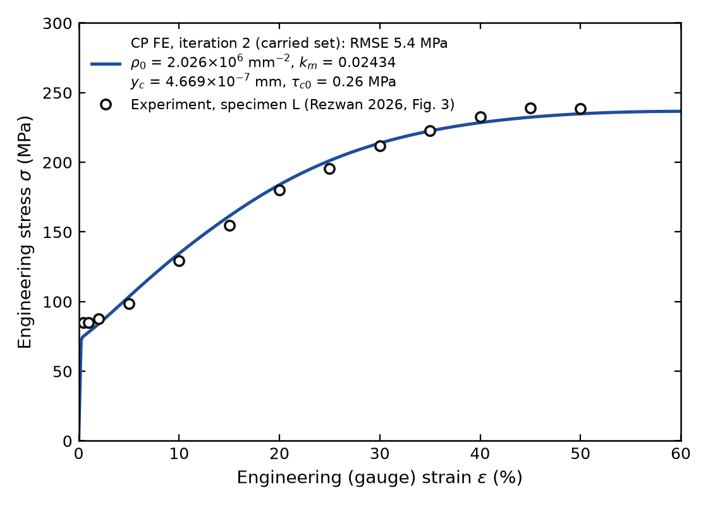

# Crystal plasticity and phase-field ductile fracture of single-crystal Ni tensile specimens with PINNACLE: finite-element calibration and the PINN+FEM, PINN and surrogate routes

Technical report, draft of 2026-10-16. Status: methodology (§2), numerical
method (§3) and the crystal-plasticity parameter calibration (§4) written;
the mesh and parameter sensitivity, the fifteen specimens, the neural and
surrogate routes and the coupled phase-field fracture stages follow as they
are confirmed by the author; abstract and introduction are held until the
study is closed. Every number here traces to a run in `docs/run_ledger.md`
(rows `ni-*`) and to a deck under `decks/ni/`; the lab notebook is
`docs/12_ni_study.md`, the plan `docs/11_ni_plan.md`. Figures of §4 are
produced by `scripts/ni_calibration_figures.py` from
`decks/ni/figures/cal_figures.i`.

## Abstract

*(to be written after all studies are complete)*

## 1. Introduction

*(to be written after all studies are complete)*

## 2. Crystal-plasticity finite-element methodology

The constitutive model is the one of the Al2219 report (Part I there),
written again here with the Ni conventions; the specimens are single
crystals, so there is one orientation per specimen and no grain structure.

### 2.1 Kinematics

The deformation gradient at each material point is split multiplicatively into
an elastic and a plastic part,

$$
\mathbf{F} = \mathbf{F}^e \mathbf{F}^p , \qquad
\mathbf{L}^p = \dot{\mathbf{F}}^p \mathbf{F}^{p-1} = \sum_{\alpha=1}^{12} \dot{\gamma}^\alpha \, \mathbf{s}^\alpha \otimes \mathbf{n}^\alpha ,
\tag{1}
$$

where $\mathbf{s}^\alpha$ and $\mathbf{n}^\alpha$ are the slip direction and
slip-plane normal of system $\alpha$ in the sample frame and
$\dot{\gamma}^\alpha$ its slip rate. The twelve $\{111\}\langle 110\rangle$
systems of the FCC lattice are used. The crystal frame of a specimen is set by
the Bunge triple $(\varphi_1, \Phi, \varphi_2)$ of its orientation group,
which rotates both the slip systems and the elastic stiffness.

### 2.2 Elasticity

The elastic response is cubic and hyperelastic in the Green-Lagrange strain of
the elastic part,

$$
\mathbf{E}^e = \tfrac{1}{2}\left(\mathbf{F}^{eT}\mathbf{F}^e - \mathbf{I}\right), \qquad
\mathbf{S} = \mathbb{C} : \mathbf{E}^e , \qquad
\boldsymbol{\sigma} = \frac{1}{\det \mathbf{F}^e}\, \mathbf{F}^e \mathbf{S} \mathbf{F}^{eT} ,
\tag{2}
$$

with $\mathbb{C}$ the cubic stiffness ($C_{11}$, $C_{12}$, $C_{44}$) rotated
into the sample frame, $\mathbf{S}$ the second Piola-Kirchhoff stress and
$\boldsymbol{\sigma}$ the Cauchy stress. The resolved shear stress on system
$\alpha$ is

$$
\tau^\alpha = \mathbf{S} : \mathbf{M}^\alpha , \qquad
\mathbf{M}^\alpha = \tfrac{1}{2}\left(\mathbf{s}^\alpha \otimes \mathbf{n}^\alpha + \mathbf{n}^\alpha \otimes \mathbf{s}^\alpha\right).
\tag{3}
$$

### 2.3 Flow rule

Slip follows a rate-dependent power law (Hutchinson form),

$$
\dot{\gamma}^\alpha = \dot{\gamma}_0 \left| \frac{\tau^\alpha}{\tau_c^\alpha} \right|^{n} \operatorname{sign}(\tau^\alpha), \qquad n = 1/m_s ,
\tag{4}
$$

with reference slip rate $\dot{\gamma}_0$, rate exponent $n$ and the rate
sensitivity $m_s$ of (rezwan 2026 predicting). No kinematic backstress is
used. With $\dot{\gamma}_0 = 10^{-5}$ s$^{-1}$ and $n = 8.33$, a slip rate of
0.2 s$^{-1}$ (single slip at the test's gage rate, §2.6) needs
$|\tau| = 3.3\,\tau_c$: at the strain rate of these tests the flow stress is
mostly rate stress, which §4.3 quantifies.

### 2.4 Slip resistance and dislocation-density evolution

The slip resistance is a Taylor relation on the forest density, with the
latent-hardened interaction sum,

$$
\tau_c^\alpha = \tau_{c0} + \alpha_0\, \mu\, b \sqrt{\sum_{\beta=1}^{12} a^{\alpha\beta} \rho^\beta}, \qquad
a^{\alpha\beta} = \begin{cases} 1 & \alpha = \beta \\ q & \alpha \ne \beta \end{cases}
\tag{5}
$$

where $\rho^\beta$ is the statistically stored dislocation density of system
$\beta$, $\mu$ the shear modulus, $b$ the Burgers vector, $\alpha_0$ the
Taylor prefactor, $q$ the latent-to-self hardening ratio and $\tau_{c0}$ the
lattice friction (the paper's Peierls stress). With all twelve densities
equal, the interaction sum multiplies the density by $1 + 11q = 16.4$; the
calibrated parameters of §4 are specific to this convention, as in the
Al2219 report.

Each density evolves by a Kocks-Mecking storage-recovery law written per
system,

$$
\dot{\rho}^\alpha = \frac{1}{b}\left( k_m \sqrt{\rho^\alpha} - 2 y_c\, \rho^\alpha \right) \left| \dot{\gamma}^\alpha \right| ,
\qquad \rho^\alpha(0) = \rho_0 ,
\tag{6}
$$

with the storage coefficient $k_m$ (PINNACLE's `k1`) and the annihilation
distance $y_c$ (PINNACLE's `annihilation_diameter`, recovery coefficient
$k_2 = 2 y_c$). The law saturates at

$$
\rho_{sat} = \left( \frac{k_m}{2 y_c} \right)^2 , \qquad
\tau_{c,sat} = \tau_{c0} + \alpha_0 \mu b \sqrt{(1 + 11 q)\, \rho_{sat}} ,
\tag{7}
$$

so $k_m$ sets the hardening rate after yield and, together with $y_c$, the
height of the plateau; $\rho_0$ sets the initial resistance through Eq. (5);
$\tau_{c0}$ is a uniform offset of the resistance. §4.5 quantifies each of
these on the specimen.

No geometrically necessary densities or damage are active in the runs of
this part of the report: the specimen is the undamaged crystal-plasticity
baseline that the phase-field fracture stage builds on.

### 2.5 Material parameters

Table 1 lists every parameter of Eqs. (1)-(7), its value in the runs of §4,
its provenance tag (PROJECT_GUIDELINES §4) and its role in the study. Units
are millimeter, megapascal and second throughout, the paper's system, so
Table 3 of (rezwan 2026 predicting) enters the decks unchanged. PINNACLE's
law has no built-in length unit: the same specimen run in micrometers and in
millimeters gives the same stress (`docs/12_ni_study.md` §1).

**Table 1.** Crystal-plasticity parameters for single-crystal Ni.

| symbol | meaning | value | unit | provenance | role |
|---|---|---|---|---|---|
| $C_{11}$ | cubic stiffness | 253.0 | GPa | reported_table ((rezwan 2026 predicting), Table 3, from (lim 2025 quantitative)) | fixed |
| $C_{12}$ | cubic stiffness | 152.0 | GPa | reported_table | fixed |
| $C_{44}$ | cubic stiffness | 124.0 | GPa | reported_table | fixed |
| $\mu$ | shear modulus in Eq. (5) | 26.0 | GPa | reported_table | fixed |
| $b$ | Burgers vector | $2.5 \times 10^{-7}$ | mm | reported_table | fixed |
| $q$ | latent-hardening ratio | 1.4 | - | reported_table | fixed |
| $\alpha_0$ | Taylor prefactor | 0.4 | - | reported_table | fixed |
| $\dot{\gamma}_0$ | reference slip rate | $10^{-5}$ | s$^{-1}$ | reported_table | fixed |
| $m_s$ ($n = 1/m_s$) | rate sensitivity | 0.12 (8.333) | - | reported_table | fixed |
| $\rho_0$ | initial SSD density per system | $6.858 \times 10^{5}$ | mm$^{-2}$ | calibrated (§4); paper $2.35 \times 10^6$ | free |
| $k_m$ | storage coefficient | 0.01109 | - | calibrated (§4); paper 0.0295 | free |
| $y_c$ | annihilation distance | $2.265 \times 10^{-6}$ | mm | calibrated (§4); paper $0.79 \times 10^{-6}$ | free |
| $\tau_{c0}$ | lattice friction | 0.2458 | MPa | calibrated (§4); paper 0.26 | free |
| $\dot{\varepsilon}$ | applied bar strain rate | $5 \times 10^{-2}$ | s$^{-1}$ | assumed (the paper does not state the test rate; author's choice of 2026-10-15) | fixed |

The fixed set is the author's decision: the elastic constants, $b$, $\mu$,
$q$, $\alpha_0$, $\dot{\gamma}_0$ and $m_s$ stay at the paper's Ni values;
the four free parameters are the ones the paper itself calibrated on
specimen L, and the ones calibrated for Al2219.

Derived quantities of the calibrated set (Eqs. 5 and 7): initial slip
resistance $\tau_c(\rho_0) = 8.97$ MPa, saturation density
$\rho_{sat} = 5.99 \times 10^{6}$ mm$^{-2}$, saturation resistance
$\tau_{c,sat} = 26.0$ MPa.

### 2.6 Single-crystal dog-bone specimen model

**Specimens.** (rezwan 2026 predicting) tests fifteen single-crystal Ni
dog-bone coupons: five orientation groups (9, 10, H, L, P; Table 1 of the
paper, `data/extracted/ni_table1_orientations.csv`) with three thickness
variants each (x.1, x.3, x.4), whose gage thickness was measured at five
stations 2 mm apart (Table 2 of the paper,
`data/extracted/ni_table2_thickness.csv`). The calibration of §4 uses
specimen L.1: orientation L, Bunge $(60.0°, 23.5°, 80.2°)$, maximum Schmid
factor 0.42, gage thickness 0.3399 / 0.3441 / 0.3540 / 0.3625 / 0.3715 mm at
the five stations (mean 0.3544 mm).

**Geometry and mesh.** The planform is that of Fig. 2 of the paper: 25.4 mm
long, 4.8 mm wide grips, circular fillets of radius 3.175 mm tangent to a
1.85 x 8.0 mm gage (`data/extracted/ni_fig2_planform.csv`; the gage width is
measured on the plan view with the grip width as scale, $\pm 0.05$ mm, since
the paper does not dimension it). The thickness follows the five measured
stations by a natural cubic spline inside the gage, blends linearly across
each fillet to a common 0.35 mm, and is constant in the grips (author's
decision: identical ends, the measured variation in the gage). The mesh is a
single mapped hexahedral block built by the `dogbone` generator added to
hexaform for this study (`scripts/ni_specimen_mesh.py decks/ni/mesh/h040.i`).
The results of §4 are at level h040: 0.4 mm cells in the gage, 0.8 mm in the
grips, one HEX8 element through the thickness (pseudo-3D, as in the Al2219
plates), 44 x 5 x 1 divisions, 220 elements, 540 nodes, 1,620 displacement
degrees of freedom and 1,760 quadrature points; minimum scaled Jacobian
0.63, no inverted element (Fig. 1). The 8 mm gage carries 20 x 5 cells.
Node sets `gage-` and `gage+` sit on the first and last station planes and
carry the gauge strain.

**Figure 1.** The h040 mesh of specimen L.1 (blocks gage, shoulder and grip;
the five thickness stations dotted), its planform and thickness profile, and
the thickness profiles of the fifteen specimens.

**Orientation.** One orientation per specimen, the Bunge triple of its
group, given to the crystal block of the material (`euler_angles`); the
sample frame is $x$ = loading direction, $y$ = transverse, $z$ = thickness,
as in the paper.

**Boundary conditions and loading.** The grip end $x = 0$ is clamped
($\mathbf{u} = 0$ on node set `x-`); the grip end $x = 25.4$ mm is clamped
in $y$ and $z$ and displaced along $+x$ by a linear ramp to 36% of the bar
length (9.14 mm) in 7.2 s, i.e. a bar strain rate of
$5 \times 10^{-2}$ s$^{-1}$ (1.27 mm s$^{-1}$). All other faces are
traction-free. Because the gage is the narrowest and thinnest section, it
carries most of the elongation: the gauge strain runs 1.8 times the bar
strain up to 20% gauge strain and 2.0 times by the end, so the gage strain
rate is about 0.09 to 0.10 s$^{-1}$.

**Stress and strain measures.** The reported strain is the gauge strain,
the FE counterpart of the paper's DIC gage average,

$$
\varepsilon = \frac{\langle u_x \rangle_{gage+} - \langle u_x \rangle_{gage-}}{\langle X \rangle_{gage+} - \langle X \rangle_{gage-}} ,
\tag{8}
$$

the difference of the mean axial displacements of the two station planes
over their initial distance (8 mm; PINNACLE `gauge_node_sets`, ADR 0032). The
reported stress is the engineering stress, the reaction force on the pulled
grip over the mean initial gage section,

$$
\sigma = \frac{R_x}{w_g\, \bar{t}} , \qquad \bar{t} = \tfrac{1}{5}\sum_{k=1}^{5} t_k ,
\tag{9}
$$

with $w_g = 1.85$ mm and $\bar{t}$ the mean of the five station thicknesses
(0.6556 mm$^2$ for L.1), as the paper defines its engineering stress.

**Reference data.** The ground truth is the experimental engineering
stress-strain curve of specimen L in Fig. 3 of (rezwan 2026 predicting),
digitized at the figure's native 300 DPI (axis calibration residual
$10^{-4}$ strain and 0.23 MPa; repeated-extraction error 0.21 MPa;
`data/digitized/ni_fig3_specimenL_calibration.csv`). Thirteen markers, from
0.5% to 50% gauge strain, are the median stress of the digitized columns
within $\pm 0.4$% strain of each target, with the spread of those columns
as their uncertainty (0.1 to 1.7 MPa, and 25 MPa at the 0.5% marker, which
sits on the elastic-plastic knee; `data/digitized/ni_fig3_experiment_markers.csv`).
The experimental curve ends at 51.3% strain. The paper does not say which of
L.1, L.3 or L.4 Fig. 3 shows (its Fig. 4(b) gives failure strains of 46.1 to
48.1% for the three); the curve is taken as the hardening reference and L.1
as the calibration geometry.

## 3. Numerical method (PINNACLE)

All runs use PINNACLE (branch `feat/pinn_benchmark`, revision f83c378),
torch backend on the CPU, double precision, two threads per run on the
compute host. A run is fully described by one specimen deck
(`decks/ni/cp/*.i`), rendered by `scripts/ni_specimen.py` into a PINNACLE
deck from the template `decks/ni/templates/cp_specimen_template.i`; the
calibration iterations are study decks (`decks/ni/cp/cal_gn*.i`) run by
`scripts/ni_study.py`.

### 3.1 Finite-element discretization

Trilinear HEX8 elements with 2 x 2 x 2 Gauss quadrature carry the displacement
field. The finite-strain problem is posed on the displacement gradient
$\mathbf{H} = \nabla \mathbf{u}$ at each quadrature point, from which
$\mathbf{F} = \mathbf{I} + \mathbf{H}$; the material returns the Cauchy stress
of Eq. (2) and the assembler forms the residual of the balance of linear
momentum (`stress_divergence_cp` kernel, finite-strain mode) with Dirichlet
conditions on node sets. The reaction of Eq. (9) is the sum of the internal
force over the constrained degrees of freedom of the pulled face.

### 3.2 Load stepping

The quasi-static load program (`cp_quasi_static` executioner) divides the
7.2 s ramp into 360 equal steps of $\Delta t = 0.02$ s, i.e. $10^{-3}$ bar
strain and about $2 \times 10^{-3}$ gauge strain per step. A step that fails
to converge is halved and retried up to ten times. In the calibrated run the
first 288 steps converge without a cutback, up to 56.5% gauge strain, beyond
the last marker (50%) and the experimental curve (51.3%); the first cutback
marks the end of the reported curve (§4.6).

### 3.3 Newton solve and tangent

Each load step is solved by Newton's method on the displacement vector to an
absolute residual norm of $10^{-3}$ N over the free degrees of freedom (about
$6 \times 10^{-6}$ of the 160 N load at 50% strain), with no relative
criterion, at most 50 iterations, with a backtracking line search. The
algorithmic tangent $\partial \boldsymbol{\sigma} / \partial \mathbf{H}$ is
formed at every quadrature point by one-sided finite differences of the
integrated stress of §3.4 (nine perturbations of $\mathbf{H}$, perturbation
$10^{-6}$) and refreshed at every Newton iteration, then assembled sparse
and solved with a sparse LU factorization (`linear_method = direct`): the
finite-strain crystal-plasticity tangent is non-symmetric. The calibrated
run took 16 Newton iterations per step on average over its 288 clean steps
(22 for the first step from the virgin state, 48 at most).

### 3.4 Constitutive integration

The state $\{\mathbf{F}^p, \rho^\alpha\}$ at each quadrature point is
integrated over the load step inside every residual evaluation, by a
backward-Euler update of the slip increments (PINNACLE ADR 0033,
`state_update = implicit`): for the trial deformation $\mathbf{F}_{n+1}$ of
a Newton iterate, the slip increments $\Delta\gamma^\alpha$ solve

$$
\Delta\gamma^\alpha = \Delta t\, \dot{\gamma}^\alpha\!\left(\tau^\alpha(\mathbf{F}_{n+1}, \Delta\boldsymbol{\gamma}),\ \tau_c^\alpha(\rho_{n+1}(\Delta\boldsymbol{\gamma}))\right), \qquad
\mathbf{F}^p_{n+1} = \Big(\mathbf{I} + \sum_\alpha \Delta\gamma^\alpha\, \mathbf{s}^\alpha \otimes \mathbf{n}^\alpha\Big)\mathbf{F}^p_n ,
\tag{10}
$$

with $\rho_{n+1}$ advanced by Eq. (6) with $|\Delta\gamma^\alpha|$. A local
Newton per point solves Eq. (10) to $10^{-10}$ in the slip increments, with
the semi-analytic Jacobian
$\mathbf{I} + \Delta t\,(n|\dot{\gamma}|/|\tau|)\,\mathbf{K} + \Delta t\,(n\dot{\gamma}/\tau_c)\,\mathbf{h}\operatorname{sign}(\Delta\gamma)$
($\mathbf{K}$ the elastic Schmid coupling, $\mathbf{h}$ the Taylor-hardening
sensitivity), the material's exact residual at the trial end state,
residual backtracking, and a damped first phase for trials far from
equilibrium. When it fails, the step is taken as 2 to 64 backward-Euler
sub-increments along the straight deformation path, and only then by
path-following explicit sub-stepping. The stress of the step is the stress
of the integrated end state, so the slip of the step enters the equilibrium
of the same step; the state is committed when the step converges.

This replaces the explicit update of the Al2219 report, in which the stress
inside Newton was evaluated with the state frozen at the last converged step.
That scheme is first order in the load increment: on the Ni dog-bone with the
paper's parameters it gives 507 / 189 / 133 / 111 / 121 MPa at 3% gauge
strain with 16 / 64 / 128 / 256 / 1,024 steps to 2% bar strain, against a
converged 126 MPa (material point under true uniaxial stress, 3,000 explicit
steps), and would need about 30,000 steps on the calibration path. The
backward-Euler update reproduces a 1,024-step explicit path within 1% on a
single element at four steps of $10^{-3}$, and the dog-bone reference within 4% at
3% gauge strain and 2% at 4.75% with 64 steps (`docs/12_ni_study.md` §1.1;
tier 2, independently verified numerical agreement). On the Al2219 plate of
Part II the two schemes give the same calibrated fracture toughness within
1.5% (`docs/10_pfd_study.md` §10).

### 3.5 Output

The executioner records, for every accepted load step, the time, the
reaction on the pulled face, the gauge strain of Eq. (8), the Newton count
and the cutbacks; `scripts/ni_specimen.py` turns them into the engineering
curve of Eq. (9) (`results.csv`). Field output (displacement, stress,
strain, equivalent plastic strain, slip activity and mean density) is
written every 20 steps.

### 3.6 Reproducibility

Each run is reproducible from its specimen deck, the mesh deck and the data
files it names; the commands are in `docs/reproduce_ni_specimen.md`, and the
run ledger gives the deck, scripts, framework revision, host, cores and wall
time of every run. A calibration run (360 steps to 36% bar strain) takes 18
to 26 s per load step on two threads, 1.8 to 2.6 h; the five runs of an
iteration run side by side (6.4 h each in the final iteration, which shared
the host with three other runs).

## 4. Results: parameter calibration

### 4.1 Objective

The free parameters are those that minimize the root-mean-square deviation
between the engineering stress of specimen L.1, interpolated at the thirteen
marker strains of §2.6, and the marker stresses, in this framework, at this
mesh and at the assumed strain rate. The paper's calibrated values (Table 1)
are the starting point, not a target: with the interaction sum of Eq. (5),
the rate law of Eq. (4) and the assumed rate, they do not reproduce the curve
in this framework (§4.2), and the calibrated values are reported as such
(provenance `calibrated`). Markers below 0.3% strain are excluded because
the elastic branch ends near 0.05% strain and the load increment of §3.2
does not resolve it. Each parameter is bounded to 0.1 to 10 times the
paper's value.

### 4.2 Procedure

Each iteration ran the centre and one multiplicative perturbation per
parameter ($\rho_0$, $k_m$, $y_c$ x 1.2; $\tau_{c0}$ x 1.5) as five
concurrent specimen runs (`decks/ni/cp/cal_gn{1..4}.i`, driver
`scripts/ni_study.py`). The finite-difference Jacobian
$\partial \sigma_i / \partial \ln p_j$ at the marker strains gave a
Levenberg-Marquardt step in log parameters, clipped to $\pm 0.7$ in
$\ln p$ (`scripts/ni_gauss_newton.py`). The iteration stopped when the
centre's RMSE reached the markers' own spread and the next step predicted
no further gain.

**Table 2.** Gauss-Newton iterations on specimen L.1 (h040, implicit update).

| iteration | $\rho_0$ (mm$^{-2}$) | $k_m$ | $y_c$ (mm) | $\tau_{c0}$ (MPa) | RMSE (MPa) | predicted RMSE of the next centre (MPa) |
|---|---|---|---|---|---|---|
| 1 (paper's set) | $2.35 \times 10^{6}$ | 0.0295 | $0.79 \times 10^{-6}$ | 0.260 | 373.1 | 25.3 |
| 2 | $1.167 \times 10^{6}$ | 0.01465 | $0.738 \times 10^{-6}$ | 0.255 | 141.2 | 4.6 |
| 3 | $7.64 \times 10^{5}$ | 0.01081 | $1.479 \times 10^{-6}$ | 0.249 | 29.1 | 4.5 |
| 4 (calibrated) | $6.858 \times 10^{5}$ | 0.01109 | $2.265 \times 10^{-6}$ | 0.246 | 4.6 | 4.5 |

The paper's set hardens about four times too fast in this framework at the
assumed rate (841 MPa at 50% gauge strain against 238 MPa). The first two
steps were clipped and fell short of their linear predictions because the
response is strongly nonlinear in $k_m$ and $y_c$ that far from the data;
from the third iteration the prediction held (29.1 MPa predicted 4.5, the
fourth centre measured 4.6). The calibrated set lowers $\rho_0$ by a factor
3.4, $k_m$ by 2.7 and raises $y_c$ by 2.9 relative to the paper; $\tau_{c0}$
is essentially unchanged.

**Figure 2.** Gauss-Newton convergence: the centre of each iteration against
the experimental markers (left) and the RMSE of each centre with the linear
prediction made by the previous step (right).

### 4.3 Calibrated parameter set

**Table 3.** Calibrated set at mesh h040 (deck
`decks/ni/cp/calibrated_L1_h040.i`, run `results/ni_study/cal/gn4/base`),
with the linearized one-standard-deviation uncertainty from the residual and
the FE Jacobian, holding $\tau_{c0}$ at its value (see below).

| parameter | value | unit | relative 1$\sigma$ |
|---|---|---|---|
| $\rho_0$ | $6.858 \times 10^{5}$ | mm$^{-2}$ | $\pm 8$% |
| $k_m$ | 0.01109 | - | $\pm 32$% |
| $y_c$ | $2.265 \times 10^{-6}$ | mm | $\pm 51$% |
| $\tau_{c0}$ | 0.2458 | MPa | not determined by this curve |

The four parameters are not separately determined by one curve at this
rate. The singular values of the Jacobian are 441, 84, 10.5 and 0.03 MPa per
unit $\ln p$; the weakest direction is $\tau_{c0}$ alone (component 0.998),
because a lattice friction of 0.25 MPa is 3% of the initial slip resistance
of 9 MPa and moves the curve by 3 MPa per e-fold. With all four free the
linearized covariance is unbounded, so Table 3 holds $\tau_{c0}$ at its
value. Of the other three, $\rho_0$ is pinned by the yield level (8%);
$k_m$ and $y_c$ are correlated at +1.00, i.e. the curve fixes their ratio
much better than either: $k_m / y_c$ to $\pm 15$%, and the saturation
density $\rho_{sat} = (k_m / 2y_c)^2$ of Eq. (7) to $\pm 32$%.

**Figure 3.** Calibrated specimen L.1 against the experimental markers. The
dotted line marks the first load cutback, where the curve ends (§4.6).

Characteristics of the calibrated curve: engineering stress 76 MPa at the
first step (0.25% gauge strain, already past yield), 88 / 134 / 177 / 207 /
229 / 246 MPa at 2 / 10 / 20 / 30 / 40 / 50% gauge strain, and 240 MPa at
46.3%, the experimental failure strain of L.1 in Fig. 4(b) of the paper; a
hardening rate $d\sigma/d\varepsilon$ falling from 640 MPa at 2% to 350 MPa
at 20% and 150 MPa at 50%. The yield level is mostly rate stress: a single
slip system at Schmid factor 0.42 and the gage rate needs
$\tau = 3.3\,\tau_c(\rho_0) = 30$ MPa (Eq. 4), i.e. about 70 MPa of axial
stress, close to the 76 MPa of the first step, against 21 MPa for the
rate-independent resistance alone.

### 4.4 Error analysis

**Table 4.** Calibrated specimen at the experimental markers (engineering
stress against gauge strain).

| strain (%) | experiment (MPa) | FE (MPa) | difference (MPa) | relative error |
|---|---|---|---|---|
| 0.5 | 85.0 | 78.3 | -6.7 | -7.8% |
| 1 | 85.2 | 81.9 | -3.3 | -3.8% |
| 2 | 87.7 | 88.5 | +0.8 | +0.9% |
| 5 | 98.4 | 106.7 | +8.3 | +8.4% |
| 10 | 129.3 | 134.0 | +4.7 | +3.6% |
| 15 | 154.9 | 157.6 | +2.8 | +1.8% |
| 20 | 180.1 | 177.0 | -3.0 | -1.7% |
| 25 | 195.4 | 193.4 | -2.0 | -1.0% |
| 30 | 211.8 | 207.3 | -4.5 | -2.1% |
| 35 | 222.9 | 219.1 | -3.8 | -1.7% |
| 40 | 232.8 | 229.3 | -3.4 | -1.5% |
| 45 | 239.1 | 238.2 | -0.8 | -0.4% |
| 50 | 238.4 | 246.1 | +7.7 | +3.2% |

Root-mean-square deviation over the thirteen markers: 4.6 MPa, with a
largest deviation of 8.3 MPa (8.4%, at 5%). From 10% strain to 45% every
marker is within 2.1% (-4.5 to +4.7 MPa). This is a tier-4 agreement
(PROJECT_GUIDELINES §5: agreement with experiment) on the curve used for the
calibration; the other fourteen specimens are the test of the set.

The residual has a shape the four parameters cannot remove:

- **The knee (0.5 to 5%).** The experiment stays flat at 85-88 MPa to 2%
  and then rises; the FE rises from the first step, so it is low at 0.5%
  and 1% and high at 5%. The FE has no easy-glide stage: the latent
  hardening of Eq. (5) with $q = 1.4$ hardens the primary system from the
  start, whereas a single crystal in single slip typically hardens slowly
  until a secondary system activates; this reading is consistent with the
  residual but not tested here. The 0.5% marker also carries the largest
  digitization spread (25 MPa) because it lies on the steep knee.
- **The end (45 to 50%).** The experiment has stopped hardening (238 MPa at
  45 and 50%); the FE still hardens at 150 MPa per unit strain. The
  flattening is the softening that precedes damage initiation, and the end
  of the experimental curve is the damage-initiation point. Crystal
  plasticity alone has no softening mechanism and cannot follow it; the
  coupled phase-field stage calibrates the fracture parameters to that
  point and is where the softening and the final damage are reproduced.

**Figure 4.** Deviation of the calibrated specimen from the experimental
markers.

### 4.5 Effect of each parameter

Each parameter was perturbed one at a time from the calibrated set while the
others were held (Table 5, Figs. 5 and 6). The Jacobian of the final
iteration gives the same information as a sensitivity
$\partial \sigma / \partial \ln p$ along the curve (Fig. 7).

**Table 5.** One-at-a-time perturbations of the calibrated set at h040
(`decks/ni/cp/cal_gn4.i`): engineering stress at selected marker strains,
the RMSE over the thirteen markers and the sensitivity
$\partial\sigma/\partial\ln p$.

| case | 0.5% | 2% | 10% | 30% | 50% | RMSE (MPa) | $\partial\sigma/\partial\ln p$ at 2 / 10 / 30 / 50% (MPa) |
|---|---|---|---|---|---|---|---|
| calibrated | 78 | 88 | 134 | 207 | 246 | 4.6 | |
| $\rho_0$ x 1.2 = $8.229 \times 10^5$ mm$^{-2}$ | 85 | 95 | 141 | 212 | 250 | 7.4 | 38 / 40 / 27 / 22 |
| $k_m$ x 1.2 = 0.01331 | 79 | 90 | 142 | 230 | 275 | 18.7 | 9 / 46 / 126 / 157 |
| $y_c$ x 1.2 = $2.718 \times 10^{-6}$ mm | 78 | 88 | 130 | 193 | 226 | 13.0 | -4 / -24 / -78 / -108 |
| $\tau_{c0}$ x 1.5 = 0.3687 MPa | 79 | 90 | 135 | 209 | 247 | 4.7 | 3 / 3 / 3 / 3 |

What each parameter does to the curve, in this framework, with this law and
at this rate:

- **$\rho_0$ sets the yield level.** Raising the initial density raises
  $\tau_c$ through Eq. (5) from the first slip onward, so the whole curve
  moves up, by 38-40 MPa per e-fold to 10% and less with strain (22 MPa at
  50%) as the stored density overtakes the initial one. It is the parameter
  that places the knee.
- **$k_m$ sets the hardening rate.** Its effect is small at yield (9 MPa per
  e-fold at 2%) and grows with strain (157 MPa at 50%): a larger storage
  coefficient makes the curve climb faster and raises the plateau through
  Eq. (7). It is the most influential parameter beyond 10%.
- **$y_c$ sets the saturation.** Recovery is negligible at low density and
  grows with it, so a larger $y_c$ lowers the late curve (-108 MPa per
  e-fold at 50%) and leaves yield unchanged. Its sensitivity is close to
  the negative of $k_m$'s at every strain, which is why the two are
  correlated in Table 3: the curve sees mainly their ratio.
- **$\tau_{c0}$ is immaterial.** It shifts the curve by 3 MPa per e-fold at
  every strain. At 0.25 MPa it is a small part of the initial resistance,
  and the rate term of Eq. (4) multiplies all of $\tau_c$ alike, so the
  curve cannot distinguish it from an 8% change of $\rho_0$. The Al2219
  calibration found the same role at 25 MPa per e-fold.

The calibration therefore fixes three things: the yield level ($\rho_0$ at
this $\tau_{c0}$ and rate), the hardening rate and the curvature toward the
plateau ($k_m$ and $y_c$, mainly through their ratio).

**Figure 5.** One parameter perturbed at a time from the calibrated set (left
to right, top to bottom: $\rho_0$, $k_m$, $y_c$, $\tau_{c0}$).

**Figure 6.** All four perturbations on one axis.

**Figure 7.** Sensitivity $\partial\sigma/\partial\ln p$ of the engineering
stress to each parameter along the curve, from the finite-difference Jacobian
of the final iteration.

### 4.6 Scope of the calibrated set

The set of Table 3 holds for: this framework's constitutive conventions (the
latent-hardened sum of Eq. (5), the per-system law of Eq. (6), the rate law of
Eq. (4) with the fixed $\dot{\gamma}_0$ and $m_s$); the assumed bar strain
rate of $5 \times 10^{-2}$ s$^{-1}$ (with $n = 8.33$ a tenfold change of rate
moves the flow stress by about 30%; the same paper's set at
$10^{-3}$ s$^{-1}$ gave an RMSE of 183 MPa instead of 373 MPa,
`results/ni_study/cal/gn1_rate1e-3`); the implicit state update of §3.4; the
h040 mesh, whose effect is quantified in the mesh study; and specimen L.1,
whose orientation and thickness profile the other fourteen specimens vary.
$\tau_{c0}$ is held at the paper's order of magnitude rather than determined.

The curves end at the first load cutback. Beyond 54 to 60% gauge strain
(first cutback at steps 273 to 306 of 360 in the five runs of the final
iteration) the global Newton stops converging; the executioner then steps
on after exhausting its ten cutbacks and the stress jumps from 252 to over
500 MPa. Those steps are not a solution and are not used. The range is past
every marker, past the end of the experimental curve and past the 46-48%
failure strains of the L specimens: the end of each experimental curve is
the damage-initiation point, which the coupled phase-field stage takes as
the calibration target of the fracture parameters and stops at.
