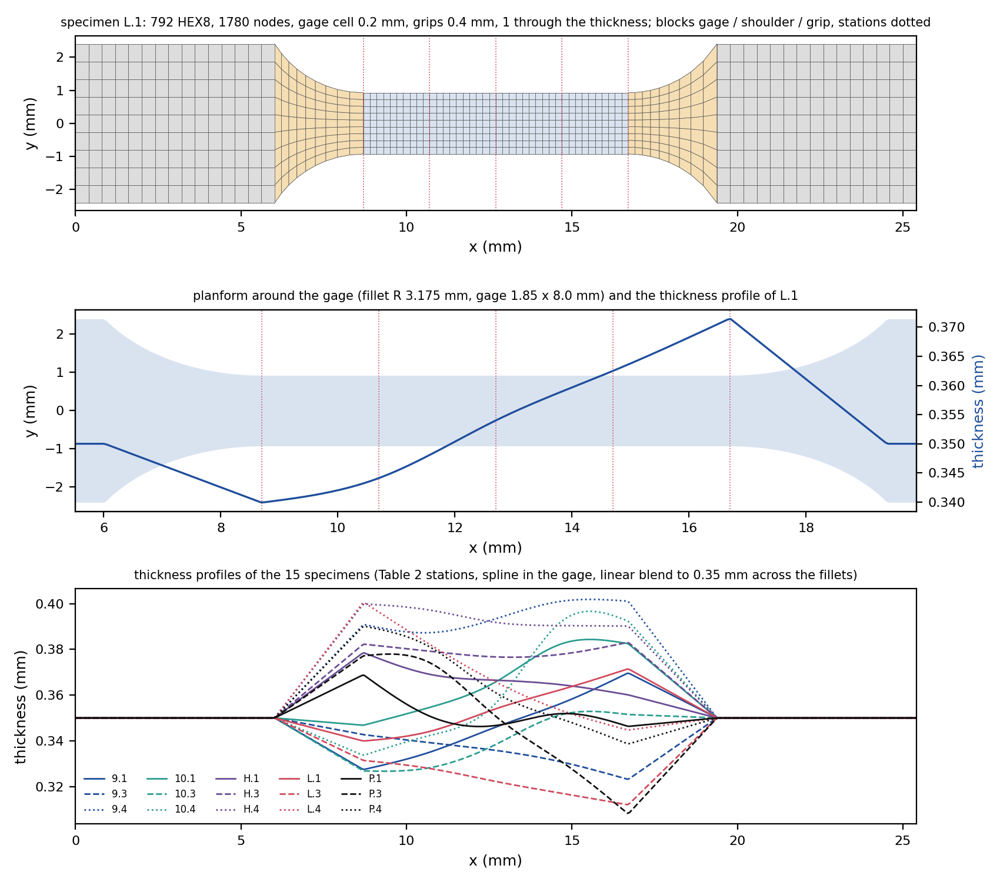
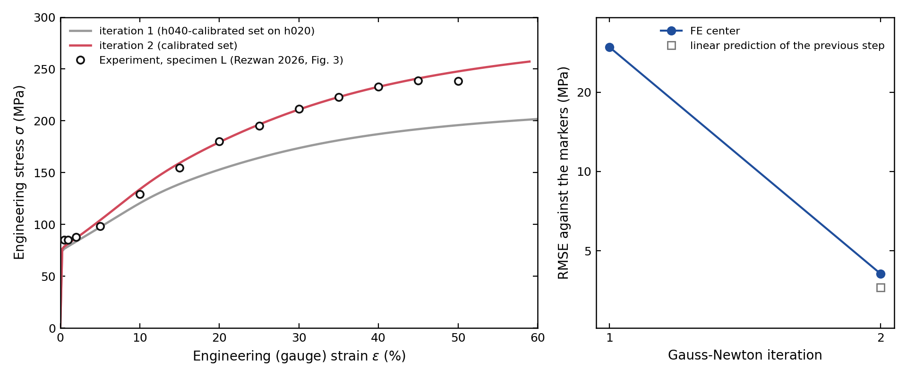
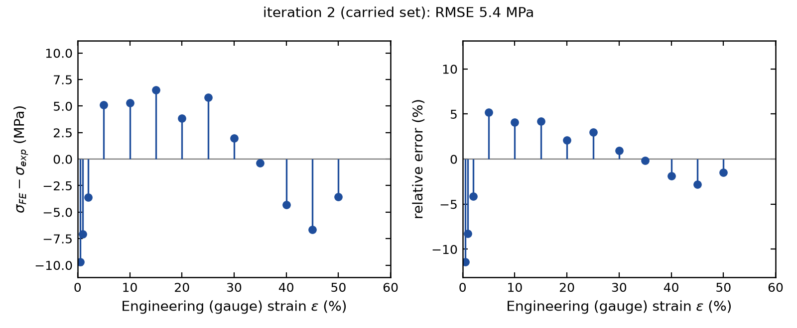
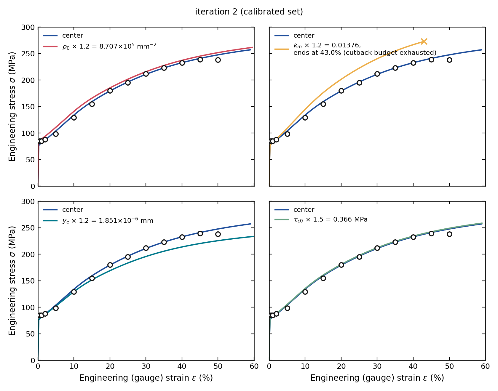
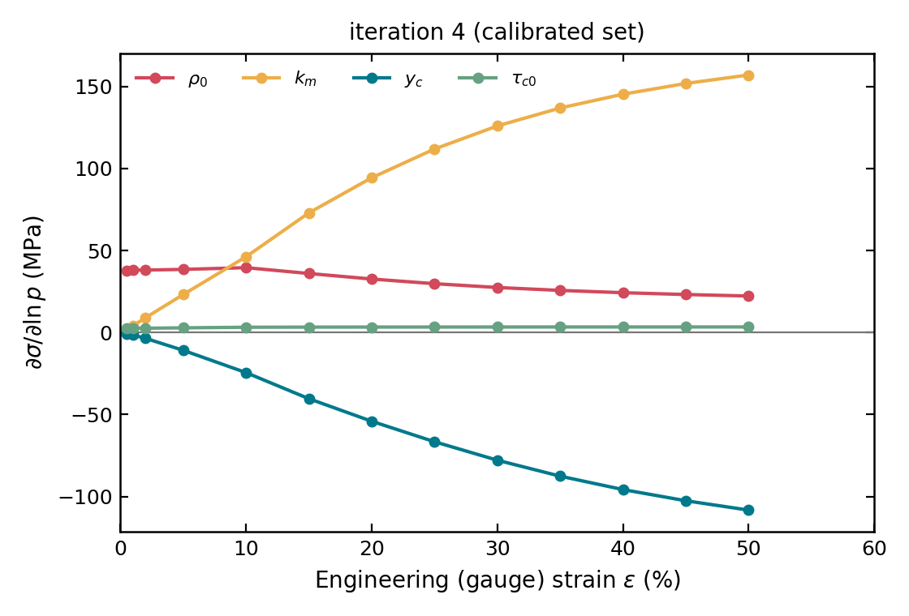

# Crystal plasticity and phase-field ductile fracture of single-crystal Ni tensile specimens with PINNACLE: finite-element calibration and the PINN+FEM, PINN and surrogate routes

Technical report, draft of 2026-10-18. Status: methodology (§2),
numerical method (§3) and the crystal-plasticity parameter calibration (§4)
written for the production mesh h020; the mesh and parameter sensitivity, the fifteen specimens, the neural and
surrogate routes and the coupled phase-field fracture stages follow as they
are confirmed by the author; abstract and introduction are held until the
study is closed. Every number here traces to a run in `docs/run_ledger.md`
(rows `ni-*`) and to a deck under `decks/ni/`; the lab notebook is
`docs/12_ni_study.md`, the plan `docs/11_ni_plan.md`. Figures of §4 are
produced by `scripts/ni_calibration_figures.py` from
`decks/ni/figures/cal_figures.i`.

## Abstract

*(to be written after all studies are complete)*

## 1. Introduction

*(to be written after all studies are complete)*

## 2. Crystal-plasticity finite-element methodology

The constitutive model is the one of the Al2219 report (Part I there),
written again here with the Ni conventions; the specimens are single
crystals, so there is one orientation per specimen and no grain structure.

### 2.1 Kinematics

The deformation gradient at each material point is split multiplicatively into
an elastic and a plastic part,

$$
\mathbf{F} = \mathbf{F}^e \mathbf{F}^p , \qquad
\mathbf{L}^p = \dot{\mathbf{F}}^p \mathbf{F}^{p-1} = \sum_{\alpha=1}^{12} \dot{\gamma}^\alpha \, \mathbf{s}^\alpha \otimes \mathbf{n}^\alpha ,
\tag{1}
$$

where $\mathbf{s}^\alpha$ and $\mathbf{n}^\alpha$ are the slip direction and
slip-plane normal of system $\alpha$ in the sample frame and
$\dot{\gamma}^\alpha$ its slip rate. The twelve $\{111\}\langle 110\rangle$
systems of the FCC lattice are used. The crystal frame of a specimen is set by
the Bunge triple $(\varphi_1, \Phi, \varphi_2)$ of its orientation group,
which rotates both the slip systems and the elastic stiffness.

### 2.2 Elasticity

The elastic response is cubic and hyperelastic in the Green-Lagrange strain of
the elastic part,

$$
\mathbf{E}^e = \tfrac{1}{2}\left(\mathbf{F}^{eT}\mathbf{F}^e - \mathbf{I}\right), \qquad
\mathbf{S} = \mathbb{C} : \mathbf{E}^e , \qquad
\boldsymbol{\sigma} = \frac{1}{\det \mathbf{F}^e}\, \mathbf{F}^e \mathbf{S} \mathbf{F}^{eT} ,
\tag{2}
$$

with $\mathbb{C}$ the cubic stiffness ($C_{11}$, $C_{12}$, $C_{44}$) rotated
into the sample frame, $\mathbf{S}$ the second Piola-Kirchhoff stress and
$\boldsymbol{\sigma}$ the Cauchy stress. The resolved shear stress on system
$\alpha$ is

$$
\tau^\alpha = \mathbf{S} : \mathbf{M}^\alpha , \qquad
\mathbf{M}^\alpha = \tfrac{1}{2}\left(\mathbf{s}^\alpha \otimes \mathbf{n}^\alpha + \mathbf{n}^\alpha \otimes \mathbf{s}^\alpha\right).
\tag{3}
$$

### 2.3 Flow rule

Slip follows a rate-dependent power law (Hutchinson form),

$$
\dot{\gamma}^\alpha = \dot{\gamma}_0 \left| \frac{\tau^\alpha}{\tau_c^\alpha} \right|^{n} \operatorname{sign}(\tau^\alpha), \qquad n = 1/m_s ,
\tag{4}
$$

with reference slip rate $\dot{\gamma}_0$, rate exponent $n$ and the rate
sensitivity $m_s$ of (rezwan 2026 predicting). No kinematic backstress is
used. With $\dot{\gamma}_0 = 10^{-5}$ s$^{-1}$ and $n = 8.33$, a slip rate of
0.2 s$^{-1}$ (single slip at the test's gage rate, §2.6) needs
$|\tau| = 3.3\,\tau_c$: at the strain rate of these tests the flow stress is
mostly rate stress (§4.6 gives its effect on the calibrated set).

### 2.4 Slip resistance and dislocation-density evolution

The slip resistance is a Taylor relation on the forest density, with the
latent-hardened interaction sum,

$$
\tau_c^\alpha = \tau_{c0} + \alpha_0\, \mu\, b \sqrt{\sum_{\beta=1}^{12} a^{\alpha\beta} \rho^\beta}, \qquad
a^{\alpha\beta} = \begin{cases} 1 & \alpha = \beta \\ q & \alpha \ne \beta \end{cases}
\tag{5}
$$

where $\rho^\beta$ is the statistically stored dislocation density of system
$\beta$, $\mu$ the shear modulus, $b$ the Burgers vector, $\alpha_0$ the
Taylor prefactor, $q$ the latent-to-self hardening ratio and $\tau_{c0}$ the
lattice friction (the paper's Peierls stress). With all twelve densities
equal, the interaction sum multiplies the density by $1 + 11q = 16.4$; the
calibrated parameters of §4 are specific to this convention, as in the
Al2219 report.

Each density evolves by a Kocks-Mecking storage-recovery law written per
system,

$$
\dot{\rho}^\alpha = \frac{1}{b}\left( k_m \sqrt{\rho^\alpha} - 2 y_c\, \rho^\alpha \right) \left| \dot{\gamma}^\alpha \right| ,
\qquad \rho^\alpha(0) = \rho_0 ,
\tag{6}
$$

with the storage coefficient $k_m$ (PINNACLE's `k1`) and the annihilation
distance $y_c$ (PINNACLE's `annihilation_diameter`, recovery coefficient
$k_2 = 2 y_c$). The law saturates at

$$
\rho_{sat} = \left( \frac{k_m}{2 y_c} \right)^2 , \qquad
\tau_{c,sat} = \tau_{c0} + \alpha_0 \mu b \sqrt{(1 + 11 q)\, \rho_{sat}} ,
\tag{7}
$$

so $k_m$ sets the hardening rate after yield and, together with $y_c$, the
height of the plateau; $\rho_0$ sets the initial resistance through Eq. (5);
$\tau_{c0}$ is a uniform offset of the resistance. §4.5 quantifies each of
these on the specimen.

No geometrically necessary densities or damage are active in the runs of
this part of the report: the specimen is the undamaged crystal-plasticity
baseline that the phase-field fracture stage builds on.

### 2.5 Material parameters

Table 1 lists every parameter of Eqs. (1)-(7), its value in the runs of §4,
its provenance tag (PROJECT_GUIDELINES §4) and its role in the study. Units
are millimeter, megapascal and second throughout, the paper's system, so
Table 3 of (rezwan 2026 predicting) enters the decks unchanged. PINNACLE's
law has no built-in length unit: the same specimen run in micrometers and in
millimeters gives the same stress (`docs/12_ni_study.md` §1).

**Table 1.** Crystal-plasticity parameters for single-crystal Ni.

| symbol | meaning | value | unit | provenance | role |
|---|---|---|---|---|---|
| $C_{11}$ | cubic stiffness | 253.0 | GPa | reported_table ((rezwan 2026 predicting), Table 3, from (lim 2025 quantitative)) | fixed |
| $C_{12}$ | cubic stiffness | 152.0 | GPa | reported_table | fixed |
| $C_{44}$ | cubic stiffness | 124.0 | GPa | reported_table | fixed |
| $\mu$ | shear modulus in Eq. (5) | 26.0 | GPa | reported_table | fixed |
| $b$ | Burgers vector | $2.5 \times 10^{-7}$ | mm | reported_table | fixed |
| $q$ | latent-hardening ratio | 1.4 | - | reported_table | fixed |
| $\alpha_0$ | Taylor prefactor | 0.4 | - | reported_table | fixed |
| $\dot{\gamma}_0$ | reference slip rate | $10^{-5}$ | s$^{-1}$ | reported_table | fixed |
| $m_s$ ($n = 1/m_s$) | rate sensitivity | 0.12 (8.333) | - | reported_table | fixed |
| $\rho_0$ | initial SSD density per system | $7.256 \times 10^5$ | mm$^{-2}$ | calibrated (§4); paper $2.35 \times 10^6$ | free |
| $k_m$ | storage coefficient | 0.01147 | - | calibrated (§4); paper 0.0295 | free |
| $y_c$ | annihilation distance | $1.542 \times 10^{-6}$ | mm | calibrated (§4); paper $0.79 \times 10^{-6}$ | free |
| $\tau_{c0}$ | lattice friction | 0.244 | MPa | calibrated (§4); paper 0.26 | free |
| $\dot{\varepsilon}$ | applied bar strain rate | $5 \times 10^{-2}$ | s$^{-1}$ | assumed (the paper does not state the test rate; author's choice of 2026-10-15) | fixed |

The fixed set is the author's decision: the elastic constants, $b$, $\mu$,
$q$, $\alpha_0$, $\dot{\gamma}_0$ and $m_s$ stay at the paper's Ni values;
the four free parameters are the ones the paper itself calibrated on
specimen L, and the ones calibrated for Al2219.

### 2.6 Single-crystal dog-bone specimen model

**Specimens.** (rezwan 2026 predicting) tests fifteen single-crystal Ni
dog-bone coupons: five orientation groups (9, 10, H, L, P; Table 1 of the
paper, `data/extracted/ni_table1_orientations.csv`) with three thickness
variants each (x.1, x.3, x.4), whose gage thickness was measured at five
stations 2 mm apart (Table 2 of the paper,
`data/extracted/ni_table2_thickness.csv`). The calibration of §4 uses
specimen L.1: orientation L, Bunge $(60.0°, 23.5°, 80.2°)$, maximum Schmid
factor 0.42, gage thickness 0.3399 / 0.3441 / 0.3540 / 0.3625 / 0.3715 mm at
the five stations (mean 0.3544 mm).

**Geometry and mesh.** The planform is that of Fig. 2 of the paper: 25.4 mm
long, 4.8 mm wide grips, circular fillets of radius 3.175 mm tangent to a
1.85 x 8.0 mm gage (`data/extracted/ni_fig2_planform.csv`; the gage width is
measured on the plan view with the grip width as scale, $\pm 0.05$ mm, since
the paper does not dimension it). The thickness follows the five measured
stations by a natural cubic spline inside the gage, blends linearly across
each fillet to a common 0.35 mm, and is constant in the grips (author's
decision: identical ends, the measured variation in the gage). The mesh is a
single mapped hexahedral block built by the `dogbone` generator added to
hexaform for this study (`scripts/ni_specimen_mesh.py decks/ni/mesh/h020.i`).
The production level is h020: 0.2 mm cells in the gage, 0.4 mm in the
grips, one HEX8 element through the thickness (pseudo-3D, as in the Al2219
plates), 88 x 9 x 1 divisions, 792 elements, 1,780 nodes, 5,340 displacement
degrees of freedom and 6,336 quadrature points; minimum scaled Jacobian
0.58, no inverted element (Fig. 1). The 8 mm gage carries 40 x 9 cells. The
mesh study (h040, h020, h010 and h020 with two elements through the
thickness) is reported with the calibrated set; the coarser h040 is 14-20%
stiffer than h020, which is the reason for the production level.
Node sets `gage-` and `gage+` sit on the first and last station planes and
carry the gauge strain.

**Figure 1.** The h020 mesh of specimen L.1 (blocks gage, shoulder and grip;
the five thickness stations dotted), its planform and thickness profile, and
the thickness profiles of the fifteen specimens.

**Orientation.** One orientation per specimen, the Bunge triple of its
group, given to the crystal block of the material (`euler_angles`); the
sample frame is $x$ = loading direction, $y$ = transverse, $z$ = thickness,
as in the paper.

**Boundary conditions and loading.** The grip end $x = 0$ is clamped
($\mathbf{u} = 0$ on node set `x-`); the grip end $x = 25.4$ mm is clamped
in $y$ and $z$ and displaced along $+x$ by a linear ramp to 36% of the bar
length (9.14 mm) in 7.2 s, i.e. a bar strain rate of
$5 \times 10^{-2}$ s$^{-1}$ (1.27 mm s$^{-1}$). All other faces are
traction-free. Because the gage is the narrowest and thinnest section, it
carries most of the elongation: the gauge strain runs 1.8 times the bar
strain up to 20% gauge strain and 2.0 times by the end, so the gage strain
rate is about 0.09 to 0.10 s$^{-1}$.

**Stress and strain measures.** The reported strain is the gauge strain,
the FE counterpart of the paper's DIC gage average,

$$
\varepsilon = \frac{\langle u_x \rangle_{gage+} - \langle u_x \rangle_{gage-}}{\langle X \rangle_{gage+} - \langle X \rangle_{gage-}} ,
\tag{8}
$$

the difference of the mean axial displacements of the two station planes
over their initial distance (8 mm; PINNACLE `gauge_node_sets`, ADR 0032). The
reported stress is the engineering stress, the reaction force on the pulled
grip over the mean initial gage section,

$$
\sigma = \frac{R_x}{w_g\, \bar{t}} , \qquad \bar{t} = \tfrac{1}{5}\sum_{k=1}^{5} t_k ,
\tag{9}
$$

with $w_g = 1.85$ mm and $\bar{t}$ the mean of the five station thicknesses
(0.6556 mm$^2$ for L.1), as the paper defines its engineering stress.

**Reference data.** The ground truth is the experimental engineering
stress-strain curve of specimen L in Fig. 3 of (rezwan 2026 predicting),
digitized at the figure's native 300 DPI (axis calibration residual
$10^{-4}$ strain and 0.23 MPa; repeated-extraction error 0.21 MPa;
`data/digitized/ni_fig3_specimenL_calibration.csv`). Thirteen markers, from
0.5% to 50% gauge strain, are the median stress of the digitized columns
within $\pm 0.4$% strain of each target, with the spread of those columns
as their uncertainty (0.1 to 1.7 MPa, and 25 MPa at the 0.5% marker, which
sits on the elastic-plastic knee; `data/digitized/ni_fig3_experiment_markers.csv`).
The experimental curve ends at 51.3% strain. The paper does not say which of
L.1, L.3 or L.4 Fig. 3 shows (its Fig. 4(b) gives failure strains of 46.1 to
48.1% for the three); the curve is taken as the hardening reference and L.1
as the calibration geometry.

## 3. Numerical method (PINNACLE)

All runs use PINNACLE (branch `feat/pinn_benchmark`, revision d91ccdb or
later; ddc76c3 or later for every run with a load cutback), torch backend on the CPU, double precision, two threads per run on
the compute host, with a 16 GB resident-memory cap per run (§3.4). A run is fully described by one specimen deck
(`decks/ni/cp/*.i`), rendered by `scripts/ni_specimen.py` into a PINNACLE
deck from the template `decks/ni/templates/cp_specimen_template.i`; the
calibration iterations are study decks (`decks/ni/cp/cal_gn*.i`) run by
`scripts/ni_study.py`.

### 3.1 Finite-element discretization

Trilinear HEX8 elements with 2 x 2 x 2 Gauss quadrature carry the displacement
field. The finite-strain problem is posed on the displacement gradient
$\mathbf{H} = \nabla \mathbf{u}$ at each quadrature point, from which
$\mathbf{F} = \mathbf{I} + \mathbf{H}$; the material returns the Cauchy stress
of Eq. (2) and the assembler forms the residual of the balance of linear
momentum (`stress_divergence_cp` kernel, finite-strain mode) with Dirichlet
conditions on node sets. The reaction of Eq. (9) is the sum of the internal
force over the constrained degrees of freedom of the pulled face.

### 3.2 Load stepping

The quasi-static load program (`cp_quasi_static` executioner) divides the
6.0 s ramp to 30% bar strain into 300 equal steps of $\Delta t = 0.02$ s,
i.e. $10^{-3}$ bar strain and about $2 \times 10^{-3}$ gauge strain per
step. A step that fails to converge is halved and retried; a run has a
budget of ten halvings in all (PINNACLE `max_cutbacks`, counted over the
run, not per step). The time increment of the constitutive update follows
the applied load increment, so a halved step keeps the strain rate and the
curve continues past a cutback unchanged. A curve ends where the budget is
spent: the steps the executioner takes after that have not converged and are
not reported. The calibrated run converges at every step to 59% gauge strain
(305 steps, its five cutbacks all beyond 41%), past the last marker (50%)
and the end of the experimental curve (51.3%).

### 3.3 Newton solve and tangent

Each load step is solved by Newton's method on the displacement vector to an
absolute residual norm of $10^{-3}$ N over the free degrees of freedom (about
$6 \times 10^{-6}$ of the 160 N load at 50% strain), with no relative
criterion, at most 50 iterations, with a backtracking line search. The
algorithmic tangent $\partial \boldsymbol{\sigma} / \partial \mathbf{H}$ is
formed at every quadrature point by one-sided finite differences of the
integrated stress of §3.4 (nine perturbations of $\mathbf{H}$, perturbation
$10^{-6}$) and refreshed at every Newton iteration, then assembled sparse
and solved with a sparse LU factorization (`linear_method = direct`): the
finite-strain crystal-plasticity tangent is non-symmetric. The calibrated
run takes 19 Newton iterations per step on average (15 below 40% gauge
strain; 11 for the first step from the virgin state, 43 at most, near the
end).

### 3.4 Constitutive integration

The state $\{\mathbf{F}^p, \rho^\alpha\}$ at each quadrature point is
integrated over the load step inside every residual evaluation, by a
backward-Euler update of the slip increments (PINNACLE ADR 0033,
`state_update = implicit`): for the trial deformation $\mathbf{F}_{n+1}$ of
a Newton iterate, the slip increments $\Delta\gamma^\alpha$ solve

$$
\Delta\gamma^\alpha = \Delta t\, \dot{\gamma}^\alpha\!\left(\tau^\alpha(\mathbf{F}_{n+1}, \Delta\boldsymbol{\gamma}),\ \tau_c^\alpha(\rho_{n+1}(\Delta\boldsymbol{\gamma}))\right), \qquad
\mathbf{F}^p_{n+1} = \Big(\mathbf{I} + \sum_\alpha \Delta\gamma^\alpha\, \mathbf{s}^\alpha \otimes \mathbf{n}^\alpha\Big)\mathbf{F}^p_n ,
\tag{10}
$$

with $\rho_{n+1}$ advanced by Eq. (6) with $|\Delta\gamma^\alpha|$. A local
Newton per point solves Eq. (10) to $10^{-10}$ in the slip increments, with
the semi-analytic Jacobian
$\mathbf{I} + \Delta t\,(n|\dot{\gamma}|/|\tau|)\,\mathbf{K} + \Delta t\,(n\dot{\gamma}/\tau_c)\,\mathbf{h}\operatorname{sign}(\Delta\gamma)$
($\mathbf{K}$ the elastic Schmid coupling, $\mathbf{h}$ the Taylor-hardening
sensitivity), the material's exact residual at the trial end state,
residual backtracking, and a damped first phase for trials far from
equilibrium. When it fails, the step is taken as 2 to 64 backward-Euler
sub-increments along the straight deformation path, and only then by
path-following explicit sub-stepping. The stress of the step is the stress
of the integrated end state, so the slip of the step enters the equilibrium
of the same step; the state is committed when the step converges. The last
fallback is rare (a trial far from equilibrium after repeated cutbacks), but
once reached it has driven a run's memory to 16 GB within seconds in some
runs (the cause is not located); every run therefore carries a
resident-memory cap (16 GB, a cgroup limit), at which the run is stopped.
The steps it has already converged stand.

This replaces the explicit update of the Al2219 report, in which the stress
inside Newton was evaluated with the state frozen at the last converged step.
That scheme is first order in the load increment: on the Ni dog-bone with the
paper's parameters it gives 507 / 189 / 133 / 111 / 121 MPa at 3% gauge
strain with 16 / 64 / 128 / 256 / 1,024 steps to 2% bar strain, against a
converged 126 MPa (material point under true uniaxial stress, 3,000 explicit
steps), and would need about 30,000 steps on the calibration path. The
backward-Euler update reproduces a 1,024-step explicit path within 1% on a
single element at four steps of $10^{-3}$, and the dog-bone reference within 4% at
3% gauge strain and 2% at 4.75% with 64 steps (`docs/12_ni_study.md` §1.1;
tier 2, independently verified numerical agreement). On the Al2219 plate of
Part II the two schemes give the same calibrated fracture toughness within
1.5% (`docs/10_pfd_study.md` §10).

### 3.5 Output

The executioner records, for every accepted load step, the time, the
reaction on the pulled face, the gauge strain of Eq. (8), the Newton count
and the cutbacks; `scripts/ni_specimen.py` turns them into the engineering
curve of Eq. (9) (`results.csv`). Field output (displacement, stress,
strain, equivalent plastic strain, slip activity and mean density) is
written every 20 steps.

### 3.6 Reproducibility

Each run is reproducible from its specimen deck, the mesh deck and the data
files it names; the commands are in `docs/reproduce_ni_specimen.md`, and the
run ledger gives the deck, scripts, framework revision, host, cores and wall
time of every run. The calibrated h020 run (305 steps to 30% bar strain)
took 82 s per load step on average on two threads (68 s below 40% gauge
strain), 6.9 h in all, with five runs side by side.

## 4. Results: parameter calibration

### 4.1 Objective

The free parameters $\rho_0$, $k_m$, $y_c$ and $\tau_{c0}$ are those that
minimize the root-mean-square deviation between the engineering stress of
specimen L.1 on the h020 mesh, interpolated at the thirteen marker gauge
strains from 0.5 to 50% (§2.6), and the marker stresses, in this framework,
on this mesh and at the assumed strain rate. The published parameter table
is not a target. In PINNACLE's law (the latent-hardened sum of Eq. (5), the
per-system law of Eq. (6)) at the assumed rate, the Table 3 set of
(rezwan 2026 predicting) hardens about four times too fast: 942 MPa at 66%
gauge strain against the experiment's 240 MPa at 51%, an RMSE of 373 MPa
(on the preliminary mesh h040, whose excess stiffness of about 20% (§5) does
not account for the factor). The calibrated values are therefore reported as
such (provenance `calibrated`).

### 4.2 Procedure

1. Each iteration ran the center and one multiplicative perturbation per
   parameter ($\rho_0$, $k_m$, $y_c$ x 1.2; $\tau_{c0}$ x 1.5) as five
   concurrent runs of the specimen to 30% bar strain (study decks
   `decks/ni/cp/h020/cal_gn*.i`, driver `scripts/ni_study.py`). The
   finite-difference Jacobian $\partial \sigma_i / \partial \ln p_j$ at the
   marker strains gave a damped Gauss-Newton step in log parameters, limited
   to $\pm 0.7$ in $\ln p$ per iteration (`scripts/ni_gauss_newton.py`,
   which writes the next center and study deck).
2. The starting point was the set of a preliminary calibration on the
   coarser mesh h040. On h020 that set gives a curve 12 to 18% below the
   markers from 10% strain on (RMSE 29.7 MPa), the mesh effect of §5.
3. The iteration stopped when the next step predicted a gain below 1 MPa.
   Two iterations were needed (Fig. 2): the first center (RMSE 29.7 MPa)
   stepped to the final set with a predicted 3.6 MPa; the second center
   measured 4.1 MPa, and its own step (-0.7% on $\rho_0$, +5.9% on $k_m$,
   +12.5% on $y_c$, -3.1% on $\tau_{c0}$) predicted 3.4 MPa. That step moves
   $k_m$ and $y_c$ together, along the one direction the markers do not
   resolve (§4.3), and was not taken.
4. An iteration took 6 to 7 h. The center run cut back five times beyond
   41% gauge strain and the $\tau_{c0}$ run four times, all recovered. In the
   $k_m$ run every step beyond 41% needed one cutback, so it spent its budget
   of ten (§3.2) at 43.0% gauge strain; its curve, and the $k_m$ column of
   the Jacobian, end there. The step not taken is the only quantity that
   used that column beyond 40%. The run later reached the memory cap of §3.4
   and was stopped; its converged steps are unaffected.

**Figure 2.** Gauss-Newton convergence on h020: the center curve of each
iteration against the experimental markers (left) and the RMSE over the
thirteen markers, with the linear prediction of the previous step (right).

### 4.3 Calibrated parameter set

**Table 2.** Calibrated set on h020 (deck `decks/ni/cp/h020/calibrated_L1_h020.i`,
run `results/ni_study/cal_h020/gn2/base`), against the paper's values, with
the linearized one-standard-deviation uncertainty from the residual at the
eleven markers from 0.5 to 40% (where all four perturbation curves exist)
and the FE Jacobian, for the four-parameter fit and with $\tau_{c0}$ held.

| parameter | value | unit | paper | ratio | relative 1$\sigma$, four free | relative 1$\sigma$, $\tau_{c0}$ held |
|---|---|---|---|---|---|---|
| $\rho_0$ | $7.256 \times 10^5$ | mm$^{-2}$ | $2.35 \times 10^6$ | 0.31 | $\pm 400$% | $\pm 6$% |
| $k_m$ | 0.01147 | - | 0.0295 | 0.39 | $\pm 81$% | $\pm 20$% |
| $y_c$ | $1.542 \times 10^{-6}$ | mm | $0.79 \times 10^{-6}$ | 1.95 | $\pm 56$% | $\pm 36$% |
| $\tau_{c0}$ | 0.244 | MPa | 0.26 | 0.94 | $\pm 6{,}200$% | held |

The uncertainties say how tightly the markers pin each value, not how far
the curve would move:

- **$\tau_{c0}$ is not identifiable here.** At 0.24 MPa it is small against
  the Taylor term of Eq. (5), so it moves the curve by only 3 MPa per e-fold,
  uniformly along the strain, and its column of the Jacobian is nearly
  parallel to that of $\rho_0$ (correlation -1.0). That near-degeneracy
  inflates all four uncertainties of the four-parameter fit. It stays close
  to the paper's value, where it started.
- **$\rho_0$ is well determined once $\tau_{c0}$ is held** ($\pm 6$%): it
  alone sets the level at yield.
- **$k_m$ and $y_c$ are determined only as a combination.** With
  $\tau_{c0}$ held their correlation is 1.00: the markers fix
  $k_m / \sqrt{y_c}$ to $\pm 2$%, not the two separately, because the curve
  does not reach the plateau of Eq. (7) within 50% strain. The step not
  taken in iteration 2 moved along this direction.

**Figure 3.** Calibrated specimen against the experimental markers.

Characteristics of the calibrated curve: yield within the first load step
(76 MPa at 0.24% gauge strain; the load steps do not resolve the elastic
branch); engineering stress 87 / 104 / 134 / 179 / 211 / 233 / 248 MPa at
2 / 5 / 10 / 20 / 30 / 40 / 50% gauge strain; a hardening rate
$d\sigma/d\varepsilon$ of 0.55 to 0.59 GPa from 2 to 10% strain, falling to
0.37 GPa at 20%, 0.18 GPa at 40% and 0.12 GPa at 50%.

### 4.4 Error analysis

**Table 3.** Calibrated specimen at the experimental markers (engineering
stress against gauge strain).

| strain (%) | experiment (MPa) | FE (MPa) | difference (MPa) | relative error |
|---|---|---|---|---|
| 0.5 | 85.0 | 78.8 | -6.2 | -7.3% |
| 1 | 85.2 | 81.5 | -3.7 | -4.3% |
| 2 | 87.7 | 86.9 | -0.8 | -1.0% |
| 5 | 98.4 | 104.0 | +5.6 | +5.7% |
| 10 | 129.3 | 134.0 | +4.7 | +3.6% |
| 15 | 154.9 | 159.3 | +4.4 | +2.9% |
| 20 | 180.1 | 179.4 | -0.7 | -0.4% |
| 25 | 195.4 | 196.4 | +1.0 | +0.5% |
| 30 | 211.8 | 210.9 | -0.9 | -0.4% |
| 35 | 222.9 | 222.9 | +0.0 | +0.0% |
| 40 | 232.8 | 232.8 | +0.0 | +0.0% |
| 45 | 239.1 | 240.9 | +1.9 | +0.8% |
| 50 | 238.4 | 247.7 | +9.2 | +3.9% |

Root-mean-square deviation over the thirteen markers: 4.1 MPa; over the
ten markers from 2 to 45% strain: 2.8 MPa, with a largest deviation of
5.6 MPa (5.7%, at 5%). From 2% to 45% strain the specimen follows the
experimental curve within a few MPa, through the change from the near-linear
hardening of the first 15% to the flattening beyond 30%. This is a tier-4
agreement (PROJECT_GUIDELINES §5: agreement with experiment).

The deviations are not random. The FE curve is 4 to 6 MPa low at 0.5 and 1%
and 4 to 6 MPa high from 5 to 15%: the experiment hardens slowly between 2
and 5% (0.36 GPa) and faster between 5 and 10% (0.62 GPa), and the FE curve,
with a nearly constant rate of 0.55 to 0.59 GPa over that range, cannot
follow that delayed onset. No step of the four parameters removes the pattern
(the linear prediction of the next step is 3.4 MPa). The 0.5% marker sits on
the elastic-plastic knee, where the digitized columns spread by 25 MPa, so
its deviation is within the data's own uncertainty; at 1% the spread is
0.2 MPa.

The other miss is the 50% marker, 3.9% high. The experiment stops hardening
between 45 and 50% (239.1 and 238.4 MPa) as it approaches failure, and
crystal plasticity alone keeps hardening (0.12 GPa at 50%). The end of each
experimental curve is the onset of damage, which this part does not model;
the phase-field fracture stage calibrates its toughness on the failure strain
of Fig. 4(b) of (rezwan 2026 predicting) (46.3% for L.1), not on this marker.

**Figure 4.** Deviation of the calibrated specimen from the experimental
markers.

### 4.5 Effect of each parameter

Each parameter was perturbed one at a time from the calibrated set while the
others were held (Table 4, Fig. 5, Fig. 6). The Jacobian of the final
iteration is the same information as a sensitivity
$\partial \sigma / \partial \ln p$, i.e. the stress change per e-fold change
of the parameter, along the curve (Fig. 7). The $k_m$ curve ends at 43.0%
gauge strain, where its run had spent its cutback budget (§4.2); its
sensitivity is drawn to the 40% marker, and its RMSE is taken over the
eleven markers to 40%.

**Table 4.** One-at-a-time perturbations of the calibrated set on h020
(`decks/ni/cp/h020/cal_gn2.i`): engineering stress at the marker strains and
the sensitivity $\partial\sigma/\partial\ln p$.

| case | 2% | 10% | 20% | 30% | 40% | 50% | RMSE (MPa) | $\partial\sigma/\partial\ln p$ at 2 / 10 / 30% (MPa) |
|---|---|---|---|---|---|---|---|---|
| calibrated | 87 | 134 | 179 | 211 | 233 | 248 | 4.1 | |
| $\rho_0$ x 1.2 = $8.707 \times 10^5$ mm$^{-2}$ | 94 | 141 | 185 | 216 | 237 | 252 | 7.9 | 39 / 39 / 27 |
| $k_m$ x 1.2 = 0.01376 | 89 | 145 | 201 | 240 | 267 | (ends at 43.0%) | 21.4 (to 40%) | 10 / 59 / 161 |
| $y_c$ x 1.2 = $1.851 \times 10^{-6}$ mm | 86 | 129 | 169 | 196 | 214 | 226 | 11.7 | -3 / -26 / -83 |
| $\tau_{c0}$ x 1.5 = 0.366 MPa | 88 | 135 | 181 | 212 | 234 | 249 | 4.6 | 3 / 3 / 3 |

What each parameter does to the curve, in this framework and with this law:

- **$\rho_0$ sets the yield level.** Raising the initial density raises
  $\tau_c$ through Eq. (5) from the first slip onward, so the whole curve
  moves up, by 39 MPa per e-fold from yield to 10% strain and less beyond
  (27 MPa at 30%, 23 MPa at 50%), as the stored density overtakes the
  initial one. It is the parameter that places the knee of the curve.
- **$k_m$ sets the hardening rate.** Its effect is small at yield (10 MPa per
  e-fold at 2%) and grows with strain (59 MPa at 10%, 161 MPa at 30%, 187 MPa
  at 40%): a larger storage coefficient makes the curve climb faster after
  yield and raises the plateau of Eq. (7). It is the parameter that sets the
  slope of the plastic branch.
- **$y_c$ sets the saturation.** Recovery is negligible at low density and
  grows with it, so a larger $y_c$ lowers the late curve (-83 MPa per e-fold
  at 30%, -121 MPa at 50%) and leaves yield unchanged. It bends the curve
  toward its plateau and, with $k_m$, fixes the plateau height.
- **$\tau_{c0}$ is a small uniform offset.** It shifts the curve by about
  3 MPa per e-fold at every strain, because it adds to $\tau_c$
  independently of the density and is small against the Taylor term. On
  this specimen, at this rate, it is immaterial to the curve, unlike in the
  Al2219 plate, where it was interchangeable with a small change of
  $\rho_0$.

The order of the calibration follows from these shapes: level ($\rho_0$)
first, slope ($k_m$) second, curvature ($y_c$) third; $\tau_{c0}$ is carried
along.

**Figure 5.** One parameter perturbed at a time from the calibrated set (left
to right, top to bottom: $\rho_0$, $k_m$, $y_c$, $\tau_{c0}$). The $k_m$
curve ends at 43.0% gauge strain (cross), where its run spent its cutback
budget.

**Figure 6.** All four perturbations on one axis.

**Figure 7.** Sensitivity $\partial\sigma/\partial\ln p$ of the engineering
stress to each parameter along the curve, from the finite-difference Jacobian
of the final iteration ($k_m$ to the 40% marker).

### 4.6 Scope of the calibrated set

The set of Table 2 holds for: this framework's constitutive conventions (the
latent-hardened sum of Eq. (5), the per-system law of Eq. (6), the rate law
of Eq. (4) with the fixed $\dot{\gamma}_0$ and $m_s$); the assumed bar
strain rate of $5 \times 10^{-2}$ s$^{-1}$ (with $m_s = 0.12$ a factor 3 in
rate moves the flow stress by about 14%); the h020 mesh (0.2 mm elements;
the mesh dependence is quantified in §5); the geometry of specimen L.1 and
the orientation of group L, while the paper does not say which of L.1, L.3
or L.4 its Fig. 3 curve shows (§2.6); and the hardening branch up to the
onset of damage, which the phase-field stage adds on top of this set.
