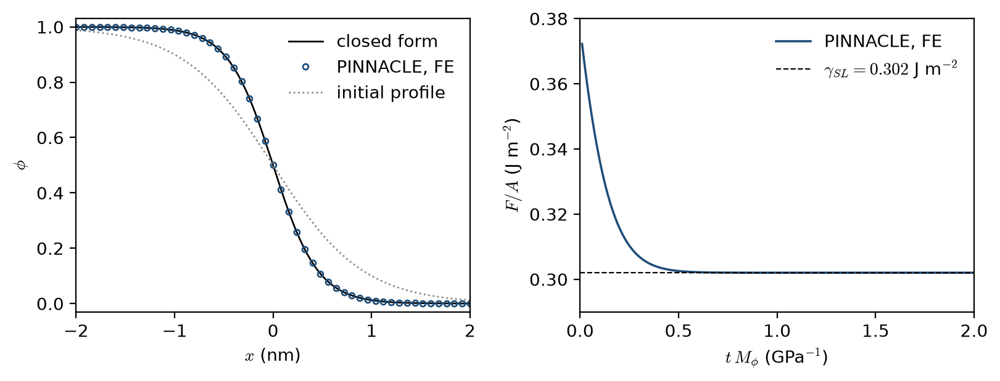
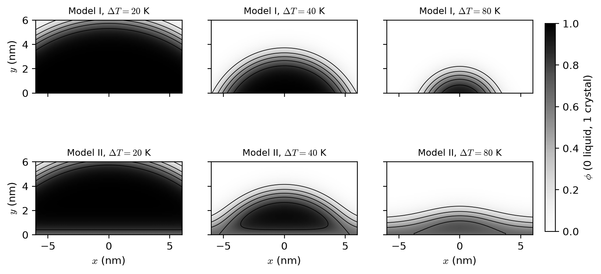
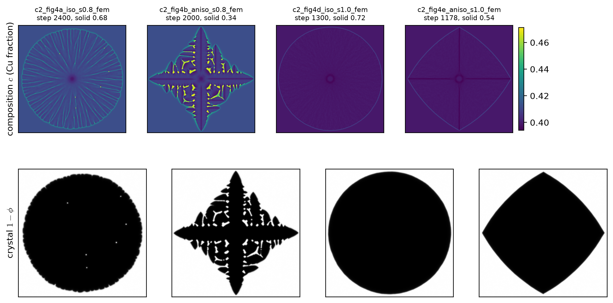
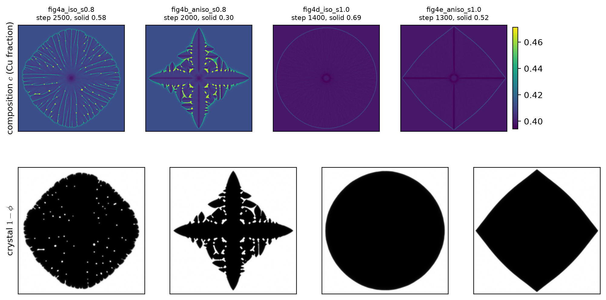

# Phase-field crystallization benchmark of PINNACLE (Part IV)

Status 2026-11-17: stage A (single-field model, cases A1 to A5) and stage B (walls and
noise, cases B1 and B2) are complete on the FE route; the stationary cases A1 and A3 are also
done on the PINN and PINN+FEM routes. Of stage C (binary and orientation-field models) the single-crystal growth forms of the binary
model are done (C1, C2); the orientation field (C3 to C6) and stage D (phase-field crystal)
have no results yet. Plan: `docs/14_phase_field_crystallization_plan.md`. Abstract and introduction are written when all stages are done.

Guide papers: (granasy 2019 nucleation), cited below as "the review", and
(granasy 2005 spherulites); for case B1 also (granasy 2007 heterogeneous). PINNACLE revision:
`ddaeb91` (ADR 0037) for sections 3.2 to 3.5, `cd2d3d3` (ADR 0038) for section 3.1's family and
scan and for stage B, `cd2288f` (ADR 0039) for stage C, all on `feat/pinn_benchmark`. Reproduction: `docs/reproduce_crystallization.md`.
Every deck named here is a complete input: `pinnacle run <deck>`.

## 1. The single-field model

The local state is one non-conserved order parameter, $\phi = 0$ in the liquid and
$\phi = 1$ in the crystal. The free energy of the review's Eq. 12, isotropic ($s = 1$), is

$$
F[\phi] = \int \Bigl\{ \frac{\epsilon^2}{2}\,|\nabla\phi|^2 + w\,g(\phi) + p(\phi)\,\Delta f \Bigr\}\,dV ,
$$

with the double well $g$, the interpolation function $p$ ($p(0) = 0$, $p(1) = 1$) and the
driving force $\Delta f = f_s - f_l < 0$ in the undercooled liquid. The standard choice is

$$
g = \tfrac14\,\phi^2(1-\phi)^2 , \qquad p = \phi^3(10 - 15\phi + 6\phi^2) .
$$

Relaxational (Allen-Cahn) dynamics, the review's Eq. 16 without noise:

$$
\dot\phi = -M_\phi\,\frac{\delta F}{\delta\phi}
         = M_\phi \bigl\{ \epsilon^2\nabla^2\phi - w\,g'(\phi) - p'(\phi)\,\Delta f \bigr\} .
$$

In PINNACLE the three terms are three kernels on one variable: `time_derivative`,
`ac_interface` (gradient coefficient $\epsilon^2$, mobility $M_\phi$) and `ac_bulk` bound to a
`parsed_free_energy` material that holds $w\,g + p\,\Delta f$ as an expression.

### 1.1 Closed forms used as targets

Planar interface at the melting point ($\Delta f = 0$). The first integral of the stationary
equation, $\tfrac12\epsilon^2\phi_x^2 = w\,g(\phi)$, gives for the quartic well

$$
\phi(x) = \frac{1}{1 + e^{x/\delta}}, \qquad \delta = \sqrt{2\epsilon^2/w}, \qquad
\gamma_{SL} = \int \epsilon^2\phi_x^2\,dx = \frac{\epsilon^2}{6\,\delta}, \qquad
d_{10\text{-}90} = 2\ln 9\;\delta .
$$

For a general well, $\gamma_{SL} = \epsilon\sqrt{2w}\int_0^1\!\sqrt g\,d\phi$ and
$d_{10\text{-}90} = (\epsilon/\sqrt{2w})\int_{0.1}^{0.9} d\phi/\sqrt g$; these two relations fix
$\epsilon^2$ and $w$ from the interface free energy and thickness for any $g$ of the review's
Table 1.

Steady front. With $p = \phi^2(3-2\phi)$ the travelling profile is the equilibrium logistic
and the velocity is

$$
v = -6\,M_\phi\,\Delta f\,\delta \;=\; -12\,M_\phi\,\Delta f\,\sqrt{\epsilon^2/(2w)} ,
$$

the expression quoted in the review after Eq. 16. For the standard $p$ there is no closed
form; the reference is the travelling-wave solution $\phi(x - vt)$ of
$\epsilon^2\phi'' + (v/M_\phi)\,\phi' = w g' + p'\Delta f$ found by shooting on $v$.

Critical nucleus. The stationary state with spherical symmetry and liquid far away solves the
review's Eq. 15,

$$
\phi'' + \frac{2}{r}\,\phi' = \frac{1}{\epsilon^2}\bigl\{ w\,g'(\phi) + p'(\phi)\,\Delta f \bigr\},
\qquad \phi'(0) = 0, \quad \phi(\infty) = 0 ,
$$

and its excess free energy is the nucleation barrier $W^* = F[\phi^*]$. It is a saddle point
of $F$. The classical droplet with a sharp interface gives $R^* = 2\gamma/|\Delta f|$ and
$W^*_{CNT} = \tfrac{16\pi}{3}\gamma^3/\Delta f^2$.

### 1.2 Material: nickel

Values of the review's Table 2 (`reported_table`): $\gamma_{SL,eq} = 0.302$ J m$^{-2}$,
$d_{10\text{-}90} = 1.0$ nm, $\Delta H_f = 17.29$ kJ mol$^{-1}$, $T_f = 1728.3$ K,
$\rho = 8357$ kg m$^{-3}$, molar mass 58.6934 g mol$^{-1}$; Turnbull's driving force
$\Delta f = \Delta H_f (T - T_f)/(T_f v_m)$.

Derived (`derived`): $v_m = 7.0233\times10^{-6}$ m$^3$ mol$^{-1}$,
$\Delta H_f/v_m = 2.46182$ GPa, and at $T_f$: $\epsilon^2 = 0.412338$ aJ nm$^{-1}$,
$w = 15.92548$ GPa, $\delta = 0.227560$ nm.

Temperature dependence. The review states that $\epsilon^2 \propto T$ and $w \propto T$ give
$\gamma_{SL} \propto T$ at constant thickness, and uses $\gamma = \gamma_{eq}T/T_f$ for the
droplet-model line of its Fig. 3; it does not say which scaling the 'standard PF' line uses.
This was settled by computation (section 3.1): the published line is reproduced with the
proportional scaling and missed by 62 to 176 % with constant $\epsilon^2$ and $w$. Every Ni
deck uses the proportional scaling (`derived`).

The decks use nm, aJ and GPa (1 aJ nm$^{-3}$ = 1 GPa) and $M_\phi = 1$, so time is in units
of $1/(M_\phi\,\mathrm{GPa})$.

## 2. Routes and what PINNACLE needed

| route | executioner | how a stationary state is obtained |
|---|---|---|
| FE | `pf_fem_transient` | one backward-Euler step with $\Delta t = 10^{12}$: Newton's method on the weak stationary equation, started from the initial condition |
| PINN | `pf_pinn_stationary` | a network $\phi_\theta(\mathbf x)$ is fitted to the initial condition, then trained on the squared stationary residual |
| PINN+FEM | `pf_pinn_fem_hybrid` | the briefly trained network is the start of the FE Newton solve, whose result is reported |

Spherical symmetry is a property of the mesh: `[Mesh] coordinate_system = spherical` puts the
volume element $4\pi r^2$ into every quadrature weight, so the weak form
$(\epsilon^2\phi', \psi')_{4\pi r^2} + (f', \psi)_{4\pi r^2} = 0$ is the radial equation above
with the symmetry condition at $r = 0$ natural, and the energy monitor returns $W^*$. In the
strong form the interface kernel adds $(2/r)\,\phi'$; the stationary network reads $r^2$, so
$\phi'(0) = 0$ holds for any weights.

Why a separate stationary network. A saddle of $F$ is unstable under the gradient flow, so a
time-dependent PINN cannot hold it. Every stationary state is a zero, hence a minimum, of
the loss $\langle(\delta F/\delta\phi)^2\rangle$. The liquid $\phi \equiv 0$ is a zero as well;
the loss is therefore divided by
$\min\bigl(1, \langle\phi^2\rangle/\langle\phi_{guess}^2\rangle\bigr)^p$ (`deflation_power`),
which leaves the nucleus a minimum and removes the liquid from the minima.

These capabilities did not exist at PINNACLE `9548123` and were added for this part
(ADR 0037, commit `ddaeb91`): the curvilinear volume element, the field time series of
`pf_fem_transient`, parsed free energies on the PINN path, the two executioners, and sparse
storage of the linear operators. The earlier `pinn_fem_hybrid` on an Allen-Cahn deck returns
a zero field and is not used.

## 3. Results

Accuracy tiers follow `PROJECT_GUIDELINES.md` section 5. The reference solutions of
`scripts/cryst_reference.py` are independent of PINNACLE (closed forms; SciPy DOP853 shooting,
relative tolerance $10^{-11}$): agreement with them is tier 2. Agreement with the review's
published curve is tier 3. No experiment enters this stage.

### 3.1 A3: critical nucleus in undercooled Ni (review Fig. 3)

Decks `decks/crystallization/single_field/a3_ni_nucleus_x<ΔT/T_f>_fem.i`, nine reduced
undercoolings from 0.10 to 0.30; radial line of 12 to 23 nm (ten equimolar radii),
$h = 0.005$ nm.

*Critical nucleus in Ni. Left: radial profiles (lines: reference; circles: PINNACLE FE).
Middle: barrier against undercooling, with the digitized 'standard PF' line of the review's
Fig. 3(c). Right: equimolar radius against the classical radius.*

| $\Delta T/T_f$ | $W^*/kT$ FE | reference | published (digitized) | droplet model | $\phi(0)$ | $R_e$ (Å) |
|---|---|---|---|---|---|---|
| 0.100 | 255.26 | 255.26 | outside the axis | 258.49 | 0.9989 | 22.57 |
| 0.150 | 99.23 | 99.22 | 100.4 | 102.47 | 0.9756 | 14.76 |
| 0.175 | 67.68 | 67.68 | 67.6 | 70.92 | 0.9452 | 12.67 |
| 0.200 | 47.87 | 47.86 | 48.0 | 51.06 | 0.9035 | 11.18 |
| 0.225 | 34.77 | 34.77 | 34.8 | 37.86 | 0.8551 | 10.07 |
| 0.250 | 25.80 | 25.79 | 25.8 | 28.72 | 0.8037 | 9.22 |
| 0.275 | 19.46 | 19.46 | 19.6 | 22.18 | 0.7519 | 8.54 |
| 0.300 | 14.90 | 14.90 | 15.7 (read at 0.295, the end of the line) | 17.37 | 0.7014 | 7.99 |

- FE against the reference (tier 2): $W^*$ within $2.2\times10^{-5}$ relative on all nine
  runs, $\phi(0)$ within $4\times10^{-5}$, $R_e$ within $2.2\times10^{-5}$; 3 to 5 Newton
  iterations, 0.8 to 1.1 s per run.
- Reference against the published line (tier 3): within 1.1 % between 0.15 and 0.275. The
  digitized stroke is 2.7 $kT$ thick (half thickness 1.4 $kT$, the extraction uncertainty;
  `data/digitized/cryst_review_fig3c_standard_pf.csv`, method in
  `scripts/cryst_digitize_fig3c.py`).
- The diffuse nucleus lies 1 to 14 % below the droplet model, and its centre is not bulk
  crystal at large undercooling ($\phi(0) = 0.70$ at 0.30), as in the review's Fig. 3(b).

The three routes at $\Delta T/T_f = 0.20$ (decks `a3_ni_nucleus_x0.200_{fem,pinn,hybrid}.i`;
reference $W^* = 0.913705$ aJ $= 47.865\,kT$):

| route | initial guess | $W^*$ (aJ), seed 0 | relative error over 5 seeds: mean ± std, worst | wall time |
|---|---|---|---|---|
| FE | droplet fitted to the reference | 0.913726 | $+2.2\times10^{-5}$ (deterministic) | 0.8 s |
| PINN | classical droplet, $R = 2\gamma/\lvert\Delta f\rvert$ | 0.913756 | $(+6.6 \pm 5.8)\times10^{-5}$, $1.7\times10^{-4}$ | 8 to 11 s |
| PINN+FEM | classical droplet | 0.913726 | $+2.2\times10^{-5}$, the FE value on every seed | 9 to 14 s |

- The PINN+FEM result equals the FE result to all printed digits because the corrector is
  the same Newton solve; the network's field was within $1.0$ to $7.1\times10^{-4}$ (relative
  L2) of it and the corrector took 3 iterations on every seed.
- In accuracy and time the network routes do not beat the FE route on this case.

All nine undercoolings on the network routes (decks `a3_ni_nucleus_x<...>_{pinn,hybrid}.i`,
seed 0, every run started from the classical droplet $R = 2\gamma/|\Delta f|$ with full
amplitude, which needs no reference solution):

| $\Delta T/T_f$ | 0.100 | 0.125 | 0.150 | 0.175 | 0.200 | 0.225 | 0.250 | 0.275 | 0.300 |
|---|---|---|---|---|---|---|---|---|---|
| PINN, error of $W^*$ ($10^{-5}$) | 15.1 | 1.6 | 1.5 | 7.5 | 4.9 | 23.7 | 4.3 | 8.1 | 5.9 |
| PINN+FEM, error of $W^*$ ($10^{-5}$) | 1.4 | 1.2 | 1.5 | 1.3 | 1.6 | 1.4 | 1.8 | 1.6 | 2.0 |
| PINN+FEM, corrector iterations | 3 | 4 | 3 | 3 | 3 | 3 | 3 | 3 | 3 |

All 18 runs reach the nucleus. The PINN+FEM errors are the FE mesh errors of the first table.

Range of initial guesses (`scripts/cryst_guess_scan.py`): the three decks of the 0.20 case
were started from full-amplitude droplets of 0.4 to 2.0 classical radii.

| guess radius / classical radius | 0.40 | 0.55 | 0.70 | 0.85 | 1.00 | 1.15 | 1.30 | 1.60 | 2.00 |
|---|---|---|---|---|---|---|---|---|---|
| FE (stationary Newton) | no convergence | liquid | liquid | nucleus | nucleus | nucleus | nucleus | no convergence | no convergence |
| PINN (deflated residual) | nucleus | nucleus | nucleus | nucleus | nucleus | nucleus | nucleus | nucleus | nucleus |
| PINN+FEM | nucleus | nucleus | nucleus | nucleus | nucleus | nucleus | nucleus | nucleus | nucleus |

This is where the routes differ. Newton's method on the stationary equation reaches the
saddle only from 0.85 to 1.3 classical radii; from smaller droplets it converges to the
liquid (a stationary state as well), from larger ones it does not converge. The stationary
network reaches the nucleus from every start tested (errors $2\times10^{-5}$ to
$1.9\times10^{-4}$, 8 to 16 s), and with the FE corrector behind it the result has FE accuracy
from every start (9 to 16 s). A third answer to the same problem, on the FE route alone, is
the constrained saddle search of section 4.1 (`pf_fem_saddle`).

### 3.2 A4: other double-well and interpolation functions (review Fig. 5)

Decks `a4_ni_nucleus_<well>_<interpolation>_x<...>_fem.i`: the GL-fcc well
$g = \phi^2(1-\phi^2)^2/6$ and the interpolations $p_{bcc} = \phi^3(4-3\phi)$,
$p_{fcc} = \phi^4(3-2\phi^2)$ of the review's Table 1, each with $\epsilon^2$ and $w$ matched to
the same $\gamma_{SL}$ and thickness.

*Lines: reference. Circles: PINNACLE FE.*

| $\Delta T/T_f$ | standard | $g_{fcc}$ & $p_{PF}$ | GL $g_{bcc}$ & $p_{bcc}$ | GL $g_{fcc}$ & $p_{fcc}$ |
|---|---|---|---|---|
| 0.15 | 99.2 | 85.4 | 147.3 | 175.0 |
| 0.20 | 47.9 | 37.6 | 81.3 | 102.2 |
| 0.25 | 25.8 | 17.6 | 50.3 | 67.0 |
| 0.30 | 14.9 | 8.6 | 33.2 | 47.2 |

All twelve FE runs are within $2.2\times10^{-5}$ of the reference (tier 2). The ordering and
the sensitivity are those of the review's Fig. 5: the Ginzburg-Landau pairs give barriers 1.5 to 3.2 times that of the standard pair, and
changing $g$ alone (first two columns) lowers it by 14 to 43 %. The
published curves of Fig. 5 were not digitized; the comparison with that figure is
qualitative (ordering and magnitude at 0.15 to 0.30).

### 3.3 A1: planar interface

Decks `a1_planar_interface_{fem,pinn,hybrid}.i`. FE: an interface twice too wide relaxes over
200 steps of $\Delta t = 0.01$ (relaxation time $\delta^2/(M_\phi\epsilon^2) = 0.126$).

| route | $\gamma_{SL}$ (J m$^{-2}$) | profile, max deviation from the logistic | 10-90 % width (nm) | note |
|---|---|---|---|---|
| target | 0.302000 | | 1.0000 | inputs of the parameter derivation |
| FE (time march) | 0.302005 | $3.2\times10^{-6}$ | 1.0000 | interface stays at $x = 0$ |
| PINN | 0.302005 (5 seeds: $+1.7\times10^{-5} \pm 1.5\times10^{-6}$) | $1.5\times10^{-4}$ | 1.0001 | interface at $x = 0.081$ nm (seed 0) |
| PINN+FEM | 0.302005 on every seed | $4.7\times10^{-6}$ | 1.0001 | interface at $x = 0.047$ nm; 4 to 19 corrector iterations |

Limit of the stationary routes on this case: the stationary equation does not fix the
position of a planar interface (translation invariance), and the two Dirichlet ends pin it
only exponentially weakly. Both stationary routes return the correct profile and energy at a
position shifted by 0.05 to 0.08 nm from the guess; the hybrid's corrector needs up to 19
iterations because its matrix is nearly singular along that shift, and the reported
prediction distance (0.07 to 2.7 %) is mostly the shift. The time march has no such freedom.

### 3.4 A2: steady crystallization front

Decks `a2_front_velocity_{tanh,standard}_fem.i`, $\Delta T/T_f = 0.20$, 40 nm, $h = 0.01$ nm,
BDF2 with $\Delta t = 0.02$ to $t = 35$; velocity from a linear fit of the solid length
$\int\phi\,dx$ for $t > 5$.

| $p$ | $v/M_\phi$ FE (nm GPa) | reference | relative error |
|---|---|---|---|
| $\phi^2(3-2\phi)$ | 0.672180 | 0.672253 (closed form) | $-1.1\times10^{-4}$ |
| $\phi^3(10-15\phi+6\phi^2)$ | 0.644397 | 0.644490 (travelling wave) | $-1.4\times10^{-4}$ |

The free energy falls at the rate $v\,\Delta f$ to ten digits in both runs, which is the
energy balance of a steady front. Tier 2.

### 3.5 A5: seeds below and above the critical size

Decks `a5_seed_{sub,super}critical_fem.i`: the tanh droplet fitted to the nucleus of case A3
with its radius multiplied by 0.9 and by 1.1, marched in time with the spherical volume
element.

The smaller seed melts (solid volume 4.2 nm$^3$ to zero by $t \approx 2.6$), the larger one
grows without bound; both start below the barrier ($F = 0.890$ and $0.887$ aJ against
$W^* = 0.9137$ aJ) and their free energy only decreases. This is the saddle-point character
of the nucleus shown by the dynamics, and the reason a time march cannot produce case A3.
Consistency check of A3 by an independent route in the same code (tier 1).

### 3.6 Animations

`figures/crystallization/a1_planar_interface.gif`, `a2_front_velocity_standard.gif`,
`a5_seed_subcritical.gif`, `a5_seed_supercritical.gif`: the profile over time from the
`fields_step*.vtk` series every run writes (`snapshots_every`).

## 4. Stage B: a wall, and thermal noise

### 4.1 B1: heterogeneous nucleation on a wall (review Fig. 6)

Model. A foreign wall adds a surface term to the free energy (review Eq. 17),

$$
F = \int \Bigl\{ \frac{\epsilon^2}{2}|\nabla\phi|^2 + w g(\phi) + p(\phi)\Delta f \Bigr\}\,dV
  + \int_{\text{wall}} Z(\phi)\,dS , \qquad
  \epsilon^2\,\mathbf n\!\cdot\!\nabla\phi = -Z'(\phi) \ \text{on the wall}
$$

($\mathbf n$ outward). The two realizations of (granasy 2007 heterogeneous):

- Model I: the wall leaves the planar interface profile undisturbed. With the first integral
  $|\nabla\phi| = \phi(1-\phi)/\delta$ at the melting point and
  $\mathbf n\cdot\nabla\phi = |\nabla\phi|\cos\Psi$ this gives
  $\epsilon^2\,\mathbf n\cdot\nabla\phi = 6\gamma\cos\Psi\,\phi(1-\phi)$, i.e.
  $Z = -\gamma\cos\Psi\,(3\phi^2 - 2\phi^3)$ and Young's equation
  $\gamma_{WL} - \gamma_{WS} = \gamma\cos\Psi$ with sharp wall interfaces.
  The barrier is $W_I = F$ including the wall term.
- Model II: the order parameter is prescribed on the wall, $\phi = \phi_0$, which orders the
  liquid next to it; $\cos\Psi = -1 + 6\phi_0^2 - 4\phi_0^3$ ($\phi_0 = 2/3$:
  $\Psi = 61.2^\circ$). The barrier is the free energy of the nucleus on the wall minus that
  of the wall layer alone. The layer exists while $w g + p\Delta f > 0$ on $(0, \phi_0]$; at
  $\Delta f = -w\,g(\phi_0)/p(\phi_0) = -w/64$ it loses stability and the barrier vanishes.

The sharp-interface counterpart in two dimensions is the circular cap,
$W_{cap} = (\gamma^2/|\Delta f|)\,(\Psi - \sin\Psi\cos\Psi)$.

Parameters. The review does not give the data behind its Fig. 6. They are in the original
paper (arXiv cond-mat/0608375, footnote 16; `reported_text`): $\gamma_{SL} = 0.364$ J m$^{-2}$,
interface thickness 2 nm, $L = 2.666\times10^9$ J m$^{-3}$, $T_m = 1728$ K, with $\epsilon^2$
and $w$ multiplied by $T$. The decks are in scaled units (lengths in
$\delta = \sqrt{2\epsilon^2/w} = 0.4551$ nm, $\epsilon^2 = 0.5$, $w = 1$, $\gamma = 1/12$), in
which the undercooling enters only through
$D = \Delta f/w(T) = -0.27778\,\Delta T/(T_m - \Delta T)$. Check of the parameters: $D = -1/64$
at $\Delta T = 92.0$ K, the critical undercooling of Model II that both papers state.

How it is solved. Half of the symmetric nucleus, wall at $y = 0$, $h = 0.25\,\delta$ ($0.4\,\delta$
at 10 K), 14 to 38 thousand nodes. The plain stationary Newton solve of stage A fails here:
for Model II at 40 K a circular cap of 0.97 classical radii falls onto the wall layer and one
of 1.00 runs to a grown crystal. The decks use `pf_fem_saddle` (ADR 0038): at a fixed amount
of crystal $V = \int\omega\phi\,dV$ the nucleus is a minimum, which Newton finds; the
multiplier $\lambda$ of that constraint is the force along the unstable direction, and the
amount is moved until $\lambda = 0$; a plain Newton step then removes the constraint. Every
deck starts from the classical cap. Two findings on the constraint: with the total amount
($\omega = 1$) the Model II search converged to the saddle of a uniformly thickened wall film
(a real stationary state of the box, with 2 to 2.5 times the energy), and in a large domain
the constrained droplet evaporates into a dilute uniform field; a weight $\omega$ that is 1
around the nucleus removes both, and is the default.

*Critical nuclei on the wall ($y = 0$), contour lines at $\phi = 1/6 \ldots 5/6$ as in the
review's Fig. 6. Model I: a cap meeting a bare wall. Model II: the nucleus merges into the
ordered wall layer and flattens toward the critical undercooling.*

| $\Delta T$ (K) | 10 | 20 | 30 | 40 | 50 | 60 | 70 | 80 | 90 |
|---|---|---|---|---|---|---|---|---|---|
| Model I, FE, cap with $\gamma(T_m)$ | 0.991 | 0.975 | 0.960 | 0.943 | 0.924 | 0.903 | 0.880 | 0.854 | 0.827 |
| Model I, published | | | 0.967 | 0.950 | 0.930 | 0.911 | 0.885 | 0.861 | 0.833 |
| Model II, FE, cap with $\gamma(T_m)$ | 0.909 | 0.810 | 0.709 | 0.600 | 0.483 | 0.359 | 0.233 | 0.112 | |
| Model II, published | | 0.816 | 0.714 | 0.604 | 0.488 | 0.362 | 0.235 | 0.118 | |
| Model I, wall angle measured (deg) | 62.4 | 61.9 | 61.8 | 61.6 | 61.5 | 61.3 | 61.2 | 60.8 | 60.7 |

- Agreement with the published curves (tier 3): within 0.008 for Model I and 0.006 for
  Model II at every undercooling, against a digitization half-stroke of 0.004
  (`data/digitized/cryst_review_fig6_barriers.csv`, `scripts/cryst_digitize_fig6.py`). The
  FE values are systematically 0.002 to 0.008 lower.
- This agreement requires the cap to be evaluated with the melting-point interface energy.
  Neither paper states which $\gamma$ the normalization uses. With the model's own
  $\gamma(T) = \gamma\,T/T_m$ the ratio is higher by $(T_m/T)^2$ (crosses in the figure:
  Model I 0.92 instead of 0.83 at 90 K) and does not match the published line. Recorded as
  `derived`.
- Model I keeps the prescribed contact angle within 1.2 degrees; the angle of Model II is
  not constant (the papers say it falls toward complete wetting at the critical undercooling).
- Cost: 25 runs, 184 s in total on 2 threads; 3 to 8 volume iterations and 14 to 32 constrained
  Newton iterations per nucleus.
- Not obtained: Model I at 100 K (the constrained solve at the classical cap's amount does not
  converge) and Model II at 90 K, 2 K below the critical undercooling, where the nucleus and
  the bare layer nearly coincide and the search cannot separate the two zeros of $\lambda$.
- Network routes: not run. `pf_pinn_stationary` imposes Dirichlet values only; the Model I
  wall is a nonlinear flux condition, and for Model II the trivial state to be deflated is
  the non-uniform wall layer. Both are extensions of the executioner, not done here.

### 4.2 B2: noise-induced nucleation and transformation kinetics

Model. The Allen-Cahn equation with a Langevin term (review Eq. 16),

$$
\dot\phi = M_\phi\{\epsilon^2\nabla^2\phi - w g'(\phi) - p'(\phi)\Delta f\} + \zeta, \qquad
\langle\zeta(\mathbf r,t)\,\zeta(\mathbf r',t')\rangle = 2kTM_\phi\,\delta(\mathbf r-\mathbf r')\,\delta(t-t') .
$$

The noise produces crystal-like fluctuations in the undercooled liquid; those beyond the
critical size grow at the front velocity and impinge. For constant nucleation and growth
rates in $d$ dimensions the transformed fraction follows the Johnson-Mehl-Avrami-Kolmogorov
law (review Eq. 6),

$$
X(t) = 1 - \exp\{-[(t - t_0)/\tau]^p\}, \qquad p = 1 + d = 3 \ \text{in two dimensions} ,
$$

and the review reports $p = 2.9$ to $3.0$ for phase-field runs of this kind (its section
3.1.1.3 and Fig. 10); the orientation-field run of (granasy 2005 spherulites) gives
$3.04 \pm 0.02$.

Deck `decks/crystallization/noise/b2_jmak_2d_fem.i`: a generic single-field case in scaled
units ($\epsilon^2 = 0.5$, $w = 1$, $M_\phi = 1$; all parameters `assumed`, no material),
$\Delta f/w = -0.20$, $160 \times 160\,\delta$ on $320 \times 320$ elements (103,041 nodes),
no-flux boundaries, backward Euler with $\Delta t = 0.1$, 350 steps. Two properties of the
noise term had to be added to PINNACLE (ADR 0038):

- strength: the draw at a quadrature point of volume $w_q$ over a step $\Delta t$ has the
  variance $A^2/(w_q\Delta t)$ with $A^2 = 2kTM_\phi = 0.0064$ (`scaling = white`), so the
  discrete noise represents the correlator above on any mesh and step;
- where it acts: in the liquid only, amplitude $\propto 1 - p(\phi)$ (`state_factor`), the
  form $\zeta = \zeta_s + (\zeta_l - \zeta_s)\,p$ of the guide papers with $\zeta_s = 0$. This
  is required, not cosmetic: with the standard $p$ the free energy is unbounded below for
  $\phi > 1$ under a driving force, and a noise acting inside the crystal kicked the field
  past the barrier above 1 in every trial run ($\phi$ reached 16 before Newton failed).

*Left: transformed fraction (area with $\phi > 0.5$) and the fitted law. Middle: Avrami plot.
Right: number of separate crystal regions; it rises with nucleation and falls with
impingement.*

| quantity | value |
|---|---|
| fit window | $0.01 < X < 0.95$, 24 snapshots |
| Avrami exponent $p$ | $2.89 \pm 0.05$ (standard error of the fit) |
| $t_0$, $\tau$ | $6.85 \pm 0.13$, $8.93 \pm 0.13$ |
| rms residual of the fit | 0.003 in $X$ |
| largest number of separate crystals | 95 |
| reference values of the run | front velocity 0.821 $\delta$ per time unit (travelling wave); 2-D nucleus $W^* = 0.0251\,w\delta^2 = 7.8\,kT$ (shooting solution) |

- The exponent is 2.2 standard errors below the theoretical 3 and inside the 2.9 to 3.0
  range the review quotes (tier 3, statistical). It is one realization: the spread over
  seeds is not measured, so the standard error of the fit understates the uncertainty.
- The first two points of the Avrami plot lie above the line: before $t_0$ the area with
  $\phi > 0.5$ already counts subcritical fluctuations.
- Wall time 30 min on 6 threads (the direct sparse solve of 103,041 unknowns at every Newton
  iteration; 3 to 4 iterations per step, no cutback).
- Animation: `figures/crystallization/b2_jmak.gif` (71 frames).

Why the noise-driven cases have no PINN route. A physics-informed network represents the
solution as a deterministic function $\phi_\theta(\mathbf x, t)$ and is trained to make the
residual of the equation vanish at collocation points. In a Langevin equation the forcing
$\zeta$ is not a function but a realization of a random field with no correlation in space
or time:

1. there is nothing smooth to fit: on a grid the forcing has variance $A^2/(w_q\Delta t)$,
   which grows without bound under refinement, and the pattern (where and when each
   nucleus appears) is set by those individual draws. A network of $(\mathbf x, t)$ has no
   input that carries them; to reproduce one realization it would have to store the
   $10^5 \times 350$ independent numbers of this run in its weights;
2. the residual cannot be evaluated pointwise: $\zeta$ exists only as increments over cells
   and steps (the equation is meaningful in its integrated, Ito form), while a strong-form
   loss differentiates $\phi_\theta$ at points;
3. without the noise the problem has the trivial solution $\phi \equiv 0$: the metastable
   liquid never nucleates, so dropping the term removes the phenomenon.

What a network can do for such a model is a different task from solving this equation:
learn statistics of the ensemble (for example $X(t)$ as a function of the parameters, the
surrogate route of the earlier parts), or solve the deterministic pieces around the noise
(the critical nucleus of section 3.1, the growth of one seed). PINNACLE refuses
`langevin_noise` on the PINN path for the first two reasons. The cases of
(granasy 2005 spherulites) are all noise driven (growth-front nucleation) and are therefore
FE-only in stage C.

## 5. Stage C, first part: the binary model and single-crystal growth forms

Stage C follows (granasy 2005 spherulites). This part covers the two-field (phase and
composition) model with one crystal orientation, case C2 (the paper's Fig. 4 a, b, d, e), and
the orientational free energy by itself (C1). The orientation field and the polycrystalline
cases (C3 to C6) are not done yet.

### 5.1 Model

Convention of that paper: $\phi = 1$ liquid, $\phi = 0$ crystal; $c$ is the Cu fraction of a
Cu-Ni ideal solution at 1574 K. The free-energy density is
$f = w(c)\,T g(\phi) + [1 - p(\phi)]\,f_S(c) + p(\phi)\,f_L(c)$ with
$f_{S,L} = (1-c) f^{Ni}_{S,L} + c f^{Cu}_{S,L} + \tfrac{RT}{v_m}[c\ln c + (1-c)\ln(1-c)]$, and
the interface energy $\gamma = \gamma_0\,s(\vartheta)$, $s = 1 + s_0\cos[k(\vartheta - \vartheta_0)]$,
$\vartheta = \operatorname{atan2}(\phi_y, \phi_x)$. In the paper's dimensionless form (lengths in
$\xi = 2.1\times10^{-4}$ cm, time in $\xi^2/D_l$; its Eq. 2.3 and 2.4):

$$
\dot\phi = m_\phi\bigl\{\nabla\!\cdot\![\,s^2\nabla\phi + s\,s'\,\nabla^{\perp}\phi\,]
           - a_w(c)\,g'(\phi) - p'(\phi)\,b(c)\bigr\} + \zeta_\phi ,
$$

$$
\dot c = \nabla\!\cdot\!\bigl\{\lambda(\phi)\,[\,\nabla c - c(1-c)\,(q_f\,p'(\phi) + q_w\,g'(\phi))\,\nabla\phi\,]\bigr\},
\qquad \lambda = p(\phi)\ (D_s = 0) ,
$$

with $a_w = \xi^2 w/\epsilon^2$, $b = \xi^2 (f_L - f_S)/(\epsilon^2 T)$ (both linear in $c$),
$q_f = v_m(\Delta f_{Ni} - \Delta f_{Cu})/RT$ and $q_w = v_m(w_{Ni} - w_{Cu})/R$. The composition
equation needs no logarithm: with the mobility $\tfrac{v_m}{RT}D\,c(1-c)$ of the paper,
$c(1-c)\nabla\ln\tfrac{c}{1-c} = \nabla c$. At zero flux
$\ln\tfrac{c}{1-c} - q_f\,p(\phi) - q_w\,g(\phi)$ is uniform, which is the common tangent:
$c_L = 0.466219$, $c_S = 0.399112$. The supersaturation is $S = (c_L - c_\infty)/(c_L - c_S)$.

Parameters and their provenance are tabulated in `docs/14_phase_field_crystallization_plan.md`,
section 7.2. In short: Table I of the paper and its stated rescaling give
$a_w = 1.020\times10^4$, $b = 1.096\times10^5\,(1-c) - 1.438\times10^5\,c$, $q_f = 0.27384$,
$q_w = 2.5\times10^{-5}$ (`derived`); $v_m = 7.4$ cm$^3$ mol$^{-1}$ is the one value that returns
the published $c_L$ and $c_S$ to six digits (`derived`); grid and step are the paper's
($\Delta x = 6.25\times10^{-3}$, $\Delta t = 4.75\times10^{-6}$, $500\times500$, periodic). Not given
in any source read and `assumed` here: the seed (a disc of 12 cells at the solidus
composition), the number of steps, and what the noise amplitude 0.0025 multiplies (taken as
the standard deviation of the nodal increment per step, in the liquid only). The composition
noise of the paper is not applied.

### 5.2 C1: orientational free energy (paper Fig. 3)

$f_{ori} \propto x F_0 + (1-x) F_1$ with $F_0 = |\sin(2\pi m u)|$ for $u < 3/(4m)$ and
$F_1 = |\sin(2\pi n u)|$ for $u < 1/(4n)$, both 1 beyond, $u = \xi_0|\nabla\theta|$.
For $k = 2$, $m = 3$, $n = 1/2$, $x = 0.2$ (`scripts/cryst_orientation_energy.py`): local maximum
at 21.4 degrees of misorientation (caption: "about 20"), metastable minimum at 30.0 degrees
with $f_{ori} = 0.400$, value 1 at 90 degrees, as in the paper's Fig. 3. This is the function
only; no PINNACLE component uses it yet.

### 5.3 C2: single-crystal growth forms (paper Fig. 4 a, b, d, e)

Two implementations of the same equations:

- an independent reference, explicit finite differences on the paper's grid
  (`scripts/cryst_binary_reference.py`, five-point Laplacian, face-centred solute flux);
- PINNACLE: decks `decks/crystallization/binary/c2_fig4{a,b,d,e}_*_fem.i`, kernels
  `wb_phase_bulk`, `ac_interface_anisotropic`, `wb_solute_flux` under `pf_fem_explicit`
  (forward Euler, lumped mass, bilinear elements, periodic in both directions; ADR 0039).

Check of the two against each other (single crystal, $S = 1.0$, no noise, $200\times200$ cells,
equivalent radius after 500 steps): PINNACLE 100.2 cells, reference 93.0 cells, reference at
half the spacing 97.1 cells, Richardson estimate of the converged value 98.4 cells. At the
paper's resolution (the 10-90 % interface width is 9.9 cells) the front velocity carries a
discretization error of $-5.5$ % in the finite-difference code and $+1.8$ % in PINNACLE
(tier 2 for the trend, not a converged number: PINNACLE was not run at half the spacing).

*PINNACLE. Top: composition; bottom: crystal. Columns: Fig. 4(a) isotropic $S = 0.8$, (b)
four-fold $s_0 = 0.1$, $S = 0.8$, (d) isotropic $S = 1.0$, (e) four-fold $S = 1.0$.*

*The independent reference, same columns.*

| case | published form (Fig. 4) | PINNACLE | steps, wall time | solute drift |
|---|---|---|---|---|
| (a) isotropic, $S = 0.8$ | "seaweed": fingered front, liquid channels | circular envelope, front broken into about 60 cells, radial solute-rich channels | 2400, 42 min | $-2.3\times10^{-12}$ |
| (b) four-fold, $S = 0.8$ | symmetric dendrite | four arms with side branches, trapped liquid pockets at $c \approx c_L$ | 2000, 38 min | $-3.1\times10^{-12}$ |
| (d) isotropic, $S = 1.0$ | compact disc (solute trapping) | compact disc, $c \approx c_\infty$ inside | 1300, 27 min | $-1.9\times10^{-12}$ |
| (e) four-fold, $S = 1.0$ | rounded square with a cross | rounded square, cross along the arms | 1250, 26 min | $-1.6\times10^{-12}$ |

- Agreement with the published figure is of form (tier 3, qualitative): which cases are
  compact and which are fingered or dendritic, the four-fold symmetry, and the composition
  pattern (channels and pockets at the liquidus composition for $S = 0.8$, nearly uniform
  composition for $S = 1.0$). No number of Fig. 4 is available to compare.
- Difference from the published panel (a): the paper shows a few broad lobes, PINNACLE and
  the reference many narrow cells. Seed, noise amplitude and run length are assumed, and the
  scale of the instability depends on them; not resolved.
- The reference's isotropic crystal has a diamond-shaped outline, PINNACLE's is circular:
  the five-point stencil imprints the grid on an interface this thin, the bilinear elements
  do so less.
- Growth law: the equivalent radius grows as $t^{0.71}$ to $t^{0.80}$ in the four runs,
  between the diffusion-controlled $t^{1/2}$ and the interface-controlled $t^{1}$ the paper
  describes for small and large driving force.
- The four runs ran side by side (3 threads each). Animations:
  `figures/crystallization/c2_pinnacle_c2_fig4*_fem.gif` (composition over time) and the
  reference's `c2_reference_fig4*.gif`.
- Routes: FE only. These runs are driven by noise (section 4.2); the alloy kernels state
  that they have no PINN form.

## 6. Limits

- Network routes cover the stationary cases A1 and A3. The time-dependent cases A2 and A5
  need `pf_pinn`, which does not yet carry the spherical term (A5), and a per-step predictor
  for the hybrid; not run. B1 needs a flux boundary condition and a non-uniform deflation
  state in `pf_pinn_stationary`; not run. B2 has no PINN route (section 4.2).
- A4 was run on the FE route only.
- B1: two end points not obtained (Model I at 100 K, Model II at 90 K). The agreement with
  the published curves rests on two inferences recorded as `derived`: the cap normalized with
  $\gamma(T_m)$, and for A3 the proportional temperature scaling of $\epsilon^2$ and $w$.
- B2 is one realization on one mesh and one step; no seed, mesh or step study.
- C2: the seed, the run length and the meaning of the noise amplitude are assumptions; each
  case is one realization; panel (a) differs from the published one in the scale of the
  cells. The orientation field (C3 to C6) and the phase-field crystal (D) are not started.
- Neural results are over 5 seeds at $\Delta T/T_f = 0.20$ and one seed elsewhere. The cost
  of the development runs behind `pf_pinn_stationary` and `pf_fem_saddle` (about 40
  exploratory runs of 1 to 90 s) is not in the wall times of the tables.
- Hardware of every number: Intel Core i9-9980HK, 2 to 6 threads, float64, numpy backend for
  FE and torch 2.13.0 (CPU) for the network routes; no GPU on this machine.
