# Phase-field crystallization with PINNACLE: nucleation, growth forms and polycrystalline solidification (Part IV)

Status 2026-11-17. Complete: the single-field model (cases A1 to A5), a foreign wall (B1),
thermal noise and transformation kinetics (B2), the binary alloy model (C1, C2) and the
orientation-field model at the conditions of Fig. 4 and Fig. 5 of (granasy 2005 spherulites)
(C3). Open: parameter series for every model, the remaining orientation-field cases (C4 to
C6), the added cases E1 to E5, the eutectic, ternary, density-coupled and quaternion models,
and the phase-field crystal (D). Plan: `docs/14_phase_field_crystallization_plan.md`.
Reproduction: `docs/reproduce_crystallization.md`. Every deck named here is a complete input:
`pinnacle run <deck>`.

## Abstract

*Draft from the results available on 2026-11-17; to be revised when all cases are complete.*

We benchmark the phase-field module of the PINNACLE framework against published results on
crystal nucleation and polycrystalline growth. Five models are covered so far: a single-field
model of a pure undercooled melt, the same model with a foreign wall, with thermal noise, a
binary alloy model, and its extension by an orientation field. Each case is solved by finite
elements and, where the problem is deterministic and stationary, also by a physics-informed
network and by a network-started finite-element solve. Every result is compared with a
reference written independently of the framework and with the published figure. Finite-element
critical nuclei in nickel agree with a shooting solution to $2.2\times10^{-5}$ and with the
published barrier to 1.1 %; interface energy and front velocity agree with closed forms to
$1.4\times10^{-4}$. Nucleation barriers on a wall follow the published curves within 0.008 of
the normalized barrier. Noise-induced crystallization gives an Avrami exponent of
$3.14 \pm 0.29$ over five realizations, against the theoretical 3. The binary model reproduces
the four single-crystal growth forms, and the orientation-field model the single-crystal
dendrite, the polycrystalline dendrite and the spherulite, with crystal radii within 1.0 to
10.1 % of the independent reference. A network trained on the stationary residual reaches the
critical nucleus from initial guesses of 0.4 to 2.0 classical radii, where Newton's method
converges only from 0.85 to 1.3. Noise-driven cases have no network route. Parameters that
the sources do not state are marked as assumed.

## 1. Introduction

*To be written when all cases are complete.*

## 2. Methods

### 2.1 Framework components

A PINNACLE problem is composed in the input deck from registered kernels on named variables,
an executioner, and postprocessors. Table 1 lists what each model of this report uses. The
components marked with an ADR number were added to PINNACLE for this part (branch
`feat/pinn_benchmark`); they are registered, documented and tested in the framework.

**Table 1.** PINNACLE components by model.

| Model (section) | Variables | Kernels and boundary terms | Executioner | Added in |
|---|---|---|---|---|
| Single-field (3) | $\phi$ | `time_derivative`, `ac_interface`, `ac_bulk` with a `parsed_free_energy` material | `pf_fem_transient`, `pf_pinn_stationary`, `pf_pinn_fem_hybrid` | ADR 0037 (`ddaeb91`) |
| Wall (4) | $\phi$ | the same, plus the wetting boundary term (`flux_form = young`) or a Dirichlet value; postprocessor `wall_free_energy` | `pf_fem_saddle` | ADR 0038 (`cd2d3d3`) |
| Thermal noise (5) | $\phi$ | the same, plus `langevin_noise` (`scaling = white`, `state_factor`) | `pf_fem_transient` | ADR 0038 |
| Binary alloy (6) | $\phi$, $c$ | `wb_phase_bulk`, `ac_interface_anisotropic`, `wb_solute_flux`, `langevin_noise` | `pf_fem_explicit` | ADR 0039 (`cd2288f`) |
| Orientation field (7) | $\phi$, $c$, $\theta$ | the binary kernels, plus `orientation_grain_flux`, `orientation_phase_coupling`, `ac_interface_anisotropic orientation = theta`, initial condition `uniform_random` | `pf_fem_explicit` on the Torch (GPU) path, angular variable, sub-cycling | ADR 0040 (`8454620`, `ef9a7cd`) |
| Fibrillar growth, gallery, pinning (7.5) | $\phi$, $c$, $\theta$ | the same, with `kinetic_anisotropy_strength`, `kinetic_anisotropy_mode` of `ac_interface_anisotropic`; `pinned_fraction` of the executioner (orientation pinning centers); `driving_a_function`, `driving_b_function`, `bounded_interpolation` of `wb_phase_bulk` (temperature programs) | `pf_fem_explicit` | `24f86b3`, `94f9215` |
| Hard spheres (8) | $m$, $\phi$ (volume fraction) | `hs_phase_bulk`, `hs_density_equilibrium` (Hall equations of state), `ac_interface` | `pf_fem_transient` (one implicit step, Newton iteration) | ADR 0041 (`d35d88e`) |
| Regular-solution eutectic (10) | $\phi$, $c$, $\mu$ (auxiliary), $\theta$ | `rs_phase_bulk`, `rs_chemical_potential`, `rs_solute_flux`; `eo_grain_flux`, `eo_phase_coupling`, `eo_potential_coupling` | `pf_fem_explicit` with `auxiliary_variables` | ADR 0042 (`a2a7dad`) |
| Ternary eutectic (11) | $\phi$, $c_1$, $c_2$, $\mu_1$, $\mu_2$, $\mu_3$ (auxiliary) | `ts_phase_bulk`, `ts_chemical_potential`, `ts_solute_flux` | `pf_fem_explicit` with `auxiliary_variables` | ADR 0044 (`94f9215`) |
| Quaternion orientation field, three dimensions (9) | $\phi$, $c$, $q$ (4 components) | the binary kernels, plus `quaternion_grain_flux`, `quaternion_phase_coupling`, `cubic_kinetic_anisotropy` (`energy_shape = linear`); initial condition `random_unit_quaternion` | `pf_fem_explicit` with `unit_norm_variables` | ADR 0043 (`94f9215`, addendum `4bad49b`) |

Spherical symmetry is a property of the mesh: `[Mesh] coordinate_system = spherical` puts the
volume element $4\pi r^2$ into every quadrature weight, so the weak form
$(\epsilon^2\phi', \psi')_{4\pi r^2} + (f', \psi)_{4\pi r^2} = 0$ is the radial equation of
section 3.2 with the symmetry condition at $r = 0$ natural, and the energy monitor returns the
barrier. In the strong form the interface kernel adds $(2/r)\,\phi'$; the stationary network
reads $r^2$, so $\phi'(0) = 0$ holds for any weights.

The capabilities of ADR 0037 did not exist at PINNACLE `9548123`: the curvilinear volume
element, the field time series of `pf_fem_transient`, parsed free energies on the PINN path,
the two network executioners, and sparse storage of the linear operators. The earlier
`pinn_fem_hybrid` on an Allen-Cahn deck returns a zero field and is not used.

### 2.2 Solution routes

**Table 2.** The three routes for a stationary state.

| route | executioner | how a stationary state is obtained |
|---|---|---|
| FE | `pf_fem_transient` | one backward-Euler step with $\Delta t = 10^{12}$: Newton's method on the weak stationary equation, started from the initial condition |
| PINN | `pf_pinn_stationary` | a network $\phi_\theta(\mathbf x)$ is fitted to the initial condition, then trained on the squared stationary residual |
| PINN+FEM | `pf_pinn_fem_hybrid` | the briefly trained network is the start of the FE Newton solve, whose result is reported |

Time-dependent cases use the FE route: `pf_fem_transient` (implicit) for the single-field
model and `pf_fem_explicit` (forward Euler, lumped mass, bilinear elements, periodic node
identification) for the alloy models.

Why a separate stationary network. A saddle of the free energy $F$ is unstable under the
gradient flow, so a time-dependent PINN cannot hold it. Every stationary state is a zero,
hence a minimum, of the loss $\langle(\delta F/\delta\phi)^2\rangle$. The liquid
$\phi \equiv 0$ is a zero as well; the loss is therefore divided by
$\min\bigl(1, \langle\phi^2\rangle/\langle\phi_{guess}^2\rangle\bigr)^p$ (`deflation_power`),
which leaves the nucleus a minimum and removes the liquid from the minima.

Constrained saddle search on the FE route (`pf_fem_saddle`, ADR 0038). At a fixed amount of
crystal $V = \int\omega\phi\,dV$ the nucleus is a minimum, which Newton finds; the multiplier
$\lambda$ of that constraint is the force along the unstable direction, and the amount is
moved until $\lambda = 0$; a plain Newton step then removes the constraint.

Why the noise-driven cases have no PINN route. A physics-informed network represents the
solution as a deterministic function $\phi_\theta(\mathbf x, t)$ and is trained to make the
residual of the equation vanish at collocation points. In a Langevin equation the forcing
$\zeta$ is not a function but a realization of a random field with no correlation in space
or time:

1. there is nothing smooth to fit: on a grid the forcing has variance $A^2/(w_q\Delta t)$,
   which grows without bound under refinement, and the pattern (where and when each
   nucleus appears) is set by those individual draws. A network of $(\mathbf x, t)$ has no
   input that carries them; to reproduce one realization it would have to store the
   $10^5 \times 350$ independent numbers of the run of section 5 in its weights;
2. the residual cannot be evaluated pointwise: $\zeta$ exists only as increments over cells
   and steps (the equation is meaningful in its integrated, Ito form), while a strong-form
   loss differentiates $\phi_\theta$ at points;
3. without the noise the problem has the trivial solution $\phi \equiv 0$: the metastable
   liquid never nucleates, so dropping the term removes the phenomenon.

What a network can do for such a model is a different task from solving this equation:
learn statistics of the ensemble (for example the transformed fraction as a function of the
parameters, the surrogate route of the earlier parts), or solve the deterministic pieces
around the noise (the critical nucleus of section 3, the growth of one seed). PINNACLE
refuses `langevin_noise` on the PINN path for the first two reasons. The cases of
(granasy 2005 spherulites) are all noise driven (growth-front nucleation) and are therefore
FE-only in sections 6 and 7.

### 2.3 Independent references

Every PINNACLE result is compared with a solution that shares no code with the framework:

- `scripts/cryst_reference.py`: closed forms of the single-field model; the critical nucleus
  by shooting and the travelling front by shooting on the velocity (SciPy DOP853, relative
  tolerance $10^{-11}$).
- `scripts/cryst_binary_reference.py`: the binary model by explicit finite differences on the
  grid of (granasy 2005 spherulites) (five-point Laplacian, face-centred solute flux).
- `scripts/cryst_orientation_reference.py`: the binary model with the orientation field,
  Torch finite differences. The modulus $|\nabla\theta|$ in the orientational energy is taken
  from the mean square of the four one-cell differences (`orientation_gradient = compact`).
- Digitized published curves: `data/digitized/cryst_review_fig3c_standard_pf.csv` and
  `cryst_review_fig6_barriers.csv`, both read from the figures as reprinted in
  (granasy 2019 nucleation); methods in `scripts/cryst_digitize_fig3c.py` and
  `scripts/cryst_digitize_fig6.py`.

### 2.4 Accuracy tiers and provenance

Accuracy tiers follow `PROJECT_GUIDELINES.md` section 5: tier 1 is a consistency check within
the code, tier 2 agreement with an independent numerical or closed-form solution, tier 3
agreement with a published result, tier 4 agreement with experiment. No experiment enters
this part. Every parameter carries a provenance tag: `reported_table`, `reported_text`,
`digitized`, `derived`, `calibrated`, `assumed` or `unavailable`.

### 2.5 Hardware and revisions

Sections 3 to 6: Intel Core i9-9980HK, 2 to 6 threads, float64, NumPy backend for FE and
Torch 2.13.0 (CPU) for the network routes. Sections 7 and 9 to 11: host rocm-server, Radeon 8060S GPU
(Torch with ROCm), float64. PINNACLE revisions: `ddaeb91` for section 3 (cases A1, A2, A4,
A5 and the three routes at one undercooling), `cd2d3d3` for the network family and guess scan
of section 3 and for sections 4 and 5, `cd2288f` for section 6, `ef9a7cd` for sections 7.4.1 to 7.4.3, `24f86b3` for sections 7.5.1 and 7.5.2, `d35d88e` for section 8, `94f9215` for sections 7.4.4, 7.5.3 to 7.5.5, 10 and 11, `4bad49b` for section 9. The runs on rocm-server use a copy of the PINNACLE source at the stated revision.

## 3. The single-field model: interface, front and critical nucleus

### 3.1 Purpose

The model answers three questions about a pure undercooled melt: what the crystal-liquid
interface costs in free energy and how wide it is, how fast a flat crystallization front
moves at a given undercooling, and how large and how costly the smallest crystal is that
grows instead of melting (the critical nucleus, whose free energy is the nucleation
barrier). The barrier sets the nucleation rate and therefore how far a melt can be
undercooled before it freezes. The diffuse-interface description goes back to
(cahn 1958 interfacial) for the interface and (cahn 1959 nucleation) for the nucleus; it
corrects the classical droplet model (turnbull 1950 nuclei) where the nucleus is only a few
interface widths across. The case computed here is nickel, for which nucleation barriers
from experiment and simulation exist (bokeloh 2011 barriers).

### 3.2 Governing equations

The local state is one non-conserved order parameter, $\phi = 0$ in the liquid and
$\phi = 1$ in the crystal. The free energy is a square-gradient functional
(cahn 1958 interfacial) in the form used for solidification (wang 1993 thermodynamically),
written here as in Eq. 12 of (granasy 2019 nucleation) for the isotropic case ($s = 1$):

$$
F[\phi] = \int \Bigl\{ \frac{\epsilon^2}{2}\,|\nabla\phi|^2 + w\,g(\phi) + p(\phi)\,\Delta f \Bigr\}\,dV ,
$$

with the double well $g$, the interpolation function $p$ ($p(0) = 0$, $p(1) = 1$) and the
driving force $\Delta f = f_s - f_l < 0$ in the undercooled liquid. The standard choice is

$$
g = \tfrac14\,\phi^2(1-\phi)^2 , \qquad p = \phi^3(10 - 15\phi + 6\phi^2) .
$$

Relaxational dynamics (allen 1979 antiphase), without noise:

$$
\dot\phi = -M_\phi\,\frac{\delta F}{\delta\phi}
         = M_\phi \bigl\{ \epsilon^2\nabla^2\phi - w\,g'(\phi) - p'(\phi)\,\Delta f \bigr\} .
$$

In PINNACLE the three terms are three kernels on one variable: `time_derivative`,
`ac_interface` (gradient coefficient $\epsilon^2$, mobility $M_\phi$) and `ac_bulk` bound to a
`parsed_free_energy` material that holds $w\,g + p\,\Delta f$ as an expression.

Planar interface at the melting point ($\Delta f = 0$). The first integral of the stationary
equation, $\tfrac12\epsilon^2\phi_x^2 = w\,g(\phi)$, gives for the quartic well

$$
\phi(x) = \frac{1}{1 + e^{x/\delta}}, \qquad \delta = \sqrt{2\epsilon^2/w}, \qquad
\gamma_{SL} = \int \epsilon^2\phi_x^2\,dx = \frac{\epsilon^2}{6\,\delta}, \qquad
d_{10\text{-}90} = 2\ln 9\;\delta .
$$

For a general well, $\gamma_{SL} = \epsilon\sqrt{2w}\int_0^1\!\sqrt g\,d\phi$ and
$d_{10\text{-}90} = (\epsilon/\sqrt{2w})\int_{0.1}^{0.9} d\phi/\sqrt g$; these two relations fix
$\epsilon^2$ and $w$ from the interface free energy and thickness for any of the functions
$g$ collected in Table 1 of (granasy 2019 nucleation).

Steady front. With $p = \phi^2(3-2\phi)$ the travelling profile is the equilibrium logistic
and the velocity is

$$
v = -6\,M_\phi\,\Delta f\,\delta \;=\; -12\,M_\phi\,\Delta f\,\sqrt{\epsilon^2/(2w)} ,
$$

the expression quoted with the equation of motion in (granasy 2019 nucleation). For the
standard $p$ there is no closed form; the reference is the travelling-wave solution
$\phi(x - vt)$ of $\epsilon^2\phi'' + (v/M_\phi)\,\phi' = w g' + p'\Delta f$ found by shooting
on $v$.

Critical nucleus. The stationary state with spherical symmetry and liquid far away solves
the Euler-Lagrange equation of $F$ (cahn 1959 nucleation),

$$
\phi'' + \frac{2}{r}\,\phi' = \frac{1}{\epsilon^2}\bigl\{ w\,g'(\phi) + p'(\phi)\,\Delta f \bigr\},
\qquad \phi'(0) = 0, \quad \phi(\infty) = 0 ,
$$

and its excess free energy is the nucleation barrier $W^* = F[\phi^*]$. It is a saddle point
of $F$. The classical droplet with a sharp interface gives $R^* = 2\gamma/|\Delta f|$ and
$W^*_{CNT} = \tfrac{16\pi}{3}\gamma^3/\Delta f^2$.

### 3.3 Parameters

**Table 3.** Parameters of the single-field model for nickel. The reported values are those
of Table 2 of (granasy 2019 nucleation), which takes them from experiment, thermodynamic
data and simulation (among them (bokeloh 2011 barriers)).

| Quantity | Value | Unit | Provenance | Source |
|---|---|---|---|---|
| interface free energy at $T_f$, $\gamma_{SL,eq}$ | 0.302 | J m$^{-2}$ | `reported_table` | (granasy 2019 nucleation), Table 2 |
| interface thickness $d_{10\text{-}90}$ | 1.0 | nm | `reported_table` | the same |
| heat of fusion $\Delta H_f$ | 17.29 | kJ mol$^{-1}$ | `reported_table` | the same |
| melting point $T_f$ | 1728.3 | K | `reported_table` | the same |
| density $\rho$ | 8357 | kg m$^{-3}$ | `reported_table` | the same |
| molar mass | 58.6934 | g mol$^{-1}$ | `reported_table` | the same |
| driving force $\Delta f$ | $\Delta H_f (T - T_f)/(T_f v_m)$ | | `reported_text` | Turnbull's linear approximation, as used in (granasy 2019 nucleation) |
| molar volume $v_m$ | $7.0233\times10^{-6}$ | m$^3$ mol$^{-1}$ | `derived` | molar mass / density |
| $\Delta H_f/v_m$ | 2.46182 | GPa | `derived` | |
| $\epsilon^2$ at $T_f$ | 0.412338 | aJ nm$^{-1}$ | `derived` | relations of section 3.2 |
| $w$ at $T_f$ | 15.92548 | GPa | `derived` | the same |
| $\delta$ | 0.227560 | nm | `derived` | the same |
| temperature scaling | $\epsilon^2 \propto T$, $w \propto T$ | | `derived` | settled by computation, see below |
| mobility $M_\phi$ | 1 | | `assumed` | sets the unit of time |

Temperature dependence. (granasy 2019 nucleation) states that $\epsilon^2 \propto T$ and
$w \propto T$ give $\gamma_{SL} \propto T$ at constant thickness, and uses
$\gamma = \gamma_{eq}T/T_f$ for the droplet-model line of its Fig. 3; it does not say which
scaling the 'standard PF' line uses. This was settled by computation (section 3.4.3): the
published line is reproduced with the proportional scaling and missed by 62 to 176 % with
constant $\epsilon^2$ and $w$. Every Ni deck uses the proportional scaling.

The decks use nm, aJ and GPa (1 aJ nm$^{-3}$ = 1 GPa) and $M_\phi = 1$, so time is in units
of $1/(M_\phi\,\mathrm{GPa})$.

### 3.4 Cases and results

The reference solutions of `scripts/cryst_reference.py` are independent of PINNACLE:
agreement with them is tier 2. Agreement with the published barrier curve is tier 3.

#### 3.4.1 A1: planar interface

Decks `decks/crystallization/single_field/a1_planar_interface_{fem,pinn,hybrid}.i`. FE: an
interface twice too wide relaxes over 200 steps of $\Delta t = 0.01$ (relaxation time
$\delta^2/(M_\phi\epsilon^2) = 0.126$).

**Figure 1.** Case A1, planar crystal-liquid interface of Ni at the melting point, FE route.
Left: initial profile (twice too wide), relaxed profile and the closed-form logistic profile.
Right: free energy per area over time against the target $\gamma_{SL} = 0.302$ J m$^{-2}$.
Reading: the profile relaxes onto the closed form and the energy onto the target (Table 4).

**Table 4.** Case A1: interface free energy, profile and width on the three routes.

| route | $\gamma_{SL}$ (J m$^{-2}$) | profile, max deviation from the logistic | 10-90 % width (nm) | note |
|---|---|---|---|---|
| target | 0.302000 | | 1.0000 | inputs of the parameter derivation |
| FE (time march) | 0.302005 | $3.2\times10^{-6}$ | 1.0000 | interface stays at $x = 0$ |
| PINN | 0.302005 (5 seeds: $+1.7\times10^{-5} \pm 1.5\times10^{-6}$) | $1.5\times10^{-4}$ | 1.0001 | interface at $x = 0.081$ nm (seed 0) |
| PINN+FEM | 0.302005 on every seed | $4.7\times10^{-6}$ | 1.0001 | interface at $x = 0.047$ nm; 4 to 19 corrector iterations |

Limit of the stationary routes on this case: the stationary equation does not fix the
position of a planar interface (translation invariance), and the two Dirichlet ends pin it
only exponentially weakly. Both stationary routes return the correct profile and energy at a
position shifted by 0.05 to 0.08 nm from the guess; the hybrid's corrector needs up to 19
iterations because its matrix is nearly singular along that shift, and the reported
prediction distance (0.07 to 2.7 %) is mostly the shift. The time march has no such freedom.

#### 3.4.2 A2: steady crystallization front

Decks `a2_front_velocity_{tanh,standard}_fem.i`, $\Delta T/T_f = 0.20$, 40 nm, $h = 0.01$ nm,
BDF2 with $\Delta t = 0.02$ to $t = 35$; velocity from a linear fit of the solid length
$\int\phi\,dx$ for $t > 5$.

**Figure 2.** Case A2, steady crystallization front in Ni at $\Delta T/T_f = 0.20$ for the two
interpolation functions. Left: solid length $\int\phi\,dx$ over time with the reference
slope. Right: front velocity over time against the reference. Reading: after a short
transient the front moves at constant velocity, within $1.4\times10^{-4}$ of the reference
(Table 5).

**Table 5.** Case A2: front velocity.

| $p$ | $v/M_\phi$ FE (nm GPa) | reference | relative error |
|---|---|---|---|
| $\phi^2(3-2\phi)$ | 0.672180 | 0.672253 (closed form) | $-1.1\times10^{-4}$ |
| $\phi^3(10-15\phi+6\phi^2)$ | 0.644397 | 0.644490 (travelling wave) | $-1.4\times10^{-4}$ |

The free energy falls at the rate $v\,\Delta f$ to ten digits in both runs, which is the
energy balance of a steady front. Tier 2.

#### 3.4.3 A3: critical nucleus in undercooled Ni

The case is Fig. 3 of (granasy 2019 nucleation): the nucleus of the standard single-field
model with the Ni data of Table 3. Decks
`decks/crystallization/single_field/a3_ni_nucleus_x<ΔT/T_f>_fem.i`, nine reduced
undercoolings from 0.10 to 0.30; radial line of 12 to 23 nm (ten equimolar radii),
$h = 0.005$ nm.

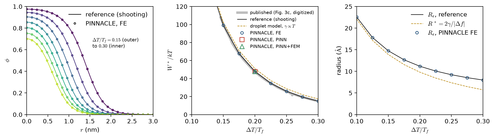

**Figure 3.** Case A3, critical nucleus in Ni. Left: radial profiles (lines: reference;
circles: PINNACLE FE). Middle: barrier against undercooling, with the 'standard PF' line
digitized from Fig. 3(c) of (granasy 2019 nucleation). Right: equimolar radius against the
classical radius. Reading: FE, reference and published line coincide; the nucleus becomes
smaller and more diffuse with undercooling.

**Table 6.** Case A3: nucleation barrier, centre value and equimolar radius.

| $\Delta T/T_f$ | $W^*/kT$ FE | reference | published (digitized) | droplet model | $\phi(0)$ | $R_e$ (Å) |
|---|---|---|---|---|---|---|
| 0.100 | 255.26 | 255.26 | outside the axis | 258.49 | 0.9989 | 22.57 |
| 0.150 | 99.23 | 99.22 | 100.4 | 102.47 | 0.9756 | 14.76 |
| 0.175 | 67.68 | 67.68 | 67.6 | 70.92 | 0.9452 | 12.67 |
| 0.200 | 47.87 | 47.86 | 48.0 | 51.06 | 0.9035 | 11.18 |
| 0.225 | 34.77 | 34.77 | 34.8 | 37.86 | 0.8551 | 10.07 |
| 0.250 | 25.80 | 25.79 | 25.8 | 28.72 | 0.8037 | 9.22 |
| 0.275 | 19.46 | 19.46 | 19.6 | 22.18 | 0.7519 | 8.54 |
| 0.300 | 14.90 | 14.90 | 15.7 (read at 0.295, the end of the line) | 17.37 | 0.7014 | 7.99 |

- FE against the reference (tier 2): $W^*$ within $2.2\times10^{-5}$ relative on all nine
  runs, $\phi(0)$ within $4\times10^{-5}$, $R_e$ within $2.2\times10^{-5}$; 3 to 5 Newton
  iterations, 0.8 to 1.1 s per run.
- Reference against the published line (tier 3): within 1.1 % between 0.15 and 0.275. The
  digitized stroke is 2.7 $kT$ thick (half thickness 1.4 $kT$, the extraction uncertainty;
  `data/digitized/cryst_review_fig3c_standard_pf.csv`, method in
  `scripts/cryst_digitize_fig3c.py`).
- The diffuse nucleus lies 1 to 14 % below the droplet model, and its centre is not bulk
  crystal at large undercooling ($\phi(0) = 0.70$ at 0.30), as in the published profiles
  (Fig. 3(b) of (granasy 2019 nucleation)).

The three routes at $\Delta T/T_f = 0.20$ (decks `a3_ni_nucleus_x0.200_{fem,pinn,hybrid}.i`;
reference $W^* = 0.913705$ aJ $= 47.865\,kT$):

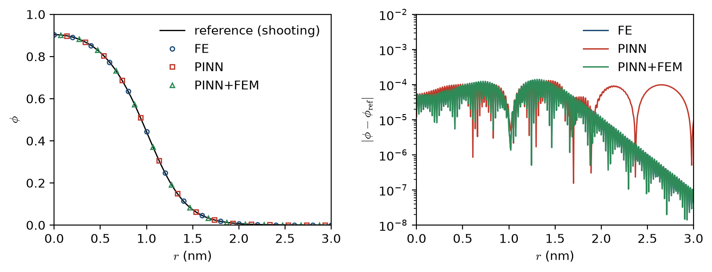

**Figure 4.** Case A3 at $\Delta T/T_f = 0.20$ on the three routes. Left: the nucleus profile
of FE, PINN and PINN+FEM against the shooting reference. Right: pointwise deviation from the
reference. Reading: the three profiles coincide to about $10^{-4}$; the PINN+FEM deviation is
that of the FE solve; the barriers are in Table 7.

**Table 7.** Case A3 at $\Delta T/T_f = 0.20$: the three routes.

| route | initial guess | $W^*$ (aJ), seed 0 | relative error over 5 seeds: mean ± std, worst | wall time |
|---|---|---|---|---|
| FE | droplet fitted to the reference | 0.913726 | $+2.2\times10^{-5}$ (deterministic) | 0.8 s |
| PINN | classical droplet, $R = 2\gamma/\lvert\Delta f\rvert$ | 0.913756 | $(+6.6 \pm 5.8)\times10^{-5}$, $1.7\times10^{-4}$ | 8 to 11 s |
| PINN+FEM | classical droplet | 0.913726 | $+2.2\times10^{-5}$, the FE value on every seed | 9 to 14 s |

- The PINN+FEM result equals the FE result to all printed digits because the corrector is
  the same Newton solve; the network's field was within $1.0$ to $7.1\times10^{-4}$ (relative
  L2) of it and the corrector took 3 iterations on every seed.
- In accuracy and time the network routes do not beat the FE route on this case.

All nine undercoolings on the network routes (decks `a3_ni_nucleus_x<...>_{pinn,hybrid}.i`,
seed 0, every run started from the classical droplet $R = 2\gamma/|\Delta f|$ with full
amplitude, which needs no reference solution):

**Table 8.** Case A3: the network routes over the undercooling family.

| $\Delta T/T_f$ | 0.100 | 0.125 | 0.150 | 0.175 | 0.200 | 0.225 | 0.250 | 0.275 | 0.300 |
|---|---|---|---|---|---|---|---|---|---|
| PINN, error of $W^*$ ($10^{-5}$) | 15.1 | 1.6 | 1.5 | 7.5 | 4.9 | 23.7 | 4.3 | 8.1 | 5.9 |
| PINN+FEM, error of $W^*$ ($10^{-5}$) | 1.4 | 1.2 | 1.5 | 1.3 | 1.6 | 1.4 | 1.8 | 1.6 | 2.0 |
| PINN+FEM, corrector iterations | 3 | 4 | 3 | 3 | 3 | 3 | 3 | 3 | 3 |

All 18 runs reach the nucleus. The PINN+FEM errors are the FE mesh errors of Table 6.

Range of initial guesses (`scripts/cryst_guess_scan.py`): the three decks of the 0.20 case
were started from full-amplitude droplets of 0.4 to 2.0 classical radii.

**Table 9.** Case A3: outcome against the radius of the initial droplet.

| guess radius / classical radius | 0.40 | 0.55 | 0.70 | 0.85 | 1.00 | 1.15 | 1.30 | 1.60 | 2.00 |
|---|---|---|---|---|---|---|---|---|---|
| FE (stationary Newton) | no convergence | liquid | liquid | nucleus | nucleus | nucleus | nucleus | no convergence | no convergence |
| PINN (deflated residual) | nucleus | nucleus | nucleus | nucleus | nucleus | nucleus | nucleus | nucleus | nucleus |
| PINN+FEM | nucleus | nucleus | nucleus | nucleus | nucleus | nucleus | nucleus | nucleus | nucleus |

This is where the routes differ. Newton's method on the stationary equation reaches the
saddle only from 0.85 to 1.3 classical radii; from smaller droplets it converges to the
liquid (a stationary state as well), from larger ones it does not converge. The stationary
network reaches the nucleus from every start tested (errors $2\times10^{-5}$ to
$1.9\times10^{-4}$, 8 to 16 s), and with the FE corrector behind it the result has FE accuracy
from every start (9 to 16 s). A third answer to the same problem, on the FE route alone, is
the constrained saddle search of section 4 (`pf_fem_saddle`).

#### 3.4.4 A4: other double-well and interpolation functions

The case is Fig. 5 of (granasy 2019 nucleation). Decks
`a4_ni_nucleus_<well>_<interpolation>_x<...>_fem.i`: the Ginzburg-Landau fcc well
$g = \phi^2(1-\phi^2)^2/6$ and the interpolations $p_{bcc} = \phi^3(4-3\phi)$,
$p_{fcc} = \phi^4(3-2\phi^2)$ of Table 1 of (granasy 2019 nucleation), each with $\epsilon^2$
and $w$ matched to the same $\gamma_{SL}$ and thickness.

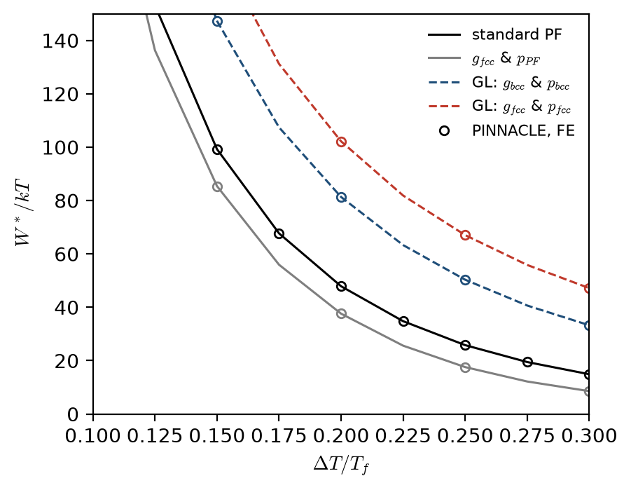

**Figure 5.** Case A4, nucleation barrier in Ni against undercooling for four pairs of
double-well and interpolation functions. Lines: reference. Circles: PINNACLE FE. Reading:
at equal interface energy and thickness the choice of functions changes the barrier by a
factor of up to 3.2.

**Table 10.** Case A4: $W^*/kT$ for four pairs of functions.

| $\Delta T/T_f$ | standard | $g_{fcc}$ & $p_{PF}$ | GL $g_{bcc}$ & $p_{bcc}$ | GL $g_{fcc}$ & $p_{fcc}$ |
|---|---|---|---|---|
| 0.15 | 99.2 | 85.4 | 147.3 | 175.0 |
| 0.20 | 47.9 | 37.6 | 81.3 | 102.2 |
| 0.25 | 25.8 | 17.6 | 50.3 | 67.0 |
| 0.30 | 14.9 | 8.6 | 33.2 | 47.2 |

All twelve FE runs are within $2.2\times10^{-5}$ of the reference (tier 2). The ordering and
the sensitivity are those of the published figure: the Ginzburg-Landau pairs give barriers
1.5 to 3.2 times that of the standard pair, and changing $g$ alone (first two columns)
lowers it by 14 to 43 %. The published curves were not digitized; the comparison with that
figure is qualitative (ordering and magnitude at 0.15 to 0.30).

#### 3.4.5 A5: seeds below and above the critical size

Decks `a5_seed_{sub,super}critical_fem.i`: the tanh droplet fitted to the nucleus of case A3
with its radius multiplied by 0.9 and by 1.1, marched in time with the spherical volume
element.

**Figure 6.** Case A5, a seed 10 % smaller and a seed 10 % larger than the critical nucleus
of Ni at $\Delta T/T_f = 0.20$, marched in time. Left: solid volume (horizontal line: the
nucleus). Middle: free energy (horizontal line: $W^*$). Right: centre value $\phi(r = 0)$.
Reading: the smaller seed melts, the larger one grows; the free energy only decreases.

The smaller seed melts (solid volume 4.2 nm$^3$ to zero by $t \approx 2.6$), the larger one
grows without bound; both start below the barrier ($F = 0.890$ and $0.887$ aJ against
$W^* = 0.9137$ aJ) and their free energy only decreases. This is the saddle-point character
of the nucleus shown by the dynamics, and the reason a time march cannot produce case A3.
Consistency check of A3 by an independent route in the same code (tier 1).

Animations of cases A1, A2 and A5: `figures/crystallization/a1_planar_interface.gif`,
`a2_front_velocity_standard.gif`, `a5_seed_subcritical.gif`, `a5_seed_supercritical.gif`: the
profile over time from the `fields_step*.vtk` series every run writes (`snapshots_every`).

### 3.5 What to expect when the parameters change

- Gradient coefficient and well height: $\gamma_{SL} = \epsilon^2/(6\delta) \propto \sqrt{\epsilon^2 w}$
  and $\delta = \sqrt{2\epsilon^2/w}$ (closed forms of section 3.2). Raising both by the same
  factor raises the interface energy and leaves the width; raising $\epsilon^2$ alone widens
  the interface and raises the energy.
- Undercooling: the barrier falls from 255 $kT$ at $\Delta T/T_f = 0.10$ to 14.9 $kT$ at 0.30,
  the equimolar radius from 22.6 to 8.0 Å, and the centre of the nucleus from bulk crystal
  ($\phi(0) = 0.999$) to 0.70 (Table 6). The droplet model overestimates the barrier by 1 %
  at 0.10 and 14 % at 0.30.
- Temperature scaling of $\epsilon^2$ and $w$: constant values instead of proportional ones
  change the barrier by 62 to 176 % (section 3.3).
- Double-well and interpolation functions: at equal $\gamma_{SL}$ and thickness the barrier
  changes by a factor of 0.6 to 3.2 (Table 10).
- Front velocity: proportional to $M_\phi\,\Delta f\,\delta$; the standard $p$ gives a 4 %
  slower front than $p = \phi^2(3-2\phi)$ at the same parameters (Table 5).
- Seed size: a seed 10 % below the critical radius melts, one 10 % above grows (section
  3.4.5).
- Parameter series beyond these (interface thickness, mobility, dimension): pending.

### 3.6 Cost

FE: 0.8 to 1.1 s per nucleus (3 to 5 Newton iterations). PINN: 8 to 16 s per nucleus;
PINN+FEM: 9 to 16 s. The cost of the development runs behind `pf_pinn_stationary` and
`pf_fem_saddle` (about 40 exploratory runs of 1 to 90 s) is not in the wall times of the
tables.

## 4. Heterogeneous nucleation on a foreign wall

### 4.1 Purpose

Crystals rarely form in the bulk of a liquid; they form on container walls and foreign
particles, where the barrier is lower. The model answers how much a wall of given wetting
properties lowers the nucleation barrier, how the nucleus sits on the wall, and at which
undercooling the wall makes nucleation barrierless. The phase-field treatment is that of
(granasy 2007 heterogeneous), with the wall entering as a surface free energy in the manner
of (cahn 1977 wetting); an earlier phase-field study of heterogeneous nucleation is
(castro 2003 heterogeneous).

### 4.2 Governing equations

A foreign wall adds a surface term to the free energy of section 3.2
(granasy 2007 heterogeneous),

$$
F = \int \Bigl\{ \frac{\epsilon^2}{2}|\nabla\phi|^2 + w g(\phi) + p(\phi)\Delta f \Bigr\}\,dV
  + \int_{\text{wall}} Z(\phi)\,dS , \qquad
  \epsilon^2\,\mathbf n\!\cdot\!\nabla\phi = -Z'(\phi) \ \text{on the wall}
$$

($\mathbf n$ outward). The two realizations of (granasy 2007 heterogeneous):

- Model I: the wall leaves the planar interface profile undisturbed. With the first integral
  $|\nabla\phi| = \phi(1-\phi)/\delta$ at the melting point and
  $\mathbf n\cdot\nabla\phi = |\nabla\phi|\cos\Psi$ this gives
  $\epsilon^2\,\mathbf n\cdot\nabla\phi = 6\gamma\cos\Psi\,\phi(1-\phi)$, i.e.
  $Z = -\gamma\cos\Psi\,(3\phi^2 - 2\phi^3)$ and Young's equation
  $\gamma_{WL} - \gamma_{WS} = \gamma\cos\Psi$ with sharp wall interfaces.
  The barrier is $W_I = F$ including the wall term.
- Model II: the order parameter is prescribed on the wall, $\phi = \phi_0$, which orders the
  liquid next to it; $\cos\Psi = -1 + 6\phi_0^2 - 4\phi_0^3$ ($\phi_0 = 2/3$:
  $\Psi = 61.2^\circ$). The barrier is the free energy of the nucleus on the wall minus that
  of the wall layer alone. The layer exists while $w g + p\Delta f > 0$ on $(0, \phi_0]$; at
  $\Delta f = -w\,g(\phi_0)/p(\phi_0) = -w/64$ it loses stability and the barrier vanishes.

The sharp-interface counterpart in two dimensions is the circular cap,
$W_{cap} = (\gamma^2/|\Delta f|)\,(\Psi - \sin\Psi\cos\Psi)$.

### 4.3 Parameters

The data behind the published figure are in the original paper (arXiv cond-mat/0608375,
footnote 16), not in (granasy 2019 nucleation), which reprints the figure.

**Table 11.** Parameters of the wall cases.

| Quantity | Value | Unit | Provenance | Source |
|---|---|---|---|---|
| interface free energy $\gamma_{SL}$ | 0.364 | J m$^{-2}$ | `reported_text` | (granasy 2007 heterogeneous), footnote 16 of the preprint |
| interface thickness | 2 | nm | `reported_text` | the same |
| heat of fusion $L$ | $2.666\times10^9$ | J m$^{-3}$ | `reported_text` | the same |
| melting point $T_m$ | 1728 | K | `reported_text` | the same |
| temperature scaling | $\epsilon^2$ and $w$ multiplied by $T$ | | `reported_text` | the same |
| contact angle $\Psi$ | 61.2 ($\phi_0 = 2/3$) | deg | `reported_text` | the same |
| scaled units of the decks | $\delta = 0.4551$ nm, $\epsilon^2 = 0.5$, $w = 1$, $\gamma = 1/12$ | | `derived` | $\delta = \sqrt{2\epsilon^2/w}$ |
| driving force | $D = \Delta f/w(T) = -0.27778\,\Delta T/(T_m - \Delta T)$ | | `derived` | from the values above |
| normalization of the cap | $\gamma(T_m)$ | | `derived` | neither paper states it; see section 4.4 |

Check of the parameters: $D = -1/64$ at $\Delta T = 92.0$ K, the critical undercooling of
Model II stated in (granasy 2007 heterogeneous).

### 4.4 Cases and results

Case B1 is the figure of (granasy 2007 heterogeneous) reprinted as Fig. 6 of
(granasy 2019 nucleation), from which the barrier curves were digitized. Decks
`decks/crystallization/walls/*.i` (25 decks: Model I at 10 to 90 K, Model II nucleus and
layer at 10 to 80 K).

How it is solved. Half of the symmetric nucleus, wall at $y = 0$, $h = 0.25\,\delta$ ($0.4\,\delta$
at 10 K), 14 to 38 thousand nodes. The plain stationary Newton solve of section 3 fails here:
for Model II at 40 K a circular cap of 0.97 classical radii falls onto the wall layer and one
of 1.00 runs to a grown crystal. The decks use `pf_fem_saddle` (section 2.2). Every deck
starts from the classical cap. Two findings on the constraint: with the total amount
($\omega = 1$) the Model II search converged to the saddle of a uniformly thickened wall film
(a real stationary state of the box, with 2 to 2.5 times the energy), and in a large domain
the constrained droplet evaporates into a dilute uniform field; a weight $\omega$ that is 1
around the nucleus removes both, and is the default.

**Figure 7.** Case B1, critical nuclei on the wall ($y = 0$), contour lines at
$\phi = 1/6 \ldots 5/6$ as in the published figure. Reading: Model I is a cap meeting a bare
wall; in Model II the nucleus merges into the ordered wall layer and flattens toward the
critical undercooling.

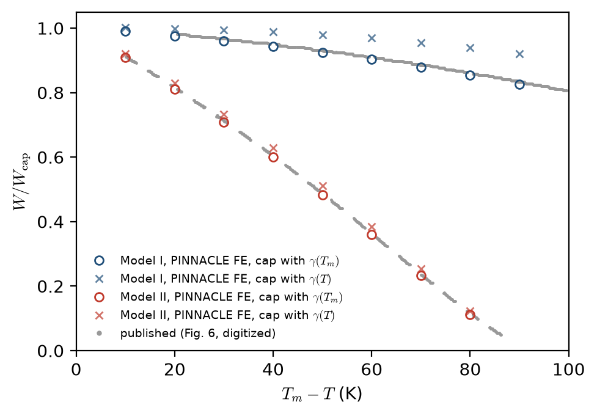

**Figure 8.** Case B1, nucleation barrier normalized by the circular-cap value against
undercooling for Models I and II: PINNACLE FE against the curves digitized from the reprint
of the figure of (granasy 2007 heterogeneous). Crosses: the FE values normalized with
$\gamma(T)$ instead of $\gamma(T_m)$. Reading: both models follow the published curves when
the cap is evaluated with $\gamma(T_m)$; the barrier of Model II falls to zero toward 92 K.

**Table 12.** Case B1: normalized barriers and the measured wall angle.

| $\Delta T$ (K) | 10 | 20 | 30 | 40 | 50 | 60 | 70 | 80 | 90 |
|---|---|---|---|---|---|---|---|---|---|
| Model I, FE, cap with $\gamma(T_m)$ | 0.991 | 0.975 | 0.960 | 0.943 | 0.924 | 0.903 | 0.880 | 0.854 | 0.827 |
| Model I, published | | | 0.967 | 0.950 | 0.930 | 0.911 | 0.885 | 0.861 | 0.833 |
| Model II, FE, cap with $\gamma(T_m)$ | 0.909 | 0.810 | 0.709 | 0.600 | 0.483 | 0.359 | 0.233 | 0.112 | |
| Model II, published | | 0.816 | 0.714 | 0.604 | 0.488 | 0.362 | 0.235 | 0.118 | |
| Model I, wall angle measured (deg) | 62.4 | 61.9 | 61.8 | 61.6 | 61.5 | 61.3 | 61.2 | 60.8 | 60.7 |

- Agreement with the published curves (tier 3): within 0.008 for Model I and 0.006 for
  Model II at every undercooling, against a digitization half-stroke of 0.004
  (`data/digitized/cryst_review_fig6_barriers.csv`, `scripts/cryst_digitize_fig6.py`). The
  FE values are systematically 0.002 to 0.008 lower.
- This agreement requires the cap to be evaluated with the melting-point interface energy.
  Neither paper states which $\gamma$ the normalization uses. With the model's own
  $\gamma(T) = \gamma\,T/T_m$ the ratio is higher by $(T_m/T)^2$ (crosses in Figure 8:
  Model I 0.92 instead of 0.83 at 90 K) and does not match the published line. Recorded as
  `derived`.
- Model I keeps the prescribed contact angle within 1.2 degrees; the angle of Model II is
  not constant (the papers say it falls toward complete wetting at the critical undercooling).
- Not obtained: Model I at 100 K (the constrained solve at the classical cap's amount does not
  converge) and Model II at 90 K, 2 K below the critical undercooling, where the nucleus and
  the bare layer nearly coincide and the search cannot separate the two zeros of $\lambda$.
- Network routes: not run. `pf_pinn_stationary` imposes Dirichlet values only; the Model I
  wall is a nonlinear flux condition, and for Model II the trivial state to be deflated is
  the non-uniform wall layer. Both are extensions of the executioner, not done here.

### 4.5 What to expect when the parameters change

- Undercooling: the normalized barrier of Model I falls slowly (0.991 at 10 K to 0.827 at
  90 K); that of Model II falls nearly linearly to zero at the critical undercooling of
  92.0 K (0.909 at 10 K, 0.112 at 80 K), where the ordered wall layer becomes unstable and
  the wall crystallizes without a barrier (Table 12).
- Wall model: a wall that orders the liquid (Model II) lowers the barrier far more than a
  wall with the same contact angle that does not (Model I).
- Contact angle: in the sharp-interface limit the barrier scales as
  $\Psi - \sin\Psi\cos\Psi$; in Model II the angle follows from the wall value through
  $\cos\Psi = -1 + 6\phi_0^2 - 4\phi_0^3$, and the critical undercooling from
  $\Delta f = -w\,g(\phi_0)/p(\phi_0)$.
- A rough wall is treated with the orientation-field model in section 7.5.5. Parameter
  series in the contact angle and the wall value $\phi_0$, and structured walls: pending.

### 4.6 Cost

25 runs, 184 s in total on 2 threads; 3 to 8 volume iterations and 14 to 32 constrained
Newton iterations per nucleus.

## 5. Thermal noise: nucleation and transformation kinetics

### 5.1 Purpose

The deterministic model of section 3 cannot start crystallization: the undercooled liquid is
metastable and stays liquid. With thermal noise, crystal-like fluctuations appear; those
beyond the critical size grow and impinge. The model answers how the crystalline fraction
evolves in time when nuclei form at random and grow at the front velocity, which is the
content of the Kolmogorov, Johnson-Mehl and Avrami theory (kolmogorov 1937 statistical;
johnson 1939 reaction; avrami 1939 kinetics). Its exponent is what calorimetry and
microscopy measure during the crystallization of metals, glasses and polymers. Earlier
phase-field tests of this law are (jou 1997 kinetics) and (castro 2003 heterogeneous).

### 5.2 Governing equations

The equation of motion of section 3.2 with a Langevin term, as in Eq. 16 of
(granasy 2019 nucleation):

$$
\dot\phi = M_\phi\{\epsilon^2\nabla^2\phi - w g'(\phi) - p'(\phi)\Delta f\} + \zeta, \qquad
\langle\zeta(\mathbf r,t)\,\zeta(\mathbf r',t')\rangle = 2kTM_\phi\,\delta(\mathbf r-\mathbf r')\,\delta(t-t') .
$$

For constant nucleation and growth rates in $d$ dimensions the transformed fraction follows
the Johnson-Mehl-Avrami-Kolmogorov law,

$$
X(t) = 1 - \exp\{-[(t - t_0)/\tau]^p\}, \qquad p = 1 + d = 3 \ \text{in two dimensions} .
$$

Phase-field runs of this kind (jou 1997 kinetics; castro 2003 heterogeneous), as summarized
in section 3.1.1.3 of (granasy 2019 nucleation), give $p = 2.9$ to $3.0$; the
orientation-field run of (granasy 2005 spherulites) gives $3.04 \pm 0.02$.

Two properties of the noise term had to be added to PINNACLE (ADR 0038):

- strength: the draw at a quadrature point of volume $w_q$ over a step $\Delta t$ has the
  variance $A^2/(w_q\Delta t)$ with $A^2 = 2kTM_\phi = 0.0064$ (`scaling = white`), so the
  discrete noise represents the correlator above on any mesh and step;
- where it acts: in the liquid only, amplitude $\propto 1 - p(\phi)$ (`state_factor`), the
  form $\zeta = \zeta_s + (\zeta_l - \zeta_s)\,p$ of (granasy 2004 modelling) and
  (granasy 2005 spherulites) with $\zeta_s = 0$. This is required, not cosmetic: with the
  standard $p$ the free energy is unbounded below for $\phi > 1$ under a driving force, and a
  noise acting inside the crystal kicked the field past the barrier above 1 in every trial
  run ($\phi$ reached 16 before Newton failed).

### 5.3 Parameters

**Table 13.** Parameters of the noise case B2 (a generic case in scaled units, no material).

| Quantity | Value | Provenance |
|---|---|---|
| $\epsilon^2$, $w$, $M_\phi$ | 0.5, 1, 1 | `assumed` |
| driving force $\Delta f/w$ | $-0.20$ | `assumed` |
| noise strength $A^2 = 2kTM_\phi$ | 0.0064 | `assumed` |
| domain | $160 \times 160\,\delta$ on $320 \times 320$ elements (103,041 nodes), no-flux boundaries | `assumed` |
| time stepping | backward Euler, $\Delta t = 0.1$, 350 steps | `assumed` |
| noise seeds | 20261117 to 20261121 | `assumed` |

### 5.4 Cases and results

Case B2. Deck `decks/crystallization/noise/b2_jmak_2d_fem.i` and the four further
realizations `b2_jmak_2d_seed{1..4}_fem.i`.

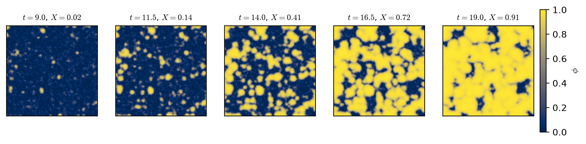

**Figure 9.** Case B2, the phase field at successive times of the deck's realization.
Reading: crystals nucleate at random places and times, grow at a common front velocity and
impinge.

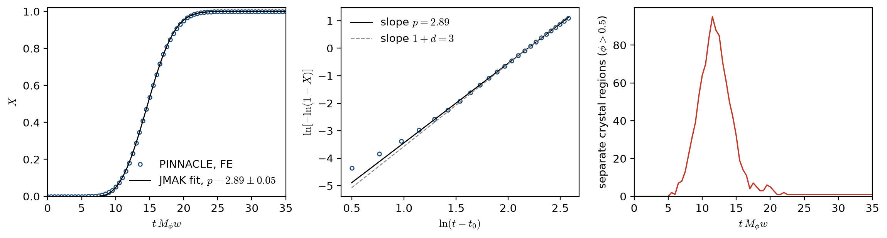

**Figure 10.** Case B2, transformation kinetics. Left: transformed fraction (area with
$\phi > 0.5$) and the fitted law. Middle: Avrami plot. Right: number of separate crystal
regions; it rises with nucleation and falls with impingement. Reading: the fraction follows
the Johnson-Mehl-Avrami-Kolmogorov law with an exponent near 3.

**Table 14.** Case B2: fit of the transformation kinetics.

| quantity | value |
|---|---|
| fit window | $0.01 < X < 0.95$, 24 snapshots |
| Avrami exponent $p$ (the deck's seed) | $2.89 \pm 0.05$ (standard error of the fit); five seeds: $3.14 \pm 0.29$ |
| $t_0$, $\tau$ | $6.85 \pm 0.13$, $8.93 \pm 0.13$ |
| rms residual of the fit | 0.003 in $X$ |
| largest number of separate crystals | 95 |
| reference values of the run | front velocity 0.821 $\delta$ per time unit (travelling wave); 2-D nucleus $W^* = 0.0251\,w\delta^2 = 7.8\,kT$ (shooting solution) |

- Five realizations (the deck and `b2_jmak_2d_seed{1..4}_fem.i`, noise seeds 20261117 to
  20261121): $p$ = 2.89, 3.09, 3.65, 3.03, 3.06; mean 3.14, standard deviation 0.29, extremes
  2.89 and 3.65; 84 to 95 crystals each. The fitted $p$ and $t_0$ are strongly correlated
  (the 3.65 run has the smallest $t_0$, 5.14); with one common $t_0 = 6.3$ for the five runs
  the exponents are 3.10, 3.04, 3.19, 3.06, 3.35: mean 3.15, standard deviation 0.13. Both
  are consistent with the theoretical $p = 3$ and with the published 2.9 to 3.0 (tier 3,
  statistical). The standard error of a single fit (0.03 to 0.08) understates the spread
  between realizations. Table: `results/crystallization/noise/b2_seed_table.csv`.
- The first two points of the Avrami plot lie above the line: before $t_0$ the area with
  $\phi > 0.5$ already counts subcritical fluctuations.
- Animation: `figures/crystallization/b2_jmak.gif` (71 frames).
- Routes: FE only (section 2.2).

### 5.5 What to expect when the parameters change

- Dimension: $p = 1 + d$ for constant nucleation and growth rates (3 in two dimensions,
  4 in three).
- Realization: the fitted exponent of one run scatters by 0.29 (0.13 with a common $t_0$)
  around the mean of five runs.
- Noise acting inside the crystal: the field leaves the physical range and the run fails
  (section 5.2).
- Parameter series (noise strength, driving force, pre-existing seeds against continuous
  nucleation): pending.

### 5.6 Cost

Wall time 30 min on 6 threads for the deck's realization (the direct sparse solve of 103,041
unknowns at every Newton iteration; 3 to 4 iterations per step, no cutback); about 60 min
each for the four further realizations run four at a time on 2 threads.

## 6. The binary alloy model: single-crystal growth forms

### 6.1 Purpose

In an alloy the growing crystal rejects solute, and the diffusion of that solute decides
the shape: a compact crystal, a fingered "seaweed" front, or a dendrite with arms along the
crystal axes. The model answers which of these forms appears at a given supersaturation and
anisotropy of the interface energy, and how the solute is distributed in and around the
crystal (microsegregation). Dendrites are the growth form of cast metals and of snow
crystals; the compact form with trapped solute appears at large driving force. The model is
the binary phase-field model of (warren 1995 microsegregation), in the form used for
nucleation and polycrystalline growth in (granasy 2002 binary) and
(granasy 2005 spherulites); the anisotropic gradient term follows
(kobayashi 1993 dendritic).

### 6.2 Governing equations

Convention of (granasy 2005 spherulites): $\phi = 1$ liquid, $\phi = 0$ crystal; $c$ is the
Cu fraction of a Cu-Ni ideal solution at 1574 K. The free-energy density is
$f = w(c)\,T g(\phi) + [1 - p(\phi)]\,f_S(c) + p(\phi)\,f_L(c)$ with
$f_{S,L} = (1-c) f^{Ni}_{S,L} + c f^{Cu}_{S,L} + \tfrac{RT}{v_m}[c\ln c + (1-c)\ln(1-c)]$, and
the interface energy $\gamma = \gamma_0\,s(\vartheta)$, $s = 1 + s_0\cos[k(\vartheta - \vartheta_0)]$,
$\vartheta = \operatorname{atan2}(\phi_y, \phi_x)$. In dimensionless form (lengths in
$\xi = 2.1\times10^{-4}$ cm, time in $\xi^2/D_l$; Eq. 2.3 and 2.4 of
(granasy 2005 spherulites)):

$$
\dot\phi = m_\phi\bigl\{\nabla\!\cdot\![\,s^2\nabla\phi + s\,s'\,\nabla^{\perp}\phi\,]
           - a_w(c)\,g'(\phi) - p'(\phi)\,b(c)\bigr\} + \zeta_\phi ,
$$

$$
\dot c = \nabla\!\cdot\!\bigl\{\lambda(\phi)\,[\,\nabla c - c(1-c)\,(q_f\,p'(\phi) + q_w\,g'(\phi))\,\nabla\phi\,]\bigr\},
\qquad \lambda = p(\phi)\ (D_s = 0) ,
$$

with $a_w = \xi^2 w/\epsilon^2$, $b = \xi^2 (f_L - f_S)/(\epsilon^2 T)$ (both linear in $c$),
$q_f = v_m(\Delta f_{Ni} - \Delta f_{Cu})/RT$ and $q_w = v_m(w_{Ni} - w_{Cu})/R$. The composition
equation needs no logarithm: with the mobility $\tfrac{v_m}{RT}D\,c(1-c)$ of the paper,
$c(1-c)\nabla\ln\tfrac{c}{1-c} = \nabla c$. At zero flux
$\ln\tfrac{c}{1-c} - q_f\,p(\phi) - q_w\,g(\phi)$ is uniform, which is the common tangent:
$c_L = 0.466219$, $c_S = 0.399112$. The supersaturation is $S = (c_L - c_\infty)/(c_L - c_S)$.

In PINNACLE: kernels `wb_phase_bulk`, `ac_interface_anisotropic`, `wb_solute_flux` under
`pf_fem_explicit` (forward Euler, lumped mass, bilinear elements, periodic in both
directions; ADR 0039).

### 6.3 Parameters

Full derivation and provenance: `docs/14_phase_field_crystallization_plan.md`, section 7.2.

**Table 15.** Parameters of the binary model (dimensionless form).

| Quantity | Value | Provenance | Source |
|---|---|---|---|
| well coefficient $a_w$ | $1.020\times10^4$ | `derived` | Table I of (granasy 2005 spherulites) and its stated rescaling |
| driving-force coefficient $b(c)$ | $1.096\times10^5\,(1-c) - 1.438\times10^5\,c$ | `derived` | the same |
| $q_f$ | 0.27384 | `derived` | the same |
| $q_w$ | $2.5\times10^{-5}$ | `derived` | the same |
| molar volume $v_m$ | 7.4 cm$^3$ mol$^{-1}$ | `derived` | the one value that returns the published $c_L$ and $c_S$ to six digits |
| liquidus, solidus $c_L$, $c_S$ | 0.466219, 0.399112 | `reported_text` | (granasy 2005 spherulites); reproduced to six digits |
| grid spacing, time step | $\Delta x = 6.25\times10^{-3}$, $\Delta t = 4.75\times10^{-6}$ | `reported_text` | (granasy 2005 spherulites) |
| grid | $500\times500$, periodic | `reported_text` | the same |
| anisotropy $s_0$, symmetry $k$ | 0 or 0.1, 4 | `reported_text` | the same |
| supersaturation $S$ | 0.8 or 1.0 | `reported_text` | the same |
| seed | disc of 12 cells at the solidus composition | `assumed` | not given |
| number of steps | 1250 to 2400 | `assumed` | not given |
| noise amplitude 0.0025 | standard deviation of the nodal increment per step, in the liquid only | `reported_text` (value), `assumed` (meaning) | (granasy 2005 spherulites) |
| composition noise | not applied | `assumed` | |

### 6.4 Cases and results

#### 6.4.1 C2: single-crystal growth forms

The case is Fig. 4 (a), (b), (d), (e) of (granasy 2005 spherulites). Two implementations of
the same equations: the independent finite-difference reference of section 2.3
(`scripts/cryst_binary_reference.py`) and PINNACLE, decks
`decks/crystallization/binary/c2_fig4{a,b,d,e}_*_fem.i`.

Check of the two against each other (single crystal, $S = 1.0$, no noise, $200\times200$ cells,
equivalent radius after 500 steps): PINNACLE 100.2 cells, reference 93.0 cells, reference at
half the spacing 97.1 cells, Richardson estimate of the converged value 98.4 cells. At the
paper's resolution (the 10-90 % interface width is 9.9 cells) the front velocity carries a
discretization error of $-5.5$ % in the finite-difference code and $+1.8$ % in PINNACLE
(tier 2 for the trend, not a converged number: PINNACLE was not run at half the spacing).

**Figure 11.** Case C2 with PINNACLE. Top: composition; bottom: crystal. Columns: conditions
of Fig. 4(a) of (granasy 2005 spherulites), isotropic $S = 0.8$; (b) four-fold $s_0 = 0.1$,
$S = 0.8$; (d) isotropic $S = 1.0$; (e) four-fold $S = 1.0$. Reading: fingered and dendritic
forms with solute-rich channels at $S = 0.8$, compact forms of nearly uniform composition at
$S = 1.0$.

**Figure 12.** Case C2 with the independent finite-difference reference, same columns as
Figure 11. Reading: the same four forms; the isotropic crystal carries a diamond-shaped grid
imprint that the finite-element result does not show.

**Figure 13.** Case C2 with PINNACLE: equivalent radius (in cells) against dimensionless
time for the four runs, logarithmic axes. Reading: the two $S = 1.0$ runs grow faster than
the two $S = 0.8$ runs; the growth exponents are given in the text.

**Table 16.** Case C2: growth forms.

| case | published form (Fig. 4 of (granasy 2005 spherulites)) | PINNACLE | steps, wall time | solute drift |
|---|---|---|---|---|
| (a) isotropic, $S = 0.8$ | "seaweed": fingered front, liquid channels | circular envelope, front broken into about 60 cells, radial solute-rich channels | 2400, 42 min | $-2.3\times10^{-12}$ |
| (b) four-fold, $S = 0.8$ | symmetric dendrite | four arms with side branches, trapped liquid pockets at $c \approx c_L$ | 2000, 38 min | $-3.1\times10^{-12}$ |
| (d) isotropic, $S = 1.0$ | compact disc (solute trapping) | compact disc, $c \approx c_\infty$ inside | 1300, 27 min | $-1.9\times10^{-12}$ |
| (e) four-fold, $S = 1.0$ | rounded square with a cross | rounded square, cross along the arms | 1250, 26 min | $-1.6\times10^{-12}$ |

- Agreement with the published figure is of form (tier 3, qualitative): which cases are
  compact and which are fingered or dendritic, the four-fold symmetry, and the composition
  pattern (channels and pockets at the liquidus composition for $S = 0.8$, nearly uniform
  composition for $S = 1.0$). No number of the published figure is available to compare.
- Difference from the published panel (a): the paper shows a few broad lobes, PINNACLE and
  the reference many narrow cells. Seed, noise amplitude and run length are assumed, and the
  scale of the instability depends on them; not resolved.
- The reference's isotropic crystal has a diamond-shaped outline, PINNACLE's is circular:
  the five-point stencil imprints the grid on an interface this thin, the bilinear elements
  do so less.
- Growth law (Figure 13): the equivalent radius grows as $t^{0.71}$ to $t^{0.80}$ in the four
  runs, between the diffusion-controlled $t^{1/2}$ and the interface-controlled $t^{1}$ that
  (granasy 2005 spherulites) describes for small and large driving force.
- Animations: `figures/crystallization/c2_pinnacle_c2_fig4*_fem.gif` (composition over time)
  and the reference's `c2_reference_fig4*.gif`.
- Routes: FE only. These runs are driven by noise (section 2.2); the alloy kernels state
  that they have no PINN form.

### 6.5 What to expect when the parameters change

- Supersaturation: at $S = 0.8$ the crystal rejects solute, the front is unstable and the
  form is fingered or dendritic with liquid channels at the liquidus composition; at
  $S = 1.0$ the solute is trapped, the crystal is compact and its composition is close to
  that of the liquid (Table 16). The front is also faster at $S = 1.0$ (Figure 13).
- Anisotropy of the interface energy: with $s_0 = 0$ the envelope is circular (seaweed at
  $S = 0.8$, disc at $S = 1.0$); with $s_0 = 0.1$ and four-fold symmetry it is a four-armed
  dendrite at $S = 0.8$ and a rounded square at $S = 1.0$.
- Resolution: at the paper's grid the front velocity carries a discretization error of
  $+1.8$ % (finite elements) and $-5.5$ % (finite differences) (section 6.4.1).
- Not varied: the symmetry index $k$, the interface thickness, the noise amplitude.
  Intermediate supersaturations and anisotropies: sections 6.5.1 and 7.5.1.

#### 6.5.1 Planar front: from partitioning to solute trapping (case E1)

The change of form between S = 0.8 and S = 1.0 has its origin in one dimension. A planar
front of the same model was run for fourteen supersaturations
(`decks/crystallization/trapping/e1_planar_s<S>_fem.i`, 3000 linear elements, 15,000 steps,
no noise), after the transition from diffusion-controlled to diffusionless growth shown for
this model in Fig. 8(a) of (granasy 2021 biomineralization).

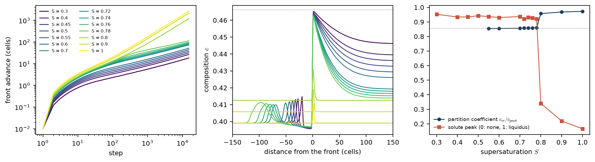

**Figure 14.** Planar front of the binary model. Left: advance of the front against the
step number for S = 0.3 to 1.0 (logarithmic axes). Middle: composition at the end of the run
against the distance from the front (dotted: solidus and liquidus). Right: partition
coefficient (crystal composition over the peak composition in the liquid; dotted: the
equilibrium value $c_S/c_L = 0.856$) and height of the solute peak (0: none, 1: liquidus).
Reading: up to S = 0.78 the front slows down with time, the liquid at the front is at the
liquidus and the crystal at the solidus; from S = 0.80 the front advances linearly in time,
the peak collapses and the crystal takes the composition of the liquid.

**Table 17.** Planar front against supersaturation. Growth exponent: slope of the front
advance against time on logarithmic axes over the second half of the run. Solute peak:
$(c_{peak} - c_\infty)/(c_L - c_\infty)$. Crystal composition: mean over the crystal formed
in the second half (-- where it is thinner than 20 cells).

| S | growth exponent | front speed at the end (cells per step) | crystal composition | solute peak ahead of the front | partition coefficient |
|---|---|---|---|---|---|
| 0.3 | 0.46 | 0.0006 | -- | 0.95 | -- |
| 0.4 | 0.46 | 0.0008 | -- | 0.93 | -- |
| 0.45 | 0.46 | 0.0010 | -- | 0.93 | -- |
| 0.5 | 0.46 | 0.0012 | -- | 0.94 | -- |
| 0.55 | 0.45 | 0.0014 | 0.3963 | 0.94 | 0.854 |
| 0.6 | 0.45 | 0.0016 | 0.3965 | 0.93 | 0.855 |
| 0.7 | 0.43 | 0.0023 | 0.3969 | 0.94 | 0.857 |
| 0.72 | 0.43 | 0.0024 | 0.3969 | 0.92 | 0.858 |
| 0.74 | 0.42 | 0.0026 | 0.3971 | 0.93 | 0.858 |
| 0.76 | 0.40 | 0.0027 | 0.3972 | 0.93 | 0.859 |
| 0.78 | 0.37 | 0.0030 | 0.3973 | 0.92 | 0.860 |
| 0.8 | 0.99 | 0.0788 | 0.4125 | 0.34 | 0.958 |
| 0.9 | 1.00 | 0.1402 | 0.4058 | 0.22 | 0.968 |
| 1 | 1.00 | 0.1724 | 0.3991 | 0.17 | 0.973 |

- The transition is discontinuous in this model: between S = 0.78 and 0.80 the front speed
  at the end of the run jumps from 0.0030 to 0.079 cells per step (a factor of 27) and the
  partition coefficient from 0.86 to 0.96. Below it the crystal has the solidus composition
  to 0.002 (0.3963 to 0.3973 against $c_S = 0.3991$) and the growth is diffusion-controlled;
  above it the composition of the liquid is frozen in.
- With this (20-fold broadened) interface, trapping sets in below S = 1: complete
  partitionless growth needs the liquid to be below the $T_0$ composition, where liquid and
  crystal of one composition have the same free energy (S = 0.50 here), and a front fast
  enough that the solute cannot escape across the interface width.
- Consequence for the forms: a dendrite needs a solute boundary layer (Mullins-Sekerka
  instability), so dendrites and seaweed appear below the transition (S = 0.7 and 0.8 in
  Figure 25; at S = 0.8 the curved two-dimensional front still rejects solute) and
  compact, faceted or spherulitic forms above it (S = 0.9 and more). The transition found
  between S = 0.8 and 0.9 in the two-dimensional series of section 7.5 is this one.
- The growth exponents below the transition are a little under 1/2 (0.37 to 0.46): the runs
  still carry the transient of the initial slab.

### 6.6 Cost

26 to 42 min per case on $500\times500$ (0.4 to 1 s per step), four runs side by side on
3 threads each (NumPy). The finite-difference reference: 2 to 8 min per case.

## 7. The orientation-field model: polycrystalline growth

### 7.1 Purpose

Most crystals found in nature and in technical materials are polycrystals. The binary model
of section 6 grows one crystal; it cannot say when a growing crystal breaks up into grains
of different orientation. The orientation field adds the local crystal orientation as a
variable, with a free energy that penalizes misorientation. New grains then form at the
growth front when the orientation cannot order as fast as the front advances (growth-front
nucleation). The model answers which form results at a given supersaturation and ratio of
orientational to translational mobility: a single-crystal dendrite, a polycrystalline
dendrite, or a spherulite, the densely branched space-filling form seen in polymers,
minerals, volcanic rocks, and (according to the 2006 review and the 2021 study cited here)
in biological materials such as amyloid deposits, mollusk shells and coral skeletons
(granasy 2006 review; granasy 2021 biomineralization). The orientation field is that of
(kobayashi 1998 vector), developed in (kobayashi 2000 continuum) and
(warren 2003 polycrystalline); its use for nucleation and growth with an orientation that
fluctuates in the liquid is from (granasy 2002 binary), and the mechanism of polycrystalline
growth by reduced orientational mobility from (granasy 2004 mechanism) and
(granasy 2005 spherulites). The three-dimensional extension is
(pusztai 2005 polycrystalline).

### 7.2 Governing equations

The binary model of section 6.2 plus the orientation field $\theta \in [0, 1)$, the crystal
angle in units of $2\pi/k$. The form implemented is model C of the appendix (A.3) of
(granasy 2004 modelling), as used in (granasy 2005 spherulites). The orientational free
energy density is

$$
f_{ori} = [1 - p(\phi)]\,\frac{HT}{2\xi_0}\,\{x\,F_0(u) + (1-x)\,F_1(u)\}, \qquad u = \xi_0|\nabla\theta| ,
$$

with $F_0 = |\sin(2\pi m u)|$ for $u < 3/(4m)$ and $F_1 = |\sin(2\pi n u)|$ for $u < 1/(4n)$,
both 1 beyond. $F_1$ has a single minimum at zero misorientation; $F_0$ adds a metastable
minimum at a fixed misorientation, which lets a crystal branch at a fixed angle. With
$x = 0$ and $n = 1/2$ (single-minimum energy), the equations added to those of section 6.2
are

$$
\dot\phi = \ldots - p'(\phi)\,[\,b(c) - h\,F(u)\,] + \zeta_\phi, \qquad
\dot\theta = \chi_l\,p(\phi)\,\nabla\!\cdot\!\Big\{[1-p(\phi)]\,\frac{\pi}{2}\cos(\pi u)\,
\frac{\nabla\theta}{|\nabla\theta|}\Big\} + \zeta_\theta ,
$$

with $F(u) = |\sin \pi u|$ for $u < 1/2$ and 1 beyond, $\xi_0 = \Delta x$,
$\chi = M_\theta\,\xi H T/D_l$ the dimensionless orientational mobility ($\chi_l$ in the
liquid, 0 in the crystal), $h = \xi^2 H/(2\xi_0\epsilon^2)$, and the interface anisotropy
taken in the frame of the local orientation, $s = 1 + s_0\cos(4\vartheta - 2\pi\theta)$. The
orientation is random in the liquid, orders in the interface and is frozen in the crystal.

In PINNACLE: `orientation_grain_flux` (the flux of the $\theta$ equation, with the mobility
as a nodal rate factor), `orientation_phase_coupling` (the term $h F$ in the $\phi$
equation), `ac_interface_anisotropic orientation = theta`; $\theta$ is an angular variable
(differences taken to the nearest equivalent value) advanced in 20 sub-steps per step
(ADR 0040).

### 7.3 Parameters

**Table 18.** Parameters of the orientation-field model, in addition to Table 15.

| Quantity | Value | Provenance | Source |
|---|---|---|---|
| orientational mobility in the liquid $\chi_l$ | 360 | `reported_text` | (granasy 2005 spherulites) |
| reduced mobility | 54 ($= 0.15 \times 360$) | `reported_text` | the same, Fig. 4 (c), (f) |
| mobility in the crystal | 0 | `reported_text` | the same |
| correlation length $\xi_0$ | $\Delta x$ | `reported_text` | the same |
| branching weight $x$, exponents $m$, $n$ | 0, -, 1/2 | `reported_text` | the same, Fig. 4 |
| sub-steps of the $\theta$ equation | 20 | `reported_text` | (granasy 2004 modelling), appendix A.2 ("about 1/20 of the time step"); (granasy 2005 spherulites) says 1/50 |
| noise amplitudes | 0.0025 ($\phi$), 0.0375 ($\theta$) | `reported_text` (values), `assumed` (taken as standard deviations of the nodal increment per step) | (granasy 2005 spherulites) |
| orientational energy scale $h$ | 1900 | `assumed` | $H$ is not printed in any of the five papers read; from $HT/2 = \gamma_{SL}$ |
| regularization of $u$ | $10^{-3}$ | `assumed` | not given |
| seed | disc of 12 cells, $\theta = 0$, random orientation around it | `assumed` | not given |
| conditions of Fig. 5: $S$ | 1.0 | `derived` | from the stated size and step count (0.15 cells per step) |
| conditions of Fig. 5: $\chi_l$ | 240 | `assumed` | from the reference runs of Table 20 |

### 7.4 Cases and results

#### 7.4.1 C1: the orientational free energy

The case is Fig. 3 of (granasy 2005 spherulites). For $k = 2$, $m = 3$, $n = 1/2$, $x = 0.2$
(`scripts/cryst_orientation_energy.py`): local maximum at 21.4 degrees of misorientation
(caption of the published figure: "about 20"), metastable minimum at 30.0 degrees with
$f_{ori} = 0.400$, value 1 at 90 degrees, as in the published figure. This is the function
only.

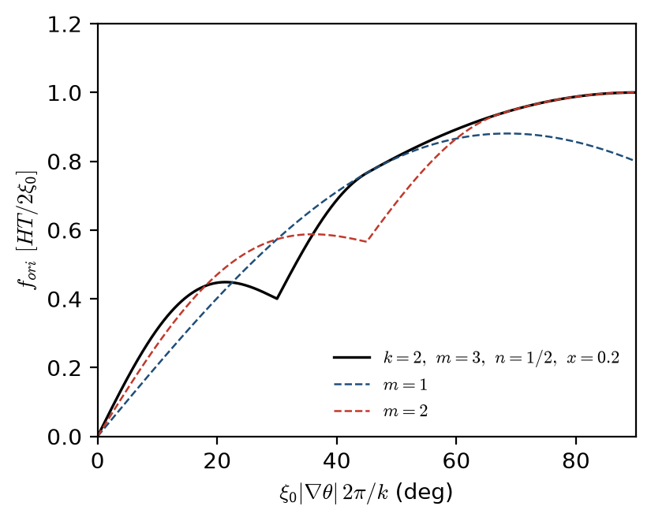

**Figure 15.** Case C1, orientational free energy against misorientation for $k = 2$,
$m = 3$, $n = 1/2$, $x = 0.2$. Reading: besides the minimum at zero misorientation there is
a metastable minimum at 30 degrees, which permits branching at that angle.

#### 7.4.2 C3: single-crystal dendrite, polycrystalline dendrite and spherulite

The case is Fig. 4 (b), (c), (f) of (granasy 2005 spherulites). Decks:
`decks/crystallization/orientation/c3_fig4{b_s0.8_chi360,c_s0.8_chi54,f_s1.0_chi54}_fem.i`
(`pf_fem_explicit`, Torch, GPU, 500 x 500, $\theta$ in 20 sub-steps), reference decks
`decks/crystallization/reference/c3_fig4*.i` for `scripts/cryst_orientation_reference.py`.

**Table 19.** Case C3 at the conditions of Fig. 4 of (granasy 2005 spherulites): PINNACLE
against the independent reference.

| Case | Expected (paper) | Radius, PINNACLE / reference (cells) | Mean neighbor misorientation in the crystal | Orientation domains |
|---|---|---|---|---|
| Fig. 4(b): $S = 0.8$, $\chi_l = 360$ | single-crystal dendrite | 114.6 / 113.4 (+1.0 %) | 0.000 / 0.000 | 2 / 2 |
| Fig. 4(c): $S = 0.8$, $\chi_l = 54$ | polycrystalline dendrite | 93.0 / 94.5 (-1.6 %) | 0.016 / 0.010 | 106 / 88 |
| Fig. 4(f): $S = 1.0$, $\chi_l = 54$ | spherulite of fine grains | 202.0 / 183.4 (+10.1 %) | 0.151 / 0.099 | 190 / 733 |

Radius: equivalent radius at step 2000 (1300 for Fig. 4(f)). Misorientation in units of
$2\pi/4$; 0.25 is a random field.

**Figure 16.** Case C3 with PINNACLE at the conditions of Fig. 4 (b), (c), (f) of
(granasy 2005 spherulites). Top: composition; bottom: orientation $\theta$ in the crystal
(cyclic color map, liquid black). Reading: one orientation at $\chi_l = 360$, many grains
along the arms at $\chi_l = 54$, a compact spherulite of fine grains at $S = 1.0$.

**Figure 17.** Case C3 with the independent reference, same panels as Figure 16. Reading:
the same three forms; the grain patterns differ in detail because the two codes draw
different noise.

- The three forms are reproduced by both codes: with the full orientational mobility the
  seed's orientation is taken over and the dendrite is one crystal; with the mobility
  reduced to 15 % new orientations are trapped at the front and the dendrite arms no longer
  follow one lattice; at $S = 1$ the front outruns the ordering and the crystal is a
  compact spherulite of grid-scale grains.
- Fig. 4(f) conditions: the grain structure is at the scale of the grid in both codes, so
  radius and domain count depend on the discretization (10 % in radius). The domain count is
  a threshold measure (12 orientation bins, regions above 20 cells) and not a grain size.
- Two errors were found on the way, both by comparing the codes term by term on a 96 x 96
  case. (1) PINNACLE multiplied the noise load by the row's mobility $\chi(\phi)$, so the
  orientational noise was up to 54 times too large and the crystal stayed disordered
  (misorientation 0.18 against 0.034); fixed in PINNACLE ef9a7cd with a regression test.
  (2) The reference took $|\nabla\theta|$ in $F$ from two-cell central differences, which
  do not see grid-scale disorder; it gave a 28 % larger crystal at $S = 0.8$ (radius 119
  against 93). With one-cell differences the two codes agree to 1.6 %.
- Animations: `figures/crystallization/c3_pinnacle_c3_fig4*_fem.gif`,
  `c3_reference_fig4*.gif` (orientation over time).
- One realization per case. Routes: FE only (noise driven, section 2.2).

#### 7.4.3 C3: from a faceted crystal to a spherulite, at 1000 x 1000

The case is Fig. 5 of (granasy 2005 spherulites). The paper's run is 4000 x 4000 with 13,500
steps; it states neither $S$ nor $\chi_l$. $S = 1.0$ is `derived` from the stated size and
step count (0.15 cells per step, the speed measured at $S = 1.0$: 0.14 to 0.16; at $S = 0.8$
it is 0.05). $\chi_l = 240$ is `assumed` from the reference runs of Table 20 ($h = 1900$,
$s_0 = 0.1$; `docs/14_phase_field_crystallization_plan.md`, section 8.5).

**Table 20.** Reference runs at $S = 1.0$ for the choice of $\chi_l$.

| $\chi_l$ | grid, steps | result |
|---|---|---|
| 360 | 500^2, 1300 | square single crystal (10 orientation domains, all near the seed) |
| 300 | 1000^2, 3200 | faceted crystal of about ten sectors that start at the seed |
| 240 | 1000^2, 3200 | sectors from the seed plus wedge-shaped grains that start at the growth front; envelope rounding |
| 180 | 500^2, 1300 | radially elongated grains, rounded envelope |
| 108 | 500^2, 1300 | fine-grained spherulite |

**Figure 18.** Independent reference at $S = 1.0$, $s_0 = 0.1$, 500 x 500, step 1300, for
$\chi_l = 360$, 180 and 108. Top: composition; bottom: orientation. Reading: with falling
orientational mobility the square single crystal gives way to radially elongated grains and
then to a fine-grained spherulite with a circular envelope.

**Figure 19.** Independent reference at $S = 1.0$, $s_0 = 0.1$, 1000 x 1000, step 3200, for
$\chi_l = 300$ and 240. Reading: at 300 the crystal is divided into about ten sectors that
start at the seed; at 240 further wedge-shaped grains start at the growth front.

Decks: `decks/crystallization/orientation/c3_fig5_s1.0_chi240_n1000_fem.i` and
`decks/crystallization/reference/c3_fig5_s1.0_chi240_n1000.i` (3200 steps, until the crystal
reaches the box).

**Table 21.** Case C3 at the conditions taken for Fig. 5, 1000 x 1000: PINNACLE against the
reference over time.

| Step | Radius, PINNACLE / reference (cells) | Orientation domains |
|---|---|---|
| 800 | 135.9 / 124.4 (+9.3 %) | 34 / 47 |
| 1600 | 257.4 / 233.9 (+10.1 %) | 69 / 96 |
| 2400 | 379.7 / 344.9 (+10.1 %) | 116 / 148 |
| 3200 | 497.5 / 456.6 (+9.0 %) | 180 / 209 |

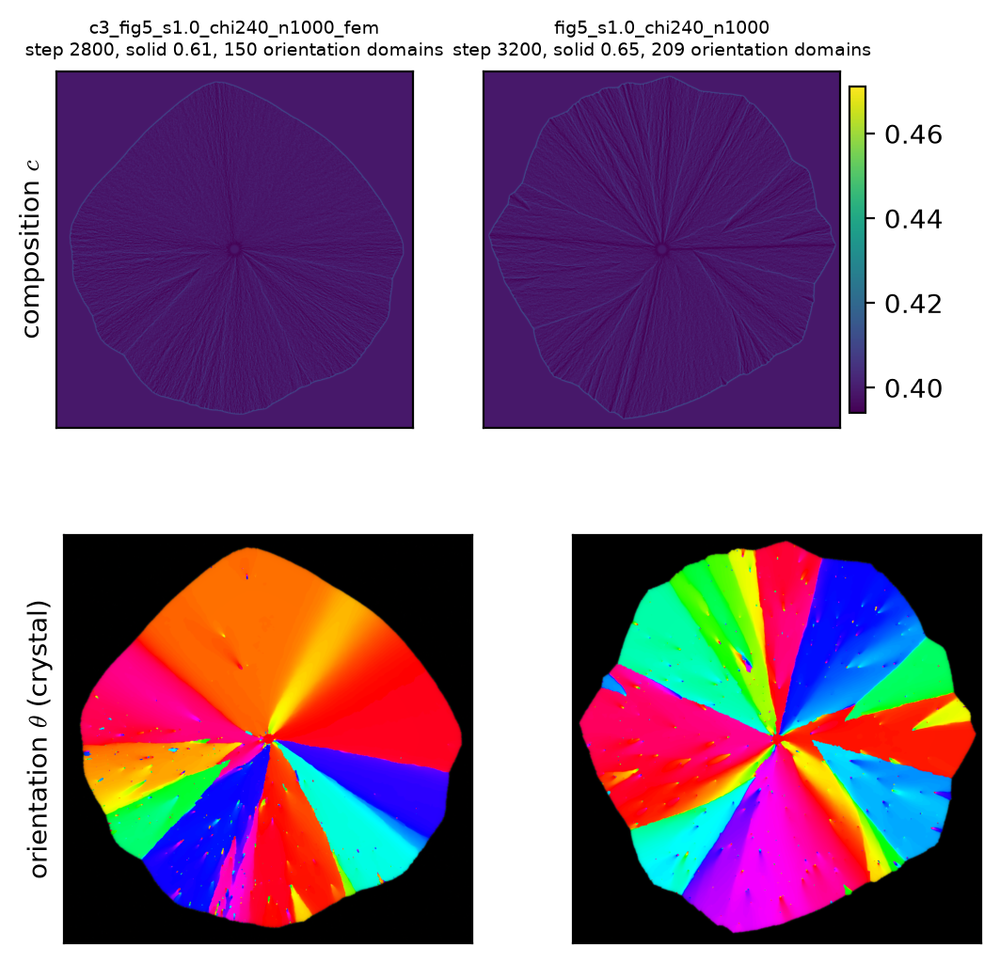

**Figure 20.** Case C3 at $S = 1.0$, $\chi_l = 240$, 1000 x 1000: PINNACLE (left, step 2800)
and the independent reference (right, step 3200). Top: composition; bottom: orientation.
Reading: both give a faceted crystal divided into sectors, with wedge-shaped grains starting
at the growth front and an envelope that rounds with size.

- Both codes give the same form: a faceted crystal divided into sectors of different
  orientation, with wedge-shaped grains that start at the growth front and an envelope that
  rounds with size. The number of orientation domains grows with the radius in both.
- The radius differs by 9 to 10 % at all times: a difference of front speed, as at
  $S = 1.0$ in section 6.4.1 (FE +1.8 %, finite differences -5.5 % against the Richardson
  value) and in Table 19.
- Difference from the paper: there the crystal is one square until a critical size; here
  sectors start at the seed for $\chi_l \le 300$. It depends on the seed (12 cells, random
  orientation around it) and on the assumed $h$ and noise.
- Animations: `figures/crystallization/c3_fig5_*.gif`. One realization.

#### 7.4.4 C5: nucleation and growth of spherulites, transformation kinetics

*Purpose.* Without a seed the noise nucleates crystals everywhere in the liquid; each grows
as a spherulite until the crystals meet. The crystalline fraction $X(t)$ then follows the
Johnson-Mehl-Avrami-Kolmogorov law $X = 1 - \exp\{-[(t - t_0)/\tau]^p\}$, with $p = 1 + d$
for a constant nucleation rate and a constant growth rate in $d$ dimensions. Section III.B of
(granasy 2005 spherulites) reports $p = 3.04 \pm 0.02$, $\tau = 0.0106$, $t_0 = 0.00178$ on
5000 x 5000 at the conditions of the spherulite of section 7.4.2 ($S = 1.0$,
$\chi_l = 54$), after a pre-heat of 10,000 steps at 1595 K (reported_text).

*Set-up.* No seed; three realizations of the noise per ensemble; fit for $0.01 < X < 0.95$ as
in the paper. Reference stencil: 3 x 1000 x 1000; PINNACLE: 3 x 500 x 500. Two items are not
those of the paper:

- **Noise amplitude (calibrated).** With the standard deviation of section 7.3 (0.0025 per
  step on $\phi$) no crystal appears in 5000 steps in either code. The threshold is sharp in
  the reference: none at 0.0060, half transformed at step 2650 from about 6 crystals at
  0.0062, complete by step 1100 at 0.0070. The ensembles use 0.0070 (reference) and 0.0062
  (PINNACLE). At equal nodal standard deviation PINNACLE nucleates about 5 times sooner: its
  noise enters as an element load, so neighboring nodes receive correlated increments.
- **Pre-heat (shortened).** 5000 steps in the reference (3000 in the PINNACLE decks) instead
  of 10,000, with the driving terms of the model at 1595 K (93394 and -155690, derived by
  scaling the terms of section 6.3 with $(T_i - T)/T$); the interpolation function is clamped to $0 \le \phi \le 1$ during the
  pre-heat (PINNACLE: `bounded_interpolation`), because its polynomial outside this range
  destabilizes the stable liquid.

The time scale ($\tau$, $t_0$) therefore cannot be compared with the paper; the exponent can.

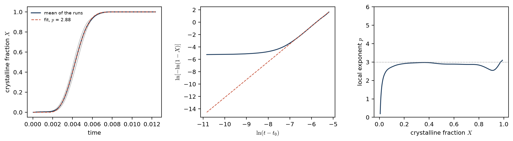

**Figure 21.** Reference stencil, three runs of 1000 x 1000 with pre-heat. Left:
crystalline fraction of the runs (gray), their mean and the fit. Middle: Avrami plot of the
mean. Right: local exponent against the fraction.

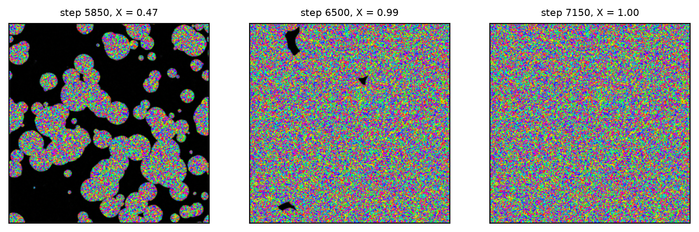

**Figure 22.** Orientation maps of one reference run with pre-heat at the three
saved frames after the first crystals ($X$ = 0.47, 0.99, 1.00; frames are 650 steps apart).
The crystals are round and nucleate at different times (different sizes at $X$ = 0.47); the
grains inside them are a few cells wide, finer than in the seeded run of section 7.4.2,
because of the raised noise amplitude.

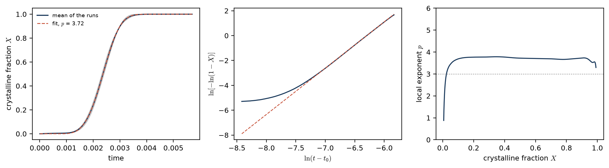

**Figure 23.** As Figure 21 for PINNACLE, three runs of 500 x 500 without
pre-heat.

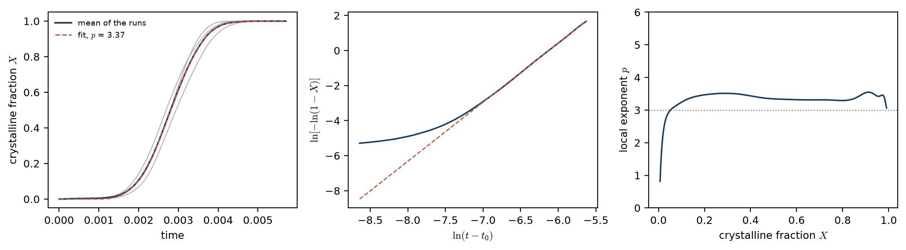

**Figure 24.** As Figure 21 for PINNACLE, three runs of 500 x 500
with a pre-heat of 3000 steps at 1595 K; time counted from the quench.

**Table 22.** Kinetic exponent of the ensemble mean (error of the fit) and of the single
runs; number of crystals counted in the last frame with $X < 0.6$, summed over the runs.

| code | grid | pre-heat | noise (std on $\phi$ per step) | $p$ (mean) | $p$ (single runs) | $t_0$ | $\tau$ | crystals |
|---|---|---|---|---|---|---|---|---|
| paper | 5000 x 5000 | 10,000 steps | not printed | 3.04 ± 0.02 | -- | 0.00178 | 0.0106 | -- |
| reference | 3 x 1000 x 1000 | none | 0.0070 | 3.43 ± 0.04 | 3.45, 3.57, 3.41 | 0.00124 | 0.00328 | 160 |
| reference | 3 x 1000 x 1000 | 5000 steps | 0.0070 | 2.88 ± 0.03 | 2.87, 2.64, 3.29 | 0.00155 | 0.00310 | 127 |
| PINNACLE | 3 x 500 x 500 | none | 0.0062 | 3.72 ± 0.01 | 4.13, 3.91, 3.19 | 0.00070 | 0.00184 | 77 |
| PINNACLE | 3 x 500 x 500 | 3000 steps | 0.0062 | 3.37 ± 0.01 | 3.02, 5.11, 2.82 | 0.00085 | 0.00219 | 48 |

- Without pre-heat the exponent is above 3 in both codes (3.43 and 3.72). The liquid starts
  without fluctuations, so the nucleation rate rises during the first part of the run: an
  increasing rate gives $p > 1 + d$. This is the starting transient the paper removes with
  its pre-heat.
- With pre-heat the reference gives 2.88 ± 0.03, within 5 % of the paper's 3.04 and of the
  ideal value 3. The single runs scatter between 2.64 and 3.29: 40 to 50 crystals per run
  are too few for the second digit; the paper's box holds 25 times more.
- PINNACLE with pre-heat (Figure 24) gives 3.37 ± 0.01 for the
  ensemble mean, 11 % above the paper, down from 3.72 without pre-heat. Two of the three
  runs give 3.02 and 2.82, the third 5.11. In that run the fit puts the incubation time
  near zero ($t_0$ = 0.0001 against 0.0009 and 0.0012): $t_0$ and $p$ trade against each
  other when a run holds 13 to 20 crystals, and one early crystal moves both. The local
  exponent of the ensemble (right panel) lies between 3.3 and 3.5 for $X$ from 0.15 to 0.9.
  The 500 x 500 box is too small to settle the exponent to better than about 10 %.
- Accuracy: tier 3 for the exponent (statistical): reference within 5 % of the paper with
  pre-heat, PINNACLE within 11 % on a box with a quarter of the area. No comparison of the
  time scale.

*What to expect.* A larger noise amplitude shortens the incubation and raises the number of
crystals steeply (threshold behavior), which makes the final grains smaller; the exponent
does not depend on it once the liquid is equilibrated. A lower $\chi_l$ or a higher $S$
changes the internal structure of each spherulite (section 7.5.1) but not the exponent, as
long as the envelopes stay round and grow linearly in time. Diffusion-controlled forms
(dendrites at $S < 0.9$, growth exponent near 0.5) give a lower $p$ (2 for a constant
nucleation rate in two dimensions).

### 7.5 What to expect when the parameters change

- Orientational mobility at $S = 1.0$ (Table 20, Figures 17 and 18): 360 gives a square
  single crystal; 300 a faceted crystal of about ten sectors; 240 sectors plus grains that
  start at the growth front; 180 radially elongated grains with a rounded envelope; 108 and
  54 a fine-grained spherulite with a circular envelope. The lower the mobility, the finer
  the grains and the rounder the envelope.
- Orientational mobility at $S = 0.8$ (Table 19): 360 gives a single-crystal dendrite, 54 a
  polycrystalline dendrite (106 orientation domains at step 2000) whose arms do not follow
  one lattice.
- Supersaturation at $\chi_l = 54$ (Table 19): at 0.8 the form is still dendritic; at 1.0
  the front is about three times faster (0.15 against 0.05 cells per step), outruns the
  ordering, and the crystal is a compact spherulite.
- Size: at $\chi_l = 240$ the number of orientation domains grows with the radius (34 at
  step 800 to 180 at step 3200, Table 21).
#### 7.5.1 Parameter series at the conditions of the single-crystal and polycrystalline forms

Fifteen runs on 500 x 500, one parameter varied at a time around the conditions of
(granasy 2005 spherulites): decks `decks/crystallization/orientation/series/c3_s<S>_a<s0>_chi<chi>_fem.i`
(written by `scripts/cryst_orientation_decks.py`, each one complete), measures by
`scripts/cryst_orientation_series.py`. The intermediate values (S = 0.7 and 0.9;
$s_0$ = 0.025 and 0.05; $\chi_l$ = 18, 108, 180, 240) are not in the paper. One realization
per case, the same noise seeds in all.

Measures, at the last saved step before the crystal reaches the box edge:
*equivalent radius* $\sqrt{A/\pi}$ of the crystal area $A$; *compactness* $A/(\pi R_{\max}^2)$
with $R_{\max}$ the largest distance of a crystal cell from the seed (1 for a disc, small for
needles and dendrites); *growth exponent* $n$ of $R \propto t^n$ over the second half of the
run (1/2: diffusion controlled, 1: interface controlled); *orientation domains*: connected
crystal regions of like orientation (12 bins, more than 20 cells); *mean misorientation*
between neighboring crystal cells in units of $2\pi/k$ (0.25: random); *boundary fraction*:
share of neighbor pairs with misorientation above 0.05 (18 degrees of the 90 degree period),
a measure of grain-boundary length per area; *radial alignment*
$\langle\cos k(\alpha-\beta)\rangle$ of the fast growth direction $\alpha = 2\pi\theta/k$ with
the direction $\beta$ from the seed (1: fast directions point outward everywhere, the fiber
texture of a spherulite; 0: no relation); *trapped solute* $(\bar c - c_S)/(c_L - c_S)$ of the
crystal (0: solidus composition; $1 - S$: the liquid composition is frozen in).

**Supersaturation** ($s_0 = 0.1$, $\chi_l = 360$).

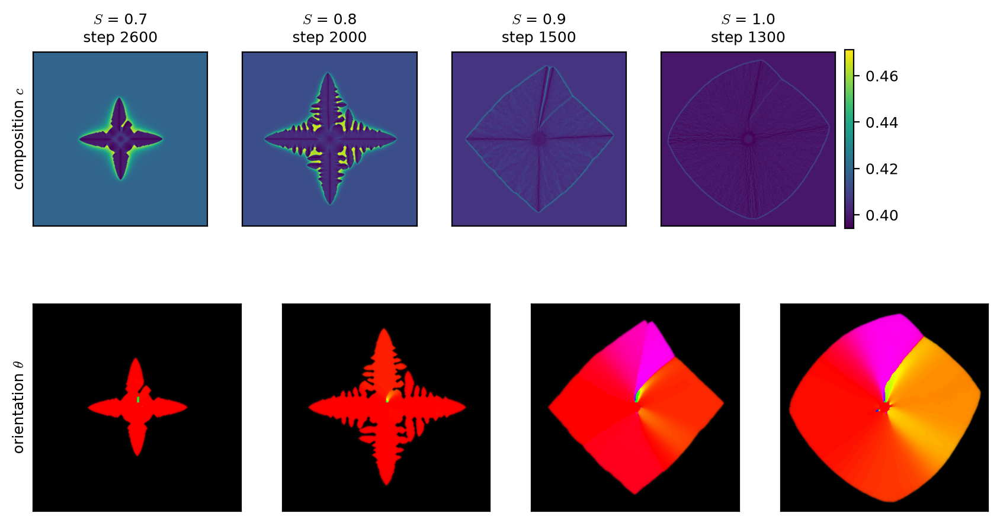

**Figure 25.** Composition (top) and orientation (bottom, liquid black) for S = 0.7, 0.8,
0.9, 1.0 at $s_0 = 0.1$ and $\chi_l = 360$ (PINNACLE, 500 x 500). Reading: at 0.7 and 0.8 a
four-fold dendrite with solute piled up between the arms; at 0.9 and 1.0 the arms close into
a faceted, nearly square crystal without a solute layer, and the orientation drifts across
the crystal in a few low-angle sectors.

**Table 23.** Measures of the supersaturation series.

| S | step | equivalent radius (cells) | compactness | growth exponent | orientation domains | mean misorientation | boundary fraction | radial alignment | trapped solute |
|---|---|---|---|---|---|---|---|---|---|
| 0.7 | 2600 | 69.6 | 0.33 | 0.60 | 2 | 0.0008 | 0.0018 | 0.52 | 0.013 |
| 0.8 | 2000 | 114.5 | 0.36 | 0.79 | 2 | 0.0005 | 0.0006 | 0.40 | 0.051 |
| 0.9 | 1500 | 174.8 | 0.67 | 0.86 | 10 | 0.0008 | 0.0022 | 0.13 | 0.090 |
| 1.0 | 1300 | 208.9 | 0.80 | 0.90 | 7 | 0.0008 | 0.0021 | 0.03 | -0.004 |

- The form changes between S = 0.8 and 0.9: compactness 0.36 to 0.67, growth exponent 0.79
  to 0.86 and on to 0.90. Below, growth is limited by the diffusion of rejected solute and
  the tips escape along the fast directions; above, the solute is trapped (the composition
  map is flat) and the whole perimeter advances at the kinetic rate.
- The front speed rises about threefold from 0.8 to 1.0 (radius 114.5 cells in 2000 steps
  against 208.9 in 1300).
- Crystallography: the crystal stays one grain up to 0.8. At 0.9 and 1.0, with the same
  orientational mobility, the fast front no longer fully orders the orientation: a few
  low-angle sectors appear (10 and 7 domains, mean misorientation still below 0.001).

**Anisotropy of the interface free energy** ($S = 0.8$, $\chi_l = 360$).

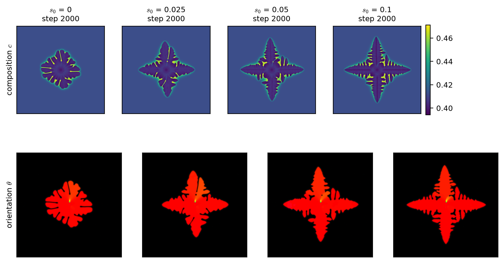

**Figure 26.** As Figure 25 for $s_0$ = 0, 0.025, 0.05, 0.1 at S = 0.8. Reading: without
anisotropy the crystal is a seaweed of splitting tips; 2.5 % already selects four primary
arms; the arms sharpen and the side branches order as $s_0$ grows.

**Table 24.** Measures of the anisotropy series.

| $s_0$ | step | equivalent radius (cells) | compactness | growth exponent | orientation domains | mean misorientation | boundary fraction | radial alignment | trapped solute |
|---|---|---|---|---|---|---|---|---|---|
| 0 | 2000 | 94.4 | 0.66 | 0.62 | 2 | 0.0006 | 0.0009 | 0.09 | 0.058 |
| 0.025 | 2000 | 105.2 | 0.41 | 0.70 | 2 | 0.0005 | 0.0007 | 0.35 | 0.063 |
| 0.05 | 2000 | 111.8 | 0.37 | 0.77 | 7 | 0.0005 | 0.0006 | 0.39 | 0.059 |
| 0.1 | 2000 | 114.5 | 0.36 | 0.79 | 2 | 0.0005 | 0.0006 | 0.40 | 0.051 |

- Anisotropy stabilizes the tip: compactness falls from 0.66 (seaweed) to 0.36 (dendrite),
  the radius after 2000 steps grows from 94 to 115 cells and the growth exponent from 0.62
  to 0.79: a stable tip grows steadily into fresh liquid, a splitting tip stays in its own
  solute field.
- Radial alignment rises from 0.09 to 0.40: with anisotropy the arms run along the fast
  directions of the lattice, so a section through the crystal shows the lattice orientation
  in its outline; a seaweed does not.

**Orientational mobility at S = 0.8** ($s_0 = 0.1$).

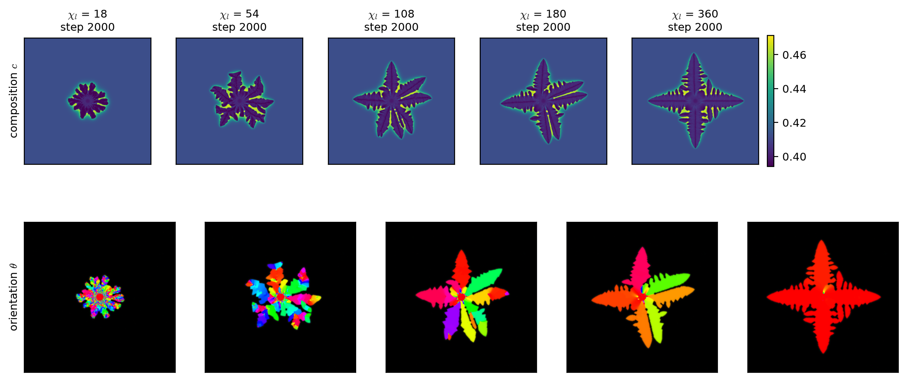

**Figure 27.** As Figure 25 for $\chi_l$ = 18, 54, 108, 180, 360 at S = 0.8. Reading: from
right to left the single-crystal dendrite breaks into a few arms of different orientation
(180, 108), then into a polycrystalline dendrite (54) and a compact fine-grained particle
(18).

**Table 25.** Measures of the mobility series at S = 0.8.

| $\chi_l$ | step | equivalent radius (cells) | compactness | growth exponent | orientation domains | mean misorientation | boundary fraction | radial alignment | trapped solute |
|---|---|---|---|---|---|---|---|---|---|
| 18 | 2000 | 63.4 | 0.60 | 0.51 | 110 | 0.0831 | 0.3680 | 0.11 | -0.031 |
| 54 | 2000 | 92.8 | 0.48 | 0.75 | 106 | 0.0150 | 0.0581 | 0.08 | 0.006 |
| 108 | 2000 | 106.3 | 0.42 | 0.75 | 34 | 0.0039 | 0.0153 | 0.62 | 0.028 |
| 180 | 2000 | 109.2 | 0.39 | 0.75 | 15 | 0.0015 | 0.0052 | 0.51 | 0.040 |
| 360 | 2000 | 114.5 | 0.36 | 0.79 | 2 | 0.0005 | 0.0006 | 0.40 | 0.051 |

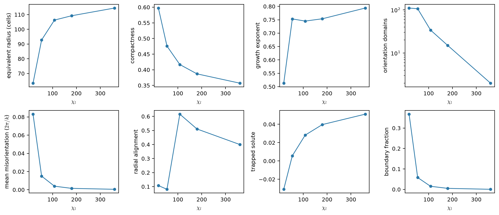

**Figure 28.** The measures of Table 25 against $\chi_l$. Reading: the number of orientation
domains and the misorientation rise steeply below $\chi_l$ of about 100, and the radius
falls with them.

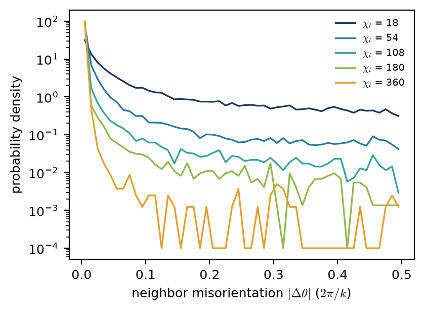

**Figure 29.** Probability density of the misorientation between neighboring crystal cells
for the mobility series at S = 0.8 (logarithmic scale). Reading: at 360 and 180 nearly all
pairs lie below 0.02 (inside grains); with falling mobility a flat tail up to 0.5 grows:
high-angle boundaries of all misorientations, as expected for orientations frozen in from an
unordered liquid without a preferred misfit angle.

- Each halving of the mobility roughly multiplies the grain-boundary content by three to
  four (boundary fraction 0.0006, 0.005, 0.015, 0.058, 0.37) and divides the mean domain area
  (20,600, 2500, 1040, 255, 115 cells).
- Growth slows as the mobility falls (radius 114.5 to 63.4 cells): a front whose orientation
  is not ordered carries the orientational energy $hF$, which reduces the driving force.
- The dendritic outline survives down to 108: every arm is a single crystal that started at
  the seed with its own orientation and grows along its own fast direction (radial alignment
  0.5 to 0.6, the highest of the series). At 54 new grains also form at the growth front and
  the arms bend and split; at 18 the particle is a spherulite in the making.

**Orientational mobility at S = 1.0** ($s_0 = 0.1$).

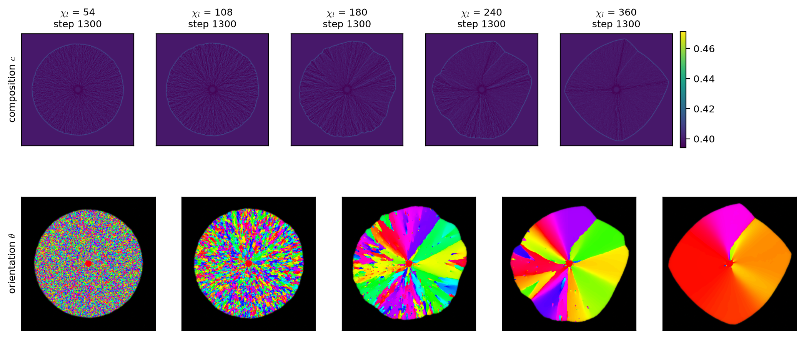

**Figure 30.** As Figure 25 for $\chi_l$ = 54, 108, 180, 240, 360 at S = 1.0. Reading: the
same transition as at S = 0.8, shifted to higher mobility: the faceted crystal (360) is
already a spherulite of elongated grains at 180.

**Table 26.** Measures of the mobility series at S = 1.0.

| $\chi_l$ | step | equivalent radius (cells) | compactness | growth exponent | orientation domains | mean misorientation | boundary fraction | radial alignment | trapped solute |
|---|---|---|---|---|---|---|---|---|---|
| 54 | 1300 | 202.2 | 0.98 | 0.90 | 190 | 0.1508 | 0.6451 | -0.00 | -0.004 |
| 108 | 1300 | 205.1 | 0.94 | 0.90 | 1393 | 0.0698 | 0.3130 | 0.03 | -0.004 |
| 180 | 1300 | 210.3 | 0.88 | 0.91 | 305 | 0.0146 | 0.0593 | 0.38 | -0.004 |
| 240 | 1300 | 210.0 | 0.84 | 0.91 | 59 | 0.0039 | 0.0128 | 0.25 | -0.004 |
| 360 | 1300 | 208.9 | 0.80 | 0.90 | 7 | 0.0008 | 0.0021 | 0.03 | -0.004 |

- The transition from a single crystal to a polycrystal depends on the ratio of the
  ordering rate to the front speed: at S = 1.0 the front is three times faster and the same
  number of orientation domains is reached at about twice the mobility (15 domains at
  $\chi_l = 180$ for S = 0.8; 59 at 240 and 305 at 180 for S = 1.0).
- The radius is almost independent of the mobility at S = 1.0 (209 to 210 cells at 180 to
  360): the driving force is large against the orientational energy. The envelope rounds
  (compactness 0.80 at 360, 0.88 at 180) because grains of all orientations reach the front.
- Solute: the trapped fraction is zero within 0.005 in all runs at S = 1.0 (the liquid has
  the solidus composition); at S = 0.8 it rises from -0.03 to 0.05 with the mobility, that
  is with the growth rate.
- The domain count is a threshold measure: at $\chi_l = 54$ and S = 1.0 it drops to 190
  although the misorientation is the highest of the series (0.15), because most grains are
  then smaller than the 20-cell threshold. Mean misorientation and boundary fraction are the
  measures to follow at the fine-grained end.

#### 7.5.2 Fibrillar growth with fixed-angle branching: from needles to category 2 spherulites

Case C4, after Fig. 6 of (granasy 2005 spherulites). Polymers and many minerals grow as
thin fibers that branch at fixed crystallographic angles. Two ingredients are added to the
model of section 7.2. (1) A two-fold anisotropy of the phase-field mobility,
$M_\phi = 1 + \delta_0\cos(2\vartheta - 2\pi\theta)$, with $\delta_0 = 0.995$ (`reported_text`:
"99.5 %"): the crystal grows 400 times faster along its axis than across it, and the interface
free energy is isotropic ($s_0 = 0$). (2) The branching part $F_0$ of the orientational
energy with weight $x = 0.15$ and $m = 3$ (`reported_text`): a second, metastable minimum
at a misorientation of $1/(2m) = 1/6$ of the period, 30 degrees for a two-fold crystal, so
that a new grain at the growth front prefers that misfit. $\chi_l = 360$ is `assumed` (not
stated for this figure); the seed is set at 30 degrees ($\theta = 1/6$). In PINNACLE the
mobility is a rate factor of the phase-field row with the interface normal taken from a
lumped nodal gradient (`ac_interface_anisotropic kinetic_anisotropy_strength`, ADR 0040
addendum). Twelve decks, `decks/crystallization/orientation/fibril/c4_s<S>_x<x>_d<delta0>_fem.i`
(500 x 500). The paper varies S; the series in $x$ and $\delta_0$ are added here.

**Supersaturation** ($x = 0.15$, $\delta_0 = 0.995$; the paper's series).

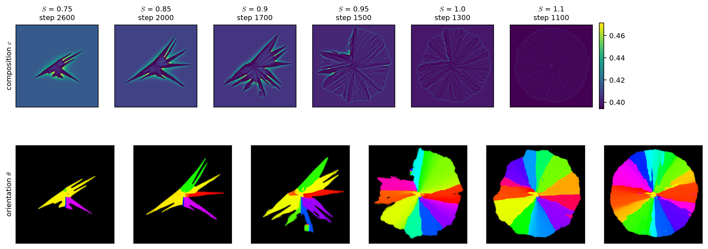

**Figure 31.** Composition (top) and orientation (bottom, period 180 degrees) for S = 0.75,
0.85, 0.9, 0.95, 1.0, 1.1 (PINNACLE). Reading: a needle along the seed direction with a few
side fibers at fixed angles (0.75), a bundle of diverging fibers (0.85, 0.9: an axialite or
sheaf), a nearly space-filling fan with two notches left on either side of the seed (0.95),
and a round spherulite of radial sectors (1.0, 1.1). The same sequence as Fig. 6 of the
paper. The fibers appear in a few discrete colors: the orientations allowed by the 30 degree
misfit.

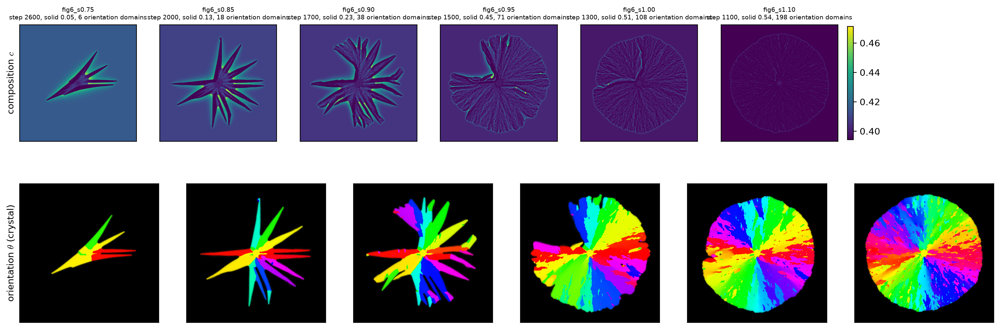

**Figure 32.** The same six conditions in the independent reference
(`decks/crystallization/reference/c4_fig6_s*.i`). Reading: the same sequence of forms; the
reference realizations carry more branches (38 against 16 orientation domains at S = 0.9)
and keep open "eyes" beside the seed up to S = 1.0.

**Table 27.** Measures of the fibrillar supersaturation series (PINNACLE; symmetry index 2).

| S | step | equivalent radius (cells) | compactness | growth exponent | orientation domains | mean misorientation | boundary fraction | radial alignment | trapped solute |
|---|---|---|---|---|---|---|---|---|---|
| 0.75 | 2600 | 63.3 | 0.12 | 0.47 | 12 | 0.0032 | 0.0140 | 0.71 | -0.115 |
| 0.85 | 2000 | 86.9 | 0.16 | 0.46 | 9 | 0.0029 | 0.0109 | 0.83 | -0.153 |
| 0.9 | 1700 | 120.8 | 0.26 | 0.51 | 16 | 0.0026 | 0.0128 | 0.85 | -0.062 |
| 0.95 | 1500 | 203.2 | 0.69 | 0.87 | 26 | 0.0020 | 0.0088 | 0.90 | 0.033 |
| 1.0 | 1300 | 216.5 | 0.83 | 0.93 | 25 | 0.0021 | 0.0117 | 0.93 | -0.004 |
| 1.1 | 1100 | 223.9 | 0.91 | 0.92 | 39 | 0.0024 | 0.0141 | 0.94 | -0.103 |

- The change from open fiber bundles to a space-filling spherulite lies between S = 0.9 and
  0.95: compactness 0.26 to 0.69, growth exponent 0.51 to 0.87. Below, the fibers are
  separated by solute-rich liquid and lengthen as $t^{1/2}$; above, the liquid between them
  is trapped and the envelope advances at a constant rate.
- Radial alignment is high throughout (0.71 to 0.94): every fiber grows along its own fast
  axis, so the crystal axis points outward everywhere. This is the fiber texture seen in
  spherulites under polarized light (the Maltese cross); the category 1 spherulite of Table 26
  made of equiaxed grains has an alignment near zero.
- The grains are sectors, not equiaxed: 12 to 39 domains of 1000 to 5900 cells each, with a
  boundary fraction near 0.01, an order of magnitude below the category 1 spherulite at
  $\chi_l = 180$ (0.059).
- Against the reference: same forms, fewer branches in the PINNACLE realization and the
  "eyes" close earlier. One realization each; the discretizations differ in how they
  evaluate the interface normal of the kinetic anisotropy (nodal projection against central
  differences).

**Branching weight** (S = 0.9, $\delta_0 = 0.995$).

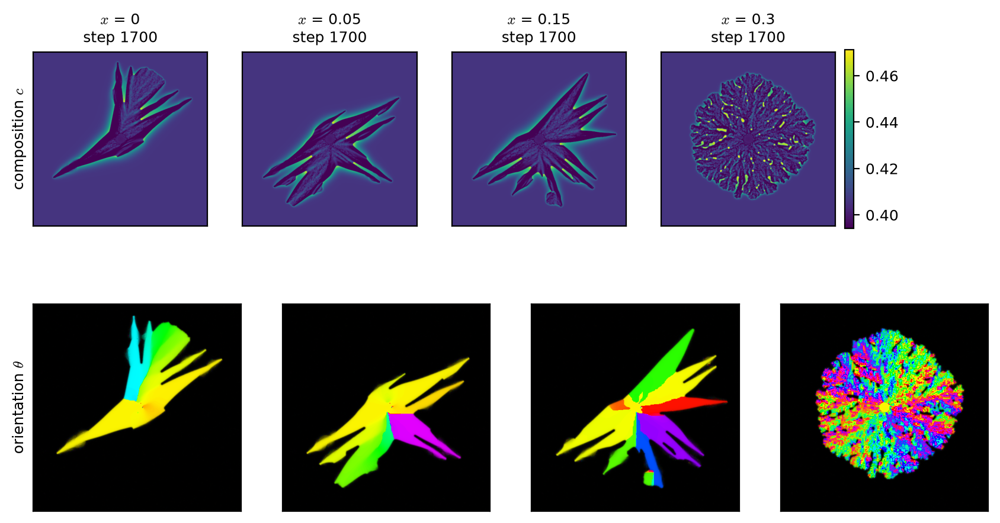

**Figure 33.** As Figure 31 for $x$ = 0, 0.05, 0.15, 0.3. Reading: without the branching
minimum ($x = 0$) the fibers split by low-angle fanning and the orientation changes smoothly
along the fan; with $x$ = 0.05 and 0.15 side fibers start at fixed angles and carry distinct
orientations; at 0.3 the front nucleates grains everywhere and the form is a compact
fine-grained spherulite with liquid inclusions.

**Table 28.** Measures of the branching-weight series.

| $x$ | step | equivalent radius (cells) | compactness | growth exponent | orientation domains | mean misorientation | boundary fraction | radial alignment | trapped solute |
|---|---|---|---|---|---|---|---|---|---|
| 0 | 1700 | 104.3 | 0.20 | 0.64 | 13 | 0.0017 | 0.0041 | 0.80 | -0.059 |
| 0.05 | 1700 | 110.0 | 0.22 | 0.54 | 12 | 0.0018 | 0.0049 | 0.74 | -0.072 |
| 0.15 | 1700 | 120.8 | 0.26 | 0.51 | 16 | 0.0026 | 0.0128 | 0.85 | -0.062 |
| 0.3 | 1700 | 164.8 | 0.71 | 0.89 | 894 | 0.0555 | 0.3318 | 0.46 | 0.046 |

- Up to $x = 0.15$ the weight changes how the fibers branch, not how many grains there are
  (12 to 16 domains); between 0.15 and 0.3 the fixed-angle minimum becomes deep enough for
  grains to form at the front without waiting for noise: 894 domains, boundary fraction
  0.33, and the growth becomes linear in time (exponent 0.89).
- The branching weight is therefore the parameter for the density of the internal structure
  of a spherulite at a given supersaturation; the paper uses 0.1 to 0.275 in its gallery
  (its Table II).

**Kinetic anisotropy** (S = 0.9, $x = 0.15$).

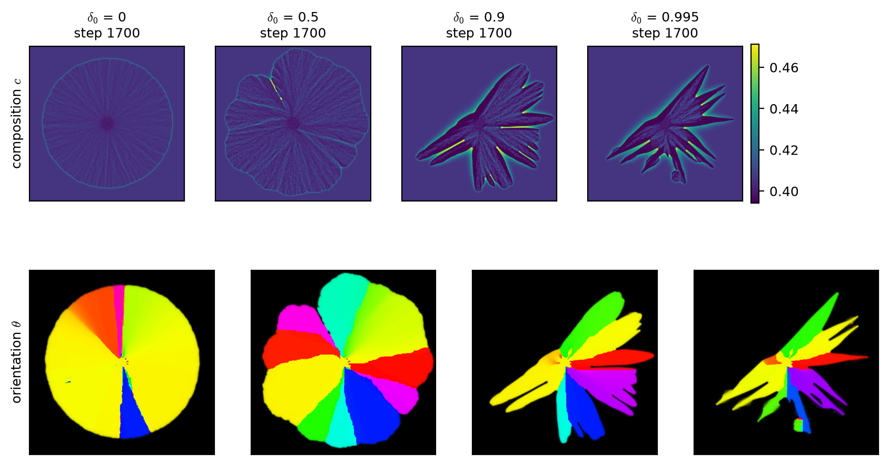

**Figure 34.** As Figure 31 for $\delta_0$ = 0, 0.5, 0.9, 0.995. Reading: with an isotropic
mobility the crystal is a disc of a few sectors; at 0.5 the envelope becomes lobed, each
lobe a sector growing along its fast axis; at 0.9 the sectors separate into broad blades;
at 0.995 into thin fibers.

**Table 29.** Measures of the kinetic-anisotropy series.

| $\delta_0$ | step | equivalent radius (cells) | compactness | growth exponent | orientation domains | mean misorientation | boundary fraction | radial alignment | trapped solute |
|---|---|---|---|---|---|---|---|---|---|
| 0 | 1700 | 208.7 | 0.96 | 0.89 | 20 | 0.0017 | 0.0069 | 0.13 | 0.094 |
| 0.5 | 1700 | 225.4 | 0.82 | 0.93 | 18 | 0.0017 | 0.0083 | 0.84 | 0.093 |
| 0.9 | 1700 | 155.3 | 0.40 | 0.72 | 11 | 0.0017 | 0.0087 | 0.90 | 0.018 |
| 0.995 | 1700 | 120.8 | 0.26 | 0.51 | 16 | 0.0026 | 0.0128 | 0.85 | -0.062 |

- The anisotropy of the mobility sets the aspect ratio of the growth units: compactness
  0.96, 0.82, 0.40, 0.26. Fibers need $\delta_0$ above about 0.9, that is a ratio of fast to
  slow mobility above about 20.
- Radial alignment jumps from 0.13 to 0.84 already at $\delta_0 = 0.5$: a moderate kinetic
  anisotropy is enough to select grains whose fast axis points outward, long before the form
  becomes fibrillar.
- A strong anisotropy slows the overall transformation (equivalent radius 225 cells at 0.5,
  121 at 0.995 after the same time): the slow faces hardly move and solute piles up between
  the fibers.

#### 7.5.3 Gallery of spherulitic forms at the published parameter sets (case C6)

Section III.D of (granasy 2005 spherulites) shows ten growth forms (its Fig. 10) that differ
only in the supersaturation, the two anisotropies, the branching weight and angle and the two
mobilities; its Table II lists the values (reported_table). The decks
`decks/crystallization/orientation/gallery/c6_fig10<a-j>_fem.i` take these values without
change. Not printed in the paper and therefore assumed: the number of steps, the seed (here a
disc of 10 cells at 30 degrees) and the noise amplitudes (those of section 7.3). The paper's
grids are 500 to 3000 cells wide; all panels are run here at 500 x 500, so that for the
panels with larger grids only the first part of the growth is seen. With
$s_0 \ge 0.5$ the explicit step is halved (assumed, for stability). The comparison is
qualitative (tier 3).

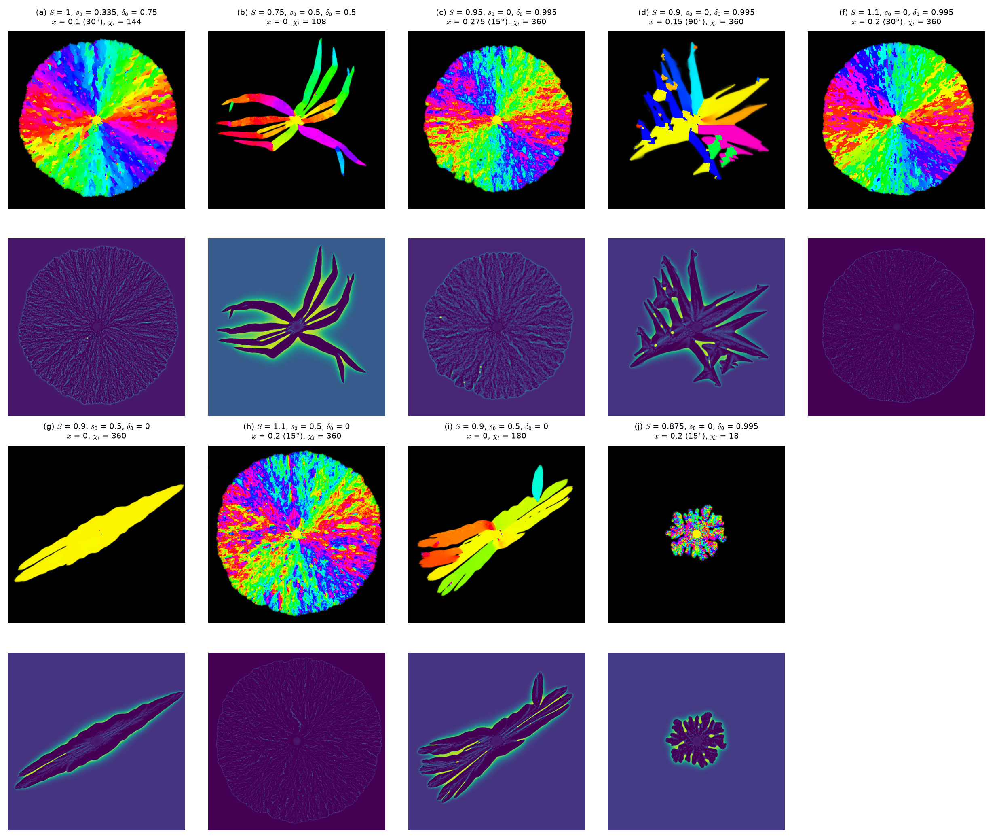

**Figure 35.** PINNACLE at the parameter sets of Table II of
(granasy 2005 spherulites), 500 x 500, at the last saved frame before the crystal reaches the
box edge. For every panel: orientation (color, period 180 degrees; liquid black) and
composition below it. Panel (e) is missing: see the note under Table 30.

**Table 30.** Conditions (reported_table) and measures (definitions in section
7.5.1; two-fold symmetry) of the gallery.

| panel | S | $s_0$ | $\delta_0$ | $x$ (angle) | $m_\phi$ | $\chi_l$ | paper grid | step | compactness | growth exponent | orientation domains | boundary fraction | radial alignment |
|---|---|---|---|---|---|---|---|---|---|---|---|---|---|
| (a) | 1 | 0.335 | 0.75 | 0.1 (30°) | 1 | 144 | 1000 | 1300 | 0.89 | 0.93 | 391 | 0.077 | 0.87 |
| (b) | 0.75 | 0.5 | 0.5 | 0 | 0.9 | 108 | 2000 | 5200 | 0.20 | 0.69 | 68 | 0.014 | 0.77 |
| (c) | 0.95 | 0 | 0.995 | 0.275 (15°) | 1 | 360 | 1000 | 1500 | 0.89 | 0.91 | 1444 | 0.466 | 0.77 |
| (d) | 0.9 | 0 | 0.995 | 0.15 (90°) | 1 | 360 | 2000 | 1700 | 0.33 | 0.72 | 30 | 0.015 | 0.59 |
| (f) | 1.1 | 0 | 0.995 | 0.2 (30°) | 1 | 360 | 1000 | 1100 | 0.92 | 0.91 | 424 | 0.118 | 0.84 |
| (g) | 0.9 | 0.5 | 0 | 0 | 0.9 | 360 | 2000 | 3060 | 0.13 | 0.56 | 21 | 0.000 | 0.73 |
| (h) | 1.1 | 0.5 | 0 | 0.2 (15°) | 1 | 360 | 500 | 1980 | 0.89 | 0.93 | 1842 | 0.381 | 0.63 |
| (i) | 0.9 | 0.5 | 0 | 0 | 0.8 | 180 | 1000 | 3400 | 0.23 | 0.73 | 30 | 0.005 | 0.77 |
| (j) | 0.875 | 0 | 0.995 | 0.2 (15°) | 1 | 18 | 3000 | 1850 | 0.64 | 0.59 | 91 | 0.558 | 0.18 |

Panel (e) ($s_0$ = 0.75, $\chi_l$ = 1440) was not obtained. Three runs became non-finite
early in the growth:

| time step | orientation sub-steps | non-finite at time |
|---|---|---|
| 2.375e-6 | 10 | 0.00133 (560 steps) |
| 2.375e-6 | 40 | 0.00143 |
| 1.1875e-6 | 20 | 0.00189 |

More orientation sub-steps and a smaller step delay the failure but do not remove it, so it
is not the stability limit of the orientation equation. The probable cause is the interface
anisotropy: for a two-fold anisotropy $1 + s_0\cos 2\vartheta$ the interface stiffness
$1 - 3 s_0 \cos 2\vartheta$ is negative over a range of directions once $s_0 > 1/3$, and at
$s_0 = 0.75$ it reaches -1.25, where the gradient term acts as backward diffusion. The
panels with $s_0$ = 0.335 and 0.5 ran. The cause was not isolated further (no field was
saved at the failure); a regularized anisotropy for missing orientations is not in PINNACLE
(section 12).

Reading, panel by panel, against Fig. 10 of the paper:

- **(a), (f): spherulites of radial fibers.** Reproduced in kind: round envelope
  (compactness 0.89 and 0.92), linear growth (exponent 0.93 and 0.91), about 400 radial
  grains, fast axes pointing outward (alignment 0.87 and 0.84).
- **(b): spiky form.** The paper shows a star of about 15 straight needles; here a sheaf of
  about 12 blades that bend away from the seed axis (compactness 0.20). The open, spiky
  character is reproduced; the blades are fewer and curved.
- **(c): arboresque form.** The paper shows an open star with rough arms; here the crystal
  is a compact spherulite of 1440 small grains (boundary fraction 0.47). Not reproduced:
  with $x = 0.275$ the fixed-angle minimum creates grains everywhere along the front, as in
  the $x = 0.3$ run of section 7.5.2.
- **(d): quadrite.** The paper shows a square pattern with a cross-hatched fine structure on
  2000 x 2000. Here the crystal is a star of straight blades of two orientations 90 degrees
  apart (yellow and blue in Figure 35): the right-angle branching is present, the
  box is too small for the cross-hatched square to develop.
- **(g), (i): sheaves.** The paper's panels contain several crystals (its box is 2 to 4 times
  wider and the crystals were nucleated by noise); a single seeded crystal here gives one
  needle whose ends begin to split (g, 21 domains) and one sheaf (i, $\chi_l$ halved,
  30 domains). The growth unit is reproduced, the multi-crystal texture is not.
- **(h): spherulite on a square.** The paper shows a square envelope with fine radial fibers;
  here a round, fine-grained spherulite (1836 domains). The interface-energy anisotropy of
  0.5 does not shape the envelope in this run.
- **(j): undulating branched pattern.** The paper shows a tree of curved branches on
  3000 x 3000; here, after 1850 steps, a small crystal with rounded lobes of fine random
  grains (alignment 0.18, the lowest of the set). With $\chi_l$ = 18 the orientation cannot
  follow the front; the branches of the paper would need the larger box and a longer time.

In summary the published parameter sets give the classes of forms of the paper (radial
spherulites, spiky sheaves, right-angle branching, needles) but not every panel: (c), (h) and
(j) differ, and the multi-crystal panels need the paper's box sizes. The runs differ from the
paper's in the assumed items listed above and in the 500 x 500 box.

- Animations: `figures/crystallization/c6_gallery_<panel>.gif`.
- Cost: 282 to 894 s per panel on the GPU of rocm-server (Table 30 runs, 4322 s in all).

#### 7.5.4 Foreign particles and low orientational mobility: two routes to the same form (case E4)

*Purpose.* Section III.E of (granasy 2005 spherulites) and (granasy 2006 review) state a
duality: a crystal becomes polycrystalline either because foreign particles force new
orientations on the front (static heterogeneities) or because the orientation of the liquid
relaxes too slowly to follow the front (dynamic heterogeneities), and the two routes give
similar forms. The paper's Fig. 11 shows it for a needle crystal: 99.5 % two-fold kinetic
anisotropy, isotropic interface energy, 250,000 single-pixel orientation pinning centers on
2000 x 2000 (6.25 % of the pixels), or the orientational mobility reduced by a factor of 5
(reported_text).

*Set-up.* Three runs of 500 x 500 and 2000 steps at $S = 0.85$, $\delta_0 = 0.995$,
no branching minimum ($x = 0$): the needle ($\chi_l$ = 360); the same with pinning centers on
6.25 % of the nodes; the same without centers and $\chi_l$ = 72. A pinning center is a node
whose orientation keeps its initial random value (`pinned_fraction = 'theta 0.0625'` of the
executioner; ADR 0044, commit `94f9215`). Assumed: $S$ (not printed for this figure), the
seed, the step count.

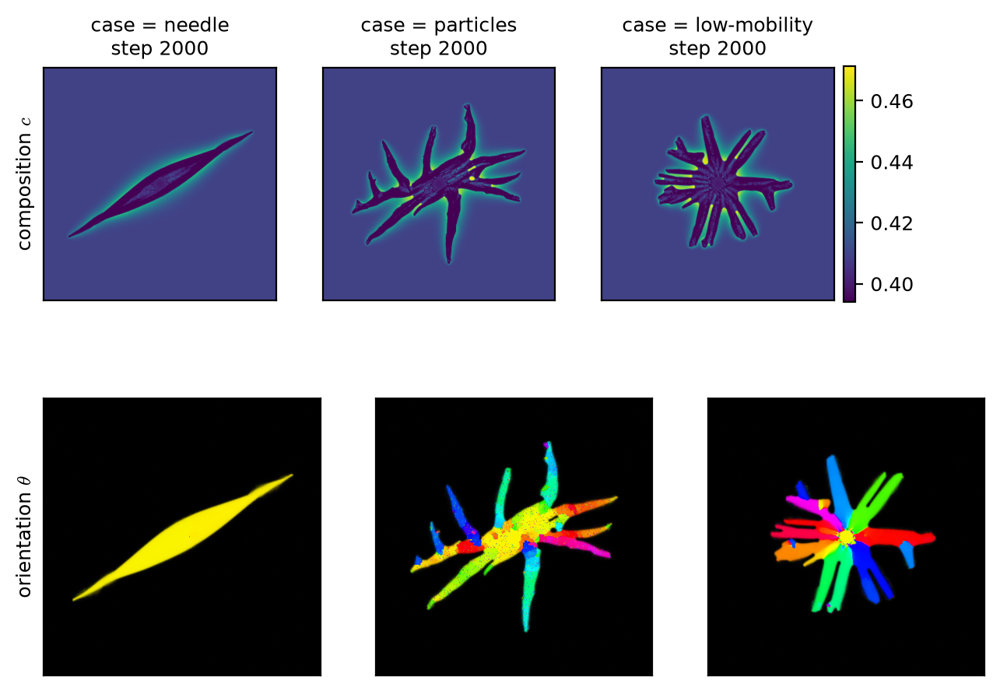

**Figure 36.** Composition (top) and orientation (bottom, period 180 degrees) after
2000 steps. Left: needle without heterogeneities. Middle: with orientation pinning centers
on 6.25 % of the nodes. Right: without centers, orientational mobility divided by 5.

**Table 31.** Measures of the three runs (definitions in section 7.5.1).

| run | equivalent radius (cells) | maximum radius (cells) | compactness | growth exponent | orientation domains | mean misorientation | boundary fraction | radial alignment |
|---|---|---|---|---|---|---|---|---|
| needle | 62.8 | 229 | 0.08 | 0.42 | 4 | 0.0005 | 0.0003 | 0.80 |
| pinning centers, 6.25 % | 93.0 | 203 | 0.21 | 0.69 | 60 | 0.0322 | 0.114 | 0.56 |
| $\chi_l / 5$ | 97.5 | 161 | 0.37 | 0.69 | 44 | 0.0054 | 0.023 | 0.86 |

- Without heterogeneities the crystal is a single needle (4 domains, compactness 0.08) that
  grows by diffusion (exponent 0.42).
- Both routes turn it into a branched polycrystal: 60 and 44 orientation domains, arms
  pointing in all directions, about twice the crystallized area and a growth exponent of 0.69
  in both. This is the duality of the paper, reproduced in kind (tier 3, qualitative).
- The two forms are similar, not equal. With particles the grains are speckled (the centers
  stay inside the crystal as point defects: mean misorientation 0.032 against 0.005) and the
  arms are irregular; with low mobility the arms are clean single grains that fan out from
  the seed (radial alignment 0.86 against 0.56).
- The paper calls the dense late form "fungus"; it needs its 2000 x 2000 box. Here the
  first branching generation is seen.

*What to expect.* More pinning centers or a lower $\chi_l$ give more and thinner arms and,
in the limit, a spherulite (section 7.5.1 for $\chi_l$). A needle needs both a clean liquid and
a fast orientation field; either impurity particles or a viscous liquid (low rotational
diffusion) is enough to lose it.

- Animations are not produced for this case; the frames are in the run directories.
- Cost: 507, 557 and 590 s on the GPU of rocm-server.

#### 7.5.5 Nucleation on a rough wall (case E5)

*Purpose.* Crystals in a real melt rarely form in the bulk; they form on container walls and
foreign particles, and on a rough surface first in its scratches and corners. The case
shows this selection of sites with the noise-driven model of section 7.4.4 and no seed, and
gives the user the rule that predicts it.

*Model.* The binary model with the orientation field at the conditions of the radial
spherulite ($S$ = 1.0, $s_0$ = 0.1, $\chi_l$ = 54). The liquid layer lies on a sawtooth
wall with grooves 30 cells deep and 80 cells apart; the layer is 400 cells wide and 185 to
215 high. Every boundary is a no-flux boundary, which for the phase field is a wall with a
contact angle of 90° (granasy 2007 heterogeneous). The grid is a mapped structured grid
(`scripts/cryst_rough_wall_mesh.py`). The noise is set below the level that nucleates in
the bulk within the run (0.0062 in section 7.4.4): standard deviation 0.0054, 0.0048 and
0.0044 of the nodal increment per step (assumed).

*Expected result.* With a contact angle of 90° a two-dimensional nucleus in a wedge of
opening angle $\beta$ is the sector $\beta / 2\pi$ of the homogeneous nucleus, and its
barrier is the same fraction of the homogeneous one:

**Table 32.** Sites of the box, their barrier relative to homogeneous nucleation
(derived from the wedge angle), and the crystals found there in ten runs (one at 0.0054,
five at 0.0048, four at 0.0044; 23 crystals). The site of a crystal is the node of lowest
$\phi$ in the first saved frame in which it exists.

| site | opening angle | relative barrier | number of sites | crystals | crystals per site |
|---|---|---|---|---|---|
| bottom corners (flank of the sawtooth and side wall) | 53° | 0.15 | 2 | 8 | 4 |
| top corners | 90° | 0.25 | 2 | 4 | 2 |
| grooves of the sawtooth | 106° | 0.30 | 4 | 3 | 0.75 |
| flat walls (top and sides) | 180° | 0.50 | about 770 nodes | 6 | 0.008 per node |
| ridges of the sawtooth | 254° | 0.70 | 5 | 1 | 0.2 |
| bulk liquid | 360° | 1 | about 80,000 nodes | 1 | 0.00001 per node |

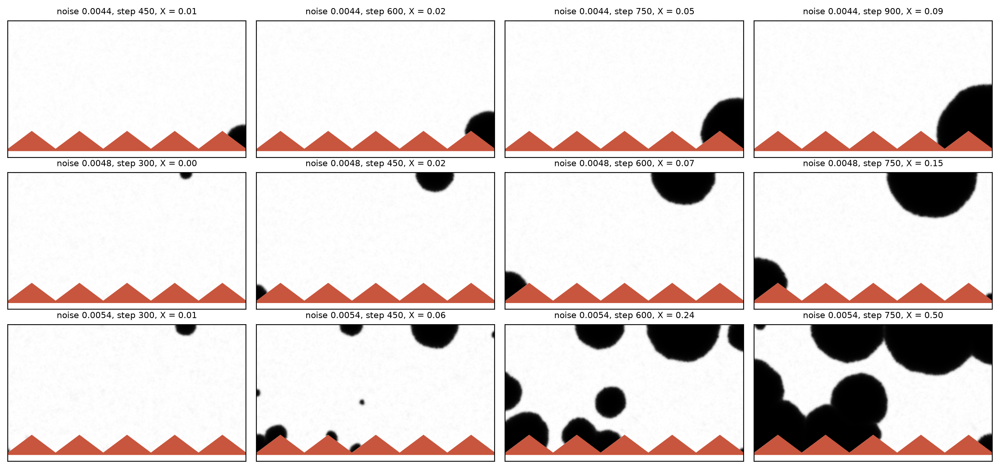

**Figure 37.** Phase field (black: crystal) at four early frames of the first run
at each noise level (0.0044, 0.0048, 0.0054 from top to bottom); the wall is drawn in red.
Animations: `figures/crystallization/e5_rough_wall_<run>.gif`.

- 22 of the 23 crystals form on a wall; the wall nodes are 1.5 % of the box.
- The number of crystals per site follows the wedge angle: 4 per 53° corner, 2 per 90°
  corner, 0.75 per 106° groove. The sharper the wedge, the lower the barrier and the more
  often it is the first site.
- Lowering the noise sharpens the selection. At 0.0044 all five crystals start in a corner (four
  in the 53° corners, one in a top corner); at 0.0054 crystals also appear on the flat
  walls and one in the bulk.
- The one crystal counted on a ridge starts 5 cells from the ridge line on its flank, a
  flat-wall site in effect.
- Limits of the evidence: 23 crystals; the first runs at 0.0048 and 0.0054 use the same
  random numbers (scaled), so their crystal on the top wall at the same place is one event,
  not two. The side walls make the two end grooves sharper than the inner ones; a box
  periodic along the wall would give equal grooves. Accuracy: tier 3, qualitative (the paper shows the
  preference for grooves in one image and prints no count).

*What to expect.* Deeper or sharper grooves lower the barrier in proportion to the opening
angle and act at lower noise (lower undercooling in a material). A contact angle above 90°
(less wetting, section 4) raises all wall barriers and moves nucleation back into the bulk.
At a noise level that nucleates in the bulk the wall no longer matters and the result is
that of section 7.4.4. After nucleation the crystals grow as the spherulites of
Figure 22, cut by the wall.

Cost: 230 s per run alone on the GPU of rocm-server (3000 steps, 80,601 nodes), 355 s when
the GPU is shared.

#### 7.5.6 Summary for the user

| to obtain | change | measured effect |
|---|---|---|
| compact, faceted crystal instead of a dendrite | raise S above about 0.85 | compactness 0.36 to 0.80, solute trapped |
| seaweed instead of a dendrite | $s_0 \to 0$ | tip splitting, no lattice-aligned arms |
| polycrystalline dendrite | lower $\chi_l$ to about 0.15 to 0.3 of the single-crystal value at S = 0.8 | 34 to 106 domains, dendritic outline kept |
| spherulite | lower $\chi_l$ further, or raise S at fixed $\chi_l$ | round envelope, fine radial grains |
| finer grains | lower $\chi_l$, raise S | domain area falls by a factor of 3 to 10 per halving of $\chi_l$ |

| needles, sheaves | two-fold kinetic anisotropy $\delta_0 > 0.9$, S below about 0.9 | compactness 0.12 to 0.26, fibers along the crystal axis |
| category 2 spherulite (fibers that fan out) | the same with S of 0.95 or more | compactness 0.69 to 0.91, radial alignment above 0.9 |
| denser internal structure | raise the branching weight $x$ | 16 domains at 0.15, 894 at 0.3 |

Not varied yet: $h$, the noise amplitudes, the seed size, the branching angle ($m$) and
four- or six-fold fibers.

### 7.6 Cost

On rocm-server (Radeon 8060S, float64): 0.24 to 0.31 s per step for PINNACLE at 500 x 500
(405 to 553 s per case), 0.04 to 0.05 s per step for the reference stencil. At 1000 x 1000:
PINNACLE 3500 s (1.09 s per step), reference 0.12 s per step. The paper's size for Fig. 5
(4000 x 4000, 13,500 steps) would take about 2.5 to 3 days on PINNACLE and 7 to 8 hours on
the reference; not run.

## 8. The density-coupled model: crystal nucleation in the hard-sphere liquid

### 8.1 Purpose

The single-field model of section 3 takes the driving force as a number and gives the
crystal the density of the liquid. In the hard-sphere system, the reference system of
nucleation theory (colloidal suspensions realize it), the crystal is about 10 % denser than
the liquid, the thermodynamics is known from equations of state, and the nucleation barrier
is known from Monte Carlo simulation (auer 2001 prediction). The model of
(granasy 2003 hardsphere) couples a structural order parameter to the density and predicts
the barrier without an adjustable parameter. It answers: how large is the barrier when the
nucleus is so small that it has no bulk crystal at its center, and how far is the classical
droplet model off. The case tests a capability the earlier sections do not: a free energy
given by equations of state and a second field without a gradient term.

### 8.2 Governing equations

Fields: the structural order parameter $m$ (1 liquid, 0 crystal) and the volume fraction
$\phi = \pi\sigma^3\rho/6$ ($\sigma$ the sphere diameter, $\rho$ the number density). The
Helmholtz free energy is (granasy 2003 hardsphere, Eq. 1-2)

$$
F = \int \Big\{ \frac{bT}{2}|\nabla m|^2 + wT\,g(m) + [1-p(m)]\,f_S(\phi) + p(m)\,f_L(\phi) \Big\}\,d\mathbf r ,
\qquad g = \tfrac14 m^2(1-m)^2,\quad p = m^3(10-15m+6m^2).
$$

The particle number is conserved, so the critical fluctuation in a liquid of volume fraction
$\phi_\infty$ is an extremum of the grand potential $\Omega = F - \mu_\infty N$ (Eq. 4-6):

$$
bT\Big(m'' + \frac{2}{r}m'\Big) = wT\,g'(m) + p'(m)\,[f_L(\phi) - f_S(\phi)], \qquad
[1-p(m)]\,\mu_S(\phi) + p(m)\,\mu_L(\phi) = \mu_\infty .
$$

The second equation has no gradient: the density follows the structure point by point. The
work of formation is $W^* = \int 4\pi r^2\,\{ \tfrac{bT}{2}m'^2 + \Delta\omega \}\,dr$ with
$\Delta\omega = f - \mu_\infty\rho + p_\infty$ (Eq. 8). The bulk free energies follow from
the equations of state $Z(\phi) = p/(\rho kT)$ by $\partial a/\partial\phi = Z/\phi$ ($a$ per
particle), $\mu = a + Z$, $f = \rho a$. The classical droplet model gives
$W^*_{\rm CNT} = (16\pi/3)\,\gamma_\infty^3/\Delta\omega_{\max}^2$ with the largest gain
$\Delta\omega_{\max}$ over the density of the crystal.

The coefficients $b$ and $w$ are fixed at coexistence by the interface free energy and the
10-90 % interface thickness (Eq. 10-11):

$$
\gamma_\infty = \sqrt{2bT}\int_0^1 \sqrt{\Delta\omega[\xi,\phi(\xi)]}\,d\xi, \qquad
d_{10\text{-}90} = \sqrt{bT/2}\int_{0.1}^{0.9} \frac{d\xi}{\sqrt{\Delta\omega[\xi,\phi(\xi)]}} .
$$

In PINNACLE: kernels `hs_phase_bulk` ($m$ row), `hs_density_equilibrium` ($\phi$ row) and
`ac_interface` (gradient term) on a radial line with the spherical volume element, solved by
Newton iteration with exact tangents (ADR 0041).

### 8.3 Parameters

**Table 33.** Parameters of the hard-sphere case. Units $kT = 1$, $\sigma = 1$.

| quantity | value | provenance | source |
|---|---|---|---|
| fluid equation of state | Hall, rational form | `derived` (cited, not printed, in the paper; coefficients verified in two open reproductions) | (hall 1972 another) |
| fcc solid equation of state | Hall, polynomial fit in $\beta = 4(1-\phi/\phi_{cp})$ | `derived`: reproduces the paper's solid densities 0.5796, 0.5875, 0.5948 to four digits; Hall's rational solid form gives 0.5784, 0.5865, 0.5939 | (hall 1972 another) |
| coexistence, liquid | 0.494 | `reported_text` | (granasy 2003 hardsphere) |
| coexistence, solid | 0.5466, at equal pressure 11.81 (paper: 0.546, 11.81) | `derived` | this work |
| interface free energy $\gamma_\infty$ | 0.58 (111), 0.62 (100), 0.64 (110), average 0.6133 | `reported_text` | (davidchack 2000 direct) through (granasy 2003 hardsphere) |
| 10-90 % thickness | 5.94 (111), 5.54 (100), 4.75 (110), average 5.410 | `reported_text` | (granasy 2003 hardsphere) |
| $b$, $w$ (average) | 4.38593, 3.44567 | `derived` from the two rows above | this work |
| $b$, $w$ (111) / (100) / (110) | 4.52380, 2.63226 / 4.53801, 3.37041 / 4.04335, 4.55772 | `derived` | this work |

The solid's additive constant is fixed by equal chemical potential at this coexistence.
Fixing it at the printed 0.546 instead leaves a pressure mismatch of 0.05 and gives
$W^* = 22$ instead of 40.6: the barrier is very sensitive to the consistency of the two
free-energy branches.

### 8.4 Cases and results

Case F1. Decks `decks/crystallization/hard_sphere/f1_nucleus_<interface>_phi<value>_fem.i`
(28 decks: four interface data sets, seven volume fractions; radial line of 60 $\sigma$,
2400 elements). Reference: `scripts/cryst_hard_sphere_reference.py`, a shooting solution of
the same equations, independent of PINNACLE.

**Table 34.** Hard-sphere nucleus, average interface data. $R_{1/2}$: radius where $m$ is
halfway between its center value and 1; $\Delta N$: excess number of particles of the
nucleus.

| $\phi_\infty$ | $W^*/kT$ PINNACLE | reference | relative difference | classical | ratio | $m(0)$ | $\phi(0)$ | $R_{1/2}/\sigma$ | $\Delta N$ | Newton iterations |
|---|---|---|---|---|---|---|---|---|---|---|
| 0.5207 | 40.627 | 40.626 | +1.8e-05 | 29.21 | 1.39 | 0.115 | 0.5813 | 3.94 | 24.3 | 5 |
| 0.5240 | 31.343 | 31.342 | +1.8e-05 | 22.08 | 1.42 | 0.145 | 0.5842 | 3.52 | 16.7 | 5 |
| 0.5277 | 23.994 | 23.993 | +1.9e-05 | 16.61 | 1.44 | 0.182 | 0.5865 | 3.17 | 11.4 | 5 |
| 0.5310 | 19.205 | 19.205 | +1.9e-05 | 13.16 | 1.46 | 0.218 | 0.5877 | 2.93 | 8.4 | 5 |
| 0.5343 | 15.540 | 15.539 | +1.9e-05 | 10.60 | 1.47 | 0.258 | 0.5879 | 2.75 | 6.3 | 5 |
| 0.5400 | 10.963 | 10.963 | +1.9e-05 | 7.53 | 1.46 | 0.336 | 0.5855 | 2.55 | 4.0 | 5 |
| 0.5500 | 6.104 | 6.104 | +1.8e-05 | 4.46 | 1.37 | 0.485 | 0.5777 | 2.44 | 2.0 | 4 |

- At $\phi_\infty = 0.5207$ PINNACLE gives $W^* = 40.627\,kT$; the paper prints 40.63
  (accuracy tier 2: a number from the text). All 28 runs agree with the independent
  reference to $3\times10^{-5}$, the discretization error of the 0.025 $\sigma$ mesh.
- The Monte Carlo barriers at 0.5207, 0.5277 and 0.5343, read from Fig. 5 of the paper's
  preprint (`digitized`, about $\pm 1$), are about 42, 26 and 19: the model gives 40.6, 24.0
  and 15.5, the classical droplet model 29.2, 16.6 and 10.6.

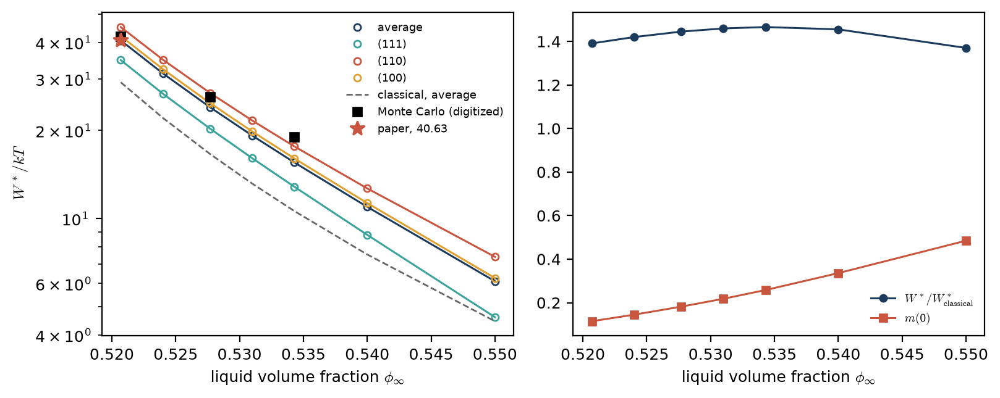

**Figure 38.** Left: nucleation barrier against the volume fraction of the liquid; lines:
independent reference, circles: PINNACLE, for the average interface data and the three
orientations; dashed: classical droplet model with the average interface free energy;
squares: Monte Carlo (digitized); star: the value printed in the paper. Right: ratio of the
barrier to the classical one and the order parameter at the center of the nucleus. Reading:
the phase-field barrier lies 37 to 47 % above the classical one over the whole range and
close to the simulation points; the center of the nucleus is never bulk liquid-free crystal
at small sizes ($m(0)$ rises from 0.11 to 0.48).

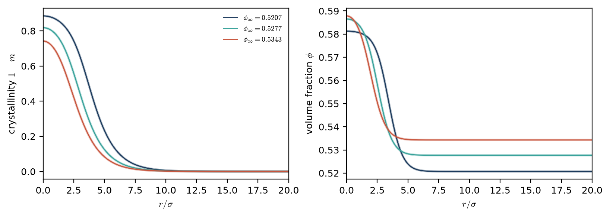

**Figure 39.** Radial profiles of the crystallinity $1 - m$ and of the volume fraction at
the three Monte Carlo states (thin lines: PINNACLE; broad pale lines: reference). Reading:
the interface is as wide as the nucleus; the density at the center (0.581 to 0.588) stays
below that of the bulk crystal of equal chemical potential (0.583 to 0.599).

### 8.5 What to expect when the parameters change

- Volume fraction of the liquid: the barrier falls from 40.6 to 6.1 $kT$ between 0.5207 and
  0.5500, the nucleus shrinks from $R_{1/2} = 3.9$ to 2.4 $\sigma$ and from 24 to 2 excess
  particles, and its center loses crystallinity ($m(0)$ from 0.11 to 0.48). Beyond about
  0.55 the "nucleus" is a weak ripple of structure rather than a crystallite.
- Interface data (Table 35): the barrier scales roughly with $\gamma_\infty^3$, as in the
  classical theory, but the interface thickness matters as well: the (110) data (largest
  $\gamma_\infty$, thinnest interface) give the highest barrier, the (111) data the lowest.
  A 10 % change of $\gamma_\infty$ changes the barrier by about 30 %.
- The ratio to the classical barrier stays between 1.37 and 1.47 over the range: the
  classical model underestimates the barrier, that is overestimates the nucleation rate by
  $e^{11}$ at 0.5207.
- Equations of state: the constant between the two branches must come from a consistent
  coexistence (section 8.3). Hall's two solid forms differ by 0.3 % in pressure near
  melting; only the polynomial form reproduces the solid densities printed in the paper.

**Table 35.** Barrier $W^*/kT$ (PINNACLE) for the interface data of the three orientations.

| $\phi_\infty$ | (111) | (100) | average | (110) |
|---|---|---|---|---|
| 0.5207 | 34.81 | 42.03 | 40.63 | 45.14 |
| 0.5277 | 20.28 | 24.80 | 23.99 | 26.85 |
| 0.5343 | 12.84 | 16.04 | 15.54 | 17.64 |
| 0.5500 | 4.60 | 6.26 | 6.10 | 7.40 |

### 8.6 Cost

Each deck runs in about 3 s on one laptop core (4 to 5 Newton iterations on 2401 nodes with
two unknowns); the reference takes 40 s for all 28 states. Routes: FE only so far. The
tabulated free energies have no network form in PINNACLE (ADR 0041); a stationary PINN and
the hybrid for this case need a differentiable equation-of-state closure and are not done.

## 9. The quaternion orientation field: polycrystalline growth in three dimensions

### 9.1 Purpose

In two dimensions one angle fixes the orientation of a crystal. In three dimensions three
numbers are needed, and a field of Euler angles has singular points. (pusztai 2005
threedimensions) describe the orientation by a unit quaternion and carry the model of
section 7 to three dimensions. The case answers two questions for the user: does a crystal
that grows into a liquid of random orientations order that liquid at its front, and at what
orientational mobility does it stop doing so and become a polycrystal (growth front
nucleation). It tests three capabilities the earlier sections do not: a four-component
variable held on the unit sphere, an orientational energy that is invariant under rotation
of the sample, and a kinetic anisotropy taken in the frame of the local crystal.

### 9.2 Governing equations

The phase field $\phi$ (1 liquid, 0 crystal) and the composition $c$ follow the binary model
of section 6. The orientation is $q = (q_0, q_1, q_2, q_3)$ with $\sum_i q_i^2 = 1$,
$q_0 = \cos(\delta/2)$ and $q_i = a_i \sin(\delta/2)$ for a rotation by $\delta$ about the
axis $a$. The angle between two nearby orientations is twice their distance on the unit
sphere, so the orientational energy linear in the misorientation is
(pusztai 2005 threedimensions)

$$ f_{ori} = 2 H T\,[1 - p(\phi)]\,\Big\{\sum_i (\nabla q_i)^2\Big\}^{1/2}. $$

The equations of motion are

$$ \dot\phi = M_\phi(n')\Big\{\nabla^2\phi - a_w(c)\,g'(\phi) - p'(\phi)\big[b(c) - h\,F(u)\big]\Big\} + \zeta_\phi, $$

$$ \dot q_i = \chi_l\,p(\phi)\Big\{\nabla\!\cdot\!J_i - q_i \sum_k q_k \nabla\!\cdot\!J_k\Big\}, \qquad
   J_i = [1 - p(\phi)]\,\frac{\pi}{2}\,\frac{\xi_0 \nabla q_i}{u}, $$

with the normalized misorientation $u = \xi_0 |\nabla q|\,k/\pi$ and $F(u) = \pi u$. The
second term of the $q$ equation is the Lagrange multiplier that keeps $|q| = 1$. The
kinetic coefficient has cubic symmetry in the frame of the crystal,

$$ M_\phi(n') = 1 - 3\gamma + 4\gamma\,(n_1'^4 + n_2'^4 + n_3'^4), \qquad n' = R(q)^T \frac{\nabla\phi}{|\nabla\phi|}, $$

so every grain grows fastest along its own $\langle 100\rangle$ directions. For a rotation
about one fixed axis the model reduces to the two-dimensional one with the same $h$ and
$\chi_l$ (tested in PINNACLE, ADR 0043). Crystal symmetries are not applied to the
orientational energy (triclinic), as in the paper's runs.

*Energy shape.* The two-dimensional kernels of section 7 use a saturated energy,
$F = |\sin \pi u|$ up to $u = 1/2$ and 1 beyond. In three dimensions without crystal
symmetry this shape fails: two random orientations differ by 126° on average ($u = 1.4$ at
$k = 4$), where the saturated energy exerts no torque. The first series of this case was
run with it. The crystal kept the random orientation of the liquid cell by cell (mean
neighbor misorientation 123°) and the result did not depend on $\chi_l$. The decks now set
`energy_shape = linear`, the published energy above, added to PINNACLE for this case (ADR
0043 addendum, revision `4bad49b`). The first series is discarded.

### 9.3 Parameters

**Table 36.** Parameters of case F4.

| quantity | value | provenance |
|---|---|---|
| binary model (Cu-Ni at 1574 K), $\Delta x$ = 6.25e-3, $\Delta t$ = 4.75e-6 | as section 6 | reported_table / derived |
| supersaturation $S$ | 1.0 (spherulite), 0.78 (dendrites) | reported_text |
| orientational mobility $\chi_l$ | 360, 108, 72, 54, 36, 12 | assumed (the paper prints mobilities in other units; it reduces $M_q$ by 3 to 3.5 for the spherulite) |
| $h$ | 1900 | assumed, as section 7 |
| $k$, $\xi_0$ | 4, $\Delta x$ | assumed |
| kinetic anisotropy $\gamma$ | 0.2 | assumed (not printed in the paper) |
| noise on $\phi$ | standard deviation 0.0025 per step, liquid only | assumed |
| seed | radius 8 cells, one random orientation per seed | assumed |
| box | 64 x 64 x 64 cells, periodic | paper: 300 x 300 x 300 |

### 9.4 Cases and results

Decks: `decks/crystallization/quaternion/f4_spherulite_n64_s1_chi<chi>_g0.2_fem.i` and
`f4_dendrites_n64_s0.78_chi360_g0.2_fem.i`, from `scripts/cryst_quaternion_decks.py`.
Solver: `pf_fem_explicit` on trilinear elements, $q$ as a unit-norm variable with 20
sub-steps per step. Measures and figures: `scripts/cryst_quaternion_figures.py`.

*Expected result.* (pusztai 2005 threedimensions) show a single seed that grows into a
compact polycrystalline spherulite when the orientational mobility is reduced by a factor
of 3 to 3.5, and several seeds that grow into dendrites with arms along their own cubic
axes at $S$ = 0.78. No number is printed for either; the comparison is of the form
(tier 3, qualitative).

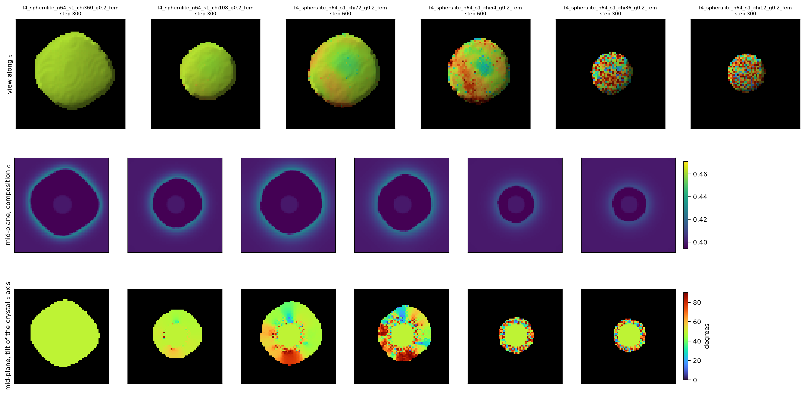

**Figure 40.** One seed at $S$ = 1 for $\chi_l$ = 360, 108, 72, 54, 36 and 12
(left to right; steps 300, 300, 600, 600, 300, 300). Top: view along $z$, colored by the
tilt of the crystal $z$ axis against the laboratory $z$ axis (0 to 90°). Middle:
composition in the mid-plane. Bottom: tilt in the mid-plane. The disc of one color at the
center is the seed. Animations: `figures/crystallization/f4_spherulite_<run>.gif`.

**Table 37.** Measures of the series of Figure 40 at the stated step.
Growth: increase of the equivalent radius per step. Misorientation: mean angle between
neighboring crystal cells. Boundary share: neighbor pairs above 15°.

| $\chi_l$ | step | solid fraction | radius (cells) | growth (cells per step) | sphericity | misorientation | boundary share |
|---|---|---|---|---|---|---|---|
| 360 | 300 | 0.177 | 22.3 | 0.048 | 0.975 | 0.03° | 0 |
| 108 | 300 | 0.071 | 16.4 | 0.028 | 0.980 | 1.6° | 0.02 |
| 72 | 600 | 0.142 | 20.7 | 0.021 | 0.979 | 5.5° | 0.09 |
| 54 | 600 | 0.098 | 18.3 | 0.017 | 0.977 | 22.9° | 0.43 |
| 36 | 300 | 0.028 | 12.0 | 0.013 | 0.985 | 61° | 0.71 |
| 12 | 300 | 0.022 | 11.1 | 0.010 | 0.994 | 76° | 0.64 |

- $\chi_l$ = 360: a single crystal. The front orders the liquid completely (0.03°). The
  shape shows the cubic kinetic anisotropy: flat sides and corners along the crystal axes.
- $\chi_l$ = 108 (reduced by 3.3): still one crystal, with the first small regions of
  other orientation at the front (2 % of the neighbor pairs). This is the onset of growth
  front nucleation, at the reduction the paper quotes for its spherulite.
- $\chi_l$ = 72 and 54: a polycrystal. Sectors of different orientation start at the
  surface of the seed and widen outward. At 54 nearly half of the neighbor pairs are grain
  boundaries and the outline is round: a compact polycrystalline spherulite, as in the
  paper's figure.
- $\chi_l$ = 36 and 12: the shell that has grown is orientationally disordered at the scale
  of the cell, and growth nearly stops (4 and 3 cells in 300 steps against 14 at 360). The
  disordered solid pays the orientational energy $h F$ in every cell, which removes most of
  the driving force.
- The growth rate falls by a factor of 5 over the series at a fixed thermodynamic driving
  force. In this model the rate of orientational ordering limits growth once $\chi_l$ is
  low.

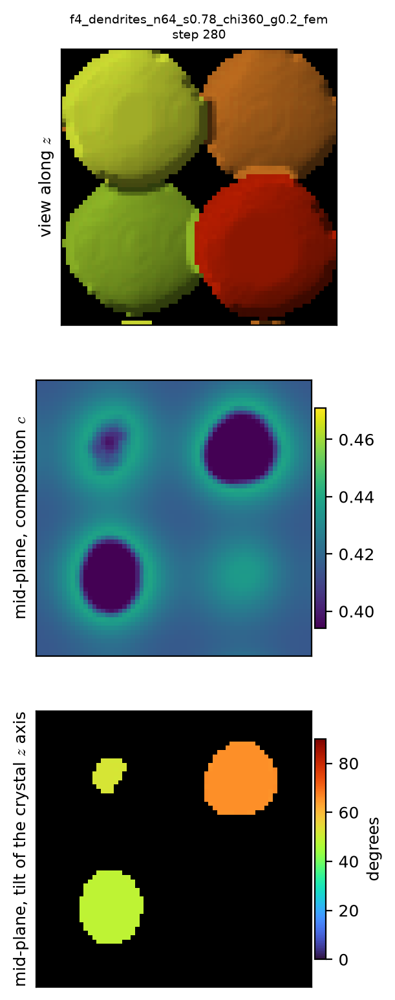

**Figure 41.** Four seeds of random orientation at $S$ = 0.78,
$\chi_l$ = 360, step 280 (solid fraction 0.28); panels as in Figure 40.
Animation: `figures/crystallization/f4_dendrites_<run>.gif`.

- Each seed grows as one crystal with its own orientation (four tilt values; misorientation
  inside the crystals 0.04°), and the crystals keep their orientations where they meet.
- Dendrite arms do not form. The crystals meet at a radius of about 13 cells, before the
  front has developed arms. The paper's box is 300 cells wide. This part of the case
  is not reproduced at 64 cells; it shows multi-grain growth and impingement only.
- Accuracy: tier 3, qualitative, for the spherulite, with the transition found at the mobility
  reduction the paper quotes; the dendrite form is not reached.

### 9.5 What to expect when the parameters change

- *Orientational mobility $\chi_l$.* The control parameter of this section. High: a single
  crystal. A reduction by about 3: first new grains. By 5 to 7: a polycrystal with grains
  that widen outward. By 10 and more: a disordered, slowly growing solid. In a material
  this is the ratio of rotational to translational diffusion, which falls steeply on
  undercooling toward the glass transition (granasy 2005 spherulites).
- *Supersaturation $S$.* A faster front leaves less time for ordering, so the transition
  is expected at higher $\chi_l$ (granasy 2005 spherulites). Not varied here.
- *Kinetic anisotropy $\gamma$.* Sets the faceting of the single crystal and the arm
  directions of dendrites; with $\gamma = 0$ the single crystal is a sphere.
- *Orientational energy $h$.* A larger $h$ raises the grain-boundary energy and the cost of
  a disordered solid: growth at low $\chi_l$ stops earlier.
- *Box size.* Dendrites, and spherulites with many grains across the radius, need boxes of
  200 to 300 cells per edge (section 13).
- *Crystallography.* The tilt maps are the three-dimensional counterpart of an orientation
  map from electron backscatter diffraction; the misorientation and boundary share of Table
  36 are the quantities such a map gives. With the triclinic energy every pair
  of different orientations is a grain boundary; twin or symmetry-equivalent orientations
  of a cubic crystal are not recognized.

### 9.6 Cost

On the GPU of rocm-server (float64, shared with other runs) a 64 x 64 x 64 run takes 2.2 to
2.6 s per step: 670 s for 300 steps, 1560 s for 600. The cost is dominated by the 20
sub-steps of the four-component orientation field. Routes: FE only; the unit-norm
constraint and the non-differentiable energy have no network form in PINNACLE.

## 10. The regular-solution eutectic model: lamellar growth of Ag-Cu

### 10.1 Purpose

A eutectic liquid freezes into two solid phases at once. In Ag-Cu these are an Ag-rich and
a Cu-rich solid solution that grow side by side as lamellae and exchange atoms through the
liquid ahead of the front. (lewis 2004 eutectic) give a phase-field model for this with
regular-solution thermodynamics and add an orientation field for eutectic grains;
(ratkai 2017 nanoscale) use the same thermodynamics for lamellar growth on the nanometer
scale. The case shows the user how the lamellar spacing and the undercooling set the front
speed and the pattern, and at what spacing a lamella splits. It tests a fourth-order
composition equation (the chemical potential as an auxiliary variable), a
composition-dependent double well, and an orientational energy that depends on the
composition.

### 10.2 Governing equations

Fields: $\phi$ (1 liquid, 0 solid) and $c$, the mole fraction of Cu. Energies are in units
of $RT/v$, lengths in nm, times in $\xi^2/D_L$ = 7.143e-10 s ($\xi$ = 1 nm):

$$ F = \int \Big\{ \frac{\kappa_\phi}{2}|\nabla\phi|^2 + \frac{\kappa_c}{2}|\nabla c|^2 + w(c)\,g(\phi)
      + [1 - p(\phi)]\,f_S(c) + p(\phi)\,f_L(c) \Big\}\,dV, $$

$$ f_L = \omega_L\,c(1-c) + c\ln c + (1-c)\ln(1-c), \qquad
   f_S = (1-c) f_A + c f_B + \omega_S\,c(1-c) + c\ln c + (1-c)\ln(1-c), $$

$$ \dot\phi = -m_\phi\big\{ w(c)\,g'(\phi) + p'(\phi)\,[f_L - f_S] - \kappa_\phi\nabla^2\phi \big\}, \qquad
   \dot c = \nabla\!\cdot\!\big\{ D(\phi)\,c(1-c)\,\nabla\mu \big\}, $$

$$ \mu = (w_B - w_A)\,g(\phi) + [1 - p(\phi)]\,f_S'(c) + p(\phi)\,f_L'(c) - \kappa_c\nabla^2 c, \qquad
   D(\phi) = r + (1 - r)\,p(\phi), $$

with $w(c) = (1-c)\,w_A + c\,w_B$, $f_A = L_A v (T - T_A)/(T_A R T)$ and the same for B, and
$\omega = \Omega v/(RT)$ with $\Omega_L v = 16{,}000 - 4T$ and $\Omega_S v = 26{,}000 - 4T$
J/mol (lewis 2004 eutectic). What the terms do:

- $\omega_S > 2$: the solid has a miscibility gap. The two ends of the gap are the two
  solid solutions.
- $\omega_L < 2$: the liquid stays mixed.
- $\kappa_c$: the energy of the boundary between the two solids. Without it the lamellae
  could be arbitrarily thin.
- $r = D_S/D_L$ = 0.01: the solid pattern, once formed, changes slowly.

*Eutectic grain (case F2b).* An orientation field $\theta \in [0, 1)$ is added with the
energy of (lewis 2004 eutectic),

$$ f_{ori} = [1 - p(\phi)]\,S\,E(c, u), \qquad u = d\,|\nabla\theta|, $$

$$ E = h(c)\,u + [1 - h(c)]\,\{A + B\,|\cos(2\pi m u)|\}, \qquad
   h(c) = \tfrac{1}{2}\Big\{1 + \cos\Big[2\pi\,\frac{c - c_\alpha}{c_\beta - c_\alpha}\Big]\Big\}. $$

Inside either solid ($h = 1$) the energy is that of a grain boundary, linear in the
misorientation. Across a boundary between the two solids ($h \to 0$) it is lowest at a
fixed misorientation, $u = 1/(4m)$: the two solids of one grain keep an orientation
relation. $\dot\theta = \chi_l\,p(\phi)\,\nabla\!\cdot\!(\partial f_{ori}/\partial\nabla\theta)$.

PINNACLE: `rs_phase_bulk`, `rs_chemical_potential`, `rs_solute_flux` with $\mu$ as an
auxiliary variable; `eo_grain_flux`, `eo_phase_coupling`, `eo_potential_coupling` for the
orientation (ADR 0042).

### 10.3 Parameters

The model with these data gives a eutectic at 1055.48 K and $c_E$ = 0.3454, with solids of
$c_\alpha$ = 0.149 and $c_\beta$ = 0.851 (`scripts/cryst_eutectic_thermo.py`; the papers
print 1055.5 K and 0.35).

**Table 38.** Parameters of cases F2 and F2b.

| quantity | value | provenance |
|---|---|---|
| $L_{Ag}$, $L_{Cu}$, $v$ | 1097, 1728 J/cm³, 8.7 cm³/mol | reported_text (lewis 2004 eutectic) |
| $T_{Ag}$, $T_{Cu}$ | 1234, 1358 K | reported_text |
| $\Omega_L v$, $\Omega_S v$ | 16,000 - 4 T, 26,000 - 4 T J/mol | reported_text |
| interface energies | 172 (Ag), 227 (Cu) mJ/m² | reported_text (ratkai 2017 nanoscale) |
| interface thickness (10 to 90 %) | 1 nm | reported_text |
| $\epsilon_c^2 = \epsilon_\phi^2/4$; $D_L$; $M_\phi$; $D_S/D_L$ | 1.4e-9 m²/s; 0.25 m³/(J s); 0.01 | reported_text |
| at 955.5 K: $f_A$, $f_B$, $\omega_S$, $\omega_L$ | -0.2711, -0.5609, 2.792, 1.533 | derived |
| $\kappa_\phi$, $\kappa_c$, $w_A$, $w_B$, $m_\phi$ (955.5 K) | 0.1991, 0.0498, 7.691, 11.061, 0.1631 | derived |
| liquid composition $c_0$ | 0.345 | reported_text (eutectic) |
| mesh size, time step | 0.25 nm, 0.004 | assumed |
| F2: box, steps | $\lambda$ x 60 nm, one lamella pair, periodic across; 300,000 steps (0.86 µs) | assumed |
| F2: initial solid | slab of 10 nm, Cu-rich share by the lever rule (0.309 at 955.5 K) | assumed |
| F2b: $A$, $B$, $m$, $d$ | 0.9, 0.1, 1/2, mesh size | reported_text (lewis 2004 eutectic) |
| F2b: $S$, $\chi_l$ | 0.1 and 0.3; 3 and 0.3 | assumed (not printed) |
| F2b: box, temperature, seed | 64 x 64 nm (256 x 256), 900 K, lamellar disc of radius 10 nm with 10 nm pairs, one orientation | assumed |

### 10.4 Cases and results

Decks: `decks/crystallization/eutectic/f2_lamellar_T<T>_c0.345_lam<lambda>_fem.i`,
`f2_long100_T955.5_c0.345_lam16_fem.i` and `grain/f2b_grain_*.i`, from
`scripts/cryst_eutectic_decks.py`. Measures and figures: `scripts/cryst_eutectic_figures.py`
and `scripts/cryst_eutectic_grain_figures.py`.

*Expected result.* (ratkai 2017 nanoscale) report steady lamellar growth with
$\lambda^2 v$ = 0.41e-17 m³/s and cite 1.4e-17 m³/s from experiment. (lewis 2004 eutectic)
show a eutectic grain that grows from a seed as a two-phase pattern with one orientation
relation. Neither paper prints a speed for a single spacing and temperature that could be
compared directly; the comparison is of $\lambda^2 v$ in order of magnitude and of the
form (tier 3, qualitative).

#### 10.4.1 Series in the lamellar spacing

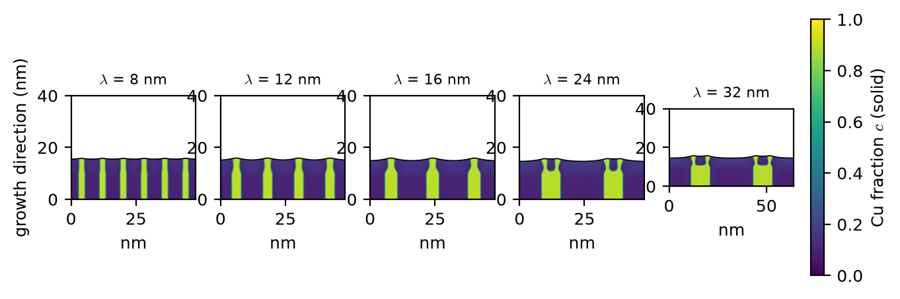

**Figure 42.** Lamellar growth at 955.5 K (undercooling 100 K) for initial
spacings of 8 to 48 nm after 300,000 steps. Color: Cu fraction in the solid; line: the
front. The box holds one pair and is repeated sideways for display. Animation of the 16 nm
case: `figures/crystallization/f2_lamellar_T955.5_lam16.gif`.

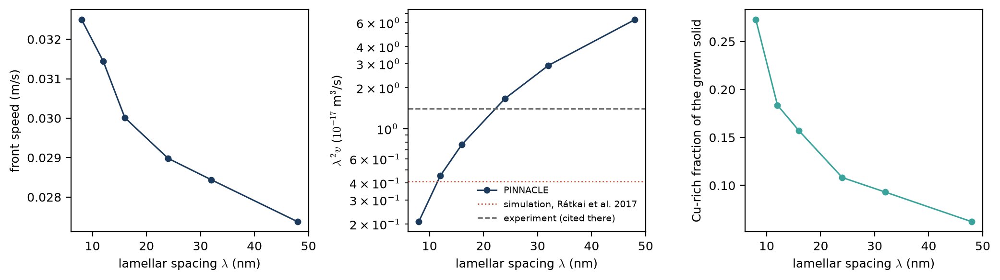

**Figure 43.** Measures of the spacing series against the initial spacing. Left:
front speed. Middle: $\lambda^2 v$ with the initial spacing; lines: simulation and
experiment as given by (ratkai 2017 nanoscale). Right: Cu-rich share of the new solid.

**Table 39.** Spacing series at 955.5 K. Final spacing: box width over the number
of Cu-rich lamellae 3 nm behind the front. Unsteadiness: relative change of the speed
between the last two fifths of the run.

| initial $\lambda$ (nm) | front (nm) | speed (m/s) | unsteadiness | Cu-rich lamellae at the end | final spacing (nm) | $\lambda^2 v$ with the final spacing (1e-17 m³/s) | Cu-rich share |
|---|---|---|---|---|---|---|---|
| 8 | 38.3 | 0.0329 | 0.00002 | 1 | 8 | 0.21 | 0.273 |
| 12 | 37.8 | 0.0324 | 0.0003 | 1 | 12 | 0.47 | 0.270 |
| 16 | 36.8 | 0.0313 | 0.010 | 1 | 16 | 0.80 | 0.259 |
| 24 | 37.2 | 0.0323 | 0.019 | 2 | 12 | 0.46 | 0.270 |
| 32 | 36.4 | 0.0315 | 0.020 | 2 | 16 | 0.81 | 0.258 |
| 48 | 36.4 | 0.0320 | 0.002 | 4 | 12 | 0.46 | 0.269 |

- Spacings of 8, 12 and 16 nm grow as set. At 16 nm the Cu-rich lamella varies in width
  along the growth direction.
- At 24 and 32 nm the Cu-rich lamella splits in two within the first 2 nm of growth, and the
  branches move apart until the spacing is halved. At 48 nm it splits and a new Cu-rich
  lamella forms in the middle of the wide Ag-rich one, which then splits as well: four
  lamellae, spacing 12 nm.
- The pattern therefore selects a spacing between 8 and 16 nm at this undercooling,
  whatever the start. With that spacing $\lambda^2 v$ is 0.2 to 0.8e-17 m³/s. The value
  0.41e-17 of (ratkai 2017 nanoscale) lies inside the range; the experimental value they
  cite is 1.8 to 7 times higher.
- The front speed is the same within 5 % for all spacings (0.0313 to 0.0329 m/s). The
  classical theory of lamellar growth gives a speed that depends on the spacing through
  diffusion along the front and through the curvature of the lamella tips. Neither shows
  here. At 100 K of undercooling and nanometer spacings the speed is consistent with
  growth limited by attachment at the interface ($m_\phi$); that was not tested by a
  series in $m_\phi$.
- The Cu-rich share of the new solid is 0.26 to 0.27, below the lever rule (0.309). The
  solids are less pure than at equilibrium (next section), which lowers the share needed.

#### 10.4.2 Series in the undercooling

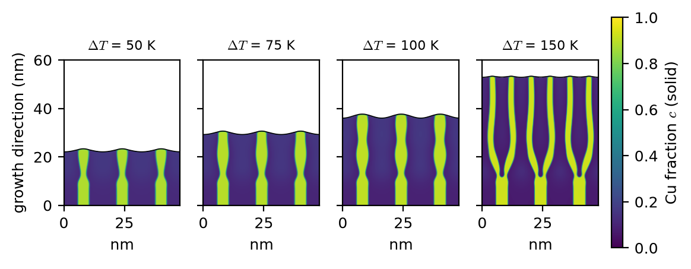

**Figure 44.** Lamellar growth with an initial spacing of 16 nm at undercoolings
of 50, 75, 100 and 150 K (1005.5 to 905.5 K) after 300,000 steps.

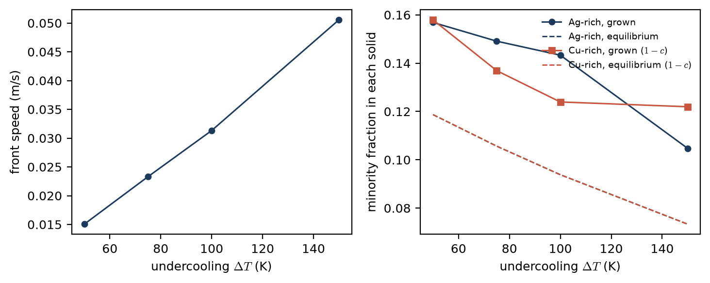

**Figure 45.** Left: front speed against undercooling. Right: fraction of the
minority component in each new solid (symbols) and at equilibrium (dashed; the two
equilibrium curves coincide in this model).

**Table 40.** Undercooling series at an initial spacing of 16 nm.

| $T$ (K) | undercooling (K) | front (nm) | speed (m/s) | speed per K (1e-4 m/s/K) | final spacing (nm) | minority fraction, Ag-rich / Cu-rich solid | equilibrium |
|---|---|---|---|---|---|---|---|
| 1005.5 | 50 | 22.7 | 0.0151 | 3.0 | 16 | 0.157 / 0.158 | 0.119 |
| 980.5 | 75 | 29.9 | 0.0233 | 3.1 | 16 | 0.149 / 0.137 | 0.106 |
| 955.5 | 100 | 36.8 | 0.0313 | 3.1 | 16 | 0.143 / 0.124 | 0.094 |
| 905.5 | 150 | 53.0 | 0.0506 | 3.4 | 8 | 0.105 / 0.122 | 0.073 |

- The speed rises linearly with the undercooling, 3.0 to 3.4e-4 m/s per K.
- At 150 K the 16 nm lamella splits and the spacing halves to 8 nm. The selected spacing
  falls as the speed rises, the direction of the rule $\lambda^2 v$ = constant.
- Both solids hold 0.03 to 0.05 more of the minority component than at equilibrium at
  every undercooling: the front traps solute. The solid diffusivity (1 % of the liquid's)
  is too low to remove the excess during the run.

#### 10.4.3 Long run: is the growth steady?

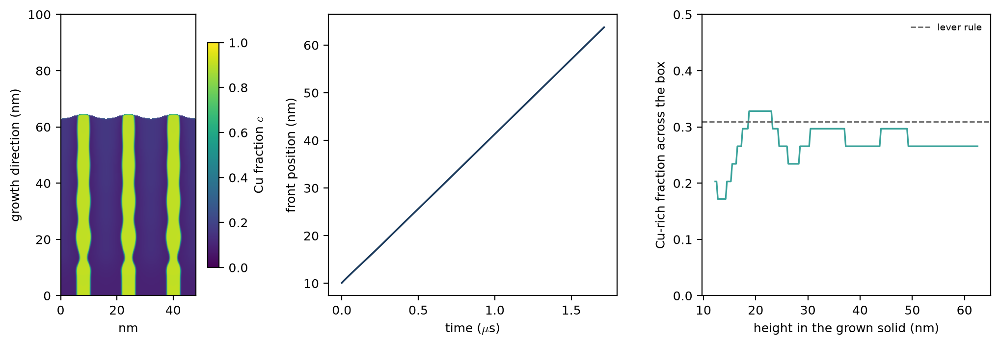

**Figure 46.** Run of 600,000 steps (1.7 µs) at 955.5 K and 16 nm in a box 100 nm
long. Left: Cu fraction at the end (three periods). Middle: front position against time.
Right: Cu-rich share across the box against height.

- The front moves from 10.1 to 63.8 nm at 0.0314 m/s in the second half and 0.0313 m/s in
  the first: steady. This differs from the ternary front of section 11, which slows down;
  here nothing is rejected into the liquid on average.
- Cu-rich share 0.273 ± 0.033 over the grown length (lever rule 0.309). The width of the
  lamella oscillates along the growth direction with a period of about 10 nm and an
  amplitude that gets smaller.
- $\lambda^2 v$ = 0.80e-17 m³/s.

#### 10.4.4 Eutectic grain with an orientation field (case F2b)

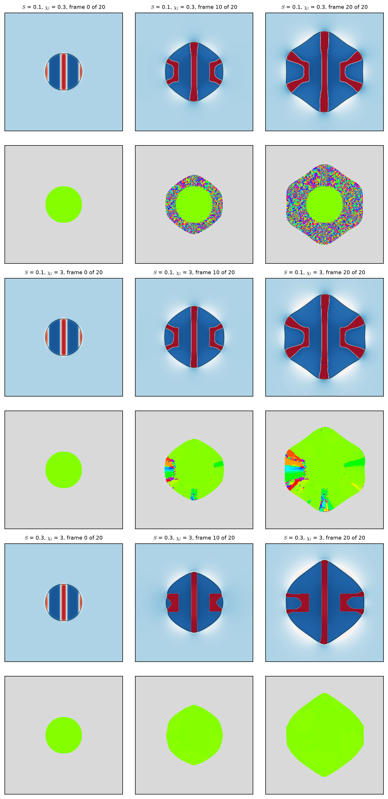

**Figure 47.** Growth of a eutectic grain at 900 K from a lamellar seed. Rows in
pairs: composition (red Cu-rich, blue Ag-rich, light blue liquid) and orientation (color:
$\theta$; gray: liquid). Top pair: $S$ = 0.1, $\chi_l$ = 0.3. Middle: $S$ = 0.1,
$\chi_l$ = 3. Bottom: $S$ = 0.3, $\chi_l$ = 3. Columns: start, 50,000 and 100,000 steps.
Animations: `figures/crystallization/f2b_<run>.gif`.

**Table 41.** Eutectic grain after 100,000 steps (0.29 µs). Reoriented share: part of
the solid more than 5 % of the period away from the seed orientation.

| $S$ | $\chi_l$ | solid fraction | Cu-rich share | reoriented share | orientation |
|---|---|---|---|---|---|
| 0.1 | 3 | 0.359 | 0.262 | 0.19 | seed orientation, with sectors of other orientations that start at the tips of the Cu-rich lamellae |
| 0.1 | 0.3 | 0.326 | 0.277 | 0.69 | seed kept; everything grown later is disordered at the scale of the cell |
| 0.3 | 3 | 0.323 | 0.233 | 0.00 | one orientation throughout |

- The grain grows as a two-phase pattern in all three runs. The central Cu-rich lamella
  extends along its length; the side lamellae turn outward and follow the front. The
  outline is elongated along the lamellae, where both solids are fed directly from the
  liquid.
- $\chi_l$ sets how well the new solid takes the orientation of the grain. At 3 most of it
  does. At 0.3 the front outruns the ordering and the shell freezes with the random
  orientation of the liquid, as in section 9 at low mobility. The two-phase pattern is
  almost unchanged: at $S$ = 0.1 the orientational energy is too small to act on it.
- At $S$ = 0.3 the solid has one orientation and the pattern differs: the side lamellae
  stay straight and do not split. The orientational energy now enters the balance at the
  boundaries between the two solids and feeds back on the morphology.
- Not reproduced: the step of half a period in $\theta$ across the boundaries between the
  two solids, which the energy favors. The seed here has one
  orientation in both solids and the new solid keeps it at $S$ = 0.3. A seed with the
  orientation step built in was not run.

### 10.5 What to expect when the parameters change

- *Lamellar spacing.* Below about 8 nm the boundary energy between the solids takes too
  much of the driving force (not run below 8 nm). From 8 to 16 nm the lamellae grow as
  set. Above about 20 nm they split until the spacing is back in that range.
- *Undercooling.* The speed is proportional to it (3e-4 m/s per K here). The stable range
  of spacings moves down: 16 nm is stable at 100 K and splits at 150 K.
- *Liquid composition $c_0$.* Sets the share of the two solids by the lever rule. Far from
  the eutectic composition one solid grows ahead of the other (not run).
- *$D_S/D_L$.* Higher: the trapped excess of the minority component relaxes and the
  lamellae coarsen behind the front.
- *$\kappa_c$.* Higher: wider boundaries between the solids and a larger smallest spacing.
- *$\chi_l$ and $S$ (grain).* Low $\chi_l$: a disordered shell. High $S$: one orientation
  and straighter lamellae. Very high $S$ is expected to slow growth, as $h$ does in
  sections 7 and 9.
- *Crystallography.* In a micrograph the lamellae are the composition contrast; the
  orientation field gives what an orientation map of the same area would show. One
  eutectic grain is a region where each solid has a single orientation, even though the
  two solids alternate many times across it. The sectors at $\chi_l$ = 3 are new grains
  that start at the lamella tips, the counterpart of growth front nucleation in sections 7
  and 9.

### 10.6 Cost

One lamella pair, 0.25 nm mesh, 60 nm long, 300,000 steps on the GPU of rocm-server
(float64, shared with other runs): 689 s at 8 nm (32 x 240 cells), 928 to 1379 s at 16 nm,
1745 to 1812 s at 12 to 32 nm, 2560 s at 48 nm (192 x 240 cells), that is 2.3 to 8.5 ms per
step. The GPU was shared, so the times are not a scaling measurement. The long run took 4209 s. The
grain (256 x 256, 100,000 steps, with orientation) took 3273 to 6200 s. Routes: FE only.

## 11. The ternary eutectic model: lamellar growth, solute rejection and trapping

### 11.1 Purpose

Two solid phases that grow side by side from one liquid form a eutectic. A third component
that neither solid dissolves is pushed ahead of the front. (ratkai 2015 ternary) show that
this rejected component destabilizes the lamellar front into cells and, at higher speed,
into two-phase dendrites, and that a fast front traps all components and grows without
partitioning. The case gives the user the three numbers that control such a structure: how
fast the front moves at a given driving force, how much of the third component the solid
takes up, and whether the solid stays two-phase. It tests three capabilities of PINNACLE:
three coupled conserved fields with a mobility matrix, chemical potentials carried as
auxiliary variables (so that the fourth-order equations need second derivatives only), and
a free energy with a logarithmic term.

### 11.2 Governing equations

Fields: $\phi$ (1 liquid, 0 solid; the paper uses the opposite labels) and the mole
fractions $c_1$, $c_2$, with $c_3 = 1 - c_1 - c_2$. Free energy (ratkai 2015 ternary),
dimensionless:

$$ F = \int \Big\{ \frac{\kappa_\phi}{2}|\nabla\phi|^2 + w\,g(\phi) + p(\phi)\,f_l
      + [1 - p(\phi)]\Big[f_s + \frac{\kappa_c}{2}\sum_i |\nabla c_i|^2\Big] \Big\}\,dV, $$

$$ f_l = \sum_i c_i \ln c_i, \qquad
   f_s = \sum_i c_i\,(f_{s,i} + \ln c_i) + \Omega_{12} c_1 c_2 + \Omega_{23} c_2 c_3 + \Omega_{31} c_3 c_1 . $$

The liquid is an ideal solution and the solid a regular solution. $f_{s,i}$ is the free
energy of pure solid $i$ relative to its liquid; the same value $f_s$ is used for the three
components and is the driving force of the case. Equations of motion:

$$ \dot\phi = -M_\phi \Big\{ w\,g'(\phi) + p'(\phi)\Big[f_l - f_s - \frac{\kappa_c}{2}\sum_i|\nabla c_i|^2\Big] - \kappa_\phi \nabla^2\phi \Big\}, $$

$$ \dot c_i = \sum_j \nabla\!\cdot\!\big[\,p(\phi)\,M_{ij}\,\nabla\mu_j\,\big], \qquad
   \mu_j = \ln c_j + [1 - p(\phi)]\Big(f_{s,j} + \sum_k \Omega_{jk} c_k\Big) - \kappa_c \nabla\!\cdot\!\big([1 - p(\phi)]\nabla c_j\big), $$

with $M_{ii} = 1$ and $M_{ij} = -1/2$, which keeps $\sum_i c_i = 1$. The mobility vanishes
in the solid ($p = 0$), so the composition pattern is frozen behind the front.

What the terms do:

- $\Omega_{12} = 3.05 > 2$: a solid of equal $c_1$ and $c_2$ is unstable and separates
  into two solid solutions. This makes the lamellae.
- $\Omega_{23} = \Omega_{31} = 3.0$: component 3 raises the energy of both solids. They
  reject it.
- $\kappa_c$ acts in the solid only. It sets the energy and width of the boundary between
  the two solids, and with it the smallest lamellar spacing.
- $f_s$: the more negative, the larger the driving force and the faster the front.

In PINNACLE: kernels `ts_phase_bulk`, `ts_solute_flux` and `ts_chemical_potential`, with
$\mu_1$, $\mu_2$, $\mu_3$ as auxiliary variables of `pf_fem_explicit` (ADR 0044).

### 11.3 Parameters

**Table 42.** Parameters of case F3.

| quantity | value | provenance |
|---|---|---|
| $\kappa_\phi$, $\kappa_c$, $w$, $M_\phi$ | 0.75, 0.4, 0.0469, 1 | reported_text |
| $\Omega_{12}$, $\Omega_{23} = \Omega_{31}$ | 3.05, 3.0 | reported_text |
| $\Delta x$, $\Delta t$ | 1, 0.0025 | reported_text |
| liquid composition $(c_1, c_2, c_3)$ | (0.455, 0.455, 0.09) | reported_text |
| $f_s$ | -0.82 to -0.964, uniform | paper: a gradient, -0.964 at the cold end and -0.914 at the dendrite tip, pulled at a fixed speed; uniform here (assumed) |
| initial solid | slab of 40 cells, lamella pairs of 16 cells, solids (0.8225, 0.0875, 0.09) and (0.0875, 0.8225, 0.09) | assumed |
| noise | none | paper: flux noise, amplitude not printed (unavailable) |
| box | 64 x 192 cells, two-dimensional, periodic across the lamellae, no flux at both ends | paper: 96 x 96 x 612 |
| steps | 120,000 (series), 600,000 (long runs) | paper: up to 3.6e6 |

### 11.4 Cases and results

Decks: `decks/crystallization/ternary/f3_ternary_fs<f_s>_c30.09_lam16_fem.i` (series) and
`f3_long_fs<f_s>_c30.09_lam16_fem.i` (long runs), from `scripts/cryst_ternary_decks.py`.
Measures and figures: `scripts/cryst_ternary_figures.py`.

*Expected result.* (ratkai 2015 ternary) report, with rising pulling speed: a flat lamellar
front, eutectic colonies, two-phase dendrites, and partitionless growth above a speed of
0.35; the lamellar spacing follows $\lambda \propto v^{-1/2}$. Their runs are
three-dimensional and pulled through a gradient. A two-dimensional section at uniform
driving force cannot form the dendrite. The comparison is of the sequence from lamellar to
partitionless growth (tier 3, qualitative).

#### 11.4.1 Series in the driving force

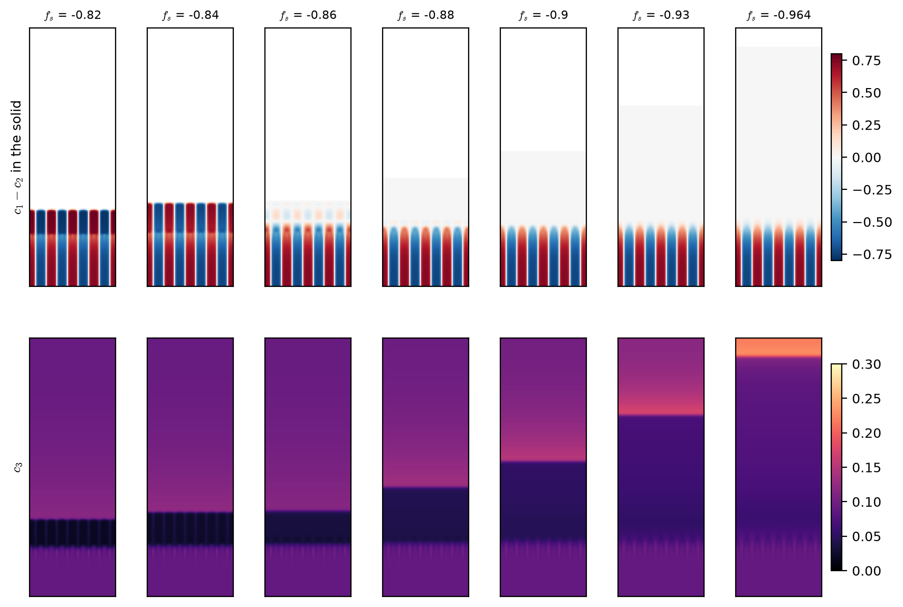

**Figure 48.** Series in $f_s$ at time 300 (120,000 steps). Top: $c_1 - c_2$ in
the solid (red and blue: the two solid solutions; white: homogeneous solid). Bottom:
$c_3$. The slab below 40 cells is the initial solid. Animation:
`figures/crystallization/f3_f3_ternary_fs-0.86_c30.09_lam16_fem.gif`.

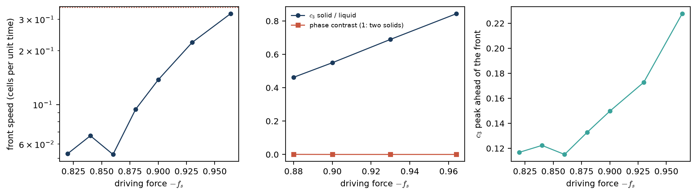

**Figure 49.** Measures of the series. Left: front speed over the last 40 % of the
run; dotted line: the speed above which the paper reports partitionless growth. Middle:
$c_3$ of the new solid over that of the liquid, and the contrast between the two solids
(1: the initial solids; 0: homogeneous). Right: largest $c_3$ ahead of the front.

**Table 43.** Series in the driving force at time 300. Advance: front position
minus 40. Speed: mean over the last 40 % of the run. The middle columns are measured in the
solid more than 15 cells from the seed, which three runs did not reach (--).

| $f_s$ | advance (cells) | speed | new solid | $c_3$ solid / liquid | $c_3$ peak ahead |
|---|---|---|---|---|---|
| -0.82 | 17.5 | 0.053 | two-phase, 4 pairs | -- | 0.117 |
| -0.84 | 22.8 | 0.067 | two-phase, 4 pairs | -- | 0.122 |
| -0.86 | 23.1 | 0.053 | two-phase, contrast fading | -- | 0.115 |
| -0.88 | 40.8 | 0.094 | homogeneous | 0.46 | 0.133 |
| -0.90 | 60.1 | 0.138 | homogeneous | 0.55 | 0.150 |
| -0.93 | 94.5 | 0.223 | homogeneous | 0.69 | 0.173 |
| -0.964 | 138.4 | 0.323 | homogeneous | 0.84 | 0.228 |

- At $f_s$ = -0.82 and -0.84 the front continues the four lamella pairs of the seed. The
  new solid is almost free of component 3, which collects in a layer ahead of the front.
- From $f_s$ = -0.88 the solid no longer separates: $c_1 = c_2$ behind the front
  (contrast below 0.001). The front is too fast for components 1 and 2 to exchange sideways
  within the interface. Component 3 is still partly rejected.
- Trapping of component 3 rises with the speed: 46 % of the liquid value at speed 0.094,
  84 % at 0.323. At the paper's limit of 0.35 the trend gives nearly complete trapping,
  which agrees with the paper's partitionless growth.
- $f_s$ = -0.86 is at the transition. The contrast fades during the run and the speed is
  not ordered with the neighbors (0.053 against 0.067 at -0.84): the run is a transient.
- Difference from the paper: the solid becomes homogeneous in $c_1 - c_2$ at a speed
  between 0.07 and 0.09 here. The paper still shows two-phase dendrites at higher speeds.
  Three differences of the set-up bear on this and were not separated: no noise here (the
  homogeneous solid is unstable but needs a perturbation to separate, and the mobility in
  the solid is zero), a flat front in two dimensions (a dendrite tip rejects component 3
  sideways and stays slower locally), and a uniform driving force.

#### 11.4.2 Long runs: is the lamellar front steady?

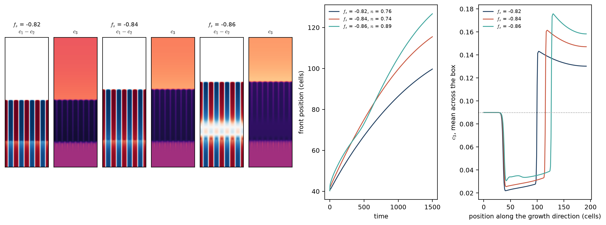

**Figure 50.** Long runs (time 1500, 600,000 steps) at $f_s$ = -0.82, -0.84 and
-0.86. Maps: $c_1 - c_2$ in the solid and $c_3$ at the end. Middle: front position against
time; $n$ is the exponent of (position - 40) $\propto t^n$ over the last 80 % of the run.
Right: $c_3$ averaged across the box, along the growth direction; dotted: the initial
liquid value.

**Table 44.** Long runs at time 1500. Deceleration: relative change of the speed
between the fourth and the last fifth of the run.

| $f_s$ | front (cells) | speed (last 40 %) | deceleration | exponent $n$ | pairs | contrast | $c_3$ solid / liquid | $c_3$ at the front | $c_3$ at the far end |
|---|---|---|---|---|---|---|---|---|---|
| -0.82 | 99.7 | 0.028 | 0.22 | 0.76 | 4 | 0.68 | 0.28 | 0.143 | 0.130 |
| -0.84 | 115.5 | 0.033 | 0.27 | 0.74 | 4 | 0.64 | 0.32 | 0.162 | 0.147 |
| -0.86 | 126.7 | 0.045 | 0.28 | 0.89 | 4 | 0.46 | 0.39 | 0.176 | 0.158 |

- The lamellae are stable. Four pairs of spacing 16 cells grow over 60 to 87 cells with
  straight boundaries; no pair is lost or added.
- The front is not steady. It decelerates in all three runs, with an exponent between 1/2
  (growth limited by diffusion) and 1 (steady growth).
- The cause is the rejected component. The solid takes 28 to 39 % of the liquid's $c_3$;
  the rest stays in the liquid. At a uniform driving force a planar front has no steady
  state unless the solid takes up the full liquid value, so the layer ahead of the front
  thickens and the front slows. In addition the box is closed and 192 cells long: by the
  end the liquid at the far wall has risen from 0.09 to 0.13 to 0.16. Both effects reduce
  the driving force with time. The runs do not separate them.
- This is why the paper pulls the sample through a gradient. The front then moves to the
  position where its speed equals the pulling speed, and a steady state exists at every
  pulling speed. PINNACLE has a temperature programme in time (section 7.4.4) but no moving
  frame; a pulled case would need a field $f_s(y - vt)$, which the kernels do not take
  today (section 12).
- $f_s$ = -0.86 shows the transition in one run. Over the first 20 cells the contrast
  faded, and a band of about 12 cells grew nearly homogeneous (the white band in the map).
  As the front slowed, the two-phase pattern came back with the spacing of the seed. The
  contrast of the table (0.46) averages over both parts.
- Component 3 inside the solid is not uniform: it is higher along the boundaries between
  the two solids (the thin vertical lines in the $c_3$ maps), where both major components
  are diluted.

#### 11.4.3 Series in the initial spacing

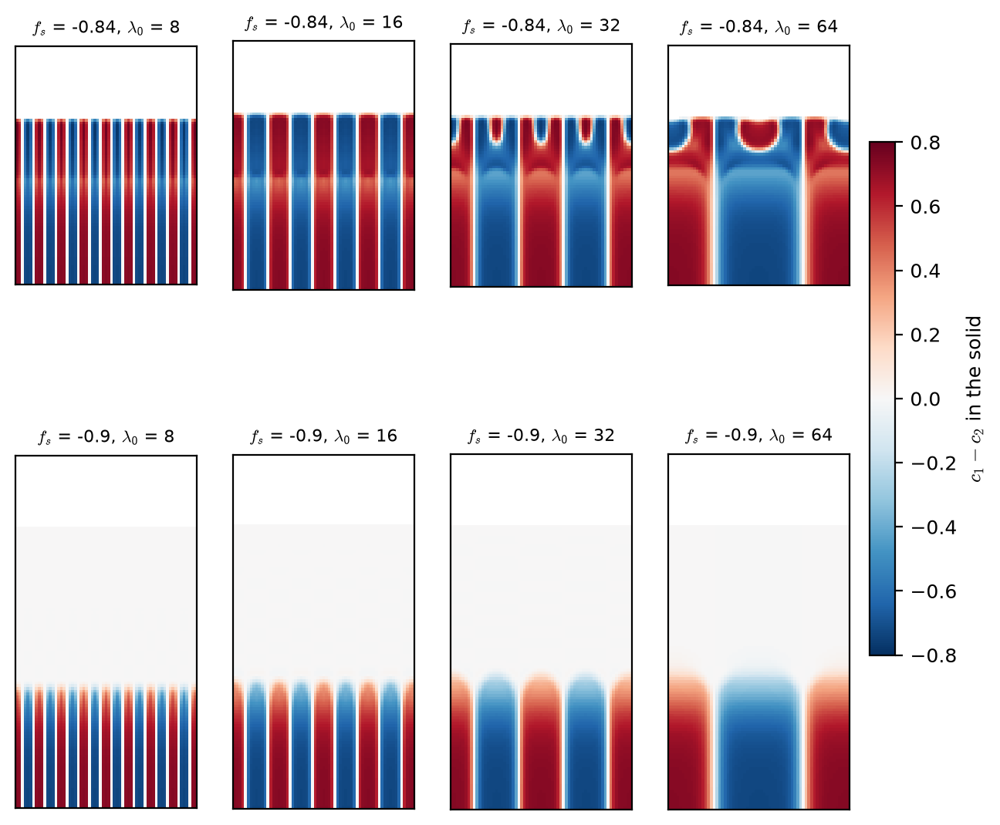

**Figure 51.** Initial spacings $\lambda_0$ of 8, 16, 32 and 64 cells at
$f_s$ = -0.84 (top) and -0.9 (bottom) at time 300; $c_1 - c_2$ in the solid. The view is
cut 25 cells above the front.

**Table 45.** Spacing series at time 300. Pairs at the front: counted 3 cells
behind it.

| $f_s$ | $\lambda_0$ (cells) | front (cells) | speed | pairs at the start | pairs at the front | spacing at the front (cells) |
|---|---|---|---|---|---|---|
| -0.84 | 8 | 59.4 | 0.059 | 8 | 8 | 8 |
| -0.84 | 16 | 62.8 | 0.067 | 4 | 4 | 16 |
| -0.84 | 32 | 60.6 | 0.065 | 2 | 6 | 10.7 |
| -0.84 | 64 | 59.8 | 0.060 | 1 | 3 | 21.3 |
| -0.9 | 8 | 99.6 | 0.1375 | 8 | homogeneous | -- |
| -0.9 | 16 | 100.1 | 0.1375 | 4 | homogeneous | -- |
| -0.9 | 32 | 100.5 | 0.1375 | 2 | homogeneous | -- |
| -0.9 | 64 | 100.7 | 0.1374 | 1 | homogeneous | -- |

- $f_s$ = -0.84: spacings of 8 and 16 cells grow as set. At 32 and 64 cells a lamella of
  the other solid forms in the middle of every wide lamella, at the front, about 10 cells
  after the start. Probable cause: the wide lamella collects the other major component
  ahead of its center faster than sideways diffusion removes it. The spacing falls toward the range of
  8 to 16 cells without any noise. At 64 cells the adjustment is not finished at the end
  of the run.
- The speed depends weakly on the spacing (0.059 to 0.067, highest at 16 cells). The runs
  are transients (section 11.4.2), so no law $\lambda(v)$ is read from them.
- $f_s$ = -0.9: the solid is homogeneous at every initial spacing and the speed is the same
  to three digits. The transition to the homogeneous solid does not depend on the pattern
  it starts from.

### 11.5 What to expect when the parameters change

- *Driving force $f_s$.* Above about -0.85: two-phase lamellae that reject component 3,
  slow and decelerating. Below about -0.88: a homogeneous solid, faster, with component 3
  trapped in proportion to the speed. Near -0.964 the solid is close to the liquid
  composition.
- *Share of the third component $c_3$.* More of it thickens the rejected layer and slows
  the lamellar front further. In three dimensions it is what breaks the flat front into
  colonies and dendrites (ratkai 2015 ternary). Not varied here.
- *Lamellar spacing.* At a low driving force spacings of 8 to 16 cells are kept; wider
  lamellae are subdivided at the front (section 11.4.3). The paper finds
  $\lambda \propto v^{-1/2}$ for steady, pulled growth; the transient runs here do not
  test that law.
- *$\Omega_{12}$.* Below 2 the two solids are miscible and no lamellae form. Larger values
  give purer solids and a sharper boundary.
- *$\kappa_c$.* Larger: wider boundaries between the solids and a larger smallest spacing.
- *Box length.* A closed box enriches in the rejected component. For a steady measurement
  the liquid ahead should be several diffusion lengths $D/v$ long; at speed 0.03 that is
  several hundred cells.
- *Crystallography.* The model has no orientation field: the two solids are phases, not
  grains. A micrograph of such a solid would show the two-phase pattern (composition
  contrast in back-scattered electrons) and the third component as a film at the phase
  boundaries and in the last liquid to freeze. Orientation in a eutectic grain is treated
  with the binary model in section 10.

### 11.6 Cost

64 x 192 cells with six fields on the GPU of rocm-server (float64): 393 s for 120,000 steps
when the GPU ran seven such jobs in turn (3.3 ms per step); the long runs took 8867, 4573
and 2781 s for 600,000 steps on a GPU shared with other jobs (4.6 to 14.8 ms per step).
The paper's three-dimensional box (96 x 96 x 612, 3.6e6 steps) has 460 times the cells and
6 to 30 times the steps; it was not attempted (section 13). Routes: FE only.

## 12. Limits

- Network routes cover the stationary cases A1 and A3. The time-dependent cases A2 and A5
  need `pf_pinn`, which does not yet carry the spherical term (A5), and a per-step predictor
  for the hybrid; not run. B1 needs a flux boundary condition and a non-uniform deflation
  state in `pf_pinn_stationary`; not run. B2 has no PINN route (section 2.2).
- A4 was run on the FE route only.
- B1: two end points not obtained (Model I at 100 K, Model II at 90 K). The agreement with
  the published curves rests on two inferences recorded as `derived`: the cap normalized with
  $\gamma(T_m)$, and for A3 the proportional temperature scaling of $\epsilon^2$ and $w$.
- B2: five realizations on one mesh and one step; no mesh or step study.
- C2: the seed, the run length and the meaning of the noise amplitude are assumptions; each
  case is one realization; panel (a) differs from the published one in the scale of the
  cells.
- C3: $h$ is assumed and not yet calibrated; one realization per case; 500 x 500 only for
  the Fig. 4 conditions and 1000 x 1000 for the Fig. 5 conditions; the parameter series of
  section 7.5 are one realization per point, the fibrillar cases (C4) included; C5, C6,
  E1 to E5 and the phase-field crystal (D) are not started.
- F1 (hard spheres): FE route only; the Monte Carlo points are read by eye from a figure.
  Of the four models added on 2026-11-17, the eutectic (binary and ternary) and the
  three-dimensional quaternion model are not implemented yet.
- Neural results are over 5 seeds at $\Delta T/T_f = 0.20$ and one seed elsewhere. The cost
  of the development runs behind `pf_pinn_stationary` and `pf_fem_saddle` (about 40
  exploratory runs of 1 to 90 s) is not in the wall times of the tables.
- Hardware of every number of sections 3 to 6: Intel Core i9-9980HK, 2 to 6 threads,
  float64, numpy backend for FE and torch 2.13.0 (CPU) for the network routes; no GPU on
  that machine. Section 7 ran on the rocm-server GPU.

## 13. Computational cost at larger sizes

Measured step times of the orientation-field model in PINNACLE (`pf_fem_explicit`; three
fields, 20 orientation sub-steps per step, bilinear elements, float64):

**Table 46.** Measured cost per time step.

| hardware | backend | 250 x 250 | 500 x 500 | 1000 x 1000 | per cell and step |
|---|---|---|---|---|---|
| laptop, Intel Core i9-9980HK, 8 threads | NumPy | 3.2 s | 12.3 s | -- | 4.9e-5 s |
| the same | Torch, CPU | 1.3 s | 4.9 s | -- | 2.0e-5 s |
| AMD Ryzen AI Max+ 395, integrated Radeon 8060S (ROCm) | Torch, GPU | -- | 0.24 to 0.31 s | 1.09 s | 1.1e-6 s |
| the same GPU, independent finite-difference reference | Torch, GPU | -- | 0.04 to 0.05 s | 0.12 s | 1.2e-7 to 2e-7 s |

A crystal that grows at constant speed needs a number of steps proportional to the box edge
$N$, so the cost of a run that fills the box grows as $N^3$ in two dimensions. With
$4N$ steps (the Fig. 4 runs use 2000 steps at $N = 500$ for S = 0.8):

**Table 47.** Estimated wall time of one run that fills an $N \times N$ box (scaled from
Table 46; `derived`, not measured beyond 1000 x 1000).

| grid | steps | laptop CPU, Torch | integrated GPU | suggested hardware |
|---|---|---|---|---|
| 250 x 250 | 1000 | 22 min | (not measured; under 2 min by scaling) | any desktop |
| 500 x 500 | 2000 | 2.7 h | 8 to 10 min (measured) | desktop CPU overnight, or any GPU |
| 1000 x 1000 | 4000 | 22 h | 1.2 h (3200 steps measured: 58 min) | GPU with 8 GB or more |
| 2000 x 2000 | 8000 | 7 days | 10 h | GPU with 16 GB or more |
| 4000 x 4000 | 13,500 (paper, Fig. 5) | about 50 days | 2.5 to 3 days | GPU with 32 GB or more, or the stencil reference (7 to 8 h) |

- Memory: the 1000 x 1000 run used 3.3 GB of host memory; the GPU memory was not recorded.
  The element-wise arrays scale with the number of elements, so the 4000 x 4000 figure is an
  extrapolation and was not tested.
- A discrete GPU was not available; it is expected to be faster than the integrated one,
  by a factor that was not measured.
- TPU: the explicit path has array namespaces for NumPy and Torch only
  (`backend/array_namespace.py`). PINNACLE has JAX and TensorFlow backends for the network
  routes, but the explicit executioner does not use them, so these cases cannot run on a
  TPU today.
- The stationary cases (sections 3, 4 and 8) cost seconds to minutes on one core at any of
  the sizes used and need no accelerator.
- Three-dimensional cases are not measured yet.

## 14. References

Keys of `bib/references.bib`, by model.

Single-field model (section 3): cahn-1958-interfacial; cahn-1959-nucleation;
allen-1979-antiphase; wang-1993-thermodynamically; turnbull-1950-nuclei;
bokeloh-2011-barriers; granasy-2019-nucleation.

Foreign wall (section 4): granasy-2007-heterogeneous; cahn-1977-wetting;
castro-2003-heterogeneous; granasy-2019-nucleation (reprint of the figure that was
digitized).

Thermal noise and transformation kinetics (section 5): kolmogorov-1937-statistical;
johnson-1939-reaction; avrami-1939-kinetics; jou-1997-kinetics; castro-2003-heterogeneous;
granasy-2004-modelling; granasy-2005-spherulites; granasy-2019-nucleation.

Binary alloy model (section 6): warren-1995-microsegregation; kobayashi-1993-dendritic;
granasy-2002-binary; granasy-2005-spherulites.

Orientation-field model (section 7): kobayashi-1998-vector; kobayashi-2000-continuum;
warren-2003-polycrystalline; granasy-2002-binary; granasy-2004-mechanism;
granasy-2004-modelling; granasy-2005-spherulites; pusztai-2005-polycrystalline;
granasy-2006-review; granasy-2021-biomineralization; granasy-2007-heterogeneous (rough
wall, section 7.5.5).

Density-coupled hard-sphere model (section 8): granasy-2003-hardsphere; hall-1972-another;
auer-2001-prediction; davidchack-2000-direct.

Quaternion orientation field in three dimensions (section 9):
pusztai-2005-threedimensions; granasy-2005-spherulites.
