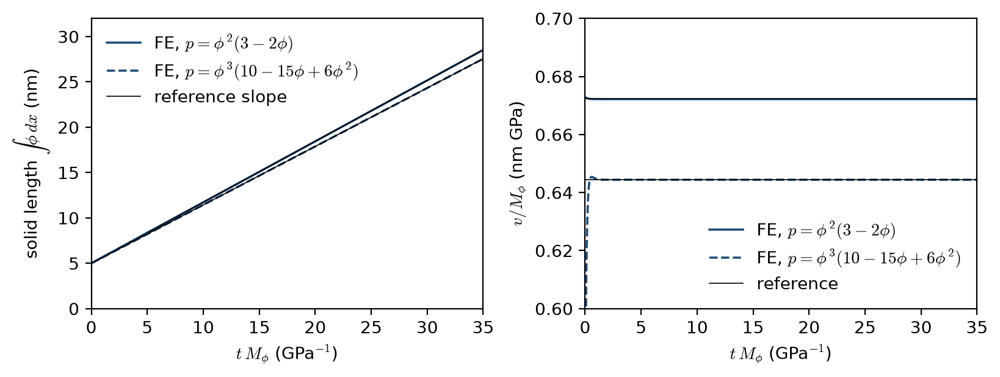
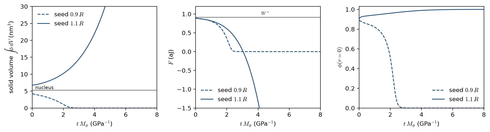
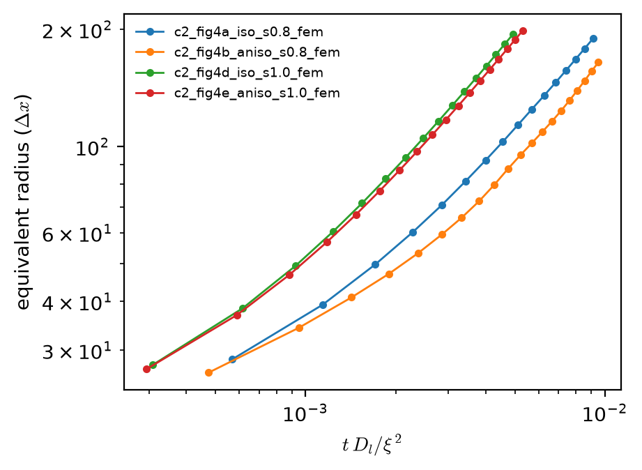
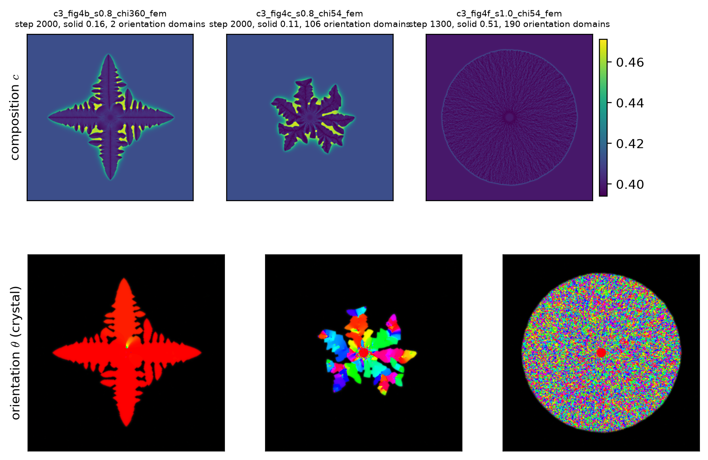
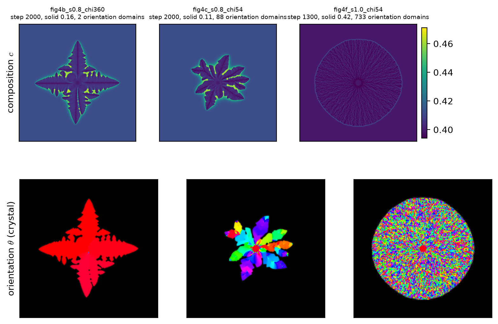

# Phase-field crystallization with PINNACLE: nucleation, growth forms and polycrystalline solidification (Part IV)

Status 2026-11-17. Complete: the single-field model (cases A1 to A5), a foreign wall (B1),
thermal noise and transformation kinetics (B2), the binary alloy model (C1, C2) and the
orientation-field model at the conditions of Fig. 4 and Fig. 5 of (granasy 2005 spherulites)
(C3). Open: parameter series for every model, the remaining orientation-field cases (C4 to
C6), the added cases E1 to E5, the eutectic, ternary, density-coupled and quaternion models,
and the phase-field crystal (D). Plan: `docs/14_phase_field_crystallization_plan.md`.
Reproduction: `docs/reproduce_crystallization.md`. Every deck named here is a complete input:
`pinnacle run <deck>`.

## Abstract

*Draft from the results available on 2026-11-17; to be revised when all cases are complete.*

We benchmark the phase-field module of the PINNACLE framework against published results on
crystal nucleation and polycrystalline growth. Five models are covered so far: a single-field
model of a pure undercooled melt, the same model with a foreign wall, with thermal noise, a
binary alloy model, and its extension by an orientation field. Each case is solved by finite
elements and, where the problem is deterministic and stationary, also by a physics-informed
network and by a network-started finite-element solve. Every result is compared with a
reference written independently of the framework and with the published figure. Finite-element
critical nuclei in nickel agree with a shooting solution to $2.2\times10^{-5}$ and with the
published barrier to 1.1 %; interface energy and front velocity agree with closed forms to
$1.4\times10^{-4}$. Nucleation barriers on a wall follow the published curves within 0.008 of
the normalized barrier. Noise-induced crystallization gives an Avrami exponent of
$3.14 \pm 0.29$ over five realizations, against the theoretical 3. The binary model reproduces
the four single-crystal growth forms, and the orientation-field model the single-crystal
dendrite, the polycrystalline dendrite and the spherulite, with crystal radii within 1.0 to
10.1 % of the independent reference. A network trained on the stationary residual reaches the
critical nucleus from initial guesses of 0.4 to 2.0 classical radii, where Newton's method
converges only from 0.85 to 1.3. Noise-driven cases have no network route. Parameters that
the sources do not state are marked as assumed.

## 1. Introduction

*To be written when all cases are complete.*

## 2. Methods

### 2.1 Framework components

A PINNACLE problem is composed in the input deck from registered kernels on named variables,
an executioner, and postprocessors. Table 1 lists what each model of this report uses. The
components marked with an ADR number were added to PINNACLE for this part (branch
`feat/pinn_benchmark`); they are registered, documented and tested in the framework.

**Table 1.** PINNACLE components by model.

| Model (section) | Variables | Kernels and boundary terms | Executioner | Added in |
|---|---|---|---|---|
| Single-field (3) | $\phi$ | `time_derivative`, `ac_interface`, `ac_bulk` with a `parsed_free_energy` material | `pf_fem_transient`, `pf_pinn_stationary`, `pf_pinn_fem_hybrid` | ADR 0037 (`ddaeb91`) |
| Wall (4) | $\phi$ | the same, plus the wetting boundary term (`flux_form = young`) or a Dirichlet value; postprocessor `wall_free_energy` | `pf_fem_saddle` | ADR 0038 (`cd2d3d3`) |
| Thermal noise (5) | $\phi$ | the same, plus `langevin_noise` (`scaling = white`, `state_factor`) | `pf_fem_transient` | ADR 0038 |
| Binary alloy (6) | $\phi$, $c$ | `wb_phase_bulk`, `ac_interface_anisotropic`, `wb_solute_flux`, `langevin_noise` | `pf_fem_explicit` | ADR 0039 (`cd2288f`) |
| Orientation field (7) | $\phi$, $c$, $\theta$ | the binary kernels, plus `orientation_grain_flux`, `orientation_phase_coupling`, `ac_interface_anisotropic orientation = theta`, initial condition `uniform_random` | `pf_fem_explicit` on the Torch (GPU) path, angular variable, sub-cycling | ADR 0040 (`8454620`, `ef9a7cd`) |

Spherical symmetry is a property of the mesh: `[Mesh] coordinate_system = spherical` puts the
volume element $4\pi r^2$ into every quadrature weight, so the weak form
$(\epsilon^2\phi', \psi')_{4\pi r^2} + (f', \psi)_{4\pi r^2} = 0$ is the radial equation of
section 3.2 with the symmetry condition at $r = 0$ natural, and the energy monitor returns the
barrier. In the strong form the interface kernel adds $(2/r)\,\phi'$; the stationary network
reads $r^2$, so $\phi'(0) = 0$ holds for any weights.

The capabilities of ADR 0037 did not exist at PINNACLE `9548123`: the curvilinear volume
element, the field time series of `pf_fem_transient`, parsed free energies on the PINN path,
the two network executioners, and sparse storage of the linear operators. The earlier
`pinn_fem_hybrid` on an Allen-Cahn deck returns a zero field and is not used.

### 2.2 Solution routes

**Table 2.** The three routes for a stationary state.

| route | executioner | how a stationary state is obtained |
|---|---|---|
| FE | `pf_fem_transient` | one backward-Euler step with $\Delta t = 10^{12}$: Newton's method on the weak stationary equation, started from the initial condition |
| PINN | `pf_pinn_stationary` | a network $\phi_\theta(\mathbf x)$ is fitted to the initial condition, then trained on the squared stationary residual |
| PINN+FEM | `pf_pinn_fem_hybrid` | the briefly trained network is the start of the FE Newton solve, whose result is reported |

Time-dependent cases use the FE route: `pf_fem_transient` (implicit) for the single-field
model and `pf_fem_explicit` (forward Euler, lumped mass, bilinear elements, periodic node
identification) for the alloy models.

Why a separate stationary network. A saddle of the free energy $F$ is unstable under the
gradient flow, so a time-dependent PINN cannot hold it. Every stationary state is a zero,
hence a minimum, of the loss $\langle(\delta F/\delta\phi)^2\rangle$. The liquid
$\phi \equiv 0$ is a zero as well; the loss is therefore divided by
$\min\bigl(1, \langle\phi^2\rangle/\langle\phi_{guess}^2\rangle\bigr)^p$ (`deflation_power`),
which leaves the nucleus a minimum and removes the liquid from the minima.

Constrained saddle search on the FE route (`pf_fem_saddle`, ADR 0038). At a fixed amount of
crystal $V = \int\omega\phi\,dV$ the nucleus is a minimum, which Newton finds; the multiplier
$\lambda$ of that constraint is the force along the unstable direction, and the amount is
moved until $\lambda = 0$; a plain Newton step then removes the constraint.

Why the noise-driven cases have no PINN route. A physics-informed network represents the
solution as a deterministic function $\phi_\theta(\mathbf x, t)$ and is trained to make the
residual of the equation vanish at collocation points. In a Langevin equation the forcing
$\zeta$ is not a function but a realization of a random field with no correlation in space
or time:

1. there is nothing smooth to fit: on a grid the forcing has variance $A^2/(w_q\Delta t)$,
   which grows without bound under refinement, and the pattern (where and when each
   nucleus appears) is set by those individual draws. A network of $(\mathbf x, t)$ has no
   input that carries them; to reproduce one realization it would have to store the
   $10^5 \times 350$ independent numbers of the run of section 5 in its weights;
2. the residual cannot be evaluated pointwise: $\zeta$ exists only as increments over cells
   and steps (the equation is meaningful in its integrated, Ito form), while a strong-form
   loss differentiates $\phi_\theta$ at points;
3. without the noise the problem has the trivial solution $\phi \equiv 0$: the metastable
   liquid never nucleates, so dropping the term removes the phenomenon.

What a network can do for such a model is a different task from solving this equation:
learn statistics of the ensemble (for example the transformed fraction as a function of the
parameters, the surrogate route of the earlier parts), or solve the deterministic pieces
around the noise (the critical nucleus of section 3, the growth of one seed). PINNACLE
refuses `langevin_noise` on the PINN path for the first two reasons. The cases of
(granasy 2005 spherulites) are all noise driven (growth-front nucleation) and are therefore
FE-only in sections 6 and 7.

### 2.3 Independent references

Every PINNACLE result is compared with a solution that shares no code with the framework:

- `scripts/cryst_reference.py`: closed forms of the single-field model; the critical nucleus
  by shooting and the travelling front by shooting on the velocity (SciPy DOP853, relative
  tolerance $10^{-11}$).
- `scripts/cryst_binary_reference.py`: the binary model by explicit finite differences on the
  grid of (granasy 2005 spherulites) (five-point Laplacian, face-centred solute flux).
- `scripts/cryst_orientation_reference.py`: the binary model with the orientation field,
  Torch finite differences. The modulus $|\nabla\theta|$ in the orientational energy is taken
  from the mean square of the four one-cell differences (`orientation_gradient = compact`).
- Digitized published curves: `data/digitized/cryst_review_fig3c_standard_pf.csv` and
  `cryst_review_fig6_barriers.csv`, both read from the figures as reprinted in
  (granasy 2019 nucleation); methods in `scripts/cryst_digitize_fig3c.py` and
  `scripts/cryst_digitize_fig6.py`.

### 2.4 Accuracy tiers and provenance

Accuracy tiers follow `PROJECT_GUIDELINES.md` section 5: tier 1 is a consistency check within
the code, tier 2 agreement with an independent numerical or closed-form solution, tier 3
agreement with a published result, tier 4 agreement with experiment. No experiment enters
this part. Every parameter carries a provenance tag: `reported_table`, `reported_text`,
`digitized`, `derived`, `calibrated`, `assumed` or `unavailable`.

### 2.5 Hardware and revisions

Sections 3 to 6: Intel Core i9-9980HK, 2 to 6 threads, float64, NumPy backend for FE and
Torch 2.13.0 (CPU) for the network routes. Section 7: host rocm-server, Radeon 8060S GPU
(Torch with ROCm), float64. PINNACLE revisions: `ddaeb91` for section 3 (cases A1, A2, A4,
A5 and the three routes at one undercooling), `cd2d3d3` for the network family and guess scan
of section 3 and for sections 4 and 5, `cd2288f` for section 6, `ef9a7cd` for section 7.

## 3. The single-field model: interface, front and critical nucleus

### 3.1 Purpose

The model answers three questions about a pure undercooled melt: what the crystal-liquid
interface costs in free energy and how wide it is, how fast a flat crystallization front
moves at a given undercooling, and how large and how costly the smallest crystal is that
grows instead of melting (the critical nucleus, whose free energy is the nucleation
barrier). The barrier sets the nucleation rate and therefore how far a melt can be
undercooled before it freezes. The diffuse-interface description goes back to
(cahn 1958 interfacial) for the interface and (cahn 1959 nucleation) for the nucleus; it
corrects the classical droplet model (turnbull 1950 nuclei) where the nucleus is only a few
interface widths across. The case computed here is nickel, for which nucleation barriers
from experiment and simulation exist (bokeloh 2011 barriers).

### 3.2 Governing equations

The local state is one non-conserved order parameter, $\phi = 0$ in the liquid and
$\phi = 1$ in the crystal. The free energy is a square-gradient functional
(cahn 1958 interfacial) in the form used for solidification (wang 1993 thermodynamically),
written here as in Eq. 12 of (granasy 2019 nucleation) for the isotropic case ($s = 1$):

$$
F[\phi] = \int \Bigl\{ \frac{\epsilon^2}{2}\,|\nabla\phi|^2 + w\,g(\phi) + p(\phi)\,\Delta f \Bigr\}\,dV ,
$$

with the double well $g$, the interpolation function $p$ ($p(0) = 0$, $p(1) = 1$) and the
driving force $\Delta f = f_s - f_l < 0$ in the undercooled liquid. The standard choice is

$$
g = \tfrac14\,\phi^2(1-\phi)^2 , \qquad p = \phi^3(10 - 15\phi + 6\phi^2) .
$$

Relaxational dynamics (allen 1979 antiphase), without noise:

$$
\dot\phi = -M_\phi\,\frac{\delta F}{\delta\phi}
         = M_\phi \bigl\{ \epsilon^2\nabla^2\phi - w\,g'(\phi) - p'(\phi)\,\Delta f \bigr\} .
$$

In PINNACLE the three terms are three kernels on one variable: `time_derivative`,
`ac_interface` (gradient coefficient $\epsilon^2$, mobility $M_\phi$) and `ac_bulk` bound to a
`parsed_free_energy` material that holds $w\,g + p\,\Delta f$ as an expression.

Planar interface at the melting point ($\Delta f = 0$). The first integral of the stationary
equation, $\tfrac12\epsilon^2\phi_x^2 = w\,g(\phi)$, gives for the quartic well

$$
\phi(x) = \frac{1}{1 + e^{x/\delta}}, \qquad \delta = \sqrt{2\epsilon^2/w}, \qquad
\gamma_{SL} = \int \epsilon^2\phi_x^2\,dx = \frac{\epsilon^2}{6\,\delta}, \qquad
d_{10\text{-}90} = 2\ln 9\;\delta .
$$

For a general well, $\gamma_{SL} = \epsilon\sqrt{2w}\int_0^1\!\sqrt g\,d\phi$ and
$d_{10\text{-}90} = (\epsilon/\sqrt{2w})\int_{0.1}^{0.9} d\phi/\sqrt g$; these two relations fix
$\epsilon^2$ and $w$ from the interface free energy and thickness for any of the functions
$g$ collected in Table 1 of (granasy 2019 nucleation).

Steady front. With $p = \phi^2(3-2\phi)$ the travelling profile is the equilibrium logistic
and the velocity is

$$
v = -6\,M_\phi\,\Delta f\,\delta \;=\; -12\,M_\phi\,\Delta f\,\sqrt{\epsilon^2/(2w)} ,
$$

the expression quoted with the equation of motion in (granasy 2019 nucleation). For the
standard $p$ there is no closed form; the reference is the travelling-wave solution
$\phi(x - vt)$ of $\epsilon^2\phi'' + (v/M_\phi)\,\phi' = w g' + p'\Delta f$ found by shooting
on $v$.

Critical nucleus. The stationary state with spherical symmetry and liquid far away solves
the Euler-Lagrange equation of $F$ (cahn 1959 nucleation),

$$
\phi'' + \frac{2}{r}\,\phi' = \frac{1}{\epsilon^2}\bigl\{ w\,g'(\phi) + p'(\phi)\,\Delta f \bigr\},
\qquad \phi'(0) = 0, \quad \phi(\infty) = 0 ,
$$

and its excess free energy is the nucleation barrier $W^* = F[\phi^*]$. It is a saddle point
of $F$. The classical droplet with a sharp interface gives $R^* = 2\gamma/|\Delta f|$ and
$W^*_{CNT} = \tfrac{16\pi}{3}\gamma^3/\Delta f^2$.

### 3.3 Parameters

**Table 3.** Parameters of the single-field model for nickel. The reported values are those
of Table 2 of (granasy 2019 nucleation), which takes them from experiment, thermodynamic
data and simulation (among them (bokeloh 2011 barriers)).

| Quantity | Value | Unit | Provenance | Source |
|---|---|---|---|---|
| interface free energy at $T_f$, $\gamma_{SL,eq}$ | 0.302 | J m$^{-2}$ | `reported_table` | (granasy 2019 nucleation), Table 2 |
| interface thickness $d_{10\text{-}90}$ | 1.0 | nm | `reported_table` | the same |
| heat of fusion $\Delta H_f$ | 17.29 | kJ mol$^{-1}$ | `reported_table` | the same |
| melting point $T_f$ | 1728.3 | K | `reported_table` | the same |
| density $\rho$ | 8357 | kg m$^{-3}$ | `reported_table` | the same |
| molar mass | 58.6934 | g mol$^{-1}$ | `reported_table` | the same |
| driving force $\Delta f$ | $\Delta H_f (T - T_f)/(T_f v_m)$ | | `reported_text` | Turnbull's linear approximation, as used in (granasy 2019 nucleation) |
| molar volume $v_m$ | $7.0233\times10^{-6}$ | m$^3$ mol$^{-1}$ | `derived` | molar mass / density |
| $\Delta H_f/v_m$ | 2.46182 | GPa | `derived` | |
| $\epsilon^2$ at $T_f$ | 0.412338 | aJ nm$^{-1}$ | `derived` | relations of section 3.2 |
| $w$ at $T_f$ | 15.92548 | GPa | `derived` | the same |
| $\delta$ | 0.227560 | nm | `derived` | the same |
| temperature scaling | $\epsilon^2 \propto T$, $w \propto T$ | | `derived` | settled by computation, see below |
| mobility $M_\phi$ | 1 | | `assumed` | sets the unit of time |

Temperature dependence. (granasy 2019 nucleation) states that $\epsilon^2 \propto T$ and
$w \propto T$ give $\gamma_{SL} \propto T$ at constant thickness, and uses
$\gamma = \gamma_{eq}T/T_f$ for the droplet-model line of its Fig. 3; it does not say which
scaling the 'standard PF' line uses. This was settled by computation (section 3.4.3): the
published line is reproduced with the proportional scaling and missed by 62 to 176 % with
constant $\epsilon^2$ and $w$. Every Ni deck uses the proportional scaling.

The decks use nm, aJ and GPa (1 aJ nm$^{-3}$ = 1 GPa) and $M_\phi = 1$, so time is in units
of $1/(M_\phi\,\mathrm{GPa})$.

### 3.4 Cases and results

The reference solutions of `scripts/cryst_reference.py` are independent of PINNACLE:
agreement with them is tier 2. Agreement with the published barrier curve is tier 3.

#### 3.4.1 A1: planar interface

Decks `decks/crystallization/single_field/a1_planar_interface_{fem,pinn,hybrid}.i`. FE: an
interface twice too wide relaxes over 200 steps of $\Delta t = 0.01$ (relaxation time
$\delta^2/(M_\phi\epsilon^2) = 0.126$).

**Figure 1.** Case A1, planar crystal-liquid interface of Ni at the melting point, FE route.
Left: initial profile (twice too wide), relaxed profile and the closed-form logistic profile.
Right: free energy per area over time against the target $\gamma_{SL} = 0.302$ J m$^{-2}$.
Reading: the profile relaxes onto the closed form and the energy onto the target (Table 4).

**Table 4.** Case A1: interface free energy, profile and width on the three routes.

| route | $\gamma_{SL}$ (J m$^{-2}$) | profile, max deviation from the logistic | 10-90 % width (nm) | note |
|---|---|---|---|---|
| target | 0.302000 | | 1.0000 | inputs of the parameter derivation |
| FE (time march) | 0.302005 | $3.2\times10^{-6}$ | 1.0000 | interface stays at $x = 0$ |
| PINN | 0.302005 (5 seeds: $+1.7\times10^{-5} \pm 1.5\times10^{-6}$) | $1.5\times10^{-4}$ | 1.0001 | interface at $x = 0.081$ nm (seed 0) |
| PINN+FEM | 0.302005 on every seed | $4.7\times10^{-6}$ | 1.0001 | interface at $x = 0.047$ nm; 4 to 19 corrector iterations |

Limit of the stationary routes on this case: the stationary equation does not fix the
position of a planar interface (translation invariance), and the two Dirichlet ends pin it
only exponentially weakly. Both stationary routes return the correct profile and energy at a
position shifted by 0.05 to 0.08 nm from the guess; the hybrid's corrector needs up to 19
iterations because its matrix is nearly singular along that shift, and the reported
prediction distance (0.07 to 2.7 %) is mostly the shift. The time march has no such freedom.

#### 3.4.2 A2: steady crystallization front

Decks `a2_front_velocity_{tanh,standard}_fem.i`, $\Delta T/T_f = 0.20$, 40 nm, $h = 0.01$ nm,
BDF2 with $\Delta t = 0.02$ to $t = 35$; velocity from a linear fit of the solid length
$\int\phi\,dx$ for $t > 5$.

**Figure 2.** Case A2, steady crystallization front in Ni at $\Delta T/T_f = 0.20$ for the two
interpolation functions. Left: solid length $\int\phi\,dx$ over time with the reference
slope. Right: front velocity over time against the reference. Reading: after a short
transient the front moves at constant velocity, within $1.4\times10^{-4}$ of the reference
(Table 5).

**Table 5.** Case A2: front velocity.

| $p$ | $v/M_\phi$ FE (nm GPa) | reference | relative error |
|---|---|---|---|
| $\phi^2(3-2\phi)$ | 0.672180 | 0.672253 (closed form) | $-1.1\times10^{-4}$ |
| $\phi^3(10-15\phi+6\phi^2)$ | 0.644397 | 0.644490 (travelling wave) | $-1.4\times10^{-4}$ |

The free energy falls at the rate $v\,\Delta f$ to ten digits in both runs, which is the
energy balance of a steady front. Tier 2.

#### 3.4.3 A3: critical nucleus in undercooled Ni

The case is Fig. 3 of (granasy 2019 nucleation): the nucleus of the standard single-field
model with the Ni data of Table 3. Decks
`decks/crystallization/single_field/a3_ni_nucleus_x<ΔT/T_f>_fem.i`, nine reduced
undercoolings from 0.10 to 0.30; radial line of 12 to 23 nm (ten equimolar radii),
$h = 0.005$ nm.

**Figure 3.** Case A3, critical nucleus in Ni. Left: radial profiles (lines: reference;
circles: PINNACLE FE). Middle: barrier against undercooling, with the 'standard PF' line
digitized from Fig. 3(c) of (granasy 2019 nucleation). Right: equimolar radius against the
classical radius. Reading: FE, reference and published line coincide; the nucleus becomes
smaller and more diffuse with undercooling.

**Table 6.** Case A3: nucleation barrier, centre value and equimolar radius.

| $\Delta T/T_f$ | $W^*/kT$ FE | reference | published (digitized) | droplet model | $\phi(0)$ | $R_e$ (Å) |
|---|---|---|---|---|---|---|
| 0.100 | 255.26 | 255.26 | outside the axis | 258.49 | 0.9989 | 22.57 |
| 0.150 | 99.23 | 99.22 | 100.4 | 102.47 | 0.9756 | 14.76 |
| 0.175 | 67.68 | 67.68 | 67.6 | 70.92 | 0.9452 | 12.67 |
| 0.200 | 47.87 | 47.86 | 48.0 | 51.06 | 0.9035 | 11.18 |
| 0.225 | 34.77 | 34.77 | 34.8 | 37.86 | 0.8551 | 10.07 |
| 0.250 | 25.80 | 25.79 | 25.8 | 28.72 | 0.8037 | 9.22 |
| 0.275 | 19.46 | 19.46 | 19.6 | 22.18 | 0.7519 | 8.54 |
| 0.300 | 14.90 | 14.90 | 15.7 (read at 0.295, the end of the line) | 17.37 | 0.7014 | 7.99 |

- FE against the reference (tier 2): $W^*$ within $2.2\times10^{-5}$ relative on all nine
  runs, $\phi(0)$ within $4\times10^{-5}$, $R_e$ within $2.2\times10^{-5}$; 3 to 5 Newton
  iterations, 0.8 to 1.1 s per run.
- Reference against the published line (tier 3): within 1.1 % between 0.15 and 0.275. The
  digitized stroke is 2.7 $kT$ thick (half thickness 1.4 $kT$, the extraction uncertainty;
  `data/digitized/cryst_review_fig3c_standard_pf.csv`, method in
  `scripts/cryst_digitize_fig3c.py`).
- The diffuse nucleus lies 1 to 14 % below the droplet model, and its centre is not bulk
  crystal at large undercooling ($\phi(0) = 0.70$ at 0.30), as in the published profiles
  (Fig. 3(b) of (granasy 2019 nucleation)).

The three routes at $\Delta T/T_f = 0.20$ (decks `a3_ni_nucleus_x0.200_{fem,pinn,hybrid}.i`;
reference $W^* = 0.913705$ aJ $= 47.865\,kT$):

**Figure 4.** Case A3 at $\Delta T/T_f = 0.20$ on the three routes. Left: the nucleus profile
of FE, PINN and PINN+FEM against the shooting reference. Right: pointwise deviation from the
reference. Reading: the three profiles coincide to about $10^{-4}$; the PINN+FEM deviation is
that of the FE solve; the barriers are in Table 7.

**Table 7.** Case A3 at $\Delta T/T_f = 0.20$: the three routes.

| route | initial guess | $W^*$ (aJ), seed 0 | relative error over 5 seeds: mean ± std, worst | wall time |
|---|---|---|---|---|
| FE | droplet fitted to the reference | 0.913726 | $+2.2\times10^{-5}$ (deterministic) | 0.8 s |
| PINN | classical droplet, $R = 2\gamma/\lvert\Delta f\rvert$ | 0.913756 | $(+6.6 \pm 5.8)\times10^{-5}$, $1.7\times10^{-4}$ | 8 to 11 s |
| PINN+FEM | classical droplet | 0.913726 | $+2.2\times10^{-5}$, the FE value on every seed | 9 to 14 s |

- The PINN+FEM result equals the FE result to all printed digits because the corrector is
  the same Newton solve; the network's field was within $1.0$ to $7.1\times10^{-4}$ (relative
  L2) of it and the corrector took 3 iterations on every seed.
- In accuracy and time the network routes do not beat the FE route on this case.

All nine undercoolings on the network routes (decks `a3_ni_nucleus_x<...>_{pinn,hybrid}.i`,
seed 0, every run started from the classical droplet $R = 2\gamma/|\Delta f|$ with full
amplitude, which needs no reference solution):

**Table 8.** Case A3: the network routes over the undercooling family.

| $\Delta T/T_f$ | 0.100 | 0.125 | 0.150 | 0.175 | 0.200 | 0.225 | 0.250 | 0.275 | 0.300 |
|---|---|---|---|---|---|---|---|---|---|
| PINN, error of $W^*$ ($10^{-5}$) | 15.1 | 1.6 | 1.5 | 7.5 | 4.9 | 23.7 | 4.3 | 8.1 | 5.9 |
| PINN+FEM, error of $W^*$ ($10^{-5}$) | 1.4 | 1.2 | 1.5 | 1.3 | 1.6 | 1.4 | 1.8 | 1.6 | 2.0 |
| PINN+FEM, corrector iterations | 3 | 4 | 3 | 3 | 3 | 3 | 3 | 3 | 3 |

All 18 runs reach the nucleus. The PINN+FEM errors are the FE mesh errors of Table 6.

Range of initial guesses (`scripts/cryst_guess_scan.py`): the three decks of the 0.20 case
were started from full-amplitude droplets of 0.4 to 2.0 classical radii.

**Table 9.** Case A3: outcome against the radius of the initial droplet.

| guess radius / classical radius | 0.40 | 0.55 | 0.70 | 0.85 | 1.00 | 1.15 | 1.30 | 1.60 | 2.00 |
|---|---|---|---|---|---|---|---|---|---|
| FE (stationary Newton) | no convergence | liquid | liquid | nucleus | nucleus | nucleus | nucleus | no convergence | no convergence |
| PINN (deflated residual) | nucleus | nucleus | nucleus | nucleus | nucleus | nucleus | nucleus | nucleus | nucleus |
| PINN+FEM | nucleus | nucleus | nucleus | nucleus | nucleus | nucleus | nucleus | nucleus | nucleus |

This is where the routes differ. Newton's method on the stationary equation reaches the
saddle only from 0.85 to 1.3 classical radii; from smaller droplets it converges to the
liquid (a stationary state as well), from larger ones it does not converge. The stationary
network reaches the nucleus from every start tested (errors $2\times10^{-5}$ to
$1.9\times10^{-4}$, 8 to 16 s), and with the FE corrector behind it the result has FE accuracy
from every start (9 to 16 s). A third answer to the same problem, on the FE route alone, is
the constrained saddle search of section 4 (`pf_fem_saddle`).

#### 3.4.4 A4: other double-well and interpolation functions

The case is Fig. 5 of (granasy 2019 nucleation). Decks
`a4_ni_nucleus_<well>_<interpolation>_x<...>_fem.i`: the Ginzburg-Landau fcc well
$g = \phi^2(1-\phi^2)^2/6$ and the interpolations $p_{bcc} = \phi^3(4-3\phi)$,
$p_{fcc} = \phi^4(3-2\phi^2)$ of Table 1 of (granasy 2019 nucleation), each with $\epsilon^2$
and $w$ matched to the same $\gamma_{SL}$ and thickness.

**Figure 5.** Case A4, nucleation barrier in Ni against undercooling for four pairs of
double-well and interpolation functions. Lines: reference. Circles: PINNACLE FE. Reading:
at equal interface energy and thickness the choice of functions changes the barrier by a
factor of up to 3.2.

**Table 10.** Case A4: $W^*/kT$ for four pairs of functions.

| $\Delta T/T_f$ | standard | $g_{fcc}$ & $p_{PF}$ | GL $g_{bcc}$ & $p_{bcc}$ | GL $g_{fcc}$ & $p_{fcc}$ |
|---|---|---|---|---|
| 0.15 | 99.2 | 85.4 | 147.3 | 175.0 |
| 0.20 | 47.9 | 37.6 | 81.3 | 102.2 |
| 0.25 | 25.8 | 17.6 | 50.3 | 67.0 |
| 0.30 | 14.9 | 8.6 | 33.2 | 47.2 |

All twelve FE runs are within $2.2\times10^{-5}$ of the reference (tier 2). The ordering and
the sensitivity are those of the published figure: the Ginzburg-Landau pairs give barriers
1.5 to 3.2 times that of the standard pair, and changing $g$ alone (first two columns)
lowers it by 14 to 43 %. The published curves were not digitized; the comparison with that
figure is qualitative (ordering and magnitude at 0.15 to 0.30).

#### 3.4.5 A5: seeds below and above the critical size

Decks `a5_seed_{sub,super}critical_fem.i`: the tanh droplet fitted to the nucleus of case A3
with its radius multiplied by 0.9 and by 1.1, marched in time with the spherical volume
element.

**Figure 6.** Case A5, a seed 10 % smaller and a seed 10 % larger than the critical nucleus
of Ni at $\Delta T/T_f = 0.20$, marched in time. Left: solid volume (horizontal line: the
nucleus). Middle: free energy (horizontal line: $W^*$). Right: centre value $\phi(r = 0)$.
Reading: the smaller seed melts, the larger one grows; the free energy only decreases.

The smaller seed melts (solid volume 4.2 nm$^3$ to zero by $t \approx 2.6$), the larger one
grows without bound; both start below the barrier ($F = 0.890$ and $0.887$ aJ against
$W^* = 0.9137$ aJ) and their free energy only decreases. This is the saddle-point character
of the nucleus shown by the dynamics, and the reason a time march cannot produce case A3.
Consistency check of A3 by an independent route in the same code (tier 1).

Animations of cases A1, A2 and A5: `figures/crystallization/a1_planar_interface.gif`,
`a2_front_velocity_standard.gif`, `a5_seed_subcritical.gif`, `a5_seed_supercritical.gif`: the
profile over time from the `fields_step*.vtk` series every run writes (`snapshots_every`).

### 3.5 What to expect when the parameters change

- Gradient coefficient and well height: $\gamma_{SL} = \epsilon^2/(6\delta) \propto \sqrt{\epsilon^2 w}$
  and $\delta = \sqrt{2\epsilon^2/w}$ (closed forms of section 3.2). Raising both by the same
  factor raises the interface energy and leaves the width; raising $\epsilon^2$ alone widens
  the interface and raises the energy.
- Undercooling: the barrier falls from 255 $kT$ at $\Delta T/T_f = 0.10$ to 14.9 $kT$ at 0.30,
  the equimolar radius from 22.6 to 8.0 Å, and the centre of the nucleus from bulk crystal
  ($\phi(0) = 0.999$) to 0.70 (Table 6). The droplet model overestimates the barrier by 1 %
  at 0.10 and 14 % at 0.30.
- Temperature scaling of $\epsilon^2$ and $w$: constant values instead of proportional ones
  change the barrier by 62 to 176 % (section 3.3).
- Double-well and interpolation functions: at equal $\gamma_{SL}$ and thickness the barrier
  changes by a factor of 0.6 to 3.2 (Table 10).
- Front velocity: proportional to $M_\phi\,\Delta f\,\delta$; the standard $p$ gives a 4 %
  slower front than $p = \phi^2(3-2\phi)$ at the same parameters (Table 5).
- Seed size: a seed 10 % below the critical radius melts, one 10 % above grows (section
  3.4.5).
- Parameter series beyond these (interface thickness, mobility, dimension): pending.

### 3.6 Cost

FE: 0.8 to 1.1 s per nucleus (3 to 5 Newton iterations). PINN: 8 to 16 s per nucleus;
PINN+FEM: 9 to 16 s. The cost of the development runs behind `pf_pinn_stationary` and
`pf_fem_saddle` (about 40 exploratory runs of 1 to 90 s) is not in the wall times of the
tables.

## 4. Heterogeneous nucleation on a foreign wall

### 4.1 Purpose

Crystals rarely form in the bulk of a liquid; they form on container walls and foreign
particles, where the barrier is lower. The model answers how much a wall of given wetting
properties lowers the nucleation barrier, how the nucleus sits on the wall, and at which
undercooling the wall makes nucleation barrierless. The phase-field treatment is that of
(granasy 2007 heterogeneous), with the wall entering as a surface free energy in the manner
of (cahn 1977 wetting); an earlier phase-field study of heterogeneous nucleation is
(castro 2003 heterogeneous).

### 4.2 Governing equations

A foreign wall adds a surface term to the free energy of section 3.2
(granasy 2007 heterogeneous),

$$
F = \int \Bigl\{ \frac{\epsilon^2}{2}|\nabla\phi|^2 + w g(\phi) + p(\phi)\Delta f \Bigr\}\,dV
  + \int_{\text{wall}} Z(\phi)\,dS , \qquad
  \epsilon^2\,\mathbf n\!\cdot\!\nabla\phi = -Z'(\phi) \ \text{on the wall}
$$

($\mathbf n$ outward). The two realizations of (granasy 2007 heterogeneous):

- Model I: the wall leaves the planar interface profile undisturbed. With the first integral
  $|\nabla\phi| = \phi(1-\phi)/\delta$ at the melting point and
  $\mathbf n\cdot\nabla\phi = |\nabla\phi|\cos\Psi$ this gives
  $\epsilon^2\,\mathbf n\cdot\nabla\phi = 6\gamma\cos\Psi\,\phi(1-\phi)$, i.e.
  $Z = -\gamma\cos\Psi\,(3\phi^2 - 2\phi^3)$ and Young's equation
  $\gamma_{WL} - \gamma_{WS} = \gamma\cos\Psi$ with sharp wall interfaces.
  The barrier is $W_I = F$ including the wall term.
- Model II: the order parameter is prescribed on the wall, $\phi = \phi_0$, which orders the
  liquid next to it; $\cos\Psi = -1 + 6\phi_0^2 - 4\phi_0^3$ ($\phi_0 = 2/3$:
  $\Psi = 61.2^\circ$). The barrier is the free energy of the nucleus on the wall minus that
  of the wall layer alone. The layer exists while $w g + p\Delta f > 0$ on $(0, \phi_0]$; at
  $\Delta f = -w\,g(\phi_0)/p(\phi_0) = -w/64$ it loses stability and the barrier vanishes.

The sharp-interface counterpart in two dimensions is the circular cap,
$W_{cap} = (\gamma^2/|\Delta f|)\,(\Psi - \sin\Psi\cos\Psi)$.

### 4.3 Parameters

The data behind the published figure are in the original paper (arXiv cond-mat/0608375,
footnote 16), not in (granasy 2019 nucleation), which reprints the figure.

**Table 11.** Parameters of the wall cases.

| Quantity | Value | Unit | Provenance | Source |
|---|---|---|---|---|
| interface free energy $\gamma_{SL}$ | 0.364 | J m$^{-2}$ | `reported_text` | (granasy 2007 heterogeneous), footnote 16 of the preprint |
| interface thickness | 2 | nm | `reported_text` | the same |
| heat of fusion $L$ | $2.666\times10^9$ | J m$^{-3}$ | `reported_text` | the same |
| melting point $T_m$ | 1728 | K | `reported_text` | the same |
| temperature scaling | $\epsilon^2$ and $w$ multiplied by $T$ | | `reported_text` | the same |
| contact angle $\Psi$ | 61.2 ($\phi_0 = 2/3$) | deg | `reported_text` | the same |
| scaled units of the decks | $\delta = 0.4551$ nm, $\epsilon^2 = 0.5$, $w = 1$, $\gamma = 1/12$ | | `derived` | $\delta = \sqrt{2\epsilon^2/w}$ |
| driving force | $D = \Delta f/w(T) = -0.27778\,\Delta T/(T_m - \Delta T)$ | | `derived` | from the values above |
| normalization of the cap | $\gamma(T_m)$ | | `derived` | neither paper states it; see section 4.4 |

Check of the parameters: $D = -1/64$ at $\Delta T = 92.0$ K, the critical undercooling of
Model II stated in (granasy 2007 heterogeneous).

### 4.4 Cases and results

Case B1 is the figure of (granasy 2007 heterogeneous) reprinted as Fig. 6 of
(granasy 2019 nucleation), from which the barrier curves were digitized. Decks
`decks/crystallization/walls/*.i` (25 decks: Model I at 10 to 90 K, Model II nucleus and
layer at 10 to 80 K).

How it is solved. Half of the symmetric nucleus, wall at $y = 0$, $h = 0.25\,\delta$ ($0.4\,\delta$
at 10 K), 14 to 38 thousand nodes. The plain stationary Newton solve of section 3 fails here:
for Model II at 40 K a circular cap of 0.97 classical radii falls onto the wall layer and one
of 1.00 runs to a grown crystal. The decks use `pf_fem_saddle` (section 2.2). Every deck
starts from the classical cap. Two findings on the constraint: with the total amount
($\omega = 1$) the Model II search converged to the saddle of a uniformly thickened wall film
(a real stationary state of the box, with 2 to 2.5 times the energy), and in a large domain
the constrained droplet evaporates into a dilute uniform field; a weight $\omega$ that is 1
around the nucleus removes both, and is the default.

**Figure 7.** Case B1, critical nuclei on the wall ($y = 0$), contour lines at
$\phi = 1/6 \ldots 5/6$ as in the published figure. Reading: Model I is a cap meeting a bare
wall; in Model II the nucleus merges into the ordered wall layer and flattens toward the
critical undercooling.

**Figure 8.** Case B1, nucleation barrier normalized by the circular-cap value against
undercooling for Models I and II: PINNACLE FE against the curves digitized from the reprint
of the figure of (granasy 2007 heterogeneous). Crosses: the FE values normalized with
$\gamma(T)$ instead of $\gamma(T_m)$. Reading: both models follow the published curves when
the cap is evaluated with $\gamma(T_m)$; the barrier of Model II falls to zero toward 92 K.

**Table 12.** Case B1: normalized barriers and the measured wall angle.

| $\Delta T$ (K) | 10 | 20 | 30 | 40 | 50 | 60 | 70 | 80 | 90 |
|---|---|---|---|---|---|---|---|---|---|
| Model I, FE, cap with $\gamma(T_m)$ | 0.991 | 0.975 | 0.960 | 0.943 | 0.924 | 0.903 | 0.880 | 0.854 | 0.827 |
| Model I, published | | | 0.967 | 0.950 | 0.930 | 0.911 | 0.885 | 0.861 | 0.833 |
| Model II, FE, cap with $\gamma(T_m)$ | 0.909 | 0.810 | 0.709 | 0.600 | 0.483 | 0.359 | 0.233 | 0.112 | |
| Model II, published | | 0.816 | 0.714 | 0.604 | 0.488 | 0.362 | 0.235 | 0.118 | |
| Model I, wall angle measured (deg) | 62.4 | 61.9 | 61.8 | 61.6 | 61.5 | 61.3 | 61.2 | 60.8 | 60.7 |

- Agreement with the published curves (tier 3): within 0.008 for Model I and 0.006 for
  Model II at every undercooling, against a digitization half-stroke of 0.004
  (`data/digitized/cryst_review_fig6_barriers.csv`, `scripts/cryst_digitize_fig6.py`). The
  FE values are systematically 0.002 to 0.008 lower.
- This agreement requires the cap to be evaluated with the melting-point interface energy.
  Neither paper states which $\gamma$ the normalization uses. With the model's own
  $\gamma(T) = \gamma\,T/T_m$ the ratio is higher by $(T_m/T)^2$ (crosses in Figure 8:
  Model I 0.92 instead of 0.83 at 90 K) and does not match the published line. Recorded as
  `derived`.
- Model I keeps the prescribed contact angle within 1.2 degrees; the angle of Model II is
  not constant (the papers say it falls toward complete wetting at the critical undercooling).
- Not obtained: Model I at 100 K (the constrained solve at the classical cap's amount does not
  converge) and Model II at 90 K, 2 K below the critical undercooling, where the nucleus and
  the bare layer nearly coincide and the search cannot separate the two zeros of $\lambda$.
- Network routes: not run. `pf_pinn_stationary` imposes Dirichlet values only; the Model I
  wall is a nonlinear flux condition, and for Model II the trivial state to be deflated is
  the non-uniform wall layer. Both are extensions of the executioner, not done here.

### 4.5 What to expect when the parameters change

- Undercooling: the normalized barrier of Model I falls slowly (0.991 at 10 K to 0.827 at
  90 K); that of Model II falls nearly linearly to zero at the critical undercooling of
  92.0 K (0.909 at 10 K, 0.112 at 80 K), where the ordered wall layer becomes unstable and
  the wall crystallizes without a barrier (Table 12).
- Wall model: a wall that orders the liquid (Model II) lowers the barrier far more than a
  wall with the same contact angle that does not (Model I).
- Contact angle: in the sharp-interface limit the barrier scales as
  $\Psi - \sin\Psi\cos\Psi$; in Model II the angle follows from the wall value through
  $\cos\Psi = -1 + 6\phi_0^2 - 4\phi_0^3$, and the critical undercooling from
  $\Delta f = -w\,g(\phi_0)/p(\phi_0)$.
- Parameter series (contact angle, wall value $\phi_0$, rough and structured walls): pending.

### 4.6 Cost

25 runs, 184 s in total on 2 threads; 3 to 8 volume iterations and 14 to 32 constrained
Newton iterations per nucleus.

## 5. Thermal noise: nucleation and transformation kinetics

### 5.1 Purpose

The deterministic model of section 3 cannot start crystallization: the undercooled liquid is
metastable and stays liquid. With thermal noise, crystal-like fluctuations appear; those
beyond the critical size grow and impinge. The model answers how the crystalline fraction
evolves in time when nuclei form at random and grow at the front velocity, which is the
content of the Kolmogorov, Johnson-Mehl and Avrami theory (kolmogorov 1937 statistical;
johnson 1939 reaction; avrami 1939 kinetics). Its exponent is what calorimetry and
microscopy measure during the crystallization of metals, glasses and polymers. Earlier
phase-field tests of this law are (jou 1997 kinetics) and (castro 2003 heterogeneous).

### 5.2 Governing equations

The equation of motion of section 3.2 with a Langevin term, as in Eq. 16 of
(granasy 2019 nucleation):

$$
\dot\phi = M_\phi\{\epsilon^2\nabla^2\phi - w g'(\phi) - p'(\phi)\Delta f\} + \zeta, \qquad
\langle\zeta(\mathbf r,t)\,\zeta(\mathbf r',t')\rangle = 2kTM_\phi\,\delta(\mathbf r-\mathbf r')\,\delta(t-t') .
$$

For constant nucleation and growth rates in $d$ dimensions the transformed fraction follows
the Johnson-Mehl-Avrami-Kolmogorov law,

$$
X(t) = 1 - \exp\{-[(t - t_0)/\tau]^p\}, \qquad p = 1 + d = 3 \ \text{in two dimensions} .
$$

Phase-field runs of this kind (jou 1997 kinetics; castro 2003 heterogeneous), as summarized
in section 3.1.1.3 of (granasy 2019 nucleation), give $p = 2.9$ to $3.0$; the
orientation-field run of (granasy 2005 spherulites) gives $3.04 \pm 0.02$.

Two properties of the noise term had to be added to PINNACLE (ADR 0038):

- strength: the draw at a quadrature point of volume $w_q$ over a step $\Delta t$ has the
  variance $A^2/(w_q\Delta t)$ with $A^2 = 2kTM_\phi = 0.0064$ (`scaling = white`), so the
  discrete noise represents the correlator above on any mesh and step;
- where it acts: in the liquid only, amplitude $\propto 1 - p(\phi)$ (`state_factor`), the
  form $\zeta = \zeta_s + (\zeta_l - \zeta_s)\,p$ of (granasy 2004 modelling) and
  (granasy 2005 spherulites) with $\zeta_s = 0$. This is required, not cosmetic: with the
  standard $p$ the free energy is unbounded below for $\phi > 1$ under a driving force, and a
  noise acting inside the crystal kicked the field past the barrier above 1 in every trial
  run ($\phi$ reached 16 before Newton failed).

### 5.3 Parameters

**Table 13.** Parameters of the noise case B2 (a generic case in scaled units, no material).

| Quantity | Value | Provenance |
|---|---|---|
| $\epsilon^2$, $w$, $M_\phi$ | 0.5, 1, 1 | `assumed` |
| driving force $\Delta f/w$ | $-0.20$ | `assumed` |
| noise strength $A^2 = 2kTM_\phi$ | 0.0064 | `assumed` |
| domain | $160 \times 160\,\delta$ on $320 \times 320$ elements (103,041 nodes), no-flux boundaries | `assumed` |
| time stepping | backward Euler, $\Delta t = 0.1$, 350 steps | `assumed` |
| noise seeds | 20261117 to 20261121 | `assumed` |

### 5.4 Cases and results

Case B2. Deck `decks/crystallization/noise/b2_jmak_2d_fem.i` and the four further
realizations `b2_jmak_2d_seed{1..4}_fem.i`.

**Figure 9.** Case B2, the phase field at successive times of the deck's realization.
Reading: crystals nucleate at random places and times, grow at a common front velocity and
impinge.

**Figure 10.** Case B2, transformation kinetics. Left: transformed fraction (area with
$\phi > 0.5$) and the fitted law. Middle: Avrami plot. Right: number of separate crystal
regions; it rises with nucleation and falls with impingement. Reading: the fraction follows
the Johnson-Mehl-Avrami-Kolmogorov law with an exponent near 3.

**Table 14.** Case B2: fit of the transformation kinetics.

| quantity | value |
|---|---|
| fit window | $0.01 < X < 0.95$, 24 snapshots |
| Avrami exponent $p$ (the deck's seed) | $2.89 \pm 0.05$ (standard error of the fit); five seeds: $3.14 \pm 0.29$ |
| $t_0$, $\tau$ | $6.85 \pm 0.13$, $8.93 \pm 0.13$ |
| rms residual of the fit | 0.003 in $X$ |
| largest number of separate crystals | 95 |
| reference values of the run | front velocity 0.821 $\delta$ per time unit (travelling wave); 2-D nucleus $W^* = 0.0251\,w\delta^2 = 7.8\,kT$ (shooting solution) |

- Five realizations (the deck and `b2_jmak_2d_seed{1..4}_fem.i`, noise seeds 20261117 to
  20261121): $p$ = 2.89, 3.09, 3.65, 3.03, 3.06; mean 3.14, standard deviation 0.29, extremes
  2.89 and 3.65; 84 to 95 crystals each. The fitted $p$ and $t_0$ are strongly correlated
  (the 3.65 run has the smallest $t_0$, 5.14); with one common $t_0 = 6.3$ for the five runs
  the exponents are 3.10, 3.04, 3.19, 3.06, 3.35: mean 3.15, standard deviation 0.13. Both
  are consistent with the theoretical $p = 3$ and with the published 2.9 to 3.0 (tier 3,
  statistical). The standard error of a single fit (0.03 to 0.08) understates the spread
  between realizations. Table: `results/crystallization/noise/b2_seed_table.csv`.
- The first two points of the Avrami plot lie above the line: before $t_0$ the area with
  $\phi > 0.5$ already counts subcritical fluctuations.
- Animation: `figures/crystallization/b2_jmak.gif` (71 frames).
- Routes: FE only (section 2.2).

### 5.5 What to expect when the parameters change

- Dimension: $p = 1 + d$ for constant nucleation and growth rates (3 in two dimensions,
  4 in three).
- Realization: the fitted exponent of one run scatters by 0.29 (0.13 with a common $t_0$)
  around the mean of five runs.
- Noise acting inside the crystal: the field leaves the physical range and the run fails
  (section 5.2).
- Parameter series (noise strength, driving force, pre-existing seeds against continuous
  nucleation): pending.

### 5.6 Cost

Wall time 30 min on 6 threads for the deck's realization (the direct sparse solve of 103,041
unknowns at every Newton iteration; 3 to 4 iterations per step, no cutback); about 60 min
each for the four further realizations run four at a time on 2 threads.

## 6. The binary alloy model: single-crystal growth forms

### 6.1 Purpose

In an alloy the growing crystal rejects solute, and the diffusion of that solute decides
the shape: a compact crystal, a fingered "seaweed" front, or a dendrite with arms along the
crystal axes. The model answers which of these forms appears at a given supersaturation and
anisotropy of the interface energy, and how the solute is distributed in and around the
crystal (microsegregation). Dendrites are the growth form of cast metals and of snow
crystals; the compact form with trapped solute appears at large driving force. The model is
the binary phase-field model of (warren 1995 microsegregation), in the form used for
nucleation and polycrystalline growth in (granasy 2002 binary) and
(granasy 2005 spherulites); the anisotropic gradient term follows
(kobayashi 1993 dendritic).

### 6.2 Governing equations

Convention of (granasy 2005 spherulites): $\phi = 1$ liquid, $\phi = 0$ crystal; $c$ is the
Cu fraction of a Cu-Ni ideal solution at 1574 K. The free-energy density is
$f = w(c)\,T g(\phi) + [1 - p(\phi)]\,f_S(c) + p(\phi)\,f_L(c)$ with
$f_{S,L} = (1-c) f^{Ni}_{S,L} + c f^{Cu}_{S,L} + \tfrac{RT}{v_m}[c\ln c + (1-c)\ln(1-c)]$, and
the interface energy $\gamma = \gamma_0\,s(\vartheta)$, $s = 1 + s_0\cos[k(\vartheta - \vartheta_0)]$,
$\vartheta = \operatorname{atan2}(\phi_y, \phi_x)$. In dimensionless form (lengths in
$\xi = 2.1\times10^{-4}$ cm, time in $\xi^2/D_l$; Eq. 2.3 and 2.4 of
(granasy 2005 spherulites)):

$$
\dot\phi = m_\phi\bigl\{\nabla\!\cdot\![\,s^2\nabla\phi + s\,s'\,\nabla^{\perp}\phi\,]
           - a_w(c)\,g'(\phi) - p'(\phi)\,b(c)\bigr\} + \zeta_\phi ,
$$

$$
\dot c = \nabla\!\cdot\!\bigl\{\lambda(\phi)\,[\,\nabla c - c(1-c)\,(q_f\,p'(\phi) + q_w\,g'(\phi))\,\nabla\phi\,]\bigr\},
\qquad \lambda = p(\phi)\ (D_s = 0) ,
$$

with $a_w = \xi^2 w/\epsilon^2$, $b = \xi^2 (f_L - f_S)/(\epsilon^2 T)$ (both linear in $c$),
$q_f = v_m(\Delta f_{Ni} - \Delta f_{Cu})/RT$ and $q_w = v_m(w_{Ni} - w_{Cu})/R$. The composition
equation needs no logarithm: with the mobility $\tfrac{v_m}{RT}D\,c(1-c)$ of the paper,
$c(1-c)\nabla\ln\tfrac{c}{1-c} = \nabla c$. At zero flux
$\ln\tfrac{c}{1-c} - q_f\,p(\phi) - q_w\,g(\phi)$ is uniform, which is the common tangent:
$c_L = 0.466219$, $c_S = 0.399112$. The supersaturation is $S = (c_L - c_\infty)/(c_L - c_S)$.

In PINNACLE: kernels `wb_phase_bulk`, `ac_interface_anisotropic`, `wb_solute_flux` under
`pf_fem_explicit` (forward Euler, lumped mass, bilinear elements, periodic in both
directions; ADR 0039).

### 6.3 Parameters

Full derivation and provenance: `docs/14_phase_field_crystallization_plan.md`, section 7.2.

**Table 15.** Parameters of the binary model (dimensionless form).

| Quantity | Value | Provenance | Source |
|---|---|---|---|
| well coefficient $a_w$ | $1.020\times10^4$ | `derived` | Table I of (granasy 2005 spherulites) and its stated rescaling |
| driving-force coefficient $b(c)$ | $1.096\times10^5\,(1-c) - 1.438\times10^5\,c$ | `derived` | the same |
| $q_f$ | 0.27384 | `derived` | the same |
| $q_w$ | $2.5\times10^{-5}$ | `derived` | the same |
| molar volume $v_m$ | 7.4 cm$^3$ mol$^{-1}$ | `derived` | the one value that returns the published $c_L$ and $c_S$ to six digits |
| liquidus, solidus $c_L$, $c_S$ | 0.466219, 0.399112 | `reported_text` | (granasy 2005 spherulites); reproduced to six digits |
| grid spacing, time step | $\Delta x = 6.25\times10^{-3}$, $\Delta t = 4.75\times10^{-6}$ | `reported_text` | (granasy 2005 spherulites) |
| grid | $500\times500$, periodic | `reported_text` | the same |
| anisotropy $s_0$, symmetry $k$ | 0 or 0.1, 4 | `reported_text` | the same |
| supersaturation $S$ | 0.8 or 1.0 | `reported_text` | the same |
| seed | disc of 12 cells at the solidus composition | `assumed` | not given |
| number of steps | 1250 to 2400 | `assumed` | not given |
| noise amplitude 0.0025 | standard deviation of the nodal increment per step, in the liquid only | `reported_text` (value), `assumed` (meaning) | (granasy 2005 spherulites) |
| composition noise | not applied | `assumed` | |

### 6.4 Cases and results

#### 6.4.1 C2: single-crystal growth forms

The case is Fig. 4 (a), (b), (d), (e) of (granasy 2005 spherulites). Two implementations of
the same equations: the independent finite-difference reference of section 2.3
(`scripts/cryst_binary_reference.py`) and PINNACLE, decks
`decks/crystallization/binary/c2_fig4{a,b,d,e}_*_fem.i`.

Check of the two against each other (single crystal, $S = 1.0$, no noise, $200\times200$ cells,
equivalent radius after 500 steps): PINNACLE 100.2 cells, reference 93.0 cells, reference at
half the spacing 97.1 cells, Richardson estimate of the converged value 98.4 cells. At the
paper's resolution (the 10-90 % interface width is 9.9 cells) the front velocity carries a
discretization error of $-5.5$ % in the finite-difference code and $+1.8$ % in PINNACLE
(tier 2 for the trend, not a converged number: PINNACLE was not run at half the spacing).

**Figure 11.** Case C2 with PINNACLE. Top: composition; bottom: crystal. Columns: conditions
of Fig. 4(a) of (granasy 2005 spherulites), isotropic $S = 0.8$; (b) four-fold $s_0 = 0.1$,
$S = 0.8$; (d) isotropic $S = 1.0$; (e) four-fold $S = 1.0$. Reading: fingered and dendritic
forms with solute-rich channels at $S = 0.8$, compact forms of nearly uniform composition at
$S = 1.0$.

**Figure 12.** Case C2 with the independent finite-difference reference, same columns as
Figure 11. Reading: the same four forms; the isotropic crystal carries a diamond-shaped grid
imprint that the finite-element result does not show.

**Figure 13.** Case C2 with PINNACLE: equivalent radius (in cells) against dimensionless
time for the four runs, logarithmic axes. Reading: the two $S = 1.0$ runs grow faster than
the two $S = 0.8$ runs; the growth exponents are given in the text.

**Table 16.** Case C2: growth forms.

| case | published form (Fig. 4 of (granasy 2005 spherulites)) | PINNACLE | steps, wall time | solute drift |
|---|---|---|---|---|
| (a) isotropic, $S = 0.8$ | "seaweed": fingered front, liquid channels | circular envelope, front broken into about 60 cells, radial solute-rich channels | 2400, 42 min | $-2.3\times10^{-12}$ |
| (b) four-fold, $S = 0.8$ | symmetric dendrite | four arms with side branches, trapped liquid pockets at $c \approx c_L$ | 2000, 38 min | $-3.1\times10^{-12}$ |
| (d) isotropic, $S = 1.0$ | compact disc (solute trapping) | compact disc, $c \approx c_\infty$ inside | 1300, 27 min | $-1.9\times10^{-12}$ |
| (e) four-fold, $S = 1.0$ | rounded square with a cross | rounded square, cross along the arms | 1250, 26 min | $-1.6\times10^{-12}$ |

- Agreement with the published figure is of form (tier 3, qualitative): which cases are
  compact and which are fingered or dendritic, the four-fold symmetry, and the composition
  pattern (channels and pockets at the liquidus composition for $S = 0.8$, nearly uniform
  composition for $S = 1.0$). No number of the published figure is available to compare.
- Difference from the published panel (a): the paper shows a few broad lobes, PINNACLE and
  the reference many narrow cells. Seed, noise amplitude and run length are assumed, and the
  scale of the instability depends on them; not resolved.
- The reference's isotropic crystal has a diamond-shaped outline, PINNACLE's is circular:
  the five-point stencil imprints the grid on an interface this thin, the bilinear elements
  do so less.
- Growth law (Figure 13): the equivalent radius grows as $t^{0.71}$ to $t^{0.80}$ in the four
  runs, between the diffusion-controlled $t^{1/2}$ and the interface-controlled $t^{1}$ that
  (granasy 2005 spherulites) describes for small and large driving force.
- Animations: `figures/crystallization/c2_pinnacle_c2_fig4*_fem.gif` (composition over time)
  and the reference's `c2_reference_fig4*.gif`.
- Routes: FE only. These runs are driven by noise (section 2.2); the alloy kernels state
  that they have no PINN form.

### 6.5 What to expect when the parameters change

- Supersaturation: at $S = 0.8$ the crystal rejects solute, the front is unstable and the
  form is fingered or dendritic with liquid channels at the liquidus composition; at
  $S = 1.0$ the solute is trapped, the crystal is compact and its composition is close to
  that of the liquid (Table 16). The front is also faster at $S = 1.0$ (Figure 13).
- Anisotropy of the interface energy: with $s_0 = 0$ the envelope is circular (seaweed at
  $S = 0.8$, disc at $S = 1.0$); with $s_0 = 0.1$ and four-fold symmetry it is a four-armed
  dendrite at $S = 0.8$ and a rounded square at $S = 1.0$.
- Resolution: at the paper's grid the front velocity carries a discretization error of
  $+1.8$ % (finite elements) and $-5.5$ % (finite differences) (section 6.4.1).
- Parameter series (intermediate supersaturations and anisotropies, symmetry $k$, interface
  thickness, noise amplitude): pending.

### 6.6 Cost

26 to 42 min per case on $500\times500$ (0.4 to 1 s per step), four runs side by side on
3 threads each (NumPy). The finite-difference reference: 2 to 8 min per case.

## 7. The orientation-field model: polycrystalline growth

### 7.1 Purpose

Most crystals found in nature and in technical materials are polycrystals. The binary model
of section 6 grows one crystal; it cannot say when a growing crystal breaks up into grains
of different orientation. The orientation field adds the local crystal orientation as a
variable, with a free energy that penalizes misorientation. New grains then form at the
growth front when the orientation cannot order as fast as the front advances (growth-front
nucleation). The model answers which form results at a given supersaturation and ratio of
orientational to translational mobility: a single-crystal dendrite, a polycrystalline
dendrite, or a spherulite, the densely branched space-filling form seen in polymers,
minerals, volcanic rocks, and (according to the 2006 review and the 2021 study cited here)
in biological materials such as amyloid deposits, mollusk shells and coral skeletons
(granasy 2006 review; granasy 2021 biomineralization). The orientation field is that of
(kobayashi 1998 vector), developed in (kobayashi 2000 continuum) and
(warren 2003 polycrystalline); its use for nucleation and growth with an orientation that
fluctuates in the liquid is from (granasy 2002 binary), and the mechanism of polycrystalline
growth by reduced orientational mobility from (granasy 2004 mechanism) and
(granasy 2005 spherulites). The three-dimensional extension is
(pusztai 2005 polycrystalline).

### 7.2 Governing equations

The binary model of section 6.2 plus the orientation field $\theta \in [0, 1)$, the crystal
angle in units of $2\pi/k$. The form implemented is model C of the appendix (A.3) of
(granasy 2004 modelling), as used in (granasy 2005 spherulites). The orientational free
energy density is

$$
f_{ori} = [1 - p(\phi)]\,\frac{HT}{2\xi_0}\,\{x\,F_0(u) + (1-x)\,F_1(u)\}, \qquad u = \xi_0|\nabla\theta| ,
$$

with $F_0 = |\sin(2\pi m u)|$ for $u < 3/(4m)$ and $F_1 = |\sin(2\pi n u)|$ for $u < 1/(4n)$,
both 1 beyond. $F_1$ has a single minimum at zero misorientation; $F_0$ adds a metastable
minimum at a fixed misorientation, which lets a crystal branch at a fixed angle. With
$x = 0$ and $n = 1/2$ (single-minimum energy), the equations added to those of section 6.2
are

$$
\dot\phi = \ldots - p'(\phi)\,[\,b(c) - h\,F(u)\,] + \zeta_\phi, \qquad
\dot\theta = \chi_l\,p(\phi)\,\nabla\!\cdot\!\Big\{[1-p(\phi)]\,\frac{\pi}{2}\cos(\pi u)\,
\frac{\nabla\theta}{|\nabla\theta|}\Big\} + \zeta_\theta ,
$$

with $F(u) = |\sin \pi u|$ for $u < 1/2$ and 1 beyond, $\xi_0 = \Delta x$,
$\chi = M_\theta\,\xi H T/D_l$ the dimensionless orientational mobility ($\chi_l$ in the
liquid, 0 in the crystal), $h = \xi^2 H/(2\xi_0\epsilon^2)$, and the interface anisotropy
taken in the frame of the local orientation, $s = 1 + s_0\cos(4\vartheta - 2\pi\theta)$. The
orientation is random in the liquid, orders in the interface and is frozen in the crystal.

In PINNACLE: `orientation_grain_flux` (the flux of the $\theta$ equation, with the mobility
as a nodal rate factor), `orientation_phase_coupling` (the term $h F$ in the $\phi$
equation), `ac_interface_anisotropic orientation = theta`; $\theta$ is an angular variable
(differences taken to the nearest equivalent value) advanced in 20 sub-steps per step
(ADR 0040).

### 7.3 Parameters

**Table 17.** Parameters of the orientation-field model, in addition to Table 15.

| Quantity | Value | Provenance | Source |
|---|---|---|---|
| orientational mobility in the liquid $\chi_l$ | 360 | `reported_text` | (granasy 2005 spherulites) |
| reduced mobility | 54 ($= 0.15 \times 360$) | `reported_text` | the same, Fig. 4 (c), (f) |
| mobility in the crystal | 0 | `reported_text` | the same |
| correlation length $\xi_0$ | $\Delta x$ | `reported_text` | the same |
| branching weight $x$, exponents $m$, $n$ | 0, -, 1/2 | `reported_text` | the same, Fig. 4 |
| sub-steps of the $\theta$ equation | 20 | `reported_text` | (granasy 2004 modelling), appendix A.2 ("about 1/20 of the time step"); (granasy 2005 spherulites) says 1/50 |
| noise amplitudes | 0.0025 ($\phi$), 0.0375 ($\theta$) | `reported_text` (values), `assumed` (taken as standard deviations of the nodal increment per step) | (granasy 2005 spherulites) |
| orientational energy scale $h$ | 1900 | `assumed` | $H$ is not printed in any of the five papers read; from $HT/2 = \gamma_{SL}$ |
| regularization of $u$ | $10^{-3}$ | `assumed` | not given |
| seed | disc of 12 cells, $\theta = 0$, random orientation around it | `assumed` | not given |
| conditions of Fig. 5: $S$ | 1.0 | `derived` | from the stated size and step count (0.15 cells per step) |
| conditions of Fig. 5: $\chi_l$ | 240 | `assumed` | from the reference runs of Table 19 |

### 7.4 Cases and results

#### 7.4.1 C1: the orientational free energy

The case is Fig. 3 of (granasy 2005 spherulites). For $k = 2$, $m = 3$, $n = 1/2$, $x = 0.2$
(`scripts/cryst_orientation_energy.py`): local maximum at 21.4 degrees of misorientation
(caption of the published figure: "about 20"), metastable minimum at 30.0 degrees with
$f_{ori} = 0.400$, value 1 at 90 degrees, as in the published figure. This is the function
only.

**Figure 14.** Case C1, orientational free energy against misorientation for $k = 2$,
$m = 3$, $n = 1/2$, $x = 0.2$. Reading: besides the minimum at zero misorientation there is
a metastable minimum at 30 degrees, which permits branching at that angle.

#### 7.4.2 C3: single-crystal dendrite, polycrystalline dendrite and spherulite

The case is Fig. 4 (b), (c), (f) of (granasy 2005 spherulites). Decks:
`decks/crystallization/orientation/c3_fig4{b_s0.8_chi360,c_s0.8_chi54,f_s1.0_chi54}_fem.i`
(`pf_fem_explicit`, Torch, GPU, 500 x 500, $\theta$ in 20 sub-steps), reference decks
`decks/crystallization/reference/c3_fig4*.i` for `scripts/cryst_orientation_reference.py`.

**Table 18.** Case C3 at the conditions of Fig. 4 of (granasy 2005 spherulites): PINNACLE
against the independent reference.

| Case | Expected (paper) | Radius, PINNACLE / reference (cells) | Mean neighbor misorientation in the crystal | Orientation domains |
|---|---|---|---|---|
| Fig. 4(b): $S = 0.8$, $\chi_l = 360$ | single-crystal dendrite | 114.6 / 113.4 (+1.0 %) | 0.000 / 0.000 | 2 / 2 |
| Fig. 4(c): $S = 0.8$, $\chi_l = 54$ | polycrystalline dendrite | 93.0 / 94.5 (-1.6 %) | 0.016 / 0.010 | 106 / 88 |
| Fig. 4(f): $S = 1.0$, $\chi_l = 54$ | spherulite of fine grains | 202.0 / 183.4 (+10.1 %) | 0.151 / 0.099 | 190 / 733 |

Radius: equivalent radius at step 2000 (1300 for Fig. 4(f)). Misorientation in units of
$2\pi/4$; 0.25 is a random field.

**Figure 15.** Case C3 with PINNACLE at the conditions of Fig. 4 (b), (c), (f) of
(granasy 2005 spherulites). Top: composition; bottom: orientation $\theta$ in the crystal
(cyclic color map, liquid black). Reading: one orientation at $\chi_l = 360$, many grains
along the arms at $\chi_l = 54$, a compact spherulite of fine grains at $S = 1.0$.

**Figure 16.** Case C3 with the independent reference, same panels as Figure 15. Reading:
the same three forms; the grain patterns differ in detail because the two codes draw
different noise.

- The three forms are reproduced by both codes: with the full orientational mobility the
  seed's orientation is taken over and the dendrite is one crystal; with the mobility
  reduced to 15 % new orientations are trapped at the front and the dendrite arms no longer
  follow one lattice; at $S = 1$ the front outruns the ordering and the crystal is a
  compact spherulite of grid-scale grains.
- Fig. 4(f) conditions: the grain structure is at the scale of the grid in both codes, so
  radius and domain count depend on the discretization (10 % in radius). The domain count is
  a threshold measure (12 orientation bins, regions above 20 cells) and not a grain size.
- Two errors were found on the way, both by comparing the codes term by term on a 96 x 96
  case. (1) PINNACLE multiplied the noise load by the row's mobility $\chi(\phi)$, so the
  orientational noise was up to 54 times too large and the crystal stayed disordered
  (misorientation 0.18 against 0.034); fixed in PINNACLE ef9a7cd with a regression test.
  (2) The reference took $|\nabla\theta|$ in $F$ from two-cell central differences, which
  do not see grid-scale disorder; it gave a 28 % larger crystal at $S = 0.8$ (radius 119
  against 93). With one-cell differences the two codes agree to 1.6 %.
- Animations: `figures/crystallization/c3_pinnacle_c3_fig4*_fem.gif`,
  `c3_reference_fig4*.gif` (orientation over time).
- One realization per case. Routes: FE only (noise driven, section 2.2).

#### 7.4.3 C3: from a faceted crystal to a spherulite, at 1000 x 1000

The case is Fig. 5 of (granasy 2005 spherulites). The paper's run is 4000 x 4000 with 13,500
steps; it states neither $S$ nor $\chi_l$. $S = 1.0$ is `derived` from the stated size and
step count (0.15 cells per step, the speed measured at $S = 1.0$: 0.14 to 0.16; at $S = 0.8$
it is 0.05). $\chi_l = 240$ is `assumed` from the reference runs of Table 19 ($h = 1900$,
$s_0 = 0.1$; `docs/14_phase_field_crystallization_plan.md`, section 8.5).

**Table 19.** Reference runs at $S = 1.0$ for the choice of $\chi_l$.

| $\chi_l$ | grid, steps | result |
|---|---|---|
| 360 | 500^2, 1300 | square single crystal (10 orientation domains, all near the seed) |
| 300 | 1000^2, 3200 | faceted crystal of about ten sectors that start at the seed |
| 240 | 1000^2, 3200 | sectors from the seed plus wedge-shaped grains that start at the growth front; envelope rounding |
| 180 | 500^2, 1300 | radially elongated grains, rounded envelope |
| 108 | 500^2, 1300 | fine-grained spherulite |

**Figure 17.** Independent reference at $S = 1.0$, $s_0 = 0.1$, 500 x 500, step 1300, for
$\chi_l = 360$, 180 and 108. Top: composition; bottom: orientation. Reading: with falling
orientational mobility the square single crystal gives way to radially elongated grains and
then to a fine-grained spherulite with a circular envelope.

**Figure 18.** Independent reference at $S = 1.0$, $s_0 = 0.1$, 1000 x 1000, step 3200, for
$\chi_l = 300$ and 240. Reading: at 300 the crystal is divided into about ten sectors that
start at the seed; at 240 further wedge-shaped grains start at the growth front.

Decks: `decks/crystallization/orientation/c3_fig5_s1.0_chi240_n1000_fem.i` and
`decks/crystallization/reference/c3_fig5_s1.0_chi240_n1000.i` (3200 steps, until the crystal
reaches the box).

**Table 20.** Case C3 at the conditions taken for Fig. 5, 1000 x 1000: PINNACLE against the
reference over time.

| Step | Radius, PINNACLE / reference (cells) | Orientation domains |
|---|---|---|
| 800 | 135.9 / 124.4 (+9.3 %) | 34 / 47 |
| 1600 | 257.4 / 233.9 (+10.1 %) | 69 / 96 |
| 2400 | 379.7 / 344.9 (+10.1 %) | 116 / 148 |
| 3200 | 497.5 / 456.6 (+9.0 %) | 180 / 209 |

**Figure 19.** Case C3 at $S = 1.0$, $\chi_l = 240$, 1000 x 1000: PINNACLE (left, step 2800)
and the independent reference (right, step 3200). Top: composition; bottom: orientation.
Reading: both give a faceted crystal divided into sectors, with wedge-shaped grains starting
at the growth front and an envelope that rounds with size.

- Both codes give the same form: a faceted crystal divided into sectors of different
  orientation, with wedge-shaped grains that start at the growth front and an envelope that
  rounds with size. The number of orientation domains grows with the radius in both.
- The radius differs by 9 to 10 % at all times: a difference of front speed, as at
  $S = 1.0$ in section 6.4.1 (FE +1.8 %, finite differences -5.5 % against the Richardson
  value) and in Table 18.
- Difference from the paper: there the crystal is one square until a critical size; here
  sectors start at the seed for $\chi_l \le 300$. It depends on the seed (12 cells, random
  orientation around it) and on the assumed $h$ and noise.
- Animations: `figures/crystallization/c3_fig5_*.gif`. One realization.

### 7.5 What to expect when the parameters change

- Orientational mobility at $S = 1.0$ (Table 19, Figures 17 and 18): 360 gives a square
  single crystal; 300 a faceted crystal of about ten sectors; 240 sectors plus grains that
  start at the growth front; 180 radially elongated grains with a rounded envelope; 108 and
  54 a fine-grained spherulite with a circular envelope. The lower the mobility, the finer
  the grains and the rounder the envelope.
- Orientational mobility at $S = 0.8$ (Table 18): 360 gives a single-crystal dendrite, 54 a
  polycrystalline dendrite (106 orientation domains at step 2000) whose arms do not follow
  one lattice.
- Supersaturation at $\chi_l = 54$ (Table 18): at 0.8 the form is still dendritic; at 1.0
  the front is about three times faster (0.15 against 0.05 cells per step), outruns the
  ordering, and the crystal is a compact spherulite.
- Size: at $\chi_l = 240$ the number of orientation domains grows with the radius (34 at
  step 800 to 180 at step 3200, Table 20).
- Parameter series (intermediate $\chi_l$ at $S = 0.8$, $s_0$, $h$, noise amplitudes,
  branching weight $x$ and angle, kinetic anisotropy, symmetry $k$) and the crystallographic
  measures that go with them (grain size, misorientation distribution, texture): pending.

### 7.6 Cost

On rocm-server (Radeon 8060S, float64): 0.24 to 0.31 s per step for PINNACLE at 500 x 500
(405 to 553 s per case), 0.04 to 0.05 s per step for the reference stencil. At 1000 x 1000:
PINNACLE 3500 s (1.09 s per step), reference 0.12 s per step. The paper's size for Fig. 5
(4000 x 4000, 13,500 steps) would take about 2.5 to 3 days on PINNACLE and 7 to 8 hours on
the reference; not run.

## 8. Limits

- Network routes cover the stationary cases A1 and A3. The time-dependent cases A2 and A5
  need `pf_pinn`, which does not yet carry the spherical term (A5), and a per-step predictor
  for the hybrid; not run. B1 needs a flux boundary condition and a non-uniform deflation
  state in `pf_pinn_stationary`; not run. B2 has no PINN route (section 2.2).
- A4 was run on the FE route only.
- B1: two end points not obtained (Model I at 100 K, Model II at 90 K). The agreement with
  the published curves rests on two inferences recorded as `derived`: the cap normalized with
  $\gamma(T_m)$, and for A3 the proportional temperature scaling of $\epsilon^2$ and $w$.
- B2: five realizations on one mesh and one step; no mesh or step study.
- C2: the seed, the run length and the meaning of the noise amplitude are assumptions; each
  case is one realization; panel (a) differs from the published one in the scale of the
  cells.
- C3: $h$ is assumed and not yet calibrated; one realization per case; 500 x 500 only for
  the Fig. 4 conditions and 1000 x 1000 for the Fig. 5 conditions. The cases C4 to C6, E1 to
  E5 and the phase-field crystal (D) are not started.
- Neural results are over 5 seeds at $\Delta T/T_f = 0.20$ and one seed elsewhere. The cost
  of the development runs behind `pf_pinn_stationary` and `pf_fem_saddle` (about 40
  exploratory runs of 1 to 90 s) is not in the wall times of the tables.
- Hardware of every number of sections 3 to 6: Intel Core i9-9980HK, 2 to 6 threads,
  float64, numpy backend for FE and torch 2.13.0 (CPU) for the network routes; no GPU on
  that machine. Section 7 ran on the rocm-server GPU.

## 9. Computational cost at larger sizes

Pending.

## 10. References

Keys of `bib/references.bib`, by model.

Single-field model (section 3): cahn-1958-interfacial; cahn-1959-nucleation;
allen-1979-antiphase; wang-1993-thermodynamically; turnbull-1950-nuclei;
bokeloh-2011-barriers; granasy-2019-nucleation.

Foreign wall (section 4): granasy-2007-heterogeneous; cahn-1977-wetting;
castro-2003-heterogeneous; granasy-2019-nucleation (reprint of the figure that was
digitized).

Thermal noise and transformation kinetics (section 5): kolmogorov-1937-statistical;
johnson-1939-reaction; avrami-1939-kinetics; jou-1997-kinetics; castro-2003-heterogeneous;
granasy-2004-modelling; granasy-2005-spherulites; granasy-2019-nucleation.

Binary alloy model (section 6): warren-1995-microsegregation; kobayashi-1993-dendritic;
granasy-2002-binary; granasy-2005-spherulites.

Orientation-field model (section 7): kobayashi-1998-vector; kobayashi-2000-continuum;
warren-2003-polycrystalline; granasy-2002-binary; granasy-2004-mechanism;
granasy-2004-modelling; granasy-2005-spherulites; pusztai-2005-polycrystalline;
granasy-2006-review; granasy-2021-biomineralization.
